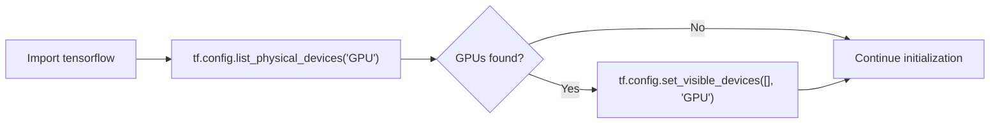
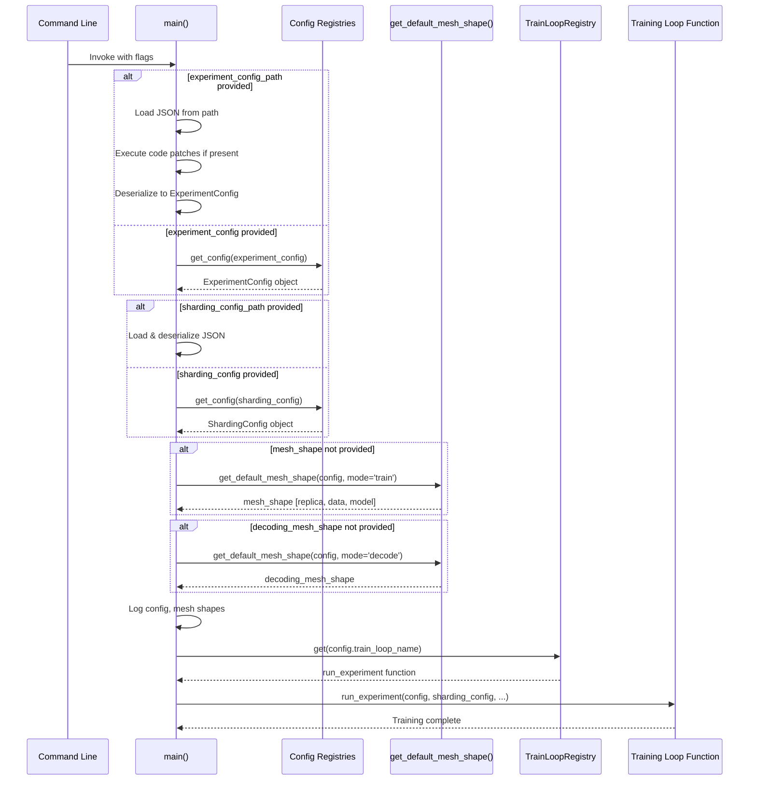
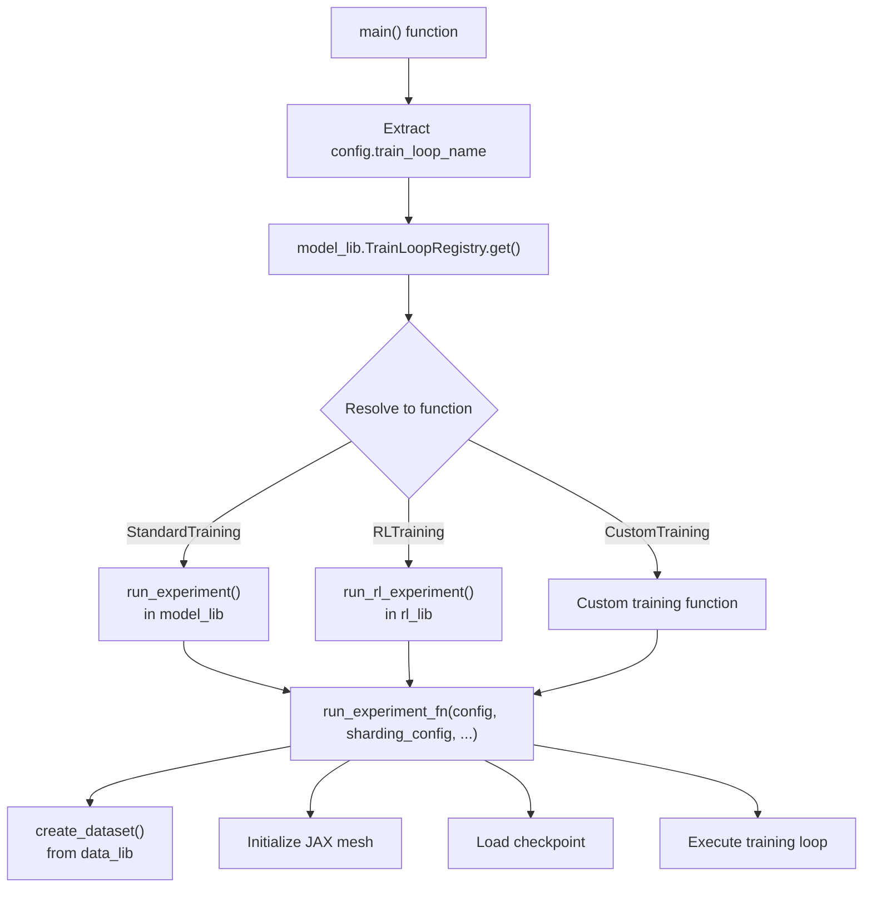
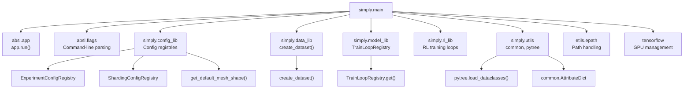

<!-- source: DeepWiki mcp.deepwiki.com · repo google-deepmind/simply · page 6.1 main.py · fetched 2026-10-26 -->

# main.py

<details>
<summary>Relevant source files</summary>

The following files were used as context for generating this wiki page:

- [README.md](README.md)
- [setup/setup_assets.py](setup/setup_assets.py)
- [simply/main.py](simply/main.py)

</details>


## Purpose and Scope

This document provides API reference documentation for `simply/main.py`, the primary entrypoint for executing training experiments in the Simply codebase. The module orchestrates experiment execution by parsing command-line arguments, loading configurations, determining device mesh layouts, and delegating to registered training loops.

For conceptual understanding of how experiments are structured, see [Understanding Configurations](#3.1). For details on available training workflows, see [Training Systems](#4.4). For practical guides on running experiments, see [Running Your First Experiment](#2.3).

Sources: [simply/main.py:1-151]()

## Overview

The `main.py` module serves as a thin orchestration layer that:

1. Parses command-line flags for experiment configuration
2. Loads `ExperimentConfig` and `ShardingConfig` objects from registries or JSON files
3. Determines device mesh shapes for distributed execution
4. Invokes the appropriate training loop function
5. Manages TensorFlow/JAX GPU visibility to prevent device conflicts

The module does not implement training logic directly; it delegates to training loop functions registered in `model_lib.TrainLoopRegistry`.

Sources: [simply/main.py:89-148]()

## TensorFlow GPU Management

The module begins by configuring TensorFlow to prevent GPU conflicts with JAX:



**TensorFlow GPU Hiding Logic**

This configuration is critical because SeqIO (the data pipeline library) uses TensorFlow internally, and both TensorFlow and JAX will attempt to allocate GPU memory if not managed. The code at [simply/main.py:16-27]() ensures TensorFlow uses only CPU resources, leaving all GPUs available for JAX computation.

Sources: [simply/main.py:16-27]()

## Command-Line Flags

The module defines seven command-line flags for experiment configuration:

| Flag | Type | Default | Purpose |
|------|------|---------|---------|
| `--experiment_config` | string | None | Name of experiment config in registry (e.g., `Gemma2BV2`) |
| `--experiment_config_path` | string | None | Path to JSON config file (mutually exclusive with `--experiment_config`) |
| `--sharding_config` | string | `GSPMDSharding` | Name of sharding config in registry |
| `--sharding_config_path` | string | None | Path to JSON sharding config file |
| `--experiment_dir` | string | `/tmp/simply_lm/` | Directory for checkpoints, logs, and outputs |
| `--mesh_shape` | list | Auto-computed | Device mesh shape as comma-separated integers (e.g., `1,265,1`) |
| `--dcn_mesh_shape` | list | None | DCN mesh shape for multi-slice topology (e.g., `2,1,1`) |
| `--decoding_mesh_shape` | list | Auto-computed | Device mesh shape for inference/decoding |

**Flag Definition Locations:**
- Experiment config flags: [simply/main.py:47-58]()
- Sharding config flags: [simply/main.py:50-65]()
- Directory flag: [simply/main.py:67-68]()
- Mesh shape flags: [simply/main.py:70-86]()

Sources: [simply/main.py:47-86]()

### Configuration Loading Patterns

The module supports two configuration loading patterns:

```mermaid
graph TB
    subgraph "Pattern 1: Registry-Based"
        ExpName["--experiment_config<br/>TransformerLMTest"] --> GetConfig["config_lib.ExperimentConfigRegistry<br/>.get_config()"]
        GetConfig --> ExpConfig["ExperimentConfig<br/>object"]
    end
    
    subgraph "Pattern 2: File-Based"
        ExpPath["--experiment_config_path<br/>config.json"] --> LoadJSON["json.load()"]
        LoadJSON --> CheckPatch{"'code_patch'<br/>present?"}
        CheckPatch -->|Yes| ExecCode["Execute code patches<br/>exec() in context"]
        CheckPatch -->|No| Deserialize["pytree.load_dataclasses()"]
        ExecCode --> Deserialize
        Deserialize --> ExpConfig2["ExperimentConfig<br/>object"]
    end
    
    subgraph "Sharding Config"
        ShardName["--sharding_config<br/>GSPMDSharding"] --> GetShardConfig["config_lib.ShardingConfigRegistry<br/>.get_config()"]
        ShardPath["--sharding_config_path<br/>sharding.json"] --> LoadShardJSON["pytree.load_dataclasses()"]
        GetShardConfig --> ShardConfig["ShardingConfig"]
        LoadShardJSON --> ShardConfig
    end
```



**Configuration Loading: Registry vs File**

Sources: [simply/main.py:91-114]()

## Main Function Execution Flow

The `main()` function at [simply/main.py:89-148]() implements the following execution sequence:



**Main Function Execution Sequence**

Sources: [simply/main.py:89-148]()

### Configuration Loading Details

**Registry-Based Loading** ([simply/main.py:105-107]()):
```python
config = config_lib.ExperimentConfigRegistry.get_config(
    _EXPERIMENT_CONFIG.value
)
```

**File-Based Loading with Code Patching** ([simply/main.py:91-103]()):
- Loads JSON configuration from path
- Executes any `code_patch` entries to dynamically modify module globals
- Deserializes JSON to dataclass using `pytree.load_dataclasses()`

**Code Patch Execution**: The code patch mechanism at [simply/main.py:97-102]() allows JSON configs to include executable Python code that modifies the runtime environment before config deserialization. This enables advanced configuration scenarios without modifying source code.

Sources: [simply/main.py:91-114]()

### Mesh Shape Determination

Device mesh shapes define how model and data parallelism are distributed across accelerators. The module computes mesh shapes automatically if not provided:

**Training Mesh** ([simply/main.py:118-122]()):
```python
mesh_shape = config_lib.get_default_mesh_shape(
    config, mode='train', dcn_mesh_shape=dcn_mesh_shape)
```

**Decoding Mesh** ([simply/main.py:124-128]()):
```python
decoding_mesh_shape = config_lib.get_default_mesh_shape(
    config, mode='decode', dcn_mesh_shape=dcn_mesh_shape)
```

The mesh shape is a 3-tuple `[replica, data, model]` defining:
- **replica**: Number of independent replicas (for SPMD)
- **data**: Data parallelism axis (batch sharding)
- **model**: Model parallelism axis (weight sharding)

The `dcn_mesh_shape` parameter supports multi-slice DCN (Data Center Network) topologies for distributed training across multiple hardware slices.

Sources: [simply/main.py:115-130]()

## Training Loop Invocation

The final step delegates execution to a training loop function retrieved from the registry:



**Training Loop Resolution and Invocation**

The invocation at [simply/main.py:139-147]() passes:
- `config`: Experiment configuration
- `sharding_config`: Device sharding strategy
- `mesh_shape`: Device layout for training
- `decoding_mesh_shape`: Device layout for inference
- `dcn_mesh_shape`: DCN topology specification
- `create_dataset`: Data pipeline factory function
- `experiment_dir`: Output directory for checkpoints and logs

Sources: [simply/main.py:139-147]()

## Parameter Passing

The training loop function receives the following parameters:

| Parameter | Type | Source | Purpose |
|-----------|------|--------|---------|
| `config` | `ExperimentConfig` | Registry or JSON file | Model architecture, training hyperparameters |
| `sharding_config` | `ShardingConfig` | Registry or JSON file | Weight and activation sharding rules |
| `mesh_shape` | `list[int]` | CLI flag or auto-computed | Device mesh for training |
| `decoding_mesh_shape` | `list[int]` | CLI flag or auto-computed | Device mesh for inference |
| `dcn_mesh_shape` | `list[int] \| None` | CLI flag | Multi-slice topology shape |
| `create_dataset` | `Callable` | `data_lib.create_dataset` | Dataset factory function |
| `experiment_dir` | `str` | CLI flag | Output directory path |

All parameters are passed as keyword arguments to the training loop function at [simply/main.py:140-147]().

Sources: [simply/main.py:140-147]()

## Dataclass Conversion

The module includes a fallback mechanism for non-dataclass configs:

```python
if not dataclasses.is_dataclass(config):
    config = common.AttributeDict(config)
```

At [simply/main.py:132-133](), this converts dictionary-based configs to `AttributeDict` objects that support attribute-style access while maintaining dictionary compatibility. This supports legacy configuration formats.

Sources: [simply/main.py:132-133]()

## Example Usage

**Basic experiment with registered config:**
```bash
python -m simply.main \
  --experiment_config TransformerLMTest \
  --experiment_dir /tmp/my_experiment \
  --alsologtostderr
```

**Experiment with custom config file:**
```bash
python -m simply.main \
  --experiment_config_path configs/my_experiment.json \
  --sharding_config GSPMDSharding \
  --experiment_dir /tmp/my_experiment
```

**Distributed experiment with explicit mesh:**
```bash
python -m simply.main \
  --experiment_config Gemma2BV2 \
  --mesh_shape 1,256,1 \
  --dcn_mesh_shape 4,1,1 \
  --experiment_dir /tmp/distributed_experiment
```

**Debugging without JIT compilation:**
```bash
export JAX_DISABLE_JIT=True
python -m simply.main \
  --experiment_config TransformerLMTestNoScan \
  --experiment_dir /tmp/debug_experiment \
  --alsologtostderr
```

These examples demonstrate the patterns documented in [README.md:14-21]().

Sources: [README.md:14-21](), [simply/main.py:47-148]()

## Module Dependencies



**Module Dependency Graph**

The module imports are located at [simply/main.py:29-44](). Note that `rl_lib` is imported but not directly used; it registers RL training loops with `TrainLoopRegistry` through module-level side effects.

Sources: [simply/main.py:18-44]()

## Entry Point

The module is executed as a Python module (not a script) using the pattern:

```bash
python -m simply.main [FLAGS...]
```

The entry point at [simply/main.py:149-150]() uses the `absl.app.run()` framework, which handles:
- Flag parsing and validation
- Help message generation (`--help`)
- Error handling and reporting
- Logging initialization

Sources: [simply/main.py:149-150]()

---

