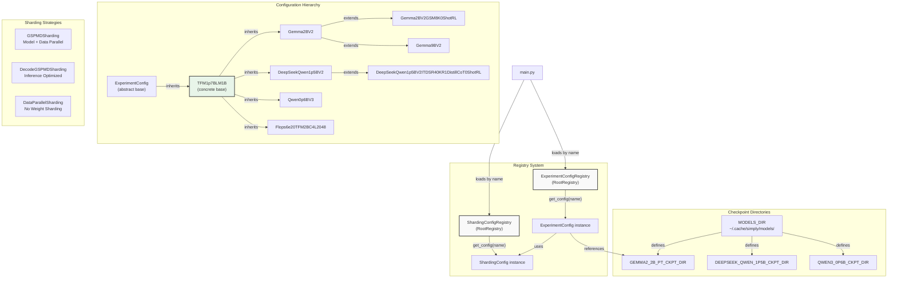
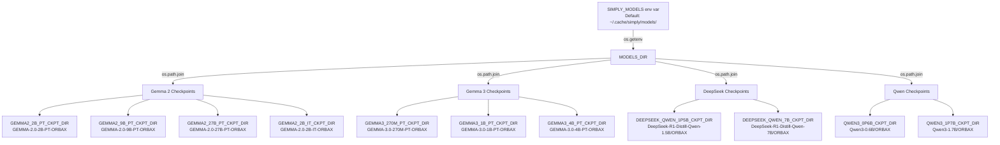
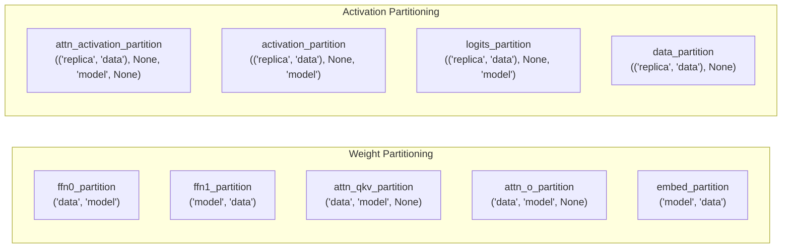
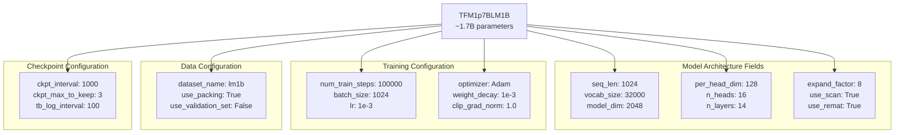
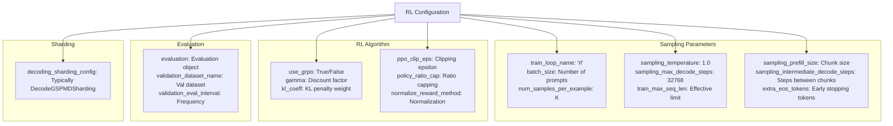
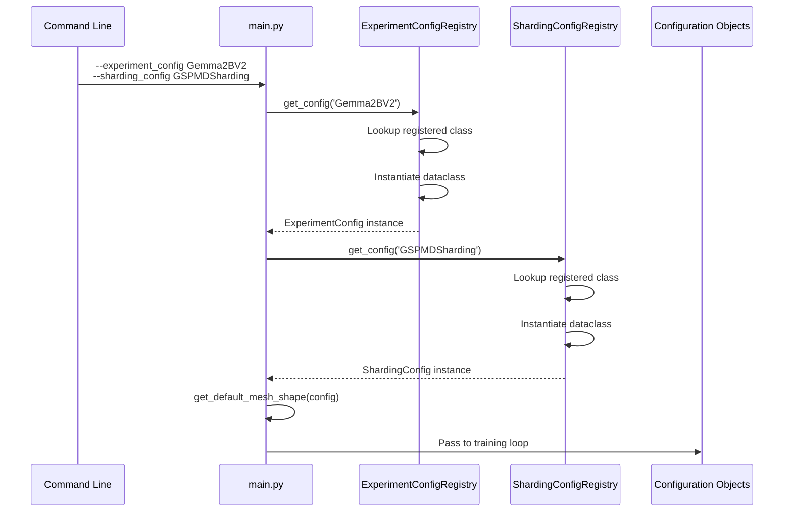

<!-- source: DeepWiki mcp.deepwiki.com · repo google-deepmind/simply · page 6.2 config_lib.py · fetched 2026-10-26 -->

# config_lib.py

<details>
<summary>Relevant source files</summary>

The following files were used as context for generating this wiki page:

- [simply/config_lib.py](simply/config_lib.py)
- [simply/config_lib_test.py](simply/config_lib_test.py)

</details>


This document provides a comprehensive API reference for the configuration system in Simply. The `config_lib.py` module defines experiment configurations, sharding strategies, and checkpoint directory management. It is the primary mechanism for defining and loading model architectures, training parameters, and distributed execution strategies.

For information about using configurations in practice, see [Understanding Configurations](#3.1). For the complete catalog of available model configurations, see [Model Configuration Catalog](#3.2). For guidance on creating custom configurations, see [Creating Custom Configurations](#3.4).

**Sources:** [simply/config_lib.py:1-1837]()

## Overview

The configuration system is built on two core registry classes that enable string-based configuration selection:

- **`ExperimentConfigRegistry`**: Manages 210+ experiment configurations defining model architectures, training hyperparameters, datasets, and optimization settings
- **`ShardingConfigRegistry`**: Manages sharding strategies that control how model parameters and activations are distributed across devices

All configurations are frozen dataclasses that inherit from base classes and override specific fields to define variants. This inheritance-based approach minimizes duplication while enabling flexible experimentation.

**Sources:** [simply/config_lib.py:76-90]()

## Architecture Diagram



**Sources:** [simply/config_lib.py:76-90](), [simply/config_lib.py:192-343]()

## Registry Classes

### ExperimentConfigRegistry

The `ExperimentConfigRegistry` class manages all experiment configurations. It inherits from `registry.RootRegistry` and provides string-based configuration lookup.

**Key Methods:**

| Method | Signature | Description |
|--------|-----------|-------------|
| `get_config` | `(name: str) -> ExperimentConfig` | Retrieves and instantiates a configuration by name |
| `get` | `(name: str) -> Type[ExperimentConfig]` | Retrieves the configuration class (inherited from RootRegistry) |
| `register` | Used as decorator | Registers a configuration class with the registry |

**Example Usage:**

```python
# Retrieve a configuration by name
config = ExperimentConfigRegistry.get_config('Gemma2BV2')

# Register a new configuration
@ExperimentConfigRegistry.register
@dataclasses.dataclass(frozen=True)
class MyConfig(TFM1p7BLM1B):
    model_dim: int = 512
```

The registry maintains a namespace `'Experiment'` to organize configuration names.

**Sources:** [simply/config_lib.py:76-82]()

### ShardingConfigRegistry

The `ShardingConfigRegistry` manages sharding strategies that control parameter and activation distribution across devices.

**Key Methods:**

| Method | Signature | Description |
|--------|-----------|-------------|
| `get_config` | `(name: str) -> ShardingConfig` | Retrieves and instantiates a sharding configuration by name |

**Available Configurations:**

- `GSPMDSharding`: Default strategy with model and data parallelism
- `DecodeGSPMDSharding`: Optimized for inference with modified activation partitioning
- `DataParallelSharding`: Pure data parallelism without weight sharding

The registry maintains a namespace `'Sharding'` to organize sharding strategy names.

**Sources:** [simply/config_lib.py:84-90]()

## Checkpoint Directory Management

The module defines checkpoint directory paths for all supported pretrained models. These paths are constructed from the `MODELS_DIR` environment variable, which defaults to `~/.cache/simply/models/`.

### Environment Variables

| Variable | Default | Description |
|----------|---------|-------------|
| `SIMPLY_MODELS` | `~/.cache/simply/models/` | Base directory for model checkpoints |

### Directory Constants



**Key Constants:**

**Gemma 2 Family:**
- `GEMMA2_2B_PT_CKPT_DIR`: Pretrained 2B parameter model
- `GEMMA2_9B_PT_CKPT_DIR`: Pretrained 9B parameter model
- `GEMMA2_27B_PT_CKPT_DIR`: Pretrained 27B parameter model
- `GEMMA2_2B_IT_CKPT_DIR`: Instruction-tuned 2B model
- `GEMMA2_9B_IT_CKPT_DIR`: Instruction-tuned 9B model
- `GEMMA2_27B_IT_CKPT_DIR`: Instruction-tuned 27B model

**Gemma 3 Family:**
- `GEMMA3_270M_PT_CKPT_DIR` through `GEMMA3_27B_IT_CKPT_DIR`: Various sizes from 270M to 27B

**DeepSeek-Qwen Family:**
- `DEEPSEEK_QWEN_1P5B_CKPT_DIR` through `DEEPSEEK_QWEN_32B_CKPT_DIR`: 1.5B, 7B, 14B, 32B variants

**Qwen Family:**
- `QWEN3_0P6B_CKPT_DIR` through `QWEN3_32B_CKPT_DIR`: 0.6B through 32B variants
- `QWEN2p5_MATH_*_CKPT_DIR`: Math-specialized Qwen 2.5 models
- `QWQ_32B_CKPT_DIR`: QwQ 32B model

**Sources:** [simply/config_lib.py:34-70]()

## Sharding Configurations

Sharding configurations control how model parameters and activations are distributed across devices. Each configuration specifies partition specifications for weights, activations, and data.

### GSPMDSharding

The default sharding strategy that implements both model and data parallelism. It shards model parameters across the model dimension and data across the data dimension.



**Partition Specifications:**

| Parameter/Activation | Shape | Partition Spec | Description |
|---------------------|-------|----------------|-------------|
| `ffn0_partition` | `(model_dim, model_dim * expansion_factor)` | `('data', 'model')` | First FFN layer sharded across data and model |
| `ffn1_partition` | `(model_dim * expansion_factor, model_dim)` | `('model', 'data')` | Second FFN layer with transposed sharding |
| `attn_qkv_partition` | `(model_dim, num_heads, per_head_size)` | `('data', 'model', None)` | QKV weights sharded on first two dims |
| `attn_o_partition` | `(model_dim, num_heads, per_head_size)` | `('data', 'model', None)` | Output projection sharded |
| `embed_partition` | `(vocab_size, model_dim)` | `('model', 'data')` | Embedding table sharded |
| `activation_partition` | `(batch_size, seq_len, model_dim)` | `(('replica', 'data'), None, 'model')` | Activations sharded on batch and model dims |
| `logits_partition` | `(batch_size, seq_len, vocab_size)` | `(('replica', 'data'), None, 'model')` | Output logits sharded |

**Sources:** [simply/config_lib.py:104-136]()

### DecodeGSPMDSharding

A variant of `GSPMDSharding` optimized for inference. It differs only in the `activation_partition` specification, which removes model-dimension sharding to reduce communication during autoregressive decoding.

**Key Difference:**

```python
# GSPMDSharding:
activation_partition = (('replica', 'data'), None, 'model')

# DecodeGSPMDSharding:
activation_partition = (('replica', 'data'), None, None)
```

This configuration is commonly used in RL training where decoding is performed during rollout generation.

**Sources:** [simply/config_lib.py:138-143]()

### DataParallelSharding

Pure data parallelism with no weight sharding. All model parameters are replicated across devices, and only data and activations are sharded.

**Key Characteristics:**

- All weight partition specs are `(None, None)` or `(None, None, None)`
- Activation partitions use `('replica', 'data', 'model')` tuple for batch dimension
- Suitable for smaller models that fit on a single device
- Simplifies communication patterns

**Sources:** [simply/config_lib.py:145-182]()

## Base Experiment Configuration

### ExperimentConfig

The abstract base class for all experiment configurations. All concrete configurations inherit from this class.

**Sources:** [simply/config_lib.py:192-195]()

### TFM1p7BLM1B

The primary base configuration from which most model configurations inherit. Defines approximately 100 parameters covering model architecture, training settings, data configuration, and checkpointing behavior.



**Key Field Categories:**

**Model Architecture (30+ fields):**
- `model_dim`, `n_heads`, `per_head_dim`, `n_layers`: Core transformer dimensions
- `expand_factor`, `ffn_expand_dim`: FFN expansion configuration
- `use_scan`, `use_remat`, `remat_policy`: Memory optimization
- `use_rmsnorm`, `use_pre_ln`, `use_post_ln`: Normalization settings
- `use_flash_attention`, `flash_attention_block_size`: Attention optimization
- `n_kv_heads`: Grouped query attention support
- `block_attn_pattern`: Attention pattern per layer (local/global)
- `attn_soft_cap`, `output_logits_soft_cap`: Softcapping parameters

**Data Configuration:**
- `batch_size`, `seq_len`: Batch and sequence dimensions
- `dataset_name`, `dataset_seed`: Dataset specification
- `use_packing`: Whether to pack multiple sequences per example
- `use_validation_set`, `validation_dataset_name`: Validation configuration
- `feature_converter_name`: Data preprocessing pipeline

**Training Configuration:**
- `train_loop_name`: Training loop implementation ('default' or 'rl')
- `optimizer`: Optimizer specification (Adam, AdamW, etc.)
- `lr`: Learning rate schedule configuration
- `weight_decay`, `clip_grad_norm`: Regularization parameters
- `grad_accum_steps`: Gradient accumulation steps
- `num_train_steps`: Total training steps

**Checkpoint Configuration:**
- `should_save_ckpt`, `ckpt_interval`, `ckpt_max_to_keep`: Checkpoint saving
- `init_ckpt_dir`, `init_ckpt_step`, `init_ckpt_format`: Loading pretrained checkpoints
- `tb_log_interval`: TensorBoard logging frequency

**Sources:** [simply/config_lib.py:197-343]()

## Model Family Configurations

### Gemma Family

The Gemma configuration family supports both Gemma 2 and Gemma 3 model variants with sizes ranging from 270M to 27B parameters.

**Gemma 2 Architecture Characteristics:**

```python
# Key architectural differences from base config
use_per_dim_scale: bool = False  # No per-dimension scaling
n_kv_heads: int = 4  # Grouped query attention
block_attn_pattern: tuple[str, ...] = ('local', 'global')  # Alternating attention
window_size: int = 4095  # Local attention window
```

**Gemma 2 Configurations:**

| Configuration | Parameters | Checkpoint | Key Features |
|--------------|-----------|-----------|--------------|
| `Gemma2BV2` | 2.6B | `GEMMA2_2B_PT_CKPT_DIR` | 2304 dim, 8 heads, 26 layers |
| `Gemma9BV2` | 9.2B | `GEMMA2_9B_PT_CKPT_DIR` | 3584 dim, 16 heads, 42 layers |
| `Gemma27BV2` | 27.2B | `GEMMA2_27B_PT_CKPT_DIR` | 4608 dim, 32 heads, 46 layers |
| `Gemma2BV2IT` | 2.6B | `GEMMA2_2B_IT_CKPT_DIR` | Instruction-tuned variant |

**Gemma 3 Architecture Characteristics:**

```python
# Key differences from Gemma 2
use_qk_norm: bool = True  # QK normalization
n_kv_heads: int = 1  # More aggressive KV compression
block_attn_pattern: tuple[str, ...] = ('local', ..., 'global')  # 6-layer pattern
window_size: int = 511  # Smaller local window
local_rope_max_timescale: int = 10_000
global_rope_max_timescale: int = 1_000_000  # Different RoPE timescales
```

**Gemma 3 Configurations:**

| Configuration | Parameters | Dimensions | Layers |
|--------------|-----------|-----------|---------|
| `Gemma270MV3` | 270M | 640 dim | 18 |
| `Gemma1BV3` | 1B | 1152 dim | 26 |
| `Gemma4BV3` | 4B | 2560 dim | 34 |
| `Gemma12BV3` | 12B | 3840 dim | 48 |
| `Gemma27BV3` | 27B | 5376 dim | 62 |

**Sources:** [simply/config_lib.py:577-777]()

### DeepSeek-Qwen Family

The DeepSeek-Qwen family provides models optimized for reasoning tasks, particularly mathematics.

**Architecture Characteristics:**

```python
# Key differences from base config
ffn_activation: str = 'silu'  # SiLU instead of GELU
use_post_ln: bool = False  # Pre-LN only
use_tied_embedding: bool = False  # Separate input/output embeddings
use_combined_qkv: bool = False  # Separate Q, K, V projections
qkv_use_bias: bool = True  # Bias in QKV projections
```

**Model Configurations:**

| Configuration | Parameters | Model Dim | FFN Dim | KV Heads | Checkpoint |
|--------------|-----------|-----------|----------|----------|------------|
| `DeepSeekQwen1p5BV2` | 1.5B | 1536 | 8960 | 2 | `DEEPSEEK_QWEN_1P5B_CKPT_DIR` |
| `DeepSeekQwen7BV2` | 7B | 3584 | 18944 | 4 | `DEEPSEEK_QWEN_7B_CKPT_DIR` |
| `DeepSeekQwen14BV2` | 14B | 5120 | 13824 | 8 | `DEEPSEEK_QWEN_14B_CKPT_DIR` |
| `DeepSeekQwen32BV2` | 32B | 5120 | 27648 | 8 | `DEEPSEEK_QWEN_32B_CKPT_DIR` |

**RL Configurations:**

The family includes extensive RL configurations for mathematical reasoning:

- `DeepSeekQwen1p5BV2ITDSR40KR1DistillCoT0ShotRL`: Base RL configuration for DSR40K dataset
- Variants with `F32`, `BF16`: Different precision configurations
- Variants with `V2`, `V3`, `V4`: Hyperparameter search variants

**Sources:** [simply/config_lib.py:1094-1542]()

### Qwen 3 Family

The Qwen 3 family provides clean, modern transformer architectures.

**Architecture Characteristics:**

```python
# Key features
use_qk_norm: bool = True  # QK normalization
use_tied_embedding: bool = True  # Tied embeddings (except larger models)
qkv_use_bias: bool = False  # No bias in QKV
global_rope_max_timescale: int = 1_000_000  # Extended context
```

**Model Configurations:**

| Configuration | Parameters | Model Dim | FFN Dim | Heads | Layers |
|--------------|-----------|-----------|----------|-------|--------|
| `Qwen0p6BV3` | 0.6B | 1024 | 3072 | 16 | 28 |
| `Qwen1p7BV3` | 1.7B | 2048 | 6144 | 16 | 28 |
| `Qwen4BV3` | 4B | 2560 | 9728 | 32 | 36 |
| `Qwen8BV3` | 8B | 4096 | 12288 | 32 | 36 |
| `Qwen14BV3` | 14B | 5120 | 17408 | 40 | 40 |
| `Qwen32BV3` | 32B | 5120 | 25600 | 64 | 64 |

**Sources:** [simply/config_lib.py:1549-1641]()

### C4 Scaling Law Experiments

The module includes configurations for C4 scaling law experiments at different compute budgets.

**Configurations:**

| Configuration | FLOPs | Parameters | Tokens | Batch Size | Steps |
|--------------|-------|-----------|---------|-----------|-------|
| `Flops6e20TFM2BC4L2048` | 6.2e20 | 2.3B | 44.8B | 1024 | 21,297 |
| `Flops1e20TFM986MC4L2048` | 1.1e20 | 986M | 18.4B | 256 | 35,106 |
| `Flops1e19TFM338MC4L2048` | 1.2e19 | 338M | 6.1B | 192 | 15,466 |
| `Flops1e18TFM111MC4L2048` | 1.3e18 | 111M | 1.9B | 128 | 7,252 |
| `Flops2e17TFM41MC4L2048` | 1.7e17 | 41M | 678M | 80 | 4,140 |
| `Flops2e16TFM15MC4L2048` | 2.0e16 | 15M | 225M | 64 | 1,717 |

These configurations are designed to follow optimal data-to-parameter ratios based on compute budget.

**Sources:** [simply/config_lib.py:349-571]()

## Configuration Utilities

### apply_config_diff

Creates a new configuration by applying the difference between two base configurations to a target configuration. This utility enables systematic configuration variants.

```python
def apply_config_diff(config, diff_base, diff_new):
    """Applies field differences between diff_base and diff_new to config.
    
    Args:
        config: Configuration to update
        diff_base: Base configuration for comparison
        diff_new: New configuration with desired changes
        
    Returns:
        Updated configuration with changes applied
    """
```

**Example Usage:**

```python
# Create a 7B RL config from 1.5B RL config by applying 7B architecture diff
config = apply_config_diff(
    config=DeepSeekQwen1p5BV2ITDSR40KR1DistillCoT0ShotRL(),
    diff_base=DeepSeekQwen1p5BV2(),  # 1.5B architecture
    diff_new=DeepSeekQwen7BV2()      # 7B architecture
)
```

This pattern is used extensively to create configuration families where architecture changes are applied to task-specific configurations.

**Sources:** [simply/config_lib.py:1373-1382]()

### get_default_mesh_shape

Computes the default device mesh shape for a given configuration and execution mode. This function implements the logic for determining optimal replica, data, and model parallelism dimensions.

```python
def get_default_mesh_shape(
    config: BaseExperimentConfig,
    mode: str = 'train',
    dcn_mesh_shape=None
) -> list[int]:
    """Returns default mesh shape [replica, data, model].
    
    Args:
        config: Experiment configuration
        mode: 'train' or 'decode'
        dcn_mesh_shape: Optional DCN topology specification
        
    Returns:
        List of [replica_parallel, data_parallel, model_parallel] dimensions
    """
```

**Train Mode Algorithm:**

1. Compute `data_parallel = gcd(model_dim, device_count)`
2. Compute `replica_parallel = device_count / data_parallel`
3. Validate that batch size is divisible by `data_parallel * replica_parallel`
4. Account for gradient accumulation if specified
5. Return `[replica_parallel, data_parallel, 1]`

**Decode Mode Algorithm:**

1. Compute `model_parallel = gcd(model_dim, n_kv_heads, n_heads, device_count)`
2. Compute `replica_parallel = device_count / model_parallel`
3. Validate that decode batch size is divisible by `replica_parallel`
4. Return `[replica_parallel, 1, model_parallel]`

**Example Results:**

```python
# 2B model on 8 devices
config = Gemma2BV2()
mesh_shape = get_default_mesh_shape(config, mode='train')
# Result: [1, 8, 1] - pure data parallelism

# 27B model on 64 devices for decoding
config = Gemma27BV2()
mesh_shape = get_default_mesh_shape(config, mode='decode')
# Result: [2, 1, 32] - heavy model parallelism
```

**Sources:** [simply/config_lib.py:1787-1836]()

## RL-Specific Configurations

Reinforcement learning configurations extend base model configurations with additional fields for sampling, reward computation, and policy optimization.

**Key RL-Specific Fields:**



**RL Field Summary:**

| Field | Type | Description |
|-------|------|-------------|
| `train_batch_size` | `int` | Total samples = `batch_size * num_samples_per_example` |
| `batch_size` | `int` | Number of unique prompts per batch |
| `num_samples_per_example` | `int` | Samples to generate per prompt (K in top-K) |
| `sampling_temperature` | `float` | Sampling temperature |
| `train_max_seq_len` | `int` | Maximum sequence length including prompt and generation |
| `sampling_prefill_size` | `int` | Tokens to process in initial prefill |
| `sampling_intermediate_decode_steps` | `int` | Tokens to generate between policy evaluations |
| `gamma` | `float` | Discount factor for returns |
| `kl_coeff` | `float` | KL divergence penalty coefficient |
| `use_grpo` | `bool` | Use Group Relative Policy Optimization |
| `ppo_clip_eps` | `float` | PPO clipping epsilon |
| `normalize_reward_method` | `str` | 'Global', 'ByGroup', or 'None' |
| `evaluation` | `Evaluation` | Reward computation strategy |
| `decoding_sharding_config` | `ShardingConfig` | Sharding strategy for rollout generation |

**Sources:** [simply/config_lib.py:839-911](), [simply/config_lib.py:1133-1206]()

## Test Configurations

Several minimal configurations are provided for testing:

### TransformerLMTest

A minimal 8-dimensional model for unit testing.

```python
@ExperimentConfigRegistry.register
@dataclasses.dataclass(frozen=True)
class TransformerLMTest(TFM1p7BLM1B):
    model_dim: int = 8
    per_head_dim: int = 4
    n_heads: int = 2
    n_layers: int = 2
    num_train_steps: int = 50
    batch_size: int = 4
    seq_len: int = 64
```

**Variants:**

- `TransformerLMTestC4`: Uses C4 dataset with 4096 sequence length
- `TransformerLMTestNoScan`: Disables scan and remat for debugging
- `TransformerLMTestSFT`: Supervised fine-tuning test configuration
- `TransformerLMTestRL`: RL training test configuration

**Sources:** [simply/config_lib.py:1647-1785]()

## Configuration Loading Pattern

The typical pattern for loading and using configurations:



**Alternative: JSON Configuration Loading**

```python
# Load from JSON file
with open('config.json', 'r') as f:
    config_dict = json.load(f)
config = pytree.load_dataclasses(config_dict)
```

**Sources:** [simply/config_lib.py:76-90](), [simply/config_lib_test.py:25-38]()

## Registration Patterns

### Dataclass Registration

Most configurations use the dataclass registration pattern:

```python
@ExperimentConfigRegistry.register
@dataclasses.dataclass(frozen=True)
class MyConfig(TFM1p7BLM1B):
    model_dim: int = 512
    n_layers: int = 8
```

### Function Registration

Complex configurations that require programmatic construction use function registration:

```python
@ExperimentConfigRegistry.register
def Gemma12BV3_IT_DSR40K_B2K_L10K_RL():
    # Start with base RL config
    config = DeepSeekQwen1p5BV2ITDSR40KR1DistillCoT0ShotRL()
    base_config = DeepSeekQwen1p5BV2()
    new_base_config = Gemma12BV3()
    
    # Apply architecture diff
    config = apply_config_diff(config, base_config, new_base_config)
    
    # Override specific fields
    config = dataclasses.replace(
        config,
        train_batch_size=2048,
        use_flash_attention=True,
        vocab_name='gemini3_v6',
    )
    return config
```

### Named Registration

Configurations can be registered with custom names for convenience:

```python
ExperimentConfigRegistry.register(
    DeepSeekQwen7BV2ITDSR40KR1DistillCoT0ShotRL,
    name='dsqwen_v2-7b-dsr40k-R1_distill_cot0shot-rl'
)
```

**Sources:** [simply/config_lib.py:780-835](), [simply/config_lib.py:1393-1395]()

## Best Practices

### Configuration Inheritance

1. **Always inherit from TFM1p7BLM1B or another established base**: This ensures all required fields are present
2. **Use frozen=True for dataclasses**: Prevents accidental mutation
3. **Override only necessary fields**: Minimize duplication
4. **Document parameter counts and architectural details**: Include comments with model statistics

### Configuration Organization

1. **Group related configurations together**: Keep model families adjacent in the file
2. **Use consistent naming conventions**: `ModelFamilySizeVariantTask` pattern
3. **Register configurations immediately after definition**: Maintain clear mapping between definition and registration

### Configuration Testing

The test suite verifies that configurations are serializable and deserializable:

```python
def test_dump_load_baseline_config(self):
    config = config_lib.ExperimentConfigRegistry.get_config('TransformerLMTest')
    sharding_config = config_lib.ShardingConfigRegistry.get_config('GSPMDSharding')
    model = model_lib.TransformerLM(config, sharding_config)
    py = pytree.dump_dataclasses(model)
    loaded_model = pytree.load_dataclasses(py)
    assert py == pytree.dump_dataclasses(loaded_model)
```

This ensures configurations can be saved to and loaded from JSON for experiment tracking.

**Sources:** [simply/config_lib_test.py:25-38]()

---

