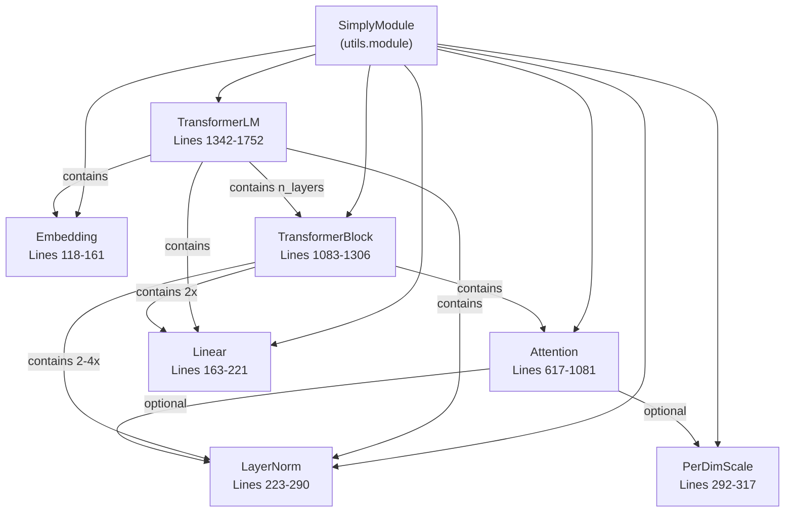
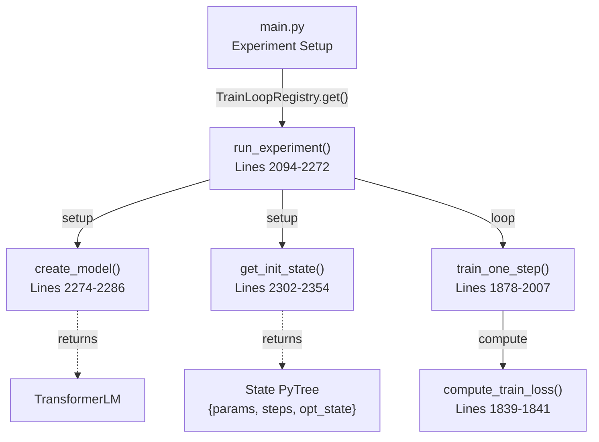
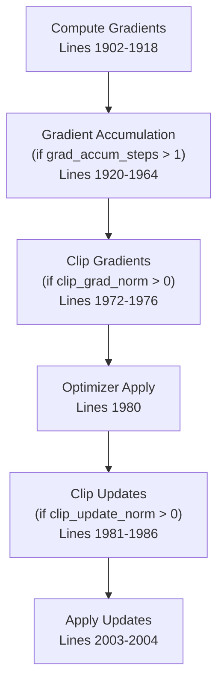
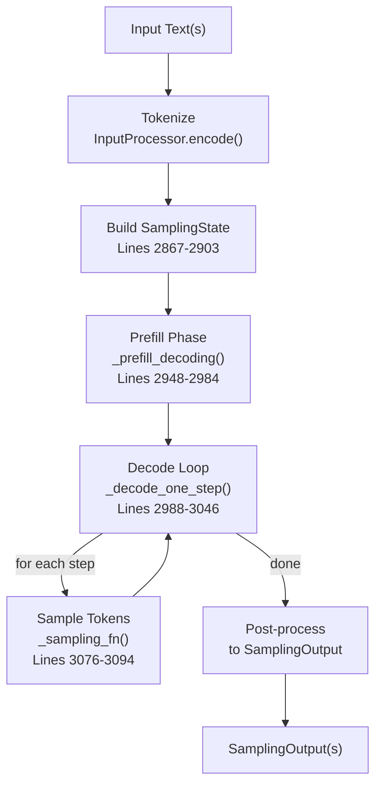

<!-- source: DeepWiki mcp.deepwiki.com · repo google-deepmind/simply · page 6.3 model_lib.py · fetched 2026-10-26 -->

# model_lib.py

<details>
<summary>Relevant source files</summary>

The following files were used as context for generating this wiki page:

- [simply/model_lib.py](simply/model_lib.py)
- [simply/model_lib_test.py](simply/model_lib_test.py)

</details>


This document provides an API reference for `model_lib.py`, the core modeling module that implements transformer architectures, training loops, and inference interfaces.

For experiment orchestration using these components, see [main.py](#6.1). For model configuration definitions, see [config_lib.py](#6.2). For data preparation, see [data_lib.py](#6.4). For reinforcement learning training, see [rl_lib.py](#6.5).

## Overview

`model_lib.py` implements three major subsystems:

1. **Architecture Components**: Neural network modules (`TransformerLM`, `Attention`, `TransformerBlock`, `Linear`, `Embedding`, `LayerNorm`)
2. **Training Infrastructure**: Loss computation, gradient descent, checkpointing, and the standard training loop
3. **Inference System**: `LMInterface` for text generation and scoring with KV-caching support

The module is built on JAX and follows a functional programming pattern where model parameters are explicitly passed to `apply()` methods.

**Sources**: [simply/model_lib.py:1-50]()

## Architecture

### Core Model Class Hierarchy



All model components inherit from `SimplyModule` and follow a two-method pattern:
- `init(prng_key)`: Initialize parameters
- `apply(params, x)`: Forward pass computation

**Sources**: [simply/model_lib.py:118-1306](), [simply/model_lib.py:1342-1752]()

### TransformerLM

`TransformerLM` is the primary decoder-only transformer model class.

| Configuration Field | Type | Description |
|-------------------|------|-------------|
| `config` | `SimplyConfig` | Model hyperparameters (dim, layers, heads, vocab size) |
| `sharding_config` | `SimplyConfig` | Device mesh partitioning strategy |

**Key Methods**:

```python
def init(prng_key: PRNGKey) -> PyTree
```
Initializes all model parameters including embeddings, transformer blocks, final layer norm, and output projection.

```python
def apply(
    params: PyTree,
    x: Array,  # [batch, seq_len] token IDs
    segment_ids: Array | None = None,
    segment_positions: Array | None = None,
    extra_inputs: Mapping[str, PyTree] | None = None,
    decode_state: PyTree = None,
) -> tuple[Array, PyTree]
```
Computes logits for next token prediction. Returns `(logits, extra_output)` where `extra_output` contains decode state for KV-caching.

**Architecture Details**:
- Token embeddings via `Embedding` [simply/model_lib.py:1356-1362]()
- N stacked `TransformerBlock` layers [simply/model_lib.py:1410-1415]()
- Optional scan-based loop for memory efficiency [simply/model_lib.py:1590-1709]()
- Final RMSNorm/LayerNorm [simply/model_lib.py:1417-1423]()
- Output projection to vocabulary (optionally tied with embedding) [simply/model_lib.py:1424-1434]()

**Sources**: [simply/model_lib.py:1342-1752]()

### TransformerBlock

A single transformer layer implementing pre/post-normalization variants with attention and feed-forward sublayers.

| Configuration Field | Default | Description |
|-------------------|---------|-------------|
| `use_rmsnorm` | `False` | Use RMSNorm instead of LayerNorm |
| `use_pre_ln` | `True` | Apply normalization before sublayers |
| `use_post_ln` | `False` | Apply normalization after sublayers |
| `use_gated_activation_in_ffn` | `False` | Use gated linear units (GLU) |
| `use_flash_attention` | `False` | Enable TPU flash attention |
| `window_size` | `0` | Sliding window size (0 = full attention) |
| `n_kv_heads` | `0` | Number of KV heads for grouped-query attention (0 = same as n_heads) |

**Forward Pass**:
1. Pre-normalization (optional) [simply/model_lib.py:1264-1265]()
2. Multi-head attention [simply/model_lib.py:1266-1270]()
3. Post-normalization (optional) [simply/model_lib.py:1271-1272]()
4. Residual connection [simply/model_lib.py:1273]()
5. Pre-normalization for FFN (optional) [simply/model_lib.py:1280-1281]()
6. Feed-forward network (2-layer MLP) [simply/model_lib.py:1282-1294]()
7. Post-normalization (optional) [simply/model_lib.py:1295-1296]()
8. Residual connection [simply/model_lib.py:1297]()

**Sources**: [simply/model_lib.py:1083-1306]()

### Attention

Multi-head self-attention with support for grouped-query attention, RoPE embeddings, flash attention, and sliding windows.

**Key Features**:

| Feature | Configuration | Description |
|---------|--------------|-------------|
| Grouped-Query Attention | `n_kv_heads < n_heads` | Reduce KV cache size [simply/model_lib.py:660-666]() |
| RoPE | `rope_max_timescale`, `rope_scale_factor` | Rotary positional embeddings [simply/model_lib.py:876-887]() |
| Flash Attention | `use_flash_attention=True` | TPU-optimized attention kernel [simply/model_lib.py:932-1017]() |
| Sliding Window | `window_size > 0` | Local attention pattern [simply/model_lib.py:643]() |
| QK Normalization | `qk_norm` | Normalize queries and keys [simply/model_lib.py:872-874]() |
| Soft Capping | `attn_soft_cap` | Bound attention logits [simply/model_lib.py:599-600]() |

**Computation Flow**:

```mermaid
graph LR
    Input["x<br/>[batch, seq, dim]"]
    QKV["QKV Projection<br/>Lines 806-866"]
    RoPE["RoPE<br/>Lines 876-887"]
    Scale["Query Scaling<br/>Lines 889-894"]
    Cache["KV Cache Update<br/>Lines 915-924"]
    AttnCompute["Attention Computation<br/>Lines 932-1059"]
    Output_Proj["Output Projection<br/>Lines 1068-1075"]
    Output["output<br/>[batch, seq, dim]"]
    
    Input --> QKV
    QKV --> RoPE
    RoPE --> Scale
    Scale --> Cache
    Cache --> AttnCompute
    AttnCompute --> Output_Proj
    Output_Proj --> Output
```


**Sources**: [simply/model_lib.py:617-1081]()

### Positional Embeddings

```python
def rotary_positional_embedding(
    embedding_mat,
    segment_positions=None,
    min_timescale=1,
    max_timescale=10_000,
    scale_factor=1.0,
)
```

Implements Rotary Position Embeddings (RoPE) by rotating query and key representations in the complex plane. The rotation angle is determined by position and frequency.

**Algorithm**:
1. Compute frequency bands: `timescale = min * (max/min)^(2i/d)` [simply/model_lib.py:340]()
2. Calculate angles: `angle = position / timescale / scale_factor` [simply/model_lib.py:350]()
3. Apply rotation to first and second half of embeddings [simply/model_lib.py:356-359]()

**Sources**: [simply/model_lib.py:330-363]()

### KV Cache Management

```python
def updated_decode_state(
    k: Array,
    v: Array,
    segment_positions: Array,
    segment_ids: Array,
    decode_state: PyTree,
    window_size: int = 0,
) -> tuple[Array, Array, Array, Array, PyTree]
```

Manages key-value cache for efficient autoregressive decoding. Supports:
- **Incremental Updates**: Insert new KV pairs at current position [simply/model_lib.py:415-416]()
- **Sliding Windows**: Maintain circular buffer of size `window_size + 1` [simply/model_lib.py:412-447]()
- **Prefill Handling**: Initialize cache from full sequence [simply/model_lib.py:429-460]()

Cache structure:
```python
decode_state = {
    'k': Array,  # [batch, cache_len, n_kv_heads, per_head_dim]
    'v': Array,  # [batch, cache_len, n_kv_heads, per_head_dim]
    'segment_positions': Array,  # [batch, cache_len]
    'segment_ids': Array,  # [batch, cache_len]
    'window_size=N': None,  # metadata marker
}
```

**Sources**: [simply/model_lib.py:365-461]()

### Attention Mask Creation

```python
def create_mask(
    segment_positions: Array,
    kv_segment_positions: Array,
    segment_ids: Array,
    kv_segment_ids: Array,
    window_size: int = 0,
) -> Array
```

Creates boolean attention masks combining:
1. **Causal masking**: Query position ≥ key position [simply/model_lib.py:488-491]()
2. **Sliding window**: Query position - key position ≤ window_size [simply/model_lib.py:494-496]()
3. **Segment masking**: Query and key in same segment [simply/model_lib.py:499-503]()

Returns `[batch, seq_len, seq_len]` boolean mask where `True` = attendable.

**Sources**: [simply/model_lib.py:463-510]()

## Training Infrastructure

### Training Loop Architecture



**Sources**: [simply/model_lib.py:2089-2272](), [simply/model_lib.py:2274-2286](), [simply/model_lib.py:2302-2354]()

### Loss Computation

```python
def compute_loss(model, params, batch) -> tuple[float, dict]
```

Computes cross-entropy loss with the following steps:

1. **Forward Pass**: Get logits from model [simply/model_lib.py:1785-1787]()
2. **Log-Softmax**: Compute log probabilities (always in float32) [simply/model_lib.py:1789]()
3. **Target Masking**: Apply `decoder_loss_weights` [simply/model_lib.py:1791-1793]()
4. **Loss Reduction**: Normalize by total weight [simply/model_lib.py:1794-1796]()
5. **Metrics**: Compute accuracy [simply/model_lib.py:1799-1802]()

**Batch Structure**:
```python
batch = {
    'decoder_input_tokens': Array,     # [batch, seq_len]
    'decoder_target_tokens': Array,    # [batch, seq_len]
    'decoder_loss_weights': Array,     # [batch, seq_len], optional
    'decoder_segment_ids': Array,      # [batch, seq_len], optional
    'decoder_positions': Array,        # [batch, seq_len], optional
}
```

**Sources**: [simply/model_lib.py:1770-1809]()

### Training Step

```python
def train_one_step(
    state, batch, model, opt,
    teacher_model=None,
    lr=1e-4,
    grad_accum_steps=-1,
    clip_grad_norm=-1,
    clip_update_norm=-1,
    clip_update_rms=-1,
    clip_local_update_rms=-1,
    weight_decay=-1,
    custom_loss_fn=None,
    add_log_info=False
) -> tuple[float, PyTree, dict]
```

Executes one training step with optional gradient accumulation, clipping, and regularization.

**Execution Flow**:


**Gradient Accumulation**: When `grad_accum_steps > 1`, the batch is split into mini-batches and gradients are accumulated with weighted averaging [simply/model_lib.py:1920-1964]().

**Gradient Clipping**: 
- `clip_grad_norm`: Clip by global norm [simply/model_lib.py:1972-1976]()
- `clip_update_rms`: Clip updates by RMS [simply/model_lib.py:1989-1996]()

**Sources**: [simply/model_lib.py:1878-2007]()

### Experiment Runner

```python
@TrainLoopRegistry.register(name='default')
def run_experiment(
    config,
    sharding_config,
    mesh_shape,
    create_dataset,
    experiment_dir='',
    dcn_mesh_shape=None,
    decoding_mesh_shape=None
) -> dict
```

The default training loop implementation registered in `TrainLoopRegistry`. Orchestrates:

1. **Setup** [simply/model_lib.py:2105-2122]():
   - Device mesh configuration
   - Model and optimizer creation
   - State initialization from checkpoint or scratch

2. **Data Preparation** [simply/model_lib.py:2143-2156]():
   - Create training and validation datasets
   - Build global array sharding functions

3. **Training Loop** [simply/model_lib.py:2185-2260]():
   - Iterate for `num_train_steps`
   - Checkpoint saving at `ckpt_interval`
   - Validation evaluation at `validation_eval_interval`
   - Metric logging at `tb_log_interval`
   - Early stopping support

4. **Finalization** [simply/model_lib.py:2261-2271]():
   - Return final metrics (train/validation loss, accuracy)

**Sources**: [simply/model_lib.py:2094-2272]()

## Inference System

### LMInterface

`LMInterface` provides a high-level API for text generation and scoring, abstracting away tokenization, batching, and KV-caching.

**Initialization**:
```python
lm_interface = LMInterface(
    model: TransformerLM,
    params: PyTree,
    vocab: SimplyVocab,
    default_sampling_params: SamplingParams = None,
    default_scoring_params: ScoringParams = None,
)
```

**Key Methods**:

| Method | Purpose | Returns |
|--------|---------|---------|
| `generate()` | Autoregressive text generation | `list[SamplingOutput]` or `list[list[SamplingOutput]]` |
| `score()` | Score input→output transition | `ScoringOutput` |
| `score_tokens()` | Score token sequence | `list[float]` (log-likelihoods) |

**Sources**: [simply/model_lib.py:2690-3218]()

### Generation Flow



**Sources**: [simply/model_lib.py:2690-3218]()

### SamplingParams

Configuration for text generation:

| Parameter | Type | Default | Description |
|-----------|------|---------|-------------|
| `temperature` | `float` | `1.0` | Sampling temperature (0 = greedy) |
| `top_k` | `int` | `-1` | Keep top-k tokens (-1 = disabled) |
| `top_p` | `float` | `1.0` | Nucleus sampling threshold |
| `max_decode_steps` | `int` | `32` | Maximum tokens to generate |
| `num_samples` | `int` | `1` | Number of samples per input |
| `prefill_size` | `int` | `256` | Batch size for prefill phase |
| `sort_by` | `str` | `None` | Sort samples by metric (e.g., `'avg_output_logprob'`) |
| `eos_ids` | `list[int]` | `None` | End-of-sequence token IDs |
| `intermediate_decode_steps` | `int` | `0` | Pause generation after N steps |

**Sources**: [simply/model_lib.py:64](), [simply/utils/sampling_lib.py:1-100]()

### SamplingState

Internal state for autoregressive generation:

```python
@dataclasses.dataclass(frozen=True)
class SamplingState:
    prng_key: PRNGKey
    decode_state: PyTree            # KV cache
    tokens: Array                   # [batch, seq_len]
    token_logprobs: Array           # [batch, decode_state_length+1]
    token_scores: Array             # [batch, decode_state_length+1]
    position: Array                 # [] current position
    input_lens: Array               # [batch, 1]
    max_decode_steps: Array         # [batch, 1]
    eos_ids: Array                  # [n_eos]
```

**Properties**:
- `is_pad_seq`: Identifies padding sequences [simply/model_lib.py:2498-2500]()
- `reached_eos`: Checks if EOS token generated [simply/model_lib.py:2507-2514]()
- `has_ended`: Determines if generation complete [simply/model_lib.py:2516-2523]()

**Sources**: [simply/model_lib.py:2471-2551]()

### SamplingOutput

Result of text generation:

```python
@dataclasses.dataclass
class SamplingOutput:
    input_token_ids: list[int]          # Input tokens including BOS
    output_token_ids: list[int]         # Generated tokens
    input_token_scores: list[float]     # Log-likelihood per input token
    output_token_scores: list[float]    # Log-likelihood per output token
    input_token_logprobs: list[float]   # Sampling logprobs for input
    output_token_logprobs: list[float]  # Sampling logprobs for output
    sum_input_score: float
    avg_input_score: float
    sum_output_score: float
    avg_output_score: float
    sum_input_logprob: float
    avg_input_logprob: float
    sum_output_logprob: float
    avg_output_logprob: float
```

**Note**: `token_scores` use scoring parameters (typically `temperature=1.0`), while `token_logprobs` use sampling parameters. These differ when sampling uses restricted distributions (top-k, top-p).

**Sources**: [simply/model_lib.py:2553-2688]()

### Sampling Functions

The `SamplingRegistry` provides different token sampling strategies:

```python
@SamplingRegistry.register
def sample_categorical(
    logits: Array,
    prng_key: PRNGKey,
    temperature: float = 1.0,
    top_k: int = -1,
    top_p: float = 1.0,
) -> tuple[Array, Array]
```

**Process**:
1. Apply temperature scaling [simply/model_lib.py:3127]()
2. Compute top-k and/or top-p masks [simply/model_lib.py:3128-3141]()
3. Sample from masked distribution [simply/model_lib.py:3142-3143]()
4. Return `(sampled_tokens, logprobs)` [simply/model_lib.py:3144-3147]()

**Sources**: [simply/model_lib.py:3100-3147]()

### Scoring Functions

```python
def score_tokens(
    self,
    tokens: Array,  # [batch, seq_len]
    scoring_params: ScoringParams = None,
) -> list[float]
```

Computes log-likelihood for each token given preceding context:
1. Run model forward pass [simply/model_lib.py:3203]()
2. Extract target token logits [simply/model_lib.py:3205-3209]()
3. Apply temperature and masking [simply/model_lib.py:3211-3215]()
4. Return log probabilities

**Sources**: [simply/model_lib.py:3186-3218]()

## Utility Functions

### Tree Operations

```python
def tree_norm(tree: PyTree) -> float
```
Computes L2 norm across all leaves in a PyTree [simply/model_lib.py:2009-2012]().

```python
def tree_rms(tree: PyTree) -> float
```
Computes root-mean-square across all leaves [simply/model_lib.py:2015-2020]().

```python
def flatten_dict(d: dict[str, Any]) -> dict[str, str]
```
Flattens nested dictionaries with `/` separator: `{'a': {'b': 1}}` → `{'a/b': 1}` [simply/model_lib.py:2409-2423]().

**Sources**: [simply/model_lib.py:2009-2023](), [simply/model_lib.py:2409-2423]()

### Attention Utilities

```python
def soft_cap(x: Array, cap: float) -> Array
```
Applies soft capping: `cap * tanh(x / cap)` to bound attention logits [simply/model_lib.py:113-116]().

```python
def chunked_local_attn(q, k, v, mask, window_size, ...)
```
Optimized local attention by chunking sequences into windows [simply/model_lib.py:512-591]().

```python
def top_k_mask(logits: Array, top_k: int) -> Array
```
Creates boolean mask for top-k tokens [simply/model_lib.py:3149-3165]().

```python
def top_p_mask(logits: Array, top_p: float) -> Array
```
Creates boolean mask for nucleus sampling [simply/model_lib.py:3168-3185]().

**Sources**: [simply/model_lib.py:113-116](), [simply/model_lib.py:512-591](), [simply/model_lib.py:3149-3185]()

### Batch Statistics

```python
@jax.jit
def compute_batch_stats_info(batch: Batch, pad_id: int = 0) -> Mapping[str, Any]
```

Computes diagnostic statistics for training batches:
- Number of sequences and tokens [simply/model_lib.py:2430-2437]()
- Token padding ratios [simply/model_lib.py:2441-2443]()
- Loss weight distribution [simply/model_lib.py:2445-2452]()
- Segment statistics (if using packed sequences) [simply/model_lib.py:2454-2459]()

Used for monitoring data quality and debugging [simply/model_lib.py:2216-2220]().

**Sources**: [simply/model_lib.py:2425-2461]()

### Quantization

```python
def quantize_tfm_params(
    params: PyTree,
    quantize_embed: bool = True,
    quantize_output: bool = False,
) -> PyTree
```

Quantizes model parameters to int8 with per-channel scaling [simply/model_lib.py:3220-3298]().

**Quantizable Parameters**:
- Attention QKV and output projections
- FFN weights
- Embeddings (optional)
- Output layer (optional)

Weights stored as `QuantizedArray` with scale factors. Automatically dequantized during forward pass via `common.convert_or_dequantize()`.

**Sources**: [simply/model_lib.py:3220-3298]()

## Type Aliases and Common Patterns

### AnnotatedArray

Model parameters are wrapped in `AnnotatedArray` dataclass to store metadata:

```python
param = AnnotatedArray.create(
    array,                      # The raw array
    dim_annotation='io',        # Dimension semantic annotation
)
```

Dimension annotations indicate parameter semantics:
- `'io'`: input × output (e.g., `[in_dim, out_dim]`)
- `'oii'`: output × input × input (e.g., attention output projection)
- `'.ioo'`: leading dimension × input × output × output (e.g., QKV projection)
- `'h'`: hidden dimension (e.g., bias, layer norm scale)

Use `get_raw_arrays(params)` to strip annotations and access raw arrays [simply/model_lib.py:78]().

**Sources**: [simply/model_lib.py:66-78](), [simply/model_lib.py:436-486]()

### Partition Annotations

Sharding partition annotations specify how tensors are distributed across devices:

```python
PartitionAnnotation = tuple[str | None, ...] | None
```

Example: `('replica', 'data', 'model')` partitions across data and model parallel axes.

Used throughout model components:
- `embed_partition`: Embedding table sharding
- `attn_qkv_partition`: Attention projection sharding
- `ffn0_partition`, `ffn1_partition`: FFN layer sharding
- `activation_partition`: Activation tensor sharding

**Sources**: [simply/model_lib.py:53](), [simply/utils/sharding.py:1-100]()

---

