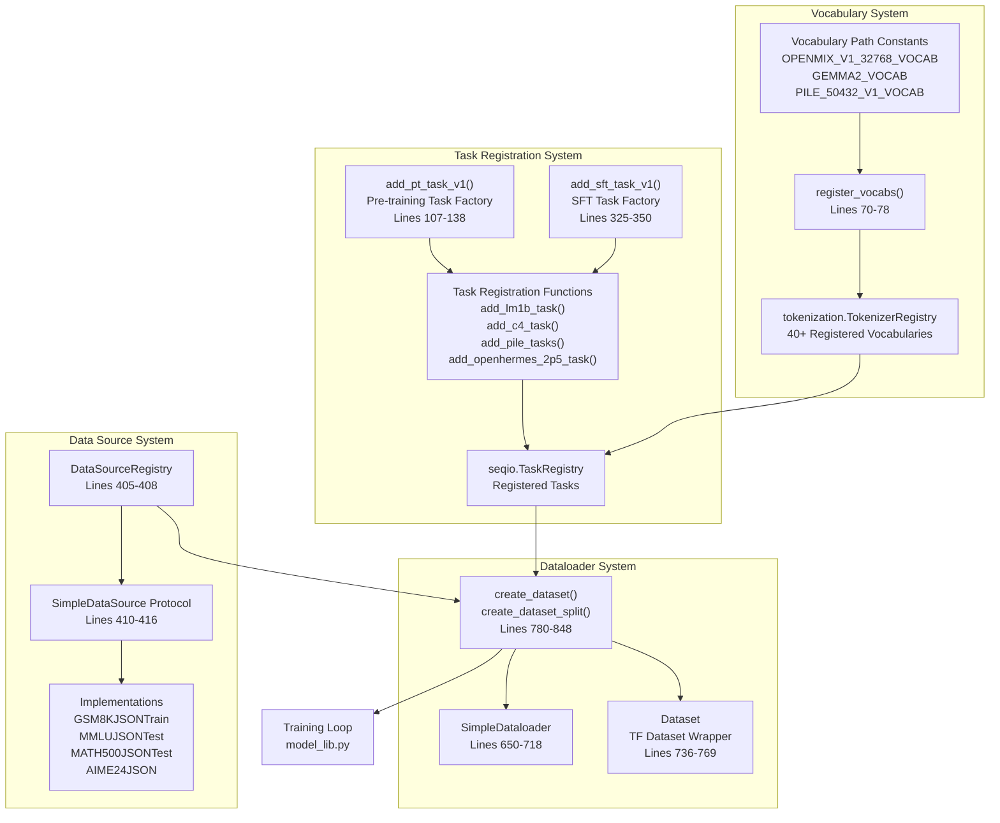
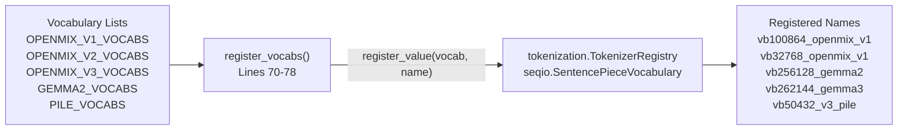
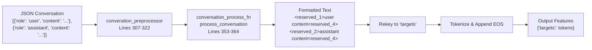
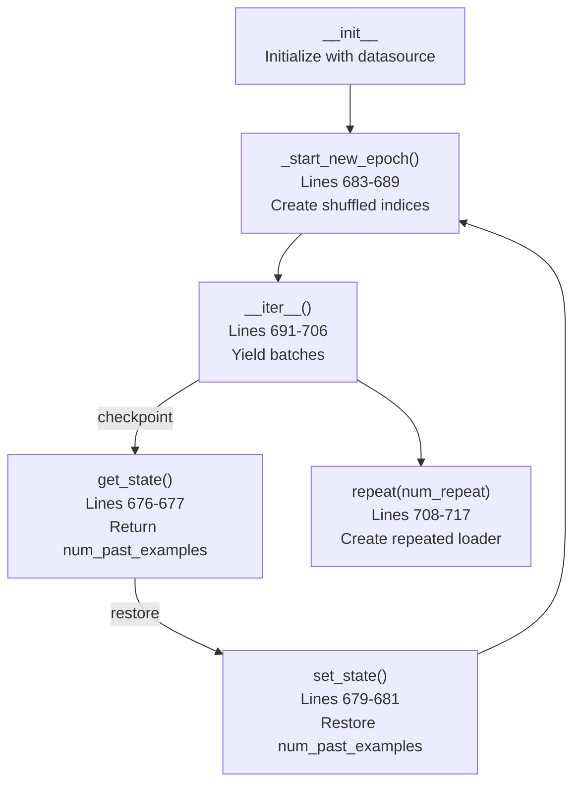
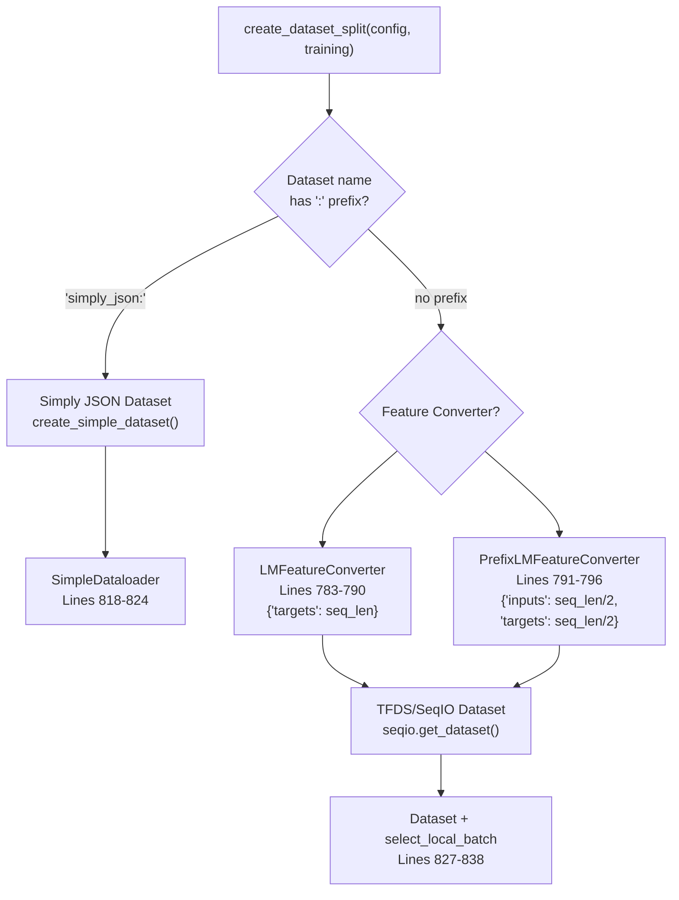
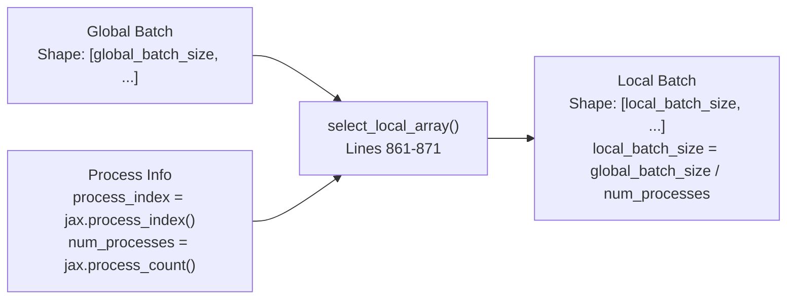
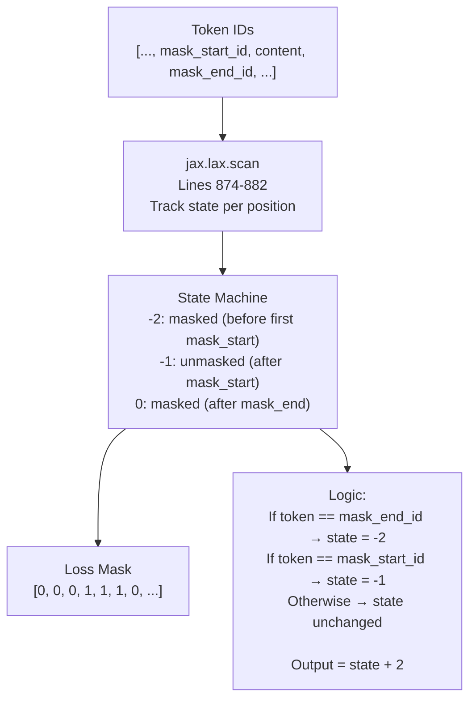

<!-- source: DeepWiki mcp.deepwiki.com · repo google-deepmind/simply · page 6.4 data_lib.py · fetched 2026-10-26 -->

# data_lib.py

<details>
<summary>Relevant source files</summary>

The following files were used as context for generating this wiki page:

- [simply/data_lib.py](simply/data_lib.py)
- [simply/data_lib_test.py](simply/data_lib_test.py)

</details>


This document provides a detailed API reference for `data_lib.py`, which handles dataset creation, vocabulary management, and data pipeline construction for training and evaluation in the Simply codebase. This module serves as the bridge between external data sources (TFDS, JSON files) and the training loops.

For information about how datasets are used in training workflows, see [Standard Training Workflow](#5.1) and [RL Training](#5.2). For configuration of dataset parameters, see [config_lib.py](#6.2).

**Sources**: [simply/data_lib.py:1-890]()

## Overview and Architecture

The `data_lib.py` module provides three primary systems:

1. **Vocabulary Management**: Registration and management of 40+ tokenizer vocabularies
2. **Task Registration**: SeqIO task definitions for pre-training and supervised fine-tuning datasets
3. **Data Loading**: Custom dataloaders for JSON-based datasets used in RL and evaluation

The module integrates with SeqIO for TFDS-based datasets and provides custom implementations for JSON-based datasets that don't fit SeqIO's patterns.



**Sources**: [simply/data_lib.py:14-890]()

## Vocabulary Management

### Vocabulary Path Constants

The module defines vocabulary path constants that reference SentencePiece models in the vocabs directory. These constants are organized by vocabulary family:

| Vocabulary Family | Size | Constant Name | Path Pattern |
|-------------------|------|---------------|--------------|
| OpenMix V1 | 32,768 | `OPENMIX_V1_32768_VOCAB` | `spm-32768-open_mix_v2_edu-r100-v1p1-07122024.model` |
| OpenMix V1 | 100,864 | `OPENMIX_V1_100864_VOCAB` | `spm-100864-open_mix_v1-reserved_100-02272024.model` |
| OpenMix V2 Edu | 100,864 | `OPENMIX_V2_EDU_100864_V1P1_VOCAB` | `spm-100864-open_mix_v2_edu-r100-v1p1-07122024.model` |
| OpenMix V3 | 100,864 | `OPENMIX_V3_100864_V2_VOCAB` | `spm-100864-openmix_v3-r100-v2-08312024.model` |
| Gemma2 | 256,128 | `GEMMA2_VOCAB` | `gemma2_tokenizer.model` |
| Gemma3 | 262,144 | `GEMMA3_VOCAB` | `gemma3_cleaned_262144_v2.spiece.model` |
| Pile V3 | 50,432 | `PILE_50432_V3_VOCAB` | `spm-50432-pile-train00-spc2_24-02252024.model` |
| Pile V1 | 100,864 | `PILE_100864_V1_VOCAB` | `spm-100864-pile-train00+01-02142024.model` |
| Pile V1 | 256,000 | `PILE_256000_V1_VOCAB` | `spm-256000-pile-train00+01-02162024.model` |

The base directory for vocabularies is controlled by the `SIMPLY_VOCABS` environment variable, defaulting to `~/.cache/simply/vocabs/`.

**Sources**: [simply/data_lib.py:42-95]()

### Vocabulary Registration

The `register_vocabs()` function registers vocabularies with the `TokenizerRegistry`:



Each vocabulary is registered with a naming pattern: `vb{size}_{family}`. For example:
- `vb256128_gemma2` - Gemma2 vocabulary with 256,128 tokens
- `vb100864_v1_pile` - Pile V1 vocabulary with 100,864 tokens

**Sources**: [simply/data_lib.py:57-83]()

### Special Tokens

The module defines reserved tokens for conversation formatting in SFT tasks:

| Constant | Value | Purpose |
|----------|-------|---------|
| `USER_TOKEN` | `<reserved_1>` | Marks user messages |
| `ASSISTANT_TOKEN` | `<reserved_2>` | Marks assistant responses |
| `SYSTEM_TOKEN` | `<reserved_3>` | Marks system prompts |
| `END_OF_MESSAGE_TOKEN` | `<reserved_4>` | Marks message boundaries |

**Sources**: [simply/data_lib.py:97-101]()

## Task Registration

### Pre-Training Task Factory

The `add_pt_task_v1()` function creates SeqIO tasks for pre-training datasets:

```python
def add_pt_task_v1(name, source, vocab, add_eos=False, use_reduce_concat_split=True)
```

**Parameters**:
- `name` (str): Task name to register
- `source` (seqio.DataSource): Data source (TFDS or TFExample)
- `vocab` (str): Path to vocabulary file
- `add_eos` (bool): Whether to append EOS token
- `use_reduce_concat_split` (bool): Whether to concatenate and split documents

**Preprocessing Pipeline**:

```mermaid
graph LR
    Input["Raw Dataset<br/>{'text': '...'}"]
    Rekey["t5.data.preprocessors.rekey<br/>{'targets': 'text'}"]
    Tokenize["seqio.preprocessors.tokenize<br/>Apply SentencePiece"]
    AppendEOS["seqio.preprocessors.append_eos<br/>Add EOS token"]
    Concat["reduce_concat_tokens<br/>Concatenate documents"]
    Split["split_tokens_to_targets_length<br/>Split to seq_len"]
    Output["Output Features<br/>{'targets': tokens}"]
    
    Input --> Rekey
    Rekey --> Tokenize
    Tokenize --> AppendEOS
    AppendEOS --> Concat
    Concat --> Split
    Split --> Output
```



When `use_reduce_concat_split=True`, the pipeline concatenates multiple documents and splits them into fixed-length sequences, maximizing GPU utilization. This is used for large corpus training (C4, Pile, RedPajama).

When `use_reduce_concat_split=False`, each document becomes a separate example. This is used for smaller datasets (LM1B, IMDB Reviews).

**Sources**: [simply/data_lib.py:107-138]()

### Registered Pre-Training Datasets

The module registers multiple pre-training datasets by calling task-specific functions:

| Function | Datasets | Vocabularies | Source Type |
|----------|----------|--------------|-------------|
| `add_lm1b_task()` | lm1b, minilm1b | OpenMix V1, V2 | TFDS |
| `add_c4_task()` | c4 | OpenMix V1, V2 | TFDS |
| `add_imdb_reviews_task()` | imdb_reviews | T5 CC | TFDS |
| `add_pile_tasks()` | the_pile_lm | Pile vocabs | TFRecord |
| `add_redpajama_1t_task()` | redpajama_1t_{cat} | OpenMix V1, V2, V3 | TFRecord |
| `add_starcoder_task()` | starcoder | OpenMix V1 | TFRecord |
| `add_refinedweb_task()` | refinedweb | OpenMix V1 | TFRecord |
| `add_fineweb_edu_task()` | fineweb_edu | FWEdu, OpenMix V1, V2 | TFRecord |
| `add_dclm_baseline_1p0_task()` | dclm_baseline_1p0 | OpenMix V1, V2, V3 | TFRecord |
| `add_stack_v2_smol_task()` | stack_v2_smol_repo, stack_v2_smol_file | OpenMix V2, V3 | TFRecord |

Task names follow the pattern `{dataset_name}.{vocab_name}`. For example: `c4.vb100864_openmix_v1`.

**Sources**: [simply/data_lib.py:141-301]()

### SFT Task Factory

The `add_sft_task_v1()` function creates SeqIO tasks for supervised fine-tuning with conversational data:

```python
def add_sft_task_v1(name, source, vocab, conversation_process_fn)
```

**Parameters**:
- `name` (str): Task name to register
- `source` (seqio.DataSource): Data source
- `vocab` (str): Path to vocabulary file
- `conversation_process_fn` (Callable): Function to process conversation JSON

**Conversation Processing**:



The `process_conversation()` function converts JSON conversations to formatted text with special tokens marking role boundaries. Each message is wrapped with a role token and `END_OF_MESSAGE_TOKEN`.

**Sources**: [simply/data_lib.py:307-364]()

### Registered SFT Datasets

| Function | Dataset | Vocabularies | Format |
|----------|---------|--------------|--------|
| `add_openhermes_2p5_task()` | openhermes_2p5 | OpenMix V1, V2, V3 | Conversation JSON |
| `add_tulu_v2_task()` | tulu_v2_sft | OpenMix V1, V2 | Conversation JSON |

**Sources**: [simply/data_lib.py:367-395]()

## Data Source Registry and JSON Datasets

### DataSourceRegistry

The `DataSourceRegistry` provides a registry for JSON-based datasets that are loaded directly (not through SeqIO):

```python
class DataSourceRegistry(registry.RootRegistry):
    namespace: ClassVar[str] = 'datasource'
```

Registered data sources are accessed via `DataSourceRegistry.get_instance(name)`.

**Sources**: [simply/data_lib.py:405-408]()

### SimpleDataSource Protocol

Data sources must implement the `SimpleDataSource` protocol:

```python
class SimpleDataSource(Protocol):
    def __len__(self): ...
    def __getitem__(self, index: int): ...
```

This protocol defines a list-like interface for datasets.

**Sources**: [simply/data_lib.py:410-416]()

### Registered JSON Data Sources

```mermaid
graph TB
    DataSourceRegistry["DataSourceRegistry"]
    
    GSM8K["GSM8KJSONTrain<br/>GSM8KJSONTest<br/>Lines 421-441<br/>simply_json:gsm8k_train<br/>simply_json:gsm8k_test"]
    
    GSM8KVariants["GSM8K Variants<br/>Lines 444-452<br/>simply_json:gsm8k_train4<br/>simply_json:gsm8k_train32<br/>simply_json:gsm8k_train128"]
    
    SimpleQA["SimpleQATest<br/>SimpleQATestNumberOnly<br/>Lines 458-487<br/>simply_json:simple_qa_test<br/>simply_json:simple_qa_num"]
    
    MMLU["MMLUJSONTest<br/>Lines 489-505<br/>simply_json:mmlu_test"]
    
    DSR["DeepScaleRJSONTrain<br/>Lines 510-529<br/>simply_json:dsr40k_train"]
    
    AIME["AIME24JSON<br/>AIME25JSON<br/>Lines 535-582<br/>simply_json:aime24<br/>simply_json:aime25"]
    
    MATH500["MATH500JSONTest<br/>Lines 588-611<br/>simply_json:math500_test"]
    
    GPQA["GPQADiamondJSON<br/>Lines 617-640<br/>simply_json:gpqa_diamond"]
    
    DataSourceRegistry --> GSM8K
    DataSourceRegistry --> GSM8KVariants
    DataSourceRegistry --> SimpleQA
    DataSourceRegistry --> MMLU
    DataSourceRegistry --> DSR
    DataSourceRegistry --> AIME
    DataSourceRegistry --> MATH500
    DataSourceRegistry --> GPQA
```



Each data source class is a frozen dataclass with:
- `path`: Path to JSON file
- `example_start_index` / `example_end_index`: Optional slicing parameters
- `split`: Dataset split name
- `load()`: Method returning list of examples

**Example: GSM8KJSONTrain**

```python
@functools.partial(DataSourceRegistry.register, name='simply_json:gsm8k_train')
@dataclasses.dataclass(frozen=True)
class GSM8KJSONTrain(SimpleDataSource):
    path: str = os.path.join(DATASETS_DIR, 'gsm8k/gsm8k.json')
    split: str = 'train'
    
    def load(self):
        with epath.Path(self.path).open('r') as f:
            data = json.load(f)
        examples = data[self.split]
        for i, example in enumerate(examples):
            example['uid'] = f'gsm8k_{self.split}-{i}'
            example['id'] = i
        return examples
```

**Sources**: [simply/data_lib.py:419-640]()

### Dataset Field Conventions

JSON data sources normalize their outputs to common field names:

| Dataset | Fields |
|---------|--------|
| GSM8K | question, short_answer, answer, uid, id |
| DeepScaleR | question, short_answer, answer, uid, id |
| AIME | question, short_answer, answer, uid, id |
| MATH500 | question, short_answer, answer, subject, level, uid, id |
| MMLU | (varies by task) uid, id |
| GPQA | question, correct_answer, incorrect_answer_1/2/3, uid, id |
| SimpleQA | (varies) uid, id |

The `uid` field provides a unique string identifier across datasets, while `id` is an integer index.

**Sources**: [simply/data_lib.py:419-640]()

## Dataloader Classes

### SimpleDataloader

The `SimpleDataloader` class provides a lightweight dataloader for JSON datasets with state management for checkpointing:

```python
class SimpleDataloader(Dataloader):
    def __init__(
        self, datasource: SimpleDataSource, batch_size: int, 
        shuffle: bool = True, num_epochs: int | None = None, 
        seed: int | None = None, num_past_examples: int = 0,
        drop_remainder: bool = True
    )
```

**Key Features**:



**State Management**:
- `num_past_examples`: Total examples seen across all epochs
- `current_epoch`: Computed as `num_past_examples // len(datasource)`
- `_cursor`: Position within current epoch

The dataloader uses a deterministic shuffle per epoch based on `seed + current_epoch`, enabling exact recovery from checkpoints.

**Iteration Behavior**:

| Configuration | Behavior |
|---------------|----------|
| `drop_remainder=True` | Stops when remaining examples < batch_size |
| `drop_remainder=False` | Wraps to next epoch to complete batch |
| `num_epochs=None` | Infinite iteration |
| `num_epochs=N` | Stops after N complete epochs |

**Sources**: [simply/data_lib.py:650-718]()

### Dataset Wrapper

The `Dataset` class wraps `tf.data.Dataset` and applies post-processing with NumPy/JAX:

```python
class Dataset:
    def __init__(
        self, tf_dataset: tf.data.Dataset,
        processors: Optional[list[Processor]] = None
    )
```

**Key Methods**:

| Method | Purpose |
|--------|---------|
| `add_processor(processor)` | Add a batch processor function |
| `repeat(num_repeat)` | Create repeated dataset |
| `copy(tf_dataset, processors)` | Create modified copy |
| `__iter__()` | Iterate batches with processors applied |

The iterator applies processors sequentially to each batch after converting from TensorFlow to NumPy:

```python
for batch in self._tf_dataset.as_numpy_iterator():
    for processor in self._processors:
        batch = processor(batch)
    yield batch
```

**Sources**: [simply/data_lib.py:736-769]()

## Dataset Creation Functions

### create_dataset_split

The `create_dataset_split()` function is the primary interface for creating training or validation datasets:

```python
def create_dataset_split(
    config, num_past_examples: int = 0, training: bool = True
)
```

**Decision Flow**:



**Configuration Parameters**:

| Config Field | Purpose |
|--------------|---------|
| `dataset_name` | Dataset identifier (optionally prefixed with `simply_json:`) |
| `validation_dataset_name` | Override dataset for validation split |
| `batch_size` | Training batch size |
| `validation_eval_batch_size` | Override batch size for validation |
| `validation_eval_epochs` | Number of validation epochs |
| `seq_len` | Sequence length |
| `use_packing` | Whether to pack multiple sequences per example |
| `bos_id` | BOS token ID (optional) |
| `feature_converter_name` | "LMFeatureConverter" or "PrefixLMFeatureConverter" |
| `dataset_seed` | Random seed for shuffling |

**Sources**: [simply/data_lib.py:780-838]()

### create_simple_dataset

Helper function for creating JSON datasets:

```python
def create_simple_dataset(
    name: str, batch_size: int, seed: int, 
    shuffle: bool, num_epochs: int | None
)
```

This function:
1. Gets data source from `DataSourceRegistry`
2. Calls `.load()` to get examples
3. Wraps in `SimpleDataloader` with specified parameters

**Sources**: [simply/data_lib.py:720-733]()

### create_dataset

Top-level function for creating train and validation splits:

```python
def create_dataset(config, num_past_examples: int = 0):
    train_set = create_dataset_split(config, num_past_examples, training=True)
    validation_set = None
    if config.use_validation_set:
        validation_set = create_dataset_split(
            config, num_past_examples, training=False
        )
    return train_set, validation_set
```

Returns a tuple `(train_set, validation_set)` where `validation_set` may be `None` if `config.use_validation_set` is False.

**Sources**: [simply/data_lib.py:841-848]()

## Batch Processing Utilities

### Multi-Process Batch Selection

The `select_local_batch()` function distributes global batches across processes:

```python
def select_local_batch(batch: Batch) -> Batch
```

This function is used in distributed training to ensure each process receives its portion of the batch. It applies `select_local_array()` to all arrays in the batch pytree.



The function slices arrays as:
```python
start_index = process_index * local_batch_size
end_index = start_index + local_batch_size
return array[start_index:end_index]
```

**Sources**: [simply/data_lib.py:851-871]()

### Chat Loss Mask Creation

For supervised fine-tuning with conversational data, the module provides functions to mask loss computation on user turns:

```python
def create_chat_loss_mask(token_ids, mask_start_id, mask_end_id)
def add_chat_loss_mask(batch, mask_start_id, mask_end_id)
```

**Masking Logic**:



The function uses a scan operation to track whether each position is between `mask_start_id` and `mask_end_id` tokens. Positions in this range receive a loss weight of 1, others receive 0.

**Typical Usage**:
- `mask_start_id` = ID of `ASSISTANT_TOKEN` (`<reserved_2>`)
- `mask_end_id` = ID of `END_OF_MESSAGE_TOKEN` (`<reserved_4>`)

This ensures the model only trains on assistant responses, not user prompts or system messages.

**Sources**: [simply/data_lib.py:874-889]()

## Integration with Training

### Usage in Standard Training

Standard training loops use `create_dataset()` to obtain train and validation iterators:

```python
train_ds, validation_ds = data_lib.create_dataset(config)

for batch in train_ds:
    # batch contains preprocessed sequences
    # Keys: 'decoder_target_tokens', 'decoder_input_tokens', 'decoder_loss_weights'
    loss = train_one_step(state, batch)
```

**Sources**: [simply/data_lib.py:841-848]()

### Usage in RL Training

RL training uses `create_simple_dataset()` for JSON-based datasets:

```python
dataset = data_lib.create_simple_dataset(
    name='simply_json:gsm8k_train',
    batch_size=config.batch_size,
    seed=config.dataset_seed,
    shuffle=True,
    num_epochs=None
)

for batch in dataset:
    # batch is a list of dicts: [{'question': ..., 'answer': ...}, ...]
    # Each dict contains raw fields from JSON
    completions = generate_completions(model, batch)
    rewards = compute_rewards(completions, batch)
    ppo_update(model, completions, rewards)
```

**Sources**: [simply/data_lib.py:720-733]()

## Configuration Integration

### Dataset Name Resolution

Experiment configurations specify datasets using the `dataset_name` field:

**TFDS Datasets**:
```python
config.dataset_name = 'c4.vb100864_openmix_v1'
# Resolved to SeqIO task registered by add_c4_task()
```

**JSON Datasets**:
```python
config.dataset_name = 'simply_json:gsm8k_train'
# Prefix 'simply_json:' triggers SimpleDataloader path
```

### Feature Converter Selection

The `feature_converter_name` determines preprocessing:

| Converter | Use Case | Output Features |
|-----------|----------|-----------------|
| `LMFeatureConverter` | Causal LM training | `targets`: Full sequence |
| `PrefixLMFeatureConverter` | Prefix LM training | `inputs`: Context<br/>`targets`: Continuation |

**Sources**: [simply/data_lib.py:783-800]()

## Testing

The module includes tests in `data_lib_test.py`:

| Test | Purpose |
|------|---------|
| `test_add_chat_mask_to_loss` | Validates chat loss mask creation logic |
| `test_simple_dataloader` | Tests dataloader iteration, shuffling, epochs, state management |

Key test cases:
- Basic iteration with `drop_remainder=True/False`
- Deterministic shuffling with seeds
- State recovery with `num_past_examples`
- Multi-epoch iteration

**Sources**: [simply/data_lib_test.py:1-102]()

---

