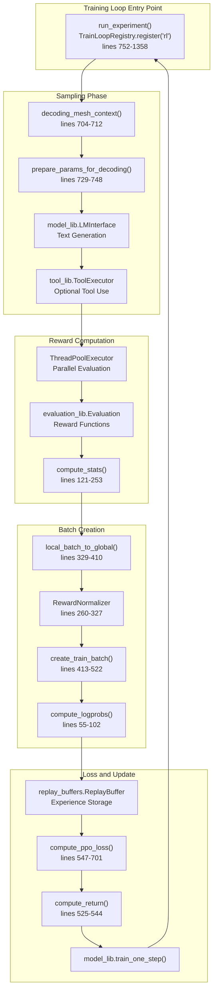
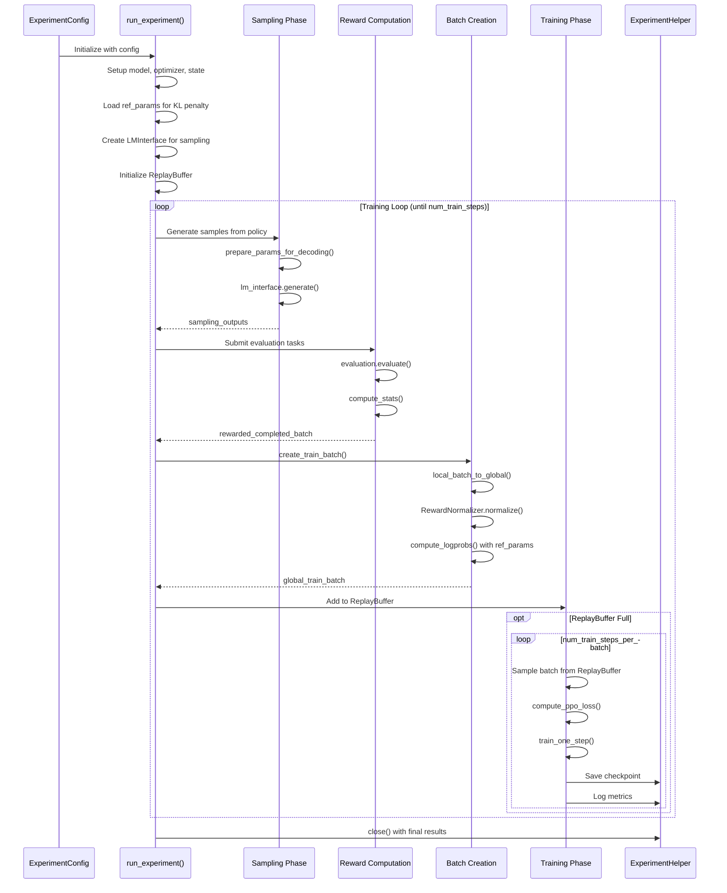
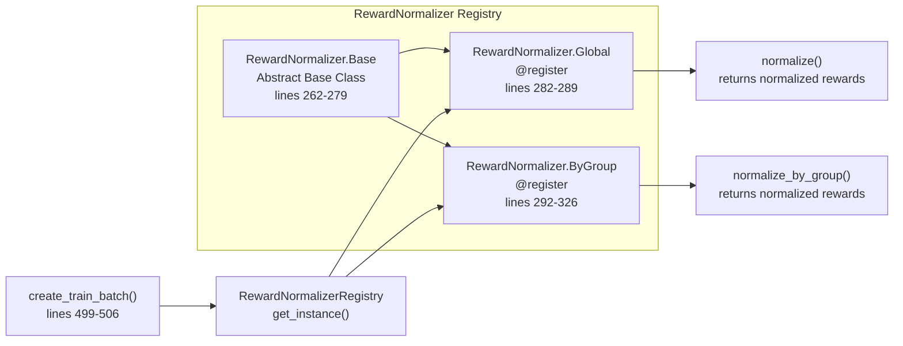
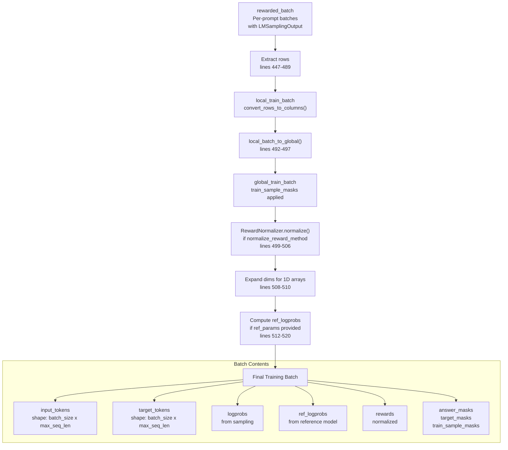
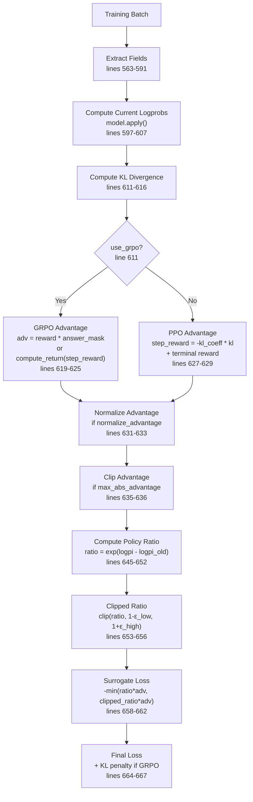
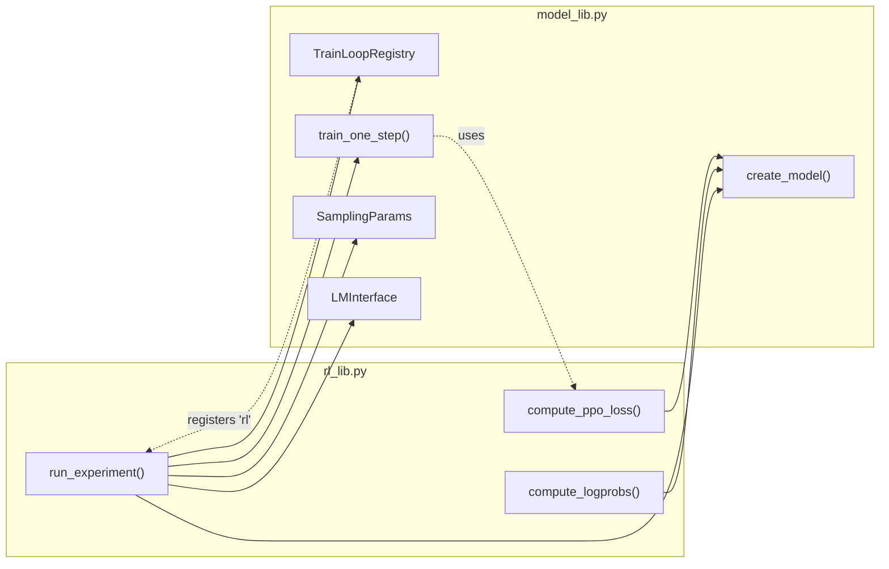
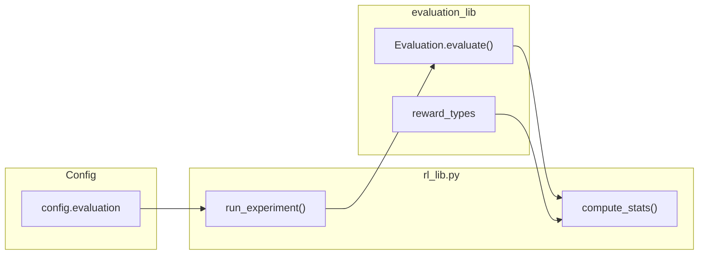

<!-- source: DeepWiki mcp.deepwiki.com · repo google-deepmind/simply · page 6.5 rl_lib.py · fetched 2026-10-26 -->

# rl_lib.py

<details>
<summary>Relevant source files</summary>

The following files were used as context for generating this wiki page:

- [simply/rl_lib.py](simply/rl_lib.py)
- [simply/rl_lib_test.py](simply/rl_lib_test.py)

</details>


## Purpose and Scope

This document describes the reinforcement learning training infrastructure in `simply/rl_lib.py`. This module implements the PPO (Proximal Policy Optimization) and GRPO (Group Relative Policy Optimization) training algorithms for language models, including sampling, reward computation, batch creation, and policy updates.

For standard supervised training without RL, see [Standard Training Workflow](#5.1). For the model architecture and inference capabilities used by RL training, see [model_lib.py](#6.3). For evaluation and reward computation, see the `evaluation_lib` utilities.

**Sources**: [simply/rl_lib.py:1-15]()

---

## Architecture Overview

The RL training system orchestrates several subsystems to implement policy gradient methods. The training loop alternates between sampling from the current policy, evaluating rewards, and performing gradient updates.

### System Architecture Diagram



**Sources**: [simply/rl_lib.py:752-1358](), [simply/rl_lib.py:55-102](), [simply/rl_lib.py:329-522](), [simply/rl_lib.py:547-701]()

---

## Main Training Loop

The `run_experiment` function serves as the registered training loop for RL configurations. It is registered in the `TrainLoopRegistry` with the name `'rl'`.

### Training Loop Registration

The function is decorated at [simply/rl_lib.py:751]():

```python
@functools.partial(model_lib.TrainLoopRegistry.register, name='rl')
def run_experiment(config, sharding_config, mesh_shape, create_dataset, ...)
```

This allows configurations to specify `train_loop_name='rl'` to use this training procedure.

### Execution Flow Sequence



**Sources**: [simply/rl_lib.py:752-1358](), [simply/rl_lib.py:910-926](), [simply/rl_lib.py:952-1154](), [simply/rl_lib.py:1195-1226]()

---

## Core Components

### Reward Normalization

The `RewardNormalizer` class hierarchy provides strategies for normalizing rewards before training. Reward normalization is critical for stable PPO training.

#### RewardNormalizer Class Hierarchy

| Class | Registry Name | Method | Description |
|-------|---------------|--------|-------------|
| `RewardNormalizer.Global` | `'Global'` | Global mean/std normalization | Normalizes rewards across entire batch using global statistics |
| `RewardNormalizer.ByGroup` | `'ByGroup'` | Per-prompt group normalization | Normalizes rewards within each prompt's response group |

**Implementation Details**:

- **Global Normalizer** [simply/rl_lib.py:282-289](): Computes mean and standard deviation across all valid samples and normalizes: `(reward - mean) / max(std, 1e-5)`

- **ByGroup Normalizer** [simply/rl_lib.py:292-326](): Groups samples by `example_ids` and normalizes within each group. Useful when multiple responses are generated per prompt.

**Configuration**: Set `config.normalize_reward_method` to `'Global'` or `'ByGroup'` to enable normalization.



**Sources**: [simply/rl_lib.py:256-327](), [simply/rl_lib_test.py:21-49]()

---

### Batch Creation Pipeline

The batch creation process converts rewarded samples from multiple hosts into a unified training batch with properly computed reference log probabilities.

#### Multi-Host Batch Aggregation

The `local_batch_to_global` function [simply/rl_lib.py:329-410]() aggregates samples across all hosts:

**Process**:
1. Each host has a local batch with `local_batch[mask_name]` indicating valid samples
2. Compute `num_valids` array showing valid sample counts per host
3. Calculate starting indices using cumulative sum
4. Create zero-filled buffers of size `global_batch_size`
5. Place local valid samples at computed positions
6. Sum buffers across all hosts using `sharding_lib.sum_across_hosts()`
7. Validate that global mask matches expected pattern

**Key Properties**:
- Handles variable-sized local batches across hosts
- Drops extra samples if total exceeds `global_batch_size`
- Preserves ordering based on host index

#### Training Batch Construction

The `create_train_batch` function [simply/rl_lib.py:413-522]() constructs the final training batch:



**Batch Fields**:

| Field | Shape | Description |
|-------|-------|-------------|
| `input_tokens` | `(batch_size, max_seq_len)` | Input token IDs (shifted left) |
| `target_tokens` | `(batch_size, max_seq_len)` | Target token IDs (shifted right) |
| `logprobs` | `(batch_size, max_seq_len)` | Log probabilities from sampling model |
| `ref_logprobs` | `(batch_size, max_seq_len)` | Log probabilities from reference model (optional) |
| `answer_masks` | `(batch_size, max_seq_len)` | Mask for answer tokens (response portion) |
| `target_masks` | `(batch_size, max_seq_len)` | Mask for valid positions |
| `train_sample_masks` | `(batch_size, 1)` | Mask for samples included in training |
| `rewards` | `(batch_size, 1)` | Normalized rewards |
| `verdicts` | `(batch_size, 1)` | Correctness labels |
| `in_batch_example_ids` | `(batch_size,)` | Grouping IDs for reward normalization |

**Sources**: [simply/rl_lib.py:413-522](), [simply/rl_lib.py:329-410]()

---

### PPO Loss Computation

The `compute_ppo_loss` function [simply/rl_lib.py:547-701]() implements the core PPO objective with optional GRPO variant.

#### Loss Function Components

**PPO Objective**:
```
L_PPO = -E[min(r(θ) * A, clip(r(θ), 1-ε, 1+ε) * A)]
```

Where:
- `r(θ) = exp(logπ_θ - logπ_old)` is the policy ratio
- `A` is the advantage estimate
- `ε` is the clipping parameter (`ppo_clip_eps`)

**GRPO Variant**: Uses reference model log probabilities to compute KL divergence and incorporates it into the loss.

#### Advantage Computation Flow



**Key Parameters** (from config):

| Parameter | Config Field | Default | Description |
|-----------|--------------|---------|-------------|
| `gamma` | `config.gamma` | 1.0 | Discount factor for returns |
| `kl_coeff` | `config.kl_coeff` | 0.001 | KL penalty coefficient |
| `use_grpo` | `config.use_grpo` | False | Use GRPO instead of PPO |
| `ppo_clip_eps_high` | `config.ppo_clip_eps_high` | 0.2 | Upper clipping threshold |
| `ppo_clip_eps_low` | `config.ppo_clip_eps_low` | 0.2 | Lower clipping threshold |
| `policy_ratio_cap` | `config.policy_ratio_cap` | 10.0 | Maximum policy ratio (dual-clip PPO) |
| `normalize_advantage` | `config.normalize_advantage` | True | Normalize advantages before clipping |
| `max_abs_advantage` | `config.max_abs_advantage` | 10.0 | Maximum absolute advantage value |

**Logged Metrics**:
- `entropy`: Policy entropy
- `kl_divergence`: KL divergence from reference policy
- `policy_ratio/mean`, `policy_ratio/max`, `policy_ratio/min`: Policy ratio statistics
- `logp_diff_abs/mean`, `logp_diff_abs/max`: Log probability difference statistics

**Sources**: [simply/rl_lib.py:547-701](), [simply/rl_lib.py:525-544]()

---

## Sampling and Reward Pipeline

### Decoding Context Management

RL training often uses a separate mesh configuration for sampling (generation) vs training (gradient computation). This optimization allows different sharding strategies optimized for each phase.

**Decoding Mesh Context** [simply/rl_lib.py:704-712]():
```python
def decoding_mesh_context(decoding_mesh_shape, dcn_mesh_shape):
    if decoding_mesh_shape is None:
        return contextlib.nullcontext()
    return sharding_lib.mesh_context(
        mesh_shape=decoding_mesh_shape, dcn_mesh_shape=dcn_mesh_shape
    )
```

**Parameter Preparation** [simply/rl_lib.py:729-748]():
- Converts parameters to `bfloat16` or `float32` for efficient generation
- Reshards to decoding mesh if different from training mesh
- Uses `process_allgather` for cross-host gathering when meshes differ

### Statistics Computation

The `compute_stats` function [simply/rl_lib.py:121-253]() aggregates statistics across all hosts for logging and monitoring.

**Computed Statistics**:

| Metric | Description |
|--------|-------------|
| `seq_len/mean`, `seq_len/max`, `seq_len/min` | Sequence length statistics |
| `prompt_len/mean`, `prompt_len/max`, `prompt_len/min` | Input prompt length statistics |
| `response_len/mean`, `response_len/max`, `response_len/min` | Generated response length statistics |
| `truncated` | Fraction of truncated sequences |
| `reward` | Average reward |
| `accuracy` | Average correctness |
| `pass_at_k` | Pass@K metric (any correct in group) |
| `eval_count` | Number of evaluated samples |
| `train_count` | Number of samples used for training |
| `train_sample_ratio` | Ratio of training samples to evaluated samples |

If the evaluation defines `reward_types`, per-type statistics are also computed.

**Sources**: [simply/rl_lib.py:121-253](), [simply/rl_lib.py:105-118]()

---

## Replay Buffer Integration

The training loop uses a replay buffer to enable multiple gradient updates per batch of sampled experiences. This is controlled by `config.num_train_steps_per_batch`.

**Replay Buffer Setup** [simply/rl_lib.py:928-932]():
```python
replay_buffer_size = train_batch_size * num_train_steps_per_batch
replay_buffer = replay_buffers.ReplayBuffer(replay_buffer_size)
```

**Usage Pattern** [simply/rl_lib.py:1214-1347]():
1. Sample from policy and collect rewarded batch
2. Create training batch from rewarded samples
3. Add to replay buffer: `replay_buffer.extend(train_batch)`
4. When buffer is full, iterate over batches for training:
   ```python
   for batch in replay_buffer.iterator(train_batch_size, shuffle=True):
       # Perform training step
   ```
5. Training updates occur `num_train_steps_per_batch` times per filled buffer

**Important Constraint** [simply/rl_lib.py:934-938](): 
If `num_train_steps_per_batch > 1` (off-policy learning), `config.use_policy_logp_as_sampler_logp` must be `False` to avoid staleness issues.

**Sources**: [simply/rl_lib.py:928-932](), [simply/rl_lib.py:1214-1226]()

---

## Key Configuration Fields

RL experiments require specific configuration fields beyond standard training:

### Sampling Configuration

| Field | Type | Description |
|-------|------|-------------|
| `sampling_temperature` | float | Temperature for sampling |
| `sampling_max_decode_steps` | int | Maximum tokens to generate |
| `sampling_intermediate_decode_steps` | int | Intermediate decode steps (optional) |
| `sampling_max_input_len` | int | Maximum input length |
| `sampling_max_tool_response_len` | int | Maximum tool response length (if using tools) |
| `sampling_prefill_size` | int | Prefill batch size |
| `num_samples_per_example` | int | Number of samples per prompt |
| `max_num_samples_per_train_batch` | int | Maximum samples to generate per training iteration |

### Training Configuration

| Field | Type | Description |
|-------|------|-------------|
| `train_batch_size` | int | Training batch size |
| `train_max_seq_len` | int | Maximum sequence length for training |
| `num_train_steps_per_batch` | int | Number of gradient updates per sampled batch |
| `grad_accum_steps` | int | Gradient accumulation steps |
| `normalize_reward_method` | str | Reward normalization method ('Global' or 'ByGroup') |
| `filter_truncated` | bool | Exclude truncated sequences from training |
| `filter_throttled` | bool | Exclude throttled samples from training |

### RL Algorithm Configuration

| Field | Type | Description |
|-------|------|-------------|
| `gamma` | float | Discount factor |
| `kl_coeff` | float | KL penalty coefficient |
| `use_grpo` | bool | Use GRPO instead of PPO |
| `ppo_clip_eps` | float | PPO clipping epsilon |
| `ppo_clip_eps_high` | float | Upper clipping threshold |
| `ppo_clip_eps_low` | float | Lower clipping threshold |
| `policy_ratio_cap` | float | Maximum policy ratio (dual-clip) |
| `normalize_advantage` | bool | Normalize advantages |
| `max_abs_advantage` | float | Maximum absolute advantage |
| `use_policy_logp_as_sampler_logp` | bool | Use policy logprobs as sampler logprobs (pure on-policy) |
| `ref_params_dtype` | str | Data type for reference parameters |

### Evaluation Configuration

| Field | Type | Description |
|-------|------|-------------|
| `evaluation` | eval_lib.Evaluation | Evaluation object for reward computation |
| `use_validation_set` | bool | Use validation set for periodic evaluation |
| `validation_eval_interval` | int | Steps between validation evaluations |
| `validation_eval_epochs` | int | Epochs to run on validation set |
| `validation_num_eval_steps` | int | Maximum validation steps |

### Mesh Configuration

| Field | Type | Description |
|-------|------|-------------|
| `decoding_mesh_shape` | Sequence[int] | Mesh shape for decoding (optional) |
| `decoding_sharding_config` | ShardingConfig | Sharding config for decoding (optional) |
| `decoding_quant_scheme` | str | Quantization scheme for decoding params |

**Sources**: [simply/rl_lib.py:752-932]()

---

## Function Reference

### Core Training Functions

#### `run_experiment`
[simply/rl_lib.py:752-1358]()

Main RL training loop registered as `'rl'` in `TrainLoopRegistry`.

**Arguments**:
- `config`: ExperimentConfig object
- `sharding_config`: ShardingConfig object  
- `mesh_shape`: Device mesh shape
- `create_dataset`: Function to create train/eval datasets
- `experiment_dir`: Directory for checkpoints and logs
- `dcn_mesh_shape`: DCN mesh shape (optional)
- `decoding_mesh_shape`: Decoding mesh shape (optional)

**Returns**: Dictionary with final results including `train_accuracy`, `eval_accuracy`, `eval_accuracy_history`, `early_stop`

#### `compute_ppo_loss`
[simply/rl_lib.py:547-701]()

Computes PPO or GRPO loss for a batch of data.

**Arguments**:
- `model`: TransformerLM model
- `params`: Model parameters
- `batch`: Training batch dictionary
- `gamma`: Discount factor
- `kl_coeff`: KL penalty coefficient
- `use_grpo`: Whether to use GRPO
- `ppo_clip_eps_high`, `ppo_clip_eps_low`: Clipping thresholds
- `policy_ratio_cap`: Maximum policy ratio
- `normalize_advantage`: Whether to normalize advantages
- `max_abs_advantage`: Maximum absolute advantage
- `use_policy_logp_as_sampler_logp`: Use policy logprobs as sampler logprobs

**Returns**: Tuple of `(loss, log_dict)` where `log_dict` contains metrics

### Utility Functions

#### `compute_logprobs`
[simply/rl_lib.py:55-102]()

Computes log probabilities for decoder tokens, with optional microbatching.

**Arguments**:
- `model`: TransformerLM model
- `params`: Model parameters
- `batch`: Batch dictionary
- `microbatch_size`: Microbatch size (optional)

**Returns**: Array of log probabilities with shape `(batch_size, max_seq_len)`

#### `create_train_batch`
[simply/rl_lib.py:413-522]()

Creates a training batch from rewarded samples across hosts.

**Arguments**:
- `rewarded_batch`: Per-prompt rewarded example batches
- `num_valid_samples`: Valid sample counts per host
- `train_batch_size`: Training batch size
- `max_seq_len`: Maximum sequence length
- `normalize_reward_method`: Reward normalization method
- `ref_params`: Reference model parameters (optional)
- `compute_logprobs_fn`: Function to compute reference logprobs (optional)

**Returns**: Dictionary containing training batch arrays

#### `compute_stats`
[simply/rl_lib.py:121-253]()

Computes statistics from rewarded batches across hosts.

**Arguments**:
- `rewarded_completed_batch`: Mapping of prompt index to rewarded samples
- `lm_interface`: LMInterface for tokenization info
- `evaluation`: Evaluation object

**Returns**: Dictionary of aggregated statistics

#### `compute_return`
[simply/rl_lib.py:525-544]()

Computes discounted returns for advantages.

**Arguments**:
- `reward`: Reward array with shape `(batch_size, seq_len)`
- `mask`: Mask array with shape `(batch_size, seq_len)`
- `gamma`: Discount factor

**Returns**: Discounted return array

#### `local_batch_to_global`
[simply/rl_lib.py:329-410]()

Converts local batches from different hosts to a global batch.

**Arguments**:
- `local_batch`: Local batch data
- `mask_name`: Name of validity mask field
- `num_valids`: Valid sample counts per host
- `global_batch_size`: Target global batch size

**Returns**: Global batch aggregated across hosts

### Helper Functions

#### `prepare_params_for_decoding`
[simply/rl_lib.py:729-748]()

Quantizes and reshards parameters for efficient decoding.

**Arguments**:
- `params`: Model parameters
- `abstract_decoding_params`: Abstract parameters for target sharding
- `quant_scheme`: Quantization scheme ('bfloat16' or 'float32')

**Returns**: Prepared parameters

#### `decoding_mesh_context`
[simply/rl_lib.py:704-712]()

Context manager for decoding mesh.

**Arguments**:
- `decoding_mesh_shape`: Decoding mesh shape (optional)
- `dcn_mesh_shape`: DCN mesh shape (optional)

**Returns**: Context manager

#### `np_safe_mean`, `np_safe_std`, `np_safe_weighted_mean`
[simply/rl_lib.py:105-118]()

Numpy safe aggregation functions that handle masking and zero denominators.

**Sources**: [simply/rl_lib.py:55-748]()

---

## Integration with Other Systems

### Connection to model_lib



**Key Interactions**:
- `run_experiment` creates models via `model_lib.create_model()` [simply/rl_lib.py:778-779, 890-898]()
- Sampling uses `model_lib.LMInterface` for generation [simply/rl_lib.py:910-919]()
- Training uses `model_lib.train_one_step()` with custom loss [simply/rl_lib.py:814-838]()
- Registered in `model_lib.TrainLoopRegistry` [simply/rl_lib.py:751]()

### Connection to evaluation_lib



**Key Interactions**:
- Config provides `evaluation` object [simply/rl_lib.py:872]()
- Evaluation executor runs `evaluation.evaluate()` in parallel [simply/rl_lib.py:875-877, 1051-1053]()
- `compute_stats` uses evaluation's `reward_types` for per-type metrics [simply/rl_lib.py:143-146, 198-211]()

**Sources**: [simply/rl_lib.py:751-926](), [simply/rl_lib.py:872-877]()

---

## Testing

The test suite in `simply/rl_lib_test.py` validates the reward normalization components.

### RewardNormalizer Tests

**Global Normalization Test** [simply/rl_lib_test.py:23-32]():
- Tests global mean/std normalization
- Verifies normalized values match expected statistics
- Handles masking of invalid samples

**ByGroup Normalization Test** [simply/rl_lib_test.py:34-48]():
- Tests per-group normalization with grouped `example_ids`
- Verifies within-group normalization
- Tests optional fixed standard deviation parameter

**Sources**: [simply/rl_lib_test.py:1-53]()

---

