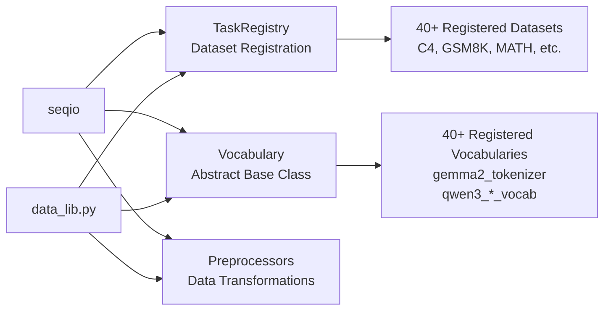
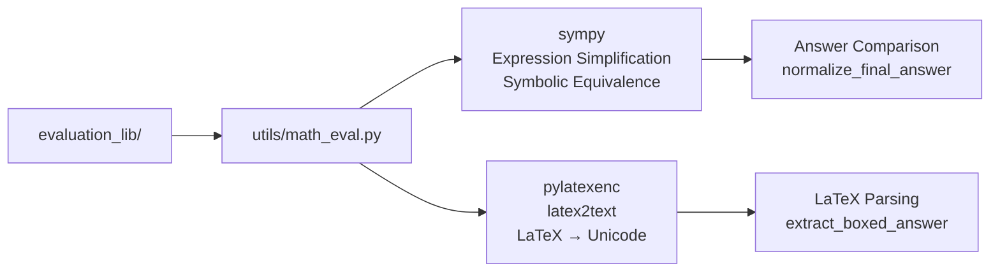

<!-- source: DeepWiki mcp.deepwiki.com · repo google-deepmind/simply · page 7.1 Dependencies and Requirements · fetched 2026-10-26 -->

# Dependencies and Requirements

<details>
<summary>Relevant source files</summary>

The following files were used as context for generating this wiki page:

- [README.md](README.md)
- [requirements.txt](requirements.txt)
- [setup/setup_assets.py](setup/setup_assets.py)

</details>


This document provides a comprehensive breakdown of all dependencies required by the Simply research codebase, their purposes, version compatibility considerations, and how they integrate into Simply's architecture. For information about installing and configuring Simply, see [Installation and Setup](#2.1). For asset downloads using HuggingFace, see [Asset Management](#2.2).

## Overview

Simply maintains a minimal dependency footprint focused on three core pillars: JAX for computation, Orbax for state management, and SeqIO for data pipelines. All dependencies fall into four categories: core computational framework (JAX ecosystem), data processing libraries, utility packages, and optional evaluation tools.

## Dependency Architecture

The following diagram illustrates the dependency hierarchy and how each external package integrates with Simply's modules:

```mermaid
graph TB
    subgraph "Simply Modules"
        Main["main.py<br/>Experiment Orchestration"]
        ConfigLib["config_lib.py<br/>Configuration Management"]
        ModelLib["model_lib.py<br/>TransformerLM Implementation"]
        DataLib["data_lib.py<br/>Dataset & Vocabulary"]
        RLLib["rl_lib.py<br/>PPO Training"]
        EvalLib["evaluation_lib/<br/>Reward Computation"]
        Utils["utils/<br/>pytree, module, common"]
    end
    
    subgraph "Core: JAX Ecosystem"
        JAX["jax<br/>Numerical Computing<br/>JIT, grad, vmap, pmap"]
        Orbax["orbax<br/>Checkpoint I/O<br/>PyTreeCheckpointer<br/>CheckpointManager"]
        CLU["clu<br/>Metrics & Periodic Actions<br/>PeriodicCallback"]
    end
    
    subgraph "Data Pipeline"
        SeqIO["seqio<br/>Task Registry<br/>Vocabulary<br/>Preprocessors"]
        T5["t5<br/>SentencePieceVocabulary<br/>Preprocessor Utils"]
    end
    
    subgraph "Tensor & Computation Utilities"
        Einops["einops<br/>rearrange, repeat<br/>Tensor Reshaping"]
    end
    
    subgraph "Logging & Experiment Management"
        AbslPy["absl-py<br/>flags, logging, app<br/>CLI Argument Parsing"]
        TensorBoard["tensorboard<br/>SummaryWriter<br/>Metrics Logging"]
    end
    
    subgraph "Optional: Evaluation Tools"
        Sympy["sympy<br/>Symbolic Math<br/>Expression Evaluation"]
        PyLatexEnc["pylatexenc<br/>LaTeX Parsing<br/>latex2text"]
        HFHub["huggingface_hub<br/>snapshot_download<br/>Asset Downloads"]
    end
    
    subgraph "Testing"
        Pytest["pytest<br/>Test Framework"]
    end
    
    ModelLib --> JAX
    ModelLib --> Orbax
    ModelLib --> CLU
    ModelLib --> Einops
    
    Main --> JAX
    Main --> AbslPy
    Main --> TensorBoard
    Main --> ConfigLib
    Main --> ModelLib
    Main --> DataLib
    
    ConfigLib --> Orbax
    
    DataLib --> SeqIO
    DataLib --> T5
    DataLib --> JAX
    
    RLLib --> ModelLib
    RLLib --> JAX
    
    EvalLib --> Sympy
    EvalLib --> PyLatexEnc
    
    Utils --> JAX
    
    HFHub -.->|"used by"| SetupAssets["setup/setup_assets.py"]
    
    Pytest -.->|"tests"| ModelLib
    Pytest -.->|"tests"| DataLib
    Pytest -.->|"tests"| Utils
```



**Sources:** [README.md:23-42](), [requirements.txt:1-12](), [setup/setup_assets.py:29-34]()

## Core Dependencies: JAX Ecosystem

The JAX ecosystem forms the computational foundation of Simply. These dependencies are mandatory for all operations.

### JAX

**Package:** `jax`  
**Purpose:** Numerical computing framework providing automatic differentiation, JIT compilation, and device parallelism

JAX is the core computational engine underlying all model operations, training loops, and inference procedures in Simply.

| JAX Feature | Usage in Simply | Code Locations |
|------------|----------------|----------------|
| `jax.jit` | JIT compilation of training steps, forward passes | [model_lib.py]() training functions |
| `jax.grad` / `jax.value_and_grad` | Gradient computation for optimization | [model_lib.py]() `train_one_step` |
| `jax.vmap` | Batch processing, parallel computation | [model_lib.py]() attention mechanisms |
| `jax.pmap` | Multi-device parallelism | Training loop distribution |
| `jax.lax.scan` | Efficient sequential operations in transformer blocks | [model_lib.py]() `TransformerLM` |
| `jax.tree_utils` | PyTree manipulation for model parameters | [utils/pytree.py]() utilities |
| `jax.sharding` | Distributed computation strategies | Mesh and sharding configuration |

**Platform-Specific Installation:**

```bash
# CPU (development/testing)
pip install -U jax

# GPU with CUDA 12.x
pip install -U "jax[cuda12]"

# TPU (Google Cloud)
pip install -U "jax[tpu]"
```

The installation command varies by hardware platform. See [README.md:33-39]() for detailed instructions.

**Sources:** [README.md:23-42](), [requirements.txt:1]()

### Orbax

**Package:** `orbax`  
**Purpose:** Checkpoint management and state persistence

Orbax handles all checkpoint I/O operations, managing Simply's specific checkpoint format (step-numbered directories with OCDBT files).

| Orbax Component | Usage in Simply | Code Locations |
|----------------|----------------|----------------|
| `orbax.checkpoint.PyTreeCheckpointer` | Save/load model parameters and optimizer state | [config_lib.py]() checkpoint loading |
| `orbax.checkpoint.CheckpointManager` | Manage checkpoint retention, versioning | Training loops |
| `orbax.checkpoint.CheckpointManagerOptions` | Configure save intervals, keep policy | Experiment configuration |

**Key Integration Points:**

Simply expects checkpoints in a specific directory structure that Orbax manages:
```
CHECKPOINT_DIR/
├── 0/
│   ├── checkpoint
│   ├── _CHECKPOINT_METADATA
│   └── manifest.ocdbt
├── 1000/
│   └── checkpoint
└── ...
```

The [setup/setup_assets.py:47-112]() script reorganizes downloaded HuggingFace checkpoints into this format.

**Sources:** [README.md:27](), [requirements.txt:2](), [setup/setup_assets.py:47-112]()

### CLU

**Package:** `clu`  
**Purpose:** Common utilities for metrics aggregation and periodic actions

CLU (Common Loop Utils) provides standardized patterns for training loop instrumentation.

| CLU Component | Usage in Simply | Code Locations |
|--------------|----------------|----------------|
| `clu.metrics` | Training and validation metrics | Model library metric computation |
| `clu.periodic_actions` | Periodic checkpointing, logging callbacks | Training loop hooks |

**Sources:** [requirements.txt:6]()

## Data Pipeline Dependencies

These dependencies power Simply's data loading and preprocessing infrastructure.

### SeqIO

**Package:** `seqio`  
**Purpose:** Data pipeline framework for sequence-to-sequence tasks

SeqIO provides the foundational abstractions for dataset registration, vocabulary management, and preprocessing pipelines.



**Integration Pattern:**

Data configurations in [config_lib.py]() reference dataset names that resolve through SeqIO's task registry in [data_lib.py](). Vocabularies are loaded from `~/.cache/simply/vocabs/` and registered with SeqIO for use by preprocessing pipelines.

**Sources:** [README.md:28](), [requirements.txt:3]()

### T5

**Package:** `t5`  
**Purpose:** Transformer utilities and vocabulary implementations

T5 provides `SentencePieceVocabulary` implementations and preprocessing utilities that Simply's data layer builds upon.

| T5 Component | Usage in Simply | Code Locations |
|-------------|----------------|----------------|
| `t5.data.SentencePieceVocabulary` | Base class for tokenizer wrappers | [data_lib.py]() vocabulary registration |
| `t5.data.preprocessors` | Preprocessing function templates | Data pipeline utilities |

**Sources:** [requirements.txt:7]()

## Computation and Tensor Utilities

### Einops

**Package:** `einops`  
**Purpose:** Tensor reshaping with readable, declarative syntax

Einops simplifies complex tensor manipulations in attention mechanisms and model architectures.

**Common Usage Patterns:**

```python
# Pattern: Multi-head attention reshaping
# rearrange(x, 'b s (h d) -> b h s d', h=num_heads)

# Pattern: Combining batch dimensions
# rearrange(x, 'b ... -> (b ...) ...')

# Pattern: Broadcasting operations
# repeat(x, '... -> ... n', n=num_samples)
```

These patterns appear extensively in [model_lib.py]() for attention mechanism implementations and tensor layout transformations required by sharding strategies.

**Sources:** [requirements.txt:4]()

## Logging and Experiment Management

### Absl-py

**Package:** `absl-py`  
**Purpose:** Command-line flag parsing and application structure

Absl provides the CLI framework that [main.py]() uses for experiment configuration.

| Absl Component | Usage in Simply | Code Locations |
|---------------|----------------|----------------|
| `absl.flags` | Define command-line arguments | [main.py]() flag definitions |
| `absl.logging` | Structured logging with severity levels | All modules |
| `absl.app` | Application entry point with flag parsing | [main.py]() `main()` function |

**Key Flags Defined:**

- `--experiment_config`: Configuration name or path
- `--experiment_dir`: Output directory for checkpoints and logs
- `--sharding_config`: Sharding strategy selection
- `--alsologtostderr`: Console output control

**Sources:** [README.md:15-21](), [requirements.txt:5]()

### TensorBoard

**Package:** `tensorboard`  
**Purpose:** Metrics visualization and experiment tracking

TensorBoard integration provides real-time monitoring of training progress through its `SummaryWriter` interface.

**Metrics Logged:**

- Training loss per step
- Learning rate schedule
- Gradient norms
- Validation metrics at checkpoint intervals
- Model-specific metrics (perplexity, accuracy)

**Sources:** [requirements.txt:8]()

## Optional Dependencies

These dependencies are only required for specific evaluation tasks and can be omitted for core training workflows.

### Mathematical Evaluation Tools

**Packages:** `sympy`, `pylatexenc`  
**Purpose:** Symbolic mathematics and LaTeX parsing for MATH dataset evaluation

These packages enable evaluation on mathematical reasoning tasks where answers may be expressed in symbolic or LaTeX format.



**Usage Context:**

Required only when running experiments with MATH or GSM8K datasets that involve mathematical answer extraction and comparison. See [requirements.txt:9-11]() comment indicating these are conditional dependencies.

**Sources:** [requirements.txt:9-11]()

### HuggingFace Hub

**Package:** `huggingface_hub`  
**Purpose:** Asset downloads from HuggingFace repositories

This dependency is only required for initial setup, not for running experiments.

**Key Functions:**

| Function | Usage | Code Location |
|---------|-------|---------------|
| `snapshot_download()` | Download complete repositories | [setup/setup_assets.py:30-34](), [setup/setup_assets.py:150-156]() |

**Installation:**

```bash
pip install huggingface_hub
```

This package can be omitted if assets are obtained through alternative means or already present in the cache directories.

**Sources:** [setup/setup_assets.py:29-34](), [README.md:49-50]()

### Testing Framework

**Package:** `pytest`  
**Purpose:** Unit and integration testing

Pytest is required only for development and contributing, not for running experiments.

**Test Coverage Areas:**

- PyTree serialization and deserialization
- Gradient computation correctness
- Attention mechanism implementations
- Data pipeline transformations
- Configuration validation

**Sources:** [requirements.txt:12]()

## Installation Matrix

The following table summarizes installation requirements by use case:

| Use Case | Required Packages | Platform Considerations |
|----------|------------------|------------------------|
| **Standard Training (GPU)** | `jax[cuda12]`, `orbax`, `seqio`, `einops`, `absl-py`, `clu`, `t5`, `tensorboard` | Requires CUDA 12.x drivers |
| **Standard Training (TPU)** | `jax[tpu]`, `orbax`, `seqio`, `einops`, `absl-py`, `clu`, `t5`, `tensorboard` | Google Cloud TPU environment |
| **CPU Development** | `jax` (CPU), `orbax`, `seqio`, `einops`, `absl-py`, `clu`, `t5`, `tensorboard` | Slower, for debugging only |
| **Initial Setup** | All above + `huggingface_hub` | One-time requirement |
| **MATH Evaluation** | All above + `sympy`, `pylatexenc` | Optional, task-specific |
| **Development/Testing** | All above + `pytest` | For contributors |

## Dependency Usage Patterns in Code

The following diagram maps specific import patterns to their locations in Simply's codebase:

```mermaid
graph TB
    subgraph "model_lib.py Imports"
        MLJax["import jax<br/>import jax.numpy as jnp<br/>from jax import lax"]
        MLOrbax["from orbax.checkpoint import..."]
        MLEinops["from einops import rearrange"]
    end
    
    subgraph "data_lib.py Imports"
        DLSeqIO["import seqio<br/>from seqio import Task"]
        DLT5["import t5.data"]
        DLJax["import jax"]
    end
    
    subgraph "main.py Imports"
        MainAbsl["from absl import app<br/>from absl import flags<br/>from absl import logging"]
        MainTB["from tensorboard import..."]
    end
    
    subgraph "evaluation_lib/ Imports"
        EvalSympy["import sympy"]
        EvalLatex["from pylatexenc.latex2text import..."]
    end
    
    subgraph "utils/ Imports"
        UtilsJax["import jax<br/>import jax.tree_util"]
    end
    
    MLJax --> ForwardPass["Forward Pass Computation"]
    MLJax --> GradComp["Gradient Computation"]
    MLOrbax --> CkptLoad["Checkpoint Loading"]
    MLEinops --> AttnReshape["Attention Tensor Reshaping"]
    
    DLSeqIO --> TaskReg["Task Registration"]
    DLT5 --> VocabImpl["Vocabulary Implementation"]
    
    MainAbsl --> CLIParsing["CLI Flag Parsing"]
    MainTB --> MetricsLog["Metrics Logging"]
    
    EvalSympy --> SymbolicMath["Symbolic Math Evaluation"]
    EvalLatex --> LaTeXParse["LaTeX Answer Parsing"]
    
    UtilsJax --> PyTreeOps["PyTree Operations"]
```



**Sources:** [model_lib.py](), [data_lib.py](), [main.py](), [evaluation_lib/](), [utils/]()

## Version Compatibility

Simply does not pin specific versions in [requirements.txt:1-12](), allowing compatibility with a range of versions. However, the following compatibility considerations apply:

### JAX Version Constraints

- **Minimum:** JAX 0.4.x or later (for modern sharding APIs)
- **CUDA:** Must match system CUDA version (12.x vs 13.x)
- **Breaking Changes:** JAX frequently introduces API changes; use the latest stable version for best results

### Orbax Checkpoint Format

- Orbax checkpoint format has evolved across versions
- Simply expects OCDBT format (modern Orbax default)
- Legacy checkpoint formats may require migration utilities

### SeqIO Compatibility

- SeqIO versions should match T5 version for vocabulary compatibility
- Task registry APIs are stable across recent versions

## Environment Variables

Dependencies respect the following environment variables for asset locations:

| Variable | Purpose | Default | Used By |
|----------|---------|---------|---------|
| `SIMPLY_MODELS` | Model checkpoint directory | `~/.cache/simply/models/` | [config_lib.py](), [setup/setup_assets.py:38]() |
| `SIMPLY_DATASETS` | Dataset directory | `~/.cache/simply/datasets/` | [data_lib.py](), [setup/setup_assets.py:39]() |
| `SIMPLY_VOCABS` | Vocabulary directory | `~/.cache/simply/vocabs/` | [data_lib.py](), [setup/setup_assets.py:40]() |
| `JAX_DISABLE_JIT` | Disable JIT compilation for debugging | (unset) | [README.md:20]() |

**Sources:** [setup/setup_assets.py:38-40](), [README.md:20]()

## Troubleshooting Common Dependency Issues

### JAX Installation Failures

**Symptom:** `jax` installation fails or JAX cannot find CUDA

**Resolution:**
1. Verify CUDA version: `nvcc --version`
2. Install matching JAX variant: `pip install "jax[cuda12]"` or `"jax[cuda11]"`
3. For TPU: Ensure proper TPU runtime environment

### Orbax Checkpoint Loading Errors

**Symptom:** `CheckpointNotFoundError` or checkpoint format incompatibility

**Resolution:**
1. Verify checkpoint directory structure matches [setup/setup_assets.py:56-58]() expected format
2. Run `python setup/setup_assets.py` to reorganize downloaded checkpoints
3. Check that numeric step directories (0/, 1000/, etc.) contain `checkpoint` files

### SeqIO Task Registration Failures

**Symptom:** Dataset not found or vocabulary loading errors

**Resolution:**
1. Ensure vocabularies exist in `~/.cache/simply/vocabs/`
2. Run `python setup/setup_assets.py` to copy tokenizer files
3. Verify dataset names match registered tasks in [data_lib.py]()

### Missing Optional Dependencies

**Symptom:** Import errors for `sympy` or `pylatexenc`

**Resolution:**
- Install optional dependencies: `pip install sympy pylatexenc`
- These are only required for MATH evaluation tasks
- Can be omitted for other experiments

**Sources:** [requirements.txt:9-11](), [README.md:44-60]()

## Summary

Simply's dependency architecture prioritizes three core pillars:

1. **JAX Ecosystem** (jax, orbax, clu): Computational foundation and state management
2. **Data Pipeline** (seqio, t5): Dataset loading and preprocessing
3. **Utilities** (einops, absl-py, tensorboard): Tensor operations, CLI, and logging

Optional dependencies (sympy, pylatexenc, huggingface_hub, pytest) support specific workflows but are not required for standard training. Platform-specific JAX installation is the primary setup consideration, with CPU, GPU (CUDA), and TPU variants requiring different installation commands. All dependencies are listed in [requirements.txt:1-12]() and can be installed with `pip install -r requirements.txt` after platform-specific JAX installation.

**Sources:** [README.md:23-42](), [requirements.txt:1-12](), [setup/setup_assets.py:1-289]()

---

