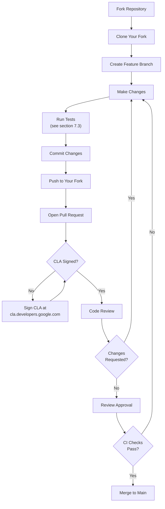
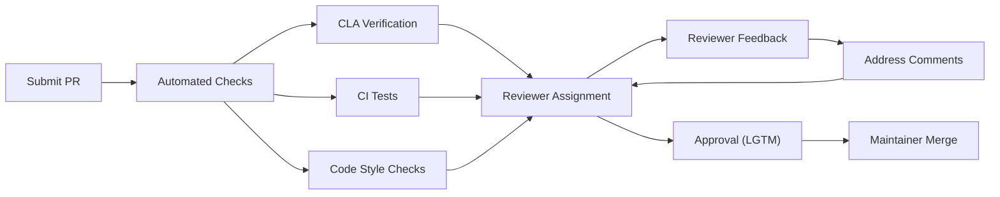
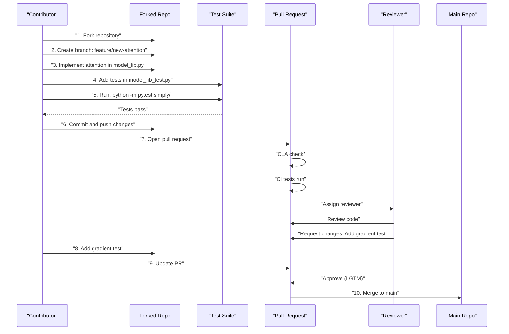

<!-- source: DeepWiki mcp.deepwiki.com · repo google-deepmind/simply · page 7.2 Contributing Guidelines · fetched 2026-10-26 -->

# Contributing Guidelines

<details>
<summary>Relevant source files</summary>

The following files were used as context for generating this wiki page:

- [CONTRIBUTING.md](CONTRIBUTING.md)
- [LICENSE](LICENSE)

</details>


## Purpose and Scope

This document outlines the process for contributing to the Simply research codebase. It covers legal requirements (Contributor License Agreement), code review procedures, and community standards. For information about running tests, see [Testing](#7.3). For guidance on adding new features or extending the codebase, see [Extending Simply](#7.4). For technical dependencies, see [Dependencies and Requirements](#7.1).

**Sources:** [CONTRIBUTING.md:1-25]()

---

## Contributor License Agreement (CLA)

All contributions to Simply require a signed Contributor License Agreement. This legal requirement protects both contributors and the project.

### CLA Requirements

| Requirement | Details |
|-------------|---------|
| **URL** | https://cla.developers.google.com/ |
| **Scope** | Per contributor (individual or employer) |
| **Frequency** | One-time (applies across Google open source projects) |
| **Retention** | You retain copyright to your contributions |
| **Purpose** | Grants permission to use and redistribute contributions |

### When CLA is Required

The CLA must be signed before any contribution can be merged:
- All pull requests (code, documentation, configuration)
- Submissions by external contributors
- Submissions by project members (if not previously signed)

If you have previously signed a Google CLA for another project, you do not need to sign again.

**Sources:** [CONTRIBUTING.md:3-13]()

---

## Code Review Process

Simply uses GitHub pull requests for all code reviews. No submission bypasses this requirement, including contributions from project maintainers.

### Pull Request Workflow



### Code Review Standards

All pull requests undergo review for:

| Review Aspect | Criteria |
|---------------|----------|
| **Functionality** | Changes work as intended; no regressions |
| **Test Coverage** | New code includes appropriate tests |
| **Code Quality** | Follows existing patterns and style |
| **Documentation** | Public APIs are documented; complex logic explained |
| **Performance** | No unnecessary computational overhead |
| **Dependencies** | New dependencies justified and minimal |

**Sources:** [CONTRIBUTING.md:15-20]()

---

## GitHub Pull Request Guidelines

### Creating a Pull Request

1. **Branch from main**: Create a feature branch from the latest `main` branch
2. **Descriptive title**: Use clear, concise PR titles (e.g., "Add flash attention support to TransformerBlock")
3. **Detailed description**: Explain what changes were made and why
4. **Link issues**: Reference related GitHub issues using `#issue_number`
5. **Small, focused changes**: Keep PRs focused on a single feature or fix

### Pull Request Template Structure

```markdown
## Description
[Brief description of changes]

## Motivation
[Why these changes are needed]

## Changes
- [List of specific changes]

## Testing
- [How changes were tested]
- [Reference to test files/functions]

## Checklist
- [ ] Tests pass locally
- [ ] New tests added for new functionality
- [ ] Documentation updated (if applicable)
- [ ] CLA signed
```

### Review Process Details



**Sources:** [CONTRIBUTING.md:15-20]()

---

## Community Guidelines

Simply follows Google's Open Source Community Guidelines. These guidelines establish expectations for respectful, constructive interaction.

### Core Principles

| Principle | Description |
|-----------|-------------|
| **Respectful Communication** | Treat all contributors with respect regardless of experience level |
| **Constructive Feedback** | Focus on the code, not the person; provide actionable suggestions |
| **Inclusive Environment** | Welcome contributors from diverse backgrounds and perspectives |
| **Collaborative Spirit** | Work together toward shared goals; help others succeed |

### Code of Conduct

The full community guidelines are available at:
- **URL**: https://opensource.google/conduct/

These guidelines cover:
- Expected behavior in issues, pull requests, and discussions
- Unacceptable behavior and harassment policies
- Reporting procedures for violations
- Enforcement and consequences

**Sources:** [CONTRIBUTING.md:22-25]()

---

## Best Practices for Simply Contributions

### Code Quality Standards

When contributing to Simply, follow these established patterns:

#### JAX and NumPy Style
- Use JAX transformations (`jit`, `vmap`, `pmap`) appropriately
- Avoid side effects in functions passed to JAX transformations
- Use immutable data structures (pytrees) for model state
- Follow NumPy-style broadcasting conventions

#### Configuration Changes
If modifying experiment configurations:
- Inherit from existing base configurations (see [Creating Custom Configurations](#3.4))
- Register new configurations using the registry pattern from [config_lib.py]()
- Document configuration parameters in docstrings
- Test configurations with small-scale experiments before full runs

#### Model Architecture Changes
For changes to [model_lib.py]():
- Maintain compatibility with existing sharding strategies
- Ensure new components work with KV-caching for inference
- Add tests for gradient computation correctness
- Document computational complexity in docstrings

#### Data Pipeline Changes
For modifications to [data_lib.py]():
- Register new vocabularies in the vocabulary registry
- Ensure datasets work with SeqIO integration
- Test with small batch sizes before production runs
- Document data format requirements

**Sources:** [config_lib.py](), [model_lib.py](), [data_lib.py]()

---

## Contribution Workflow Example

### Example: Adding a New Attention Mechanism



### Contribution Checklist

Before submitting a pull request, verify:

- [ ] **CLA signed** at https://cla.developers.google.com/
- [ ] **Tests added** for new functionality (see [Testing](#7.3))
- [ ] **Tests pass** locally: `python -m pytest simply/`
- [ ] **Code follows existing patterns** in relevant modules
- [ ] **Documentation updated** for public APIs
- [ ] **Commit messages** are descriptive
- [ ] **PR description** explains motivation and changes
- [ ] **No unnecessary dependencies** added
- [ ] **Performance impact** considered for training-critical paths
- [ ] **Sharding compatibility** maintained for model changes

**Sources:** [CONTRIBUTING.md:1-25]()

---

## Common Contribution Types

### Bug Fixes

For bug fixes:
1. Create an issue describing the bug (if not already reported)
2. Reference the issue in your PR description
3. Add a test case that reproduces the bug
4. Verify the test fails before your fix and passes after
5. Consider edge cases that might trigger similar bugs

### New Features

For new features:
1. Discuss the feature in a GitHub issue first (for major features)
2. Follow the extension patterns in [Extending Simply](#7.4)
3. Add comprehensive tests covering normal and edge cases
4. Update documentation in docstrings and wiki pages
5. Provide example configurations or usage in PR description

### Documentation Improvements

Documentation contributions are valuable:
- Fix typos or clarify explanations
- Add examples for complex features
- Update outdated information
- Improve code comments for complex algorithms
- Expand API documentation with usage examples

### Configuration Additions

When adding model configurations:
- Use inheritance from base configs (see [config_lib.py]())
- Test configurations with small-scale runs first
- Document architecture decisions in comments
- Follow naming conventions: `[Family][Size][Task]` (e.g., `Gemma2BRL`)

**Sources:** [CONTRIBUTING.md:1-25](), [config_lib.py]()

---

## Getting Help

If you have questions about contributing:

1. **Check existing documentation**: Review [Getting Started](#2) and relevant API sections (#6.x)
2. **Search issues**: Look for similar questions or problems in GitHub issues
3. **Open a discussion**: Use GitHub Discussions for general questions
4. **Open an issue**: For specific bugs or feature proposals
5. **Reference documentation**: Cite relevant wiki sections in your questions

For technical questions about:
- **Setup and installation**: See [Installation and Setup](#2.1)
- **Running experiments**: See [Running Your First Experiment](#2.3)
- **Testing changes**: See [Testing](#7.3)
- **Extending functionality**: See [Extending Simply](#7.4)

**Sources:** [CONTRIBUTING.md:1-25]()

---

