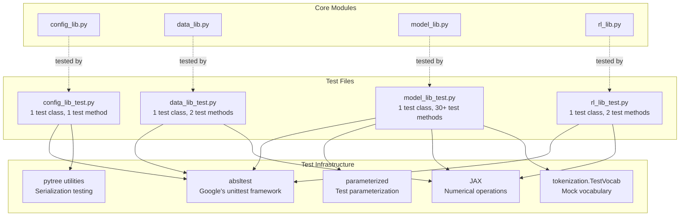
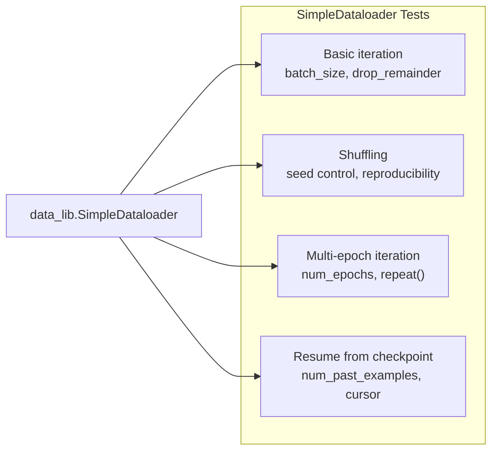
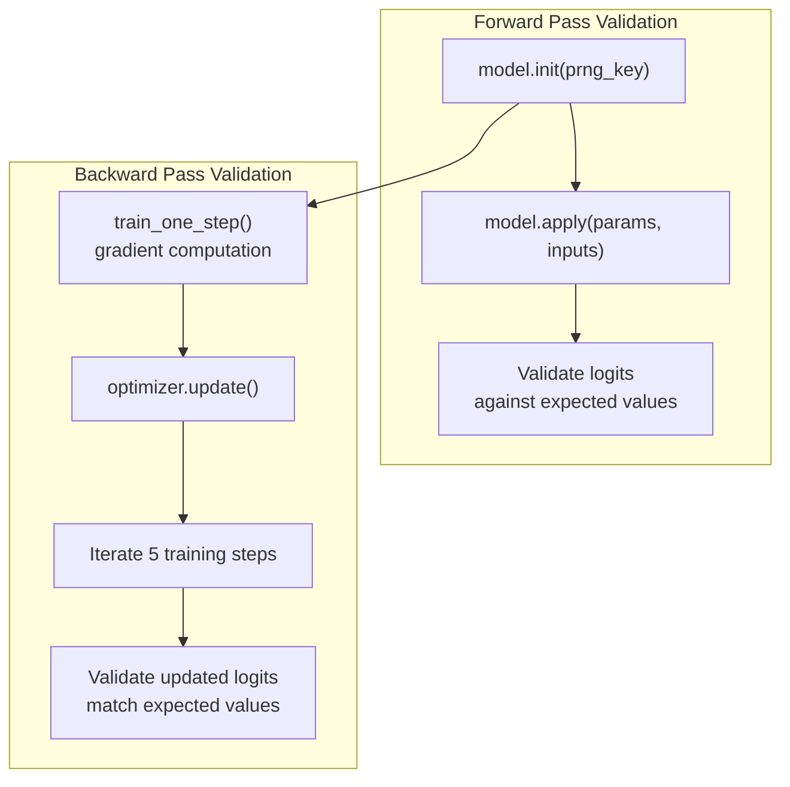
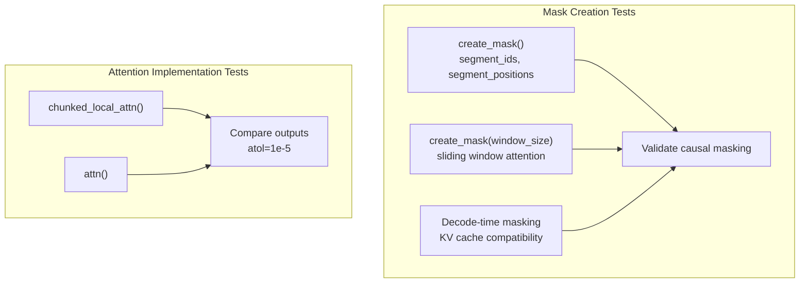
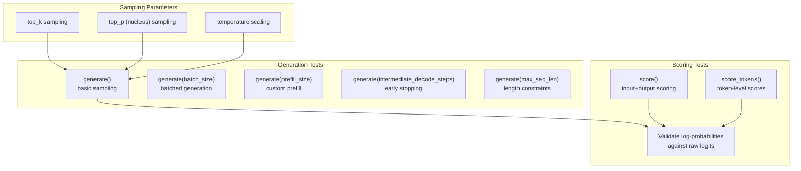
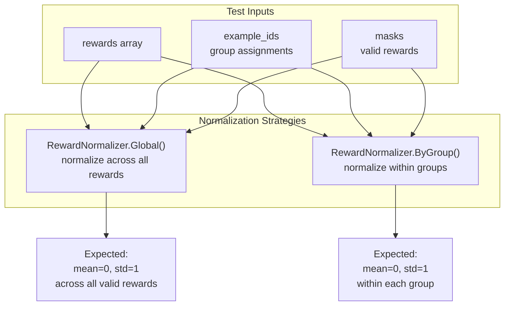

<!-- source: DeepWiki mcp.deepwiki.com · repo google-deepmind/simply · page 7.3 Testing · fetched 2026-10-26 -->

# Testing

<details>
<summary>Relevant source files</summary>

The following files were used as context for generating this wiki page:

- [simply/config_lib_test.py](simply/config_lib_test.py)
- [simply/data_lib_test.py](simply/data_lib_test.py)
- [simply/model_lib_test.py](simply/model_lib_test.py)
- [simply/rl_lib_test.py](simply/rl_lib_test.py)

</details>


This page documents the Simply codebase's test suite, test patterns, and testing infrastructure. It provides guidance for running existing tests and writing new tests when contributing to the codebase.

For information about setting up the development environment and installing dependencies, see [Dependencies and Requirements](#7.1). For contributing code and the review process, see [Contributing Guidelines](#7.2).

---

## Overview

The Simply test suite consists of unit tests for core modules organized as parallel test files. Each primary module (`config_lib.py`, `data_lib.py`, `model_lib.py`, `rl_lib.py`) has a corresponding test file that validates its functionality.

### Test Suite Structure



**Sources:** [simply/config_lib_test.py:1-43](), [simply/data_lib_test.py:1-102](), [simply/model_lib_test.py:1-1373](), [simply/rl_lib_test.py:1-53]()

---

## Running Tests

### Running All Tests

To run the entire test suite:

```bash
# From the repository root
python -m pytest simply/
```

### Running Individual Test Files

```bash
# Run config tests
python -m simply.config_lib_test

# Run data tests
python -m simply.data_lib_test

# Run model tests
python -m simply.model_lib_test

# Run RL tests
python -m simply.rl_lib_test
```

### Running Specific Test Methods

```bash
# Using absltest directly
python -m simply.model_lib_test ModelLibTest.test_forward_pass

# Using pytest
python -m pytest simply/model_lib_test.py::ModelLibTest::test_forward_pass
```

**Sources:** [simply/config_lib_test.py:41-42](), [simply/data_lib_test.py:100-101](), [simply/model_lib_test.py:1371-1372]()

---

## Test Organization by Module

### Configuration Tests (`config_lib_test.py`)

Tests the configuration system's serialization and model instantiation capabilities.

| Test Method | Purpose | Key Validations |
|------------|---------|----------------|
| `test_dump_load_baseline_config` | Configuration serialization | Validates pytree dump/load roundtrip, model creation from config, correct model class registration |

**Test Pattern:**
```python
# 1. Load configuration by name
config = ExperimentConfigRegistry.get_config('TransformerLMTest')
sharding_config = ShardingConfigRegistry.get_config('GSPMDSharding')

# 2. Instantiate model from configuration
model_cls = ModuleRegistry.get(config.model_name)
model = model_cls(config, sharding_config)

# 3. Test pytree serialization roundtrip
py = pytree.dump_dataclasses(model)
loaded_model = pytree.load_dataclasses(py)
loaded_py = pytree.dump_dataclasses(loaded_model)
assert py == loaded_py
```

**Sources:** [simply/config_lib_test.py:23-38]()

---

### Data Pipeline Tests (`data_lib_test.py`)

Tests data loading, preprocessing, and batch iteration.

| Test Method | Purpose | Coverage |
|------------|---------|----------|
| `test_add_chat_mask_to_loss` | Chat loss mask creation | Tests `create_chat_loss_mask` with start/end markers |
| `test_simple_dataloader` | DataLoader functionality | Iteration, batching, shuffling, epochs, random seeds, remainder handling, cursor tracking |

#### SimpleDataloader Test Coverage



**Key Test Assertions:**
- Correct batch size and shape
- Deterministic shuffling with seeds
- Proper epoch boundaries
- Cursor position tracking (`num_past_examples`)
- Drop remainder behavior

**Sources:** [simply/data_lib_test.py:21-98]()

---

### Model Tests (`model_lib_test.py`)

The most comprehensive test suite, covering all aspects of the TransformerLM implementation.

#### Test Configuration

A minimal test configuration is defined for fast test execution:

```python
@dataclasses.dataclass(frozen=True)
class TFMTest(config_lib.TFM1p7BLM1B):
    model_dim: int = 16
    per_head_dim: int = 4
    n_heads: int = 8
    n_layers: int = 2
    vocab_size: int = 64
    seq_len: int = 10
    batch_size: int = 16
```

**Sources:** [simply/model_lib_test.py:38-72]()

#### Forward and Backward Pass Tests



| Test Method | Purpose | Numerical Tolerance |
|------------|---------|---------------------|
| `test_forward_pass` | Forward computation correctness | `atol=1e-5` |
| `test_backward_pass` | Gradient computation and optimization | `atol=1e-5` |
| `test_grad_accumulation` | Gradient accumulation equivalence | `atol=1e-5` |

**Sources:** [simply/model_lib_test.py:81-201](), [simply/model_lib_test.py:202-346](), [simply/model_lib_test.py:348-411]()

#### Attention Mechanism Tests



| Test Method | Validates |
|------------|-----------|
| `test_create_mask` | Causal masking with segment IDs |
| `test_create_mask_with_window_size` | Sliding window attention |
| `test_create_mask_decode` | Decode-time mask generation |
| `test_chunked_local_attn` | Chunked attention equivalence to standard attention |

**Sources:** [simply/model_lib_test.py:538-560](), [simply/model_lib_test.py:562-617](), [simply/model_lib_test.py:619-630](), [simply/model_lib_test.py:632-660]()

#### KV Cache Tests

Tests that autoregressive decoding with KV caching produces identical results to full-sequence computation.

```python
def compute_logits_decoding_from_k(model, params, k):
    # Process first k tokens
    inputs = np.tile(np.array([example[:k]]), (batch, 1))
    init_logits, extra_output = apply_fn(
        params, inputs, decode_state=decode_state,
        segment_positions=segment_positions)
    decode_state = extra_output['decode_state']
    
    # Decode remaining tokens one at a time
    for i in range(k, len(example)):
        inputs = np.tile(np.array([[example[i]]]), (batch, 1))
        logits, extra_output = apply_fn(
            params, inputs, decode_state=decode_state,
            segment_positions=np.array([[i]]))
        decode_state = extra_output['decode_state']
```

**Test validates:** Decoding from position `k=1` produces same logits as decoding from position `k=len(example)` (full prefill).

**Sources:** [simply/model_lib_test.py:666-702]()

#### Precision and Quantization Tests

Parameterized tests validate model execution across different numeric precisions:

| Activation Dtype | Test Coverage |
|-----------------|---------------|
| `float8_e4m3fn` | Forward pass, quantization |
| `float8_e5m2` | Forward pass, quantization |
| `int8` | Forward pass, quantization |
| `bfloat16` | Forward pass, quantization |
| `float16` | Forward pass, quantization |
| `float32` | Forward pass, quantization |

```python
@parameterized.parameters(
    {'activation_dtype_name': 'float8_e4m3fn'},
    {'activation_dtype_name': 'bfloat16'},
    # ...
)
def test_mixed_precision(self, activation_dtype_name):
    config = dataclasses.replace(
        config, activation_dtype_name=activation_dtype_name)
    model = model_lib.TransformerLM(config)
    logits, _ = model.apply(params, batch)
    self.assertEqual(logits.dtype, jnp.dtype(activation_dtype_name))
```

**Sources:** [simply/model_lib_test.py:487-510](), [simply/model_lib_test.py:512-536]()

#### LMInterface Tests

Tests the high-level inference API for text generation and scoring.



| Test Method | Validates |
|------------|-----------|
| `test_lm_interface_generate` | Basic text generation, output lengths |
| `test_lm_interface_batch` | Batched generation consistency |
| `test_lm_interface_generate_with_local_state` | Generation with local attention, various prefill sizes |
| `test_lm_interface_score` | Sequence scoring API |
| `test_lm_interface_score_tokens` | Token-level scoring |
| `test_continue_decoding` | Intermediate decode steps correctness |
| `test_sampling_output_logprobs` | Log-probability computation |
| `test_sampling_token_scores` | Token score computation with different sampling params |
| `test_batch_sampling` | Multi-sample batch generation |
| `test_batch_sampling_with_max_seq_len` | Length-constrained generation |

**Key Assertion Pattern:**
```python
# Validate that LMInterface scores match direct model application
all_tokens = np.array([so.input_token_ids + so.output_token_ids])
logits, _ = self.tfm_lm.apply(params, all_tokens[:, :-1])
token_ll = model_lib.compute_log_likelihood(logits, all_tokens[:, 1:], ...)
np.testing.assert_allclose(
    np.asarray([so.output_token_scores]),
    token_ll[:, len(so.input_token_scores):],
    rtol=1e-5
)
```

**Sources:** [simply/model_lib_test.py:750-823](), [simply/model_lib_test.py:824-864](), [simply/model_lib_test.py:866-893](), [simply/model_lib_test.py:941-997](), [simply/model_lib_test.py:1006-1082]()

#### Sampling Strategy Tests

Tests for top-k and top-p (nucleus) sampling mask generation.

```python
@parameterized.named_parameters(
    ('top_k_1', 1), ('top_k_5', 5), ('top_k_10', 10)
)
def test_top_k_mask(self, top_k: int):
    logits = np.random.randn(5, 10)
    mask = model_lib.top_k_mask(logits, top_k=top_k)
    # Validate exactly top_k tokens are selected
    np.testing.assert_array_equal(jnp.sum(mask, axis=-1), min(top_k, 10))
```

**Sources:** [simply/model_lib_test.py:704-716](), [simply/model_lib_test.py:718-737]()

#### Utility Function Tests

| Test Method | Function Tested | Purpose |
|------------|----------------|---------|
| `test_replace_embeddings` | `_replace_embeddings` | Embedding substitution with masks |
| `test_dim_annotation` | Parameter dimension annotations | Sharding metadata validation |
| `test_tree_norm` | `tree_norm` | PyTree L2 norm computation |
| `test_flatten_dict` | `flatten_dict` | Nested dict flattening |
| `test_segment_info` | Segment-based attention | Segment ID and position handling |
| `test_expand_dim_in_ffn` | FFN expand dimension | Custom FFN hidden size |
| `test_get_scaling_info` | `get_scaling_info` | FLOPs computation |
| `test_n_blocks` | Block construction | Layer count with attention patterns |

**Sources:** [simply/model_lib_test.py:413-434](), [simply/model_lib_test.py:436-485](), [simply/model_lib_test.py:739-742](), [simply/model_lib_test.py:744-748](), [simply/model_lib_test.py:1269-1291]()

---

### Reinforcement Learning Tests (`rl_lib_test.py`)

Tests reward normalization strategies for RL training.

#### RewardNormalizer Tests



| Test Method | Strategy | Validation |
|------------|----------|-----------|
| `test_global` | Global normalization | Mean=0, std=1 across all masked rewards |
| `test_by_group` | Per-group normalization | Mean=0, std=1 within each group |

**Test Pattern:**
```python
rewards = np.array([1.0, 2.0, 3.0, 4.0, 5.0, 6.0, 7.0, 8.0])
example_ids = np.array([1, 1, 2, 2, 3, 3, 4, 4])
masks = np.array([1, 0, 0, 1, 1, 1, 0, 0], dtype=np.bool)

normalizer = rl_lib.RewardNormalizer.Global()
normalized_rewards = normalizer.normalize(rewards, example_ids, masks)

# Validate normalized statistics
subrewards = rewards[masks]
expected = (subrewards - np.mean(subrewards)) / np.std(subrewards)
np.testing.assert_allclose(normalized_rewards[masks], expected)
```

**Sources:** [simply/rl_lib_test.py:21-48]()

---

## Test Patterns and Best Practices

### 1. Parameterized Tests

Use `@parameterized` decorators for testing multiple configurations:

```python
@parameterized.named_parameters(
    dict(testcase_name='scan_prefill_3', use_scan=True, prefill_size=3),
    dict(testcase_name='scan_prefill_4', use_scan=True, prefill_size=4),
    dict(testcase_name='noscan_prefill_4', use_scan=False, prefill_size=4),
)
def test_lm_interface_generate_with_local_state(self, use_scan, prefill_size):
    # Test implementation
```

**Sources:** [simply/model_lib_test.py:824-864]()

### 2. Numerical Comparison

Use appropriate tolerances for floating-point comparisons:

```python
# For CPU tests
np.testing.assert_allclose(output, expected, atol=1e-5)

# For cross-device tests (CPU/GPU/TPU)
np.testing.assert_allclose(output, expected, rtol=1e-5)
```

**Platform Considerations:** Some tests include comments noting they work on CPU but may fail on GPU/TPU due to numerical precision differences and non-associative reductions (e.g., LayerNorm).

**Sources:** [simply/model_lib_test.py:696-702](), [simply/model_lib_test.py:1052-1057]()

### 3. Deterministic Testing

Use fixed random seeds for reproducibility:

```python
seed = 42
prng_key = jax.random.key(seed)
params = model.init(prng_key)
```

**Sources:** [simply/model_lib_test.py:83-84]()

### 4. Test Fixtures

Use `setUp()` to initialize common test resources:

```python
def setUp(self):
    super().setUp()
    self.config = TFMTest()
    self.tfm_lm = model_lib.TransformerLM(self.config)
```

**Sources:** [simply/model_lib_test.py:76-79]()

### 5. Mock Vocabularies

Use `TestVocab` for testing without real tokenizer dependencies:

```python
vocab = tokenization.TestVocab([str(i) for i in range(60)])
lm_interface = model_lib.LMInterface(self.tfm_lm, params, vocab)
```

**Sources:** [simply/model_lib_test.py:751-758]()

---

## Writing New Tests

### Adding Tests to Existing Test Classes

1. **Choose appropriate test file** based on module being tested
2. **Add test method** to existing test class (e.g., `ModelLibTest`)
3. **Use descriptive test names** starting with `test_`
4. **Include docstring** explaining what is being validated

### Test Method Template

```python
def test_new_feature(self):
    """Tests that new_feature produces expected output."""
    # Setup
    config = TFMTest()
    model = model_lib.TransformerLM(config)
    params = model.init(jax.random.key(0))
    
    # Execute
    output = model.new_feature(params, inputs)
    
    # Validate
    expected_output = compute_expected()
    np.testing.assert_allclose(output, expected_output, atol=1e-5)
```

### Parameterized Test Template

```python
@parameterized.named_parameters(
    dict(testcase_name='config_1', param1=value1, param2=value2),
    dict(testcase_name='config_2', param1=value3, param2=value4),
)
def test_parameterized_feature(self, param1, param2):
    """Tests feature with different parameter combinations."""
    # Use param1 and param2 in test logic
```

### Adding New Test Files

If adding a new module (e.g., `new_module.py`), create corresponding test file:

1. Create `new_module_test.py` in same directory
2. Import `absltest` and module under test
3. Create test class inheriting from `absltest.TestCase`
4. Add test methods
5. Include `if __name__ == '__main__': absltest.main()` at end

**Template:**
```python
from absl.testing import absltest
from simply import new_module

class NewModuleTest(absltest.TestCase):
    
    def test_basic_functionality(self):
        """Tests basic functionality of new_module."""
        result = new_module.function_to_test(inputs)
        self.assertEqual(result, expected)

if __name__ == '__main__':
    absltest.main()
```

---

## Common Test Utilities

### pytree Utilities

Used for testing dataclass serialization:

```python
from simply.utils import pytree

# Dump to JSON-serializable format
py = pytree.dump_dataclasses(model)

# Load from JSON-serializable format
loaded_model = pytree.load_dataclasses(py)
```

**Sources:** [simply/config_lib_test.py:35-37]()

### Test Vocabulary

Mock vocabulary for testing text processing without real tokenizers:

```python
from simply.utils import tokenization

# Create test vocabulary
vocab = tokenization.TestVocab([str(i) for i in range(vocab_size)])

# Use in tests
tokens = vocab.encode("1 2 3")  # Returns: [1, 2, 3]
```

**Sources:** [simply/model_lib_test.py:751]()

### Custom Test Vocabularies

For specialized testing (e.g., non-text modalities), create custom vocabulary classes:

```python
class TestNpArrayQuantizer(tokenization.SimplyVocab[np.ndarray]):
    """Example: vocabulary that encodes numpy arrays."""
    
    def encode(self, raw_sequence: np.ndarray) -> list[int]:
        # Custom encoding logic
        pass
    
    def decode(self, token_ids: list[int]) -> np.ndarray:
        # Custom decoding logic
        pass
```

**Sources:** [simply/model_lib_test.py:1326-1369]()

---

## Test Coverage Summary

### Coverage by Module

| Module | Test File | Test Count | Key Areas |
|--------|-----------|------------|-----------|
| `config_lib.py` | `config_lib_test.py` | 1 | Configuration serialization, model instantiation |
| `data_lib.py` | `data_lib_test.py` | 2 | Data loading, batching, chat masking |
| `model_lib.py` | `model_lib_test.py` | 30+ | Forward/backward pass, attention, KV cache, LMInterface, sampling |
| `rl_lib.py` | `rl_lib_test.py` | 2 | Reward normalization |

### Critical Test Categories

1. **Numerical Correctness**: Forward/backward pass validation against known outputs
2. **Interface Contracts**: LMInterface generation and scoring APIs
3. **Optimization**: Gradient accumulation equivalence, optimizer integration
4. **Precision Support**: float8, int8, bfloat16, float16, float32
5. **Attention Mechanisms**: Causal masking, window attention, KV caching
6. **Serialization**: Pytree dump/load roundtrips
7. **Sampling**: Top-k, top-p, temperature scaling
8. **Batching**: Variable-length sequences, padding, masking

**Sources:** [simply/config_lib_test.py:1-43](), [simply/data_lib_test.py:1-102](), [simply/model_lib_test.py:1-1373](), [simply/rl_lib_test.py:1-53]()

---

## Continuous Integration

When contributing to Simply, ensure:

1. **All existing tests pass** before submitting pull requests
2. **New features include tests** covering main functionality
3. **Tests are deterministic** (use fixed random seeds)
4. **Numerical tolerances are appropriate** for cross-platform compatibility
5. **Test names are descriptive** and follow `test_*` convention

For more information on the contribution process, see [Contributing Guidelines](#7.2).

---

