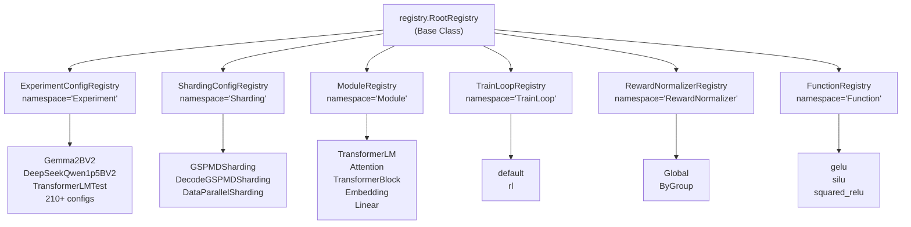
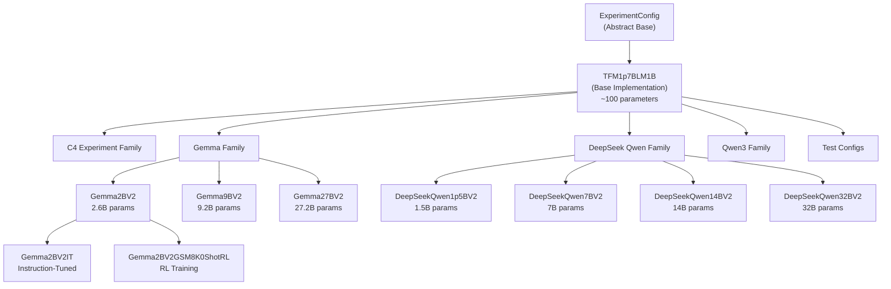
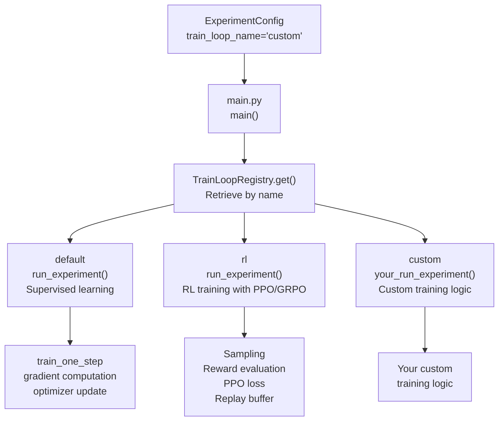
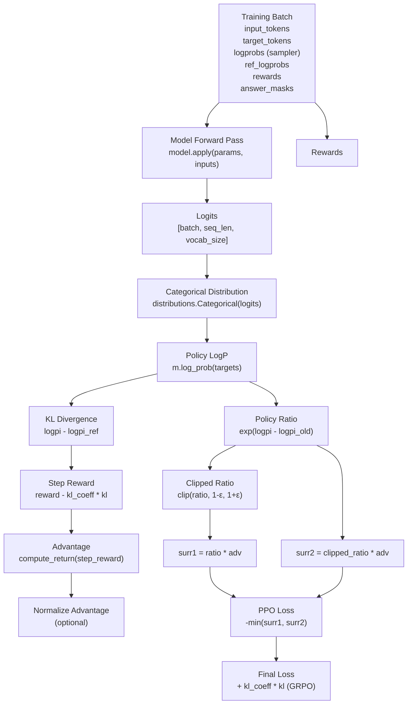
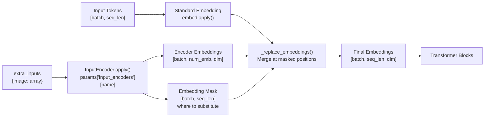
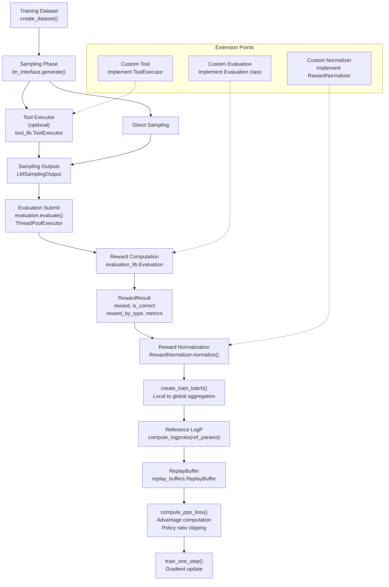
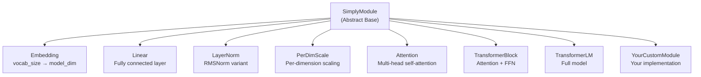

<!-- source: DeepWiki mcp.deepwiki.com · repo google-deepmind/simply · page 7.4 Extending Simply · fetched 2026-10-26 -->

# Extending Simply

<details>
<summary>Relevant source files</summary>

The following files were used as context for generating this wiki page:

- [simply/config_lib.py](simply/config_lib.py)
- [simply/model_lib.py](simply/model_lib.py)
- [simply/rl_lib.py](simply/rl_lib.py)

</details>


## Purpose and Scope

This document provides technical guidance for extending the Simply codebase with custom functionality. It covers the registry-based extension system, implementation patterns for new components, and integration procedures. For information about using existing model configurations, see [Model Configuration Catalog](#3.2). For details on the existing training systems, see [Training Systems](#4.4).

---

## Extension Architecture Overview

Simply uses a **registry pattern** to enable modular extensions without modifying core code. Components register themselves using decorators, making them discoverable at runtime through string-based lookups.

### Core Registry Classes



**Sources:** [simply/config_lib.py:76-90](), [simply/model_lib.py:41-42](), [simply/rl_lib.py:256-258]()

### Registration Pattern

All extensions follow this pattern:

```python
@RegistryClass.register
@dataclasses.dataclass(frozen=True)
class CustomComponent(BaseClass):
    # Component implementation
```

Components are retrieved by name:
```python
component = RegistryClass.get('ComponentName')()
```

**Sources:** [simply/config_lib.py:76-90](), [simply/model_lib.py:118-161]()

---

## Adding New Model Configurations

### Configuration Inheritance Hierarchy



**Sources:** [simply/config_lib.py:192-343](), [simply/config_lib.py:577-669](), [simply/config_lib.py:1094-1335]()

### Creating a New Configuration

**Step 1: Define the configuration class**

```python
@ExperimentConfigRegistry.register
@dataclasses.dataclass(frozen=True)
class CustomModel(TFM1p7BLM1B):  # Inherit from base
    # Override architectural parameters
    model_dim: int = 1024
    n_heads: int = 8
    n_layers: int = 12
    per_head_dim: int = 128
    
    # Override training parameters
    batch_size: int = 128
    num_train_steps: int = 50_000
    lr: opt_lib.Schedule = opt_lib.LinearWarmupCosineDecay(
        value=1e-3,
        warmup_steps=1_000,
        steps_after_decay=0,
        end_decay=0.1,
    )
    
    # Set checkpoint path
    init_ckpt_dir: str = '/path/to/checkpoint'
    vocab_name: str = 'custom_vocab'
```

**Step 2: Use `apply_config_diff` for variants**

For creating model size variants, use the `apply_config_diff` utility:

```python
@ExperimentConfigRegistry.register
def CustomModel7B():
    return apply_config_diff(
        config=CustomModel1p5B(),
        diff_base=BaseModel1p5B(),
        diff_new=BaseModel7B()
    )
```

This pattern automatically transfers only the differing fields between base configurations.

**Sources:** [simply/config_lib.py:1373-1542]()

### Configuration Parameter Categories

| Category | Key Parameters |
|----------|----------------|
| **Architecture** | `model_dim`, `n_heads`, `n_layers`, `per_head_dim`, `expand_factor`, `n_kv_heads` |
| **Attention** | `use_flash_attention`, `window_size`, `attn_soft_cap`, `use_qk_norm` |
| **Normalization** | `use_rmsnorm`, `use_pre_ln`, `use_post_ln`, `norm_scale_plus_one`, `rms_norm_epsilon` |
| **FFN** | `use_gated_activation_in_ffn`, `ffn_activation`, `ffn_use_bias`, `ffn_expand_dim` |
| **Training** | `batch_size`, `num_train_steps`, `lr`, `optimizer`, `weight_decay`, `grad_accum_steps` |
| **Data** | `dataset_name`, `seq_len`, `vocab_size`, `use_packing`, `use_validation_set` |
| **Checkpointing** | `init_ckpt_dir`, `init_ckpt_step`, `init_ckpt_format`, `ckpt_interval` |
| **RL-specific** | `train_batch_size`, `gamma`, `kl_coeff`, `use_grpo`, `normalize_reward_method` |

**Sources:** [simply/config_lib.py:192-343]()

---

## Creating Custom Model Architectures

### Model Component Pipeline

```mermaid
graph LR
    Input["Input Tokens<br/>[batch, seq_len]"]
    
    Input --> Embed["Embedding Layer<br/>params['embed']<br/>Embedding.apply()"]
    Embed --> InputEnc["Input Encoders<br/>(Optional)<br/>params['input_encoders']"]
    
    InputEnc --> Block0["TransformerBlock 0<br/>params['block_0']"]
    Block0 --> Block1["TransformerBlock 1<br/>params['block_1']"]
    Block1 --> BlockN["...<br/>TransformerBlock N"]
    
    BlockN --> FinalLN["Final LayerNorm<br/>params['final_ln']"]
    FinalLN --> Output["Output Layer<br/>params['output_layer']<br/>Linear.apply()"]
    
    Output --> Logits["Logits<br/>[batch, seq_len, vocab_size]"]
    
    subgraph "TransformerBlock Components"
        PreLN0["Pre LayerNorm 0<br/>params['pre_ln_0']"]
        Attn["Attention<br/>params['attn']"]
        PreLN1["Pre LayerNorm 1<br/>params['pre_ln_1']"]
        FFN0["FFN Layer 0<br/>params['ffn_0']"]
        FFN1["FFN Layer 1<br/>params['ffn_1']"]
    end
```



**Sources:** [simply/model_lib.py:1342-1435](), [simply/model_lib.py:1488-1752]()

### Adding a Custom Module

**Step 1: Define the module class**

```python
@module.ModuleRegistry.register
@dataclasses.dataclass
class CustomAttention(module.SimplyModule):
    model_dim: int
    n_heads: int
    # ... parameters
    
    # Mixed precision
    weight_dtype: DTypeLike = 'float32'
    activation_dtype: DTypeLike = 'bfloat16'
    
    # Sharding annotations
    qkv_partition: PartitionAnnotation = None
    output_partition: PartitionAnnotation = None
    
    def setup(self) -> None:
        """Initialize submodules."""
        # Create subcomponents
        pass
    
    def init(self, prng_key: PRNGKey) -> PyTree:
        """Initialize parameters."""
        params = {}
        # Initialize weights with proper sharding
        params['custom_weight'] = initializer.XavierUniformInit()(
            prng_key,
            shape=[self.model_dim, self.model_dim],
            dim_annotation='io',
            dtype=self.weight_dtype,
        )
        params['custom_weight'] = sharding_lib.with_sharding_constraint(
            params['custom_weight'], self.qkv_partition
        )
        params['custom_weight'] = AnnotatedArray.create(
            params['custom_weight'], dim_annotation='io'
        )
        return params
    
    def apply(
        self,
        params: PyTree,
        x: Array,
        *,
        segment_ids: Array,
        segment_positions: Array,
        decode_state: PyTree = None,
    ) -> tuple[Array, PyTree]:
        """Forward pass."""
        params = get_raw_arrays(params)
        # Implement custom logic
        output = ...
        extra_output = {'decode_state': decode_state}
        return output, extra_output
```

**Step 2: Integrate into TransformerBlock**

Modify the `TransformerBlock` setup to use your custom module by specifying it in the config or subclassing `TransformerBlock`.

**Sources:** [simply/model_lib.py:617-1081](), [simply/model_lib.py:118-290]()

### Key Module Interface Requirements

All custom modules must implement:

1. **`setup()`** - Initialize submodules (optional)
2. **`init(prng_key)`** - Return parameter PyTree
3. **`apply(params, inputs, ...)`** - Forward pass returning `(output, extra_output)`

Parameter initialization must include:
- Proper dtype casting (`weight_dtype`, `activation_dtype`)
- Sharding constraints via `with_sharding_constraint()`
- `AnnotatedArray.create()` wrapping with `dim_annotation`

**Sources:** [simply/model_lib.py:118-290]()

---

## Implementing Custom Training Loops

### Training Loop Registration System



**Sources:** [simply/model_lib.py:1917-2064](), [simply/rl_lib.py:751-1358]()

### Creating a Custom Training Loop

**Step 1: Define the training loop function**

```python
@model_lib.TrainLoopRegistry.register(name='custom')
def run_experiment(
    config,
    sharding_config,
    mesh_shape,
    create_dataset,
    experiment_dir='',
    dcn_mesh_shape=None,
    decoding_mesh_shape=None,
):
    """Custom training loop implementation."""
    
    # Setup mesh and experiment helper
    sharding_lib.set_default_mesh_shape(
        mesh_shape=mesh_shape, dcn_mesh_shape=dcn_mesh_shape
    )
    helper = exp_helper.ExperimentHelper(
        experiment_dir,
        ckpt_interval=config.ckpt_interval,
        ckpt_max_to_keep=config.ckpt_max_to_keep,
        num_train_steps=config.num_train_steps,
        metric_log_interval=config.tb_log_interval,
    )
    
    # Create model and load state
    model, _ = model_lib.create_model(config, sharding_config)
    state = model_lib.get_init_state(
        config, sharding_config, helper.ckpt_mngr, helper.ckpt_dir
    )
    
    # Define custom loss function
    def custom_loss_fn(model, params, batch):
        logits, _ = model.apply(params, batch['inputs'])
        # Implement custom loss logic
        loss = ...
        log_dict = {'custom_metric': ...}
        return loss, log_dict
    
    # Compile training step
    train_one_step_fn = functools.partial(
        model_lib.train_one_step,
        model=model,
        opt=config.optimizer,
        custom_loss_fn=custom_loss_fn,
        grad_accum_steps=config.grad_accum_steps,
        clip_grad_norm=config.clip_grad_norm,
    )
    train_one_step_fn = jax.jit(train_one_step_fn)
    
    # Training loop
    train_set, eval_set = create_dataset(config)
    for batch in train_set:
        loss, state, log_dict = train_one_step_fn(
            state=state,
            batch=batch,
            lr=lr_schedule(state['steps']),
        )
        # Log metrics, save checkpoints
        if helper.should_log_metrics(steps):
            helper.write_scalars(steps, log_dict)
    
    helper.close()
```

**Sources:** [simply/model_lib.py:1917-2064](), [simply/rl_lib.py:751-1358]()

### Custom Loss Function Interface

Loss functions must follow this signature:

```python
def custom_loss_fn(
    model: SimplyModule,
    params: PyTree,
    batch: dict[str, Array],
) -> tuple[float, dict[str, Any]]:
    """
    Args:
        model: The model instance
        params: Model parameters
        batch: Input batch with keys like 'input_tokens', 'target_tokens'
    
    Returns:
        loss: Scalar loss value
        log_dict: Dictionary of metrics to log
    """
    logits, _ = model.apply(params, batch['input_tokens'])
    loss = compute_loss(logits, batch['target_tokens'])
    log_dict = {'custom_metric': metric_value}
    return loss, log_dict
```

**Sources:** [simply/model_lib.py:1836-1876](), [simply/rl_lib.py:547-701]()

---

## Custom Loss Functions

### PPO Loss Implementation Example



**Sources:** [simply/rl_lib.py:547-701]()

### Implementing a Custom Loss

```python
def custom_contrastive_loss(
    model,
    params: PyTree,
    batch: dict[str, Array],
    temperature: float = 0.07,
) -> tuple[float, dict[str, Any]]:
    """Custom contrastive learning loss."""
    
    # Extract embeddings
    embeddings, _ = model.apply(
        params,
        batch['input_tokens'],
        segment_ids=batch.get('segment_ids'),
        segment_positions=batch.get('segment_positions'),
    )
    
    # Pool embeddings (e.g., mean pooling over sequence)
    mask = batch['target_masks']
    pooled = masked.masked_mean(embeddings, mask=mask, axis=1)
    
    # Compute similarity matrix
    normalized = pooled / jnp.linalg.norm(pooled, axis=-1, keepdims=True)
    similarity = jnp.matmul(normalized, normalized.T) / temperature
    
    # Contrastive loss
    labels = jnp.arange(similarity.shape[0])
    loss = jax.nn.softmax_cross_entropy_with_integer_labels(
        similarity, labels
    )
    
    log_dict = {
        'contrastive_loss': loss,
        'similarity_mean': jnp.mean(similarity),
    }
    
    return jnp.mean(loss), log_dict
```

Pass this to `train_one_step` via the `custom_loss_fn` parameter.

**Sources:** [simply/model_lib.py:1836-1876]()

---

## Adding Input Encoders

### Input Encoder Interface

Input encoders enable multimodal inputs (e.g., images, audio) by converting them to embeddings that substitute into the token sequence.



**Sources:** [simply/model_lib.py:1308-1340](), [simply/model_lib.py:1551-1571]()

### Creating a Custom Input Encoder

```python
@dataclasses.dataclass
class ImageInputEncoder(InputEncoderInterface):
    """Encodes images as embeddings."""
    
    name: str = 'image_encoder'
    extra_input_keys: Tuple[str, ...] = ('image',)
    
    # Architecture parameters
    image_size: int = 224
    patch_size: int = 16
    embed_dim: int = 768
    
    def setup(self):
        """Initialize vision transformer components."""
        self.patch_embed = Linear(
            self.patch_size * self.patch_size * 3,
            self.embed_dim,
        )
    
    def init(self, prng_key: PRNGKey) -> PyTree:
        """Initialize parameters."""
        params = {}
        params['patch_embed'] = self.patch_embed.init(prng_key)
        return params
    
    def apply(
        self,
        params: PyTree,
        x: Array,  # Input tokens (not used for images)
        image: Array,  # [batch, height, width, channels]
    ) -> InputEncoderInterface.Output:
        """Convert image to embeddings."""
        
        # Patchify image
        batch_size = image.shape[0]
        patches = einops.rearrange(
            image,
            'b (h p1) (w p2) c -> b (h w) (p1 p2 c)',
            p1=self.patch_size,
            p2=self.patch_size,
        )
        
        # Project patches to embeddings
        embeddings = self.patch_embed.apply(params['patch_embed'], patches)
        
        # Create mask for where to insert embeddings
        # Assume special token  at position 0
        embedding_mask = jnp.zeros((batch_size, x.shape[1]), dtype=bool)
        embedding_mask = embedding_mask.at[:, 0].set(True)
        
        return InputEncoderInterface.Output(
            embeddings=embeddings,
            embedding_mask=embedding_mask,
        )
```

**Step 2: Add to configuration**

```python
@ExperimentConfigRegistry.register
@dataclasses.dataclass(frozen=True)
class MultimodalModel(TFM1p7BLM1B):
    input_encoders: list[Any] = dataclasses.field(
        default_factory=lambda: [
            ImageInputEncoder(
                name='image_encoder',
                image_size=224,
                patch_size=16,
                embed_dim=2048,  # Match model_dim
            )
        ]
    )
```

**Step 3: Pass images in dataset**

```python
batch = {
    'input_tokens': tokens,  # Shape: [batch, seq_len]
    'target_tokens': targets,
    'extra_inputs': {
        'image': images,  # Shape: [batch, H, W, C]
    }
}
```

**Sources:** [simply/model_lib.py:1308-1340](), [simply/model_lib.py:1457-1486]()

---

## Extending RL Components

### RL Training Pipeline Extension Points



**Sources:** [simply/rl_lib.py:751-1358]()

### Creating a Custom Reward Normalizer

```python
class RewardNormalizer:
    
    @RewardNormalizerRegistry.register
    class CustomNormalizer(RewardNormalizer.Base):
        """Custom reward normalization strategy."""
        
        def normalize(
            self,
            rewards: np.ndarray,
            example_ids: np.ndarray,
            masks: np.ndarray,
        ) -> np.ndarray:
            """
            Args:
                rewards: 1D array of rewards [num_samples]
                example_ids: 1D array of example IDs [num_samples]
                masks: 1D array of valid sample masks [num_samples]
            
            Returns:
                Normalized rewards [num_samples]
            """
            # Custom normalization logic
            # Example: rank-based normalization
            valid_rewards = rewards[masks]
            ranks = np.argsort(np.argsort(valid_rewards))
            normalized = (ranks - ranks.mean()) / (ranks.std() + 1e-8)
            
            result = np.zeros_like(rewards)
            result[masks] = normalized
            return result
```

**Usage in config:**

```python
@dataclasses.dataclass(frozen=True)
class CustomRLConfig(BaseConfig):
    normalize_reward_method: str = 'CustomNormalizer'
```

**Sources:** [simply/rl_lib.py:256-327]()

### Creating a Custom Evaluation

```python
class CustomEvaluation(eval_lib.Evaluation):
    """Custom evaluation logic for RL rewards."""
    
    def get_messages(self, example: dict) -> list[dict]:
        """Convert example to messages for LM format."""
        return [
            {'role': 'user', 'content': example['question']},
        ]
    
    def evaluate(
        self,
        example: dict,
        response: str,
    ) -> dict[str, Any]:
        """
        Evaluate a response and return reward.
        
        Returns:
            Dict with keys:
                - 'reward': float, the reward value
                - 'correct': bool, whether answer is correct
                - 'reward_types': list of reward type strings (optional)
                - 'reward_result': RewardResult object (optional)
        """
        # Custom evaluation logic
        ground_truth = example['answer']
        is_correct = self._check_correctness(response, ground_truth)
        
        # Assign reward
        reward = 1.0 if is_correct else -1.0
        
        return {
            'reward': reward,
            'correct': is_correct,
            'reward_types': ['exact_match'],
        }
    
    def _check_correctness(self, response: str, ground_truth: str) -> bool:
        """Implement your correctness checking logic."""
        # Custom logic here
        return response.strip() == ground_truth.strip()
```

**Usage in config:**

```python
@dataclasses.dataclass(frozen=True)
class CustomRLConfig(BaseConfig):
    evaluation: eval_lib.Evaluation = CustomEvaluation()
```

**Sources:** [simply/rl_lib.py:122-254](), [simply/rl_lib.py:872-873]()

---

## Custom Modules and Layers

### Module Hierarchy



**Sources:** [simply/model_lib.py:118-1340]()

### Creating Custom Layers

**Example: Custom normalization layer**

```python
@module.ModuleRegistry.register
@dataclasses.dataclass
class AdaptiveLayerNorm(module.SimplyModule):
    """Layer normalization with adaptive scaling."""
    
    dim: int
    num_conditions: int = 10
    weight_dtype: DTypeLike = 'float32'
    activation_dtype: DTypeLike = 'bfloat16'
    
    def init(self, prng_key: PRNGKey) -> PyTree:
        key1, key2, key3 = jax.random.split(prng_key, 3)
        params = {}
        
        # Standard layernorm parameters
        params['scale'] = jnp.ones(self.dim, dtype=self.weight_dtype)
        params['bias'] = jnp.zeros(self.dim, dtype=self.weight_dtype)
        
        # Adaptive parameters
        params['condition_embed'] = jax.random.normal(
            key1, [self.num_conditions, self.dim], dtype=self.weight_dtype
        )
        
        # Wrap with AnnotatedArray
        for k in ['scale', 'bias', 'condition_embed']:
            params[k] = AnnotatedArray.create(
                params[k], dim_annotation='h'
            )
        
        return params
    
    def apply(
        self,
        params: PyTree,
        x: Array,
        condition_id: int | Array | None = None,
    ) -> Array:
        params = get_raw_arrays(params)
        
        # Standard normalization
        x = x.astype(jnp.float32)
        mean = jnp.mean(x, axis=-1, keepdims=True)
        var = jnp.var(x, axis=-1, keepdims=True)
        x = (x - mean) / jnp.sqrt(var + 1e-6)
        
        # Apply adaptive scaling if condition provided
        if condition_id is not None:
            scale_modifier = params['condition_embed'][condition_id]
            scale = params['scale'] * (1.0 + scale_modifier)
        else:
            scale = params['scale']
        
        x = x * scale + params['bias']
        return x.astype(self.activation_dtype)
```

**Sources:** [simply/model_lib.py:223-290](), [simply/model_lib.py:292-317]()

---

## Integration Checklist

When extending Simply, ensure you address these integration points:

### 1. **Sharding Annotations**

All parameters must specify sharding:

```python
# During initialization
param = sharding_lib.with_sharding_constraint(param, partition_spec)
param = AnnotatedArray.create(param, dim_annotation='io')

# During forward pass
output = sharding_lib.with_sharding_constraint(output, partition_spec)
```

| Annotation | Meaning | Example |
|------------|---------|---------|
| `'io'` | Input-output dimensions | Weight matrices `[in_dim, out_dim]` |
| `'oii'` | Output projection | Attention output `[out_dim, n_heads, per_head_dim]` |
| `'ioo'` | Input projection | QKV weights |
| `'h'` | Hidden dimension | Biases, layer norm parameters |
| `'.ioo'` | Leading batch dim | Stacked parameters `[3, dim, heads, per_head]` |

**Sources:** [simply/model_lib.py:138-206]()

### 2. **Mixed Precision Handling**

Handle dtype conversions properly:

```python
# Convert params to activation dtype
w = common.convert_or_dequantize(params['weight'], dtype=self.activation_dtype)

# Ensure numerical stability in float32
x = x.astype(jnp.float32)
# ... computation ...
x = x.astype(self.activation_dtype)
```

**Sources:** [simply/model_lib.py:144-160](), [simply/model_lib.py:265-289]()

### 3. **Decode State Management**

For autoregressive generation, handle KV caching:

```python
def apply(self, params, x, *, decode_state=None, ...):
    # Update decode state
    k, v, seg_pos, seg_ids, decode_state = updated_decode_state(
        k=k,
        v=v,
        segment_positions=segment_positions,
        segment_ids=segment_ids,
        decode_state=decode_state,
        window_size=self.window_size,
    )
    
    # Return new decode state
    extra_output = {'decode_state': decode_state}
    return output, extra_output
```

**Sources:** [simply/model_lib.py:365-461]()

### 4. **Gradient Accumulation**

For large batch sizes:

```python
config = dataclasses.replace(
    config,
    grad_accum_steps=4,  # Accumulate over 4 microbatches
)
```

Ensure `train_batch_size` is divisible by `grad_accum_steps`.

**Sources:** [simply/config_lib.py:301](), [simply/model_lib.py:1836-1915]()

### 5. **Checkpoint Format Compatibility**

When loading pretrained checkpoints:

```python
init_ckpt_format: str = 'Gemma3pFormat'  # or 'Gemma3pLegacyFormat'
```

Available formats are registered in checkpoint conversion utilities.

**Sources:** [simply/config_lib.py:617-618](), [simply/config_lib.py:725]()

### 6. **Validation During Development**

Test your extensions with small configs:

```python
@ExperimentConfigRegistry.register
@dataclasses.dataclass(frozen=True)
class CustomModelTest(TransformerLMTest):
    """Small test version of your custom model."""
    # Override with your custom components
    model_name: str = 'CustomTransformerLM'
    num_train_steps: int = 10
```

**Sources:** [simply/config_lib.py:1647-1684]()

### 7. **Logging and Metrics**

Add custom metrics to training loops:

```python
log_dict = {
    'custom_metric': metric_value,
    'loss_component_1': component_1,
    'loss_component_2': component_2,
}
return loss, log_dict
```

These appear in TensorBoard automatically.

**Sources:** [simply/rl_lib.py:692-701]()

### 8. **Registry Namespacing**

When creating new registries, define unique namespaces:

```python
class CustomRegistry(registry.RootRegistry):
    namespace: str = 'CustomComponent'
```

**Sources:** [simply/config_lib.py:76-90]()

---

## Testing Extensions

### Unit Testing Pattern

```python
def test_custom_module():
    """Test custom module initialization and forward pass."""
    import jax
    
    # Create module
    module = CustomModule(
        model_dim=256,
        activation_dtype='float32',
    )
    
    # Initialize parameters
    prng_key = jax.random.key(42)
    params = module.init(prng_key)
    
    # Test forward pass
    batch_size, seq_len = 2, 16
    x = jax.random.normal(prng_key, [batch_size, seq_len, 256])
    
    output, extra = module.apply(params, x)
    
    # Verify output shape
    assert output.shape == (batch_size, seq_len, 256)
    
    # Verify no NaNs
    assert not jnp.any(jnp.isnan(output))
```

### Integration Testing

Use `TransformerLMTest` config for fast iteration:

```bash
python -m simply.main \
  --experiment_config=CustomModelTest \
  --experiment_dir=/tmp/test_custom_model
```

**Sources:** [simply/config_lib.py:1647-1684]()

---

## Summary

Simply's extension system provides multiple integration points:

| Extension Type | Registry | Base Class | Key Methods |
|----------------|----------|------------|-------------|
| Model Config | `ExperimentConfigRegistry` | `ExperimentConfig` | Dataclass fields |
| Sharding | `ShardingConfigRegistry` | N/A (dataclass) | Partition specifications |
| Module/Layer | `ModuleRegistry` | `SimplyModule` | `init()`, `apply()` |
| Training Loop | `TrainLoopRegistry` | Function | `run_experiment()` |
| Loss Function | N/A | Function | `custom_loss_fn()` |
| Input Encoder | N/A | `InputEncoderInterface` | `init()`, `apply()` |
| Reward Normalizer | `RewardNormalizerRegistry` | `RewardNormalizer.Base` | `normalize()` |
| Activation Function | `FunctionRegistry` | Function | Standard function |

For adding new datasets and vocabularies, see [Data Pipeline](#4.3). For details on checkpoint format conversion, see [Working with Pretrained Models](#5.4).

**Sources:** [simply/config_lib.py:76-90](), [simply/model_lib.py:40-42](), [simply/rl_lib.py:256-258]()