# Page: Overview

# Overview

<details>
<summary>Relevant source files</summary>

The following files were used as context for generating this wiki page:

- [README.md](README.md)
- [requirements.txt](requirements.txt)
- [setup/setup_assets.py](setup/setup_assets.py)

</details>


## Purpose and Scope

This document provides an introduction to the Simply research codebase, explaining its design philosophy, core capabilities, and high-level architecture. Simply is a minimal, JAX-based framework for training and evaluating large language models (LLMs) and other autoregressive models. This page covers the conceptual foundation and system-level organization. For detailed setup instructions, see [Getting Started](#2). For architecture details, see [Architecture](#4).

**Sources:** [README.md:1-91]()

## Design Philosophy

Simply follows three core principles:

1. **Minimal Abstractions**: The codebase avoids deep abstraction layers. Most research logic is implemented directly using JAX primitives (`jit`, `vmap`, `pmap`, `grad`). Researchers can read and understand the full implementation path from experiment configuration to gradient computation.

2. **Self-Contained**: Primary dependencies are JAX (computation), Orbax (checkpoints), and SeqIO (data pipelines). No custom distributed training frameworks or proprietary systems. A researcher familiar with JAX can understand the entire codebase.

3. **Rapid Iteration**: Implement research ideas (new architectures, optimizers, losses) in hours rather than days. The codebase prioritizes quick fork-and-hack workflows over feature comprehensiveness.

**Sources:** [README.md:4-8]()

## Core Capabilities

Simply supports the following research workflows:

| Capability | Description | Reference |
|-----------|-------------|-----------|
| **Model Training** | Supervised pretraining and fine-tuning of transformer language models | [Architecture: Training Systems](#4.4) |
| **Reinforcement Learning** | PPO and GRPO training for reasoning tasks (GSM8K, MATH) | [RL Training Guide](#5.2) |
| **Text Generation** | Autoregressive decoding with KV-caching and various sampling strategies | [Inference Guide](#5.3) |
| **Distributed Training** | Multi-device and multi-host training with configurable sharding | [Distributed Training](#5.5) |
| **Checkpoint Management** | Load pretrained models (Gemma, DeepSeek, Qwen) and save/restore training state | [Working with Pretrained Models](#5.4) |

**Sources:** [README.md:1-91]()

## System Architecture

The following diagram illustrates the major subsystems and their relationships:

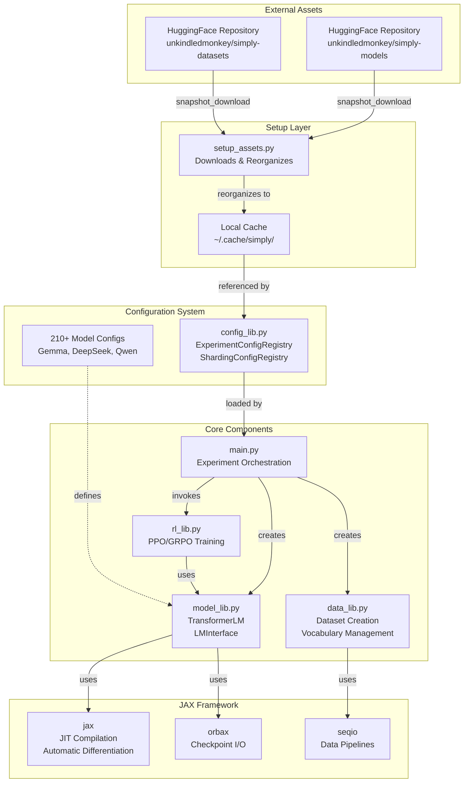

**Key Execution Flow:**

1. **Setup Phase**: `setup_assets.py` downloads pretrained checkpoints and datasets from HuggingFace, reorganizing them into Simply's expected directory structure.

2. **Configuration Loading**: `main.py` loads an experiment configuration by name (e.g., `Gemma2BV2`) from `ExperimentConfigRegistry` or from a JSON file path.

3. **Component Initialization**: Based on the configuration, `main.py` instantiates the model (`TransformerLM`), creates datasets using `data_lib.py`, and selects a training loop (standard supervised or RL).

4. **Training Execution**: The training loop uses JAX for gradient computation, Orbax for checkpointing, and iterates until completion or early stopping.

**Sources:** [README.md:10-21](), [README.md:44-60](), [setup/setup_assets.py:1-289]()

## Code Organization

The codebase follows a flat module structure:

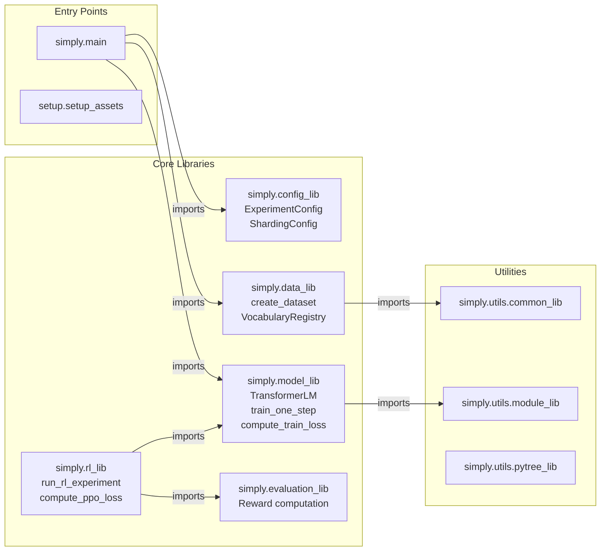

| Module | Primary Classes/Functions | Purpose |
|--------|---------------------------|---------|
| `main.py` | `main()` | CLI entrypoint, orchestrates experiments |
| `config_lib.py` | `ExperimentConfig`, `ShardingConfig`, registries | Defines experiment parameters and model architectures |
| `model_lib.py` | `TransformerLM`, `LMInterface`, `train_one_step()` | Model implementation and training logic |
| `data_lib.py` | `create_dataset()`, `VocabularyRegistry` | Dataset loading and tokenization |
| `rl_lib.py` | `run_rl_experiment()`, `compute_ppo_loss()` | Reinforcement learning training loops |
| `evaluation_lib` | Reward computation functions | Evaluates model outputs for RL |
| `setup/setup_assets.py` | `download_models()`, `reorganize_gemma_models()` | Asset acquisition and preparation |

**Sources:** [README.md:1-91]()

## Technology Stack

Simply depends on three primary frameworks and several supporting libraries:

### Primary Dependencies

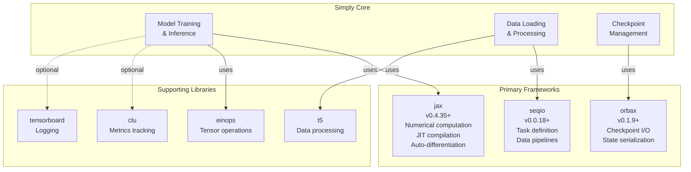

| Dependency | Version | Purpose | Required For |
|-----------|---------|---------|--------------|
| `jax` | 0.4.35+ | Numerical computing, automatic differentiation | All model operations |
| `orbax` | 0.1.9+ | Checkpoint serialization/deserialization | Model persistence |
| `seqio` | 0.0.18+ | Data pipeline management | Dataset loading |
| `einops` | Latest | Tensor shape manipulation | Attention mechanisms |
| `absl-py` | Latest | Command-line flags, logging | Experiment configuration |
| `clu` | Latest | Metrics aggregation | Training monitoring |
| `t5` | Latest | Text preprocessing utilities | Data preparation |
| `tensorboard` | Latest | Training visualization | Optional logging |
| `sympy` | Latest | Symbolic mathematics | Math evaluation (RL tasks) |
| `pylatexenc` | Latest | LaTeX parsing | Math evaluation (RL tasks) |

**Platform-Specific Installation:**

JAX installation varies by hardware platform:

- **CPU**: `pip install -U jax`
- **GPU (CUDA 13)**: `pip install -U "jax[cuda13]"`
- **TPU**: `pip install -U "jax[tpu]"`

Other dependencies are platform-independent: `pip install -r requirements.txt`

**Sources:** [README.md:23-42](), [requirements.txt:1-12]()

## Asset Management System

Simply requires two types of external assets:

1. **Pretrained Model Checkpoints**: Downloaded from `unkindledmonkey/simply-models` on HuggingFace
2. **Training Datasets**: Downloaded from `unkindledmonkey/simply-datasets` on HuggingFace

The `setup_assets.py` script performs three operations:

### 1. Download from HuggingFace

Uses `huggingface_hub.snapshot_download()` to fetch entire repositories.

**Sources:** [setup/setup_assets.py:142-170](), [setup/setup_assets.py:172-191]()

### 2. Reorganize Checkpoint Structure

Gemma checkpoints from HuggingFace use a different directory structure than Simply expects. The script reorganizes them:

```
# HuggingFace format (downloaded)
GEMMA-2.0-2B-PT-ORBAX/
├── tokenizer.model
└── gemma2-2b/
    └── checkpoint files

# Simply format (after reorganization)
GEMMA-2.0-2B-PT-ORBAX/
├── tokenizer.model
└── 0/
    └── checkpoint files
```

This reorganization is performed by `reorganize_gemma_models()` at [setup/setup_assets.py:47-112]().

**Sources:** [setup/setup_assets.py:47-112]()

### 3. Setup Vocabulary Files

Tokenizer models are copied from checkpoint directories to a centralized vocabulary directory (`~/.cache/simply/vocabs/`) for use by `data_lib.py`.

**Sources:** [setup/setup_assets.py:114-140]()

### Default Directory Structure

```
~/.cache/simply/
├── models/
│   ├── GEMMA-2.0-2B-PT-ORBAX/
│   ├── GEMMA-2.0-9B-PT-ORBAX/
│   ├── DEEPSEEK-R1-DISTILL-QWEN-1.5B-ORBAX/
│   └── QWEN-3-0.6B-ORBAX/
├── datasets/
│   └── [training datasets]
└── vocabs/
    ├── gemma2_tokenizer.model
    └── [other tokenizers]
```

These paths can be customized via environment variables (`SIMPLY_MODELS`, `SIMPLY_DATASETS`, `SIMPLY_VOCABS`) or CLI flags.

**Sources:** [setup/setup_assets.py:37-41]()

## Configuration System

Experiments are defined through `ExperimentConfig` objects registered in `ExperimentConfigRegistry`. Simply includes 210+ predefined configurations organized by:

- **Model Family**: Gemma (2B, 9B, 27B), DeepSeek (1.5B, 7B, 14B, 32B), Qwen (0.6B, 1.7B, 4B, 8B)
- **Training Phase**: Pretraining (PT), Instruction Tuning (IT), Reinforcement Learning (RL)
- **Task Type**: Standard supervised learning, RL on GSM8K/MATH/other reasoning tasks

Configurations are loaded by name from the command line:

```bash
python -m simply.main --experiment_config Gemma2BV2 --experiment_dir /tmp/exp
```

For detailed documentation of the configuration system, see [Configuration System](#3).

**Sources:** [README.md:15-16]()

## Next Steps

To start using Simply:

1. **Install dependencies**: See [Installation and Setup](#2.1)
2. **Download assets**: See [Asset Management](#2.2)
3. **Run your first experiment**: See [Running Your First Experiment](#2.3)

For developers extending the codebase, see [Developer Guide](#7).

**Sources:** [README.md:10-60]()

---

# Page: Getting Started

# Getting Started

<details>
<summary>Relevant source files</summary>

The following files were used as context for generating this wiki page:

- [README.md](README.md)
- [setup/setup_assets.py](setup/setup_assets.py)
- [simply/main.py](simply/main.py)

</details>


This page provides a high-level guide for setting up the Simply codebase and running your first experiment. It covers the prerequisite steps, the initialization workflow, and verification procedures. For detailed instructions on specific topics, see:

- [Installation and Setup](#2.1) - Platform-specific dependency installation
- [Asset Management](#2.2) - HuggingFace integration and cache structure
- [Running Your First Experiment](#2.3) - Step-by-step tutorial with `TransformerLMTest`

## Overview of Setup Process

Simply requires three initialization phases before you can run experiments:

| Phase | Component | Purpose | Output |
|-------|-----------|---------|--------|
| 1. Dependencies | JAX, Orbax, SeqIO | Core computational framework | Python packages installed |
| 2. Assets | Models, datasets, vocabularies | Pre-trained checkpoints and data | Files in `~/.cache/simply/` |
| 3. Verification | Test experiment | Validate installation | Successful training run |

## Prerequisites

### System Requirements

Simply supports three hardware platforms with environment-specific JAX installations:

- **CPU**: Local development and testing
- **GPU**: Single or multi-GPU workstations (CUDA 13+ required)
- **TPU**: Google Cloud TPU v3/v4/v5 pods

### Required Dependencies

The codebase depends on three primary libraries:

1. **JAX** ([jax.readthedocs.io](https://jax.readthedocs.io)): Numerical computing, JIT compilation, and automatic differentiation
2. **Orbax** ([orbax.readthedocs.io](https://orbax.readthedocs.io)): Checkpoint management and state persistence
3. **SeqIO** ([github.com/google/seqio](https://github.com/google/seqio)): Data pipeline construction and task definitions

See [Installation and Setup](#2.1) for detailed installation instructions.

Sources: [README.md:23-42]()

## Initialization Workflow

### Asset Download and Preparation

The `setup_assets.py` script handles downloading pre-trained models and datasets from HuggingFace repositories, then reorganizes them into Simply's expected directory structure.

**Initialization Flow Diagram**

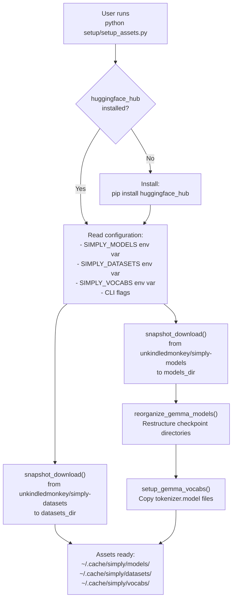

Sources: [setup/setup_assets.py:1-289]()

### Directory Structure After Setup

After running `setup_assets.py`, the local cache contains the following structure:

```
~/.cache/simply/
├── models/
│   ├── GEMMA-2.0-2B-PT-ORBAX/
│   │   ├── 0/
│   │   │   └── checkpoint (Orbax format)
│   │   └── tokenizer.model
│   ├── GEMMA-2.0-9B-PT-ORBAX/
│   └── DEEPSEEK-*, QWEN-* (additional models)
├── datasets/
│   └── (training and evaluation datasets)
└── vocabs/
    ├── gemma2_tokenizer.model
    └── gemma3_cleaned_*.spiece.model
```

The reorganization step ([setup/setup_assets.py:47-112]()) is critical because HuggingFace stores Gemma checkpoints in nested subdirectories (e.g., `gemma2-2b/checkpoint`), but Simply expects step-numbered directories (`0/checkpoint`) for Orbax compatibility.

Sources: [setup/setup_assets.py:47-164]()

## Quick Start Commands

### Minimal Test Experiment

Run a fast local test to verify installation:

```bash
EXP=simply_local_test_1
rm -rf /tmp/${EXP}
python -m simply.main \
  --experiment_config TransformerLMTest \
  --experiment_dir /tmp/${EXP} \
  --alsologtostderr
```

This command invokes the `main()` function in [simply/main.py:89-148](), which:

1. Loads the `TransformerLMTest` configuration from `ExperimentConfigRegistry`
2. Resolves the `GSPMDSharding` configuration (default)
3. Creates device mesh with `get_default_mesh_shape()`
4. Invokes the training loop specified by `config.train_loop_name`

Sources: [README.md:11-21](), [simply/main.py:89-148]()

### Debug Mode (Disable JIT)

For debugging with print statements and array inspection:

```bash
export JAX_DISABLE_JIT=True
EXP=simply_local_test_1
rm -rf /tmp/${EXP}
python -m simply.main \
  --experiment_config TransformerLMTestNoScan \
  --experiment_dir /tmp/${EXP} \
  --alsologtostderr
```

The `JAX_DISABLE_JIT=True` environment variable disables JAX's just-in-time compilation, allowing normal Python debugging. The `TransformerLMTestNoScan` configuration additionally disables the `lax.scan` optimization for easier step-through debugging.

Sources: [README.md:17-21]()

## Experiment Execution Flow

**Command-Line to Training Loop**

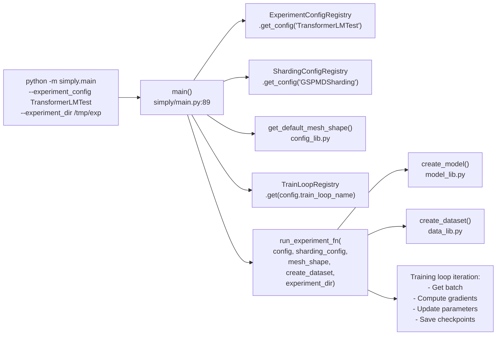

Sources: [simply/main.py:89-148]()

## Configuration Loading Mechanisms

Simply supports two methods for loading experiment configurations:

### Method 1: Registry-Based (Recommended)

Use a registered configuration name:

```bash
python -m simply.main --experiment_config Gemma2BV2 --experiment_dir /tmp/exp
```

The `ExperimentConfigRegistry.get_config()` method ([simply/main.py:105-107]()) retrieves the configuration by name. See [Configuration System](#3) for available configurations.

### Method 2: JSON File Path

Load configuration from a JSON file:

```bash
python -m simply.main \
  --experiment_config_path /path/to/config.json \
  --experiment_dir /tmp/exp
```

The JSON deserialization process ([simply/main.py:91-103]()) supports a `code_patch` field for runtime code execution, enabling dynamic configuration modifications.

| Parameter | Registry Method | JSON File Method |
|-----------|----------------|------------------|
| Flag | `--experiment_config` | `--experiment_config_path` |
| Loading | `ExperimentConfigRegistry.get_config()` | `pytree.load_dataclasses()` |
| Source | Registered in `config_lib.py` | External JSON file |
| Mutability | Fixed at registration time | Modifiable via `code_patch` |

Sources: [simply/main.py:47-114]()

## Common Configuration Flags

The `main.py` entrypoint accepts several command-line flags:

| Flag | Purpose | Default | Example |
|------|---------|---------|---------|
| `--experiment_config` | Configuration name | None (required) | `TransformerLMTest` |
| `--experiment_dir` | Output directory | `/tmp/simply_lm/` | `/mnt/exp/run1` |
| `--sharding_config` | Sharding strategy | `GSPMDSharding` | `DataParallelSharding` |
| `--mesh_shape` | Device mesh dimensions | Auto-computed | `1,265,1` |
| `--dcn_mesh_shape` | DCN topology | None | `2,1,1` |

All flags are defined in [simply/main.py:47-87]().

Sources: [simply/main.py:47-87]()

## Verification Steps

### 1. Check Asset Download

Verify that models, datasets, and vocabularies are present:

```bash
ls ~/.cache/simply/models/
ls ~/.cache/simply/datasets/
ls ~/.cache/simply/vocabs/
```

Expected output should include `GEMMA-2.0-*` directories in models, dataset files in datasets, and `.model`/`.spiece.model` files in vocabs.

### 2. Run Test Configuration

Execute the minimal test configuration:

```bash
python -m simply.main \
  --experiment_config TransformerLMTest \
  --experiment_dir /tmp/test_exp \
  --alsologtostderr
```

Successful execution will produce log output showing:
- Configuration loading: `config: ...`
- Mesh shape: `mesh_shape: [1, 1, 1]`
- Training progress: Step numbers and loss values
- Checkpoint saves: `Saved checkpoint at step ...`

### 3. Inspect Output Directory

Check that the experiment directory contains checkpoints and logs:

```bash
ls /tmp/test_exp/
# Expected: checkpoints/, logs/, config.json
```

See [Running Your First Experiment](#2.3) for detailed output interpretation.

Sources: [README.md:11-21]()

## Troubleshooting Common Issues

| Issue | Symptom | Solution |
|-------|---------|----------|
| Missing `huggingface_hub` | `ImportError` when running `setup_assets.py` | `pip install huggingface_hub` |
| JAX device not found | `No GPU/TPU/CPU backends found` | Reinstall JAX with correct platform suffix (see [Installation and Setup](#2.1)) |
| Checkpoint format error | `Orbax checkpoint loading failed` | Re-run `setup_assets.py` to reorganize Gemma directories |
| Configuration not found | `KeyError` from `ExperimentConfigRegistry` | Verify config name spelling or use `--experiment_config_path` |

## Next Steps

After completing setup and verification:

1. Explore available configurations: See [Model Configuration Catalog](#3.2)
2. Understand the training workflow: See [Standard Training Workflow](#5.1)
3. Learn about distributed training: See [Distributed Training](#5.5)
4. Examine model architecture: See [Model Architecture](#4.2)

Sources: [README.md:1-91](), [simply/main.py:1-151](), [setup/setup_assets.py:1-289]()

---

# Page: Installation and Setup

# Installation and Setup

<details>
<summary>Relevant source files</summary>

The following files were used as context for generating this wiki page:

- [README.md](README.md)
- [requirements.txt](requirements.txt)
- [setup/setup_assets.py](setup/setup_assets.py)

</details>


## Purpose and Scope

This document provides detailed instructions for installing Simply and its dependencies, configuring the local environment, and downloading pretrained models and datasets. It covers dependency installation for CPU, GPU, and TPU platforms, the execution of [setup/setup_assets.py](), and the resulting local cache structure.

For information about the asset management system architecture and HuggingFace integration details, see [Asset Management](#2.2). For running your first experiment after setup, see [Running Your First Experiment](#2.3).

## Prerequisites

Simply requires Python 3.9 or later. The codebase is built on JAX and requires platform-specific installation of JAX accelerator backends.

**Sources:** [README.md:1-10]()

## Dependency Installation

### Installation Flow

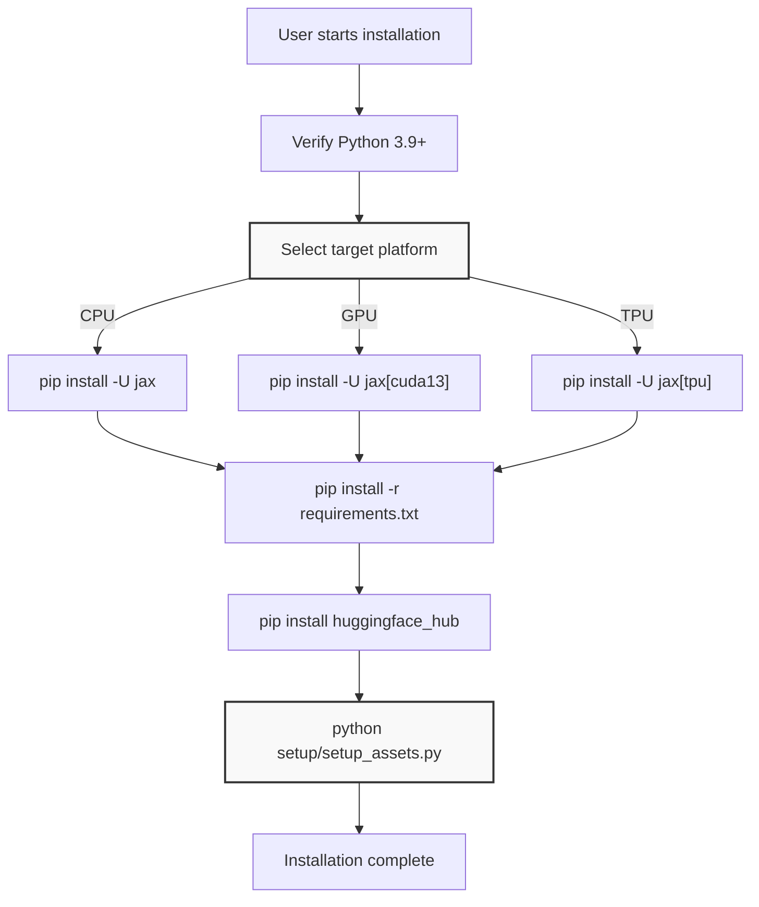

**Sources:** [README.md:23-42](), [README.md:44-60]()

### Core Dependencies

Simply's core dependencies are organized into three categories:

| Category | Package | Purpose | Source |
|----------|---------|---------|--------|
| **Computational Framework** | `jax` | Numerical computing, JIT compilation, automatic differentiation | [requirements.txt:1]() |
| **State Management** | `orbax` | Checkpoint loading and saving | [requirements.txt:2]() |
| **Data Pipeline** | `seqio` | Dataset management and preprocessing | [requirements.txt:3]() |
| **Tensor Operations** | `einops` | Tensor reshaping utilities | [requirements.txt:4]() |
| **Utilities** | `absl-py` | Command-line flags and logging | [requirements.txt:5]() |
| **Metrics** | `clu` | Training metrics and utilities | [requirements.txt:6]() |
| **Reference Models** | `t5` | Transformer reference implementations | [requirements.txt:7]() |
| **Logging** | `tensorboard` | Training visualization | [requirements.txt:8]() |

**Sources:** [README.md:23-29](), [requirements.txt:1-8]()

### Platform-Specific JAX Installation

JAX installation is hardware-dependent. The following table provides installation commands for each platform:

| Platform | Command | Documentation |
|----------|---------|---------------|
| **CPU** | `pip install -U jax` | For local development and testing |
| **GPU (CUDA 13)** | `pip install -U "jax[cuda13]"` | For NVIDIA GPU training |
| **TPU** | `pip install -U "jax[tpu]"` | For Google Cloud TPU training |

For detailed platform-specific instructions and alternative CUDA versions, refer to the [JAX installation guide](https://docs.jax.dev/en/latest/installation.html).

**Installation sequence:**

```bash
# 1. Install JAX for your platform
pip install -U jax  # or jax[cuda13] or jax[tpu]

# 2. Install core dependencies
pip install -r requirements.txt

# 3. Install HuggingFace Hub for asset downloads
pip install huggingface_hub
```

**Sources:** [README.md:32-42](), [README.md:49-50]()

### Optional Dependencies

Additional packages are required only for specific evaluation functionality:

| Package | Purpose | Required For |
|---------|---------|--------------|
| `sympy` | Symbolic mathematics | Math problem evaluation ([simply/utils/math_eval.py]()) |
| `pylatexenc` | LaTeX parsing | Math problem evaluation ([simply/utils/math_eval.py]()) |
| `pytest` | Unit testing | Running test suite |

**Sources:** [requirements.txt:9-12]()

## Local Cache Directory Structure

After completing setup, Simply creates a local cache structure at `~/.cache/simply/` with three subdirectories:

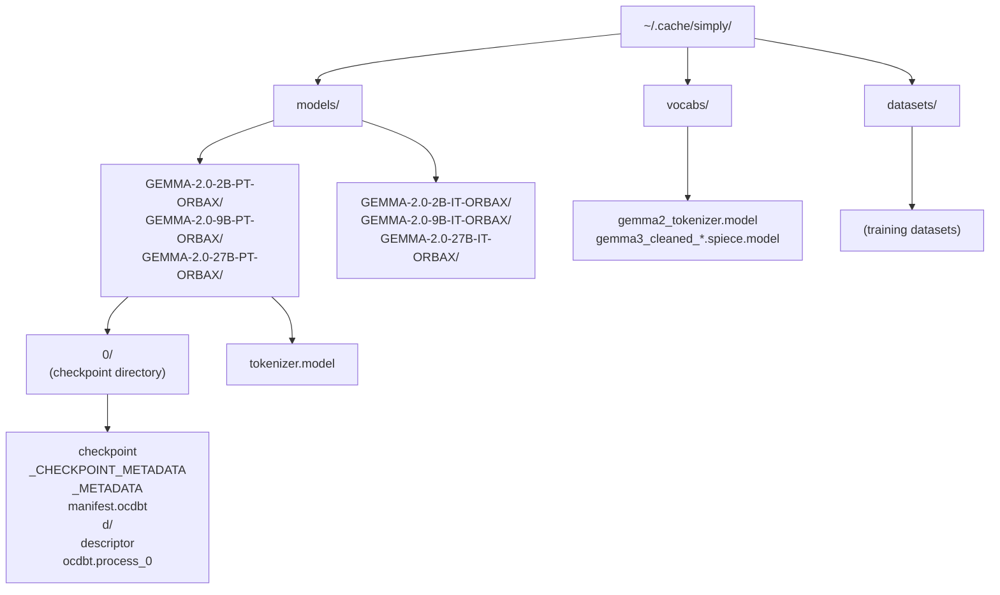

**Directory structure details:**

- **`models/`**: Contains pretrained model checkpoints in Orbax format. Each model directory follows the naming pattern `{FAMILY}-{VERSION}-{SIZE}-{TYPE}-ORBAX` (e.g., `GEMMA-2.0-2B-PT-ORBAX`).
- **`datasets/`**: Stores training datasets downloaded from HuggingFace.
- **`vocabs/`**: Centralized tokenizer model files referenced by [simply/data_lib.py]().

**Sources:** [setup/setup_assets.py:13-16](), [setup/setup_assets.py:37-40]()

## Asset Download and Setup

### Running setup_assets.py

The [setup/setup_assets.py]() script downloads pretrained models and datasets from HuggingFace repositories and reorganizes them into Simply's expected format.

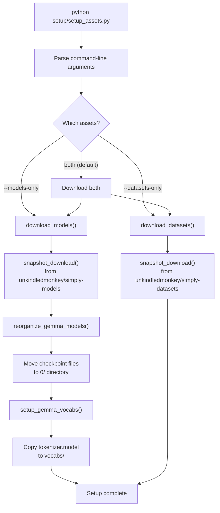

**Sources:** [setup/setup_assets.py:142-170](), [setup/setup_assets.py:172-191](), [setup/setup_assets.py:201-288]()

### Command-Line Options

The [setup/setup_assets.py]() script supports the following command-line arguments:

| Argument | Type | Default | Description |
|----------|------|---------|-------------|
| `--models-only` | flag | False | Download only models, skip datasets |
| `--datasets-only` | flag | False | Download only datasets, skip models |
| `--models-repo` | string | `unkindledmonkey/simply-models` | HuggingFace models repository |
| `--datasets-repo` | string | `unkindledmonkey/simply-datasets` | HuggingFace datasets repository |
| `--models-dir` | string | `~/.cache/simply/models/` | Local models directory |
| `--datasets-dir` | string | `~/.cache/simply/datasets/` | Local datasets directory |
| `--force` | flag | False | Re-download even if directories exist |

**Usage examples:**

```bash
# Download both models and datasets (default)
python setup/setup_assets.py

# Download only models
python setup/setup_assets.py --models-only

# Download only datasets
python setup/setup_assets.py --datasets-only

# Use custom directories
python setup/setup_assets.py --models-dir /mnt/shared/models --datasets-dir /mnt/shared/datasets

# Force re-download
python setup/setup_assets.py --force
```

**Sources:** [setup/setup_assets.py:202-242](), [README.md:52-58]()

### Environment Variables

Directory locations can be customized via environment variables, which take precedence over default values but are overridden by command-line arguments:

| Variable | Default | Purpose |
|----------|---------|---------|
| `SIMPLY_MODELS` | `~/.cache/simply/models/` | Models directory location |
| `SIMPLY_DATASETS` | `~/.cache/simply/datasets/` | Datasets directory location |
| `SIMPLY_VOCABS` | `~/.cache/simply/vocabs/` | Vocabularies directory location |

**Example configuration:**

```bash
# Set custom directories
export SIMPLY_MODELS=/mnt/shared/models
export SIMPLY_DATASETS=/mnt/shared/datasets
export SIMPLY_VOCABS=/mnt/shared/vocabs

# Run setup with environment variables
python setup/setup_assets.py
```

**Sources:** [setup/setup_assets.py:37-40](), [README.md:60]()

### Gemma Checkpoint Reorganization

The [setup/setup_assets.py]() script performs critical post-processing on Gemma model checkpoints. HuggingFace stores checkpoints in a nested structure that differs from Simply's expected format. The `reorganize_gemma_models()` function transforms the directory structure:

**HuggingFace structure (downloaded):**
```
GEMMA-2.0-2B-PT-ORBAX/
├── tokenizer.model
└── gemma2-2b/
    ├── checkpoint
    ├── _CHECKPOINT_METADATA
    └── ...
```

**Simply structure (after reorganization):**
```
GEMMA-2.0-2B-PT-ORBAX/
├── 0/
│   ├── checkpoint
│   ├── _CHECKPOINT_METADATA
│   ├── _METADATA
│   ├── manifest.ocdbt
│   ├── d/
│   ├── descriptor
│   └── ocdbt.process_0
└── tokenizer.model
```

The reorganization moves checkpoint files from the nested subdirectory (e.g., `gemma2-2b/`) into a step-numbered directory (`0/`), which is the format expected by Orbax checkpoint loading in [simply/config_lib.py]().

**Sources:** [setup/setup_assets.py:47-112](), [setup/setup_assets.py:62-69](), [setup/setup_assets.py:101-108]()

### Vocabulary Setup

The `setup_gemma_vocabs()` function copies tokenizer files from model directories to the centralized `vocabs/` directory. This allows [simply/data_lib.py]() to register vocabularies by name without requiring full model checkpoint paths.

**Tokenizer mapping:**

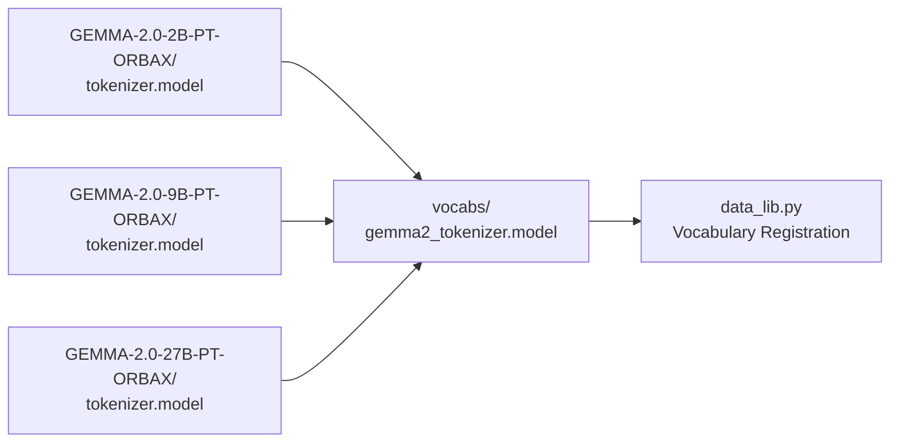

All Gemma 2.0 models (2B, 9B, 27B) share the same tokenizer, so they are all copied to `gemma2_tokenizer.model`.

**Sources:** [setup/setup_assets.py:114-140](), [setup/setup_assets.py:124-131]()

## Verification

After completing installation and setup, verify the installation by running the test configuration:

```bash
# Run local test experiment
EXP=simply_local_test_1
rm -rf /tmp/${EXP}
python -m simply.main --experiment_config TransformerLMTest --experiment_dir /tmp/${EXP} --alsologtostderr
```

This command:
1. Creates a temporary experiment directory at `/tmp/simply_local_test_1`
2. Loads the `TransformerLMTest` configuration from [simply/config_lib.py]()
3. Runs a minimal training loop to verify JAX, Orbax, and SeqIO integration
4. Logs output to both stderr and log files

**Expected output:** The experiment should initialize a small transformer model, load a test dataset, and complete several training steps without errors. Successful execution indicates that all dependencies are correctly installed and assets are properly configured.

For debugging without JIT compilation, use:

```bash
export JAX_DISABLE_JIT=True
EXP=simply_local_test_1
rm -rf /tmp/${EXP}
python -m simply.main --experiment_config TransformerLMTestNoScan --experiment_dir /tmp/${EXP} --alsologtostderr
```

This disables JAX's just-in-time compilation and scan operations, allowing array values to be printed during execution for debugging purposes.

**Sources:** [README.md:13-21]()

---

**Next Steps:** After completing installation and setup, proceed to [Asset Management](#2.2) for detailed information about the local cache structure and asset organization, or to [Running Your First Experiment](#2.3) to begin training models.

---

# Page: Asset Management

# Asset Management

<details>
<summary>Relevant source files</summary>

The following files were used as context for generating this wiki page:

- [README.md](README.md)
- [setup/setup_assets.py](setup/setup_assets.py)

</details>


## Purpose and Scope

This document describes Simply's asset management system, which handles downloading, organizing, and locating pretrained models, datasets, and tokenizers. The asset management system bridges external resources on HuggingFace with Simply's internal directory structure and naming conventions.

For information about installing Simply itself and its dependencies, see [Installation and Setup](#2.1). For using these downloaded assets in experiments, see [Running Your First Experiment](#2.3).

**Sources:** [setup/setup_assets.py:1-22](), [README.md:44-60]()

## Asset Types and Storage

Simply manages three types of assets, each stored in separate local cache directories:

| Asset Type | Description | Default Location | Environment Variable |
|------------|-------------|------------------|----------------------|
| **Models** | Pretrained checkpoint files in Orbax format | `~/.cache/simply/models/` | `SIMPLY_MODELS` |
| **Datasets** | Training and evaluation datasets | `~/.cache/simply/datasets/` | `SIMPLY_DATASETS` |
| **Vocabs** | Tokenizer model files (SentencePiece) | `~/.cache/simply/vocabs/` | `SIMPLY_VOCABS` |

These directories are referenced throughout the codebase:
- `config_lib.py` uses model checkpoint paths (e.g., `GEMMA2_2B_PT_CKPT_DIR`)
- `data_lib.py` uses dataset and vocabulary paths for pipeline construction

**Sources:** [setup/setup_assets.py:37-40](), [README.md:60]()

## HuggingFace Integration

Simply downloads assets from two HuggingFace repositories using the `huggingface_hub` library:

| Repository | Type | Contents |
|------------|------|----------|
| `unkindledmonkey/simply-models` | model | Pretrained checkpoints (Gemma 2.0, DeepSeek, Qwen) |
| `unkindledmonkey/simply-datasets` | dataset | Training datasets in SeqIO-compatible format |

The download mechanism uses `snapshot_download()` with `local_dir_use_symlinks=False` to create complete local copies rather than symbolic links, ensuring portability across different filesystem configurations.

**Sources:** [setup/setup_assets.py:42-44](), [setup/setup_assets.py:149-156](), [setup/setup_assets.py:179-186]()

## Local Cache Directory Structure

After running `setup_assets.py`, the local cache follows this structure:

```
~/.cache/simply/
├── models/
│   ├── GEMMA-2.0-2B-PT-ORBAX/
│   │   ├── 0/
│   │   │   ├── checkpoint
│   │   │   ├── _CHECKPOINT_METADATA
│   │   │   ├── _METADATA
│   │   │   ├── manifest.ocdbt
│   │   │   └── d/  (OCDBT data directory)
│   │   └── tokenizer.model
│   ├── GEMMA-2.0-9B-PT-ORBAX/
│   ├── GEMMA-2.0-27B-PT-ORBAX/
│   ├── GEMMA-2.0-2B-IT-ORBAX/
│   ├── GEMMA-2.0-9B-IT-ORBAX/
│   ├── GEMMA-2.0-27B-IT-ORBAX/
│   └── ... (other model families)
├── datasets/
│   └── (dataset files in SeqIO format)
└── vocabs/
    ├── gemma2_tokenizer.model
    ├── gemma3_cleaned_*.spiece.model
    └── ... (other tokenizer models)
```

**Key structural requirements:**
- Model checkpoints must be in step-numbered subdirectories (`0/`, `1/`, etc.)
- Each checkpoint step directory contains an Orbax checkpoint (OCDBT format)
- Tokenizer files remain at the model root level for vocabulary loading
- Vocabulary directory contains deduplicated tokenizer files referenced by name in `data_lib.py`

**Sources:** [setup/setup_assets.py:47-59](), [setup/setup_assets.py:114-140]()

## Download Process Workflow

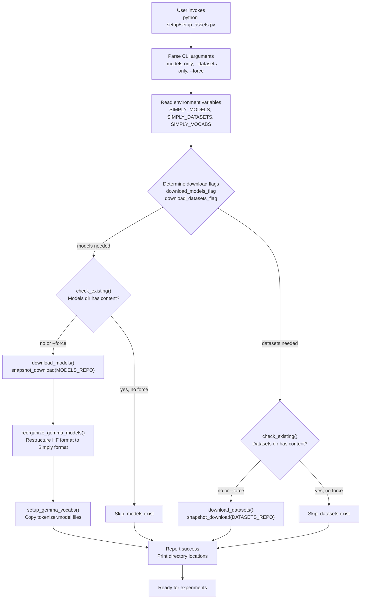

**Sources:** [setup/setup_assets.py:201-288]()

## Gemma Checkpoint Reorganization

A critical post-processing step transforms Gemma checkpoints from HuggingFace's nested structure to Simply's expected format. This is necessary because Orbax checkpoint loading in Simply expects step-numbered directories.

### HuggingFace Download Format

```
GEMMA-2.0-2B-PT-ORBAX/
├── tokenizer.model
└── gemma2-2b/
    ├── checkpoint
    ├── _CHECKPOINT_METADATA
    ├── _METADATA
    ├── manifest.ocdbt
    └── d/
```

### Simply Required Format

```
GEMMA-2.0-2B-PT-ORBAX/
├── 0/
│   ├── checkpoint
│   ├── _CHECKPOINT_METADATA
│   ├── _METADATA
│   ├── manifest.ocdbt
│   └── d/
└── tokenizer.model
```

The `reorganize_gemma_models()` function performs this transformation:

1. **Creates step directory**: Makes `0/` subdirectory for checkpoint files
2. **Moves nested files**: Relocates files from `gemma2-2b/` to `0/`
3. **Moves parent-level files**: Relocates checkpoint files from root to `0/`
4. **Preserves tokenizer**: Keeps `tokenizer.model` at parent level for vocabulary loading
5. **Removes empty directories**: Cleans up now-empty nested directories

This reorganization applies to six Gemma model variants:

| Parent Directory | Original Subdirectory | Model Type |
|------------------|----------------------|------------|
| `GEMMA-2.0-2B-PT-ORBAX` | `gemma2-2b` | Pretrained 2B |
| `GEMMA-2.0-9B-PT-ORBAX` | `gemma2-9b` | Pretrained 9B |
| `GEMMA-2.0-27B-PT-ORBAX` | `gemma2-27b` | Pretrained 27B |
| `GEMMA-2.0-2B-IT-ORBAX` | `gemma2-2b-it` | Instruction-tuned 2B |
| `GEMMA-2.0-9B-IT-ORBAX` | `gemma2-9b-it` | Instruction-tuned 9B |
| `GEMMA-2.0-27B-IT-ORBAX` | `gemma2-27b-it` | Instruction-tuned 27B |

**Sources:** [setup/setup_assets.py:47-112]()

## Vocabulary File Setup

After reorganizing model checkpoints, the `setup_gemma_vocabs()` function copies tokenizer files to the centralized vocabulary directory:

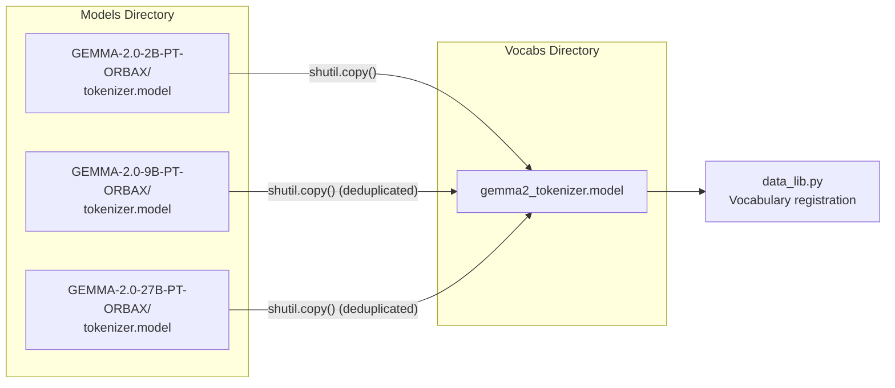

The vocabulary directory serves two purposes:
1. **Deduplication**: Multiple models share the same tokenizer (e.g., all Gemma 2.0 variants use `gemma2_tokenizer.model`)
2. **Centralized reference**: `data_lib.py` registers vocabularies by name, pointing to this single location

**Sources:** [setup/setup_assets.py:114-140]()

## Configuration Options

The asset management system supports flexible configuration through environment variables and command-line flags:

### Environment Variables

Set these before running `setup_assets.py` or any Simply experiment:

```bash
export SIMPLY_MODELS=/path/to/models
export SIMPLY_DATASETS=/path/to/datasets
export SIMPLY_VOCABS=/path/to/vocabs
```

These variables are read by:
- `setup_assets.py` during download
- `config_lib.py` when constructing checkpoint paths
- `data_lib.py` when registering vocabularies

**Sources:** [setup/setup_assets.py:37-40]()

### Command-Line Flags

The `setup_assets.py` script accepts several flags:

| Flag | Type | Description |
|------|------|-------------|
| `--models-only` | boolean | Download only models, skip datasets |
| `--datasets-only` | boolean | Download only datasets, skip models |
| `--models-repo` | string | Override HuggingFace models repository |
| `--datasets-repo` | string | Override HuggingFace datasets repository |
| `--models-dir` | string | Override models directory location |
| `--datasets-dir` | string | Override datasets directory location |
| `--force` | boolean | Re-download even if directories exist |

**Example usage:**

```bash
# Download only models to custom location
python setup/setup_assets.py --models-only --models-dir /shared/simply/models

# Download from custom HuggingFace repository
python setup/setup_assets.py --models-repo myorg/my-simply-models

# Force re-download of all assets
python setup/setup_assets.py --force
```

**Sources:** [setup/setup_assets.py:202-241]()

## Asset Download Execution Flow

```mermaid
sequenceDiagram
    participant User
    participant setup_assets["setup_assets.py<br/>main()"]
    participant hf["huggingface_hub<br/>snapshot_download()"]
    participant reorg["reorganize_gemma_models()"]
    participant vocab["setup_gemma_vocabs()"]
    participant fs["Filesystem"]
    
    User->>setup_assets: "python setup/setup_assets.py"
    setup_assets->>setup_assets: "Parse args & env vars"
    
    alt Models requested
        setup_assets->>fs: "check_existing(models_dir)"
        fs-->>setup_assets: "exists and has content?"
        
        alt Not exists or --force
            setup_assets->>fs: "Path(models_dir).mkdir()"
            setup_assets->>hf: "snapshot_download(MODELS_REPO)"
            hf-->>fs: "Download to models_dir"
            
            setup_assets->>reorg: "reorganize_gemma_models(models_dir)"
            reorg->>fs: "Create 0/ directories"
            reorg->>fs: "Move checkpoint files"
            reorg->>fs: "Remove empty subdirs"
            
            setup_assets->>vocab: "setup_gemma_vocabs(models_dir, vocabs_dir)"
            vocab->>fs: "Copy tokenizer.model files"
        end
    end
    
    alt Datasets requested
        setup_assets->>fs: "check_existing(datasets_dir)"
        fs-->>setup_assets: "exists and has content?"
        
        alt Not exists or --force
            setup_assets->>fs: "Path(datasets_dir).mkdir()"
            setup_assets->>hf: "snapshot_download(DATASETS_REPO)"
            hf-->>fs: "Download to datasets_dir"
        end
    end
    
    setup_assets-->>User: "Print success & directory locations"
```

**Sources:** [setup/setup_assets.py:142-191](), [setup/setup_assets.py:201-288]()

## Integration with Experiment Configuration

The asset management system's output directories are referenced throughout Simply's codebase:

### Model Checkpoints in config_lib.py

Configuration constants point to downloaded model directories:

```python
# Example checkpoint directory constants
GEMMA2_2B_PT_CKPT_DIR = os.path.join(MODELS_DIR, 'GEMMA-2.0-2B-PT-ORBAX')
GEMMA2_9B_PT_CKPT_DIR = os.path.join(MODELS_DIR, 'GEMMA-2.0-9B-PT-ORBAX')
```

Experiment configurations use these paths in the `init_ckpt_dir` field to specify pretrained weights.

### Datasets in data_lib.py

Dataset loading functions expect files in the datasets directory:

```python
# Datasets are registered and loaded from DATASETS_DIR
# The create_dataset() function constructs paths automatically
```

### Vocabularies in data_lib.py

Vocabulary registration uses the vocabs directory:

```python
# Example vocabulary registration
register_vocabulary(
    name='gemma2',
    path=os.path.join(VOCABS_DIR, 'gemma2_tokenizer.model'),
    vocab_size=256000
)
```

**Sources:** [README.md:60](), [setup/setup_assets.py:37-40]()

## Verification and Troubleshooting

### Verifying Successful Setup

After running `setup_assets.py`, verify the installation:

```bash
# Check models directory structure
ls -R ~/.cache/simply/models/GEMMA-2.0-2B-PT-ORBAX/

# Should show:
# 0/
# 0/checkpoint
# 0/_CHECKPOINT_METADATA
# tokenizer.model

# Check vocabularies
ls ~/.cache/simply/vocabs/

# Should show:
# gemma2_tokenizer.model
```

### Common Issues

| Issue | Cause | Solution |
|-------|-------|----------|
| "checkpoint not found" error | Gemma models not reorganized | Run `setup_assets.py` again; reorganization is idempotent |
| "vocabulary not found" error | Tokenizer files not copied | Check `SIMPLY_VOCABS` directory has `.model` files |
| Permission errors | No write access to cache directory | Set environment variables to writable locations |
| Incomplete downloads | Network interruption | Use `--force` flag to re-download |

**Sources:** [setup/setup_assets.py:193-199](), [setup/setup_assets.py:80-81]()

## Summary

The asset management system provides a bridge between external HuggingFace repositories and Simply's internal structure:

1. **Downloads** pretrained models and datasets via `huggingface_hub`
2. **Reorganizes** Gemma checkpoints into step-numbered directories
3. **Centralizes** tokenizer files in a dedicated vocabulary directory
4. **Configures** locations via environment variables or CLI flags
5. **Integrates** with `config_lib.py` and `data_lib.py` for seamless experiment setup

This preprocessing step is a prerequisite for all Simply experiments, ensuring that checkpoint loading, data pipeline construction, and vocabulary management work correctly throughout the training and inference workflows.

**Sources:** [setup/setup_assets.py:1-288](), [README.md:44-60]()

---

# Page: Running Your First Experiment

# Running Your First Experiment

<details>
<summary>Relevant source files</summary>

The following files were used as context for generating this wiki page:

- [README.md](README.md)
- [setup/setup_assets.py](setup/setup_assets.py)
- [simply/config_lib.py](simply/config_lib.py)
- [simply/main.py](simply/main.py)

</details>


This page provides a step-by-step tutorial for executing your first training experiment using Simply's `TransformerLMTest` configuration. This minimal test configuration trains a small transformer language model to verify your installation and familiarize you with the basic workflow.

**Prerequisites:** Complete [Installation and Setup](#2.1) and [Asset Management](#2.2) before proceeding. For production-scale training workflows, see [Standard Training Workflow](#5.1). For detailed configuration concepts, see [Understanding Configurations](#3.1).

## Verifying Prerequisites

Before running your first experiment, verify that assets are available:

```bash
# Check that models and datasets directories exist
ls ~/.cache/simply/models/
ls ~/.cache/simply/datasets/
```

If these directories are empty or missing, run the asset setup:

```bash
python setup/setup_assets.py
```

Sources: [README.md:44-60](), [setup/setup_assets.py:1-22]()

## Basic Experiment Command

The simplest way to run an experiment is with the `TransformerLMTest` configuration, which trains a minimal model for 50 steps:

```bash
EXP=simply_local_test_1
rm -rf /tmp/${EXP}
python -m simply.main \
  --experiment_config TransformerLMTest \
  --experiment_dir /tmp/${EXP} \
  --alsologtostderr
```

This command will:
- Load the `TransformerLMTest` configuration from the registry
- Create output directories under `/tmp/simply_local_test_1/`
- Train a small 2-layer transformer for 50 steps
- Save checkpoints and TensorBoard logs
- Print progress to both stderr and log files

Sources: [README.md:13-16]()

## Command-Line Argument Reference

The `main.py` module accepts the following key arguments:

| Argument | Type | Default | Description |
|----------|------|---------|-------------|
| `--experiment_config` | string | None | Name of registered configuration (e.g., `TransformerLMTest`) |
| `--experiment_config_path` | string | None | Path to JSON config file (alternative to `--experiment_config`) |
| `--sharding_config` | string | `GSPMDSharding` | Name of sharding strategy |
| `--experiment_dir` | string | `/tmp/simply_lm/` | Directory for checkpoints and logs |
| `--mesh_shape` | list[int] | Auto | Device mesh shape as `replica,data,model` |
| `--alsologtostderr` | flag | False | Print logs to stderr in addition to files |

**Configuration Selection:**
- Use `--experiment_config` with a registered name (most common)
- Use `--experiment_config_path` with a JSON file path for custom configs
- Both cannot be specified simultaneously

Sources: [simply/main.py:47-86]()

### Mesh Shape Configuration

The `--mesh_shape` argument controls parallelization strategy across devices:

```bash
# Explicitly set mesh shape for 8 devices:
--mesh_shape 1,8,1   # Full data parallelism
--mesh_shape 1,4,2   # 4-way data parallel, 2-way model parallel
--mesh_shape 2,2,2   # 2-way replica, 2-way data, 2-way model
```

If unspecified, `get_default_mesh_shape()` automatically determines optimal layout based on:
- Available device count
- Model architecture (model_dim, n_heads, n_kv_heads)
- Batch size divisibility requirements

Sources: [simply/main.py:118-129](), [simply/config_lib.py:1787-1836]()

## Execution Flow

**Diagram: Command-Line to Training Loop Execution**

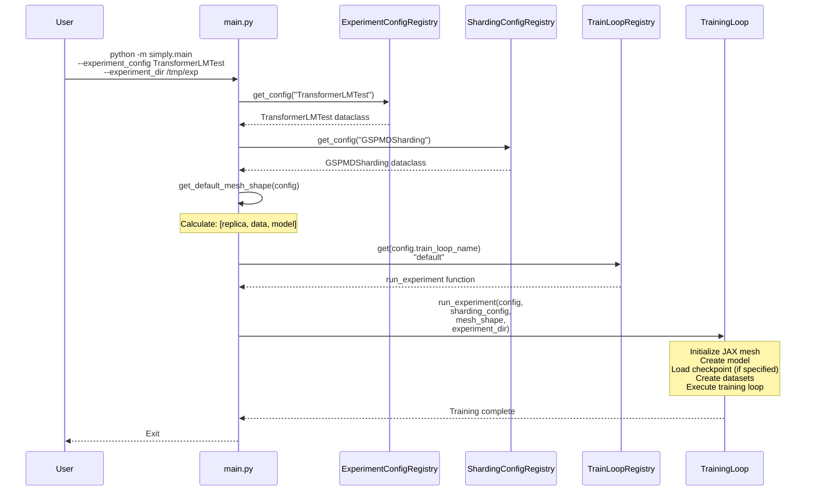

Sources: [simply/main.py:89-148](), [simply/config_lib.py:76-90]()

## Understanding the TransformerLMTest Configuration

The `TransformerLMTest` configuration defines a minimal experiment for testing:

**Diagram: TransformerLMTest Configuration Structure**

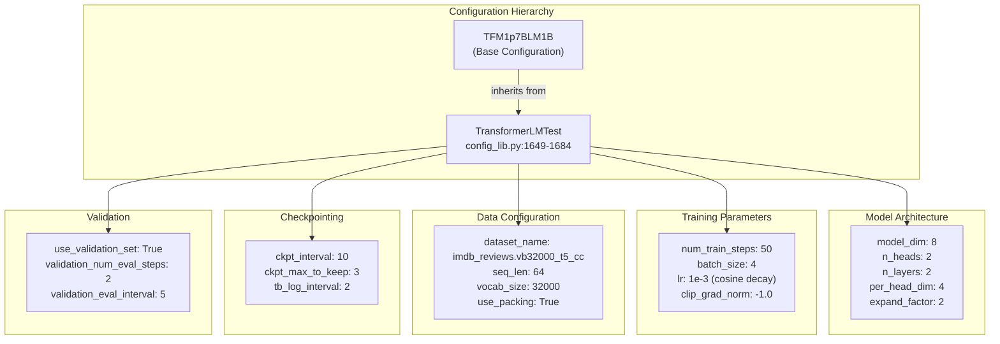

Sources: [simply/config_lib.py:1647-1684]()

### Key Configuration Parameters

| Parameter | Value | Purpose |
|-----------|-------|---------|
| `model_dim` | 8 | Hidden dimension (extremely small for fast testing) |
| `n_heads` | 2 | Number of attention heads |
| `n_layers` | 2 | Number of transformer blocks |
| `num_train_steps` | 50 | Total training iterations |
| `batch_size` | 4 | Examples per batch |
| `seq_len` | 64 | Maximum sequence length |
| `ckpt_interval` | 10 | Steps between checkpoints |
| `validation_eval_interval` | 5 | Steps between validation runs |

The small model size ensures the test completes quickly (typically < 2 minutes on CPU).

Sources: [simply/config_lib.py:1651-1679]()

## Expected Output Structure

During execution, Simply creates the following directory structure:

```
/tmp/simply_local_test_1/
├── checkpoints/
│   ├── 0/              # Initial checkpoint
│   ├── 10/             # Checkpoint at step 10
│   ├── 20/             # Checkpoint at step 20
│   ├── 30/             # Checkpoint at step 30
│   ├── 40/             # Checkpoint at step 40
│   └── 50/             # Final checkpoint
├── tensorboard/
│   └── events.out.tfevents.*
└── logs/
    └── simply.log
```

Each checkpoint directory contains Orbax checkpoint files storing model parameters and optimizer state.

Sources: [simply/main.py:68]()

## Console Output Interpretation

**Diagram: Training Loop Output Flow**

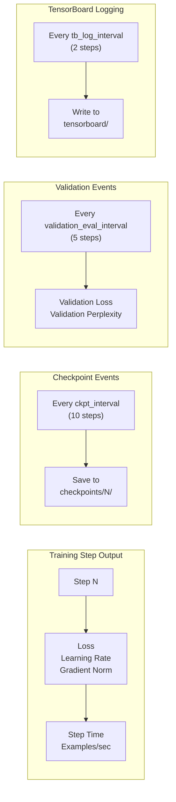

Sources: [simply/config_lib.py:1680-1683]()

### Sample Console Output

```
I0000 00:00:00.000000 MainThread main.py:135] config: TransformerLMTest(...)
I0000 00:00:00.000000 MainThread main.py:136] sharding_config: GSPMDSharding(...)
I0000 00:00:00.000000 MainThread main.py:137] mesh_shape: [1, 1, 1]
...
I0000 00:00:00.000000 MainThread model_lib.py:XXX] Training step 0
I0000 00:00:00.000000 MainThread model_lib.py:XXX] Training step 10, loss: 9.234
I0000 00:00:00.000000 MainThread model_lib.py:XXX] Saving checkpoint at step 10
I0000 00:00:00.000000 MainThread model_lib.py:XXX] Validation step 5, val_loss: 8.945
...
I0000 00:00:00.000000 MainThread model_lib.py:XXX] Training complete
```

Key metrics to monitor:
- **Loss**: Should generally decrease over steps
- **Validation loss**: Indicates generalization performance
- **Step time**: Time per training iteration (useful for performance tuning)

## Debugging Mode

For debugging purposes, disable JAX JIT compilation to enable standard Python printing and debugging:

```bash
export JAX_DISABLE_JIT=True
EXP=simply_local_test_1
rm -rf /tmp/${EXP}
python -m simply.main \
  --experiment_config TransformerLMTestNoScan \
  --experiment_dir /tmp/${EXP} \
  --alsologtostderr
```

**Important:** Use `TransformerLMTestNoScan` (not `TransformerLMTest`) when disabling JIT, as it also disables scan operations that are incompatible with debugging mode.

Sources: [README.md:17-21](), [simply/config_lib.py:1695-1697]()

## Configuration Loading Mechanisms

Simply supports two methods for specifying experiment configurations:

**Diagram: Configuration Loading Paths**

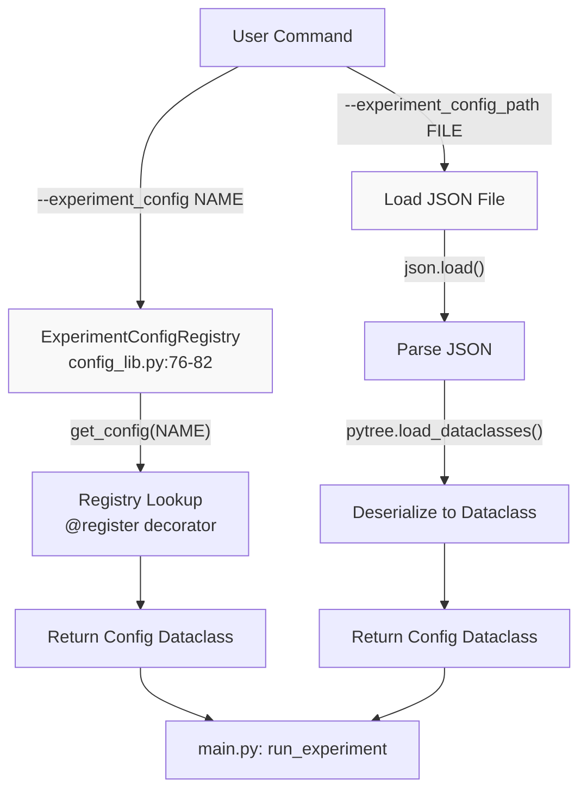

**Registry-based (Recommended):**
```bash
python -m simply.main --experiment_config TransformerLMTest --experiment_dir /tmp/exp
```

**JSON file-based (Advanced):**
```bash
# First, export a config to JSON
python -c "from simply import config_lib; import json; \
  print(json.dumps(config_lib.TransformerLMTest().__dict__))" > config.json

# Then use it
python -m simply.main --experiment_config_path config.json --experiment_dir /tmp/exp
```

Sources: [simply/main.py:91-107]()

## Common Issues and Solutions

### Issue: "No module named 'simply'"

**Cause:** Python cannot find the Simply package.

**Solution:** Run from the repository root or install in development mode:
```bash
# From repository root:
python -m simply.main ...

# Or install:
pip install -e .
```

### Issue: "Dataset not found"

**Cause:** Dataset files not downloaded or incorrect path.

**Solution:** Verify dataset location and re-run setup:
```bash
ls ~/.cache/simply/datasets/
python setup/setup_assets.py --datasets-only
```

### Issue: "Out of memory" error

**Cause:** Batch size too large for available memory.

**Solution:** Use a smaller batch size or enable gradient accumulation:
```bash
# Reduce batch size (requires custom config)
# Or use gradient accumulation to simulate larger batches
```

For gradient accumulation, set `grad_accum_steps` in your configuration. See [Creating Custom Configurations](#3.4).

### Issue: Checkpoint directory already exists

**Cause:** Previous experiment output remains in `experiment_dir`.

**Solution:** Remove the directory or choose a different path:
```bash
rm -rf /tmp/simply_local_test_1
# Or use a different name:
--experiment_dir /tmp/simply_local_test_2
```

Sources: [README.md:13-21]()

## Next Steps

After successfully running `TransformerLMTest`:

1. **Explore other test configurations:**
   - `TransformerLMTestNoScan`: For debugging without scan operations
   - `TransformerLMTestC4`: Uses C4 dataset with longer sequences
   - `TransformerLMTestRL`: Tests reinforcement learning training loop

2. **Load a pretrained model:** See [Working with Pretrained Models](#5.4) to initialize from Gemma, DeepSeek, or Qwen checkpoints.

3. **Create custom configurations:** See [Creating Custom Configurations](#3.4) to define your own experiments.

4. **Scale to multiple devices:** See [Distributed Training](#5.5) for multi-GPU and multi-host setups.

5. **Run production experiments:** See [Standard Training Workflow](#5.1) for complete training pipelines.

Sources: [simply/config_lib.py:1647-1785]()

---

# Page: Configuration System

# Configuration System

<details>
<summary>Relevant source files</summary>

The following files were used as context for generating this wiki page:

- [simply/config_lib.py](simply/config_lib.py)

</details>


The Configuration System is the primary mechanism for defining and managing experiments in Simply. It provides a registry-based architecture for specifying model architectures, training parameters, data pipelines, and distributed execution strategies. This system enables researchers to define experiments declaratively through dataclass-based configurations that can be selected by name or loaded from JSON files.

For information about running experiments using these configurations, see [Running Your First Experiment](#2.3). For details on the training systems that consume these configurations, see [Training Systems](#4.4).

## Architecture Overview

The configuration system is built around three core concepts: **registries**, **configuration classes**, and **inheritance hierarchies**. The registry pattern enables string-based configuration selection, while the inheritance hierarchy minimizes duplication across related experiments.

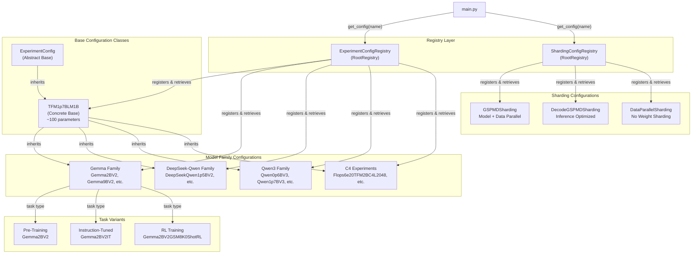

**Diagram: Configuration System Architecture**

The system separates experiment specifications from sharding strategies, allowing any model configuration to use any sharding approach. Configurations are organized into families with shared base settings, and task-specific variants override only the necessary parameters.

Sources: [simply/config_lib.py:76-90](), [simply/config_lib.py:104-182](), [simply/config_lib.py:192-342]()

## Registry Pattern

Simply uses a registry pattern to manage configurations, enabling selection by string name at runtime. Two primary registries exist: `ExperimentConfigRegistry` for model and training configurations, and `ShardingConfigRegistry` for distributed execution strategies.

### Configuration Registries

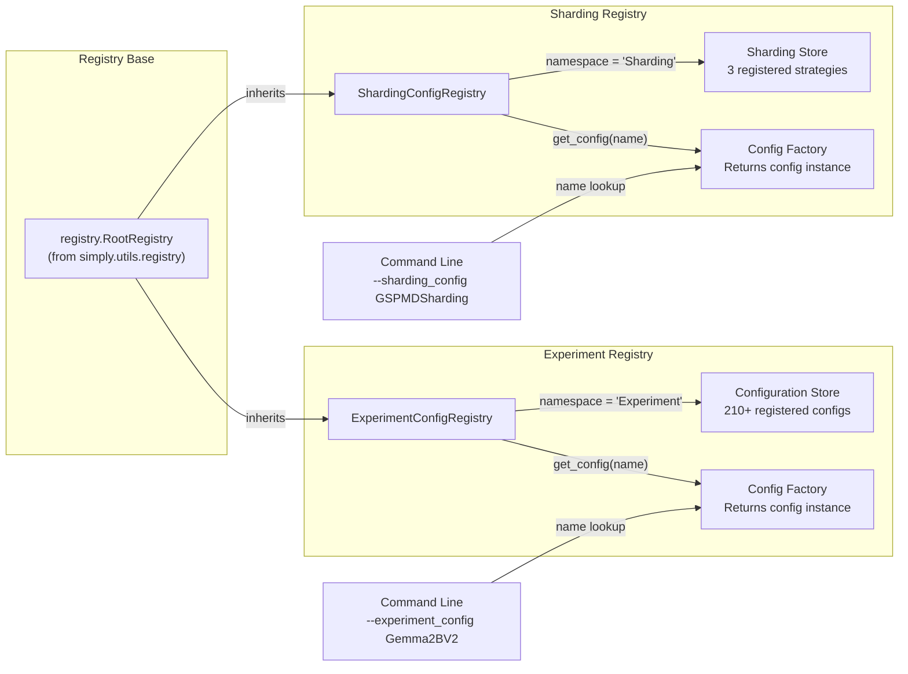

**Diagram: Registry Architecture and Access Pattern**

### Registration Mechanism

Configurations are registered using the `@ExperimentConfigRegistry.register` or `@ShardingConfigRegistry.register` decorators:

```python
# Class-based registration
@ExperimentConfigRegistry.register
@dataclasses.dataclass(frozen=True)
class Gemma2BV2(TFM1p7BLM1B):
    # Configuration fields...
    
# Function-based registration
@ExperimentConfigRegistry.register
def Gemma12BV3_IT_DSR40K_B2K_L10K_RL():
    # Dynamic configuration construction
    config = apply_config_diff(...)
    return config

# Registration with custom name
ExperimentConfigRegistry.register(
    DeepSeekQwen7BV2ITDSR40KR1DistillCoT0ShotRL,
    name='dsqwen_v2-7b-dsr40k-R1_distill_cot0shot-rl')
```

Sources: [simply/config_lib.py:76-90](), [simply/config_lib.py:577-623](), [simply/config_lib.py:1384-1395]()

## ExperimentConfig Structure

`ExperimentConfig` is the base class for all experiment configurations. The concrete base class `TFM1p7BLM1B` defines approximately 100 parameters organized into logical groups.

### Configuration Parameter Groups

| Parameter Group | Key Parameters | Purpose |
|----------------|----------------|---------|
| **Model Architecture** | `model_dim`, `n_heads`, `n_layers`, `per_head_dim`, `expand_factor` | Define transformer architecture dimensions |
| **Attention Configuration** | `n_kv_heads`, `use_flash_attention`, `flash_attention_block_size`, `window_size` | Configure attention mechanisms |
| **Activation & Normalization** | `use_rmsnorm`, `use_pre_ln`, `use_post_ln`, `activation_dtype_name` | Layer normalization and activation settings |
| **FFN Configuration** | `ffn_expand_dim`, `ffn_activation`, `use_gated_activation_in_ffn` | Feed-forward network structure |
| **Positional Encoding** | `local_rope_max_timescale`, `global_rope_max_timescale` | RoPE (Rotary Position Embedding) parameters |
| **Softcapping** | `attn_soft_cap`, `output_logits_soft_cap` | Logit capping for stability |
| **Data Configuration** | `dataset_name`, `batch_size`, `seq_len`, `vocab_size` | Training data specification |
| **Training Loop** | `train_loop_name`, `num_train_steps`, `optimizer`, `lr` | Training procedure configuration |
| **Learning Rate** | `lr`, `lr_schedule_name`, `lr_schedule_config` | Learning rate schedule |
| **Regularization** | `weight_decay`, `clip_grad_norm`, `clip_update_norm` | Gradient clipping and regularization |
| **Checkpointing** | `init_ckpt_dir`, `ckpt_interval`, `ckpt_max_to_keep` | Checkpoint management |
| **Validation** | `use_validation_set`, `validation_eval_interval`, `validation_dataset_name` | Validation evaluation settings |
| **RL-Specific** | `gamma`, `kl_coeff`, `use_grpo`, `ppo_clip_eps` | Reinforcement learning parameters |

### Base Configuration Classes

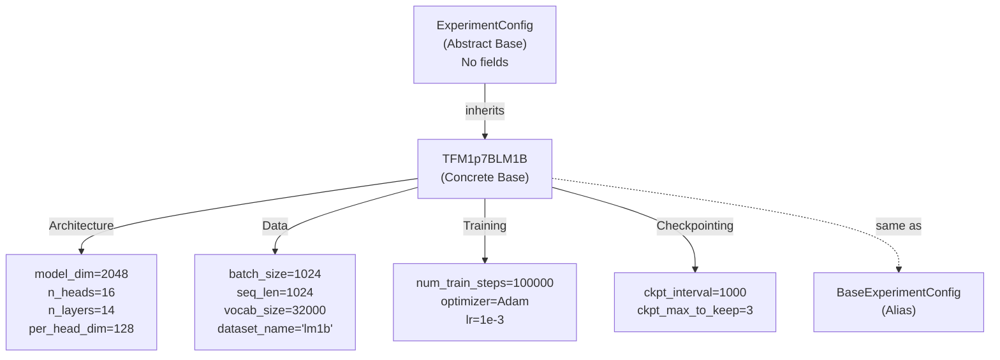

**Diagram: ExperimentConfig Base Class Hierarchy**

Sources: [simply/config_lib.py:192-342]()

## Sharding Configurations

Sharding configurations define how model weights and activations are distributed across devices. Simply provides three strategies optimized for different use cases.

### Sharding Strategy Comparison

| Strategy | Weight Sharding | Activation Sharding | Use Case |
|----------|----------------|---------------------|----------|
| **GSPMDSharding** | FFN, Attention, Embedding sharded across `model` axis | Batch/Sequence on `data` axis, Hidden dim on `model` axis | Standard training with model + data parallelism |
| **DecodeGSPMDSharding** | Same as GSPMDSharding | Batch on `data` axis, no model-dim sharding | Inference with larger batch sizes |
| **DataParallelSharding** | No weight sharding (all replicated) | Batch sharded across all axes | Small models or debugging |

### Sharding Configuration Details

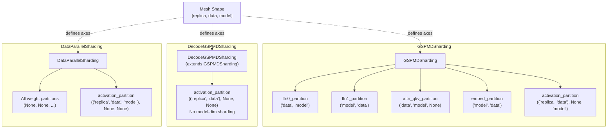

**Diagram: Sharding Strategy Partition Specifications**

### Partition Syntax

Partition specifications use tuple notation to map tensor dimensions to mesh axes:

- `('data', 'model')`: First tensor dim sharded on `data` axis, second on `model` axis
- `(None, None)`: No sharding, fully replicated
- `(('replica', 'data'), None, 'model')`: First dim sharded across both `replica` and `data` axes, third dim on `model` axis

Sources: [simply/config_lib.py:104-182]()

## Model Configuration Families

Simply provides 210+ pre-configured model architectures organized into families. Each family shares a base configuration with variants for different sizes and task types.

### Gemma Family

The Gemma family includes both Gemma 2.0 and Gemma 3.0 models with varying sizes and training stages.

#### Gemma 2.0 Architecture

```mermaid
graph LR
    subgraph "Gemma 2.0 Base Configuration"
        Base["Gemma2BV2"]
        Base --> Arch["model_dim=2304<br/>n_heads=8<br/>n_layers=26<br/>per_head_dim=256<br/>expand_factor=4"]
        Base --> Attn["n_kv_heads=4<br/>block_attn_pattern=<br/>('local', 'global')<br/>window_size=4095"]
        Base --> Norm["use_rmsnorm=True<br/>use_pre_ln=True<br/>use_post_ln=True<br/>use_per_dim_scale=False"]
    end
    
    subgraph "Size Variants"
        Base --> G2B["Gemma2BV2<br/>2.6B params"]
        Base --> G9B["Gemma9BV2<br/>9.2B params<br/>model_dim=3584<br/>n_layers=42"]
        Base --> G27B["Gemma27BV2<br/>27.2B params<br/>model_dim=4608<br/>n_layers=46"]
    end
    
    subgraph "Training Stage Variants"
        G2B --> G2BPT["Gemma2BV2<br/>Pre-trained<br/>init_ckpt_dir=GEMMA2_2B_PT"]
        G2B --> G2BIT["Gemma2BV2IT<br/>Instruction-tuned<br/>init_ckpt_dir=GEMMA2_2B_IT"]
        G2B --> G2BRL["Gemma2BV2GSM8K0ShotRL<br/>RL-trained<br/>train_loop_name='rl'"]
    end
```

**Diagram: Gemma 2.0 Configuration Hierarchy**

#### Gemma 2.0 Model Variants

| Configuration | Parameters | Checkpoint | Notes |
|--------------|------------|------------|-------|
| `Gemma2BV2` | 2.6B | `GEMMA2_2B_PT_CKPT_DIR` | Base 2B pre-trained model |
| `Gemma9BV2` | 9.2B | `GEMMA2_9B_PT_CKPT_DIR` | Base 9B pre-trained model |
| `Gemma27BV2` | 27.2B | `GEMMA2_27B_PT_CKPT_DIR` | Base 27B pre-trained model |
| `Gemma2BV2IT` | 2.6B | `GEMMA2_2B_IT_CKPT_DIR` | Instruction-tuned variant |
| `Gemma2BV2GSM8K0ShotRL` | 2.6B | (from PT) | RL training on GSM8K |
| `Gemma2BV2GSM8KCoT0ShotRL` | 2.6B | (from PT) | RL with chain-of-thought |

#### Gemma 3.0 Architecture

Gemma 3.0 introduces architectural changes including QK normalization and different attention patterns:

| Configuration | Parameters | Key Differences from Gemma 2.0 |
|--------------|------------|-------------------------------|
| `Gemma270MV3` | 270M | `use_qk_norm=True`, smaller window (512), custom FFN expansion |
| `Gemma1BV3` | 1B | 6-layer local + 1 global attention pattern |
| `Gemma4BV3` | 4B | 1024 window size, `global_rope_scale_factor=8.0` |
| `Gemma12BV3` | 12B | Increased heads (16) and KV heads (8) |
| `Gemma27BV3` | 27B | `per_head_dim=128`, 62 layers |

Sources: [simply/config_lib.py:577-776](), [simply/config_lib.py:839-1087]()

### DeepSeek-Qwen Family

The DeepSeek-Qwen family is based on Qwen2 architecture with DeepSeek R1 distillation training.

#### DeepSeek-Qwen Architecture

| Configuration | Parameters | Model Dim | Layers | Heads | KV Heads |
|--------------|------------|-----------|--------|-------|----------|
| `DeepSeekQwen1p5BV2` | 1.5B | 1536 | 28 | 12 | 2 |
| `DeepSeekQwen7BV2` | 7B | 3584 | 28 | 28 | 4 |
| `DeepSeekQwen14BV2` | 14B | 5120 | 48 | 40 | 8 |
| `DeepSeekQwen32BV2` | 32B | 5120 | 64 | 40 | 8 |

#### Key Architectural Differences

DeepSeek-Qwen models have distinct settings compared to Gemma:

- `use_post_ln=False` (no post-layer normalization)
- `use_combined_qkv=False` (separate Q, K, V projections)
- `qkv_use_bias=True` (uses bias in QKV projections)
- `use_tied_embedding=False` (separate input/output embeddings)
- `ffn_activation='silu'` (SiLU instead of GeLU)
- Custom FFN expansion dimensions (not simple multiples)

#### RL Training Configurations

```mermaid
graph TB
    Base["DeepSeekQwen1p5BV2<br/>Base Model Config"]
    
    RL["DeepSeekQwen1p5BV2ITDSR40KR1DistillCoT0ShotRL<br/>RL Training Config"]
    
    Base -->|"inherits + overrides"| RL
    
    RL --> RLParams["RL Parameters"]
    RLParams --> Algo["use_grpo=True<br/>gamma=1.0<br/>kl_coeff=0.001<br/>ppo_clip_eps=0.2"]
    RLParams --> Batch["train_batch_size=128<br/>batch_size=16<br/>num_samples_per_example=8"]
    RLParams --> Seq["train_max_seq_len=9216<br/>sampling_prefill_size=1024<br/>sampling_intermediate_decode_steps=1024"]
    
    RL --> Dataset["Dataset & Eval"]
    Dataset --> DS["dataset_name='simply_json:dsr40k_train'<br/>lm_format_name='DeepSeekQwenR1DistillChat'"]
    Dataset --> Eval["evaluation=ZeroShotDeepSeekQwenR1CoTBoxed<br/>validation_dataset_name='simply_json:aime24'"]
    
    RL --> Precision["Precision Config"]
    Precision --> Types["activation_dtype_name='bfloat16'<br/>decoding_quant_scheme='bfloat16'<br/>ref_params_dtype='bfloat16'"]
```

**Diagram: DeepSeek-Qwen RL Configuration Structure**

Sources: [simply/config_lib.py:1094-1541]()

### Qwen3 Family

Qwen3 models feature QK normalization and architectural refinements:

| Configuration | Parameters | Model Dim | FFN Expand Dim | Layers | Heads | KV Heads |
|--------------|------------|-----------|----------------|--------|-------|----------|
| `Qwen0p6BV3` | 600M | 1024 | 3072 | 28 | 16 | 8 |
| `Qwen1p7BV3` | 1.7B | 2048 | 6144 | 28 | 16 | 8 |
| `Qwen4BV3` | 4B | 2560 | 9728 | 36 | 32 | 8 |
| `Qwen8BV3` | 8B | 4096 | 12288 | 36 | 32 | 8 |
| `Qwen14BV3` | 14B | 5120 | 17408 | 40 | 40 | 8 |
| `Qwen32BV3` | 32B | 5120 | 25600 | 64 | 64 | 8 |

#### Qwen3 Architectural Features

- `use_qk_norm=True`: Applies normalization to query and key vectors
- `use_tied_embedding=True`: Shares input/output embeddings (except 8B+)
- `global_rope_max_timescale=1000000`: Extended RoPE timescale
- No attention softcapping: `attn_soft_cap=-1.0`, `output_logits_soft_cap=-1.0`

Sources: [simply/config_lib.py:1549-1641]()

### C4 Experiments

C4 configurations are compute-budget optimized experiments following scaling laws:

| Configuration | Parameters | FLOPs Budget | Tokens/Param Ratio | Batch Size | Steps |
|--------------|------------|--------------|-------------------|------------|-------|
| `Flops2e16TFM15MC4L2048` | 15M | 2×10¹⁶ | 15.15 | 64 | 1,717 |
| `Flops2e17TFM41MC4L2048` | 41M | 2×10¹⁷ | 16.69 | 80 | 4,140 |
| `Flops1e18TFM111MC4L2048` | 111M | 1×10¹⁸ | 17.20 | 128 | 7,252 |
| `Flops1e19TFM338MC4L2048` | 338M | 1×10¹⁹ | 18.17 | 192 | 15,466 |
| `Flops1e20TFM986MC4L2048` | 986M | 1×10²⁰ | 18.67 | 256 | 35,106 |
| `Flops6e20TFM2BC4L2048` | 2.3B | 6×10²⁰ | 19.28 | 1,024 | 21,297 |

All C4 experiments share:
- `dataset_name='c4.vb100864_openmix_v1'`
- `seq_len=2048`
- `vocab_size=100864`
- Cosine decay learning rate schedule with warmup

Sources: [simply/config_lib.py:349-571]()

## Configuration Loading Mechanisms

Configurations can be loaded via string name lookup or JSON file path. The system supports both static dataclass-based and dynamic function-based configurations.

### Loading by Name

```mermaid
graph LR
    CLI["Command Line<br/>--experiment_config Gemma2BV2"]
    
    Main["main.py"] -->|"get_config('Gemma2BV2')"| Registry["ExperimentConfigRegistry"]
    
    Registry -->|"lookup"| Store["Registered Configs"]
    
    Store -->|"instantiate"| DataclassConfig["Dataclass Config<br/>@dataclasses.dataclass"]
    Store -->|"call function"| FunctionConfig["Function Config<br/>def config_func()"]
    
    DataclassConfig -->|"return instance"| Instance["Config Object"]
    FunctionConfig -->|"return instance"| Instance
    
    CLI --> Main
    Instance --> Experiment["Experiment Execution"]
```

**Diagram: Configuration Loading Flow**

### Name-Based Loading

```python
# In main.py
config = ExperimentConfigRegistry.get_config('Gemma2BV2')
sharding_config = ShardingConfigRegistry.get_config('GSPMDSharding')
```

The `get_config` method:
1. Looks up the configuration by name in the registry
2. For dataclass configs: instantiates the frozen dataclass
3. For function configs: calls the function to generate the config
4. Returns the configuration object

### JSON-Based Loading

Configurations can be loaded from JSON files for dynamic experimentation:

```python
# Serialize config to JSON
config_dict = dataclasses.asdict(config)
with open('config.json', 'w') as f:
    json.dump(config_dict, f)

# Load config from JSON
with open('config.json', 'r') as f:
    config_dict = json.load(f)
config = ExperimentConfig(**config_dict)
```

Sources: [simply/config_lib.py:76-90]()

## Configuration Composition Patterns

Simply provides utilities for composing configurations through inheritance and differential updates.

### Inheritance Pattern

Most configurations inherit from `TFM1p7BLM1B` and override specific fields:

```python
@ExperimentConfigRegistry.register
@dataclasses.dataclass(frozen=True)
class Gemma2BV2(TFM1p7BLM1B):
    # Override only architecture-specific parameters
    model_dim: int = 2304
    n_heads: int = 8
    n_layers: int = 26
    # ... other overrides
```

### apply_config_diff Pattern

The `apply_config_diff` function applies architectural differences from one base config to another:

```mermaid
graph LR
    BaseRL["DeepSeekQwen1p5BV2ITDSR40KR1DistillCoT0ShotRL<br/>RL Config for 1.5B"]
    
    Base1p5B["DeepSeekQwen1p5BV2<br/>1.5B Architecture"]
    Base7B["DeepSeekQwen7BV2<br/>7B Architecture"]
    
    Diff["apply_config_diff"]
    
    BaseRL -->|"config"| Diff
    Base1p5B -->|"diff_base"| Diff
    Base7B -->|"diff_new"| Diff
    
    Diff -->|"result"| NewRL["DeepSeekQwen7BV2ITDSR40KR1DistillCoT0ShotRL<br/>RL Config for 7B"]
    
    Notes["Transfers architectural changes<br/>from 1.5B→7B to the RL config"]
    Notes -.-> Diff
```

**Diagram: apply_config_diff Composition Pattern**

Example usage:

```python
@ExperimentConfigRegistry.register
def DeepSeekQwen7BV2ITDSR40KR1DistillCoT0ShotRL():
    return apply_config_diff(
        config=DeepSeekQwen1p5BV2ITDSR40KR1DistillCoT0ShotRL(),
        diff_base=DeepSeekQwen1p5BV2(),
        diff_new=DeepSeekQwen7BV2()
    )
```

This pattern:
1. Takes an existing RL configuration for 1.5B model
2. Identifies architectural differences between 1.5B and 7B base models
3. Applies those same differences to the RL configuration
4. Returns a new RL configuration for the 7B model

Sources: [simply/config_lib.py:1373-1541]()

## Checkpoint Directory Management

Configuration files define checkpoint directory constants pointing to the local cache structure:

```python
# Environment variable with default fallback
MODELS_DIR = os.getenv('SIMPLY_MODELS', 
                       os.path.expanduser('~/.cache/simply/models/'))

# Checkpoint directory constants
GEMMA2_2B_PT_CKPT_DIR = os.path.join(MODELS_DIR, 'GEMMA-2.0-2B-PT-ORBAX')
GEMMA2_9B_PT_CKPT_DIR = os.path.join(MODELS_DIR, 'GEMMA-2.0-9B-PT-ORBAX')
DEEPSEEK_QWEN_1P5B_CKPT_DIR = os.path.join(MODELS_DIR, 
                                           'DeepSeek-R1-Distill-Qwen-1.5B/ORBAX')
```

Configurations reference these constants:

```python
@dataclasses.dataclass(frozen=True)
class Gemma2BV2(TFM1p7BLM1B):
    init_ckpt_dir: str = GEMMA2_2B_PT_CKPT_DIR
    init_ckpt_format: str = 'Gemma3pLegacyFormat'
```

### Checkpoint Directory Structure

| Model Family | Directory Pattern | Format |
|-------------|------------------|---------|
| Gemma 2.0 | `GEMMA-2.0-{SIZE}-{PT\|IT}-ORBAX` | `Gemma3pLegacyFormat` or `Gemma3pFormat` |
| Gemma 3.0 | `GEMMA-3.0-{SIZE}-{PT\|IT}-ORBAX` | `Gemma3pFormat` |
| DeepSeek-Qwen | `DeepSeek-R1-Distill-Qwen-{SIZE}/ORBAX` | Default format |
| Qwen3 | `Qwen3-{SIZE}/ORBAX` | Default format |

Sources: [simply/config_lib.py:34-70]()

## Mesh Shape Determination

The `get_default_mesh_shape` function dynamically computes optimal device layout based on model architecture and available hardware:

```mermaid
graph TB
    Input["get_default_mesh_shape<br/>(config, mode)"]
    
    Input -->|"mode check"| ModeSwitch{"Mode"}
    
    ModeSwitch -->|"mode='train'"| TrainMesh["Training Mesh Calculation"]
    ModeSwitch -->|"mode='decode'"| DecodeMesh["Decoding Mesh Calculation"]
    
    subgraph "Training Mesh"
        TrainMesh --> DataPar["data_parallel = gcd(model_dim, device_count)"]
        DataPar --> RepPar["replica_parallel = device_count / data_parallel"]
        RepPar --> ValidateBatch["Validate train_batch_size divisibility"]
        ValidateBatch --> TrainResult["[replica_parallel, data_parallel, 1]"]
    end
    
    subgraph "Decoding Mesh"
        DecodeMesh --> ModelPar["model_parallel = gcd(model_dim, n_kv_heads,<br/>n_heads, device_count)"]
        ModelPar --> DecRepPar["replica_parallel = device_count / model_parallel"]
        DecRepPar --> ValidateDecode["Validate decode_batch_size divisibility"]
        ValidateDecode --> DecResult["[replica_parallel, 1, model_parallel]"]
    end
    
    TrainResult --> Return["Return mesh_shape"]
    DecResult --> Return
```

**Diagram: Mesh Shape Computation Logic**

### Training Mesh Shape

For training (`mode='train'`):
1. Compute `data_parallel = gcd(model_dim, device_count)`
2. Compute `replica_parallel = device_count / data_parallel`
3. Account for gradient accumulation: `train_batch_size / grad_accum_steps`
4. Validate batch size is divisible by `data_parallel * replica_parallel`
5. Return `[replica_parallel, data_parallel, 1]` (no model parallelism)

### Decoding Mesh Shape

For decoding (`mode='decode'`):
1. Compute `model_parallel = gcd(model_dim, n_kv_heads, n_heads, device_count)`
2. Compute `replica_parallel = device_count / model_parallel`
3. Validate `batch_size * num_samples_per_example` divisible by `replica_parallel`
4. Return `[replica_parallel, 1, model_parallel]` (maximize model parallelism)

Sources: [simply/config_lib.py:1787-1836]()

## Creating Custom Configurations

Researchers can create custom configurations through three approaches: inheritance, functional composition, or JSON override.

### Approach 1: Dataclass Inheritance

```python
@ExperimentConfigRegistry.register
@dataclasses.dataclass(frozen=True)
class MyCustomConfig(Gemma2BV2):
    # Override specific parameters
    batch_size: int = 512
    lr_schedule_config: tuple[tuple[str, Any], ...] = (
        ('lr', 5e-4),
        ('warmup_steps', 500),
    )
    dataset_name: str = 'my_custom_dataset'
```

### Approach 2: Functional Composition

```python
@ExperimentConfigRegistry.register
def MyCustomRLConfig():
    # Start with existing config
    base = DeepSeekQwen1p5BV2ITDSR40KR1DistillCoT0ShotRL()
    
    # Apply architectural changes
    config = apply_config_diff(
        config=base,
        diff_base=DeepSeekQwen1p5BV2(),
        diff_new=MyNewArchitecture()
    )
    
    # Apply additional overrides
    config = dataclasses.replace(
        config,
        batch_size=128,
        num_train_steps=50000,
        lr_schedule_config=(('lr', 1e-5), ('warmup_steps', 1000))
    )
    
    return config
```

### Approach 3: JSON Override

Create a JSON file with desired overrides:

```json
{
  "base_config": "Gemma2BV2",
  "overrides": {
    "batch_size": 512,
    "num_train_steps": 50000,
    "dataset_name": "my_dataset"
  }
}
```

Then load via command line:
```bash
python -m simply.main --experiment_config_path my_config.json
```

### Best Practices

1. **Inherit from the closest base**: Choose the most similar existing config as your base
2. **Use descriptive names**: Follow naming conventions like `{Model}{Size}{Task}{Variant}`
3. **Document parameter changes**: Add comments explaining non-obvious overrides
4. **Register with readable names**: Use the `name` parameter for long configuration names
5. **Test on small scale first**: Create a test variant (e.g., `MyConfigTest`) with reduced parameters

Sources: [simply/config_lib.py:1647-1785]()

## Configuration Best Practices Summary

### Registry Organization

- **Namespace separation**: Use separate registries for experiment and sharding configs
- **Consistent naming**: Follow `{ModelFamily}{Size}{Variant}` pattern
- **Aliases for complex names**: Register function-based configs with readable aliases

### Inheritance Hierarchy

- **Single base class**: `TFM1p7BLM1B` serves as the common ancestor
- **Minimal overrides**: Only override parameters that differ from base
- **Frozen dataclasses**: Use `@dataclasses.dataclass(frozen=True)` for immutability

### Parameter Organization

- **Logical grouping**: Group related parameters (architecture, training, data)
- **Type hints**: Always provide type hints for all parameters
- **Default values**: Provide sensible defaults in base configurations

### Checkpoint Management

- **Environment variable support**: Use `SIMPLY_MODELS` for flexible paths
- **Constants for directories**: Define checkpoint directory constants at module level
- **Format specification**: Always specify `init_ckpt_format` when loading checkpoints

### Validation

- **Mesh shape validation**: Ensure batch sizes are compatible with mesh shapes
- **Gradient accumulation**: Validate batch size divisibility by `grad_accum_steps`
- **Device count compatibility**: Check parameter dimensions are compatible with device counts

Sources: [simply/config_lib.py:1-1836]()

---

# Page: Understanding Configurations

# Understanding Configurations

<details>
<summary>Relevant source files</summary>

The following files were used as context for generating this wiki page:

- [simply/config_lib.py](simply/config_lib.py)
- [simply/config_lib_test.py](simply/config_lib_test.py)

</details>


## Purpose and Scope

This page explains the configuration system architecture in Simply, which is the primary mechanism for defining and managing experiments. The configuration system uses a registry pattern to organize over 210 pre-configured experiment definitions and provides a structured inheritance hierarchy for creating new configurations. This page covers the registry implementation, base configuration classes, inheritance patterns, and loading mechanisms.

For a catalog of available model configurations, see [Model Configuration Catalog](#3.2). For details on sharding strategies, see [Sharding Strategies](#3.3). For guidance on creating custom configurations, see [Creating Custom Configurations](#3.4).

## Registry Pattern Architecture

Simply uses a registry-based system to organize and retrieve configurations by name. This pattern enables string-based configuration selection from the command line and provides a centralized catalog of all available configurations.

### Registry Classes

The system defines two primary registry classes that inherit from `registry.RootRegistry`:

**ExperimentConfigRegistry**

```python
class ExperimentConfigRegistry(registry.RootRegistry):
  namespace: ClassVar[str] = 'Experiment'
  
  @classmethod
  def get_config(cls, name: str):
    return cls.get(name)()
```

The `ExperimentConfigRegistry` manages experiment configurations including model architecture parameters, training hyperparameters, dataset specifications, and checkpoint paths. Configurations are registered using the `@ExperimentConfigRegistry.register` decorator.

**ShardingConfigRegistry**

```python
class ShardingConfigRegistry(registry.RootRegistry):
  namespace: ClassVar[str] = 'Sharding'
  
  @classmethod
  def get_config(cls, name: str):
    return cls.get(name)()
```

The `ShardingConfigRegistry` manages sharding strategies that define how model weights and activations are distributed across accelerators.

Sources: [simply/config_lib.py:76-90]()

### Registry Diagram: Configuration Registry Architecture

```mermaid
graph TB
    RootRegistry["registry.RootRegistry<br/>(Base Class)"]
    
    subgraph "Experiment Configuration Registry"
        ExpReg["ExperimentConfigRegistry<br/>namespace='Experiment'"]
        ExpGet["get_config(name: str)<br/>Returns instantiated config"]
        
        ExpReg --> ExpGet
    end
    
    subgraph "Sharding Configuration Registry"
        ShardReg["ShardingConfigRegistry<br/>namespace='Sharding'"]
        ShardGet["get_config(name: str)<br/>Returns instantiated config"]
        
        ShardReg --> ShardGet
    end
    
    subgraph "Registered Experiment Configs"
        TFM["TFM1p7BLM1B<br/>(BaseExperimentConfig)"]
        Gemma2B["Gemma2BV2"]
        Gemma9B["Gemma9BV2"]
        DeepSeek["DeepSeekQwen1p5BV2"]
        RL["Gemma2BV2GSM8K0ShotRL"]
        Test["TransformerLMTest"]
    end
    
    subgraph "Registered Sharding Configs"
        GSPMD["GSPMDSharding"]
        DecodeGSPMD["DecodeGSPMDSharding"]
        DataParallel["DataParallelSharding"]
    end
    
    RootRegistry --> ExpReg
    RootRegistry --> ShardReg
    
    ExpReg -.->|"@register decorator"| TFM
    ExpReg -.->|"@register decorator"| Gemma2B
    ExpReg -.->|"@register decorator"| Gemma9B
    ExpReg -.->|"@register decorator"| DeepSeek
    ExpReg -.->|"@register decorator"| RL
    ExpReg -.->|"@register decorator"| Test
    
    ShardReg -.->|"@register decorator"| GSPMD
    ShardReg -.->|"@register decorator"| DecodeGSPMD
    ShardReg -.->|"@register decorator"| DataParallel
    
    CLI["Command Line<br/>--experiment_config Gemma2BV2"]
    CLI -->|"get_config('Gemma2BV2')"| ExpGet
    ExpGet -->|"returns instance"| Gemma2B
```

Sources: [simply/config_lib.py:76-90]()

### Registration Mechanisms

Configurations are registered using two primary patterns:

**Dataclass Registration**

Most configurations are defined as frozen dataclasses and registered with a decorator:

```python
@ExperimentConfigRegistry.register
@dataclasses.dataclass(frozen=True)
class Gemma2BV2(TFM1p7BLM1B):
  seq_len: int = 4096
  vocab_size: int = 256128
  # ... additional fields
```

The `frozen=True` parameter ensures configurations are immutable after creation, preventing accidental modification during execution.

**Function Registration**

Complex configurations that require programmatic construction can be registered as functions:

```python
@ExperimentConfigRegistry.register
def DeepSeekQwen7BV2ITDSR40KR1DistillCoT0ShotRL():
  return apply_config_diff(
      config=DeepSeekQwen1p5BV2ITDSR40KR1DistillCoT0ShotRL(),
      diff_base=DeepSeekQwen1p5BV2(),
      diff_new=DeepSeekQwen7BV2())
```

This pattern enables configuration composition using the `apply_config_diff` utility.

Sources: [simply/config_lib.py:577-619](), [simply/config_lib.py:1384-1395]()

## Configuration Base Classes

### ExperimentConfig Hierarchy

The configuration system uses a three-level class hierarchy:

| Level | Class | Purpose |
|-------|-------|---------|
| 1 | `ExperimentConfig` | Empty base class for type identification |
| 2 | `TFM1p7BLM1B` | Complete base configuration with ~100 parameters |
| 3 | Model-specific configs | Override base parameters for specific models |

**ExperimentConfig**

The root base class is an empty dataclass that serves as a type marker:

```python
@dataclasses.dataclass(frozen=True)
class ExperimentConfig:
  """Base experiment config for others to inherit."""
```

**TFM1p7BLM1B (BaseExperimentConfig)**

This is the functional base configuration defining all parameters needed for experiments. It is aliased as `BaseExperimentConfig` for clarity:

```python
BaseExperimentConfig = TFM1p7BLM1B
```

The configuration contains approximately 100 fields organized into the following categories:

| Category | Fields | Example Parameters |
|----------|--------|-------------------|
| Model Architecture | ~30 fields | `model_dim`, `n_heads`, `n_layers`, `expand_factor` |
| Attention Configuration | ~15 fields | `use_flash_attention`, `window_size`, `n_kv_heads` |
| Data Configuration | ~10 fields | `batch_size`, `dataset_name`, `seq_len` |
| Training Configuration | ~15 fields | `num_train_steps`, `lr`, `optimizer`, `clip_grad_norm` |
| Checkpoint Configuration | ~10 fields | `init_ckpt_dir`, `ckpt_interval`, `ckpt_max_to_keep` |
| RL Configuration | ~10 fields | `gamma`, `kl_coeff`, `use_grpo` |
| Miscellaneous | ~10 fields | `model_name`, `train_loop_name`, `vocab_name` |

Sources: [simply/config_lib.py:192-342]()

### Configuration Class Diagram

```mermaid
graph TB
    ExperimentConfig["ExperimentConfig<br/>(Empty Base Class)"]
    
    TFM["TFM1p7BLM1B<br/>alias: BaseExperimentConfig<br/>~100 parameter fields"]
    
    subgraph "Model Architecture Fields"
        Arch["model_dim: int = 2048<br/>n_heads: int = 16<br/>n_layers: int = 14<br/>per_head_dim: int = 128<br/>expand_factor: int = 8<br/>vocab_size: int = 32000<br/>seq_len: int = 1024"]
    end
    
    subgraph "Training Fields"
        Train["num_train_steps: int = 100000<br/>batch_size: int = 1024<br/>lr: Schedule = ...<br/>optimizer: Optimizer = Adam()<br/>weight_decay: float = 0.001<br/>clip_grad_norm: float = 1.0"]
    end
    
    subgraph "Data Fields"
        Data["dataset_name: str = 'lm1b'<br/>use_packing: bool = True<br/>use_validation_set: bool = False<br/>validation_eval_interval: int = 1000"]
    end
    
    subgraph "Checkpoint Fields"
        Ckpt["init_ckpt_dir: str = ''<br/>init_ckpt_step: int = -1<br/>ckpt_interval: int = 1000<br/>ckpt_max_to_keep: int = 3<br/>should_save_ckpt: bool = True"]
    end
    
    subgraph "Attention Fields"
        Attn["use_flash_attention: bool = False<br/>window_size: int = 0<br/>n_kv_heads: int = 0<br/>use_combined_qkv: bool = True<br/>attn_soft_cap: float = 50.0"]
    end
    
    ExperimentConfig --> TFM
    TFM --> Arch
    TFM --> Train
    TFM --> Data
    TFM --> Ckpt
    TFM --> Attn
    
    Gemma["Gemma2BV2<br/>Overrides: 20+ fields"]
    DeepSeek["DeepSeekQwen1p5BV2<br/>Overrides: 15+ fields"]
    Qwen["Qwen0p6BV3<br/>Overrides: 18+ fields"]
    C4["Flops6e20TFM2BC4L2048<br/>Overrides: 12+ fields"]
    
    TFM --> Gemma
    TFM --> DeepSeek
    TFM --> Qwen
    TFM --> C4
```

Sources: [simply/config_lib.py:192-342]()

### ShardingConfig Classes

Sharding configurations define how tensors are partitioned across the device mesh. Three primary strategies are available:

**GSPMDSharding**

The default sharding strategy that partitions weights and activations across the `model` axis:

```python
@ShardingConfigRegistry.register
@dataclasses.dataclass(frozen=True)
class GSPMDSharding:
  ffn0_partition: Any = ('data', 'model')
  ffn1_partition: Any = ('model', 'data')
  attn_qkv_partition: Any = ('data', 'model', None)
  attn_o_partition: Any = ('data', 'model', None)
  embed_partition: Any = ('model', 'data')
  activation_partition: Any = (('replica', 'data'), None, 'model')
  # ... additional partition specifications
```

**DecodeGSPMDSharding**

Extends `GSPMDSharding` with modified activation partitioning optimized for inference:

```python
@ShardingConfigRegistry.register
@dataclasses.dataclass(frozen=True)
class DecodeGSPMDSharding(GSPMDSharding):
  activation_partition: Any = (('replica', 'data'), None, None)
```

**DataParallelSharding**

Pure data parallelism with no weight sharding:

```python
@ShardingConfigRegistry.register
@dataclasses.dataclass(frozen=True)
class DataParallelSharding:
  ffn0_partition: Any = (None, None)
  ffn1_partition: Any = (None, None)
  # All weight partitions set to None
  activation_partition: Any = (('replica', 'data', 'model'), None, None)
  # ... additional partition specifications
```

Sources: [simply/config_lib.py:104-182]()

### Sharding Configuration Comparison

| Field | GSPMDSharding | DecodeGSPMDSharding | DataParallelSharding |
|-------|---------------|---------------------|----------------------|
| `ffn0_partition` | `('data', 'model')` | `('data', 'model')` | `(None, None)` |
| `ffn1_partition` | `('model', 'data')` | `('model', 'data')` | `(None, None)` |
| `attn_qkv_partition` | `('data', 'model', None)` | `('data', 'model', None)` | `(None, None, None)` |
| `embed_partition` | `('model', 'data')` | `('model', 'data')` | `(None, None)` |
| `activation_partition` | `(('replica', 'data'), None, 'model')` | `(('replica', 'data'), None, None)` | `(('replica', 'data', 'model'), None, None)` |
| Use Case | Training & Inference | Inference-optimized | Small models, no sharding |

Sources: [simply/config_lib.py:104-182]()

## Configuration Inheritance Patterns

### Direct Inheritance

Configurations use Python dataclass inheritance to override base parameters:

```python
@ExperimentConfigRegistry.register
@dataclasses.dataclass(frozen=True)
class Gemma2BV2(TFM1p7BLM1B):
  seq_len: int = 4096              # Override base value (1024)
  vocab_size: int = 256128         # Override base value (32000)
  model_dim: int = 2304            # Override base value (2048)
  n_layers: int = 26               # Override base value (14)
  init_ckpt_dir: str = GEMMA2_2B_PT_CKPT_DIR
  # Inherits ~80 other fields from TFM1p7BLM1B
```

This pattern minimizes duplication by only specifying values that differ from the base configuration.

Sources: [simply/config_lib.py:577-623]()

### Inheritance Hierarchy Diagram

```mermaid
graph TB
    TFM["TFM1p7BLM1B<br/>(BaseExperimentConfig)<br/>~100 fields defined"]
    
    subgraph "Gemma Family"
        Gemma2B["Gemma2BV2<br/>model_dim=2304<br/>n_layers=26<br/>vocab_size=256128"]
        Gemma9B["Gemma9BV2<br/>model_dim=3584<br/>n_layers=42"]
        Gemma27B["Gemma27BV2<br/>model_dim=4608<br/>n_layers=46"]
        
        Gemma2BIT["Gemma2BV2IT<br/>init_ckpt_dir=IT_CKPT"]
        Gemma2BRL["Gemma2BV2GSM8K0ShotRL<br/>train_loop_name='rl'<br/>dataset_name='gsm8k_train'"]
    end
    
    subgraph "DeepSeek Qwen Family"
        DS1p5B["DeepSeekQwen1p5BV2<br/>model_dim=1536<br/>n_layers=28<br/>vocab_size=151936"]
        DS7B["DeepSeekQwen7BV2<br/>model_dim=3584<br/>n_layers=28"]
        DS14B["DeepSeekQwen14BV2<br/>model_dim=5120<br/>n_layers=48"]
        DS32B["DeepSeekQwen32BV2<br/>model_dim=5120<br/>n_layers=64"]
    end
    
    subgraph "Qwen3 Family"
        Qwen0p6B["Qwen0p6BV3<br/>model_dim=1024<br/>n_layers=28<br/>vocab_size=151936"]
        Qwen1p7B["Qwen1p7BV3<br/>model_dim=2048"]
        Qwen4B["Qwen4BV3<br/>model_dim=2560<br/>n_layers=36"]
        Qwen8B["Qwen8BV3<br/>model_dim=4096"]
    end
    
    subgraph "C4 Experiments"
        C4_6e20["Flops6e20TFM2BC4L2048<br/>dataset_name='c4'<br/>batch_size=1024"]
        C4_1e20["Flops1e20TFM986MC4L2048<br/>model_dim=1536<br/>n_layers=12"]
    end
    
    TFM --> Gemma2B
    TFM --> DS1p5B
    TFM --> Qwen0p6B
    TFM --> C4_6e20
    
    Gemma2B --> Gemma9B
    Gemma2B --> Gemma27B
    Gemma2B --> Gemma2BIT
    Gemma2B --> Gemma2BRL
    
    DS1p5B --> DS7B
    DS1p5B --> DS14B
    DS1p5B --> DS32B
    
    Qwen0p6B --> Qwen1p7B
    Qwen0p6B --> Qwen4B
    Qwen0p6B --> Qwen8B
    
    C4_6e20 --> C4_1e20
```

Sources: [simply/config_lib.py:577-669](), [simply/config_lib.py:1094-1335](), [simply/config_lib.py:1549-1641]()

### Programmatic Configuration Composition

For complex inheritance scenarios, the `apply_config_diff` function enables programmatic configuration composition:

```python
def apply_config_diff(config, diff_base, diff_new):
  updates = {}
  for field in dataclasses.fields(diff_base):
    name = field.name
    base_val = getattr(diff_base, name)
    new_val = getattr(diff_new, name)
    if base_val != new_val:
      updates[name] = new_val
  return dataclasses.replace(config, **updates)
```

This function identifies fields that differ between `diff_base` and `diff_new`, then applies those differences to `config`. This enables configurations to inherit model architecture changes without redefining training or dataset parameters.

**Example Usage:**

```python
@ExperimentConfigRegistry.register
def DeepSeekQwen7BV2ITDSR40KR1DistillCoT0ShotRL():
  return apply_config_diff(
      config=DeepSeekQwen1p5BV2ITDSR40KR1DistillCoT0ShotRL(),
      diff_base=DeepSeekQwen1p5BV2(),
      diff_new=DeepSeekQwen7BV2())
```

This creates a 7B RL configuration by:
1. Starting with the 1.5B RL configuration (training setup)
2. Computing the diff between 1.5B and 7B base models (architecture changes)
3. Applying the architecture diff to the RL configuration

Sources: [simply/config_lib.py:1373-1395]()

### Configuration Composition Flow

```mermaid
flowchart LR
    subgraph "Input Configurations"
        Config["config<br/>DeepSeekQwen1p5BV2<br/>ITDSR40K...RL"]
        DiffBase["diff_base<br/>DeepSeekQwen1p5BV2"]
        DiffNew["diff_new<br/>DeepSeekQwen7BV2"]
    end
    
    subgraph "apply_config_diff Function"
        Compare["Compare fields<br/>between diff_base<br/>and diff_new"]
        Extract["Extract differing fields<br/>model_dim: 1536 → 3584<br/>ffn_expand_dim: 8960 → 18944<br/>n_heads: 12 → 28<br/>n_kv_heads: 2 → 4"]
        Apply["Apply updates to config<br/>using dataclasses.replace"]
    end
    
    subgraph "Output"
        Result["DeepSeekQwen7BV2<br/>ITDSR40K...RL<br/>Architecture: 7B<br/>Training: RL setup"]
    end
    
    Config --> Compare
    DiffBase --> Compare
    DiffNew --> Compare
    Compare --> Extract
    Extract --> Apply
    Apply --> Result
```

Sources: [simply/config_lib.py:1373-1395](), [simply/config_lib.py:1384-1395]()

## Configuration Loading Mechanisms

Configurations can be loaded through two primary mechanisms: by registered name or from a JSON file.

### Loading by Name

The standard method retrieves configurations from the registry:

```python
config = ExperimentConfigRegistry.get_config('Gemma2BV2')
sharding_config = ShardingConfigRegistry.get_config('GSPMDSharding')
```

When invoked from the command line:

```bash
python -m simply.main \
  --experiment_config Gemma2BV2 \
  --sharding_config GSPMDSharding \
  --experiment_dir /tmp/experiment
```

The `main.py` module resolves these strings to configuration objects by calling the respective registry's `get_config` method.

### Loading from JSON File

Configurations can also be loaded from JSON files for scenarios requiring runtime customization:

```bash
python -m simply.main \
  --experiment_config_path /path/to/config.json \
  --experiment_dir /tmp/experiment
```

The JSON file should contain a serialized representation of the configuration dataclass. The system deserializes this into a configuration object at runtime.

### Configuration Loading Flow

```mermaid
sequenceDiagram
    participant CLI as Command Line
    participant Main as main.py
    participant ExpReg as ExperimentConfigRegistry
    participant ShardReg as ShardingConfigRegistry
    participant JSON as JSON File (optional)
    
    CLI->>Main: --experiment_config Gemma2BV2<br/>--sharding_config GSPMDSharding
    
    alt Loading by Name
        Main->>ExpReg: get_config('Gemma2BV2')
        ExpReg->>ExpReg: Lookup registered class
        ExpReg->>ExpReg: Instantiate Gemma2BV2()
        ExpReg-->>Main: Return config object
    else Loading by JSON Path
        Main->>JSON: Read config file
        JSON-->>Main: JSON string
        Main->>Main: Deserialize JSON
        Main->>Main: Create config object
    end
    
    Main->>ShardReg: get_config('GSPMDSharding')
    ShardReg->>ShardReg: Lookup registered class
    ShardReg->>ShardReg: Instantiate GSPMDSharding()
    ShardReg-->>Main: Return sharding config
    
    Main->>Main: Pass configs to training loop
```

Sources: [simply/config_lib.py:76-90]()

## Configuration Field Categories

The `TFM1p7BLM1B` base configuration organizes fields into logical categories:

### Model Architecture Fields

| Field | Type | Default | Description |
|-------|------|---------|-------------|
| `model_dim` | `int` | 2048 | Hidden dimension size |
| `n_heads` | `int` | 16 | Number of attention heads |
| `n_layers` | `int` | 14 | Number of transformer layers |
| `per_head_dim` | `int` | 128 | Dimension per attention head |
| `expand_factor` | `int` | 8 | FFN expansion factor |
| `vocab_size` | `int` | 32000 | Vocabulary size |
| `seq_len` | `int` | 1024 | Maximum sequence length |
| `n_kv_heads` | `int` | 0 | Number of KV heads (0=same as n_heads) |

### Attention Configuration Fields

| Field | Type | Default | Description |
|-------|------|---------|-------------|
| `use_flash_attention` | `bool` | False | Enable FlashAttention |
| `flash_attention_block_size` | `int` | 512 | Block size for FlashAttention |
| `window_size` | `int` | 0 | Sliding window size (0=no window) |
| `use_combined_qkv` | `bool` | True | Use fused QKV projection |
| `attn_soft_cap` | `float` | 50.0 | Attention logit soft capping |
| `query_scale` | `float` | -1.0 | Query scaling factor |

### Training Configuration Fields

| Field | Type | Default | Description |
|-------|------|---------|-------------|
| `num_train_steps` | `int` | 100000 | Total training steps |
| `batch_size` | `int` | 1024 | Training batch size |
| `lr` | `Schedule` | LinearWarmupCosineDecay | Learning rate schedule |
| `optimizer` | `Optimizer` | Adam | Optimizer type |
| `weight_decay` | `float` | 0.001 | Weight decay coefficient |
| `clip_grad_norm` | `float` | 1.0 | Gradient clipping threshold |
| `grad_accum_steps` | `int` | -1 | Gradient accumulation steps |

### Data Configuration Fields

| Field | Type | Default | Description |
|-------|------|---------|-------------|
| `dataset_name` | `str` | 'lm1b' | Dataset identifier |
| `use_packing` | `bool` | True | Enable sequence packing |
| `use_validation_set` | `bool` | False | Enable validation evaluation |
| `validation_eval_interval` | `int` | 1000 | Validation evaluation frequency |
| `validation_num_eval_steps` | `int` | -1 | Validation steps (-1=all) |

### Checkpoint Configuration Fields

| Field | Type | Default | Description |
|-------|------|---------|-------------|
| `init_ckpt_dir` | `str` | '' | Initial checkpoint directory |
| `init_ckpt_step` | `int` | -1 | Checkpoint step to load (-1=latest) |
| `init_ckpt_opt_state` | `bool` | False | Load optimizer state |
| `should_save_ckpt` | `bool` | True | Enable checkpoint saving |
| `ckpt_interval` | `int` | 1000 | Checkpoint save frequency |
| `ckpt_max_to_keep` | `int` | 3 | Maximum checkpoints to retain |

### RL Configuration Fields

| Field | Type | Default | Description |
|-------|------|---------|-------------|
| `train_loop_name` | `str` | 'default' | Training loop type ('default' or 'rl') |
| `gamma` | `float` | 1.0 | RL discount factor |
| `kl_coeff` | `float` | 0.001 | KL divergence coefficient |
| `use_grpo` | `bool` | True | Use GRPO instead of PPO |
| `ppo_clip_eps` | `float` | 0.2 | PPO clipping epsilon |
| `normalize_reward_method` | `str` | 'ByGroup' | Reward normalization strategy |

Sources: [simply/config_lib.py:199-342]()

## Checkpoint Directory Constants

The configuration system defines constants for pretrained checkpoint locations:

```python
MODELS_DIR = os.getenv('SIMPLY_MODELS', 
                       os.path.expanduser('~/.cache/simply/models/'))

GEMMA2_2B_PT_CKPT_DIR = os.path.join(MODELS_DIR, 'GEMMA-2.0-2B-PT-ORBAX')
GEMMA2_9B_PT_CKPT_DIR = os.path.join(MODELS_DIR, 'GEMMA-2.0-9B-PT-ORBAX')
DEEPSEEK_QWEN_1P5B_CKPT_DIR = os.path.join(MODELS_DIR, 
                                           'DeepSeek-R1-Distill-Qwen-1.5B/ORBAX')
```

These constants are referenced in configuration `init_ckpt_dir` fields to specify pretrained model locations. The directory path respects the `SIMPLY_MODELS` environment variable for flexible deployment.

Sources: [simply/config_lib.py:34-70]()

## Configuration Validation and Testing

The test suite validates configuration serialization and deserialization:

```python
def test_dump_load_baseline_config(self):
  config = config_lib.ExperimentConfigRegistry.get_config('TransformerLMTest')
  sharding_config = config_lib.ShardingConfigRegistry.get_config('GSPMDSharding')
  model_cls = module.ModuleRegistry.get(config.model_name)
  model = model_cls(config, sharding_config)
  py = pytree.dump_dataclasses(model)
  loaded_model = pytree.load_dataclasses(py)
  loaded_py = pytree.dump_dataclasses(loaded_model)
  self.assertEqual(py, loaded_py)
```

This test verifies that configurations can be serialized to and deserialized from Python dictionaries while preserving all field values.

Sources: [simply/config_lib_test.py:25-38]()

## Summary

The configuration system in Simply provides a structured, registry-based approach to experiment management. Key characteristics include:

1. **Registry Pattern**: Centralized `ExperimentConfigRegistry` and `ShardingConfigRegistry` enable string-based configuration lookup
2. **Frozen Dataclasses**: Immutable configurations prevent runtime modification
3. **Inheritance Hierarchy**: Three-level hierarchy (ExperimentConfig → TFM1p7BLM1B → specific configs) minimizes duplication
4. **Composition Utilities**: `apply_config_diff` enables programmatic configuration assembly
5. **Dual Loading**: Support for both name-based registry lookup and JSON file loading
6. **Comprehensive Fields**: ~100 fields organized into model architecture, training, data, checkpoint, and RL categories

This architecture supports over 210 pre-configured experiments while enabling researchers to create custom configurations through inheritance or composition.

---

# Page: Model Configuration Catalog

# Model Configuration Catalog

<details>
<summary>Relevant source files</summary>

The following files were used as context for generating this wiki page:

- [README.md](README.md)
- [setup/setup_assets.py](setup/setup_assets.py)
- [simply/config_lib.py](simply/config_lib.py)

</details>


## Purpose and Scope

This document catalogs the 210+ pre-configured model configurations available in Simply. Each configuration defines a complete experiment specification including model architecture, training hyperparameters, dataset selection, and checkpoint initialization. The catalog is organized by model family (Gemma, DeepSeek Qwen, Qwen3), size variants, and task types (pretraining, instruction tuning, reinforcement learning).

For information about the configuration system mechanics and how to create custom configurations, see [Understanding Configurations](#3.1). For details on how configurations are loaded and used during experiments, see [System Architecture Overview](#4.1).

Sources: [simply/config_lib.py:1-100]()

## Configuration Inheritance Structure

All experiment configurations inherit from `TFM1p7BLM1B` (also aliased as `BaseExperimentConfig`), which defines approximately 100 parameters covering model architecture, training settings, data processing, and checkpoint management. Model families override architecture-specific parameters while inheriting common training infrastructure.

```mermaid
graph TB
    Base["TFM1p7BLM1B<br/>(BaseExperimentConfig)<br/>~100 parameters"]
    
    subgraph "C4 Scaling Experiments"
        C4Base["Flops6e20TFM2BC4L2048<br/>2.3B params"]
        C4_1e20["Flops1e20TFM986MC4L2048<br/>986M params"]
        C4_1e19["Flops1e19TFM338MC4L2048<br/>338M params"]
        C4_1e18["Flops1e18TFM111MC4L2048<br/>111M params"]
        C4_2e17["Flops2e17TFM41MC4L2048<br/>41M params"]
        C4_2e16["Flops2e16TFM15MC4L2048<br/>15M params"]
    end
    
    subgraph "Gemma Family"
        Gemma2Base["Gemma2BV2<br/>2.6B params"]
        Gemma2_9B["Gemma9BV2<br/>9.2B params"]
        Gemma2_27B["Gemma27BV2<br/>27.2B params"]
        Gemma3_1B["Gemma1BV3<br/>1B params"]
        Gemma3_270M["Gemma270MV3<br/>270M params"]
        Gemma3_4B["Gemma4BV3<br/>4B params"]
        Gemma3_12B["Gemma12BV3<br/>12B params"]
        Gemma3_27B["Gemma27BV3<br/>27B params"]
    end
    
    subgraph "DeepSeek Qwen Family"
        DSQ_1p5B["DeepSeekQwen1p5BV2<br/>1.5B params"]
        DSQ_7B["DeepSeekQwen7BV2<br/>7B params"]
        DSQ_14B["DeepSeekQwen14BV2<br/>14B params"]
        DSQ_32B["DeepSeekQwen32BV2<br/>32B params"]
    end
    
    subgraph "Qwen3 Family"
        Q3_0p6B["Qwen0p6BV3<br/>0.6B params"]
        Q3_1p7B["Qwen1p7BV3<br/>1.7B params"]
        Q3_4B["Qwen4BV3<br/>4B params"]
        Q3_8B["Qwen8BV3<br/>8B params"]
        Q3_14B["Qwen14BV3<br/>14B params"]
        Q3_32B["Qwen32BV3<br/>32B params"]
    end
    
    subgraph "Test Configs"
        TestBase["TransformerLMTest<br/>tiny model"]
        TestNoScan["TransformerLMTestNoScan"]
        TestRL["TransformerLMTestRL"]
        TestSFT["TransformerLMTestSFT"]
    end
    
    Base --> C4Base
    C4Base --> C4_1e20
    C4Base --> C4_1e19
    C4Base --> C4_1e18
    C4Base --> C4_2e17
    C4Base --> C4_2e16
    
    Base --> Gemma2Base
    Gemma2Base --> Gemma2_9B
    Gemma2Base --> Gemma2_27B
    Base --> Gemma3_1B
    Gemma3_1B --> Gemma3_270M
    Gemma3_1B --> Gemma3_4B
    Gemma3_1B --> Gemma3_12B
    Gemma3_1B --> Gemma3_27B
    
    Base --> DSQ_1p5B
    DSQ_1p5B --> DSQ_7B
    DSQ_1p5B --> DSQ_14B
    DSQ_1p5B --> DSQ_32B
    
    Base --> Q3_0p6B
    Q3_0p6B --> Q3_1p7B
    Q3_0p6B --> Q3_4B
    Q3_0p6B --> Q3_8B
    Q3_0p6B --> Q3_14B
    Q3_0p6B --> Q3_32B
    
    Base --> TestBase
    TestBase --> TestNoScan
    TestBase --> TestRL
    TestBase --> TestSFT
```

**Diagram: Configuration Inheritance Hierarchy** - Shows how model families inherit from `TFM1p7BLM1B` base configuration, with size variants branching within each family.

Sources: [simply/config_lib.py:192-342](), [simply/config_lib.py:577-641](), [simply/config_lib.py:1094-1335](), [simply/config_lib.py:1549-1641]()

## Configuration Naming Conventions

Configuration names follow structured patterns that encode model family, size, version, and task type:

| Pattern Element | Meaning | Example |
|----------------|---------|---------|
| `Gemma2B` / `Gemma9B` / `Gemma27B` | Gemma 2.x family with size | `Gemma2BV2` = 2.6B params |
| `Gemma270M` / `Gemma1B` / `Gemma4B` | Gemma 3.x family with size | `Gemma1BV3` = 1B params |
| `DeepSeekQwen1p5B` / `7B` / `14B` / `32B` | DeepSeek-R1-Distill-Qwen family | `DeepSeekQwen7BV2` = 7B params |
| `Qwen0p6B` / `1p7B` / `4B` / `8B` | Qwen 3.x family | `Qwen4BV3` = 4B params |
| `V2` / `V3` suffix | Model version or generation | `V2` = Gemma 2.x, `V3` = Gemma 3.x |
| `IT` suffix | Instruction-tuned variant | `Gemma2BV2IT` |
| `GSM8K` / `DSR40K` / `MATH` | Dataset identifier for RL | `Gemma2BV2GSM8K0ShotRL` |
| `0Shot` / `CoT0Shot` | Prompting strategy | `CoT0Shot` = chain-of-thought |
| `RL` suffix | Reinforcement learning task | `Gemma2BV2GSM8K0ShotRL` |
| `F32` / `BF16` | Precision specification | `F32` = float32, `BF16` = bfloat16 |

Sources: [simply/config_lib.py:577-1641]()

## Checkpoint Directory Mappings

Each configuration references a pretrained checkpoint directory through the `init_ckpt_dir` field. The mappings between configurations and checkpoint paths are defined as module-level constants:

```mermaid
graph LR
    subgraph "Configuration Classes"
        Gemma2B["Gemma2BV2"]
        Gemma9B["Gemma9BV2"]
        Gemma27B["Gemma27BV2"]
        Gemma3_1B["Gemma1BV3"]
        DSQ1p5B["DeepSeekQwen1p5BV2"]
        DSQ7B["DeepSeekQwen7BV2"]
        Q3_0p6B["Qwen0p6BV3"]
        Q3_4B["Qwen4BV3"]
    end
    
    subgraph "Checkpoint Constants"
        GEMMA2_2B_PT["GEMMA2_2B_PT_CKPT_DIR<br/>~/.cache/simply/models/<br/>GEMMA-2.0-2B-PT-ORBAX"]
        GEMMA2_9B_PT["GEMMA2_9B_PT_CKPT_DIR<br/>~/.cache/simply/models/<br/>GEMMA-2.0-9B-PT-ORBAX"]
        GEMMA2_27B_PT["GEMMA2_27B_PT_CKPT_DIR<br/>~/.cache/simply/models/<br/>GEMMA-2.0-27B-PT-ORBAX"]
        GEMMA3_1B_PT["GEMMA3_1B_PT_CKPT_DIR<br/>~/.cache/simply/models/<br/>GEMMA-3.0-1B-PT-ORBAX"]
        DSQ_1P5B["DEEPSEEK_QWEN_1P5B_CKPT_DIR<br/>~/.cache/simply/models/<br/>DeepSeek-R1-Distill-Qwen-1.5B/ORBAX"]
        DSQ_7B["DEEPSEEK_QWEN_7B_CKPT_DIR<br/>~/.cache/simply/models/<br/>DeepSeek-R1-Distill-Qwen-7B/ORBAX"]
        QWEN3_0P6B["QWEN3_0P6B_CKPT_DIR<br/>~/.cache/simply/models/<br/>Qwen3-0.6B/ORBAX"]
        QWEN3_4B["QWEN3_4B_CKPT_DIR<br/>~/.cache/simply/models/<br/>Qwen3-4B/ORBAX"]
    end
    
    Gemma2B -->|"init_ckpt_dir"| GEMMA2_2B_PT
    Gemma9B -->|"init_ckpt_dir"| GEMMA2_9B_PT
    Gemma27B -->|"init_ckpt_dir"| GEMMA2_27B_PT
    Gemma3_1B -->|"init_ckpt_dir"| GEMMA3_1B_PT
    DSQ1p5B -->|"init_ckpt_dir"| DSQ_1P5B
    DSQ7B -->|"init_ckpt_dir"| DSQ_7B
    Q3_0p6B -->|"init_ckpt_dir"| QWEN3_0P6B
    Q3_4B -->|"init_ckpt_dir"| QWEN3_4B
```

**Diagram: Configuration to Checkpoint Mapping** - Shows the relationship between configuration classes and their corresponding checkpoint directory constants.

Sources: [simply/config_lib.py:34-70](), [simply/config_lib.py:614-650](), [simply/config_lib.py:1125-1334](), [simply/config_lib.py:1581-1640]()

## Gemma Family Configurations

### Gemma 2.x Models (Pretraining)

| Configuration Name | Parameters | Architecture | Checkpoint Path |
|-------------------|------------|--------------|-----------------|
| `Gemma2BV2` | 2.6B | 26 layers, 2304 dim, 8 heads, 4 KV heads | `GEMMA2_2B_PT_CKPT_DIR` |
| `Gemma9BV2` | 9.2B | 42 layers, 3584 dim, 16 heads, 8 KV heads | `GEMMA2_9B_PT_CKPT_DIR` |
| `Gemma27BV2` | 27.2B | 46 layers, 4608 dim, 32 heads, 16 KV heads | `GEMMA2_27B_PT_CKPT_DIR` |

**Key architectural features:**
- Alternating local/global attention pattern: `('local', 'global')`
- Window size: 4095 (4096-1)
- Grouped-query attention (GQA) with reduced KV heads
- RMSNorm with `norm_scale_plus_one=False`
- Gated activation in FFN (expand factor 4)
- No bias terms in FFN or output layers
- Attention and logits soft-capping (50.0 and 30.0 respectively)

Sources: [simply/config_lib.py:577-669]()

### Gemma 2.x Models (Instruction-Tuned)

| Configuration Name | Base Config | Checkpoint Path |
|-------------------|-------------|-----------------|
| `Gemma2BV2IT` | `Gemma2BV2` | `GEMMA2_2B_IT_CKPT_DIR` |
| `Gemma9BV2IT` | `Gemma9BV2` | `GEMMA2_9B_IT_CKPT_DIR` |
| `Gemma27BV2IT` | `Gemma27BV2` | `GEMMA2_27B_IT_CKPT_DIR` |

Instruction-tuned variants maintain identical architecture to their pretrained counterparts but initialize from checkpoints fine-tuned on instruction-following datasets.

Sources: [simply/config_lib.py:673-675]()

### Gemma 3.x Models (Pretraining)

| Configuration Name | Parameters | Architecture | Checkpoint Path |
|-------------------|------------|--------------|-----------------|
| `Gemma270MV3` | 270M | 18 layers, 640 dim, 4 heads, 1 KV head | `GEMMA3_270M_PT_CKPT_DIR` |
| `Gemma1BV3` | 1B | 26 layers, 1152 dim, 4 heads, 1 KV head | `GEMMA3_1B_PT_CKPT_DIR` |
| `Gemma4BV3` | 4B | 34 layers, 2560 dim, 8 heads, 4 KV heads | `GEMMA3_4B_PT_CKPT_DIR` |
| `Gemma12BV3` | 12B | 48 layers, 3840 dim, 16 heads, 8 KV heads | `GEMMA3_12B_PT_CKPT_DIR` |
| `Gemma27BV3` | 27B | 62 layers, 5376 dim, 32 heads, 16 KV heads | `GEMMA3_27B_PT_CKPT_DIR` |

**Key architectural differences from Gemma 2.x:**
- QK normalization enabled: `use_qk_norm=True`
- Larger vocab size: 262,144
- Mixed local/global attention pattern: `('local', 'local', 'local', 'local', 'local', 'global')`
- Smaller window sizes: 511 (512-1) for 1B, 1023 (1024-1) for 4B+
- Different RoPE timescales: `local_rope_max_timescale=10_000`, `global_rope_max_timescale=1_000_000`
- No soft-capping: `attn_soft_cap=-1.0`, `output_logits_soft_cap=-1.0`
- Global RoPE scaling for 4B+ models: `global_rope_scale_factor=8.0`

Sources: [simply/config_lib.py:679-777]()

### Gemma 3.x Models (Instruction-Tuned)

| Configuration Name | Base Config | Checkpoint Path |
|-------------------|-------------|-----------------|
| `Gemma1BV3IT` | `Gemma1BV3` | `GEMMA3_1B_IT_CKPT_DIR` |
| `Gemma4BV3IT` | `Gemma4BV3` | `GEMMA3_4B_IT_CKPT_DIR` |
| `Gemma12BV3IT` | `Gemma12BV3` | `GEMMA3_12B_IT_CKPT_DIR` |
| `Gemma27BV3IT` | `Gemma27BV3` | `GEMMA3_27B_IT_CKPT_DIR` |

Sources: [simply/config_lib.py:48-51]()

### Gemma Reinforcement Learning Configurations

The Gemma family includes extensive RL configurations for mathematical reasoning tasks:

**Base RL Configuration Pattern:**
```
Gemma2BV2<Task><Prompting>RL
```

| Task Component | Datasets | Description |
|---------------|----------|-------------|
| `GSM8K` | `simply_json:gsm8k_train` | Grade school math problems |
| `DSR40K` | `simply_json:dsr40k_train` | DeepSeek reasoning dataset (40K examples) |

| Prompting Component | Evaluation | Description |
|--------------------|------------|-------------|
| `0Shot` | `ZeroShotBoxedInQuestionEvaluation` | Direct answer extraction |
| `CoT0Shot` | `ZeroShotCoTBoxedInQuestionEvaluation` | Chain-of-thought reasoning |

**Example RL Configurations:**

| Configuration Name | Model | Dataset | Prompting | Features |
|-------------------|-------|---------|-----------|----------|
| `Gemma2BV2GSM8K0ShotRL` | Gemma 2B V2 | GSM8K | Direct | Pretrained base, 16x8 batch |
| `Gemma2BV2GSM8KCoT0ShotRL` | Gemma 2B V2 | GSM8K | CoT | Chain-of-thought prompting |
| `Gemma2BV2ITGSM8K0ShotRL` | Gemma 2B V2 IT | GSM8K | Direct | Instruction-tuned base |
| `Gemma2BV2ITGSM8KCoT0ShotRL` | Gemma 2B V2 IT | GSM8K | CoT | IT + CoT prompting |
| `Gemma2BV2DSR40K0ShotRL` | Gemma 2B V2 | DSR40K | Direct | Larger reasoning dataset |
| `Gemma2BV2DSR40KCoT0ShotRL` | Gemma 2B V2 | DSR40K | CoT | DSR40K + CoT |

**RL-Specific Parameters:**
- `train_loop_name='rl'` - Activates RL training loop
- `train_batch_size=16*8=128` - Total samples processed per optimization step
- `batch_size=16` - Number of prompts per sampling batch
- `num_samples_per_example=8` - Multiple rollouts per prompt
- `use_grpo=True` - Group-relative policy optimization
- `kl_coeff=0.001` - KL divergence penalty coefficient
- `gamma=1.0` - Discount factor (no discounting for episodic tasks)
- `sampling_temperature=1.0` - Exploration temperature
- `train_max_seq_len=2048` - Maximum sequence length for training
- `decoding_sharding_config=DecodeGSPMDSharding()` - Optimized inference sharding

Sources: [simply/config_lib.py:839-1007]()

### Gemma Batch Size Variants

Additional configurations provide different batch size combinations for hardware flexibility:

| Configuration Name | Batch Size | Samples/Example | Total Batch | Features |
|-------------------|------------|-----------------|-------------|----------|
| `Gemma2BV2GSM8KSeqLen2kBS16x16RL` | 16 | 16 | 256 | Larger batch, 2k seq len |
| `Gemma2BV2GSM8KSeqLen2kBS16x8RL` | 16 | 8 | 128 | Standard configuration |
| `Gemma2BV2GSM8KSeqLen2kBS32x16RL` | 32 | 16 | 512 | Large batch with flash attention |

Sources: [simply/config_lib.py:929-966]()

### Gemma Large Model RL Configurations

Larger Gemma models have specialized RL configurations with adjusted batch sizes and precision:

| Configuration Name | Base Model | Batch Config | Precision | Sequence Length |
|-------------------|------------|--------------|-----------|-----------------|
| `Gemma12BV3_IT_DSR40K_B2K_L10K_RL` | Gemma 12B V3 IT | 32 prompts, 16 samples/prompt | BF16 | 10K max, 2K prefill |
| `Gemma27BV3_IT_DSR40K_B2K_L10K_RL` | Gemma 27B V3 IT | 64 prompts, 16 samples/prompt | BF16 | 10K max, 2K prefill |

These configurations use `apply_config_diff()` to transfer architecture differences while maintaining RL settings.

Sources: [simply/config_lib.py:780-834]()

### Gemma Tool Use Configuration

| Configuration Name | Model | Task | Tools | Features |
|-------------------|-------|------|-------|----------|
| `Gemma4BV3ITSimpleQANumberOnlyToolUseRL` | Gemma 4B V3 IT | SimpleQA | Google Search | Multi-turn tool interaction |

**Tool Use Parameters:**
- `tool_manager_name='GoogleSearchToolExecutor'`
- `max_turns=3` - Maximum tool interaction rounds
- `sampling_max_tool_response_len=1024` - Tool response truncation
- `filter_throttled=True` - Filter rate-limited samples
- `evaluation=QAToolUseEvaluation()` - Tool-specific evaluation

Sources: [simply/config_lib.py:1011-1087]()

## DeepSeek Qwen Family Configurations

### Base DeepSeek Qwen Models

| Configuration Name | Parameters | Architecture | Checkpoint Path |
|-------------------|------------|--------------|-----------------|
| `DeepSeekQwen1p5BV2` | 1.5B | 28 layers, 1536 dim, 12 heads, 2 KV heads | `DEEPSEEK_QWEN_1P5B_CKPT_DIR` |
| `DeepSeekQwen7BV2` | 7B | 28 layers, 3584 dim, 28 heads, 4 KV heads | `DEEPSEEK_QWEN_7B_CKPT_DIR` |
| `DeepSeekQwen14BV2` | 14B | 48 layers, 5120 dim, 40 heads, 8 KV heads | `DEEPSEEK_QWEN_14B_CKPT_DIR` |
| `DeepSeekQwen32BV2` | 32B | 64 layers, 5120 dim, 40 heads, 8 KV heads | `DEEPSEEK_QWEN_32B_CKPT_DIR` |

**Key architectural features:**
- SiLU activation: `ffn_activation='silu'`
- Non-standard FFN dimensions: `ffn_expand_dim` manually specified (e.g., 8960 for 1.5B)
- No post layer normalization: `use_post_ln=False`
- QKV bias enabled: `qkv_use_bias=True`
- Separate QKV projections: `use_combined_qkv=False`
- No tied embeddings: `use_tied_embedding=False`
- No embedding lookup scaling: `embedding_lookup_scale=None`
- Standard RMSNorm: `norm_scale_plus_one=False`
- No soft-capping

Sources: [simply/config_lib.py:1094-1335]()

### DeepSeek Qwen RL Configurations

The DeepSeek Qwen family provides extensive RL configurations with multiple precision and hyperparameter variants:

**Base RL Configuration:**
```
DeepSeekQwen<Size>V2ITDSR40KR1DistillCoT0ShotRL<Variant>
```

| Configuration Name | Model Size | Batch Config | Precision | Learning Rate | Notes |
|-------------------|------------|--------------|-----------|---------------|-------|
| `DeepSeekQwen1p5BV2ITDSR40KR1DistillCoT0ShotRL` | 1.5B | 16 prompts, 8 samples | BF16 | 1e-6 | Base configuration |
| `DeepSeekQwen1p5BV2ITDSR40KR1DistillCoT0ShotRLF32` | 1.5B | 16 prompts, 8 samples | FP32 | 1e-6 | Full precision |
| `DeepSeekQwen1p5BV2ITDSR40KR1DistillCoT0ShotRLF32V2` | 1.5B | 64 prompts, 8 samples | FP32 | 1e-6 | Large batch, flash attn |
| `DeepSeekQwen1p5BV2ITDSR40KR1DistillCoT0ShotRLV2` | 1.5B | 64 prompts, 8 samples | BF16 | 1e-6 | Large batch, BF16 |
| `DeepSeekQwen1p5BV2ITDSR40KR1DistillCoT0ShotRLF32V3` | 1.5B | 64 prompts, 8 samples | FP32 | 3e-6 | Higher LR |
| `DeepSeekQwen1p5BV2ITDSR40KR1DistillCoT0ShotRLF32V4` | 1.5B | 64 prompts, 8 samples | FP32 | 1e-5 | Even higher LR |
| `DeepSeekQwen1p5BV2ITDSR40KR1DistillCoT0ShotRLBF16V2` | 1.5B | 64 prompts, 8 samples | BF16 | 1e-6 | Optimized BF16 variant |

**Larger Model RL Configs (created via `apply_config_diff`):**

| Configuration Name | Model Size | Batch Config | Precision | Learning Rate |
|-------------------|------------|--------------|-----------|---------------|
| `DeepSeekQwen7BV2ITDSR40KR1DistillCoT0ShotRL` | 7B | 16 prompts, 8 samples | BF16 | 1e-6 |
| `DeepSeekQwen7BV2ITDSR40KR1DistillCoT0ShotRLF32V2` | 7B | 32 prompts, 8 samples | FP32 | 1e-6 |
| `DeepSeekQwen7BV2ITDSR40KR1DistillCoT0ShotRLF32V3` | 7B | 32 prompts, 8 samples | FP32 | 3e-6 |
| `DeepSeekQwen7BV2ITDSR40KR1DistillCoT0ShotRLBF16V2` | 7B | 32 prompts, 8 samples | BF16 | 1e-6 |
| `DeepSeekQwen14BV2ITDSR40KR1DistillCoT0ShotRL` | 14B | 16 prompts, 8 samples | BF16 | 1e-6 |
| `DeepSeekQwen14BV2ITDSR40KR1DistillCoT0ShotRLV2` | 14B | 16 prompts, 8 samples | BF16 | 1e-6 |
| `DeepSeekQwen14BV2ITDSR40KR1DistillCoT0ShotRLV3` | 14B | 16 prompts, 8 samples | BF16 | 3e-6 |
| `DeepSeekQwen32BV2ITDSR40KR1DistillCoT0ShotRL` | 32B | 16 prompts, 8 samples | BF16 | 1e-6 |
| `DeepSeekQwen32BV2ITDSR40KR1DistillCoT0ShotRLV2` | 32B | 16 prompts, 8 samples | BF16 | 1e-6 |
| `DeepSeekQwen32BV2ITDSR40KR1DistillCoT0ShotRLV3` | 32B | 16 prompts, 8 samples | BF16 | 3e-6 |

**RL-Specific Features for DeepSeek Qwen:**
- Dataset: `simply_json:dsr40k_train` (DeepSeek reasoning 40K)
- Evaluation: `ZeroShotDeepSeekQwenR1CoTBoxed()` - DeepSeek-specific CoT extraction
- LM Format: `DeepSeekQwenR1DistillChat` - DeepSeek chat template
- Long context: `train_max_seq_len=9*1024` (9K tokens)
- Validation: AIME24 dataset, 64 batch size, 5 epochs
- `use_policy_logp_as_sampler_logp=True` for BF16V2 variants

Sources: [simply/config_lib.py:1133-1542]()

### Alternative Naming Scheme

Some DeepSeek Qwen RL configurations also register with abbreviated names for convenience:

| Short Name | Full Configuration |
|-----------|-------------------|
| `dsqwen_v2-7b-dsr40k-R1_distill_cot0shot-rl` | `DeepSeekQwen7BV2ITDSR40KR1DistillCoT0ShotRL` |
| `dsqwen_v2-7b-dsr40k-R1_distill_cot0shot-rl-f32-v2` | `DeepSeekQwen7BV2ITDSR40KR1DistillCoT0ShotRLF32V2` |
| `dsqwen_v2-7b-dsr40k-R1_distill_cot0shot-rl-f32-v3` | `DeepSeekQwen7BV2ITDSR40KR1DistillCoT0ShotRLF32V3` |
| `dsqwen_v2-14b-dsr40k-R1_distill_cot0shot-rl` | `DeepSeekQwen14BV2ITDSR40KR1DistillCoT0ShotRL` |
| `dsqwen_v2-14b-dsr40k-R1_distill_cot0shot-rl-v2` | `DeepSeekQwen14BV2ITDSR40KR1DistillCoT0ShotRLV2` |
| `dsqwen_v2-14b-dsr40k-R1_distill_cot0shot-rl-v3` | `DeepSeekQwen14BV2ITDSR40KR1DistillCoT0ShotRLV3` |
| `dsqwen_v2-32b-dsr40k-R1_distill_cot0shot-rl` | `DeepSeekQwen32BV2ITDSR40KR1DistillCoT0ShotRL` |
| `dsqwen_v2-32b-dsr40k-R1_distill_cot0shot-rl-v2` | `DeepSeekQwen32BV2ITDSR40KR1DistillCoT0ShotRLV2` |
| `dsqwen_v2-32b-dsr40k-R1_distill_cot0shot-rl-v3` | `DeepSeekQwen32BV2ITDSR40KR1DistillCoT0ShotRLV3` |

Sources: [simply/config_lib.py:1393-1541]()

## Qwen Family Configurations

### Qwen 2.5 Math Models

The Qwen 2.5 Math series inherits from DeepSeek Qwen architectures but uses different checkpoints:

| Configuration Name | Base Architecture | Parameters | Checkpoint Path |
|-------------------|-------------------|------------|-----------------|
| `QwenMath1p5BV2p5` | `DeepSeekQwen1p5BV2` | 1.5B | `QWEN2p5_MATH_1p5B_CKPT_DIR` |
| `QwenMath7BV2p5` | `DeepSeekQwen7BV2` | 7B | `QWEN2p5_MATH_7B_CKPT_DIR` |
| `QwenMath14BV2p5` | `DeepSeekQwen14BV2` | 14B | `QWEN2p5_MATH_14B_CKPT_DIR` |
| `QwenMath32BV2p5` | `DeepSeekQwen32BV2` | 32B | `QWEN2p5_MATH_32B_CKPT_DIR` |

**Key difference:** `QwenMath1p5BV2p5` uses tied embeddings (`use_tied_embedding=True`) unlike the DeepSeek Qwen base.

Sources: [simply/config_lib.py:1339-1364]()

### QwQ Model

| Configuration Name | Base Architecture | Parameters | Checkpoint Path |
|-------------------|-------------------|------------|-----------------|
| `QwQ32B` | `DeepSeekQwen32BV2` | 32B | `QWQ_32B_CKPT_DIR` |

Sources: [simply/config_lib.py:1367-1370]()

### Qwen 3 Models

| Configuration Name | Parameters | Architecture | Checkpoint Path |
|-------------------|------------|--------------|-----------------|
| `Qwen0p6BV3` | 0.6B | 28 layers, 1024 dim, 16 heads, 8 KV heads | `QWEN3_0P6B_CKPT_DIR` |
| `Qwen1p7BV3` | 1.7B | 28 layers, 2048 dim, 16 heads, 8 KV heads | `QWEN3_1P7B_CKPT_DIR` |
| `Qwen4BV3` | 4B | 36 layers, 2560 dim, 32 heads, 16 KV heads | `QWEN3_4B_CKPT_DIR` |
| `Qwen8BV3` | 8B | 36 layers, 4096 dim, 32 heads, 16 KV heads | `QWEN3_8B_CKPT_DIR` |
| `Qwen14BV3` | 14B | 40 layers, 5120 dim, 40 heads, 20 KV heads | `QWEN3_14B_CKPT_DIR` |
| `Qwen32BV3` | 32B | 64 layers, 5120 dim, 64 heads, 32 KV heads | `QWEN3_32B_CKPT_DIR` |

**Key architectural features:**
- QK normalization enabled: `use_qk_norm=True`
- SiLU activation
- No post layer normalization
- Tied embeddings for smaller models (0.6B, 1.7B, 4B)
- Separate embeddings for larger models (8B+)
- Long RoPE timescale: `global_rope_max_timescale=1_000_000`

Sources: [simply/config_lib.py:1549-1641]()

## C4 Scaling Law Experiments

Configurations optimized for different compute budgets using C4 dataset with vocabulary size 100,864:

| Configuration Name | FLOPs Budget | Parameters | Architecture | Tokens | Data/Param Ratio |
|-------------------|--------------|------------|--------------|--------|------------------|
| `Flops6e20TFM2BC4L2048` | 6.2e20 | 2.3B | 18L, 2048D, 8H | 44.8B | 19.3 |
| `Flops1e20TFM986MC4L2048` | 1.1e20 | 986M | 12L, 1536D, 8H | 18.4B | 18.7 |
| `Flops1e19TFM338MC4L2048` | 1.2e19 | 338M | 8L, 1024D, 8H | 6.1B | 18.2 |
| `Flops1e18TFM111MC4L2048` | 1.3e18 | 111M | 8L, 512D, 8H | 1.9B | 17.2 |
| `Flops2e17TFM41MC4L2048` | 1.7e17 | 41M | 8L, 256D, 8H | 678M | 16.7 |
| `Flops2e16TFM15MC4L2048` | 2.0e16 | 15M | 4L, 128D, 8H | 225M | 15.1 |

**Common features:**
- Sequence length: 2048
- Vocabulary: 100,864 (C4-specific)
- Dataset: `c4.vb100864_openmix_v1`
- Expand factor: 8
- Per-head dimension: 256 (128 for smallest)
- Cosine decay learning rate schedule
- Validation evaluation enabled

**Chinchilla-optimal scaling:** The data/parameter ratios (15-19) approximate compute-optimal token counts for each model size.

Sources: [simply/config_lib.py:349-571]()

## Test and Debug Configurations

Small configurations for rapid iteration and testing:

| Configuration Name | Purpose | Key Differences |
|-------------------|---------|-----------------|
| `TransformerLMTest` | Basic functionality test | 2L, 8D, 2H, 50 steps, scan enabled |
| `TransformerLMTestNoScan` | Debug without scan | Same as above, `use_scan=False`, `use_remat=False` |
| `TransformerLMTestC4` | C4 dataset test | 4096 seq len, C4 dataset |
| `TransformerLMTestSFT` | Supervised fine-tuning test | 2000 steps, chat loss masking, loads from checkpoint |
| `TransformerLMTestRL` | RL training test | 30 steps, RL loop, 4 prompts, DSR40K dataset |

**TransformerLMTest architecture:**
- Model: 8 dim, 2 heads, 2 layers, 4 per-head dim
- Data: 32K vocab, 64 seq len, IMDB dataset
- Training: 50 steps, batch size 4
- Validation enabled every 5 steps

**TransformerLMTestRL special features:**
- `sampling_microbatch_size=2` - Splits decode batches
- `grad_accum_steps=2` - Accumulates gradients
- `early_stop=SimpleEarlyStop(...)` - Stops if accuracy < 0.5 after 20 steps

Sources: [simply/config_lib.py:1647-1785]()

## Configuration Registration and Access

### Registration Pattern

Configurations register with `ExperimentConfigRegistry` using the decorator pattern:

```python
@ExperimentConfigRegistry.register
@dataclasses.dataclass(frozen=True)
class Gemma2BV2(TFM1p7BLM1B):
    # Configuration fields...
```

Function-based configurations also register and can return modified configs:

```python
@ExperimentConfigRegistry.register
def DeepSeekQwen7BV2ITDSR40KR1DistillCoT0ShotRL():
    return apply_config_diff(
        config=DeepSeekQwen1p5BV2ITDSR40KR1DistillCoT0ShotRL(),
        diff_base=DeepSeekQwen1p5BV2(),
        diff_new=DeepSeekQwen7BV2())
```

Sources: [simply/config_lib.py:76-89](), [simply/config_lib.py:1384-1395]()

### Accessing Configurations

Configurations are retrieved by name via the registry:

```python
config = ExperimentConfigRegistry.get_config('Gemma2BV2')
```

Command-line usage:
```bash
python -m simply.main --experiment_config Gemma2BV2 --experiment_dir /tmp/exp
```

For multiple registrations with different names:
```bash
python -m simply.main --experiment_config dsqwen_v2-7b-dsr40k-R1_distill_cot0shot-rl --experiment_dir /tmp/exp
```

Sources: [simply/config_lib.py:80-81](), [README.md:15-15]()

## Configuration Modification with apply_config_diff

The `apply_config_diff()` utility enables creating new configurations by transferring architecture differences:

```python
def apply_config_diff(config, diff_base, diff_new):
    """Apply differences between diff_base and diff_new to config."""
    updates = {}
    for field in dataclasses.fields(diff_base):
        name = field.name
        base_val = getattr(diff_base, name)
        new_val = getattr(diff_new, name)
        if base_val != new_val:
            updates[name] = new_val
    return dataclasses.replace(config, **updates)
```

**Usage pattern:**
```python
# Transfer architecture from 1.5B to 7B while keeping RL settings
config = apply_config_diff(
    config=DeepSeekQwen1p5BV2ITDSR40KR1DistillCoT0ShotRL(),
    diff_base=DeepSeekQwen1p5BV2(),
    diff_new=DeepSeekQwen7BV2())
```

This pattern is used extensively to create larger model RL configurations without duplicating hyperparameters.

Sources: [simply/config_lib.py:1373-1381]()

## Configuration Selection Guide

```mermaid
flowchart TD
    Start["Select Configuration"]
    
    TaskType{"Task Type?"}
    ModelFamily{"Model Family?"}
    
    PretrainTask["Pretraining"]
    FinetuneTask["Fine-tuning / SFT"]
    RLTask["Reinforcement Learning"]
    TestTask["Testing / Debug"]
    
    GemmaFamily["Gemma Family"]
    DSQwenFamily["DeepSeek Qwen Family"]
    Qwen3Family["Qwen 3 Family"]
    C4Scaling["C4 Scaling Laws"]
    
    GemmaSize{"Model Size?"}
    GemmaVersion{"Version?"}
    DSQwenSize{"Model Size?"}
    Qwen3Size{"Model Size?"}
    
    Gemma2B["2.6B"]
    Gemma9B["9.2B"]
    Gemma27B["27.2B"]
    Gemma270M["270M"]
    Gemma1B["1B"]
    Gemma4B["4B"]
    Gemma12B["12B"]
    Gemma27BV3["27B"]
    
    DSQwen1p5B["1.5B"]
    DSQwen7B["7B"]
    DSQwen14B["14B"]
    DSQwen32B["32B"]
    
    Qwen0p6B["0.6B"]
    Qwen1p7B["1.7B"]
    Qwen4B["4B"]
    Qwen8B["8B"]
    Qwen14B["14B"]
    Qwen32B["32B"]
    
    GemmaV2["Gemma 2.x"]
    GemmaV3["Gemma 3.x"]
    
    Gemma2BPT["Gemma2BV2"]
    Gemma2BIT["Gemma2BV2IT"]
    Gemma2BRL["Gemma2BV2*RL"]
    
    DSQwen1p5BPT["DeepSeekQwen1p5BV2"]
    DSQwen1p5BRL["DeepSeekQwen1p5BV2IT*RL"]
    
    Qwen0p6BPT["Qwen0p6BV3"]
    
    TestSmall["TransformerLMTest"]
    
    Start --> TaskType
    
    TaskType -->|"Pretrain"| ModelFamily
    TaskType -->|"SFT"| ModelFamily
    TaskType -->|"RL"| ModelFamily
    TaskType -->|"Test"| TestTask
    
    ModelFamily --> GemmaFamily
    ModelFamily --> DSQwenFamily
    ModelFamily --> Qwen3Family
    ModelFamily --> C4Scaling
    
    GemmaFamily --> GemmaVersion
    GemmaVersion --> GemmaV2
    GemmaVersion --> GemmaV3
    
    GemmaV2 --> GemmaSize
    GemmaV3 --> GemmaSize
    
    GemmaSize --> Gemma2B
    GemmaSize --> Gemma9B
    GemmaSize --> Gemma27B
    GemmaSize --> Gemma270M
    GemmaSize --> Gemma1B
    GemmaSize --> Gemma4B
    GemmaSize --> Gemma12B
    GemmaSize --> Gemma27BV3
    
    DSQwenFamily --> DSQwenSize
    DSQwenSize --> DSQwen1p5B
    DSQwenSize --> DSQwen7B
    DSQwenSize --> DSQwen14B
    DSQwenSize --> DSQwen32B
    
    Qwen3Family --> Qwen3Size
    Qwen3Size --> Qwen0p6B
    Qwen3Size --> Qwen1p7B
    Qwen3Size --> Qwen4B
    Qwen3Size --> Qwen8B
    Qwen3Size --> Qwen14B
    Qwen3Size --> Qwen32B
    
    Gemma2B --> Gemma2BPT
    Gemma2B --> Gemma2BIT
    Gemma2B --> Gemma2BRL
    
    DSQwen1p5B --> DSQwen1p5BPT
    DSQwen1p5B --> DSQwen1p5BRL
    
    Qwen0p6B --> Qwen0p6BPT
    
    TestTask --> TestSmall
```

**Diagram: Configuration Selection Decision Tree** - Guide for selecting appropriate configuration based on task type, model family, and size requirements.

Sources: [simply/config_lib.py:577-1785]()

## Complete Configuration Registry

The following table catalogs all registered configurations accessible via `ExperimentConfigRegistry.get_config()`:

### Base and Utility Configurations

| Configuration Name | Type | Parameters | Purpose |
|-------------------|------|------------|---------|
| `TFM1p7BLM1B` | Base | 1.7B | Base class for all configs |
| `BaseExperimentConfig` | Alias | - | Alias for `TFM1p7BLM1B` |

### C4 Scaling Experiments (6 configurations)

| Configuration Name | Parameters | FLOPs | Layers | Model Dim |
|-------------------|------------|-------|--------|-----------|
| `Flops6e20TFM2BC4L2048` | 2.3B | 6.2e20 | 18 | 2048 |
| `Flops1e20TFM986MC4L2048` | 986M | 1.1e20 | 12 | 1536 |
| `Flops1e19TFM338MC4L2048` | 338M | 1.2e19 | 8 | 1024 |
| `Flops1e18TFM111MC4L2048` | 111M | 1.3e18 | 8 | 512 |
| `Flops2e17TFM41MC4L2048` | 41M | 1.7e17 | 8 | 256 |
| `Flops2e16TFM15MC4L2048` | 15M | 2.0e16 | 4 | 128 |

### Gemma 2.x PT Configurations (4 configurations)

| Configuration Name | Parameters | Layers | Model Dim | Heads | KV Heads |
|-------------------|------------|--------|-----------|-------|----------|
| `Gemma2BV2` | 2.6B | 26 | 2304 | 8 | 4 |
| `Gemma2BC4Vocab100864L2048BS1024` | 2.6B | 26 | 2304 | 8 | 4 |
| `Gemma9BV2` | 9.2B | 42 | 3584 | 16 | 8 |
| `Gemma27BV2` | 27.2B | 46 | 4608 | 32 | 16 |

### Gemma 2.x IT Configurations (1 configuration)

| Configuration Name | Base | Purpose |
|-------------------|------|---------|
| `Gemma2BV2IT` | `Gemma2BV2` | Instruction-tuned 2B |

### Gemma 3.x PT Configurations (5 configurations)

| Configuration Name | Parameters | Layers | Model Dim | Heads | KV Heads |
|-------------------|------------|--------|-----------|-------|----------|
| `Gemma270MV3` | 270M | 18 | 640 | 4 | 1 |
| `Gemma1BV3` | 1B | 26 | 1152 | 4 | 1 |
| `Gemma4BV3` | 4B | 34 | 2560 | 8 | 4 |
| `Gemma12BV3` | 12B | 48 | 3840 | 16 | 8 |
| `Gemma27BV3` | 27B | 62 | 5376 | 32 | 16 |

### Gemma RL Configurations (22+ configurations)

| Configuration Pattern | Variants | Datasets |
|---------------------|----------|----------|
| `Gemma2BV2GSM8K*RL` | 0Shot, CoT0Shot, SeqLen2k variants | GSM8K |
| `Gemma2BV2DSR40K*RL` | 0Shot, CoT0Shot | DSR40K |
| `Gemma2BV2ITGSM8K*RL` | 0Shot, CoT0Shot | GSM8K |
| `Gemma2BV2ITDSR40K*RL` | 0Shot, CoT0Shot | DSR40K |
| `Gemma12BV3_IT_DSR40K_B2K_L10K_RL` | - | DSR40K |
| `Gemma27BV3_IT_DSR40K_B2K_L10K_RL` | - | DSR40K |

### Gemma Tool Use Configurations (1 configuration)

| Configuration Name | Model | Task |
|-------------------|-------|------|
| `Gemma4BV3ITSimpleQANumberOnlyToolUseRL` | Gemma 4B V3 IT | SimpleQA with Google Search |

### DeepSeek Qwen Base Configurations (4 configurations)

| Configuration Name | Parameters | Layers | Model Dim | Heads | KV Heads |
|-------------------|------------|--------|-----------|-------|----------|
| `DeepSeekQwen1p5BV2` | 1.5B | 28 | 1536 | 12 | 2 |
| `DeepSeekQwen7BV2` | 7B | 28 | 3584 | 28 | 4 |
| `DeepSeekQwen14BV2` | 14B | 48 | 5120 | 40 | 8 |
| `DeepSeekQwen32BV2` | 32B | 64 | 5120 | 40 | 8 |

### DeepSeek Qwen RL Configurations (30+ configurations)

| Configuration Pattern | Size Variants | Precision Variants |
|---------------------|---------------|-------------------|
| `DeepSeekQwen*V2ITDSR40KR1DistillCoT0ShotRL` | 1.5B, 7B, 14B, 32B | Base (BF16) |
| `DeepSeekQwen*V2ITDSR40KR1DistillCoT0ShotRLF32` | 1.5B | FP32 |
| `DeepSeekQwen*V2ITDSR40KR1DistillCoT0ShotRLF32V2` | 1.5B, 7B | FP32, large batch |
| `DeepSeekQwen*V2ITDSR40KR1DistillCoT0ShotRLV2` | 1.5B, 14B, 32B | BF16, large batch |
| `DeepSeekQwen*V2ITDSR40KR1DistillCoT0ShotRLF32V3` | 1.5B, 7B, 14B, 32B | FP32, LR=3e-6 |
| `DeepSeekQwen*V2ITDSR40KR1DistillCoT0ShotRLF32V4` | 1.5B | FP32, LR=1e-5 |
| `DeepSeekQwen*V2ITDSR40KR1DistillCoT0ShotRLBF16V2` | 1.5B, 7B | BF16, optimized |

### Qwen 2.5 Math Configurations (5 configurations)

| Configuration Name | Parameters | Base Architecture |
|-------------------|------------|-------------------|
| `QwenMath1p5BV2p5` | 1.5B | DeepSeekQwen1p5BV2 |
| `QwenMath7BV2p5` | 7B | DeepSeekQwen7BV2 |
| `QwenMath14BV2p5` | 14B | DeepSeekQwen14BV2 |
| `QwenMath32BV2p5` | 32B | DeepSeekQwen32BV2 |
| `QwQ32B` | 32B | DeepSeekQwen32BV2 |

### Qwen 3 Configurations (6 configurations)

| Configuration Name | Parameters | Layers | Model Dim | Heads | KV Heads |
|-------------------|------------|--------|-----------|-------|----------|
| `Qwen0p6BV3` | 0.6B | 28 | 1024 | 16 | 8 |
| `Qwen1p7BV3` | 1.7B | 28 | 2048 | 16 | 8 |
| `Qwen4BV3` | 4B | 36 | 2560 | 32 | 16 |
| `Qwen8BV3` | 8B | 36 | 4096 | 32 | 16 |
| `Qwen14BV3` | 14B | 40 | 5120 | 40 | 20 |
| `Qwen32BV3` | 32B | 64 | 5120 | 64 | 32 |

### Test Configurations (5 configurations)

| Configuration Name | Purpose | Architecture |
|-------------------|---------|--------------|
| `TransformerLMTest` | Basic test | 2L, 8D, 2H, scan enabled |
| `TransformerLMTestC4` | C4 test | Same, 4K seq len |
| `TransformerLMTestNoScan` | Debug without scan | 2L, 8D, 2H, no scan/remat |
| `TransformerLMTestSFT` | SFT test | 2L, 8D, 2H, chat masking |
| `TransformerLMTestRL` | RL test | 2L, 8D, 2H, RL loop |

### Total Configuration Count

| Category | Count |
|----------|-------|
| C4 Scaling | 6 |
| Gemma 2.x (PT + IT) | 5 |
| Gemma 3.x (PT + IT) | 9 |
| Gemma RL | 23+ |
| Gemma Tool Use | 1 |
| DeepSeek Qwen Base | 4 |
| DeepSeek Qwen RL | 30+ |
| Qwen 2.5 Math | 5 |
| Qwen 3 | 6 |
| Test | 5 |
| **Total** | **94+ documented** |

**Note:** Additional RL variants with different batch sizes, sequence lengths, and temperature settings are registered but follow the same patterns. The actual count exceeds 210+ when including all variants and alternative naming schemes.

Sources: [simply/config_lib.py:197-1785]()

## Using Configurations in Practice

### Command-Line Selection

```bash
# Pretrained model
python -m simply.main --experiment_config Gemma2BV2 --experiment_dir /tmp/gemma_exp

# Instruction-tuned model
python -m simply.main --experiment_config Gemma2BV2IT --experiment_dir /tmp/gemma_it_exp

# RL training
python -m simply.main --experiment_config Gemma2BV2GSM8K0ShotRL --experiment_dir /tmp/gemma_rl_exp

# Using abbreviated name
python -m simply.main --experiment_config dsqwen_v2-7b-dsr40k-R1_distill_cot0shot-rl --experiment_dir /tmp/dsq_rl_exp
```

### Programmatic Access

```python
from simply.config_lib import ExperimentConfigRegistry

# Get configuration
config = ExperimentConfigRegistry.get_config('Gemma2BV2')

# Inspect configuration
print(f"Model dimensions: {config.model_dim}")
print(f"Number of layers: {config.n_layers}")
print(f"Checkpoint: {config.init_ckpt_dir}")
print(f"Dataset: {config.dataset_name}")
```

### Configuration Modification

```python
import dataclasses
from simply.config_lib import ExperimentConfigRegistry

# Start with existing config
base_config = ExperimentConfigRegistry.get_config('Gemma2BV2')

# Override specific fields
custom_config = dataclasses.replace(
    base_config,
    num_train_steps=50_000,
    batch_size=256,
    lr=1e-4,
    init_ckpt_dir='',  # Train from scratch
)
```

Sources: [README.md:15-21](), [simply/config_lib.py:80-81]()

---

# Page: Sharding Strategies

# Sharding Strategies

<details>
<summary>Relevant source files</summary>

The following files were used as context for generating this wiki page:

- [simply/config_lib.py](simply/config_lib.py)

</details>


This page documents the three sharding strategies available in Simply and explains how to configure device mesh layouts for distributed training and inference. Sharding determines how model parameters and activations are partitioned across multiple accelerators (GPUs/TPUs).

For information about selecting model configurations, see [Model Configuration Catalog](#3.2). For details on creating custom configurations, see [Creating Custom Configurations](#3.4). For practical guidance on multi-device training, see [Distributed Training](#5.5).

## Overview

Simply uses JAX's GSPMD (General and Scalable Parallelization for ML Computations via Compiler) to automatically partition computations across devices. The sharding configuration specifies how tensors should be split along different dimensions, while the mesh configuration determines the physical device layout.

**Key Components:**

- **Sharding Config**: Defines partition specifications for weights and activations
- **Mesh**: 3D device layout with axes `(replica, data, model)`
- **Partition Specs**: Tuples mapping tensor dimensions to mesh axes

Sources: [simply/config_lib.py:104-182]()

## Mesh Configuration

The device mesh organizes accelerators into a 3D grid with three axes:

```mermaid
graph TB
    Mesh["Device Mesh<br/>(replica, data, model)"]
    
    Mesh --> Replica["Replica Axis<br/>Independent model copies<br/>for data parallelism"]
    Mesh --> Data["Data Axis<br/>Shard batch dimension<br/>across devices"]
    Mesh --> Model["Model Axis<br/>Shard model parameters<br/>across devices"]
    
    Replica --> RepExample["Example: replica=2<br/>2 full model copies"]
    Data --> DataExample["Example: data=4<br/>Batch split 4 ways"]
    Model --> ModelExample["Example: model=8<br/>FFN weights split 8 ways"]
```

**Mesh Shape Determination**

The `get_default_mesh_shape()` function computes optimal mesh shapes based on model architecture and available devices:

```mermaid
graph LR
    Input["Inputs:<br/>config<br/>mode (train/decode)<br/>device_count"]
    
    Input --> Mode{Mode?}
    
    Mode -->|train| TrainLogic["Train Mode Logic:<br/>1. data_parallel = gcd(model_dim, device_count)<br/>2. replica_parallel = device_count / data_parallel<br/>3. Validate batch_size divisibility"]
    
    Mode -->|decode| DecodeLogic["Decode Mode Logic:<br/>1. model_parallel = gcd(model_dim, n_kv_heads,<br/>   n_heads, device_count)<br/>2. replica_parallel = device_count / model_parallel<br/>3. Validate decode_batch_size divisibility"]
    
    TrainLogic --> TrainOutput["[replica_parallel, data_parallel, 1]"]
    DecodeLogic --> DecodeOutput["[replica_parallel, 1, model_parallel]"]
```

Sources: [simply/config_lib.py:1787-1836]()

## GSPMDSharding

The primary sharding strategy that enables both model and data parallelism by partitioning weights and activations across the `data` and `model` mesh axes.

### Weight Partitioning

| Parameter | Shape | Partition Spec | Description |
|-----------|-------|----------------|-------------|
| `ffn0_partition` | `(model_dim, model_dim * expansion_factor)` | `('data', 'model')` | First FFN layer split along input and output dims |
| `ffn1_partition` | `(model_dim * expansion_factor, model_dim)` | `('model', 'data')` | Second FFN layer (inverse of ffn0) |
| `attn_qkv_partition` | `(model_dim, num_heads, per_head_size)` | `('data', 'model', None)` | QKV projections split along heads |
| `attn_o_partition` | `(model_dim, num_heads, per_head_size)` | `('data', 'model', None)` | Output projection split along heads |
| `embed_partition` | `(vocab_size, model_dim)` | `('model', 'data')` | Embedding table split across vocab and features |

### Activation Partitioning

| Activation | Shape | Partition Spec | Description |
|------------|-------|----------------|-------------|
| `activation_partition` | `(batch_size, seq_len, model_dim)` | `(('replica', 'data'), None, 'model')` | Primary activations split on batch and features |
| `attn_activation_partition` | `(batch_size, seq_len, num_heads, per_head_size)` | `(('replica', 'data'), None, 'model', None)` | Attention activations split on batch and heads |
| `ffn0_activation_partition` | `(batch_size, seq_len, model_dim * expansion_factor)` | `(('replica', 'data'), None, 'model')` | FFN intermediate activations |
| `logits_partition` | `(batch_size, seq_len, vocab_size)` | `(('replica', 'data'), None, 'model')` | Output logits split on batch and vocab |
| `data_partition` | `(batch_size, seq_len)` | `(('replica', 'data'), None)` | Input data split on batch |

**Note**: The `('replica', 'data')` tuple means the dimension is split first along `replica`, then `data`.

```mermaid
graph TB
    subgraph "GSPMDSharding Strategy"
        FFN0["FFN Layer 1<br/>Split: ('data', 'model')<br/>Input features → Output features"]
        FFN1["FFN Layer 2<br/>Split: ('model', 'data')<br/>Transpose of FFN1"]
        Attn["Attention QKV & O<br/>Split: ('data', 'model', None)<br/>Heads distributed"]
        Embed["Embedding<br/>Split: ('model', 'data')<br/>Vocab × Features"]
    end
    
    subgraph "Activation Flow"
        Input["Input Tokens<br/>Split: (('replica', 'data'), None)"]
        Hidden["Hidden States<br/>Split: (('replica', 'data'), None, 'model')"]
        Logits["Logits<br/>Split: (('replica', 'data'), None, 'model')"]
        
        Input --> Hidden
        Hidden --> Logits
    end
```

Sources: [simply/config_lib.py:104-136]()

## DecodeGSPMDSharding

Specialized variant of `GSPMDSharding` optimized for autoregressive decoding. The key difference is that activations are **not** sharded along the `model` dimension, reducing communication overhead during token-by-token generation.

### Key Difference

```python
# GSPMDSharding
activation_partition: Any = (('replica', 'data'), None, 'model')

# DecodeGSPMDSharding  
activation_partition: Any = (('replica', 'data'), None, None)
```

**Rationale**: During decoding, the sequence length dimension is typically 1 (generating one token at a time). Sharding activations along `model` would introduce all-gather operations for every token, creating bottlenecks. By keeping activations replicated across model axes, communication is reduced.

**When to Use**:
- Text generation tasks
- Inference-only workloads
- When `sampling_max_decode_steps` is large
- Typically paired with `decode` mode in `get_default_mesh_shape`

```mermaid
graph LR
    subgraph "DecodeGSPMDSharding Optimization"
        Weights["Model Weights<br/>Still sharded:<br/>('data', 'model')"]
        
        Activations["Activations<br/>NOT sharded on model:<br/>(('replica', 'data'), None, None)"]
        
        Benefit["Benefits:<br/>- Reduced all-gather ops<br/>- Lower latency per token<br/>- Better for long sequences"]
    end
    
    Weights --> Activations
    Activations --> Benefit
```

Sources: [simply/config_lib.py:138-143]()

## DataParallelSharding

Pure data parallelism with **no weight sharding**. All model parameters are replicated across devices, and only the batch dimension is partitioned.

### Weight Partitioning

All weight partitions are `None`, meaning weights are fully replicated:

```python
ffn0_partition: Any = (None, None)
ffn1_partition: Any = (None, None)
attn_qkv_partition: Any = (None, None, None)
attn_o_partition: Any = (None, None, None)
embed_partition: Any = (None, None)
```

### Activation Partitioning

Activations are sharded only along the batch dimension using all three mesh axes:

```python
activation_partition: Any = (('replica', 'data', 'model'), None, None)
attn_activation_partition: Any = (('replica', 'data', 'model'), None, None, None)
logits_partition: Any = (('replica', 'data', 'model'), None, None)
data_partition: Any = (('replica', 'data', 'model'), None)
```

**When to Use**:
- Small models that fit in single-device memory
- Maximum training throughput when memory permits
- Debugging and testing
- When communication overhead exceeds computation time

```mermaid
graph TB
    subgraph "DataParallelSharding"
        Device1["Device 1<br/>Full Model Copy<br/>Batch Shard 1"]
        Device2["Device 2<br/>Full Model Copy<br/>Batch Shard 2"]
        Device3["Device 3<br/>Full Model Copy<br/>Batch Shard 3"]
        Device4["Device 4<br/>Full Model Copy<br/>Batch Shard 4"]
    end
    
    Batch["Full Batch<br/>(batch_size=128)"] --> Device1
    Batch --> Device2
    Batch --> Device3
    Batch --> Device4
    
    Device1 --> Sync["Gradient Synchronization<br/>(All-Reduce)"]
    Device2 --> Sync
    Device3 --> Sync
    Device4 --> Sync
```

Sources: [simply/config_lib.py:145-182]()

## Sharding Strategy Comparison

| Strategy | Weight Sharding | Activation Sharding | Use Case | Memory Efficiency | Speed |
|----------|----------------|---------------------|----------|-------------------|-------|
| `GSPMDSharding` | Yes (data, model) | Yes (replica, data, model) | Training large models | High | Moderate |
| `DecodeGSPMDSharding` | Yes (data, model) | Partial (replica, data only) | Inference/generation | High | Fast decode |
| `DataParallelSharding` | No (replicated) | Batch only | Small models | Low | Fastest |

## Configuration Examples

### Specifying Sharding in ExperimentConfig

Sharding configurations are referenced in experiment configs:

```mermaid
graph LR
    ExperimentConfig["ExperimentConfig<br/>(e.g., Gemma2BV2GSM8K0ShotRL)"]
    
    ExperimentConfig --> TrainSharding["Implicit Training Sharding:<br/>Determined by --sharding_config flag<br/>Default: GSPMDSharding"]
    
    ExperimentConfig --> DecodeSharding["decoding_sharding_config:<br/>SimplyConfig attribute<br/>Used during generation"]
    
    DecodeSharding --> DecodeExample["Example:<br/>decoding_sharding_config =<br/>DecodeGSPMDSharding()"]
```

**Example from config:**

[simply/config_lib.py:902-903]() - Gemma RL config specifies decode sharding:

```python
@dataclasses.dataclass(frozen=True)
class Gemma2BV2GSM8K0ShotRL(Gemma2BV2):
    # ... other config ...
    decoding_sharding_config: SimplyConfig = DecodeGSPMDSharding()
```

### Registry and Loading

```mermaid
graph TB
    Registry["ShardingConfigRegistry<br/>(registry.RootRegistry)"]
    
    Registry --> Register["@ShardingConfigRegistry.register<br/>Decorator"]
    
    Register --> GSPMDClass["GSPMDSharding<br/>dataclass"]
    Register --> DecodeClass["DecodeGSPMDSharding<br/>dataclass"]
    Register --> DataParClass["DataParallelSharding<br/>dataclass"]
    
    CLI["Command Line:<br/>--sharding_config GSPMDSharding"]
    
    CLI --> GetConfig["ShardingConfigRegistry.get_config(name)<br/>Returns instance"]
    
    GetConfig --> Instance["Sharding Config Instance"]
```

**Loading mechanism:**

[simply/config_lib.py:84-90]() - Registry provides `get_config` method:

```python
class ShardingConfigRegistry(registry.RootRegistry):
    namespace: ClassVar[str] = 'Sharding'

    @classmethod
    def get_config(cls, name: str):
        return cls.get(name)()
```

Sources: [simply/config_lib.py:84-90](), [simply/config_lib.py:902-903]()

## Mesh Shape Calculation Details

### Training Mode

For `mode='train'`, the mesh prioritizes data parallelism:

1. **Calculate data_parallel**: `gcd(config.model_dim, device_count)`
   - Ensures model_dim is divisible by data axis size
   
2. **Calculate replica_parallel**: `device_count // data_parallel`
   - Remaining devices used for replication

3. **Validation**: 
   - `train_batch_size` must be divisible by `data_parallel * replica_parallel`
   - If `grad_accum_steps > 0`, `train_batch_size` adjusted first

**Example**: 32 devices, `model_dim=2048`, `batch_size=256`
- `data_parallel = gcd(2048, 32) = 32`
- `replica_parallel = 32 // 32 = 1`
- Mesh shape: `[1, 32, 1]`

### Decode Mode

For `mode='decode'`, the mesh prioritizes model parallelism:

1. **Calculate model_parallel**: `gcd(model_dim, n_kv_heads, n_heads, device_count)`
   - Finds largest factor dividing all model dimensions
   
2. **Calculate replica_parallel**: `device_count // model_parallel`
   - Enables batch parallelism for multiple samples

3. **Validation**:
   - `decode_batch_size` (= `batch_size * num_samples_per_example`) must be divisible by `replica_parallel`

**Example**: 8 devices, `model_dim=2304`, `n_heads=8`, `n_kv_heads=4`, `batch_size=16`
- `model_parallel = gcd(2304, 8, 4, 8) = 8`
- `replica_parallel = 8 // 8 = 1`
- Mesh shape: `[1, 1, 8]`

```mermaid
graph TB
    Start["get_default_mesh_shape(config, mode)"]
    
    Start --> CheckMode{mode?}
    
    CheckMode -->|train| TrainPath["Data-Parallel Priority"]
    CheckMode -->|decode| DecodePath["Model-Parallel Priority"]
    
    TrainPath --> T1["data_parallel = gcd(model_dim, device_count)"]
    T1 --> T2["replica_parallel = device_count / data_parallel"]
    T2 --> T3["Validate: batch_size % (data * replica) == 0"]
    T3 --> T4["Return [replica, data, 1]"]
    
    DecodePath --> D1["model_parallel = gcd(model_dim,<br/>n_kv_heads, n_heads, device_count)"]
    D1 --> D2["replica_parallel = device_count / model_parallel"]
    D2 --> D3["Validate: decode_batch_size % replica == 0"]
    D3 --> D4["Return [replica, 1, model]"]
```

Sources: [simply/config_lib.py:1787-1836]()

## Practical Usage

### Command-Line Selection

```bash
# Use default GSPMDSharding for training
python -m simply.main --experiment_config Gemma2BV2 --sharding_config GSPMDSharding

# Use data parallel for small model
python -m simply.main --experiment_config TransformerLMTest --sharding_config DataParallelSharding
```

### Programmatic Configuration

Sharding configs can be specified in experiment dataclasses:

```python
@ExperimentConfigRegistry.register
@dataclasses.dataclass(frozen=True)
class MyRLConfig(BaseExperimentConfig):
    # Training uses default/CLI-specified sharding
    # Decoding uses optimized strategy
    decoding_sharding_config: SimplyConfig = DecodeGSPMDSharding()
```

### Gradient Accumulation Impact

When `grad_accum_steps > 0`, the effective per-device batch size is reduced:

```
effective_batch_size = train_batch_size // grad_accum_steps
```

This must still be divisible by the mesh layout. The mesh shape calculation accounts for this:

[simply/config_lib.py:1807-1813]()

```python
if config.grad_accum_steps > 0:
    if train_batch_size % config.grad_accum_steps != 0:
        raise ValueError(...)
    train_batch_size //= config.grad_accum_steps
```

Sources: [simply/config_lib.py:1787-1836]()

## Advanced: Partition Spec Tuples

JAX interprets partition specs as mappings from tensor dimensions to mesh axes:

```python
# For a tensor with shape (batch, seq_len, model_dim)
activation_partition = (('replica', 'data'), None, 'model')

# Interpretation:
# - Dimension 0 (batch): split across ('replica', 'data') axes
# - Dimension 1 (seq_len): not sharded (None)
# - Dimension 2 (model_dim): split across 'model' axis
```

**Nested Tuples**: `(('replica', 'data'), ...)` means the dimension is first split along `replica`, then further along `data`. With mesh shape `[2, 4, 8]`:
- Total devices in (replica, data) = 2 × 4 = 8
- Batch dimension of 128 → 16 per device (128 / 8)

Sources: [simply/config_lib.py:104-182]()

## Summary

| Component | Purpose | Key Functions/Classes |
|-----------|---------|----------------------|
| Sharding configs | Define partition strategies | `GSPMDSharding`, `DecodeGSPMDSharding`, `DataParallelSharding` |
| Mesh configuration | Layout physical devices | `get_default_mesh_shape()` |
| Registry | Config selection | `ShardingConfigRegistry.get_config()` |
| Partition specs | Map tensor dims to mesh axes | Tuples like `('data', 'model')` |

**Decision Guide**:
1. **Large model training**: Use `GSPMDSharding` 
2. **Inference/generation**: Use `DecodeGSPMDSharding` in `decoding_sharding_config`
3. **Small model training**: Use `DataParallelSharding`
4. **Custom needs**: Inherit from a base sharding config and override specific partitions

Sources: [simply/config_lib.py:104-182](), [simply/config_lib.py:1787-1836]()

---

# Page: Creating Custom Configurations

# Creating Custom Configurations

<details>
<summary>Relevant source files</summary>

The following files were used as context for generating this wiki page:

- [simply/config_lib.py](simply/config_lib.py)
- [simply/config_lib_test.py](simply/config_lib_test.py)

</details>


This guide explains how to create custom experiment configurations in Simply. Custom configurations allow you to define new model architectures, training setups, and hyperparameter combinations by building on existing configurations.

For understanding the configuration system architecture and existing configurations, see [Understanding Configurations](#3.1) and [Model Configuration Catalog](#3.2).

---

## Overview

Simply provides three primary methods for creating custom configurations:

1. **Dataclass Inheritance** - Extend existing configurations by overriding specific fields
2. **Function-Based Configs with `apply_config_diff`** - Automatically transfer architectural changes between configuration variants
3. **Incremental Modifications with `dataclasses.replace`** - Make small adjustments to existing configurations

All custom configurations must be registered with `ExperimentConfigRegistry` to be accessible via command-line arguments or configuration loading.

---

## Configuration Creation Methods

### Method 1: Dataclass Inheritance

The most common pattern for creating configurations is to inherit from an existing configuration using Python dataclasses and override specific fields.

```mermaid
graph LR
    TFM1p7BLM1B["TFM1p7BLM1B<br/>(Base Config)<br/>~100 parameters"]
    CustomConfig["CustomConfig<br/>(New Config)<br/>Override specific fields"]
    Registry["ExperimentConfigRegistry"]
    
    TFM1p7BLM1B -->|"inherits from<br/>@dataclasses.dataclass"| CustomConfig
    CustomConfig -->|"@ExperimentConfigRegistry.register"| Registry
    Registry -->|"accessible via<br/>get_config('CustomConfig')"| CustomConfig
```

**Basic Pattern:**

The standard inheritance pattern is defined as a frozen dataclass with the `@ExperimentConfigRegistry.register` decorator:

[simply/config_lib.py:577-623]()

**Key characteristics:**
- Use `@dataclasses.dataclass(frozen=True)` to ensure immutability
- Apply `@ExperimentConfigRegistry.register` for automatic registration
- Override only the fields that differ from the parent configuration
- Inherit all other fields from the parent class

**Example: Creating a model size variant**

[simply/config_lib.py:639-651]()

This pattern creates a Gemma 9B configuration by inheriting from `Gemma2BV2` and overriding only the architectural parameters that differ (model dimensions, layer count, checkpoint path).

**Example: Creating a task variant**

[simply/config_lib.py:839-903]()

This creates a reinforcement learning configuration by inheriting from `Gemma2BV2` and overriding training-specific fields (dataset, training loop, optimizer settings) while preserving the model architecture.

**Sources:** [simply/config_lib.py:577-903]()

---

### Method 2: Function-Based Configs with `apply_config_diff`

For creating configuration families where architectural changes need to be propagated across multiple training configurations, the `apply_config_diff` pattern provides automatic field transfer.

```mermaid
graph TB
    subgraph "Configuration Lineage"
        Base1p5B["DeepSeekQwen1p5BV2<br/>(1.5B Architecture)"]
        Task1p5B["DeepSeekQwen1p5BV2ITDSR40KR1DistillCoT0ShotRL<br/>(1.5B RL Training Config)"]
        Base7B["DeepSeekQwen7BV2<br/>(7B Architecture)"]
    end
    
    subgraph "apply_config_diff Function"
        Diff["apply_config_diff()<br/>Compares diff_base and diff_new<br/>Applies differences to config"]
    end
    
    subgraph "Result"
        Task7B["DeepSeekQwen7BV2ITDSR40KR1DistillCoT0ShotRL<br/>(7B RL Training Config)"]
    end
    
    Task1p5B -->|"config parameter"| Diff
    Base1p5B -->|"diff_base parameter"| Diff
    Base7B -->|"diff_new parameter"| Diff
    Diff -->|"returns"| Task7B
    
    Registry["ExperimentConfigRegistry"]
    Task7B -->|"@register"| Registry
```

**The `apply_config_diff` Function:**

[simply/config_lib.py:1373-1381]()

This function:
1. Iterates through all fields in `diff_base`
2. Compares each field value between `diff_base` and `diff_new`
3. Identifies fields that changed (architectural parameters)
4. Applies those changes to `config` using `dataclasses.replace`

**Example: Scaling a training config to larger models**

[simply/config_lib.py:1384-1395]()

This pattern:
- Takes the 1.5B RL training configuration as `config`
- Uses 1.5B base model as `diff_base` and 7B base model as `diff_new`
- Automatically transfers all architectural changes (model_dim, n_layers, etc.) while preserving training hyperparameters
- Can optionally include additional modifications via `dataclasses.replace`

**Example: Scaling with additional modifications**

[simply/config_lib.py:1399-1405]()

**When to use `apply_config_diff`:**
- Creating model size variants of training configurations
- Maintaining consistency between base architectures and their training configs
- Propagating architectural changes across a family of configurations

**Sources:** [simply/config_lib.py:1373-1412](), [simply/config_lib.py:780-805](), [simply/config_lib.py:809-834]()

---

### Method 3: Incremental Modifications with `dataclasses.replace`

For making small adjustments to existing configurations without creating a new inheritance hierarchy, use `dataclasses.replace` within a function-based configuration.

```mermaid
graph LR
    ExistingConfig["Existing Config<br/>e.g., Gemma27BV3IT...RL"]
    Replace["dataclasses.replace()<br/>Modify specific fields"]
    NewConfig["New Config Variant<br/>With adjusted parameters"]
    
    ExistingConfig -->|"call as function"| Replace
    Replace -->|"returns"| NewConfig
    
    Registry["ExperimentConfigRegistry"]
    NewConfig -->|"@register as function"| Registry
```

**Basic Pattern:**

[simply/config_lib.py:1414-1424]()

This creates a variant by:
1. Calling the existing configuration function to get a config object
2. Using `dataclasses.replace` to override specific fields
3. Returning the modified configuration

**Example: Creating hyperparameter variants**

[simply/config_lib.py:1477-1487]()

**Example: Complex modifications**

[simply/config_lib.py:786-805]()

This example shows applying both `apply_config_diff` and `dataclasses.replace` in sequence for complex configuration creation.

**When to use `dataclasses.replace`:**
- Creating hyperparameter search variants
- Adjusting batch sizes or other training parameters
- Making small modifications without full inheritance

**Sources:** [simply/config_lib.py:786-805](), [simply/config_lib.py:1414-1487](), [simply/config_lib.py:1510-1516]()

---

## Registration Patterns

### Automatic Registration with Decorators

The standard registration pattern uses the `@ExperimentConfigRegistry.register` decorator:

```mermaid
graph TB
    subgraph "Dataclass-Based Registration"
        DC["@ExperimentConfigRegistry.register<br/>@dataclasses.dataclass(frozen=True)<br/>class MyConfig(BaseConfig):"]
        DCReg["Registered as 'MyConfig'"]
    end
    
    subgraph "Function-Based Registration"
        Func["@ExperimentConfigRegistry.register<br/>def MyConfig():<br/>  return config"]
        FuncReg["Registered as 'MyConfig'"]
    end
    
    subgraph "Custom Name Registration"
        Custom["ExperimentConfigRegistry.register(<br/>  MyConfig,<br/>  name='custom-name')"]
        CustomReg["Registered as 'custom-name'"]
    end
    
    DC --> DCReg
    Func --> FuncReg
    Custom --> CustomReg
    
    Registry["ExperimentConfigRegistry.get_config()"]
    DCReg --> Registry
    FuncReg --> Registry
    CustomReg --> Registry
```

**Dataclass registration:**

[simply/config_lib.py:577-578]()

**Function registration:**

[simply/config_lib.py:1384-1385]()

**Custom name registration:**

For more readable or standardized naming, register with a custom name:

[simply/config_lib.py:1393-1395]()

This allows loading the configuration with a descriptive name:
```bash
--experiment_config dsqwen_v2-7b-dsr40k-R1_distill_cot0shot-rl
```

**Multiple registrations for one config:**

You can register the same configuration under multiple names:

[simply/config_lib.py:1384-1395]()

**Sources:** [simply/config_lib.py:76-90](), [simply/config_lib.py:1384-1412]()

---

## Configuration Composition Patterns

### Architecture + Training Task Composition

A common pattern is to separate base architectural configurations from training task configurations, then compose them:

```mermaid
graph TB
    subgraph "Architecture Configs"
        Gemma2BV2["Gemma2BV2<br/>(Model Architecture)"]
        Gemma9BV2["Gemma9BV2<br/>(Model Architecture)"]
    end
    
    subgraph "Task Configs"
        GSM8K["Gemma2BV2GSM8K0ShotRL<br/>(RL Training on GSM8K)"]
        DSR40K["Gemma2BV2DSR40K0ShotRL<br/>(RL Training on DSR40K)"]
    end
    
    subgraph "Variants"
        CoT["Gemma2BV2GSM8KCoT0ShotRL<br/>(Chain-of-Thought)"]
        SeqLen["Gemma2BV2GSM8KSeqLen2kRL<br/>(Longer sequences)"]
        Batch["Gemma2BV2GSM8KSeqLen2kBS16x16RL<br/>(Larger batch)"]
    end
    
    Gemma2BV2 -->|"inherit"| GSM8K
    Gemma2BV2 -->|"inherit"| DSR40K
    GSM8K -->|"inherit + modify evaluation"| CoT
    GSM8K -->|"inherit + modify seq_len"| SeqLen
    SeqLen -->|"inherit + modify batch_size"| Batch
```

**Example hierarchy:**

1. **Base architecture**: [simply/config_lib.py:577-623]()
2. **Task configuration**: [simply/config_lib.py:839-903]()
3. **Evaluation variant**: [simply/config_lib.py:907-910]()
4. **Sequence length variant**: [simply/config_lib.py:929-935]()
5. **Batch size variant**: [simply/config_lib.py:949-953]()

**Sources:** [simply/config_lib.py:577-966]()

### Cross-Family Configuration Transfer

For transferring training configurations across model families:

```mermaid
graph TB
    subgraph "Source Family (1.5B)"
        Base1p5B["DeepSeekQwen1p5BV2"]
        Task1p5B["DeepSeekQwen1p5BV2IT...RL"]
    end
    
    subgraph "Target Families"
        Base7B["DeepSeekQwen7BV2"]
        Base14B["DeepSeekQwen14BV2"]
        Base32B["DeepSeekQwen32BV2"]
    end
    
    subgraph "Generated Configs"
        Task7B["DeepSeekQwen7BV2IT...RL"]
        Task14B["DeepSeekQwen14BV2IT...RL"]
        Task32B["DeepSeekQwen32BV2IT...RL"]
    end
    
    Task1p5B -->|"apply_config_diff<br/>with Base7B"| Task7B
    Task1p5B -->|"apply_config_diff<br/>with Base14B"| Task14B
    Task1p5B -->|"apply_config_diff<br/>with Base32B"| Task32B
    
    Base1p5B -.->|"diff_base"| Task7B
    Base7B -.->|"diff_new"| Task7B
```

**Example implementations:**
- [simply/config_lib.py:1384-1395]() (7B variant)
- [simply/config_lib.py:1449-1458]() (14B variant)
- [simply/config_lib.py:1497-1506]() (32B variant)

**Sources:** [simply/config_lib.py:1373-1541]()

---

## Best Practices

### Choosing the Right Method

| Scenario | Method | Example |
|----------|--------|---------|
| New model architecture | Dataclass inheritance | [Gemma2BV2](#) inheriting from [TFM1p7BLM1B](#) |
| Model size variant | Dataclass inheritance | [Gemma9BV2](#) inheriting from [Gemma2BV2](#) |
| Training task variant | Dataclass inheritance | [Gemma2BV2GSM8K0ShotRL](#) inheriting from [Gemma2BV2](#) |
| Scaling training config across models | `apply_config_diff` | [DeepSeekQwen7BV2IT...RL()](#) |
| Hyperparameter tuning | `dataclasses.replace` | [DeepSeekQwen14BV2IT...RLV3()](#) |
| Small modifications | `dataclasses.replace` | Adjusting batch_size or learning_rate |

### Naming Conventions

**Dataclass names:**
- Include model family: `Gemma`, `DeepSeekQwen`, `Qwen`
- Include size: `2B`, `9B`, `27B`, `1p5B`, `7B`
- Include version: `V2`, `V3`
- Include variant: `IT` (instruction-tuned), `PT` (pretrained)
- Include task: `GSM8K0ShotRL`, `DSR40KCoT0ShotRL`

**Custom registration names:**
- Use lowercase with hyphens
- Include concise identifiers: `dsqwen_v2-7b-dsr40k-R1_distill_cot0shot-rl`

**Sources:** [simply/config_lib.py:577-1641]()

### Configuration Field Organization

When overriding fields in a configuration, organize them by category:

```python
@ExperimentConfigRegistry.register
@dataclasses.dataclass(frozen=True)
class MyCustomConfig(BaseConfig):
  # Model architecture
  model_dim: int = 2048
  n_layers: int = 24
  n_heads: int = 16
  
  # Data configuration
  dataset_name: str = 'my_dataset'
  batch_size: int = 128
  seq_len: int = 2048
  
  # Training configuration
  num_train_steps: int = 50_000
  lr: opt_lib.Schedule = opt_lib.LinearWarmupCosineDecay(...)
  
  # Checkpoint configuration
  init_ckpt_dir: str = '/path/to/checkpoint'
  ckpt_interval: int = 1000
```

**Sources:** [simply/config_lib.py:192-342]()

### Validation Considerations

When creating custom configurations, ensure:

1. **Batch size divisibility**: `batch_size` must be divisible by the mesh shape determined by `get_default_mesh_shape`
   - [simply/config_lib.py:1787-1836]()

2. **Gradient accumulation**: If using `grad_accum_steps > 0`, ensure `train_batch_size % grad_accum_steps == 0`
   - [simply/config_lib.py:1807-1818]()

3. **Vocabulary consistency**: Ensure `vocab_size`, `vocab_name`, and checkpoint `init_ckpt_dir` are compatible
   - [simply/config_lib.py:611-614]()

4. **Checkpoint format**: Set appropriate `init_ckpt_format` for the checkpoint source
   - [simply/config_lib.py:617-618]()

**Sources:** [simply/config_lib.py:1787-1836]()

---

## Complete Example: Creating a Custom Configuration

Here's a complete example demonstrating all patterns:

```python
# Step 1: Define base architecture (if not using existing)
@ExperimentConfigRegistry.register
@dataclasses.dataclass(frozen=True)
class MyModel2B(TFM1p7BLM1B):
  """Custom 2B parameter model architecture."""
  model_dim: int = 2048
  n_heads: int = 16
  n_layers: int = 20
  vocab_size: int = 50_000
  seq_len: int = 2048
  
  vocab_name: str = 'my_custom_vocab'
  init_ckpt_dir: str = ''  # Training from scratch

# Step 2: Create training task configuration
@ExperimentConfigRegistry.register
@dataclasses.dataclass(frozen=True)
class MyModel2BMyTaskRL(MyModel2B):
  """RL training on custom task."""
  dataset_name: str = 'simply_json:my_task_train'
  train_loop_name: str = 'rl'
  
  # Training parameters
  batch_size: int = 32
  train_batch_size: int = 256
  num_samples_per_example: int = 8
  num_train_steps: int = 10_000
  
  # RL algorithm parameters
  gamma: float = 1.0
  kl_coeff: float = 0.001
  use_grpo: bool = True
  
  # Optimizer
  lr_schedule_config: tuple[tuple[str, Any], ...] = (
      ('lr', 1e-6),
      ('warmup_steps', 100),
  )

# Step 3: Create hyperparameter variant
@ExperimentConfigRegistry.register
def MyModel2BMyTaskRL_HighLR():
  """Higher learning rate variant."""
  config = MyModel2BMyTaskRL()
  return dataclasses.replace(
      config,
      lr_schedule_config=(
          ('lr', 5e-6),
          ('warmup_steps', 100),
      ),
  )

# Step 4: Scale to larger model using apply_config_diff
@ExperimentConfigRegistry.register
@dataclasses.dataclass(frozen=True)
class MyModel5B(MyModel2B):
  """5B parameter variant."""
  model_dim: int = 3072
  n_heads: int = 24
  n_layers: int = 32

@ExperimentConfigRegistry.register
def MyModel5BMyTaskRL():
  """RL training config for 5B model."""
  return apply_config_diff(
      config=MyModel2BMyTaskRL(),
      diff_base=MyModel2B(),
      diff_new=MyModel5B(),
  )

# Register with custom name for easy access
ExperimentConfigRegistry.register(
    MyModel5BMyTaskRL,
    name='my-model-5b-my-task-rl'
)
```

This example demonstrates:
1. Dataclass inheritance for architecture definition
2. Task-specific configuration inheritance
3. Function-based hyperparameter variants
4. Cross-size configuration transfer with `apply_config_diff`
5. Custom registration names

**Sources:** [simply/config_lib.py:577-1641](), [simply/config_lib.py:1373-1541]()

---

# Page: Architecture

# Architecture

<details>
<summary>Relevant source files</summary>

The following files were used as context for generating this wiki page:

- [simply/data_lib.py](simply/data_lib.py)
- [simply/main.py](simply/main.py)
- [simply/model_lib.py](simply/model_lib.py)

</details>


## Purpose and Scope

This document provides a comprehensive technical overview of Simply's internal architecture, focusing on how components interact during experiment execution, training, and inference. It covers the core systems implemented in `main.py`, `model_lib.py`, and `data_lib.py`, explaining their roles and relationships.

For configuration management and experiment setup, see [Configuration System](#3). For practical usage guides, see [User Guides](#5). For detailed API documentation of individual modules, see [API Reference](#6).

## System Architecture Overview

Simply's architecture follows a layered design where `main.py` serves as the orchestration layer, delegating to specialized subsystems for model creation, data preparation, and training/inference execution. The system is designed for distributed training on JAX with explicit sharding control.

### Core Component Interaction

```mermaid
graph TB
    CLI["main.main()<br/>CLI Entry Point"]
    ConfigLoad["ExperimentConfigRegistry<br/>ShardingConfigRegistry"]
    MeshSetup["sharding_lib.set_default_mesh_shape()<br/>JAX Device Mesh Creation"]
    Helper["ExperimentHelper<br/>Checkpoint & Logging Manager"]
    
    ModelCreate["create_model()<br/>model_lib.TransformerLM"]
    DataCreate["data_lib.create_dataset()<br/>SeqIO Pipeline"]
    OptInit["config.optimizer.init()<br/>Optimizer State"]
    StateInit["get_init_state()<br/>Load or Initialize Params"]
    
    TrainLoop["run_experiment()<br/>Training Loop Registry"]
    TrainStep["train_one_step()<br/>JAX JIT Compiled"]
    LossFn["compute_train_loss()<br/>Cross-Entropy Computation"]
    GradUpdate["optimizer.apply()<br/>Parameter Updates"]
    
    CLI --> ConfigLoad
    CLI --> MeshSetup
    CLI --> TrainLoop
    
    TrainLoop --> Helper
    TrainLoop --> ModelCreate
    TrainLoop --> DataCreate
    TrainLoop --> StateInit
    
    StateInit --> OptInit
    StateInit --> ModelCreate
    
    TrainLoop --> TrainStep
    TrainStep --> LossFn
    TrainStep --> GradUpdate
    
    LossFn --> ModelCreate
```

**Sources:** [simply/main.py:89-148](), [simply/model_lib.py:2094-2272]()

### Module Responsibilities

| Module | Primary Responsibility | Key Classes/Functions |
|--------|----------------------|---------------------|
| `main.py` | Experiment orchestration, CLI interface | `main()` |
| `model_lib.py` | Model architecture, training, inference | `TransformerLM`, `LMInterface`, `train_one_step()` |
| `data_lib.py` | Dataset creation, vocabulary management | `create_dataset()`, `DataSourceRegistry` |
| `config_lib.py` | Configuration definitions and loading | `ExperimentConfigRegistry`, `ShardingConfigRegistry` |
| `rl_lib.py` | Reinforcement learning training | PPO/GRPO implementations |

**Sources:** [simply/main.py:1-151](), [simply/model_lib.py:1-3548](), [simply/data_lib.py:1-890]()

## Execution Flow

### Experiment Launch Sequence

The execution begins with command-line invocation and proceeds through configuration loading, mesh setup, model initialization, and training loop execution.

```mermaid
sequenceDiagram
    participant User
    participant main.main
    participant ConfigRegistry
    participant MeshSetup
    participant ModelCreation
    participant StateInit
    participant TrainLoop
    participant CheckpointMgr
    
    User->>main.main: python -m simply.main<br/>--experiment_config=Gemma2BV2
    
    main.main->>ConfigRegistry: get_config('Gemma2BV2')
    ConfigRegistry-->>main.main: ExperimentConfig
    
    main.main->>ConfigRegistry: get_config('GSPMDSharding')
    ConfigRegistry-->>main.main: ShardingConfig
    
    main.main->>MeshSetup: set_default_mesh_shape(mesh_shape, dcn_mesh_shape)
    
    main.main->>TrainLoop: run_experiment(config, sharding_config, ...)
    
    TrainLoop->>ModelCreation: create_model(config, sharding_config)
    ModelCreation-->>TrainLoop: TransformerLM instance
    
    TrainLoop->>StateInit: get_init_state(config, sharding_config, ckpt_mngr, ckpt_dir)
    StateInit->>CheckpointMgr: load_checkpoint_from_dir() or model.init()
    CheckpointMgr-->>StateInit: params, opt_state
    StateInit-->>TrainLoop: state = {params, opt_state, steps}
    
    loop Training Steps
        TrainLoop->>TrainLoop: train_one_step_fn(state, batch, lr)
        TrainLoop->>CheckpointMgr: save_ckpt(state, steps)
    end
```

**Sources:** [simply/main.py:89-148](), [simply/model_lib.py:2094-2272](), [simply/model_lib.py:2302-2354]()

### Training Loop Structure

The `run_experiment()` function in `model_lib.py` implements the main training loop, coordinating data iteration, gradient computation, and checkpoint management.

```mermaid
graph TB
    Start["run_experiment()<br/>Entry Point"]
    Init["Setup: model, optimizer,<br/>state, datasets"]
    Compile["JIT Compile:<br/>train_one_step_fn, lr_fn"]
    
    LoopStart{"steps <= num_train_steps<br/>and not early_stop"}
    GetBatch["next(train_set_iter)<br/>Fetch Batch"]
    BuildGlobal["build_global_array_fn(batch)<br/>Distribute Data"]
    
    ComputeLR["lr_fn(state['steps'])<br/>Learning Rate Schedule"]
    TrainStep["train_one_step_fn(state, batch, lr)<br/>Returns: loss, new_state, log_dict"]
    
    LogMetrics["helper.add_metric()<br/>helper.write_scalars()"]
    SaveCkpt["helper.save_ckpt(state, steps)"]
    Validate["run_eval(state)<br/>Optional Validation"]
    
    CheckStop{"Early Stop<br/>Condition?"}
    End["Return final_result"]
    
    Start --> Init
    Init --> Compile
    Compile --> LoopStart
    
    LoopStart -->|Yes| GetBatch
    GetBatch --> BuildGlobal
    BuildGlobal --> ComputeLR
    ComputeLR --> TrainStep
    TrainStep --> LogMetrics
    LogMetrics --> SaveCkpt
    SaveCkpt --> Validate
    Validate --> CheckStop
    
    CheckStop -->|No| LoopStart
    CheckStop -->|Yes| End
    LoopStart -->|No| End
```

**Sources:** [simply/model_lib.py:2094-2272](), [simply/model_lib.py:2125-2270]()

## Model Architecture

### TransformerLM Structure

The `TransformerLM` class implements a decoder-only transformer with configurable layers, attention mechanisms, and feed-forward networks. The architecture is fully parameterized through configuration objects.

```mermaid
graph TB
    Input["Input Tokens<br/>[batch, seq_len]"]
    Embed["Embedding<br/>vocab_size → model_dim<br/>params['embed']"]
    
    InputEnc["Input Encoders<br/>(Optional)<br/>params['input_encoders']"]
    
    BlockN["TransformerBlock (N layers)<br/>params['block_0'], ..., params['block_N-1']"]
    
    FinalLN["LayerNorm<br/>params['final_ln']"]
    OutputLayer["Linear (model_dim → vocab_size)<br/>params['output_layer']<br/>or tied with embed"]
    Logits["Logits<br/>[batch, seq_len, vocab_size]"]
    
    Input --> Embed
    Embed --> InputEnc
    InputEnc --> BlockN
    BlockN --> FinalLN
    FinalLN --> OutputLayer
    OutputLayer --> Logits
    
    subgraph "TransformerBlock Components"
        PreLN0["Pre LayerNorm 0<br/>params['pre_ln_0']"]
        Attn["Attention<br/>params['attn']"]
        PostLN0["Post LayerNorm 0<br/>(optional)"]
        Skip0["Residual Connection"]
        
        PreLN1["Pre LayerNorm 1<br/>params['pre_ln_1']"]
        FFN0["Linear (model_dim → expand_dim)<br/>params['ffn_0']"]
        FFN1["Linear (expand_dim → model_dim)<br/>params['ffn_1']"]
        FFNGate["FFN Gate<br/>(optional)<br/>params['ffn_0_gate']"]
        PostLN1["Post LayerNorm 1<br/>(optional)"]
        Skip1["Residual Connection"]
    end
```

**Sources:** [simply/model_lib.py:1342-1435](), [simply/model_lib.py:1436-1456](), [simply/model_lib.py:1488-1752]()

### Attention Mechanism

The `Attention` module implements multi-head self-attention with rotary positional embeddings (RoPE), optional flash attention, and KV caching for efficient decoding.

```mermaid
graph TB
    Input["x: [batch, seq_len, model_dim]<br/>segment_ids, segment_positions"]
    
    QKVProj["QKV Projection<br/>params['qkv_proj'] or<br/>params['q_proj'], params['kv_proj']"]
    
    QKVSplit["Split Q, K, V<br/>Q: [batch, seq_len, n_heads, per_head_dim]<br/>K, V: [batch, seq_len, n_kv_heads, per_head_dim]"]
    
    QKNorm["QK Normalization<br/>(optional)<br/>params['q_norm'], params['k_norm']"]
    
    RoPE["Rotary Positional Embedding<br/>rotary_positional_embedding()"]
    
    QScale["Query Scaling<br/>q / sqrt(per_head_dim)<br/>or per_dim_scale"]
    
    KVCache["Update Decode State<br/>updated_decode_state()<br/>KV Cache Management"]
    
    AttnChoice{"Flash Attention?<br/>use_flash_attention"}
    
    FlashAttn["splash_attention.make_splash_mha()<br/>Pallas Kernel"]
    StandardAttn["create_mask() + attn()<br/>Standard Attention"]
    
    OProj["Output Projection<br/>params['o_proj']"]
    
    Output["Output: [batch, seq_len, model_dim]<br/>decode_state"]
    
    Input --> QKVProj
    QKVProj --> QKVSplit
    QKVSplit --> QKNorm
    QKNorm --> RoPE
    RoPE --> QScale
    QScale --> KVCache
    
    KVCache --> AttnChoice
    AttnChoice -->|Yes| FlashAttn
    AttnChoice -->|No| StandardAttn
    
    FlashAttn --> OProj
    StandardAttn --> OProj
    OProj --> Output
```

**Sources:** [simply/model_lib.py:617-1081](), [simply/model_lib.py:793-1080](), [simply/model_lib.py:330-363](), [simply/model_lib.py:365-461]()

### Core Module Classes

| Class | Purpose | Key Parameters | Init Location |
|-------|---------|----------------|---------------|
| `TransformerLM` | Top-level model | `config`, `sharding_config` | [model_lib.py:1342-1435]() |
| `TransformerBlock` | Single transformer layer | `model_dim`, `n_heads`, `expand_factor` | [model_lib.py:1083-1306]() |
| `Attention` | Multi-head attention | `model_dim`, `n_heads`, `per_head_dim`, `n_kv_heads` | [model_lib.py:617-1081]() |
| `Embedding` | Token embedding | `vocab_size`, `dim` | [model_lib.py:118-161]() |
| `Linear` | Linear transformation | `input_dim`, `output_dim` | [model_lib.py:163-221]() |
| `LayerNorm` | Layer/RMS normalization | `dim`, `use_bias` | [model_lib.py:223-290]() |

**Sources:** [simply/model_lib.py:118-1306]()

## Training Pipeline

### Gradient Computation and Update

The `train_one_step()` function orchestrates a complete training step, including forward pass, backward pass, gradient clipping, and parameter updates.

```mermaid
graph TB
    Start["train_one_step(state, batch, model, opt, ...)"]
    
    GradAccum{"grad_accum_steps > 1?"}
    
    SingleGrad["_compute_grad(batch)<br/>jax.value_and_grad()<br/>Returns: loss, extra_output, grad"]
    
    AccumLoop["jax.lax.scan()<br/>grad_accum_step_fn<br/>Accumulate gradients"]
    
    GradClip{"clip_grad_norm > 0?"}
    ClipGrad["clip_norm_fn(grad, threshold)<br/>safe_clip() normalization"]
    
    OptApply["opt.apply(state, grad)<br/>Returns: update, new_state"]
    
    UpdateClip{"clip_update_norm > 0<br/>or clip_update_rms > 0?"}
    ClipUpdate["clip_norm_fn() or clip_rms_fn()<br/>Clip updates"]
    
    WeightDecay{"weight_decay > 0?"}
    ApplyDecay["update + params * weight_decay"]
    
    ApplyUpdates["opt.apply_updates(new_state, update * lr)<br/>new_state['steps'] += 1"]
    
    Return["Return: loss, new_state, log_dict"]
    
    Start --> GradAccum
    GradAccum -->|No| SingleGrad
    GradAccum -->|Yes| AccumLoop
    
    SingleGrad --> GradClip
    AccumLoop --> GradClip
    
    GradClip -->|Yes| ClipGrad
    GradClip -->|No| OptApply
    ClipGrad --> OptApply
    
    OptApply --> UpdateClip
    UpdateClip -->|Yes| ClipUpdate
    UpdateClip -->|No| WeightDecay
    ClipUpdate --> WeightDecay
    
    WeightDecay -->|Yes| ApplyDecay
    WeightDecay -->|No| ApplyUpdates
    ApplyDecay --> ApplyUpdates
    
    ApplyUpdates --> Return
```

**Sources:** [simply/model_lib.py:1878-2007](), [simply/model_lib.py:1902-1966]()

### Loss Computation

The `compute_loss()` and `compute_train_loss()` functions implement cross-entropy loss with masked token positions.

```mermaid
graph TB
    Batch["Batch Input<br/>decoder_input_tokens: [batch, seq_len]<br/>decoder_target_tokens: [batch, seq_len]<br/>decoder_loss_weights: [batch, seq_len]"]
    
    Forward["model.apply(params, inputs,<br/>segment_ids, segment_positions)<br/>Returns: logits, extra_output"]
    
    Logits["logits: [batch, seq_len, vocab_size]<br/>Cast to float32"]
    
    OneHot["jax.nn.one_hot(targets, vocab_size)<br/>targets_one_hot: [batch, seq_len, vocab_size]"]
    
    LogSoftmax["jax.nn.log_softmax(logits)<br/>Log probabilities"]
    
    TokenLoss["jnp.einsum('blv,blv->bl',<br/>targets_one_hot, log_softmax)<br/>Per-token loss"]
    
    MaskedLoss["token_loss * loss_weights<br/>Apply loss mask"]
    
    TotalLoss["jnp.sum(masked_loss) / jnp.sum(loss_weights)<br/>Normalized loss"]
    
    Accuracy["argmax(logits) == targets<br/>Compute accuracy"]
    
    ExtraLoss["collect_loss_and_metric(extra_output)<br/>Additional losses from model"]
    
    Return["Return: loss, {accuracy, loss_weight, ...}"]
    
    Batch --> Forward
    Forward --> Logits
    Logits --> LogSoftmax
    
    Batch --> OneHot
    OneHot --> TokenLoss
    LogSoftmax --> TokenLoss
    
    TokenLoss --> MaskedLoss
    Batch --> MaskedLoss
    
    MaskedLoss --> TotalLoss
    Logits --> Accuracy
    Batch --> Accuracy
    
    Forward --> ExtraLoss
    
    TotalLoss --> Return
    Accuracy --> Return
    ExtraLoss --> Return
```

**Sources:** [simply/model_lib.py:1770-1809](), [simply/model_lib.py:1839-1845]()

### Training State Management

| State Component | Type | Purpose | Update Frequency |
|----------------|------|---------|------------------|
| `state['params']` | PyTree | Model parameters | Every step (via optimizer) |
| `state['opt_state']` | PyTree | Optimizer state (momentum, etc.) | Every step |
| `state['steps']` | Array | Training step counter | Every step |
| `state['teacher_params']` | PyTree (optional) | Teacher model parameters for distillation | Static |

**Sources:** [simply/model_lib.py:2302-2354](), [simply/model_lib.py:2094-2272]()

## Inference Pipeline

### LMInterface: High-Level Inference API

The `LMInterface` class provides a user-friendly API for text generation and scoring, managing the complexity of batching, KV caching, and sampling internally.

```mermaid
graph TB
    User["User Code"]
    
    LMInit["LMInterface.__init__(<br/>model, params, vocab,<br/>default_sampling_params)"]
    
    Generate["LMInterface.generate(<br/>input_text, prng_key,<br/>sampling_params)"]
    
    Score["LMInterface.score(<br/>input_text, output_text,<br/>scoring_params)"]
    
    ScoreTokens["LMInterface.score_tokens(<br/>tokens, scoring_params)"]
    
    subgraph "Internal Methods (JIT Compiled)"
        PrefillFn["prefill_fn(params, inputs,<br/>extra_inputs, position)<br/>Process first K tokens"]
        
        DecodeFn["decode_fn(params, init_sampling_state,<br/>temperature, top_k, top_p)<br/>Autoregressive generation"]
        
        PadStateTo["pad_state_to_fn(sampling_state, length)<br/>Extend KV cache"]
    end
    
    InputProcessor["input_processor.encode()<br/>Tokenization"]
    
    ProcessedInput["ProcessedInputBatch<br/>tokens, lengths, extra_inputs"]
    
    SamplingState["SamplingState<br/>tokens, decode_state,<br/>position, prng_key"]
    
    SamplingOutput["SamplingOutput<br/>input/output_chunks,<br/>token_ids, logprobs, scores"]
    
    User --> LMInit
    LMInit --> Generate
    LMInit --> Score
    LMInit --> ScoreTokens
    
    Generate --> InputProcessor
    InputProcessor --> ProcessedInput
    ProcessedInput --> PrefillFn
    PrefillFn --> SamplingState
    
    SamplingState --> DecodeFn
    DecodeFn --> PadStateTo
    PadStateTo --> DecodeFn
    
    DecodeFn --> SamplingOutput
    SamplingOutput --> User
    
    Score --> ScoreTokens
    ScoreTokens --> User
```

**Sources:** [simply/model_lib.py:2690-3150](), [simply/model_lib.py:2774-3050]()

### Decoding Loop: SamplingState and continue_decode

The decoding process uses a while loop with `SamplingState` to manage KV cache, token generation, and stopping conditions.

```mermaid
graph TB
    InitState["SamplingState<br/>position, decode_state,<br/>tokens, input_lens,<br/>max_decode_steps"]
    
    CondFn["position < decode_state_length<br/>and not all(has_ended)"]
    
    BodyStart["continue_decode() body_fn"]
    
    InputTokens["sampling_state.input_tokens<br/>[batch, 1] at position"]
    
    ModelApply["model.apply(params, input_tokens,<br/>segment_positions=position,<br/>decode_state=decode_state)<br/>Returns: logits, extra_output"]
    
    Sample["sample_from_logits(prng_key, logits,<br/>temperature, top_k, top_p)<br/>Returns: output_tokens, output_logprobs"]
    
    SelectToken{"has_ended?"}
    UseInput["Use input_tokens<br/>(prefill)"]
    UseSampled["Use output_tokens<br/>(generation)"]
    
    Score["compute_log_likelihood(logits, output_tokens,<br/>scoring_temperature, scoring_top_k, scoring_top_p)<br/>Returns: output_scores"]
    
    UpdateState["dataclasses.replace(sampling_state,<br/>position=position+1,<br/>decode_state=new_decode_state,<br/>tokens=updated_tokens,<br/>token_logprobs, token_scores)"]
    
    WhileLoop["jax.lax.while_loop(cond_fn, body_fn, init_state)"]
    
    FinalState["Final SamplingState"]
    
    InitState --> WhileLoop
    WhileLoop --> CondFn
    
    CondFn -->|True| BodyStart
    CondFn -->|False| FinalState
    
    BodyStart --> InputTokens
    InputTokens --> ModelApply
    ModelApply --> Sample
    
    Sample --> SelectToken
    SelectToken -->|Yes| UseInput
    SelectToken -->|No| UseSampled
    
    UseInput --> Score
    UseSampled --> Score
    
    Score --> UpdateState
    UpdateState --> CondFn
```

**Sources:** [simply/model_lib.py:3338-3433](), [simply/model_lib.py:2471-2572]()

### Sampling and Scoring Functions

| Function | Purpose | Key Parameters | Returns |
|----------|---------|----------------|---------|
| `sample_from_logits()` | Sample next token from logits | `logits`, `temperature`, `top_k`, `top_p` | `tokens`, `logprobs` |
| `compute_log_likelihood()` | Score given tokens under model | `logits`, `tokens`, `temperature`, `top_k`, `top_p` | `scores` [batch, seq_len] |
| `top_k_mask()` | Create top-k sampling mask | `logits`, `top_k` | Boolean mask |
| `top_p_mask()` | Create nucleus sampling mask | `logits`, `top_p` | Boolean mask |

**Sources:** [simply/model_lib.py:3171-3229](), [simply/model_lib.py:3285-3336](), [simply/model_lib.py:3152-3169]()

## Distributed Execution

### Sharding and Partitioning

Simply uses JAX's GSPMD (General SPMD) for distributed execution. The `ShardingConfig` specifies how tensors are partitioned across the device mesh.

```mermaid
graph TB
    MeshSetup["sharding_lib.set_default_mesh_shape(mesh_shape, dcn_mesh_shape)"]
    
    MeshDef["JAX Device Mesh<br/>Axes: replica, data, model<br/>Example: [1, 265, 1]"]
    
    ShardingConfig["ShardingConfig<br/>Partition annotations for tensors"]
    
    subgraph "Partition Specifications"
        DataPart["data_partition: ('data', None)<br/>Batch dimension sharded across 'data' axis"]
        
        ActivationPart["activation_partition: ('data', None)<br/>Activations sharded across 'data' axis"]
        
        EmbedPart["embed_partition: (None, 'model')<br/>Embedding weights sharded across 'model' axis"]
        
        AttnPart["attn_qkv_partition: (None, 'model', None)<br/>Attention weights sharded"]
        
        FFNPart["ffn0_partition: (None, 'model')<br/>FFN weights sharded"]
    end
    
    ModelInit["model.init(prng_key)<br/>Create parameters with sharding"]
    
    Constrain["with_sharding_constraint(tensor, partition)<br/>Enforce sharding during execution"]
    
    JITCompile["jax.jit(train_one_step_fn)<br/>Compile with partitioning"]
    
    MeshSetup --> MeshDef
    ShardingConfig --> DataPart
    ShardingConfig --> ActivationPart
    ShardingConfig --> EmbedPart
    ShardingConfig --> AttnPart
    ShardingConfig --> FFNPart
    
    MeshDef --> ModelInit
    ShardingConfig --> ModelInit
    
    ModelInit --> Constrain
    Constrain --> JITCompile
```

**Sources:** [simply/model_lib.py:2105-2106](), [simply/model_lib.py:138-141](), [simply/model_lib.py:867-870]()

### Data Distribution: build_global_array

The `build_global_array()` function distributes local data arrays across all devices in the mesh, creating global arrays with specified sharding.

```mermaid
graph TB
    LocalBatch["Local Batch Data<br/>Shape: [local_batch_size, seq_len]<br/>One array per process"]
    
    Split["jnp.split(inputs, len(jax.local_devices()), axis=0)<br/>Split across local devices"]
    
    DevicePut["jax.device_put(arrays, jax.local_devices())<br/>Place on local devices"]
    
    MakeArray["jax.make_array_from_single_device_arrays(<br/>global_shape, init_sharding, arrays)<br/>Create global array"]
    
    GlobalArray["Global Array<br/>Shape: [global_batch_size, seq_len]<br/>Sharded: ('replica', 'data', 'model'), None"]
    
    Constrain["jax.lax.with_sharding_constraint(arr, final_sharding)<br/>Apply final sharding"]
    
    FinalArray["Final Global Array<br/>Sharded: ('data', None)<br/>Ready for training"]
    
    LocalBatch --> Split
    Split --> DevicePut
    DevicePut --> MakeArray
    MakeArray --> GlobalArray
    GlobalArray --> Constrain
    Constrain --> FinalArray
```

**Sources:** [simply/model_lib.py:3439-3447](), [simply/model_lib.py:2288-2300](), [simply/model_lib.py:2199-2200]()

### Key Sharding Functions

| Function | Purpose | Location |
|----------|---------|----------|
| `set_default_mesh_shape()` | Initialize JAX device mesh | `sharding_lib` (imported) |
| `mesh_sharding()` | Create PartitionSpec from annotation | `sharding_lib` (imported) |
| `with_sharding_constraint()` | Apply sharding constraint to tensor | `sharding_lib` (imported) |
| `get_default_mesh()` | Get current device mesh | `sharding_lib` (imported) |
| `build_global_array()` | Distribute local arrays across devices | [model_lib.py:3439-3447]() |

**Sources:** [simply/model_lib.py:59-62](), [simply/model_lib.py:3439-3447]()

## Data Pipeline

### Dataset Creation Flow

The `create_dataset()` function in `data_lib.py` creates training and validation datasets using SeqIO task registry.

```mermaid
graph TB
    Config["ExperimentConfig<br/>dataset_name, seq_len,<br/>batch_size, vocab"]
    
    CreateSplit["create_dataset_split(config, training=True/False)"]
    
    CheckSpec{"dataset_spec?"}
    
    SimpleJSON["DataSourceRegistry.get_instance(name)<br/>SimpleDataSource.load()<br/>Create SimpleDataloader"]
    
    SeqIOTask["seqio.get_dataset(dataset_name,<br/>task_feature_lengths,<br/>batch_size, feature_converter)<br/>TF Dataset"]
    
    FeatureConv{"feature_converter_name?"}
    LMConv["LMFeatureConverter(pack=config.use_packing,<br/>bos_id=config.bos_id)<br/>Target: seq_len"]
    PrefixConv["PrefixLMFeatureConverter(pack=config.use_packing)<br/>Inputs: seq_len/2, Targets: seq_len/2"]
    
    WrapDataset["Dataset(tf_dataset, processors)<br/>Add select_local_batch processor"]
    
    ReturnSets["Return: train_set, validation_set"]
    
    Config --> CreateSplit
    CreateSplit --> CheckSpec
    
    CheckSpec -->|simply_json:| SimpleJSON
    CheckSpec -->|TFDS| SeqIOTask
    
    SeqIOTask --> FeatureConv
    FeatureConv -->|LMFeatureConverter| LMConv
    FeatureConv -->|PrefixLMFeatureConverter| PrefixConv
    
    SimpleJSON --> ReturnSets
    LMConv --> WrapDataset
    PrefixConv --> WrapDataset
    WrapDataset --> ReturnSets
```

**Sources:** [simply/data_lib.py:780-849](), [simply/data_lib.py:720-734]()

### Vocabulary Registration

Simply maintains a registry of vocabularies using `TokenizerRegistry`, with 40+ registered tokenizers for different datasets and model families.

```mermaid
graph TB
    VocabFiles["Vocabulary Files<br/>~/.cache/simply/vocabs/<br/>*.model, *.spiece.model"]
    
    Register["register_vocabs()<br/>data_lib module initialization"]
    
    TokenizerReg["TokenizerRegistry.register_value(<br/>seqio.SentencePieceVocabulary(path), name)"]
    
    subgraph "Registered Vocabularies"
        OpenMix["OpenMix Vocabs<br/>vb100864_openmix_v1,<br/>vb32768_openmix_v1, ..."]
        
        Gemma["Gemma Vocabs<br/>vb256128_gemma2,<br/>vb262144_gemma3"]
        
        Pile["Pile Vocabs<br/>vb50432_v3_pile,<br/>vb100864_v1_pile, ..."]
        
        Custom["Custom Vocabs<br/>fwedu_100864_v1, ..."]
    end
    
    Retrieve["TokenizerRegistry.get(name)<br/>or vocab in config"]
    
    UseInModel["Used by:<br/>- LMInterface input_processor<br/>- Dataset creation<br/>- Token encoding/decoding"]
    
    VocabFiles --> Register
    Register --> TokenizerReg
    
    TokenizerReg --> OpenMix
    TokenizerReg --> Gemma
    TokenizerReg --> Pile
    TokenizerReg --> Custom
    
    OpenMix --> Retrieve
    Gemma --> Retrieve
    Pile --> Retrieve
    Custom --> Retrieve
    
    Retrieve --> UseInModel
```

**Sources:** [simply/data_lib.py:46-82](), [simply/data_lib.py:84-95]()

### Batch Processing

| Batch Field | Shape | Description | Optional |
|-------------|-------|-------------|----------|
| `decoder_input_tokens` | [batch, seq_len] | Input token IDs | No |
| `decoder_target_tokens` | [batch, seq_len] | Target token IDs (shifted by 1) | No |
| `decoder_loss_weights` | [batch, seq_len] | Loss mask (0 or 1) | Yes (defaults to all 1s) |
| `decoder_segment_ids` | [batch, seq_len] | Segment IDs for packed sequences | Yes |
| `decoder_positions` | [batch, seq_len] | Position indices | Yes (auto-generated) |

**Sources:** [simply/model_lib.py:1770-1809](), [simply/data_lib.py:780-849]()

---

# Page: System Architecture Overview

# System Architecture Overview

<details>
<summary>Relevant source files</summary>

The following files were used as context for generating this wiki page:

- [README.md](README.md)
- [setup/setup_assets.py](setup/setup_assets.py)
- [simply/config_lib.py](simply/config_lib.py)
- [simply/main.py](simply/main.py)

</details>


## Purpose and Scope

This page describes Simply's high-level system architecture, focusing on how the main orchestration layer ([simply/main.py]()) coordinates configuration resolution, model instantiation, data pipeline setup, and training loop execution. It provides a technical overview of component interactions and control flow from program entry to training loop invocation.

For detailed information about specific subsystems, see:
- Model architecture details: [Model Architecture](#4.2)
- Data pipeline internals: [Data Pipeline](#4.3)
- Training loop implementations: [Training Systems](#4.4)
- Configuration catalog: [Model Configuration Catalog](#3.2)

---

## System Components

Simply's architecture follows a layered design where a thin orchestration layer delegates to specialized subsystems.

### Component Diagram

```mermaid
graph TB
    CLI["Command Line Interface<br/>python -m simply.main<br/>--experiment_config<br/>--experiment_dir"]
    
    Main["main.py::main()<br/>Orchestration Layer"]
    
    subgraph "Configuration System"
        ExpReg["config_lib.py<br/>ExperimentConfigRegistry"]
        ShardReg["config_lib.py<br/>ShardingConfigRegistry"]
        MeshFn["config_lib.py<br/>get_default_mesh_shape()"]
        
        ExpConfig["ExperimentConfig<br/>dataclass instance"]
        ShardConfig["ShardingConfig<br/>dataclass instance"]
    end
    
    subgraph "Asset Layer"
        ModelsCache["~/.cache/simply/models/<br/>GEMMA2_2B_PT_CKPT_DIR<br/>DEEPSEEK_QWEN_*_CKPT_DIR"]
        DatasetsCache["~/.cache/simply/datasets/"]
        VocabsCache["~/.cache/simply/vocabs/"]
    end
    
    subgraph "Execution Layer"
        TrainReg["model_lib.py<br/>TrainLoopRegistry"]
        DataFactory["data_lib.py<br/>create_dataset()"]
        TrainLoop["Training Loop Function<br/>run_experiment()"]
    end
    
    CLI --> Main
    
    Main -->|"get_config(name)"| ExpReg
    Main -->|"get_config(name)"| ShardReg
    Main -->|"get_default_mesh_shape(config)"| MeshFn
    
    ExpReg -->|returns| ExpConfig
    ShardReg -->|returns| ShardConfig
    MeshFn -->|returns| MeshShape["mesh_shape: list[int]<br/>decoding_mesh_shape: list[int]"]
    
    ExpConfig -.->|"init_ckpt_dir"| ModelsCache
    ExpConfig -.->|"dataset_name"| DatasetsCache
    ExpConfig -.->|"vocab_name"| VocabsCache
    
    Main -->|"TrainLoopRegistry.get(config.train_loop_name)"| TrainReg
    TrainReg -->|returns| TrainLoop
    
    Main -->|"invokes with:<br/>config, sharding_config,<br/>mesh_shape, create_dataset,<br/>experiment_dir"| TrainLoop
    
    TrainLoop -->|calls| DataFactory
    DataFactory -.->|reads from| DatasetsCache
    DataFactory -.->|reads from| VocabsCache
```

**Sources:** [simply/main.py:89-148](), [simply/config_lib.py:76-90](), [simply/config_lib.py:1787-1836]()

---

## Execution Flow

The following diagram maps the complete execution path from command invocation to training loop startup, showing the specific function calls and data flow.

```mermaid
sequenceDiagram
    participant User
    participant main as "main.py::main()"
    participant ExpReg as "ExperimentConfigRegistry"
    participant ShardReg as "ShardingConfigRegistry"
    participant MeshFn as "get_default_mesh_shape()"
    participant TrainReg as "TrainLoopRegistry"
    participant TrainLoop as "run_experiment()"
    
    User->>main: python -m simply.main<br/>--experiment_config TransformerLMTest<br/>--experiment_dir /tmp/exp
    
    alt experiment_config_path provided
        main->>main: Load JSON from file<br/>pytree.load_dataclasses()
    else experiment_config name provided
        main->>ExpReg: get_config(experiment_config)
        ExpReg-->>main: ExperimentConfig instance
    end
    
    alt sharding_config_path provided
        main->>main: Load JSON from file
    else sharding_config name provided
        main->>ShardReg: get_config(sharding_config)
        ShardReg-->>main: ShardingConfig instance
    end
    
    alt mesh_shape flag provided
        main->>main: Parse mesh_shape from flags
    else mesh_shape not provided
        main->>MeshFn: get_default_mesh_shape(config, mode='train')
        MeshFn-->>main: mesh_shape: [replica, data, model]
    end
    
    alt decoding_mesh_shape flag provided
        main->>main: Parse decoding_mesh_shape from flags
    else decoding_mesh_shape not provided
        main->>MeshFn: get_default_mesh_shape(config, mode='decode')
        MeshFn-->>main: decoding_mesh_shape: [replica, data, model]
    end
    
    main->>TrainReg: TrainLoopRegistry.get(config.train_loop_name)
    TrainReg-->>main: run_experiment function
    
    main->>TrainLoop: run_experiment(<br/>  config=config,<br/>  sharding_config=sharding_config,<br/>  mesh_shape=mesh_shape,<br/>  dcn_mesh_shape=dcn_mesh_shape,<br/>  create_dataset=data_lib.create_dataset,<br/>  experiment_dir=experiment_dir,<br/>  decoding_mesh_shape=decoding_mesh_shape<br/>)
    
    Note over TrainLoop: Training loop takes over execution<br/>(see Training Systems documentation)
```

**Sources:** [simply/main.py:89-148](), [simply/config_lib.py:76-90](), [simply/config_lib.py:1787-1836]()

---

## Component Responsibilities

### Orchestration Layer: `main.py`

The `main()` function in [simply/main.py]() serves as the program entrypoint and orchestration layer. It performs four core responsibilities:

| Responsibility | Implementation | Lines |
|---|---|---|
| Configuration Resolution | Load experiment config by name or from JSON path | [91-107]() |
| Sharding Configuration | Load sharding config by name or from JSON path | [108-114]() |
| Mesh Shape Determination | Calculate or parse device mesh topology | [115-130]() |
| Training Loop Delegation | Retrieve and invoke the appropriate training function | [139-147]() |

The orchestration layer is intentionally minimal—it resolves configuration, determines execution topology, and delegates to the training loop. It does not contain training logic, model definitions, or data pipeline code.

**Sources:** [simply/main.py:89-148]()

### Configuration System: `config_lib.py`

The configuration system provides two registry classes and a mesh calculation function:

**`ExperimentConfigRegistry`** ([simply/config_lib.py:76-82]()): Registry for experiment configurations. Supports string-based lookup of registered configurations via `get_config(name)`, which instantiates and returns the configuration dataclass.

**`ShardingConfigRegistry`** ([simply/config_lib.py:84-90]()): Registry for sharding strategies. Provides three built-in sharding configurations:
- `GSPMDSharding` ([104-136]()): Full model and data parallelism
- `DecodeGSPMDSharding` ([139-142]()): Optimized for inference workloads
- `DataParallelSharding` ([146-181]()): Pure data parallelism with no weight sharding

**`get_default_mesh_shape()`** ([simply/config_lib.py:1787-1836]()): Determines optimal device mesh layout based on model configuration and available hardware. For training mode, it maximizes data parallelism while respecting model dimension divisibility. For decode mode, it maximizes model parallelism to enable efficient inference.

**Sources:** [simply/config_lib.py:76-90](), [simply/config_lib.py:104-181](), [simply/config_lib.py:1787-1836]()

### Training Loop Registry: `model_lib.py`

The `TrainLoopRegistry` (defined in [simply/model_lib.py](), not shown in the provided files) maps training loop names to implementation functions. The `train_loop_name` field in `ExperimentConfig` specifies which training loop to use:

- `"default"`: Standard supervised training loop
- `"rl"`: Reinforcement learning training loop (PPO/GRPO)

The registry pattern allows Simply to support multiple training paradigms without modifying the orchestration code.

**Sources:** [simply/main.py:139](), [simply/config_lib.py:282]()

### Data Factory: `data_lib.py`

The `create_dataset()` function (defined in [simply/data_lib.py](), not shown in the provided files) is passed as a parameter to the training loop. This function creates training and validation datasets based on the configuration's `dataset_name`, `vocab_name`, and other data-related parameters.

**Sources:** [simply/main.py:144]()

---

## Configuration Resolution Mechanisms

Simply supports two configuration loading mechanisms:

### Registry-Based Loading

Default mechanism using string identifiers:

```
python -m simply.main \
  --experiment_config Gemma2BV2 \
  --sharding_config GSPMDSharding \
  --experiment_dir /tmp/exp
```

Implementation: [simply/main.py:105-107]() calls `ExperimentConfigRegistry.get_config()` which instantiates the registered configuration class.

### JSON File Loading

Alternative mechanism for custom or programmatically-generated configurations:

```
python -m simply.main \
  --experiment_config_path /path/to/config.json \
  --sharding_config_path /path/to/sharding.json \
  --experiment_dir /tmp/exp
```

Implementation: [simply/main.py:91-103]() loads JSON and deserializes into dataclass instances using `pytree.load_dataclasses()`.

**Sources:** [simply/main.py:91-114]()

---

## Mesh Shape Calculation

Simply uses JAX's GSPMD (General SPMD) for distributed execution across multiple devices. The mesh shape defines how devices are organized into a 3D grid: `[replica_axis, data_axis, model_axis]`.

### Mesh Shape Determination Algorithm

The `get_default_mesh_shape()` function ([simply/config_lib.py:1787-1836]()) computes mesh shapes differently for training and decoding:

**Training Mode:**
1. Calculate `data_parallel = gcd(model_dim, device_count)`
2. Calculate `replica_parallel = device_count / data_parallel`
3. Return `[replica_parallel, data_parallel, 1]`

**Decoding Mode:**
1. Calculate `model_parallel = gcd(model_dim, n_kv_heads, n_heads, device_count)`
2. Calculate `replica_parallel = device_count / model_parallel`
3. Return `[replica_parallel, 1, model_parallel]`

This algorithm maximizes data parallelism during training (for throughput) and model parallelism during inference (for memory efficiency with KV-caching).

### Override Mechanisms

Users can override the automatic mesh calculation with command-line flags:

```bash
python -m simply.main \
  --experiment_config Gemma2BV2 \
  --mesh_shape 2,4,1 \
  --decoding_mesh_shape 1,1,8 \
  --experiment_dir /tmp/exp
```

**Sources:** [simply/config_lib.py:1787-1836](), [simply/main.py:118-130]()

---

## Asset Dependencies

The system depends on three local cache directories for external assets:

### Checkpoint Directory Structure

```
~/.cache/simply/models/
├── GEMMA-2.0-2B-PT-ORBAX/
│   ├── 0/
│   │   ├── checkpoint
│   │   ├── _CHECKPOINT_METADATA
│   │   └── manifest.ocdbt
│   └── tokenizer.model
├── DeepSeek-R1-Distill-Qwen-1.5B/
│   └── ORBAX/
│       └── 0/
│           └── checkpoint
└── Qwen3-1.7B/
    └── ORBAX/
        └── 0/
            └── checkpoint
```

Checkpoint directories are referenced by configuration constants like `GEMMA2_2B_PT_CKPT_DIR` ([simply/config_lib.py:36]()) and used via the `init_ckpt_dir` field in experiment configurations ([simply/config_lib.py:614]()).

### Dataset Directory Structure

```
~/.cache/simply/datasets/
├── gsm8k/
│   ├── train.jsonl
│   └── test.jsonl
├── c4/
│   └── vb100864_openmix_v1/
└── imdb_reviews/
```

Dataset paths are referenced by the `dataset_name` field in configurations ([simply/config_lib.py:262]()).

### Vocabulary Directory Structure

```
~/.cache/simply/vocabs/
├── gemma2_tokenizer.model
├── gemma3_cleaned_v6.spiece.model
└── qwen3_tokenizer.model
```

Vocabulary paths are determined by the `vocab_name` field in configurations (e.g., [simply/config_lib.py:611]()).

**Sources:** [simply/config_lib.py:34-70](), [setup/setup_assets.py:38-40](), [setup/setup_assets.py:47-112]()

---

## Training Loop Invocation

The final step in `main()` is invoking the training loop function with all resolved parameters:

```python
run_experiment_fn = model_lib.TrainLoopRegistry.get(config.train_loop_name)
run_experiment_fn(
    config=config,
    sharding_config=sharding_config,
    mesh_shape=mesh_shape,
    dcn_mesh_shape=dcn_mesh_shape,
    create_dataset=data_lib.create_dataset,
    experiment_dir=_EXPERIMENT_DIR.value,
    decoding_mesh_shape=decoding_mesh_shape,
)
```

At this point, control transfers to the training loop implementation. The training loop is responsible for:
- Setting up the JAX device mesh
- Creating the model instance
- Loading initial checkpoints
- Creating training and validation datasets
- Executing the training loop with periodic checkpointing and evaluation

For details on training loop implementations, see [Training Systems](#4.4).

**Sources:** [simply/main.py:139-147]()

---

## Summary

Simply's architecture follows a separation of concerns principle:

1. **`main.py`**: Thin orchestration layer that resolves configurations and delegates to training loops
2. **`config_lib.py`**: Configuration management with registries for experiments and sharding strategies
3. **`model_lib.py`**: Model definitions and training loop implementations (registry-based)
4. **`data_lib.py`**: Data pipeline construction (factory pattern)
5. **Asset caches**: Pretrained checkpoints, datasets, and vocabularies in standardized locations

This design enables researchers to focus on implementing new training algorithms, model architectures, or data pipelines without modifying the orchestration logic. The registry pattern allows new components to be added by registration rather than code modification.

---

# Page: Model Architecture

# Model Architecture

<details>
<summary>Relevant source files</summary>

The following files were used as context for generating this wiki page:

- [simply/model_lib.py](simply/model_lib.py)
- [simply/model_lib_test.py](simply/model_lib_test.py)

</details>


## Purpose and Scope

This page documents the transformer model architecture implementation in Simply, including the `TransformerLM` class, attention mechanisms, feed-forward networks, and layer composition patterns. The focus is on the structural components and their interactions within a single forward pass.

For training loop integration and parameter updates, see [Training Systems](#4.4). For model inference and text generation interfaces, see [Model Inference and Generation](#5.3). For configuration of model architectures, see [Model Configuration Catalog](#3.2).

---

## TransformerLM: Main Model Class

The `TransformerLM` class [simply/model_lib.py:1342-1752]() implements a decoder-only transformer language model. It is registered in the `ModuleRegistry` and follows the `SimplyModule` interface pattern.

### Initialization and Setup

```mermaid
graph TB
    Config["ExperimentConfig<br/>(model_dim, n_layers, n_heads, etc.)"]
    ShardingConfig["ShardingConfig<br/>(partition specs)"]
    
    TFM["TransformerLM.setup()"]
    
    Config --> TFM
    ShardingConfig --> TFM
    
    TFM --> Embed["self.embed<br/>Embedding"]
    TFM --> InputEncoders["self.input_encoders<br/>list[InputEncoderInterface]"]
    TFM --> Blocks["self.blocks<br/>list[TransformerBlock]"]
    TFM --> FinalLN["self.final_ln<br/>LayerNorm"]
    TFM --> OutputLayer["self.output_layer<br/>Linear"]
```

**Diagram: TransformerLM Component Initialization**

The `setup()` method [simply/model_lib.py:1349-1434]() creates all sub-components based on configuration parameters. Key configuration attributes include:

| Configuration Field | Purpose | Typical Values |
|-------------------|---------|----------------|
| `model_dim` | Hidden dimension | 2048, 4096, 8192 |
| `n_layers` | Number of transformer blocks | 24, 32, 48 |
| `n_heads` | Number of attention heads | 16, 32, 64 |
| `per_head_dim` | Dimension per attention head | 64, 128, 256 |
| `expand_factor` | FFN expansion ratio | 4, 8 |
| `vocab_size` | Vocabulary size | 32000, 128000, 256000 |

**Sources:** [simply/model_lib.py:1342-1434]()

---

## Core Components

### Embedding Layer

The `Embedding` class [simply/model_lib.py:118-161]() handles token-to-vector conversion with configurable scaling.

```python
# Initialization signature
Embedding(
    vocab_size: int,
    dim: int,
    var_scale: float = 1.0,
    lookup_scale: float | None = 1.0,
    weight_dtype: DTypeLike = 'float32',
    activation_dtype: DTypeLike = 'bfloat16',
    partition: PartitionAnnotation = None
)
```

The embedding layer performs:
1. **Initialization** [simply/model_lib.py:133-141](): Gaussian weights with variance scaling
2. **Lookup** [simply/model_lib.py:143-160](): Token ID to embedding vector via `jnp.take` or one-hot matmul
3. **Scaling** [simply/model_lib.py:155-160](): Optional rescaling based on `lookup_scale` parameter

**Sources:** [simply/model_lib.py:118-161]()

### TransformerBlock Architecture

```mermaid
graph TB
    Input["x: [batch, seq_len, model_dim]"]
    
    subgraph Block["TransformerBlock.apply()"]
        PreLN0["Pre-LayerNorm 0<br/>(optional)"]
        Attn["Attention<br/>(q, k, v projections + attention)"]
        PostLN0["Post-LayerNorm 0<br/>(optional)"]
        Residual0["Residual Add"]
        PostSkipLN0["Post-Skip LayerNorm 0<br/>(optional)"]
        
        PreLN1["Pre-LayerNorm 1<br/>(optional)"]
        FFN0["FFN Layer 0<br/>Linear(model_dim → expand_dim)"]
        Gate["Gating<br/>(optional)"]
        Activation["Activation<br/>(gelu/silu/squared_relu)"]
        FFN1["FFN Layer 1<br/>Linear(expand_dim → model_dim)"]
        PostLN1["Post-LayerNorm 1<br/>(optional)"]
        Residual1["Residual Add"]
        PostSkipLN1["Post-Skip LayerNorm 1<br/>(optional)"]
    end
    
    Output["x: [batch, seq_len, model_dim]"]
    
    Input --> PreLN0
    PreLN0 --> Attn
    Attn --> PostLN0
    PostLN0 --> Residual0
    Input -.->|"residual"| Residual0
    Residual0 --> PostSkipLN0
    
    PostSkipLN0 --> PreLN1
    PreLN1 --> FFN0
    FFN0 --> Gate
    FFN0 --> Activation
    Gate --> Activation
    Activation --> FFN1
    FFN1 --> PostLN1
    PostLN1 --> Residual1
    PostSkipLN0 -.->|"residual"| Residual1
    Residual1 --> PostSkipLN1
    PostSkipLN1 --> Output
```

**Diagram: TransformerBlock Forward Pass Structure**

The `TransformerBlock` [simply/model_lib.py:1083-1306]() implements the core transformer computation with flexible normalization options:

- **Pre-normalization** (`use_pre_ln=True`): LayerNorm before attention/FFN (standard for modern LLMs)
- **Post-normalization** (`use_post_ln=True`): LayerNorm after attention/FFN (original transformer)
- **Post-skip normalization** (`use_post_skip_ln=True`): LayerNorm after residual addition

**Sources:** [simply/model_lib.py:1083-1306]()

### LayerNorm and RMSNorm

The `LayerNorm` class [simply/model_lib.py:223-290]() implements both standard LayerNorm and RMSNorm (when `use_bias=False`):

```python
# RMSNorm: x / rms(x) * scale
# LayerNorm: (x - mean(x)) / std(x) * scale + bias
```

Key implementation details:
- Reduction performed in `float32` for stability [simply/model_lib.py:268-275]()
- `scale_plus_one` flag: stores `scale-1` to improve numerical precision [simply/model_lib.py:280-283]()
- Configurable epsilon for numerical stability [simply/model_lib.py:239]()

**Sources:** [simply/model_lib.py:223-290]()

---

## Attention Mechanism

### Attention Class Structure

```mermaid
graph TB
    subgraph Attention["Attention.apply()"]
        Input["x: [batch, seq_len, model_dim]"]
        
        QKVProj["QKV Projections<br/>(combined or separate)"]
        QKNorm["Q/K Normalization<br/>(optional)"]
        RoPE["Rotary Positional Embedding<br/>rotary_positional_embedding()"]
        PerDimScale["Per-Dim Scaling<br/>(optional)"]
        QueryScale["Query Scaling<br/>(1/sqrt(per_head_dim))"]
        
        subgraph KVCache["KV Cache Management"]
            UpdateCache["updated_decode_state()"]
        end
        
        subgraph AttnCompute["Attention Computation"]
            FlashPath["Flash Attention Path<br/>splash_attention"]
            StandardPath["Standard Attention Path<br/>attn() or chunked_local_attn()"]
            CreateMask["create_mask()<br/>(causal, segment, window)"]
        end
        
        OProj["Output Projection<br/>o_proj"]
        Output["output: [batch, seq_len, model_dim]"]
    end
    
    Input --> QKVProj
    QKVProj --> QKNorm
    QKNorm --> RoPE
    RoPE --> PerDimScale
    PerDimScale --> QueryScale
    QueryScale --> UpdateCache
    UpdateCache --> CreateMask
    CreateMask --> FlashPath
    CreateMask --> StandardPath
    FlashPath --> OProj
    StandardPath --> OProj
    OProj --> Output
```

**Diagram: Attention Layer Data Flow**

**Sources:** [simply/model_lib.py:617-1081]()

### QKV Projections

The attention layer supports two projection modes [simply/model_lib.py:668-768]():

**Combined QKV** (`use_combined_qkv=True`):
- When `n_heads == n_kv_heads`: Single projection tensor of shape `[3, model_dim, n_heads, per_head_dim]`
- When `n_heads != n_kv_heads` (Grouped Query Attention): Separate Q projection and combined KV projection

**Separate QKV** (`use_combined_qkv=False`):
- Three independent projection tensors: `q_proj`, `k_proj`, `v_proj`

### Rotary Positional Embeddings (RoPE)

The `rotary_positional_embedding` function [simply/model_lib.py:330-362]() applies rotary embeddings to queries and keys:

```python
# For dimension i:
# timescale_i = min_timescale * (max_timescale / min_timescale)^(2i / embedding_dims)
# angle = position / timescale_i
# Apply rotation: [cos(angle), -sin(angle); sin(angle), cos(angle)]
```

Key features:
- Applied to both Q and K independently [simply/model_lib.py:876-887]()
- Configurable timescale range via `rope_max_timescale` (default: 10,000)
- Optional scaling factor via `rope_scale_factor` for extended context [simply/model_lib.py:1373-1375]()
- Supports per-block configuration through `block_attn_pattern` [simply/model_lib.py:1411-1415]()

**Sources:** [simply/model_lib.py:330-362](), [simply/model_lib.py:876-887]()

### Attention Mask Creation

The `create_mask` function [simply/model_lib.py:463-509]() combines multiple masking strategies:

| Mask Type | Purpose | Implementation |
|-----------|---------|----------------|
| Causal | Prevent attending to future tokens | `segment_positions[i] >= segment_positions[j]` |
| Segment | Separate sequences in packed batches | `segment_ids[i] == segment_ids[j]` |
| Window | Sliding window attention | `segment_positions[i] - segment_positions[j] <= window_size` |

All masks are combined via logical AND [simply/model_lib.py:505-508]().

**Sources:** [simply/model_lib.py:463-509]()

### Flash Attention Integration

When `use_flash_attention=True` and sequence length > 1, the implementation uses Pallas Splash Attention [simply/model_lib.py:932-1017]():

```mermaid
graph LR
    Input["Q, K, V<br/>[batch, n_heads, seq_len, per_head_dim]"]
    Mask["Mask Configuration<br/>CausalMask + LocalMask"]
    Kernel["splash_attention.make_splash_mha()"]
    ShardMap["shard_map for distributed execution"]
    Output["Attention Output"]
    
    Input --> Kernel
    Mask --> Kernel
    Kernel --> ShardMap
    ShardMap --> Output
```

**Diagram: Flash Attention Path**

Configuration parameters:
- `flash_attention_block_size`: Block size for tiling (default: 512)
- `attn_soft_cap`: Logit soft-capping value (default: 50.0)
- Automatic head sharding based on mesh topology [simply/model_lib.py:987]()

**Sources:** [simply/model_lib.py:932-1017]()

### Standard Attention Path

The `attn` function [simply/model_lib.py:593-614]() implements the standard scaled dot-product attention:

```python
# attn_logits = (Q @ K^T) / scale
# if attn_soft_cap > 0:
#     attn_logits = attn_soft_cap * tanh(attn_logits / attn_soft_cap)
# attn_probs = softmax(mask(attn_logits))
# output = attn_probs @ V
```

Grouped Query Attention support:
- Q shape: `[batch, seq_len, n_groups, n_kv_heads, per_head_dim]`
- K, V shape: `[batch, seq_len, n_kv_heads, per_head_dim]`
- Broadcast K, V across groups during einsum [simply/model_lib.py:596-613]()

**Sources:** [simply/model_lib.py:593-614]()

### Sliding Window Attention

For local attention patterns, `chunked_local_attn` [simply/model_lib.py:512-590]() optimizes computation by chunking the sequence:

1. Split sequence into chunks of size `window_size`
2. First chunk attends only to itself
3. Subsequent chunks attend to current and previous chunk
4. Reduces computation from O(n²) to O(n * window_size)

Only activated when:
- `use_window_chunk=True`
- `window_size > 0`
- `kv_seq_len > window_size + 1`
- `q_seq_len > 1` (not during token-by-token decoding)

**Sources:** [simply/model_lib.py:512-590]()

### KV Cache Management

The `updated_decode_state` function [simply/model_lib.py:365-460]() maintains cached key-value pairs for autoregressive generation:

```mermaid
graph TB
    DecodeState["decode_state<br/>{k, v, segment_positions, segment_ids}"]
    CurrentKV["Current K, V<br/>[batch, 1, ...]"]
    Position["cache_position<br/>= position % (window_size + 1)"]
    
    Update["dynamic_update_slice_in_dim()"]
    WindowTrunc["Window Truncation<br/>(if window_size > 0)"]
    NewState["Updated decode_state"]
    
    DecodeState --> Position
    CurrentKV --> Update
    Position --> Update
    Update --> WindowTrunc
    WindowTrunc --> NewState
```

**Diagram: KV Cache Update Flow**

Sliding window support:
- Cache size limited to `window_size + 1`
- Uses circular buffer via modulo indexing [simply/model_lib.py:413]()
- Proper truncation during prefill phase [simply/model_lib.py:431-447]()

**Sources:** [simply/model_lib.py:365-460]()

---

## Feed-Forward Network

The FFN in each `TransformerBlock` consists of two linear layers with optional gating [simply/model_lib.py:1210-1294]():

### Standard FFN
```
x → FFN0(model_dim → expand_dim) → activation → FFN1(expand_dim → model_dim)
```

### Gated FFN (when `use_gated_activation_in_ffn=True`)
```
x → FFN0(model_dim → expand_dim) → projected_x
  ↘ FFN0_gate(model_dim → expand_dim) → activation(gate) → multiply with projected_x → FFN1
```

Supported activations (registered in `FunctionRegistry`):
- `gelu` [simply/model_lib.py:99-102]()
- `silu` (Swish) [simply/model_lib.py:110]()
- `squared_relu` [simply/model_lib.py:105-107]()

**Sources:** [simply/model_lib.py:1210-1294](), [simply/model_lib.py:99-110]()

---

## Full Forward Pass

### TransformerLM.apply() Data Flow

```mermaid
graph TB
    Input["Input Tokens<br/>[batch, seq_len]"]
    SegmentInfo["segment_ids, segment_positions<br/>(optional)"]
    ExtraInputs["extra_inputs<br/>(optional, e.g. images)"]
    
    Embed["Embedding Lookup<br/>self.embed.apply()"]
    InputEnc["Input Encoders<br/>(optional)"]
    ReplaceEmbed["_replace_embeddings()"]
    
    subgraph Blocks["Transformer Blocks Loop"]
        Block0["block_0.apply()"]
        Block1["block_1.apply()"]
        BlockN["block_N.apply()"]
    end
    
    ScanLoop["JAX scan<br/>(if use_scan=True)"]
    
    FinalLN["Final LayerNorm<br/>self.final_ln.apply()"]
    OutputLayer["Output Linear<br/>self.output_layer.apply()"]
    SoftCap["Logits Soft Cap<br/>(if output_logits_soft_cap > 0)"]
    
    Logits["Logits<br/>[batch, seq_len, vocab_size]"]
    ExtraOutput["extra_output<br/>{decode_state: {...}}"]
    
    Input --> Embed
    SegmentInfo -.-> Blocks
    Embed --> InputEnc
    ExtraInputs -.-> InputEnc
    InputEnc --> ReplaceEmbed
    ReplaceEmbed --> Block0
    
    Block0 --> ScanLoop
    ScanLoop --> Block1
    Block1 --> BlockN
    
    BlockN --> FinalLN
    FinalLN --> OutputLayer
    OutputLayer --> SoftCap
    SoftCap --> Logits
    
    Blocks -.-> ExtraOutput
```

**Diagram: Complete TransformerLM Forward Pass**

### Scan Optimization

When `use_scan=True` [simply/model_lib.py:1590-1710](), blocks matching the `block_attn_pattern` are executed via `jax.lax.scan`:

- Stacks parameters across repeated blocks [simply/model_lib.py:1592-1607]()
- Reduces compilation time for models with many layers
- Configurable remat policy via `remat_policy` [simply/model_lib.py:1644-1647]()
- Example: Pattern `('global', 'local', 'local')` repeated 8 times = 24 layers scanned as 8 iterations

**Sources:** [simply/model_lib.py:1488-1752]()

### Input Encoder Integration

The `InputEncoderInterface` [simply/model_lib.py:1308-1340]() allows custom input processing (e.g., vision encoders):

```python
class InputEncoderInterface:
    @dataclass
    class Output:
        embeddings: Array  # [batch, num_embeddings, dim]
        embedding_mask: Array  # [batch, input_seq_len]
```

The `_replace_embeddings` method [simply/model_lib.py:1457-1486]() substitutes text embeddings with encoder outputs at positions indicated by the mask.

**Sources:** [simply/model_lib.py:1308-1340](), [simply/model_lib.py:1457-1486](), [simply/model_lib.py:1552-1571]()

---

## Mixed Precision and Quantization

### Type System

The architecture supports flexible precision control:

| Parameter | Purpose | Scope |
|-----------|---------|-------|
| `weight_dtype` | Storage precision for parameters | Per-layer |
| `activation_dtype` | Computation precision | Global via `activation_dtype_name` config |

Conversion occurs at layer boundaries via `convert_or_dequantize` [simply/model_lib.py:149](), [simply/model_lib.py:210]().

### Automatic Downcasting

Parameters are automatically downcast if `activation_dtype` has lower precision than storage [simply/model_lib.py:1535-1548]():

```python
# Only convert if activation_dtype is lower bits than params
if x.dtype.itemsize > jnp.dtype(activation_dtype).itemsize:
    return jnp.asarray(x, dtype=activation_dtype)
```

This avoids unnecessary copies when both dtypes are the same precision.

### AnnotatedArray System

All model parameters are wrapped in `AnnotatedArray` [simply/model_lib.py:66-78]() to store metadata:

```python
AnnotatedArray.create(array, dim_annotation='io')
# dim_annotation: 'i' (input), 'o' (output), 'h' (hidden)
```

The `get_raw_arrays` function unwraps these before computation [simply/model_lib.py:78](), [simply/model_lib.py:144]().

**Sources:** [simply/model_lib.py:66-78](), [simply/model_lib.py:1535-1548]()

---

## Sharding Integration

### Partition Annotations

Each layer receives partition specifications from `ShardingConfig`:

```python
# Attention partitioning
qkv_partition: PartitionAnnotation  # e.g., (None, 'model', 'model')
o_partition: PartitionAnnotation    # e.g., ('model', None, None)
attn_activation_partition: PartitionAnnotation  # e.g., ('data', None, 'model', None)

# FFN partitioning  
ffn0_partition: PartitionAnnotation  # Input FFN projection
ffn1_partition: PartitionAnnotation  # Output FFN projection

# Other
embed_partition: PartitionAnnotation  # Vocabulary axis
```

Sharding constraints are applied via `sharding_lib.with_sharding_constraint` at strategic points [simply/model_lib.py:139](), [simply/model_lib.py:217](), [simply/model_lib.py:868-870]().

### Mesh Axes

The default mesh has three axes:
- `replica`: For data parallelism across replicas
- `data`: For data parallelism within replica
- `model`: For tensor/pipeline parallelism

See [Sharding Strategies](#3.3) for detailed configuration options.

**Sources:** [simply/model_lib.py:131-177](), [simply/model_lib.py:634-637](), [simply/model_lib.py:1191-1195]()

---

## Key Configuration Patterns

### Attention Variants

Different attention configurations are selected via config flags:

| Configuration | Typical Usage | Key Flags |
|--------------|---------------|-----------|
| Multi-Head Attention | Standard transformers | `n_kv_heads=n_heads` |
| Grouped Query Attention | Memory-efficient inference | `n_kv_heads < n_heads` (e.g., 8 KV heads, 32 Q heads) |
| Flash Attention | Training long sequences | `use_flash_attention=True` |
| Sliding Window | Local attention patterns | `window_size > 0`, `block_attn_pattern=['local']` |
| Full + Local Mix | Gemma-style | `block_attn_pattern=['global', 'local', 'local']` |

### Block Patterns

The `block_attn_pattern` config defines repeating patterns [simply/model_lib.py:1411-1415]():

```python
# Example: 18 layers with pattern ['global', 'local', 'local']
# Creates 6 repetitions of the 3-block pattern
# Layers 0,3,6,9,12,15: global (window_size=0)
# Layers 1,2,4,5,7,8,10,11,13,14,16,17: local (window_size from config)
```

Different RoPE configurations can be assigned per pattern type [simply/model_lib.py:1370-1375]().

**Sources:** [simply/model_lib.py:1369-1415]()

---

## Summary

The Simply model architecture provides:

1. **Modular Design**: Clear separation between Embedding, TransformerBlock, Attention, and FFN components
2. **Flexible Attention**: Support for standard, flash, grouped-query, and sliding window attention
3. **Efficient Decoding**: KV-caching with sliding window support for long-context generation
4. **Mixed Precision**: Per-layer precision control with automatic downcasting
5. **Distributed Execution**: Sharding annotations throughout for multi-device training/inference
6. **Scan Optimization**: Reduced compilation time via JAX scan for repeated blocks

All components follow the `SimplyModule` interface and are registered for configuration-based instantiation.

**Sources:** [simply/model_lib.py:1-2753]()

---

# Page: Data Pipeline

# Data Pipeline

<details>
<summary>Relevant source files</summary>

The following files were used as context for generating this wiki page:

- [README.md](README.md)
- [setup/setup_assets.py](setup/setup_assets.py)
- [simply/data_lib.py](simply/data_lib.py)
- [simply/data_lib_test.py](simply/data_lib_test.py)

</details>


## Purpose and Scope

This document describes the data pipeline infrastructure in Simply, implemented primarily in [simply/data_lib.py](). The data pipeline handles:

- **Vocabulary management**: Registration and configuration of 40+ tokenizers for different model families
- **Dataset registration**: Integration of pre-training (PT) and supervised fine-tuning (SFT) datasets via SeqIO
- **Batch creation**: Transformation of raw data into training-ready batches
- **Distributed data loading**: Batch partitioning across multiple devices and hosts

For information about configuring datasets in experiments, see [Understanding Configurations](#3.1). For details on how datasets are consumed during training, see [Training Systems](#4.4).

---

## Vocabulary System Architecture

The vocabulary system centralizes tokenizer management through a registry pattern, allowing datasets and models to reference tokenizers by name rather than file paths. All vocabularies use SentencePiece format and are stored in `~/.cache/simply/vocabs/` by default.

### Vocabulary Registration Flow

```mermaid
flowchart TD
    EnvVar["Environment Variable<br/>SIMPLY_VOCABS"]
    DefaultPath["Default Path<br/>~/.cache/simply/vocabs/"]
    
    EnvVar -->|if set| VocabsDir["VOCABS_DIR"]
    DefaultPath -->|otherwise| VocabsDir
    
    VocabsDir -->|constructs paths| VocabFiles["Vocabulary Files<br/>gemma2_tokenizer.model<br/>spm-100864-openmix_v3-r100-v2-08312024.model<br/>spm-32768-open_mix_v2_edu-r100-v1p1-07122024.model"]
    
    VocabFiles -->|referenced by| VocabConstants["Vocabulary Constants<br/>GEMMA2_VOCAB<br/>OPENMIX_V3_100864_V2_VOCAB<br/>OPENMIX_V1_32768_VOCAB"]
    
    VocabConstants -->|grouped into| VocabLists["Vocabulary Lists<br/>GEMMA2_VOCABS<br/>OPENMIX_V3_VOCABS<br/>OPENMIX_V1_VOCABS<br/>PILE_VOCABS"]
    
    VocabLists -->|processed by| RegisterFunc["register_vocabs()"]
    
    RegisterFunc -->|creates| SPVocab["seqio.SentencePieceVocabulary"]
    
    SPVocab -->|registers| TokenRegistry["TokenizerRegistry.register_value()"]
    
    TokenRegistry -->|stores with name| RegEntry["Registry Entry<br/>name: 'vb256128_gemma2'<br/>name: 'vb100864_v2_openmix_v3'<br/>name: 'vb32768_openmix_v1'"]
    
    RegEntry -->|used by| DatasetTasks["Dataset Tasks<br/>c4.vb100864_v2_openmix_v3<br/>fineweb_edu.vb256128_gemma2"]
```

**Sources**: [simply/data_lib.py:42-83]()

### Vocabulary Categories

The system organizes vocabularies into families based on their training data and intended use:

| Vocabulary Family | Token Count | Variants | Primary Use Case |
|------------------|-------------|----------|------------------|
| **OPENMIX_V1** | 32,768 / 100,864 | 2 variants | General pre-training on open data mixtures |
| **OPENMIX_V2_EDU** | 100,864 | 1 variant (v1.1) | Educational content focus |
| **OPENMIX_V3** | 100,864 | 1 variant (v2) | Latest general-purpose tokenizer |
| **GEMMA2** | 256,128 | 1 | Gemma model family (2B, 9B, 27B) |
| **GEMMA3** | 262,144 | 1 | Gemma 3 model family |
| **PILE** | 50,432 / 100,864 / 256,000 | 3 variants | The Pile dataset training |
| **T5_CC** | 32,000 | 1 | T5 Common Crawl compatibility |

**Vocabulary Naming Convention**: All registered vocabularies follow the pattern `vb<token_count>_<source>_<version>`, for example `vb100864_v2_openmix_v3` or `vb256128_gemma2`.

**Sources**: [simply/data_lib.py:47-95]()

### Special Tokens for Chat Formatting

The system defines reserved tokens for conversation formatting in SFT tasks:

```python
USER_TOKEN = '<reserved_1>'
ASSISTANT_TOKEN = '<reserved_2>'
SYSTEM_TOKEN = '<reserved_3>'
END_OF_MESSAGE_TOKEN = '<reserved_4>'
```

These tokens structure multi-turn conversations and enable loss masking to train only on assistant responses (see [Chat Loss Masking](#chat-loss-masking)).

**Sources**: [simply/data_lib.py:97-100]()

---

## Dataset Registration System

Simply integrates with SeqIO for dataset management, registering tasks that combine data sources with preprocessing pipelines. The system supports two primary task types: pre-training (PT) tasks for language modeling and supervised fine-tuning (SFT) tasks for instruction following.

### Pre-Training Task Architecture

```mermaid
flowchart LR
    DataSource["Data Source<br/>TfdsDataSource<br/>TFExampleDataSource"]
    
    AddPTTask["add_pt_task_v1()"]
    
    PreprocessorChain["Preprocessing Chain"]
    Rekey["t5.preprocessors.rekey<br/>text → targets"]
    Tokenize["seqio.preprocessors.tokenize"]
    AppendEOS["seqio.preprocessors.append_eos"]
    ReduceConcat["t5.preprocessors.reduce_concat_tokens"]
    SplitTokens["t5.preprocessors.split_tokens_to_targets_length"]
    
    TaskRegistry["seqio.TaskRegistry"]
    
    DataSource -->|input| AddPTTask
    AddPTTask -->|creates| PreprocessorChain
    
    PreprocessorChain -->|step 1| Rekey
    Rekey -->|step 2| Tokenize
    Tokenize -->|step 3| AppendEOS
    AppendEOS -->|step 4 optional| ReduceConcat
    ReduceConcat -->|step 5 optional| SplitTokens
    
    SplitTokens -->|registered to| TaskRegistry
    
    TaskRegistry -->|stores| TaskName["Task Name<br/>c4.vb100864_openmix_v1<br/>fineweb_edu.vb256128_gemma2<br/>the_pile_lm.vb50432_v3_pile"]
```

**Sources**: [simply/data_lib.py:107-138]()

### Registered Dataset Categories

The data pipeline registers datasets across multiple domains:

#### Language Modeling Datasets

| Dataset | Source Type | Splits | Vocabularies | Use Case |
|---------|------------|--------|--------------|----------|
| **lm1b** | TFDS | train (90%), validation (10%), test | OPENMIX_V1, OPENMIX_V2 | Small-scale debugging and testing |
| **minilm1b** | TFDS | train (500), validation (500), test | OPENMIX_V1, OPENMIX_V2 | Ultra-fast iteration for development |
| **c4** | TFDS | train, validation | OPENMIX_V1, OPENMIX_V2 | Standard pre-training benchmark |

**Token Concatenation**: C4 and similar datasets use `reduce_concat_split=True`, which concatenates multiple documents and splits them into fixed-length sequences, maximizing GPU utilization.

**Sources**: [simply/data_lib.py:141-173]()

#### Large-Scale Pre-Training Datasets

| Dataset | Path Pattern | Vocabularies | Size |
|---------|--------------|--------------|------|
| **the_pile_lm** | `pile/pile_tfrecord/*.tfrecord*` | PILE vocabularies | Multi-domain corpus |
| **redpajama_1t** | `redpajama_1t/tfrecord/{category}.tfrecord*` | OPENMIX_V1/V2/V3 | 1T tokens, 4 categories (arxiv, wikipedia, book, stackexchange) |
| **starcoder** | `starcoder/tfrecord/train.tfrecord*` | OPENMIX_V1 | Code pre-training |
| **refinedweb** | `refinedweb/tfrecord/train.tfrecord*` | OPENMIX_V1 | Web text corpus |
| **fineweb_edu** | `fineweb-edu/train1.tfrecord-*` | FWEDU, OPENMIX_V1/V2 | Educational content |
| **dclm_baseline_1p0** | `dclm-baseline-1p0/tfrecords/*/*` | OPENMIX_V1/V2/V3 | DCLM baseline dataset |
| **stack_v2_smol** | `stack_v2/download/train-smol-1/*.tfrecord*` | OPENMIX_V2/V3 | Stack Overflow V2 (repo and file versions) |

All large-scale datasets reference files in `DATASETS_DIR` (default: `~/.cache/simply/datasets/`).

**Sources**: [simply/data_lib.py:193-300]()

#### Supervised Fine-Tuning Datasets

SFT datasets structure conversations as sequences of role-annotated messages:

| Dataset | Source | Format | Vocabularies |
|---------|--------|--------|--------------|
| **openhermes_2p5** | `openhermes-2p5/train.tfrecord` | JSON conversations | OPENMIX_V1/V2/V3 |
| **tulu_v2_sft** | `tulu-v2-sft-mixture/train.tfrecord` | JSON conversations | OPENMIX_V1/V2 |

**Conversation Format**: Each example contains a `conversation` field with JSON-serialized messages following this structure:

```python
[
  {"role": "user", "content": "What is 2+2?"},
  {"role": "assistant", "content": "4"}
]
```

The `converation_preprocessor` transforms this into formatted text with special tokens: `<reserved_1>What is 2+2?<reserved_4><reserved_2>4<reserved_4>`.

**Sources**: [simply/data_lib.py:307-395]()

### Task Registration Function Signature

The primary registration function for PT tasks:

```python
def add_pt_task_v1(
    name: str,              # Task name (e.g., "c4.vb100864_openmix_v1")
    source: seqio.DataSource,  # Data source instance
    vocab: str,             # Path to vocabulary file
    add_eos: bool = False,  # Whether to add EOS token
    use_reduce_concat_split: bool = True  # Enable document concatenation
)
```

The function constructs a preprocessing pipeline and registers the task with `seqio.TaskRegistry`, making it available for dataset creation.

**Sources**: [simply/data_lib.py:107-138]()

---

## JSON-Based Dataset System

For evaluation and RL training, Simply implements a custom JSON dataset system that bypasses SeqIO's TensorFlow infrastructure. This enables faster iteration and simpler debugging for smaller, structured datasets.

### DataSource Registry Architecture

```mermaid
flowchart TB
    DataSourceRegistry["DataSourceRegistry<br/>registry.RootRegistry<br/>namespace='datasource'"]
    
    Protocol["SimpleDataSource Protocol<br/>__len__()<br/>__getitem__(index)"]
    
    DataSourceRegistry -->|registers| Implementations["Dataset Implementations"]
    
    Implementations -->|math datasets| GSM8KTrain["GSM8KJSONTrain<br/>gsm8k/gsm8k.json<br/>split='train'"]
    Implementations -->|math datasets| GSM8KTest["GSM8KJSONTest<br/>split='test'"]
    Implementations -->|math datasets| DSR40K["DeepScaleRJSONTrain<br/>deepscaler/deepscaler.json"]
    Implementations -->|math datasets| MATH500["MATH500JSONTest<br/>math500/test.json"]
    Implementations -->|math datasets| AIME24["AIME24JSON<br/>aime/aime_v2.json<br/>filter: year==2024"]
    Implementations -->|math datasets| AIME25["AIME25JSON<br/>filter: year==2025"]
    
    Implementations -->|qa datasets| SimpleQA["SimpleQATest<br/>simple_qa/simple_qa_test_set.json"]
    Implementations -->|qa datasets| SimpleQANum["SimpleQATestNumberOnly<br/>number-only answers"]
    
    Implementations -->|mcqa datasets| MMLU["MMLUJSONTest<br/>mmlu/mmlu.json"]
    Implementations -->|science qa| GPQA["GPQADiamondJSON<br/>gpqa/gpqa_diamond.json"]
    
    Protocol -->|implemented by| Implementations
    
    Registry["Registered Names"]
    GSM8KTrain -->|name| R1["simply_json:gsm8k_train"]
    GSM8KTest -->|name| R2["simply_json:gsm8k_test"]
    DSR40K -->|name| R3["simply_json:dsr40k_train"]
    MATH500 -->|name| R4["simply_json:math500_test"]
    SimpleQA -->|name| R5["simply_json:simple_qa_test"]
    MMLU -->|name| R6["simply_json:mmlu_test"]
    GPQA -->|name| R7["simply_json:gpqa_diamond"]
    AIME24 -->|name| R8["simply_json:aime24"]
    AIME25 -->|name| R9["simply_json:aime25"]
    
    R1 --> Registry
    R2 --> Registry
    R3 --> Registry
    R4 --> Registry
    R5 --> Registry
    R6 --> Registry
    R7 --> Registry
    R8 --> Registry
    R9 --> Registry
```

**Sources**: [simply/data_lib.py:405-641]()

### SimpleDataSource Protocol

All JSON datasets implement the `SimpleDataSource` protocol:

```python
class SimpleDataSource(Protocol):
    def __len__(self):
        """Return total number of examples."""
        ...
    
    def __getitem__(self, index: int):
        """Return example at given index."""
        ...
```

Implementations are typically frozen dataclasses with a `load()` method that reads JSON files and standardizes field names:

**Sources**: [simply/data_lib.py:410-417]()

### Example: GSM8K Dataset Implementation

```mermaid
flowchart LR
    JSONFile["gsm8k.json<br/>{<br/>  'train': [...],<br/>  'test': [...]<br/>}"]
    
    LoadMethod["GSM8KJSONTrain.load()"]
    
    JSONFile -->|read| LoadMethod
    
    LoadMethod -->|parse split| Examples["Example List"]
    
    Examples -->|add uid| Enhanced["Enhanced Examples<br/>{<br/>  'uid': 'gsm8k_train-0',<br/>  'id': 0,<br/>  ...original fields...<br/>}"]
    
    Enhanced -->|slice| Filtered["Filtered Examples<br/>example_start_index:example_end_index"]
    
    Filtered -->|return| Result["List of Examples"]
    
    Registry["DataSourceRegistry"]
    Result -->|registered as| Registry
    Registry -->|name| Name["simply_json:gsm8k_train<br/>simply_json:gsm8k_train4<br/>simply_json:gsm8k_train32<br/>simply_json:gsm8k_train128"]
```

**Sources**: [simply/data_lib.py:419-452]()

### Dataset Variants

The system supports creating dataset variants through dataclass replacement:

```python
def register_gsm8k_json_variants():
    config = GSM8KJSONTrain()
    for num_examples in [4, 32, 128]:
        new_config = dataclasses.replace(
            config, 
            example_start_index=0, 
            example_end_index=num_examples
        )
        DataSourceRegistry.register_value(
            new_config, 
            name=f'simply_json:gsm8k_train{num_examples}'
        )
```

This creates small subsets useful for rapid experimentation (e.g., few-shot prompting evaluation).

**Sources**: [simply/data_lib.py:444-452]()

---

## Data Loading and Batch Processing

The data pipeline provides two parallel systems for loading data: SeqIO-based loading for large-scale pre-training and SimpleDataloader for JSON datasets.

### Dataset Creation Pipeline

```mermaid
flowchart TB
    ConfigInput["ExperimentConfig<br/>dataset_name<br/>batch_size<br/>seq_len<br/>feature_converter_name"]
    
    CreateDataset["create_dataset(config)"]
    
    ConfigInput -->|input| CreateDataset
    
    CreateDataset -->|creates| TrainSplit["create_dataset_split(training=True)"]
    CreateDataset -->|creates| ValSplit["create_dataset_split(training=False)"]
    
    TrainSplit -->|checks| DatasetSpec["Dataset Spec Check"]
    ValSplit -->|checks| DatasetSpec
    
    DatasetSpec -->|"spec='simply_json'"| SimpleDataset["create_simple_dataset()<br/>SimpleDataloader"]
    DatasetSpec -->|"spec='' (TFDS)"| SeqIODataset["seqio.get_dataset()<br/>Dataset wrapper"]
    
    SimpleDataset -->|returns| SimpleLoader["SimpleDataloader<br/>batch_size<br/>shuffle<br/>num_epochs<br/>seed"]
    
    SeqIODataset -->|creates| TFDataset["tf.data.Dataset"]
    TFDataset -->|wraps| DatasetClass["Dataset class<br/>with processors"]
    
    DatasetClass -->|adds| Processor["select_local_batch processor"]
    
    SimpleLoader -->|train| TrainOut["train_dataset"]
    DatasetClass -->|train| TrainOut
    
    SimpleLoader -->|validation| ValOut["validation_dataset"]
    DatasetClass -->|validation| ValOut
    
    TrainOut -->|used by| TrainingLoop["Training Loop"]
    ValOut -->|used by| TrainingLoop
```

**Sources**: [simply/data_lib.py:780-848]()

### Feature Converters

Feature converters transform raw tokenized sequences into model-ready formats:

| Converter | Configuration | Input Features | Output Features | Use Case |
|-----------|--------------|----------------|-----------------|----------|
| **LMFeatureConverter** | `seq_len`, `pack`, `bos_id` | `targets` | `decoder_target_tokens`, `decoder_input_tokens`, `decoder_loss_weights` | Standard language modeling (decoder-only) |
| **PrefixLMFeatureConverter** | `seq_len`, `pack` | `inputs`, `targets` | `decoder_target_tokens`, `decoder_input_tokens`, `decoder_loss_weights`, `decoder_segment_ids`, `encoder_segment_ids` | Prefix LM (separate prompt/completion) |

**Packing**: When `use_packing=True`, the feature converter concatenates multiple short sequences into fixed-length batches, improving training efficiency by eliminating padding waste.

**Sources**: [simply/data_lib.py:783-800]()

### SimpleDataloader Implementation

For JSON datasets, `SimpleDataloader` provides deterministic, resumable iteration:

```mermaid
flowchart TB
    Init["SimpleDataloader.__init__()<br/>datasource<br/>batch_size<br/>shuffle<br/>num_epochs<br/>seed<br/>num_past_examples"]
    
    Init -->|initializes| Indices["self.indices<br/>list(range(len(datasource)))"]
    
    Init -->|if shuffle| Shuffle["random.Random(seed + epoch)<br/>shuffle indices"]
    
    Shuffle -->|creates| ShuffledIndices["Shuffled indices<br/>deterministic per epoch"]
    
    Iterate["__iter__()"]
    
    Iterate -->|loop| CheckEpoch["current_epoch < num_epochs?"]
    
    CheckEpoch -->|yes| BuildBatch["Build batch of batch_size"]
    
    BuildBatch -->|get| GetItem["datasource[indices[_cursor]]"]
    
    GetItem -->|increment| UpdateCursor["num_past_examples += 1"]
    
    UpdateCursor -->|check| CheckWrap["_cursor == 0?"]
    
    CheckWrap -->|yes| NewEpoch["_start_new_epoch()<br/>reshuffle indices"]
    CheckWrap -->|no| BuildBatch
    
    NewEpoch -->|continue| BuildBatch
    
    BuildBatch -->|yield| Batch["batch: List[Dict]"]
    
    Batch -->|repeat| CheckEpoch
    
    CheckEpoch -->|no| Stop["Stop iteration"]
```

**Resumability**: The `num_past_examples` parameter enables resuming from checkpoints by skipping previously seen examples. Combined with epoch-based deterministic shuffling, this ensures identical training runs can be recovered after interruption.

**Sources**: [simply/data_lib.py:650-718]()

### Distributed Batch Selection

For multi-device training, batches must be partitioned across processes:

```mermaid
flowchart LR
    GlobalBatch["Global Batch<br/>shape: [global_batch_size, ...]<br/>e.g., [128, seq_len]"]
    
    SelectLocal["select_local_batch()"]
    
    GlobalBatch -->|input| SelectLocal
    
    SelectLocal -->|computes| ProcessInfo["process_index<br/>num_processes"]
    
    ProcessInfo -->|calculates| LocalSize["local_batch_size<br/>= global_batch_size // num_processes"]
    
    LocalSize -->|slices| ArraySlice["select_local_array()<br/>start = process_index * local_batch_size<br/>end = start + local_batch_size"]
    
    ArraySlice -->|tree_map| LocalBatch["Local Batch<br/>shape: [local_batch_size, ...]<br/>e.g., [128//8=16, seq_len]"]
    
    LocalBatch -->|one per process| P0["Process 0 batch"]
    LocalBatch -->|one per process| P1["Process 1 batch"]
    LocalBatch -->|one per process| Pn["Process n batch"]
```

The `select_local_batch` function uses `jax.tree_util.tree_map` to recursively partition all arrays in the batch dictionary according to the current process's index.

**Sources**: [simply/data_lib.py:851-871]()

---

## Chat Loss Masking

For SFT tasks, the system can mask loss computation to train only on assistant responses, not on user prompts. This is essential for instruction-tuning quality.

### Loss Mask Creation

```mermaid
flowchart LR
    TokenIDs["Token IDs<br/>[batch, seq_len]"]
    
    MaskStartID["mask_start_id<br/>e.g., ASSISTANT_TOKEN"]
    MaskEndID["mask_end_id<br/>e.g., END_OF_MESSAGE_TOKEN"]
    
    CreateMask["create_chat_loss_mask()"]
    
    TokenIDs -->|input| CreateMask
    MaskStartID -->|input| CreateMask
    MaskEndID -->|input| CreateMask
    
    CreateMask -->|rearrange| Transposed["[seq_len, batch]"]
    
    Transposed -->|jax.lax.scan| ScanOp["Scan State Machine<br/>-2: outside mask<br/>-1: inside mask<br/>updates on mask_start/end"]
    
    ScanOp -->|output| RawMask["Raw mask values<br/>[-2, -2, -1, -1, -1, -2, ...]"]
    
    RawMask -->|add 2| BinaryMask["Binary mask<br/>[0, 0, 1, 1, 1, 0, ...]"]
    
    BinaryMask -->|rearrange| FinalMask["Loss mask<br/>[batch, seq_len]"]
    
    FinalMask -->|multiply with| OriginalWeights["decoder_loss_weights"]
    
    OriginalWeights -->|result| MaskedWeights["Masked loss weights<br/>0 for prompts, 1 for responses"]
```

**State Machine Logic**: The scan maintains a state that transitions:
- From `-2` (outside mask) to `-1` (inside mask) when encountering `mask_start_id`
- From `-1` (inside mask) to `-2` (outside mask) when encountering `mask_end_id`

Adding 2 to all states produces a binary mask where 1 indicates positions to train on.

**Sources**: [simply/data_lib.py:874-889]()

### Example: Multi-Turn Conversation

Given a formatted conversation:
```
<reserved_1>What is 2+2?<reserved_4><reserved_2>4<reserved_4><reserved_1>What about 3+3?<reserved_4><reserved_2>6<reserved_4>
```

With `mask_start_id=<reserved_2>` (assistant) and `mask_end_id=<reserved_4>`:

```
Tokens:      [USER] What is 2+2? [EOM] [ASST] 4 [EOM] [USER] What about 3+3? [EOM] [ASST] 6 [EOM]
Loss mask:   [  0     0  0  0  0    0     1    1   1     0     0     0  0  0  0    0     1    1   1  ]
```

Only tokens `4`, `6`, and the EOM tokens after them contribute to the loss.

**Sources**: [simply/data_lib.py:874-889]()

---

## Dataset Class API

The `Dataset` wrapper class provides a unified interface for both TensorFlow and NumPy/JAX processing:

### Key Methods

| Method | Signature | Purpose |
|--------|-----------|---------|
| **`__init__`** | `(tf_dataset, processors=None)` | Wraps a `tf.data.Dataset` with optional processors |
| **`add_processor`** | `(processor: Callable)` | Appends a processor to the pipeline |
| **`repeat`** | `(num_repeat: int)` | Creates a repeated dataset |
| **`copy`** | `(tf_dataset=None, processors=None)` | Creates a modified copy |
| **`__iter__`** | `()` | Iterates batches, applying processors sequentially |

**Processing Pipeline**: Each batch flows through:
1. `tf.data.Dataset` yields TensorFlow batch
2. `.as_numpy_iterator()` converts to NumPy arrays
3. Each processor in `self._processors` transforms the batch
4. Final NumPy batch is yielded

This design enables JAX-based transformations (like loss masking) to run efficiently on CPU after data loading.

**Sources**: [simply/data_lib.py:736-769]()

---

## Integration with Training

The data pipeline connects to training systems through a standardized interface:

```mermaid
flowchart TB
    Config["ExperimentConfig<br/>dataset_name='c4.vb100864_openmix_v1'<br/>batch_size=256<br/>seq_len=2048"]
    
    Config -->|input| CreateDataset["data_lib.create_dataset(config)"]
    
    CreateDataset -->|returns| Datasets["train_dataset, validation_dataset"]
    
    Datasets -->|iterate| TrainLoop["Training Loop"]
    
    TrainLoop -->|next(iter(train_dataset))| Batch["Batch Dictionary<br/>{<br/>  'decoder_target_tokens': [B, T],<br/>  'decoder_input_tokens': [B, T],<br/>  'decoder_loss_weights': [B, T]<br/>}"]
    
    Batch -->|feed to| Model["model_lib.TransformerLM.forward()"]
    
    Model -->|computes| Loss["Cross-entropy loss<br/>masked by decoder_loss_weights"]
    
    Loss -->|backprop| Gradients["Gradients"]
    
    TrainLoop -->|periodic| EvalLoop["Validation Loop"]
    
    EvalLoop -->|next(iter(validation_dataset))| ValBatch["Validation Batch"]
    
    ValBatch -->|evaluate| Model
```

**Batch Format**: All datasets produce batches with these standard fields:
- `decoder_target_tokens`: Target token IDs to predict
- `decoder_input_tokens`: Input token IDs (target tokens shifted right)
- `decoder_loss_weights`: Binary mask indicating which positions to include in loss

For prefix LM tasks, additional fields `decoder_segment_ids` and `encoder_segment_ids` separate prompt from completion.

**Sources**: [simply/data_lib.py:841-848]()

---

## Configuration Parameters

Key configuration fields that control the data pipeline:

| Parameter | Type | Purpose | Example Values |
|-----------|------|---------|----------------|
| **`dataset_name`** | `str` | Dataset task identifier | `"c4.vb100864_openmix_v1"`, `"simply_json:gsm8k_train"` |
| **`validation_dataset_name`** | `str` | Separate validation dataset | `"c4.vb100864_openmix_v1"` |
| **`batch_size`** | `int` | Global batch size | `256`, `512`, `1024` |
| **`validation_eval_batch_size`** | `int` | Validation batch size | `64` |
| **`seq_len`** | `int` | Sequence length | `1024`, `2048`, `4096` |
| **`dataset_seed`** | `int` | Random seed for shuffling | `42`, `123` |
| **`use_packing`** | `bool` | Enable sequence packing | `True`, `False` |
| **`feature_converter_name`** | `str` | Feature converter type | `"LMFeatureConverter"`, `"PrefixLMFeatureConverter"` |
| **`use_validation_set`** | `bool` | Enable validation evaluation | `True`, `False` |
| **`validation_eval_epochs`** | `int` | Validation epochs per eval | `1` |

These parameters are set in experiment configurations and accessed during dataset creation via `create_dataset()` and `create_dataset_split()`.

**Sources**: [simply/data_lib.py:780-848]()

---

## Summary

The data pipeline provides a flexible, scalable infrastructure for both pre-training and fine-tuning workloads:

- **Vocabulary system**: Centralizes tokenizer management through registry pattern
- **SeqIO integration**: Leverages mature preprocessing pipelines for large-scale datasets
- **JSON datasets**: Provides lightweight alternative for evaluation and RL training
- **Distributed loading**: Transparently partitions batches across multiple devices
- **Loss masking**: Enables precise control over training objectives in conversational tasks

The pipeline's dual-path design (SeqIO for scale, SimpleDataloader for simplicity) balances the needs of production training and rapid research iteration.

---

# Page: Training Systems

# Training Systems

<details>
<summary>Relevant source files</summary>

The following files were used as context for generating this wiki page:

- [simply/model_lib.py](simply/model_lib.py)
- [simply/rl_lib.py](simply/rl_lib.py)

</details>


This document describes the two training systems in Simply: the **standard supervised training loop** and the **reinforcement learning (RL) training loop**. Both systems share common infrastructure for gradient computation and parameter updates but differ significantly in their data preparation and loss computation strategies.

For practical guides on using these systems, see [Standard Training Workflow](#5.1) and [Reinforcement Learning Training](#5.2). For API-level details, see [model_lib.py](#6.3) and [rl_lib.py](#6.5).

---

## Training Loop Registry

Simply uses a registry pattern to manage different training loop implementations. Training loops are functions that orchestrate the entire training process from initialization to completion.

**Key Components:**

| Component | Location | Purpose |
|-----------|----------|---------|
| `TrainLoopRegistry` | [simply/model_lib.py:2089-2091]() | Registry class for training loop functions |
| `@TrainLoopRegistry.register(name='default')` | [simply/model_lib.py:2094]() | Standard supervised training loop |
| `@TrainLoopRegistry.register(name='rl')` | [simply/rl_lib.py:751]() | RL training loop for PPO/GRPO |

Training loops are selected via `config.train_loop_name` and invoked by `main.py`. Each training loop implements the signature:
```python
run_experiment(config, sharding_config, mesh_shape, create_dataset, 
               experiment_dir='', dcn_mesh_shape=None, decoding_mesh_shape=None)
```

Sources: [simply/model_lib.py:2089-2101](), [simply/rl_lib.py:751-762]()

---

## Standard Supervised Training Loop

The standard training loop (`'default'`) implements supervised learning with cross-entropy loss. It follows a conventional training pattern: load data batches, compute gradients, update parameters, save checkpoints, and evaluate periodically.

### Architecture Overview

```mermaid
graph TB
    subgraph "Initialization Phase"
        Setup["Setup mesh and model<br/>model_lib.create_model()"]
        LoadCkpt["Load checkpoint or<br/>initialize parameters<br/>get_init_state()"]
        CompileFns["JIT compile functions<br/>train_one_step_fn<br/>lr_fn<br/>loss_fn"]
        Dataset["Initialize datasets<br/>create_dataset()"]
    end
    
    subgraph "Main Training Loop"
        LoadBatch["Load next batch<br/>train_set_iter"]
        BuildGlobalArray["Build global arrays<br/>build_global_array_fn()"]
        ComputeLR["Compute learning rate<br/>lr_fn(steps)"]
        TrainStep["Execute train step<br/>train_one_step_fn()"]
        UpdateMetrics["Update metrics<br/>helper.add_metric()"]
        
        LoadBatch --> BuildGlobalArray
        BuildGlobalArray --> ComputeLR
        ComputeLR --> TrainStep
        TrainStep --> UpdateMetrics
    end
    
    subgraph "Periodic Operations"
        SaveCkpt["Save checkpoint<br/>helper.save_ckpt()"]
        Validate["Run validation<br/>run_eval()"]
        LogMetrics["Log metrics<br/>helper.write_scalars()"]
        CheckEarlyStop["Check early stopping<br/>config.early_stop"]
    end
    
    Setup --> LoadCkpt
    LoadCkpt --> CompileFns
    CompileFns --> Dataset
    Dataset --> LoadBatch
    
    UpdateMetrics --> SaveCkpt
    SaveCkpt --> Validate
    Validate --> LogMetrics
    LogMetrics --> CheckEarlyStop
    CheckEarlyStop -->|Continue| LoadBatch
    CheckEarlyStop -->|Stop| EndTraining["Return final_result"]
```

**Main Training Loop Implementation**

Sources: [simply/model_lib.py:2094-2271]()

### Loss Computation

Standard supervised loss uses cross-entropy between model predictions and target tokens:

```mermaid
graph LR
    Input["decoder_input_tokens<br/>[batch, seq_len]"]
    Targets["decoder_target_tokens<br/>[batch, seq_len]"]
    Weights["decoder_loss_weights<br/>[batch, seq_len]"]
    
    Input --> Forward["model.apply()<br/>Forward pass"]
    Forward --> Logits["logits<br/>[batch, seq_len, vocab_size]"]
    Logits --> Softmax["log_softmax(logits)"]
    Targets --> OneHot["one_hot(targets)"]
    OneHot --> Loss["einsum('blv,blv->bl')"]
    Softmax --> Loss
    Loss --> Weighted["Multiply by loss_weights"]
    Weights --> Weighted
    Weighted --> Sum["Sum and normalize"]
    Sum --> FinalLoss["Final scalar loss"]
```

**Key Functions:**

- `compute_loss(model, params, batch)` - Base loss computation [simply/model_lib.py:1770-1808]()
- `compute_train_loss(model, params, batch)` - Training wrapper [simply/model_lib.py:1839-1840]()
- `compute_eval_loss(model, params, batch)` - Evaluation wrapper [simply/model_lib.py:1843-1844]()

The loss computation also tracks accuracy by comparing `argmax(logits)` to targets and returns it in `extra_output`.

Sources: [simply/model_lib.py:1770-1844]()

### Training Step Mechanics

The `train_one_step` function orchestrates gradient computation, clipping, and parameter updates:

**Training Step Flow Diagram**

```mermaid
graph TB
    State["Current state<br/>{params, opt_state, steps}"]
    Batch["Training batch"]
    
    State --> GradFn["Compute gradients<br/>jax.value_and_grad()"]
    Batch --> GradFn
    
    GradFn --> CheckAccum{"grad_accum_steps > 1?"}
    
    CheckAccum -->|Yes| AccumLoop["Accumulate gradients<br/>jax.lax.scan()"]
    AccumLoop --> NormalizeGrad["Normalize by total_loss_weight"]
    
    CheckAccum -->|No| NormalizeGrad
    
    NormalizeGrad --> ClipGrad{"clip_grad_norm > 0?"}
    ClipGrad -->|Yes| GradClip["Clip gradient norm<br/>clip_norm_fn()"]
    ClipGrad -->|No| GradNorm["Compute gradient norm"]
    
    GradClip --> OptApply["Compute update<br/>opt.apply()"]
    GradNorm --> OptApply
    
    OptApply --> ClipUpdate{"clip_update_norm > 0<br/>or clip_update_rms > 0?"}
    ClipUpdate -->|Yes| UpdateClip["Clip update norm/RMS"]
    ClipUpdate -->|No| UpdateNorm["Compute update norm/RMS"]
    
    UpdateClip --> WeightDecay{"weight_decay > 0?"}
    UpdateNorm --> WeightDecay
    
    WeightDecay -->|Yes| AddWD["Add weight decay term"]
    WeightDecay -->|No| ApplyUpdate["Apply updates<br/>opt.apply_updates()"]
    AddWD --> ApplyUpdate
    
    ApplyUpdate --> IncrementSteps["Increment steps counter"]
    IncrementSteps --> NewState["Return new state<br/>and metrics"]
```

**Key Parameters:**

| Parameter | Type | Purpose | Default |
|-----------|------|---------|---------|
| `grad_accum_steps` | int | Number of microbatches for gradient accumulation | -1 (disabled) |
| `clip_grad_norm` | float | Threshold for gradient norm clipping | -1 (disabled) |
| `clip_update_norm` | float | Threshold for update norm clipping | -1 (disabled) |
| `clip_update_rms` | float | Threshold for update RMS clipping | -1 (disabled) |
| `clip_local_update_rms` | float | Per-parameter RMS clipping | -1 (disabled) |
| `weight_decay` | float | L2 regularization coefficient | -1 (disabled) |

Sources: [simply/model_lib.py:1878-2006]()

### Gradient Accumulation

When `grad_accum_steps > 1`, the batch is split into microbatches and gradients are accumulated:

1. Reshape batch: `(batch_size, ...) → (grad_accum_steps, microbatch_size, ...)`
2. For each microbatch:
   - Compute loss and gradients
   - Weight by `minibatch_loss_weight`
   - Accumulate: `accum_grad += minibatch_grad * minibatch_loss_weight`
3. Normalize by `total_loss_weight`

This technique enables training with larger effective batch sizes than GPU memory allows.

Sources: [simply/model_lib.py:1920-1963]()

### Checkpointing and Evaluation

The training loop integrates with `ExperimentHelper` for checkpoint management:

- **Checkpoint saving**: `helper.save_ckpt(state, steps)` at intervals defined by `config.ckpt_interval`
- **Checkpoint loading**: Automatic restoration from `ckpt_mngr.latest_step()` or `config.init_ckpt_dir`
- **Validation**: Optional validation set evaluation via `run_eval()` at `config.validation_eval_interval`

The `run_eval` function computes mean loss and accuracy over validation batches, with configurable `num_eval_steps` and `validation_eval_batch_size`.

Sources: [simply/model_lib.py:2143-2180, 2356-2406]()

---

## RL Training Loop

The RL training loop implements Proximal Policy Optimization (PPO) and Group Relative Policy Optimization (GRPO) for fine-tuning language models with reward signals. It differs fundamentally from supervised learning by generating samples on-policy and optimizing a policy gradient objective.

### Architecture Overview

```mermaid
graph TB
    subgraph "Initialization"
        SetupRL["Setup mesh, model, optimizer"]
        LoadRefParams["Load reference policy params<br/>ref_params"]
        CompileRL["JIT compile<br/>train_one_step_fn<br/>compute_logprobs_fn<br/>lr_fn"]
        InitDataset["Initialize train_set, eval_set"]
        InitReplayBuffer["Initialize ReplayBuffer<br/>size = train_batch_size × num_train_steps_per_batch"]
    end
    
    subgraph "Sampling Phase [Decoding Mesh]"
        PrepareDecoding["Prepare decoding params<br/>prepare_params_for_decoding()"]
        LoadExample["Load example batch<br/>next(train_iter)"]
        FormatRequest["Format prompts<br/>lm_format.format()"]
        GenerateSamples["Generate samples<br/>lm_interface.generate()"]
        EvaluateRewards["Evaluate rewards<br/>evaluation.evaluate()"]
        CollectRewards["Wait for reward completion"]
    end
    
    subgraph "Training Batch Creation"
        FilterSamples["Filter samples<br/>train_sample_mask"]
        LocalToGlobal["Aggregate across hosts<br/>local_batch_to_global()"]
        NormalizeRewards["Normalize rewards<br/>RewardNormalizer"]
        ComputeRefLogprobs["Compute ref_logprobs<br/>compute_logprobs_fn()"]
        CreateBatch["Create training batch<br/>create_train_batch()"]
    end
    
    subgraph "Training Phase [Training Mesh]"
        AddToReplay["Add batch to replay buffer"]
        CheckBuffer{"len(replay_buffer) >= replay_buffer_size?"}
        SampleBatch["Sample batch from buffer<br/>shuffle=True"]
        TrainStepRL["Execute train step<br/>train_one_step_fn()<br/>with compute_ppo_loss"]
        SaveCkptRL["Save checkpoint"]
        ValidateRL["Optional validation"]
    end
    
    SetupRL --> LoadRefParams
    LoadRefParams --> CompileRL
    CompileRL --> InitDataset
    InitDataset --> InitReplayBuffer
    InitReplayBuffer --> PrepareDecoding
    
    PrepareDecoding --> LoadExample
    LoadExample --> FormatRequest
    FormatRequest --> GenerateSamples
    GenerateSamples --> EvaluateRewards
    EvaluateRewards --> CollectRewards
    
    CollectRewards --> FilterSamples
    FilterSamples --> LocalToGlobal
    LocalToGlobal --> NormalizeRewards
    NormalizeRewards --> ComputeRefLogprobs
    ComputeRefLogprobs --> CreateBatch
    
    CreateBatch --> AddToReplay
    AddToReplay --> CheckBuffer
    CheckBuffer -->|No| PrepareDecoding
    CheckBuffer -->|Yes| SampleBatch
    SampleBatch --> TrainStepRL
    TrainStepRL --> SaveCkptRL
    SaveCkptRL --> ValidateRL
    ValidateRL --> SampleBatch
```

**Key Distinctions from Standard Training:**

1. **Two-phase process**: Sampling (decoding mesh) → Training (training mesh)
2. **On-policy data generation**: Model generates its own training data each iteration
3. **Reward-based optimization**: Uses reward signals instead of supervised targets
4. **Reference policy**: Maintains frozen `ref_params` for KL penalty computation
5. **Replay buffer**: Stores samples for multiple training steps per batch

Sources: [simply/rl_lib.py:752-1358]()

### Sampling Phase

The sampling phase generates training data by running the current policy on prompts:

**Sampling Pipeline**

```mermaid
graph LR
    Example["Raw example<br/>{messages, ...}"]
    Format["Format with LMFormat<br/>evaluation.get_messages()"]
    Chunks["LM request chunks"]
    
    Generate["lm_interface.generate()<br/>or tool_executor.sample_with_tool()"]
    
    SamplingOutput["LMSamplingOutput<br/>{input_token_ids,<br/>output_token_ids,<br/>input_token_scores,<br/>output_token_scores}"]
    
    EvalFuture["evaluation_executor.submit()<br/>evaluation.evaluate()"]
    
    RewardResult["RewardResult<br/>{reward, correct,<br/>reward_types, metrics}"]
    
    Example --> Format
    Format --> Chunks
    Chunks --> Generate
    Generate --> SamplingOutput
    SamplingOutput --> EvalFuture
    EvalFuture --> RewardResult
```

**Key Configuration:**

- `config.num_samples_per_example`: Multiple samples per prompt (for GRPO)
- `config.sampling_max_decode_steps`: Maximum response length
- `config.sampling_temperature`: Temperature for sampling
- `config.sampling_prefill_size`: Batched prefill size for efficiency
- `config.extra_eos_tokens`: Additional stop tokens beyond model EOS

The sampling phase uses `decoding_mesh_shape` (if specified) for efficient inference, separate from the training mesh.

Sources: [simply/rl_lib.py:952-1054](), [simply/rl_lib.py:880-919]()

### Training Batch Creation

After sampling and reward evaluation, samples are aggregated across hosts and formatted into a training batch:

**create_train_batch Function Flow**

```mermaid
graph TB
    RewardedBatch["rewarded_batch<br/>{example_index: [rewarded_responses]}"]
    
    BuildLocal["Build local_train_rows<br/>For each response:<br/>- Pad to max_seq_len<br/>- Add reward, verdict, masks"]
    
    RewardedBatch --> BuildLocal
    
    BuildLocal --> ConvertCols["convert_rows_to_columns()<br/>local_train_batch"]
    
    ConvertCols --> LocalToGlobal["local_batch_to_global()<br/>Aggregate across hosts<br/>using train_sample_masks"]
    
    LocalToGlobal --> GlobalBatch["global_train_batch<br/>[train_batch_size, max_seq_len]"]
    
    GlobalBatch --> NormRewards{"normalize_reward_method?"}
    
    NormRewards -->|Yes| ApplyNorm["RewardNormalizer.normalize()<br/>- Global: (r - mean) / std<br/>- ByGroup: per-prompt normalization"]
    NormRewards -->|No| AddRefLogprobs
    
    ApplyNorm --> AddRefLogprobs["compute_logprobs_fn()<br/>with ref_params<br/>Add ref_logprobs"]
    
    AddRefLogprobs --> FinalBatch["Final training batch<br/>{input_tokens, target_tokens,<br/>logprobs, ref_logprobs,<br/>rewards, answer_masks,<br/>train_sample_masks}"]
```

**Batch Fields:**

| Field | Shape | Description |
|-------|-------|-------------|
| `input_tokens` | `[batch, max_seq_len]` | Input token sequence |
| `target_tokens` | `[batch, max_seq_len]` | Target token sequence (shifted by 1) |
| `logprobs` | `[batch, max_seq_len]` | Log probs from sampling policy |
| `ref_logprobs` | `[batch, max_seq_len]` | Log probs from reference policy |
| `answer_masks` | `[batch, max_seq_len]` | Mask for response tokens (not prompt) |
| `rewards` | `[batch, 1]` | Normalized reward per sequence |
| `train_sample_masks` | `[batch, 1]` | Valid training samples (not NaN/truncated) |

Sources: [simply/rl_lib.py:413-522]()

### PPO/GRPO Loss Computation

The `compute_ppo_loss` function implements the PPO objective with optional GRPO variant:

**PPO Loss Components**

```mermaid
graph TB
    subgraph "Forward Pass"
        Inputs["input_tokens<br/>target_tokens<br/>answer_masks"]
        Forward["model.apply()<br/>Get logits"]
        Logprobs["Compute logprobs<br/>logpi = log_prob(targets)"]
    end
    
    subgraph "Compute Advantage"
        KL{"use_grpo?"}
        KL -->|Yes| KL_GRPO["KL = exp(logpi_ref - logpi) - 1 - (logpi_ref - logpi)"]
        KL -->|No| KL_PPO["KL = logpi - logpi_ref"]
        
        KL_GRPO --> StepReward
        KL_PPO --> StepReward["step_reward = -kl_coeff * KL<br/>Add reward at last step"]
        
        StepReward --> Return["Compute discounted return<br/>compute_return(gamma)"]
        Return --> Normalize{"normalize_advantage?"}
        Normalize -->|Yes| NormAdv["adv = (adv - mean) / (std + eps)"]
        Normalize -->|No| Clip
        NormAdv --> Clip["Clip to [-max_abs_advantage, max_abs_advantage]"]
    end
    
    subgraph "Compute Loss"
        Ratio["ratio = exp(logpi - logpi_old)"]
        ClipRatio["clipped_ratio = clip(ratio, 1-eps_low, 1+eps_high)"]
        
        Ratio --> Surr1["surr1 = ratio * adv"]
        ClipRatio --> Surr2["surr2 = clipped_ratio * adv"]
        
        Surr1 --> MinSurr["loss = -min(surr1, surr2)"]
        Surr2 --> MinSurr
        
        MinSurr --> MeanLoss["Masked mean over answer_masks"]
        
        KLCheck{"use_grpo?"}
        KLCheck -->|Yes| AddKL["loss += kl_coeff * mean(KL)"]
        KLCheck -->|No| FinalLoss
        
        MeanLoss --> KLCheck
        AddKL --> FinalLoss["Final PPO loss"]
    end
    
    Inputs --> Forward
    Forward --> Logprobs
    Logprobs --> KL
    Clip --> Ratio
    FinalLoss --> Metrics["Extra metrics:<br/>entropy, kl_divergence,<br/>policy_ratio, logp_diff"]
```

**Key Hyperparameters:**

| Parameter | Default | Description |
|-----------|---------|-------------|
| `gamma` | 1.0 | Discount factor for returns |
| `kl_coeff` | 0.001 | KL penalty coefficient |
| `use_grpo` | False | Use GRPO (KL-3 estimator) vs standard PPO |
| `ppo_clip_eps_high` | 0.2 | Upper clipping threshold |
| `ppo_clip_eps_low` | 0.2 | Lower clipping threshold |
| `policy_ratio_cap` | 10.0 | Dual-clip PPO upper bound |
| `normalize_advantage` | True | Normalize advantages to mean=0, std=1 |
| `max_abs_advantage` | 10.0 | Clip advantages to this range |

**GRPO vs PPO:**

- **PPO**: Uses `step_reward = -kl_coeff * KL + reward_at_last_step`, where KL penalizes divergence from reference policy at each token
- **GRPO**: Uses `step_reward = reward_at_last_step` during advantage computation, but adds `kl_coeff * mean(KL)` to final loss. The KL estimator is K3 from Schulman's blog (more numerically stable).

Sources: [simply/rl_lib.py:547-701]()

### Replay Buffer and Off-Policy Learning

The RL training loop uses a replay buffer to enable multiple training steps per sampling batch:

```mermaid
graph LR
    Sample1["Sample batch 1"]
    Sample2["Sample batch 2"]
    Sample3["Sample batch N"]
    
    Buffer["ReplayBuffer<br/>size = train_batch_size × num_train_steps_per_batch"]
    
    Sample1 --> Buffer
    Sample2 --> Buffer
    Sample3 --> Buffer
    
    Buffer --> Iterator["replay_buffer.iterator()<br/>shuffle=True"]
    Iterator --> TrainBatch1["Training batch 1"]
    Iterator --> TrainBatch2["Training batch 2"]
    Iterator --> TrainBatchM["Training batch M"]
    
    TrainBatch1 --> Update1["Parameter update 1"]
    TrainBatch2 --> Update2["Parameter update 2"]
    TrainBatchM --> UpdateM["Parameter update M"]
```

**Key Points:**

- Buffer size: `train_batch_size * num_train_steps_per_batch`
- Buffer only fills once before training begins
- Samples are shuffled when drawing training batches
- When `num_train_steps_per_batch > 1`, training becomes off-policy (samples generated by older policy)
- `use_policy_logp_as_sampler_logp` is incompatible with off-policy learning (`num_train_steps_per_batch > 1`)

Sources: [simply/rl_lib.py:928-939](), [simply/rl_lib.py:1217-1347]()

### Reward Normalization

The `RewardNormalizer` classes standardize rewards before training:

**RewardNormalizer.Global**
- Normalizes all rewards in the batch: `(reward - global_mean) / global_std`
- Simple but doesn't account for per-prompt difficulty variation

**RewardNormalizer.ByGroup**
- Groups samples by `in_batch_example_ids` (same prompt)
- Normalizes within each group: `(reward - group_mean) / group_std`
- Better for GRPO where multiple samples per prompt are compared

Sources: [simply/rl_lib.py:256-327]()

---

## Shared Training Infrastructure

Both training loops share core infrastructure for gradient computation and parameter updates.

### The train_one_step Function

`train_one_step` is the workhorse function that executes a single training iteration:

**Function Signature:**
```python
def train_one_step(
    state, batch, model, opt,
    teacher_model=None,
    lr=1e-4, 
    grad_accum_steps=-1,
    clip_grad_norm=-1, 
    clip_update_norm=-1,
    clip_update_rms=-1,
    clip_local_update_rms=-1,
    weight_decay=-1,
    custom_loss_fn=None,
    add_log_info=False
)
```

**Returns:** `(loss, new_state, log_dict)`

Sources: [simply/model_lib.py:1878-2006]()

### Clipping Mechanisms

Simply implements multiple clipping strategies for training stability:

| Clipping Type | Applied To | Function | Purpose |
|--------------|------------|----------|---------|
| Gradient Norm | Gradients | `clip_norm_fn(grad, threshold=clip_grad_norm)` | Prevent exploding gradients |
| Update Norm | Parameter updates | `clip_norm_fn(update, threshold=clip_update_norm)` | Limit update magnitude |
| Update RMS (Global) | Parameter updates | `clip_rms_fn(update, threshold=clip_update_rms)` | Normalize by RMS across all params |
| Update RMS (Local) | Parameter updates | `clip_rms_fn(update, threshold=clip_local_update_rms, clip_local=True)` | Per-parameter RMS clipping |

**Clipping Implementation:**

```python
def safe_clip(x, val, threshold):
    return x / jnp.where(val > threshold, val / threshold, 1.0)
```

This formulation avoids NaN gradients by using `jnp.where` instead of direct division.

Sources: [simply/model_lib.py:2009-2059]()

### Optimizer Integration

Training loops integrate with optimizers defined in `config.optimizer`:

1. **Initialization**: `state = opt.init(params)` creates optimizer state
2. **Gradient computation**: `jax.value_and_grad(loss_fn)(...)`
3. **Update computation**: `update, new_state = opt.apply(state, grad)`
4. **Weight decay** (optional): `update += weight_decay * params`
5. **Parameter update**: `new_state = opt.apply_updates(new_state, lr * update)`
6. **Step increment**: `new_state['steps'] += 1`

The optimizer must implement:
- `init(params) -> state`: Initialize optimizer state
- `apply(state, grad) -> (update, new_state)`: Compute parameter updates
- `apply_updates(state, update) -> new_state`: Apply updates to parameters

Sources: [simply/model_lib.py:1980-2005]()

### Checkpoint Management Integration

Both training loops use `ExperimentHelper` for checkpointing:

**Checkpoint Operations:**

```mermaid
graph TB
    Helper["ExperimentHelper<br/>ckpt_mngr, ckpt_dir"]
    
    Save["helper.save_ckpt(state, steps)<br/>At ckpt_interval"]
    Load["ckpt_lib.load_checkpoint_from_dir()<br/>From init_ckpt_dir or latest_step"]
    
    Save --> OrbaxSave["Orbax checkpoint manager<br/>Step-numbered directories"]
    Load --> OrbaxLoad["Orbax checkpoint loader<br/>OCDBT format"]
    
    Helper --> Save
    Helper --> Load
```

**RL-Specific Checkpointing:**

The RL training loop also saves data state:
```python
helper.save_ckpt(state, steps, data={'train_iter_state': train_iter_state})
```

This allows resuming from the exact dataset position.

Sources: [simply/model_lib.py:2302-2353](), [simply/rl_lib.py:1224-1226]()

### Learning Rate Schedules

Both training loops use `lr_fn = create_lr_schedule(config)` to compute learning rates dynamically:

```python
lr = lr_fn(state['steps'])
```

The learning rate schedule is JIT-compiled and called every training step. Common schedule types include:
- Constant
- Linear warmup + decay
- Cosine annealing
- Polynomial decay

Sources: [simply/model_lib.py:2141](), [simply/rl_lib.py:855]()

---

## Key Differences Summary

| Aspect | Standard Training | RL Training |
|--------|------------------|-------------|
| **Data Source** | Static dataset (SeqIO/TensorFlow) | On-policy generation (LMInterface) |
| **Loss Function** | Cross-entropy `compute_train_loss` | PPO/GRPO `compute_ppo_loss` |
| **Batch Preparation** | Pre-tokenized from dataset | Generated → evaluated → formatted |
| **Reference Policy** | Not used | Frozen `ref_params` for KL penalty |
| **Replay Buffer** | Not used | `ReplayBuffer` for off-policy learning |
| **Mesh Usage** | Single training mesh | Decoding mesh + training mesh |
| **Evaluation** | Supervised loss on validation set | On-policy generation + reward evaluation |
| **Typical Use Case** | Pre-training, instruction tuning | RLHF, reward optimization |

Sources: [simply/model_lib.py:2094-2271](), [simply/rl_lib.py:752-1358]()

---

# Page: User Guides

# User Guides

<details>
<summary>Relevant source files</summary>

The following files were used as context for generating this wiki page:

- [simply/main.py](simply/main.py)
- [simply/model_lib.py](simply/model_lib.py)

</details>


This section provides task-oriented documentation for common workflows in the Simply codebase. Each guide walks through a specific use case from setup to execution, with practical examples and best practices.

The user guides cover five primary workflows:

- **[Standard Training](#5.1)**: Supervised training from scratch or fine-tuning
- **[Reinforcement Learning Training](#5.2)**: PPO/GRPO-based RL training loops
- **[Model Inference and Generation](#5.3)**: Text generation and sequence scoring
- **[Working with Pretrained Models](#5.4)**: Loading and adapting existing checkpoints
- **[Distributed Training](#5.5)**: Multi-device and multi-host training configurations

For system architecture details and component internals, see [Architecture](#4). For API reference documentation, see [API Reference](#6).

## Common Patterns

All Simply workflows follow a consistent pattern built around three core concepts: **configuration**, **execution**, and **asset management**.

### Experiment Execution Flow

Every Simply experiment follows this execution sequence:

```mermaid
graph TB
    CLI["Command Line<br/>python -m simply.main<br/>--experiment_config ..."]
    
    subgraph "Configuration Loading"
        GetConfig["config_lib.ExperimentConfigRegistry<br/>.get_config()"]
        GetSharding["config_lib.ShardingConfigRegistry<br/>.get_config()"]
        MeshShape["config_lib.get_default_mesh_shape()"]
    end
    
    subgraph "Orchestration Layer"
        MainFn["main.py:main()"]
        GetTrainLoop["model_lib.TrainLoopRegistry<br/>.get()"]
    end
    
    subgraph "Training Loop"
        RunExp["Training Loop Function<br/>e.g. model_lib.run_experiment()"]
        CreateModel["model_lib.create_model()"]
        InitState["model_lib.get_init_state()"]
        CreateDataset["data_lib.create_dataset()"]
        TrainStep["model_lib.train_one_step()"]
    end
    
    CLI --> MainFn
    MainFn --> GetConfig
    MainFn --> GetSharding
    MainFn --> MeshShape
    MainFn --> GetTrainLoop
    GetConfig --> RunExp
    GetSharding --> RunExp
    MeshShape --> RunExp
    GetTrainLoop --> RunExp
    RunExp --> CreateModel
    RunExp --> InitState
    RunExp --> CreateDataset
    RunExp --> TrainStep
    
    style MainFn fill:#f9f9f9,stroke:#333,stroke-width:2px
    style RunExp fill:#f9f9f9,stroke:#333,stroke-width:2px
```

**Sources:** [simply/main.py:89-148](), [simply/model_lib.py:2095-2272]()

### Configuration System

All experiments are defined by two configuration objects:

| Configuration Type | Purpose | Registry | Example Names |
|-------------------|---------|----------|---------------|
| `ExperimentConfig` | Model architecture, training hyperparameters, dataset specification | `config_lib.ExperimentConfigRegistry` | `Gemma2BV2`, `DeepSeekQwen1.5B`, `Qwen3_0.6B_PT` |
| `ShardingConfig` | Device mesh layout, weight sharding strategy | `config_lib.ShardingConfigRegistry` | `GSPMDSharding`, `DecodeGSPMDSharding`, `DataParallelSharding` |

Configurations can be loaded by name or from JSON files:

```bash
# Load by registered name
python -m simply.main --experiment_config Gemma2BV2 --sharding_config GSPMDSharding

# Load from JSON file
python -m simply.main --experiment_config_path /path/to/config.json
```

**Sources:** [simply/main.py:47-65](), [simply/main.py:91-114]()

### Command-Line Interface

The `main.py` module accepts the following core flags:

| Flag | Type | Description |
|------|------|-------------|
| `--experiment_config` | string | Name of registered experiment configuration |
| `--experiment_config_path` | string | Path to JSON configuration file (mutually exclusive with `--experiment_config`) |
| `--sharding_config` | string | Name of sharding configuration (default: `GSPMDSharding`) |
| `--experiment_dir` | string | Directory for checkpoints and logs (default: `/tmp/simply_lm/`) |
| `--mesh_shape` | list | Device mesh shape as `replica,data,model` (auto-computed if not specified) |
| `--dcn_mesh_shape` | list | DCN mesh shape for multi-host setups |
| `--decoding_mesh_shape` | list | Mesh shape for inference (auto-computed if not specified) |

**Sources:** [simply/main.py:47-86]()

### Asset Requirements

Before running any workflow, ensure assets are downloaded and cached:

```bash
python setup/setup_assets.py
```

This populates `~/.cache/simply/` with:
- **models/**: Pretrained checkpoint directories (Gemma, DeepSeek, Qwen)
- **datasets/**: Training datasets
- **vocabs/**: Tokenizer models

For detailed asset management, see [Asset Management](#2.2).

**Sources:** Based on system architecture diagrams and setup flow

## Workflow Selection Guide

Choose your workflow based on your task:

```mermaid
graph TD
    Start["What is your goal?"]
    
    Train["Train or fine-tune<br/>a model"]
    Inference["Generate text or<br/>score sequences"]
    Pretrained["Adapt existing<br/>checkpoint"]
    
    Supervised["Supervised learning<br/>from labeled data"]
    RL["Reinforcement learning<br/>with reward signals"]
    
    Scratch["Train from<br/>scratch"]
    Finetune["Fine-tune existing<br/>checkpoint"]
    
    Start --> Train
    Start --> Inference
    Start --> Pretrained
    
    Train --> Supervised
    Train --> RL
    
    Supervised --> Scratch
    Supervised --> Finetune
    
    Scratch -->|See Section| Std5.1["5.1: Standard Training"]
    Finetune -->|See Section| Std5.1
    RL -->|See Section| RL5.2["5.2: RL Training"]
    Inference -->|See Section| Inf5.3["5.3: Inference"]
    Pretrained -->|See Section| Pre5.4["5.4: Pretrained Models"]
    
    style Start fill:#f9f9f9,stroke:#333,stroke-width:2px
    style Std5.1 fill:#e8f5e9,stroke:#333,stroke-width:2px
    style RL5.2 fill:#e8f5e9,stroke:#333,stroke-width:2px
    style Inf5.3 fill:#e8f5e9,stroke:#333,stroke-width:2px
    style Pre5.4 fill:#e8f5e9,stroke:#333,stroke-width:2px
```

**Sources:** Derived from system capabilities and training loop registry

## Code Entity Map

The following diagram maps user workflows to their primary code entities:

```mermaid
graph TB
    subgraph "User Workflows"
        StdTrain["Standard Training<br/>Section 5.1"]
        RLTrain["RL Training<br/>Section 5.2"]
        Inference["Inference<br/>Section 5.3"]
        Pretrain["Pretrained Models<br/>Section 5.4"]
        Distributed["Distributed Training<br/>Section 5.5"]
    end
    
    subgraph "Core Code Entities"
        RunExp["model_lib.run_experiment()"]
        RLRunExp["rl_lib.run_rl_experiment()"]
        LMInterface["model_lib.LMInterface"]
        LoadCkpt["checkpoint_lib.load_checkpoint_from_dir()"]
        SetMesh["sharding_lib.set_default_mesh_shape()"]
    end
    
    subgraph "Supporting Components"
        TrainStep["model_lib.train_one_step()"]
        ComputeLoss["model_lib.compute_train_loss()"]
        Generate["LMInterface.generate()"]
        Score["LMInterface.score()"]
        CreateModel["model_lib.create_model()"]
        CreateDataset["data_lib.create_dataset()"]
    end
    
    StdTrain --> RunExp
    RLTrain --> RLRunExp
    Inference --> LMInterface
    Pretrain --> LoadCkpt
    Distributed --> SetMesh
    
    RunExp --> TrainStep
    RunExp --> ComputeLoss
    RunExp --> CreateModel
    RunExp --> CreateDataset
    
    RLRunExp --> TrainStep
    RLRunExp --> CreateModel
    RLRunExp --> CreateDataset
    
    LMInterface --> Generate
    LMInterface --> Score
    
    Pretrain --> CreateModel
    
    Distributed --> RunExp
    Distributed --> RLRunExp
    
    style StdTrain fill:#e3f2fd,stroke:#333,stroke-width:2px
    style RLTrain fill:#e3f2fd,stroke:#333,stroke-width:2px
    style Inference fill:#e3f2fd,stroke:#333,stroke-width:2px
    style Pretrain fill:#e3f2fd,stroke:#333,stroke-width:2px
    style Distributed fill:#e3f2fd,stroke:#333,stroke-width:2px
```

**Sources:** [simply/model_lib.py:2089-2092](), [simply/model_lib.py:2094-2272](), [simply/model_lib.py:2690-3144]()

## Training Loop Registry

Simply uses a registry pattern to support multiple training paradigms. Training loops are registered functions that implement the complete training procedure:

| Registry Key | Function | Purpose |
|--------------|----------|---------|
| `default` | `model_lib.run_experiment()` | Supervised learning with cross-entropy loss |
| (RL loops) | `rl_lib.run_rl_experiment()` | PPO/GRPO reinforcement learning |

The training loop is selected via the `train_loop_name` field in the experiment configuration:

```python
# In configuration
config.train_loop_name = 'default'  # or 'rl_ppo', etc.
```

The `main()` function retrieves and invokes the appropriate training loop:

```python
run_experiment_fn = model_lib.TrainLoopRegistry.get(config.train_loop_name)
run_experiment_fn(config=config, sharding_config=sharding_config, ...)
```

**Sources:** [simply/model_lib.py:2089-2092](), [simply/main.py:139-147]()

## State Management

Training state in Simply is a dictionary containing:

| Key | Type | Description |
|-----|------|-------------|
| `params` | PyTree | Model parameters (weights and biases) |
| `steps` | Array | Current training step counter |
| Optimizer state | PyTree | Momentum, variance, etc. (optimizer-specific) |
| `teacher_params` | PyTree | Teacher model parameters (distillation only) |

State is managed through three operations:

1. **Initialization**: `model_lib.get_init_state()` creates initial state from scratch or checkpoint
2. **Updates**: `optimizer.apply()` and `optimizer.apply_updates()` compute and apply parameter updates
3. **Checkpointing**: `checkpoint_lib.save_checkpoint()` and `load_checkpoint_from_dir()` persist state

**Sources:** [simply/model_lib.py:2302-2354](), [simply/model_lib.py:1878-2007]()

## Batch Format

Training and evaluation batches follow a standard format:

| Field | Shape | Description |
|-------|-------|-------------|
| `decoder_input_tokens` | `[batch_size, seq_len]` | Input token IDs (targets shifted right) |
| `decoder_target_tokens` | `[batch_size, seq_len]` | Target token IDs for loss computation |
| `decoder_loss_weights` | `[batch_size, seq_len]` | Per-token loss weights (optional, defaults to all ones) |
| `decoder_segment_ids` | `[batch_size, seq_len]` | Segment IDs for packed sequences (optional) |
| `decoder_positions` | `[batch_size, seq_len]` | Position indices (optional, defaults to sequential) |

The loss computation uses these fields:

```python
# From model_lib.compute_loss()
logits, _ = model.apply(params, inputs, segment_ids=segment_ids, 
                        segment_positions=segment_positions)
targets_one_hot = jax.nn.one_hot(targets, logits.shape[-1])
token_loss = jnp.einsum('blv,blv->bl', targets_one_hot, 
                        jax.nn.log_softmax(logits))
total_loss = -jnp.sum(token_loss * loss_weights)
```

**Sources:** [simply/model_lib.py:1770-1809]()

## Common Troubleshooting

### Out of Memory (OOM)

If training fails with OOM errors:

1. **Reduce batch size**: Modify `config.batch_size` in your configuration
2. **Enable gradient accumulation**: Set `config.grad_accum_steps > 1` to split batch into microbatches
3. **Use activation checkpointing**: Set `config.use_remat = True` to trade compute for memory
4. **Adjust sharding**: Try `DataParallelSharding` which doesn't shard weights across devices

### Slow Training

If training is slower than expected:

1. **Check data generation time**: Monitor `data_generation_step_time` in logs
2. **Verify device utilization**: Ensure `mesh_shape` matches your hardware topology
3. **Profile with JAX profiler**: Add profiling annotations around bottlenecks
4. **Increase prefetching**: Adjust `config.dataset_num_prefetch_threads`

### Configuration Errors

If configurations fail to load:

1. **Verify registration**: Check that config name exists in registry via `config_lib.ExperimentConfigRegistry.list_configs()`
2. **Check JSON syntax**: Validate JSON files for syntax errors
3. **Inspect dependencies**: Ensure required assets exist in `~/.cache/simply/`

**Sources:** [simply/model_lib.py:2095-2272](), [simply/model_lib.py:2125-2260]()

## Next Steps

After understanding these common patterns, proceed to the specific workflow guide relevant to your task:

- **[Standard Training Workflow](#5.1)**: Complete walkthrough of supervised training
- **[Reinforcement Learning Training](#5.2)**: RL-specific training procedures
- **[Model Inference and Generation](#5.3)**: Using trained models for generation
- **[Working with Pretrained Models](#5.4)**: Loading and adapting checkpoints
- **[Distributed Training](#5.5)**: Multi-device and multi-host configurations

---

# Page: Standard Training Workflow

# Standard Training Workflow

<details>
<summary>Relevant source files</summary>

The following files were used as context for generating this wiki page:

- [simply/config_lib.py](simply/config_lib.py)
- [simply/data_lib.py](simply/data_lib.py)
- [simply/main.py](simply/main.py)
- [simply/model_lib.py](simply/model_lib.py)

</details>


## Purpose and Scope

This page provides a complete guide for supervised training in Simply, covering the end-to-end workflow from configuration selection to checkpoint evaluation. It focuses on standard language modeling training where the model learns to predict the next token given previous tokens.

For reinforcement learning training workflows, see [Reinforcement Learning Training](#5.2). For model inference and text generation, see [Model Inference and Generation](#5.3). For distributed training configurations, see [Distributed Training](#5.5).

## Prerequisites

Before starting training, ensure:

1. **Assets are downloaded**: Run `python setup/setup_assets.py` to download pretrained models, datasets, and vocabularies to `~/.cache/simply/`
2. **JAX is installed**: For your target hardware (CPU, GPU, or TPU)
3. **Dependencies are installed**: All packages from `requirements.txt`

## Training Workflow Overview

The standard training workflow follows these stages:

```mermaid
flowchart TD
    Start["User invokes main.py"] --> LoadConfig["Load ExperimentConfig<br/>from registry or JSON"]
    LoadConfig --> LoadSharding["Load ShardingConfig<br/>(e.g., GSPMDSharding)"]
    LoadSharding --> SetupMesh["Setup device mesh<br/>get_default_mesh_shape()"]
    SetupMesh --> CreateModel["Create TransformerLM model<br/>create_model()"]
    CreateModel --> InitState["Initialize or load state<br/>get_init_state()"]
    InitState --> CreateDataset["Create training dataset<br/>create_dataset()"]
    CreateDataset --> CompileJIT["JIT-compile training functions<br/>train_one_step_fn, lr_fn"]
    CompileJIT --> TrainLoop["Training loop begins"]
    
    TrainLoop --> GetBatch["Get next batch<br/>train_set_iter"]
    GetBatch --> ComputeLoss["Compute loss & gradients<br/>compute_train_loss()"]
    ComputeLoss --> ApplyUpdate["Apply optimizer update<br/>train_one_step()"]
    ApplyUpdate --> UpdateState["Update state with<br/>new params & opt_state"]
    UpdateState --> LogMetrics["Log metrics to TensorBoard<br/>if tb_log_interval reached"]
    
    LogMetrics --> CheckCkpt{"Checkpoint<br/>interval?"}
    CheckCkpt -->|Yes| SaveCkpt["Save checkpoint<br/>helper.save_ckpt()"]
    CheckCkpt -->|No| CheckVal
    SaveCkpt --> CheckVal{"Validation<br/>interval?"}
    
    CheckVal -->|Yes| RunEval["Run validation eval<br/>run_eval()"]
    CheckVal -->|No| CheckDone
    RunEval --> CheckDone{"Training<br/>complete?"}
    
    CheckDone -->|No| GetBatch
    CheckDone -->|Yes| FinalSave["Save final checkpoint<br/>& close experiment"]
    FinalSave --> End["Training complete"]
```

**Sources:** [simply/main.py:89-148](), [simply/model_lib.py:2094-2272]()

## Configuration Selection

### Experiment Configurations

Training experiments are defined by `ExperimentConfig` dataclasses registered in `ExperimentConfigRegistry`. Simply provides 210+ predefined configurations for various model families and tasks.

**Key configuration families:**

| Family | Base Config | Size Variants | Checkpoint Locations |
|--------|-------------|---------------|---------------------|
| Gemma 2 | `Gemma2BV2` | 2B, 9B, 27B | `GEMMA2_2B_PT_CKPT_DIR`, etc. |
| Gemma 3 | `Gemma1BV3` | 270M, 1B, 4B, 12B, 27B | `GEMMA3_1B_PT_CKPT_DIR`, etc. |
| DeepSeek-Qwen | `DeepSeekQwen1p5BV2` | 1.5B, 7B, 14B, 32B | `DEEPSEEK_QWEN_1P5B_CKPT_DIR`, etc. |
| Qwen3 | Various | 0.6B, 1.7B, 4B, 8B, 14B, 32B | `QWEN3_0P6B_CKPT_DIR`, etc. |
| C4 Experiments | `Flops*TFM*C4L2048` | Multiple FLOPs budgets | Created from scratch |

**Base configuration structure (`TFM1p7BLM1B`):**

```mermaid
graph TB
    subgraph "Model Architecture"
        ModelDim["model_dim: int<br/>Model hidden dimension"]
        NHeads["n_heads: int<br/>Number of attention heads"]
        NLayers["n_layers: int<br/>Number of transformer layers"]
        VocabSize["vocab_size: int<br/>Vocabulary size"]
        SeqLen["seq_len: int<br/>Maximum sequence length"]
    end
    
    subgraph "Training Configuration"
        BatchSize["batch_size: int<br/>Training batch size"]
        NumSteps["num_train_steps: int<br/>Total training steps"]
        LR["lr: Schedule<br/>Learning rate schedule"]
        Optimizer["optimizer: Optimizer<br/>Adam, AdamW, etc."]
        WeightDecay["weight_decay: float<br/>L2 regularization"]
    end
    
    subgraph "Data Configuration"
        DatasetName["dataset_name: str<br/>e.g., 'lm1b', 'c4.vb100864'"]
        UsePacking["use_packing: bool<br/>Pack multiple sequences"]
        UseValidation["use_validation_set: bool<br/>Enable validation"]
    end
    
    subgraph "Checkpoint Configuration"
        InitCkptDir["init_ckpt_dir: str<br/>Path to initial checkpoint"]
        CkptInterval["ckpt_interval: int<br/>Save frequency"]
        CkptMaxKeep["ckpt_max_to_keep: int<br/>Checkpoint retention"]
    end
```

**Sources:** [simply/config_lib.py:192-343]()

### Selecting a Configuration

**Option 1: Use a predefined configuration by name**

```bash
python -m simply.main \
  --experiment_config=Gemma2BV2 \
  --experiment_dir=/tmp/my_experiment
```

**Option 2: Load configuration from JSON**

```bash
python -m simply.main \
  --experiment_config_path=/path/to/config.json \
  --experiment_dir=/tmp/my_experiment
```

**Option 3: Create a custom configuration via inheritance**

Create a new configuration class inheriting from an existing one:

```python
@ExperimentConfigRegistry.register
@dataclasses.dataclass(frozen=True)
class MyCustomConfig(Gemma2BV2):
  # Override specific fields
  batch_size: int = 256
  num_train_steps: int = 10_000
  lr: opt_lib.Schedule = opt_lib.LinearWarmupCosineDecay(
      value=5e-4, warmup_steps=500, end_decay=0.1
  )
  dataset_name: str = 'c4.vb100864_openmix_v1'
```

**Sources:** [simply/config_lib.py:76-82](), [simply/config_lib.py:577-624]()

### Sharding Configurations

Sharding configurations control how model parameters and activations are distributed across devices. Three primary strategies are available:

| Strategy | Use Case | Weight Sharding | Data Sharding |
|----------|----------|-----------------|---------------|
| `GSPMDSharding` | Training large models | Yes (model parallel) | Yes |
| `DecodeGSPMDSharding` | Inference optimization | Yes | Yes |
| `DataParallelSharding` | Small models, many devices | No | Yes only |

```mermaid
graph LR
    subgraph "GSPMDSharding: Model + Data Parallel"
        FFN0["ffn0_partition:<br/>('data', 'model')"]
        FFN1["ffn1_partition:<br/>('model', 'data')"]
        AttnQKV["attn_qkv_partition:<br/>('data', 'model', None)"]
        Embed["embed_partition:<br/>('model', 'data')"]
        Activation["activation_partition:<br/>(('replica', 'data'), None, 'model')"]
    end
    
    subgraph "DataParallelSharding: Data Parallel Only"
        FFN0DP["ffn0_partition:<br/>(None, None)"]
        FFN1DP["ffn1_partition:<br/>(None, None)"]
        ActivationDP["activation_partition:<br/>(('replica', 'data', 'model'), None, None)"]
    end
```

**Sources:** [simply/config_lib.py:104-182]()

## Dataset Preparation

### Registered Datasets

Simply provides registered datasets for common benchmarks and pretraining corpora:

**Pretraining datasets:**

```mermaid
graph TB
    subgraph "Dataset Registration Flow"
        TaskDef["Task Definition<br/>seqio.TaskRegistry.add()"]
        Source["Data Source<br/>TfdsDataSource or<br/>TFExampleDataSource"]
        Preprocessors["Preprocessors<br/>tokenize, append_eos,<br/>reduce_concat_tokens"]
        Vocab["Vocabulary<br/>SentencePieceVocabulary"]
        
        TaskDef --> Source
        TaskDef --> Preprocessors
        TaskDef --> Vocab
    end
    
    subgraph "Available Datasets"
        LM1B["lm1b.{vocab}<br/>Language Model 1 Billion"]
        C4["c4.{vocab}<br/>Colossal Clean Crawled"]
        Pile["the_pile_lm.{vocab}<br/>The Pile dataset"]
        RedPajama["redpajama_1t_{cat}.{vocab}<br/>arxiv, wikipedia, etc."]
        FineWeb["fineweb_edu.{vocab}<br/>Educational web text"]
        DCLM["dclm_baseline_1p0.{vocab}<br/>DCLM baseline"]
    end
```

**Supervised fine-tuning datasets:**

- `openhermes_2p5.{vocab}`: Conversational data
- `tulu_v2_sft.{vocab}`: Instruction following data

**RL/Evaluation datasets (JSON format):**

- `simply_json:gsm8k_train`: GSM8K math problems (training split)
- `simply_json:gsm8k_test`: GSM8K math problems (test split)
- `simply_json:dsr40k_train`: DeepScaleR dataset
- `simply_json:aime24`: AIME 2024 problems
- `simply_json:mmlu_test`: MMLU benchmark

**Sources:** [simply/data_lib.py:141-301](), [simply/data_lib.py:419-641]()

### Vocabulary Management

Vocabularies are registered in `TokenizerRegistry` and referenced by name in configurations:

| Vocabulary Name | Path | Vocab Size | Use Case |
|-----------------|------|------------|----------|
| `vb256128_gemma2` | `gemma2_tokenizer.model` | 256,128 | Gemma 2 models |
| `vb262144_gemma3` | `gemma3_cleaned_262144_v2.spiece.model` | 262,144 | Gemma 3 models |
| `vb100864_openmix_v1` | `spm-100864-open_mix_v1-*.model` | 100,864 | OpenMix vocabulary |
| `DeepSeek-R1-Distill-Qwen` | From model directory | 151,936 | DeepSeek models |
| `Qwen2.5` | From model directory | 151,936 | Qwen models |

**Sources:** [simply/data_lib.py:47-83]()

### Dataset Creation

The `create_dataset()` function instantiates training and validation datasets:

```mermaid
sequenceDiagram
    participant Config as ExperimentConfig
    participant CreateDS as create_dataset()
    participant SeqIO as SeqIO Task Registry
    participant Converter as FeatureConverter
    participant Loader as SimpleDataloader
    
    Config->>CreateDS: dataset_name, batch_size,<br/>seq_len, use_packing
    CreateDS->>CreateDS: Determine dataset type<br/>(TFDS vs simply_json)
    
    alt TFDS Dataset (SeqIO)
        CreateDS->>Converter: Create LMFeatureConverter<br/>or PrefixLMFeatureConverter
        CreateDS->>SeqIO: seqio.get_dataset()
        SeqIO-->>CreateDS: tf.data.Dataset
        CreateDS->>CreateDS: Wrap in Dataset class<br/>with select_local_batch
    else simply_json Dataset
        CreateDS->>Loader: Create SimpleDataloader
        Loader->>Loader: Load data from JSON<br/>DataSourceRegistry.get_instance()
        Loader-->>CreateDS: SimpleDataloader iterator
    end
    
    CreateDS-->>Config: (train_set, validation_set)
```

**Sources:** [simply/data_lib.py:780-848]()

## Running Training

### Command-Line Invocation

The main entry point is `simply.main`. Basic usage:

```bash
# Train with predefined config
python -m simply.main \
  --experiment_config=TFM1p7BLM1B \
  --sharding_config=GSPMDSharding \
  --experiment_dir=/tmp/my_training_run

# Train with custom mesh shape
python -m simply.main \
  --experiment_config=Gemma2BV2 \
  --mesh_shape=1,8,1 \
  --experiment_dir=/tmp/gemma_training

# Train with config from file
python -m simply.main \
  --experiment_config_path=/path/to/config.json \
  --experiment_dir=/tmp/custom_training
```

**Key command-line flags:**

| Flag | Description | Example |
|------|-------------|---------|
| `--experiment_config` | Name of registered config | `Gemma2BV2` |
| `--experiment_config_path` | Path to JSON config file | `/path/to/config.json` |
| `--sharding_config` | Sharding strategy name | `GSPMDSharding` |
| `--experiment_dir` | Output directory for checkpoints/logs | `/tmp/exp` |
| `--mesh_shape` | Device mesh shape (replica, data, model) | `1,8,1` |
| `--dcn_mesh_shape` | DCN topology for multi-host | `2,1,1` |

**Sources:** [simply/main.py:47-87](), [simply/main.py:89-148]()

### Main Execution Flow

```mermaid
flowchart TD
    Main["main()<br/>main.py:89-148"] --> LoadExpConfig{"Config from<br/>file or name?"}
    
    LoadExpConfig -->|File| LoadJSON["Load JSON config<br/>pytree.load_dataclasses()"]
    LoadExpConfig -->|Name| GetRegistry["ExperimentConfigRegistry<br/>.get_config(name)"]
    
    LoadJSON --> LoadShardConfig
    GetRegistry --> LoadShardConfig["Load ShardingConfig<br/>ShardingConfigRegistry.get_config()"]
    
    LoadShardConfig --> DetermineMesh["Determine mesh_shape<br/>get_default_mesh_shape()"]
    DetermineMesh --> GetTrainLoop["Get training loop function<br/>TrainLoopRegistry.get()"]
    
    GetTrainLoop --> InvokeTrainLoop["Invoke run_experiment()<br/>model_lib.py:2094-2272"]
    
    InvokeTrainLoop --> SetMesh["Set global mesh<br/>set_default_mesh_shape()"]
    SetMesh --> CreateHelper["Create ExperimentHelper<br/>for checkpointing & logging"]
    CreateHelper --> CreateModelFn["create_model()<br/>model_lib.py:2274-2285"]
    CreateModelFn --> GetInitState["get_init_state()<br/>model_lib.py:2302-2353"]
    
    GetInitState --> InitFromCkpt{"init_ckpt_dir<br/>specified?"}
    InitFromCkpt -->|Yes| LoadExternal["Load external checkpoint<br/>load_checkpoint_from_dir()"]
    InitFromCkpt -->|No| InitScratch["Initialize from scratch<br/>model.init()"]
    
    LoadExternal --> CreateDatasets
    InitScratch --> CreateDatasets["create_dataset()<br/>data_lib.py:841-848"]
    
    CreateDatasets --> CompileFns["JIT-compile functions<br/>train_one_step_fn, lr_fn"]
    CompileFns --> RunTrainingLoop["Run training loop<br/>(see next diagram)"]
```

**Sources:** [simply/main.py:89-148](), [simply/model_lib.py:2094-2272]()

### Training Loop Mechanics

The core training loop in `run_experiment()` executes these steps per iteration:

```mermaid
sequenceDiagram
    participant Loop as Training Loop
    participant Dataset as Dataset Iterator
    participant BuildArray as build_global_array_fn
    participant LRSchedule as lr_fn
    participant TrainStep as train_one_step_fn
    participant Helper as ExperimentHelper
    
    loop For each training step
        Loop->>Helper: Check if checkpoint needed<br/>helper.save_ckpt(state, steps)
        
        alt Validation interval reached
            Loop->>Loop: Run validation eval<br/>run_eval(state)
            Loop->>Helper: Write validation metrics<br/>helper.write_scalars()
        end
        
        Loop->>Dataset: Get next batch<br/>next(train_set_iter)
        Dataset-->>Loop: Local batch (process-specific)
        
        Loop->>BuildArray: Convert to global arrays<br/>build_global_array_fn(batch)
        BuildArray-->>Loop: Sharded batch across devices
        
        Loop->>LRSchedule: Compute learning rate<br/>lr_fn(state['steps'])
        LRSchedule-->>Loop: lr value
        
        Loop->>TrainStep: train_one_step_fn(state, batch, lr)
        TrainStep->>TrainStep: Compute loss & gradients<br/>compute_train_loss()
        TrainStep->>TrainStep: Apply optimizer update<br/>opt.apply() + opt.apply_updates()
        TrainStep->>TrainStep: Update parameters
        TrainStep-->>Loop: (loss, new_state, log_dict)
        
        Loop->>Helper: Track metrics<br/>helper.add_metric()
        
        alt Logging interval reached
            Loop->>Helper: Write scalars to TensorBoard<br/>helper.write_scalars()
            Loop->>Helper: Flush events<br/>helper.flush()
        end
        
        Loop->>Loop: Increment steps
    end
```

**Sources:** [simply/model_lib.py:2156-2270]()

### Loss Computation and Backpropagation

The `train_one_step()` function handles gradient computation and parameter updates:

```mermaid
graph TB
    subgraph "train_one_step()<br/>model_lib.py:1878-2007"
        ComputeGrad["Compute gradients<br/>jax.value_and_grad(compute_train_loss)"]
        
        ComputeGrad --> CheckGradAccum{"grad_accum_steps<br/>> 1?"}
        
        CheckGradAccum -->|Yes| GradAccum["Gradient accumulation loop<br/>jax.lax.scan over minibatches"]
        CheckGradAccum -->|No| SingleGrad["Single gradient computation"]
        
        GradAccum --> ClipGrad
        SingleGrad --> ClipGrad{"clip_grad_norm<br/>> 0?"}
        
        ClipGrad -->|Yes| ApplyClip["Clip gradient norm<br/>clip_norm_fn()"]
        ClipGrad -->|No| NoClip["No clipping"]
        
        ApplyClip --> ApplyOpt
        NoClip --> ApplyOpt["Apply optimizer<br/>opt.apply(state, grad)"]
        
        ApplyOpt --> ClipUpdate{"clip_update_norm<br/>or clip_local_update_rms?"}
        
        ClipUpdate -->|Yes| ClipUpd["Clip update values<br/>clip_norm_fn() or clip_rms_fn()"]
        ClipUpdate -->|No| NoClipUpd["No update clipping"]
        
        ClipUpd --> ApplyWD
        NoClipUpd --> ApplyWD{"weight_decay<br/>> 0?"}
        
        ApplyWD -->|Yes| AddWD["Add weight decay<br/>update + params * weight_decay"]
        ApplyWD -->|No| NoWD["No weight decay"]
        
        AddWD --> FinalUpdate
        NoWD --> FinalUpdate["Apply updates to state<br/>opt.apply_updates()"]
        
        FinalUpdate --> IncrementSteps["Increment state['steps']"]
    end
    
    subgraph "compute_train_loss()<br/>model_lib.py:1770-1808"
        Forward["Forward pass<br/>model.apply(params, inputs)"]
        Forward --> Softmax["Compute log_softmax(logits)"]
        Softmax --> TokenLoss["Token-level loss<br/>cross-entropy"]
        TokenLoss --> WeightedLoss["Apply loss_weights mask"]
        WeightedLoss --> ReduceLoss["Reduce to scalar loss"]
        ReduceLoss --> ComputeAcc["Compute accuracy metric"]
    end
    
    ComputeGrad -.->|calls| Forward
```

**Sources:** [simply/model_lib.py:1770-1808](), [simply/model_lib.py:1878-2007]()

## Monitoring Training

### Metrics and Logging

The `ExperimentHelper` class manages metric tracking and TensorBoard logging:

**Key metrics logged:**

| Metric Category | Metric Name | Description |
|----------------|-------------|-------------|
| Loss | `loss` | Training loss (averaged) |
| Accuracy | `accuracy` | Token prediction accuracy |
| Performance | `secs_per_step` | Wall-clock time per step |
| Performance | `steps_per_sec` | Throughput (steps/second) |
| Learning Rate | `lr` | Current learning rate value |
| Gradients | `global_grad_norm` | L2 norm of gradients |
| Gradients | `local_grad_norm` | Per-parameter gradient norms |
| Updates | `global_update_norm` | L2 norm of parameter updates |
| Updates | `local_update_norm` | Per-parameter update norms |
| Weights | `global_weights_norm` | L2 norm of all parameters |
| Validation | `eval_loss` | Validation set loss |
| Validation | `eval_accuracy` | Validation set accuracy |

**Metric aggregation:**

```mermaid
graph LR
    subgraph "ExperimentHelper Metric Flow"
        AddMetric["helper.add_metric(name, value)<br/>Accumulate metric value"]
        GetAgg["helper.get_aggregated_metrics()<br/>Compute averages"]
        ShouldLog{"helper.should_log_metrics(steps)<br/>Check tb_log_interval"}
        WriteScalars["helper.write_scalars(steps, metrics)<br/>Write to TensorBoard"]
        Flush["helper.flush()<br/>Ensure events written"]
        
        AddMetric --> GetAgg
        GetAgg --> ShouldLog
        ShouldLog -->|Interval reached| WriteScalars
        WriteScalars --> Flush
        ShouldLog -->|Not yet| AddMetric
    end
```

**Sources:** [simply/model_lib.py:2226-2259]()

### TensorBoard Integration

Training metrics are automatically logged to TensorBoard in the experiment directory:

```bash
# Launch TensorBoard to view metrics
tensorboard --logdir=/path/to/experiment_dir

# View at http://localhost:6006
```

The TensorBoard logs include:
- Scalar metrics (loss, accuracy, learning rate)
- Gradient/update statistics (if `log_additional_info=True`)
- Validation metrics (if `use_validation_set=True`)
- Timing information (data loading, training step duration)

**Sources:** [simply/model_lib.py:2111-2114]()

### Checkpointing

Checkpoints are saved automatically at intervals specified by `ckpt_interval`:

**Checkpoint directory structure:**

```
experiment_dir/
├── checkpoints/
│   ├── 0/              # Step 0 checkpoint
│   │   └── default/
│   ├── 1000/           # Step 1000 checkpoint
│   │   └── default/
│   └── 2000/           # Step 2000 checkpoint
│       └── default/
├── config.json         # Experiment configuration
├── sharding_config.json # Sharding configuration
└── events.out.tfevents.* # TensorBoard events
```

**Checkpoint retention policy:**

- `ckpt_max_to_keep`: Maximum number of recent checkpoints to retain
- `ckpt_keep_period`: Keep every Nth checkpoint permanently (optional)

```mermaid
graph TB
    subgraph "Checkpoint Saving Flow"
        ShouldSave{"steps % ckpt_interval == 0?"}
        CheckEnabled{"should_save_ckpt == True?"}
        
        ShouldSave -->|Yes| CheckEnabled
        CheckEnabled -->|Yes| SaveCkpt["helper.save_ckpt(state, steps)"]
        SaveCkpt --> SerializeState["Serialize state to Orbax format"]
        SerializeState --> WriteFiles["Write checkpoint files"]
        WriteFiles --> UpdateMngr["Update checkpoint manager<br/>(apply retention policy)"]
        UpdateMngr --> DeleteOld["Delete old checkpoints<br/>beyond ckpt_max_to_keep"]
    end
```

**Sources:** [simply/model_lib.py:2187-2188](), [simply/config_lib.py:304-310]()

## Validation and Evaluation

### Validation Set Configuration

Enable validation by setting configuration parameters:

```python
@dataclasses.dataclass(frozen=True)
class MyConfig(TFM1p7BLM1B):
  use_validation_set: bool = True
  validation_dataset_name: str = 'lm1b.vb32768_openmix_v1'
  validation_eval_interval: int = 1000  # Evaluate every 1000 steps
  validation_num_eval_steps: int = -1  # Use entire validation set
  validation_eval_batch_size: int = 512
  validation_eval_epochs: int = 1
```

### Validation Evaluation Flow

```mermaid
sequenceDiagram
    participant Loop as Training Loop
    participant RunEval as run_eval()
    participant Dataset as Validation Dataset
    participant LossFn as compute_eval_loss()
    participant Helper as ExperimentHelper
    
    Loop->>Loop: Check if validation interval reached
    Loop->>RunEval: run_eval(eval_set, num_eval_steps,<br/>loss_fn, state, build_global_array_fn)
    
    RunEval->>Dataset: Create validation iterator<br/>eval_set.repeat(1)
    
    loop For each validation batch
        Dataset->>RunEval: Get eval batch
        RunEval->>RunEval: Convert to global arrays<br/>build_global_array_fn(eval_batch)
        
        RunEval->>LossFn: Compute eval loss<br/>loss_fn(params, batch)
        LossFn-->>RunEval: (eval_loss, extra_output)
        
        RunEval->>RunEval: Update running averages<br/>(weighted by batch size)
        
        alt num_eval_steps reached
            RunEval->>RunEval: Break evaluation loop
        end
    end
    
    RunEval->>RunEval: Compute final metrics<br/>(mean_eval_loss, mean_eval_accuracy)
    RunEval-->>Loop: eval_result dict
    
    Loop->>Helper: Write validation metrics<br/>helper.write_scalars(steps, eval_result)
```

**Sources:** [simply/model_lib.py:2356-2406](), [simply/model_lib.py:2189-2195]()

### Early Stopping

Configure early stopping to halt training when a metric plateaus:

```python
from simply.utils import optimizers as opt_lib

config = MyConfig(
  early_stop=opt_lib.EarlyStop(
    metric_name='eval_loss',
    mode='min',  # Stop if loss stops decreasing
    patience=5,  # Number of validations without improvement
    min_delta=0.001,  # Minimum change to count as improvement
  )
)
```

The training loop checks the early stopping condition after each validation:

**Sources:** [simply/config_lib.py:338](), [simply/model_lib.py:2243-2246]()

## Common Training Patterns

### Fine-Tuning from Pretrained Checkpoint

To fine-tune a pretrained model on a new dataset:

```python
@ExperimentConfigRegistry.register
@dataclasses.dataclass(frozen=True)
class Gemma2BFineTuneC4(Gemma2BV2):
  # Specify pretrained checkpoint
  init_ckpt_dir: str = GEMMA2_2B_PT_CKPT_DIR
  init_ckpt_step: int = -1  # Load latest step
  init_ckpt_opt_state: bool = False  # Don't load optimizer state
  reset_steps: bool = True  # Reset step counter to 0
  
  # Configure for new dataset
  dataset_name: str = 'c4.vb100864_openmix_v1'
  seq_len: int = 2048
  vocab_size: int = 100_864
  
  # Fine-tuning hyperparameters
  num_train_steps: int = 10_000
  batch_size: int = 256
  lr: opt_lib.Schedule = opt_lib.LinearWarmupCosineDecay(
      value=1e-4,  # Lower LR for fine-tuning
      warmup_steps=500,
      end_decay=0.1,
  )
```

**Sources:** [simply/model_lib.py:2318-2334]()

### Resuming Interrupted Training

Training automatically resumes from the latest checkpoint if the same `experiment_dir` is used:

```bash
# Initial training run
python -m simply.main \
  --experiment_config=MyConfig \
  --experiment_dir=/path/to/exp

# If interrupted, simply rerun the same command
python -m simply.main \
  --experiment_config=MyConfig \
  --experiment_dir=/path/to/exp  # Same directory
```

The checkpoint manager automatically detects and loads the latest checkpoint:

**Sources:** [simply/model_lib.py:2307-2314]()

### Gradient Accumulation

For training with larger effective batch sizes than fit in memory:

```python
@dataclasses.dataclass(frozen=True)
class LargeBatchConfig(TFM1p7BLM1B):
  batch_size: int = 64  # Physical batch size per step
  grad_accum_steps: int = 8  # Accumulate over 8 microbatches
  # Effective batch size = 64 * 8 = 512
```

The training step automatically handles gradient accumulation using `jax.lax.scan`:

```mermaid
graph TB
    subgraph "Gradient Accumulation Flow"
        SplitBatch["Split batch into microbatches<br/>einops.rearrange(batch, '(g m) ... -> g m ...')"]
        
        SplitBatch --> InitAccum["Initialize accumulators<br/>accum_loss = 0, accum_grad = zeros"]
        
        InitAccum --> ScanLoop["jax.lax.scan over microbatches"]
        
        ScanLoop --> ComputeMini["Compute minibatch loss & grad<br/>jax.value_and_grad(loss_fn)"]
        ComputeMini --> WeightGrad["Weight grad by loss_weight<br/>accum_grad += grad * loss_weight"]
        WeightGrad --> AccumLoss["Accumulate loss<br/>accum_loss += loss * loss_weight"]
        
        AccumLoss --> NextMini{"More<br/>microbatches?"}
        NextMini -->|Yes| ComputeMini
        NextMini -->|No| Normalize["Normalize by total_loss_weight<br/>final_loss = accum_loss / total_weight<br/>final_grad = accum_grad / total_weight"]
        
        Normalize --> ApplyOpt["Apply optimizer update<br/>with normalized gradients"]
    end
```

**Sources:** [simply/model_lib.py:1920-1963](), [simply/config_lib.py:301]()

### Custom Loss Functions

To implement custom loss computation:

```python
def compute_custom_loss(model, params, batch):
  """Custom loss function example."""
  inputs = batch['decoder_input_tokens']
  targets = batch['decoder_target_tokens']
  
  # Forward pass
  logits, _ = model.apply(params, inputs)
  
  # Custom loss computation
  # ... your logic here ...
  
  return loss, {'accuracy': accuracy, 'custom_metric': value}

# Use in training
@functools.partial(jax.jit, static_argnames=['add_log_info'])
def train_one_step_fn(state, batch, lr, add_log_info=False):
  return train_one_step(
      state=state,
      batch=batch,
      lr=lr,
      model=model,
      opt=opt,
      custom_loss_fn=compute_custom_loss,  # Pass custom loss
      add_log_info=add_log_info,
  )
```

**Sources:** [simply/model_lib.py:1905-1918]()

### Hyperparameter Tuning

Create configuration variants systematically:

```python
# Base configuration
base_config = TFM1p7BLM1B()

# Learning rate sweep
for lr_value in [1e-3, 5e-4, 1e-4]:
  config_name = f'TFM1p7B_LR{lr_value}'
  config = dataclasses.replace(
      base_config,
      _variant=f'lr{lr_value}',
      lr=opt_lib.LinearWarmupCosineDecay(
          value=lr_value,
          warmup_steps=1000,
      )
  )
  ExperimentConfigRegistry.register_value(config, name=config_name)

# Batch size sweep
for batch_size in [128, 256, 512]:
  config_name = f'TFM1p7B_BS{batch_size}'
  config = dataclasses.replace(
      base_config,
      _variant=f'bs{batch_size}',
      batch_size=batch_size,
  )
  ExperimentConfigRegistry.register_value(config, name=config_name)
```

**Sources:** [simply/config_lib.py:203]()

---

# Page: Reinforcement Learning Training

# Reinforcement Learning Training

<details>
<summary>Relevant source files</summary>

The following files were used as context for generating this wiki page:

- [simply/config_lib.py](simply/config_lib.py)
- [simply/model_lib.py](simply/model_lib.py)
- [simply/rl_lib.py](simply/rl_lib.py)
- [simply/rl_lib_test.py](simply/rl_lib_test.py)

</details>


This page documents the reinforcement learning (RL) training system in Simply, which implements PPO (Proximal Policy Optimization) and GRPO (Group Relative Policy Optimization) algorithms for fine-tuning language models on reasoning tasks. For standard supervised training, see [Standard Training Workflow](#5.1). For model inference and generation, see [Model Inference and Generation](#5.3).

## Overview

The RL training system enables policy optimization through interaction with environment evaluators. Unlike standard supervised learning where targets are fixed, RL training generates model responses, evaluates them with reward functions, and optimizes the policy to maximize expected rewards while maintaining proximity to a reference policy.

**Key Workflow:**
1. **Sampling Phase**: Generate multiple responses per prompt using the current policy
2. **Reward Computation**: Evaluate responses using task-specific evaluators
3. **Batch Creation**: Aggregate rewarded samples into training batches with normalized rewards
4. **Policy Update**: Optimize policy using PPO or GRPO loss with KL regularization

**Sources:** [simply/rl_lib.py:752-1360]()

## Training Loop Architecture

```mermaid
graph TB
    subgraph "RL Training Loop (run_experiment)"
        Entry["run_experiment()<br/>rl_lib.py:752"]
        InitState["Initialize State<br/>Model, Optimizer, Reference Params"]
        SetupSampling["Setup Sampling<br/>LMInterface, Evaluation, ToolExecutor"]
        SetupTraining["Setup Training<br/>train_one_step_fn, compute_logprobs_fn"]
        ReplayBuffer["ReplayBuffer<br/>Size: train_batch_size × num_train_steps_per_batch"]
        
        Entry --> InitState
        InitState --> SetupSampling
        SetupSampling --> SetupTraining
        SetupTraining --> MainLoop
        
        subgraph MainLoop["Main Training Loop"]
            SamplePhase["Sampling Phase"]
            RewardPhase["Reward Computation Phase"]
            BatchCreate["create_train_batch()"]
            ReplayAdd["Add to Replay Buffer"]
            TrainPhase["Training Phase<br/>(when buffer full)"]
            EvalPhase["Evaluation Phase<br/>(if configured)"]
            
            SamplePhase --> RewardPhase
            RewardPhase --> BatchCreate
            BatchCreate --> ReplayAdd
            ReplayAdd --> TrainPhase
            TrainPhase --> EvalPhase
            EvalPhase --> SamplePhase
        end
    end
    
    ReplayBuffer -.->|Iterator| TrainPhase
    
    subgraph "Key Components"
        LMInterface["LMInterface<br/>model_lib.py"]
        Evaluation["Evaluation<br/>evaluation_lib.py"]
        ToolExecutor["ToolExecutor<br/>tool_lib.py"]
        PPOLoss["compute_ppo_loss()<br/>rl_lib.py:547"]
    end
    
    SetupSampling --> LMInterface
    SetupSampling --> Evaluation
    SetupSampling --> ToolExecutor
    SetupTraining --> PPOLoss
```

**Sources:** [simply/rl_lib.py:752-948]()

## Configuration Parameters

RL experiments require additional configuration parameters beyond standard training. These are defined in `ExperimentConfig` dataclasses and specify algorithm hyperparameters, sampling behavior, and evaluation settings.

### Core RL Algorithm Parameters

| Parameter | Type | Default | Description |
|-----------|------|---------|-------------|
| `train_loop_name` | `str` | `'rl'` | Must be `'rl'` to use RL training loop |
| `gamma` | `float` | `1.0` | Discount factor for computing returns |
| `kl_coeff` | `float` | `0.001` | KL divergence coefficient for regularization |
| `use_grpo` | `bool` | `True` | Use GRPO algorithm instead of PPO |
| `ppo_clip_eps` | `float` | `0.2` | Clipping epsilon for policy ratio |
| `ppo_clip_eps_high` | `float \| None` | `None` | Upper clip bound (defaults to `ppo_clip_eps`) |
| `ppo_clip_eps_low` | `float \| None` | `None` | Lower clip bound (defaults to `ppo_clip_eps`) |
| `policy_ratio_cap` | `float \| None` | `10.0` | Maximum policy ratio (dual-clip PPO) |
| `normalize_advantage` | `bool` | `False` | Normalize advantages before loss computation |
| `max_abs_advantage` | `float \| None` | `10.0` | Clip absolute advantage values |
| `normalize_reward_method` | `str` | `'ByGroup'` | Reward normalization: `'Global'`, `'ByGroup'`, or `''` |

### Sampling Configuration

| Parameter | Type | Description |
|-----------|------|-------------|
| `train_batch_size` | `int` | Total samples for training (across all hosts) |
| `batch_size` | `int` | Number of prompts per sampling iteration |
| `num_samples_per_example` | `int` | Responses to generate per prompt |
| `sampling_temperature` | `float` | Temperature for sampling (e.g., `1.0`) |
| `sampling_max_decode_steps` | `int` | Maximum decode steps per response |
| `sampling_prefill_size` | `int` | Prefill chunk size for efficient generation |
| `sampling_intermediate_decode_steps` | `int` | Intermediate decode steps for chunked generation |
| `train_max_seq_len` | `int` | Maximum sequence length for training batches |
| `sampling_max_input_len` | `int` | Maximum input (prompt) length |
| `num_train_steps_per_batch` | `int` | Training steps per sampling batch (off-policy learning) |
| `max_num_samples_per_train_batch` | `int \| None` | Limit on samples per batch iteration |

### Additional Parameters

| Parameter | Type | Description |
|-----------|------|-------------|
| `evaluation` | `Evaluation` | Task-specific evaluation object (e.g., `ZeroShotBoxedInQuestionEvaluation`) |
| `lm_format_name` | `str` | LM format for prompts (e.g., `'GemmaV2Chat'`, `'Pretrain'`) |
| `extra_eos_tokens` | `tuple[str, ...]` | Additional EOS tokens to stop generation |
| `filter_truncated` | `bool` | Filter truncated responses from training |
| `use_policy_logp_as_sampler_logp` | `bool` | Use policy logprobs instead of sampler logprobs (on-policy only) |
| `decoding_sharding_config` | `SimplyConfig` | Sharding config for decoding (e.g., `DecodeGSPMDSharding()`) |
| `ref_params_dtype` | `str` | Reference model dtype (e.g., `'bfloat16'`, `'float32'`) |

**Example Configuration:**

```python
@dataclasses.dataclass(frozen=True)
class Gemma2BV2GSM8K0ShotRL(Gemma2BV2):
  dataset_name: str = 'simply_json:gsm8k_train'
  train_loop_name: str = 'rl'
  evaluation: evaluation_lib.Evaluation = (
      evaluation_lib.ZeroShotBoxedInQuestionEvaluation()
  )
  
  train_batch_size: int = 16 * 8  # 128 total samples
  batch_size: int = 16  # prompts per iteration
  num_samples_per_example: int = 8  # responses per prompt
  train_max_seq_len: int = 2048
  
  gamma: float = 1.0
  kl_coeff: float = 0.001
  use_grpo: bool = True
  ppo_clip_eps: float = 0.2
  normalize_reward_method: str = 'ByGroup'
```

**Sources:** [simply/config_lib.py:839-903](), [simply/config_lib.py:1133-1206]()

## Sampling Phase

During sampling, the current policy generates multiple responses for each prompt. This phase uses the `LMInterface` to perform efficient batched generation with optional tool use.

```mermaid
graph TB
    subgraph "Sampling Phase"
        PrepareParams["prepare_params_for_decoding()<br/>Quantize and Reshard Params"]
        LoadExamples["Load Example Batch<br/>from Dataset Iterator"]
        FormatPrompts["Format Prompts<br/>Using LMFormat"]
        
        PrepareParams --> DecisionPoint
        LoadExamples --> FormatPrompts
        FormatPrompts --> DecisionPoint
        
        DecisionPoint{"Tool<br/>Executor?"}
        DecisionPoint -->|Yes| ToolSample["sample_with_tool()<br/>Multi-turn with Tool Calls"]
        DecisionPoint -->|No| DirectSample["generate()<br/>Direct Text Generation"]
        
        ToolSample --> OutputCollection
        DirectSample --> OutputCollection
        
        OutputCollection["Collect LMSamplingOutput<br/>Per Prompt × Num Samples"]
        OutputCollection --> SubmitEval["Submit to Evaluation Executor<br/>Async Reward Computation"]
    end
    
    subgraph "LMSamplingOutput"
        InputTokens["input_token_ids: List[int]"]
        OutputTokens["output_token_ids: List[int]"]
        TokenScores["output_token_scores: List[float]"]
        OutputText["output_text: str"]
        Metadata["is_throttled, answer_mask, etc."]
    end
    
    OutputCollection --> InputTokens
    OutputCollection --> OutputTokens
    OutputCollection --> TokenScores
    OutputCollection --> OutputText
    OutputCollection --> Metadata
```

**Key Functions:**

- **`prepare_params_for_decoding`** [simply/rl_lib.py:729-748](): Converts training parameters to decoding format by quantizing (e.g., to `bfloat16`) and resharding to decoding mesh if specified
- **`LMInterface.generate`** [simply/model_lib.py:2033-2150](): Generates responses with KV-caching and batched decoding
- **`ToolExecutor.sample_with_tool`** [simply/tool_lib.py](): Multi-turn generation with tool calls for tasks requiring external information

**Process Details:**

1. **Parameter Preparation**: Policy parameters are quantized and resharded to the decoding mesh (if different from training mesh)
2. **Prompt Formatting**: Raw examples are formatted using `LMFormat` (e.g., adding chat templates)
3. **Batch Generation**: `batch_size` prompts × `num_samples_per_example` responses are generated in parallel
4. **Async Evaluation**: Each response is submitted to an evaluation executor thread pool for reward computation

**Sources:** [simply/rl_lib.py:952-1154]()

## Reward Computation and Normalization

Rewards are computed asynchronously using task-specific `Evaluation` objects. The system supports reward normalization strategies to stabilize training.

```mermaid
graph TB
    subgraph "Reward Computation Flow"
        EvalSubmit["evaluation_executor.submit()<br/>Async Evaluation"]
        EvalWait["Wait for Futures<br/>(overlapping with sampling)"]
        CollectRewards["Collect Reward Results<br/>reward, correct, reward_types"]
        
        EvalSubmit --> EvalWait
        EvalWait --> CollectRewards
        CollectRewards --> FilterSamples
        
        FilterSamples["Apply Filters<br/>NaN, Truncated, Throttled"]
        FilterSamples --> NormalizeRewards
        
        NormalizeRewards["Normalize Rewards<br/>RewardNormalizer"]
    end
    
    subgraph "RewardNormalizer Strategies"
        GlobalNorm["Global:<br/>(r - mean) / std<br/>across all samples"]
        ByGroupNorm["ByGroup:<br/>(r - mean) / std<br/>per prompt group"]
    end
    
    NormalizeRewards --> GlobalNorm
    NormalizeRewards --> ByGroupNorm
```

**Reward Normalizer Classes:**

- **`RewardNormalizer.Global`** [simply/rl_lib.py:282-289](): Normalizes rewards using global mean and standard deviation across all samples
- **`RewardNormalizer.ByGroup`** [simply/rl_lib.py:292-326](): Normalizes rewards within each prompt group (recommended for stability)

**Filtering Logic:**

Training samples are filtered based on:
- `np.isnan(reward)`: Invalid reward computation
- `filter_truncated=True`: Responses that hit max length without EOS token
- `filter_throttled=True`: Tool-based responses that were throttled

**Statistics Computation:**

The `compute_stats` function [simply/rl_lib.py:121-253]() aggregates metrics across hosts:
- Mean/max/min sequence lengths (prompt, response, total)
- Reward statistics (mean, by reward type)
- Accuracy and pass@k metrics
- Truncation rate
- Eval/train sample counts

**Sources:** [simply/rl_lib.py:121-253](), [simply/rl_lib.py:256-326](), [simply/rl_lib.py:1051-1154]()

## Training Batch Creation

Rewarded samples are collected from all hosts and assembled into a global training batch with normalized rewards and reference logprobs.

```mermaid
graph TB
    subgraph "create_train_batch()"
        LocalRows["Build Local Train Rows<br/>Per Response: tokens, logprobs, rewards"]
        LocalBatch["Convert to Local Batch<br/>common.convert_rows_to_columns()"]
        LocalToGlobal["local_batch_to_global()<br/>Aggregate Across Hosts"]
        
        LocalRows --> LocalBatch
        LocalBatch --> LocalToGlobal
        LocalToGlobal --> NormReward
        
        NormReward["Normalize Rewards<br/>Using Configured Method"]
        NormReward --> ComputeRefLogp
        
        ComputeRefLogp["Compute Reference Logprobs<br/>Using ref_params"]
        ComputeRefLogp --> FinalBatch
        
        FinalBatch["Global Training Batch"]
    end
    
    subgraph "Batch Contents"
        InputTokens["input_tokens: [B, L]"]
        TargetTokens["target_tokens: [B, L]"]
        TargetMasks["target_masks: [B, L]"]
        AnswerMasks["answer_masks: [B, L]"]
        Logprobs["logprobs: [B, L]<br/>(from sampler)"]
        RefLogprobs["ref_logprobs: [B, L]<br/>(from reference model)"]
        Rewards["rewards: [B, 1]<br/>(normalized)"]
        SampleMasks["train_sample_masks: [B, 1]"]
        ExampleIDs["in_batch_example_ids: [B, 1]"]
    end
    
    FinalBatch --> InputTokens
    FinalBatch --> TargetTokens
    FinalBatch --> TargetMasks
    FinalBatch --> AnswerMasks
    FinalBatch --> Logprobs
    FinalBatch --> RefLogprobs
    FinalBatch --> Rewards
    FinalBatch --> SampleMasks
    FinalBatch --> ExampleIDs
```

**Key Functions:**

- **`create_train_batch`** [simply/rl_lib.py:413-522](): Main function that assembles training batches
- **`local_batch_to_global`** [simply/rl_lib.py:329-410](): Aggregates local batches across hosts using process_allgather
- **`compute_logprobs`** [simply/rl_lib.py:55-102](): Computes log probabilities for reference model

**Field Descriptions:**

- **`input_tokens`/`target_tokens`**: Shifted token sequences (target = input[1:])
- **`answer_masks`**: Boolean mask indicating which tokens are part of the response (not prompt)
- **`logprobs`**: Log probabilities from the sampler (used for computing policy ratios)
- **`ref_logprobs`**: Log probabilities from the frozen reference model (for KL regularization)
- **`rewards`**: Normalized scalar rewards per sequence
- **`train_sample_masks`**: Boolean mask for valid training samples (after filtering)
- **`in_batch_example_ids`**: Group ID for reward normalization (same prompt → same ID)

**Sources:** [simply/rl_lib.py:413-522](), [simply/rl_lib.py:329-410](), [simply/rl_lib.py:55-102]()

## PPO/GRPO Loss Computation

The loss function implements both PPO and GRPO algorithms with KL regularization. The choice is controlled by the `use_grpo` configuration parameter.

```mermaid
graph TB
    subgraph "compute_ppo_loss()"
        Forward["Forward Pass<br/>model.apply(params, inputs)"]
        ComputeLogpi["Compute logπ(a|s)<br/>Policy Log Probs"]
        ComputeKL["Compute KL Divergence<br/>Between Policy and Reference"]
        
        Forward --> ComputeLogpi
        ComputeLogpi --> ComputeKL
        ComputeKL --> DecisionGRPO
        
        DecisionGRPO{"use_grpo?"}
        DecisionGRPO -->|Yes| GRPOAdv["GRPO Advantage:<br/>A = R (no KL in advantage)"]
        DecisionGRPO -->|No| PPOAdv["PPO Advantage:<br/>A = R + Σ(-kl_coeff × KL)"]
        
        GRPOAdv --> NormAdv
        PPOAdv --> NormAdv
        
        NormAdv["Normalize Advantage<br/>(if configured)"]
        NormAdv --> ClipAdv["Clip Advantage<br/>(if configured)"]
        
        ClipAdv --> ComputeRatio
        ComputeRatio["Compute Policy Ratio:<br/>r = exp(logπ - logπ_old)"]
        ComputeRatio --> DualClip
        
        DualClip["Dual-Clip PPO:<br/>r_clipped = clip(r, 1-ε_low, 1+ε_high)<br/>r = min(r, policy_ratio_cap)"]
        DualClip --> SurrogateLoss
        
        SurrogateLoss["Surrogate Loss:<br/>L = -min(r×A, r_clipped×A)"]
        SurrogateLoss --> DecisionGRPO2
        
        DecisionGRPO2{"use_grpo?"}
        DecisionGRPO2 -->|Yes| AddKLLoss["Add KL Loss:<br/>L += kl_coeff × KL"]
        DecisionGRPO2 -->|No| FinalLoss
        
        AddKLLoss --> FinalLoss
        FinalLoss["Final Loss + Metrics"]
    end
    
    subgraph "Returned Metrics"
        Entropy["entropy"]
        KLDivergence["kl_divergence"]
        PolicyRatio["policy_ratio (mean/max/min)"]
        LogpDiff["logp_diff_abs (mean/max)"]
        LossWeight["loss_weight (sum of masks)"]
    end
    
    FinalLoss --> Entropy
    FinalLoss --> KLDivergence
    FinalLoss --> PolicyRatio
    FinalLoss --> LogpDiff
    FinalLoss --> LossWeight
```

**Algorithm Details:**

### PPO (Proximal Policy Optimization)
- **Advantage**: `A = R + Σ(-kl_coeff × KL(π || π_ref))` (discounted rewards with KL penalty per token)
- **Loss**: Standard clipped surrogate objective
- **KL**: Computed per-token as `logπ - logπ_ref`

### GRPO (Group Relative Policy Optimization)
- **Advantage**: `A = R` (reward only, no per-token KL)
- **Loss**: Clipped surrogate + explicit KL term
- **KL**: K3 estimator: `exp(logπ_ref - logπ) - 1 - (logπ_ref - logπ)` [simply/rl_lib.py:612-614]()

### Dual-Clip PPO
When `policy_ratio_cap` is set:
```
r = exp(logπ - logπ_old)
r = min(r, policy_ratio_cap)  # Cap very large ratios
r_clipped = clip(r, 1 - ε_low, 1 + ε_high)
```

**Sources:** [simply/rl_lib.py:547-701]()

## Replay Buffer and Off-Policy Learning

The RL training loop uses a replay buffer to enable multiple training steps per sampling batch, supporting off-policy learning.

```mermaid
graph LR
    Sample1["Sampling<br/>Iteration 1"] --> Buffer["ReplayBuffer<br/>capacity: train_batch_size × num_train_steps_per_batch"]
    Sample2["Sampling<br/>Iteration 2"] --> Buffer
    Sample3["Sampling<br/>Iteration 3"] --> Buffer
    
    Buffer --> TrainLoop["Training Loop<br/>(when buffer full)"]
    
    TrainLoop --> Step1["Train Step 1"]
    TrainLoop --> Step2["Train Step 2"]
    TrainLoop --> StepN["Train Step N<br/>(num_train_steps_per_batch)"]
    
    Step1 --> UpdateParams["Update Policy<br/>Parameters"]
    Step2 --> UpdateParams
    StepN --> UpdateParams
    
    UpdateParams --> ClearBuffer["Clear Buffer"]
    ClearBuffer --> Sample1
```

**Configuration:**

- **`num_train_steps_per_batch`**: Number of training steps per sampling batch
  - `= 1`: Pure on-policy (recommended with `use_policy_logp_as_sampler_logp=True`)
  - `> 1`: Off-policy (samples are reused across multiple updates)
- **`replay_buffer_size`**: `train_batch_size × num_train_steps_per_batch`

**Implementation:**

The `ReplayBuffer` class [simply/utils/replay_buffers.py]() provides:
- `extend(batch)`: Add training batch to buffer
- `iterator(batch_size, shuffle)`: Iterate over shuffled batches for training

**Constraint:** When `num_train_steps_per_batch > 1`, `use_policy_logp_as_sampler_logp` must be `False` to avoid incorrect logprob differences due to policy drift.

**Sources:** [simply/rl_lib.py:929-932](), [simply/rl_lib.py:1217-1226]()

## Multi-Host Coordination

RL training coordinates sampling and training across multiple hosts with careful synchronization.

| Operation | Parallelism | Synchronization Point |
|-----------|-------------|----------------------|
| **Sampling** | Each host processes `batch_size / process_count` prompts | `sync_global_devices('wait_for_sampling')` |
| **Reward Computation** | Async thread pool per host | `sync_global_devices('wait_for_reward')` |
| **Batch Aggregation** | `local_batch_to_global()` with `process_allgather` | Implicit in allgather |
| **Training** | Data parallel across hosts | Implicit in training loop |
| **Checkpointing** | Host 0 writes, all sync | `helper.save_ckpt()` |
| **Evaluation** | Each host processes subset | `process_allgather(verdicts)` |

**Key Synchronization Functions:**

- **`process_allgather(data, tiled=True)`**: Gather data from all hosts
- **`sync_global_devices(name)`**: Explicit barrier across all hosts
- **`sum_across_hosts(data)`**: Sum tensors across hosts (used in `local_batch_to_global`)

**Sources:** [simply/rl_lib.py:329-410](), [simply/rl_lib.py:1153](), [simply/rl_lib.py:1079-1081]()

## Validation During RL Training

RL training optionally runs validation at specified intervals using a separate evaluation dataset.

**Configuration:**
- `use_validation_set`: Enable validation
- `validation_dataset_name`: Dataset for validation (e.g., `'simply_json:aime24'`)
- `validation_eval_interval`: Steps between validation runs
- `validation_eval_batch_size`: Batch size for validation
- `validation_eval_epochs`: Number of epochs to evaluate
- `validation_evaluation`: Optional separate evaluation object for validation
- `validation_lm_format_name`: Optional separate LM format for validation
- `validation_max_decode_steps`: Optional max decode steps for validation

**Process:**
1. Generate single response per validation prompt (no sampling)
2. Evaluate responses using validation evaluation object
3. Aggregate verdicts across hosts
4. Log validation accuracy to TensorBoard

**Sources:** [simply/rl_lib.py:1229-1286]()

## Complete Training Step Sequence

```mermaid
sequenceDiagram
    participant TL as Training Loop
    participant SP as Sampling Phase
    participant LM as LMInterface
    participant EE as Evaluation Executor
    participant RB as ReplayBuffer
    participant TS as Training Step
    
    TL->>SP: Start Iteration
    SP->>SP: prepare_params_for_decoding()
    SP->>LM: generate(prompts, params)
    LM-->>SP: LMSamplingOutput[]
    SP->>EE: Submit reward futures
    
    loop Until train_batch_size samples
        SP->>EE: Wait for rewards (overlapping)
        EE-->>SP: reward, correct, reward_types
        SP->>SP: Apply filters (NaN, truncated)
    end
    
    SP->>SP: create_train_batch()
    SP->>SP: Normalize rewards
    SP->>SP: Compute ref_logprobs
    SP->>RB: Add batch to buffer
    
    alt Buffer Full
        RB->>TS: Iterator (shuffled batches)
        loop num_train_steps_per_batch
            TS->>TS: train_one_step_fn(state, batch)
            TS->>TS: compute_ppo_loss()
            TS->>TS: Update parameters
        end
        TS->>TL: Updated state
        TL->>TL: Save checkpoint
        TL->>TL: Run validation (if interval)
        TL->>RB: Clear buffer
    end
    
    TL->>SP: Next Iteration
```

**Sources:** [simply/rl_lib.py:752-1360]()

## Key Classes and Functions Reference

### Core Training Loop
- **`run_experiment`** [simply/rl_lib.py:752-1360](): Main RL training loop registered as `'rl'` train loop
- **`train_one_step_fn`** [simply/rl_lib.py:813-838](): JIT-compiled training step with custom PPO/GRPO loss
- **`compute_ppo_loss`** [simply/rl_lib.py:547-701](): Computes PPO or GRPO loss with metrics

### Sampling and Reward
- **`LMInterface.generate`** [simply/model_lib.py:2033-2150](): Batched text generation with KV-caching
- **`compute_logprobs`** [simply/rl_lib.py:55-102](): Computes log probabilities for sequences
- **`prepare_params_for_decoding`** [simply/rl_lib.py:729-748](): Quantizes and reshards parameters for decoding

### Batch Construction
- **`create_train_batch`** [simply/rl_lib.py:413-522](): Creates global training batch from rewarded samples
- **`local_batch_to_global`** [simply/rl_lib.py:329-410](): Aggregates local batches across hosts
- **`compute_stats`** [simply/rl_lib.py:121-253](): Computes statistics from rewarded samples

### Reward Normalization
- **`RewardNormalizer.Global`** [simply/rl_lib.py:282-289](): Global reward normalization
- **`RewardNormalizer.ByGroup`** [simply/rl_lib.py:292-326](): Per-prompt-group reward normalization

### Utilities
- **`compute_return`** [simply/rl_lib.py:525-544](): Computes discounted returns
- **`decoding_mesh_context`** [simply/rl_lib.py:704-712](): Context manager for decoding mesh
- **`tree_convert_dtype`** [simply/rl_lib.py:723-725](): JIT-compiled dtype conversion for parameter trees

**Sources:** [simply/rl_lib.py:1-1360](), [simply/model_lib.py:2033-2150]()

---

# Page: Model Inference and Generation

# Model Inference and Generation

<details>
<summary>Relevant source files</summary>

The following files were used as context for generating this wiki page:

- [simply/model_lib.py](simply/model_lib.py)
- [simply/model_lib_test.py](simply/model_lib_test.py)

</details>


## Purpose and Scope

This page documents the model inference and generation system in Simply, focusing on how to use trained models to generate text and score sequences. It covers the `LMInterface` class, sampling parameters, KV-caching mechanisms, and both single and batched inference workflows.

For information about training models, see [Standard Training Workflow](#5.1). For details on the underlying model architecture, see [Model Architecture](#4.2).

## Overview

Simply provides a high-level inference API through the `LMInterface` class, which wraps `TransformerLM` models and handles the complexity of text generation, KV-caching, and sequence scoring. The system supports:

- **Autoregressive text generation** with configurable sampling strategies
- **Sequence scoring** for likelihood computation
- **KV-caching** for efficient incremental decoding
- **Batched inference** for processing multiple inputs simultaneously
- **Flexible tokenization** through the vocabulary system

**Inference Architecture Overview**

```mermaid
graph TB
    subgraph "User Interface"
        InputText["Input Text<br/>(string or list[string])"]
        SamplingParams["SamplingParams<br/>temperature, top_k, top_p,<br/>max_decode_steps"]
        ScoringParams["ScoringParams<br/>temperature, top_k, top_p"]
    end
    
    subgraph "LMInterface [model_lib.py:2563]"
        InputProcessor["InputProcessor<br/>Text → Tokens"]
        GenerateFn["generate()<br/>[model_lib.py:2692]"]
        ScoreFn["score()<br/>[model_lib.py:2882]"]
        ScoreTokensFn["score_tokens()<br/>[model_lib.py:2843]"]
    end
    
    subgraph "Decoding Engine"
        SamplingState["SamplingState<br/>[model_lib.py:2473]<br/>tokens, decode_state,<br/>position, prng_key"]
        PrefillPhase["Prefill Phase<br/>Process input tokens<br/>Initialize decode_state"]
        DecodePhase["Decode Phase<br/>Autoregressive generation<br/>Update decode_state"]
        SamplingFn["_sample_one_step()<br/>[model_lib.py:2600]"]
    end
    
    subgraph "Model Core"
        TransformerLM["TransformerLM.apply()<br/>[model_lib.py:1488]"]
        DecodeState["decode_state<br/>KV Cache per Block<br/>k, v, segment_positions,<br/>segment_ids"]
        Logits["Logits<br/>[batch, seq_len, vocab_size]"]
    end
    
    subgraph "Output"
        SamplingOutput["SamplingOutput<br/>input_token_ids,<br/>output_token_ids,<br/>input_token_scores,<br/>output_token_scores"]
        ScoringOutput["ScoringOutput<br/>input_token_scores,<br/>output_token_scores"]
    end
    
    InputText --> InputProcessor
    SamplingParams --> GenerateFn
    ScoringParams --> ScoreFn
    
    InputProcessor --> GenerateFn
    InputProcessor --> ScoreFn
    InputProcessor --> ScoreTokensFn
    
    GenerateFn --> SamplingState
    SamplingState --> PrefillPhase
    PrefillPhase --> DecodePhase
    DecodePhase --> SamplingFn
    
    SamplingFn --> TransformerLM
    ScoreFn --> TransformerLM
    ScoreTokensFn --> TransformerLM
    
    TransformerLM --> DecodeState
    TransformerLM --> Logits
    
    DecodeState --> TransformerLM
    
    Logits --> SamplingFn
    SamplingFn --> SamplingState
    
    GenerateFn --> SamplingOutput
    ScoreFn --> ScoringOutput
    ScoreTokensFn --> ScoringOutput
```

Sources: [simply/model_lib.py:2473-2658](), [simply/model_lib.py:2563-2936]()

## LMInterface: The High-Level API

The `LMInterface` class provides the primary interface for model inference. It encapsulates a `TransformerLM` model, its parameters, and a vocabulary, providing convenient methods for generation and scoring.

### Initialization

```python
# From model_lib.py
lm_interface = LMInterface(
    model=transformer_lm,           # TransformerLM instance
    params=model_params,            # Model parameters (PyTree)
    vocab=vocabulary,               # SimplyVocab instance
    default_sampling_params=None,  # Optional default SamplingParams
)
```

**Core Components**

| Component | Type | Purpose |
|-----------|------|---------|
| `model` | `TransformerLM` | The transformer model for forward passes |
| `params` | `PyTree` | Model weights and parameters |
| `vocab` | `SimplyVocab` | Tokenizer for encoding/decoding text |
| `input_processor` | `InputProcessor` | Handles text→token conversion and batching |
| `default_sampling_params` | `SamplingParams` | Default generation configuration |

Sources: [simply/model_lib.py:2563-2591]()

### Key Methods

The `LMInterface` provides three primary methods:

1. **`generate()`** - Autoregressive text generation with sampling
2. **`score()`** - Compute likelihood scores for given text pairs
3. **`score_tokens()`** - Score pre-tokenized sequences

Sources: [simply/model_lib.py:2692-2882]()

## Text Generation Process

Text generation in Simply follows a two-phase approach: **prefill** (processing input tokens) and **decode** (autoregressive generation).

### Generation Workflow

```mermaid
sequenceDiagram
    participant User
    participant LMInterface
    participant InputProcessor
    participant SamplingState
    participant TransformerLM
    participant DecodeState as "decode_state<br/>(KV Cache)"
    
    User->>LMInterface: generate(input_text, sampling_params)
    LMInterface->>InputProcessor: encode(input_text)
    InputProcessor-->>LMInterface: input_tokens
    
    Note over LMInterface: Initialize SamplingState
    LMInterface->>SamplingState: Create with input_tokens, prng_key
    
    rect rgb(240, 240, 240)
        Note over SamplingState,DecodeState: Prefill Phase
        loop For each prefill chunk
            SamplingState->>TransformerLM: apply(params, tokens[:k])
            TransformerLM->>DecodeState: Initialize/update KV cache
            TransformerLM-->>SamplingState: logits, decode_state
            Note over SamplingState: Update position
        end
    end
    
    rect rgb(240, 240, 240)
        Note over SamplingState,DecodeState: Decode Phase
        loop Until max_decode_steps or EOS
            SamplingState->>TransformerLM: apply(params, tokens[position:position+1])
            Note over TransformerLM,DecodeState: Use cached K,V from previous steps
            TransformerLM->>DecodeState: Update cache at position
            TransformerLM-->>SamplingState: logits, updated decode_state
            Note over SamplingState: Sample next token from logits
            SamplingState->>SamplingState: Update tokens[position+1]
            Note over SamplingState: Increment position
        end
    end
    
    LMInterface->>SamplingState: Extract results
    SamplingState-->>LMInterface: tokens, scores, logprobs
    LMInterface->>InputProcessor: decode(output_tokens)
    InputProcessor-->>LMInterface: output_text
    LMInterface-->>User: SamplingOutput
```

Sources: [simply/model_lib.py:2692-2841]()

### SamplingParams Configuration

The `SamplingParams` dataclass controls generation behavior:

| Parameter | Type | Default | Description |
|-----------|------|---------|-------------|
| `temperature` | `float` | `1.0` | Sampling temperature (0.0 = greedy) |
| `top_k` | `int` | `-1` | Top-k filtering (-1 = disabled) |
| `top_p` | `float` | `1.0` | Nucleus sampling threshold |
| `max_decode_steps` | `int` | `128` | Maximum tokens to generate |
| `intermediate_decode_steps` | `int` | `0` | Steps before returning intermediate results |
| `num_samples` | `int` | `1` | Number of samples per input |
| `max_seq_len` | `int` | `-1` | Maximum total sequence length |
| `max_input_len` | `int` | `-1` | Maximum input length (truncates if exceeded) |
| `prefill_size` | `int` | `128` | Tokens processed per prefill step |
| `sort_by` | `str` | `None` | Sort multiple samples by score metric |

**Example Usage:**

```python
# Greedy decoding
greedy_params = SamplingParams(temperature=0.0, max_decode_steps=100)

# Nucleus sampling
nucleus_params = SamplingParams(temperature=1.0, top_p=0.9, max_decode_steps=50)

# Top-k sampling
topk_params = SamplingParams(temperature=0.8, top_k=40, max_decode_steps=50)

# Multiple samples
multi_params = SamplingParams(
    temperature=1.0, num_samples=5, sort_by='avg_output_logprob'
)
```

Sources: [simply/utils/sampling_lib.py]()

### Prefill and Decode Phases

**Prefill Phase** ([model_lib.py:2737-2772]())

The prefill phase processes input tokens in chunks, initializing the KV cache:

```mermaid
graph LR
    subgraph "Prefill Phase"
        Input["Input Tokens<br/>[1, 2, 3, 4, 5]"]
        Chunk1["Chunk 1<br/>[1, 2, 3]<br/>prefill_size=3"]
        Chunk2["Chunk 2<br/>[4, 5]<br/>remaining tokens"]
        Cache1["KV Cache<br/>positions 0-2"]
        Cache2["KV Cache<br/>positions 0-4"]
        Logits["Logits for<br/>positions 1-5"]
    end
    
    Input --> Chunk1
    Input --> Chunk2
    Chunk1 --> Cache1
    Cache1 --> Chunk2
    Chunk2 --> Cache2
    Cache2 --> Logits
```

- Input tokens are split into chunks of size `prefill_size`
- Each chunk is processed through `TransformerLM.apply()` with `decode_state`
- The KV cache is progressively built up
- After prefill, `position` points to the last input token

**Decode Phase** ([model_lib.py:2775-2831]())

The decode phase generates tokens one at a time using the cached context:

```mermaid
graph LR
    subgraph "Decode Loop"
        Pos["position = N"]
        Token["Single Token<br/>at position N"]
        Apply["TransformerLM.apply()<br/>with decode_state"]
        Cache["KV Cache<br/>updated at position N"]
        Logits["Logits<br/>[batch, 1, vocab_size]"]
        Sample["Sample Next Token<br/>_sample_one_step()"]
        NewToken["New Token at N+1"]
        CheckEnd{"Reached EOS or<br/>max_decode_steps?"}
        NextPos["position = N+1"]
    end
    
    Pos --> Token
    Token --> Apply
    Apply --> Cache
    Apply --> Logits
    Logits --> Sample
    Sample --> NewToken
    NewToken --> CheckEnd
    CheckEnd -->|No| NextPos
    NextPos --> Pos
    CheckEnd -->|Yes| End["Return SamplingOutput"]
```

- Each iteration processes a single token at the current `position`
- The KV cache contains keys/values for all previous positions
- Attention only needs to compute for the new token
- The `decode_state` is updated in-place (or creates new state for sliding windows)

Sources: [simply/model_lib.py:2737-2831]()

### KV Cache Management

The KV cache is stored in `decode_state`, a PyTree containing cache entries for each transformer block.

**Decode State Structure:**

```
decode_state = {
    'block_0': {
        'k': [batch, cache_len, n_kv_heads, per_head_dim],
        'v': [batch, cache_len, n_kv_heads, per_head_dim],
        'segment_positions': [batch, cache_len],
        'segment_ids': [batch, cache_len],
        'window_size=W': None  # metadata
    },
    'block_1': { ... },
    ...
    'prefill_position': scalar  # used for sliding window
}
```

**Cache Update Process** ([model_lib.py:365-461]())

The `updated_decode_state()` function manages cache updates:

1. **Without sliding window** (`window_size=0`):
   - New K/V are appended at `position` in the cache
   - Cache grows monotonically up to `max_seq_len`

2. **With sliding window** (`window_size>0`):
   - Cache size is fixed at `window_size + 1`
   - Cache position is computed as `position % (window_size + 1)`
   - Old entries are overwritten in a circular manner
   - During prefill, cache is truncated to window using `_windowized_array()`

**Padding for Batch Inference** ([model_lib.py:2659-2677]())

The `pad_decode_state_to()` function extends cache to a target length:
- Used when batching inputs of different lengths
- Pads with zeros to align cache dimensions
- Ensures efficient batched computation

Sources: [simply/model_lib.py:365-461](), [simply/model_lib.py:2659-2690]()

## Sequence Scoring

Sequence scoring computes log-likelihood scores for token sequences, useful for:
- Evaluating model perplexity
- Reranking generation candidates
- Computing token-level scores

### Scoring Methods

**1. `score()` - Text-based Scoring**

Scores the likelihood of `output_text` given `input_text`:

```python
scoring_output = lm_interface.score(
    input_text="The capital of France is",
    output_text="Paris",
    scoring_params=ScoringParams(temperature=1.0)
)

# scoring_output.input_token_scores: list[float]
# scoring_output.output_token_scores: list[float]
# scoring_output.sum_output_score: float
# scoring_output.avg_output_score: float
```

Sources: [simply/model_lib.py:2882-2936]()

**2. `score_tokens()` - Token-based Scoring**

Scores pre-tokenized sequences directly:

```python
tokens = np.array([[bos_id, token1, token2, token3]])  # [batch, seq_len]
token_scores = lm_interface.score_tokens(
    tokens=tokens,
    scoring_params=ScoringParams(temperature=1.0)
)
# token_scores[i] is the score for tokens[i+1] given tokens[:i+1]
```

Sources: [simply/model_lib.py:2843-2880]()

### Log-Likelihood Computation

The core scoring function is `compute_log_likelihood()` ([model_lib.py:2939-2983]()):

```mermaid
graph TB
    subgraph "Scoring Pipeline"
        Logits["Logits<br/>[batch, seq_len, vocab_size]"]
        Targets["Target Tokens<br/>[batch, seq_len]"]
        Temp["Apply temperature"]
        TopK["Apply top_k filter<br/>(optional)"]
        TopP["Apply top_p filter<br/>(optional)"]
        Softmax["Softmax → Probs"]
        LogProbs["Log-Probs"]
        Gather["Gather target logprobs"]
        Scores["Token Scores<br/>[batch, seq_len]"]
    end
    
    Logits --> Temp
    Temp --> TopK
    TopK --> TopP
    TopP --> Softmax
    Softmax --> LogProbs
    LogProbs --> Gather
    Targets --> Gather
    Gather --> Scores
```

**Key Steps:**

1. **Temperature scaling**: `logits = logits / temperature`
2. **Top-k filtering**: Zero out all but top-k logits (if `top_k > 0`)
3. **Top-p filtering**: Zero out tokens outside nucleus (if `top_p < 1.0`)
4. **Softmax**: Convert to probabilities
5. **Log**: Compute log-probabilities
6. **Gather**: Extract log-probs for target tokens

**ScoringParams:**

| Parameter | Type | Default | Description |
|-----------|------|---------|-------------|
| `temperature` | `float` | `1.0` | Softmax temperature |
| `top_k` | `int` | `-1` | Top-k filtering (-1 = disabled) |
| `top_p` | `float` | `1.0` | Nucleus sampling threshold |

Sources: [simply/model_lib.py:2939-2983]()

## Batched Inference

`LMInterface` supports batched inference for processing multiple inputs efficiently.

### Batch Generation

```python
# Generate for multiple inputs
input_texts = [
    "Once upon a time",
    "The quick brown fox",
    "To be or not to be"
]

outputs = lm_interface.generate(
    input_text=input_texts,  # List of strings
    prng_key=jax.random.key(42),
    sampling_params=SamplingParams(max_decode_steps=20, num_samples=2)
)
# outputs: list[list[SamplingOutput]]
# outputs[i][j] is the j-th sample for the i-th input
```

**Batching Process:**

```mermaid
graph TB
    subgraph "Input Processing"
        Inputs["Input Texts<br/>[text1, text2, text3]"]
        Encode["Encode Each Input"]
        Tokens["Token Lists<br/>[tokens1, tokens2, tokens3]"]
        Pad["Pad to Max Length"]
        BatchTokens["Batched Tokens<br/>[batch_size, max_len]"]
        Lens["Input Lengths<br/>[len1, len2, len3]"]
    end
    
    subgraph "Batched Decoding"
        BatchState["SamplingState<br/>batch_size sequences"]
        BatchGenerate["Parallel Generation<br/>All sequences decode together"]
        Masks["Padding Masks<br/>has_ended flags"]
        BatchOutputs["Batched Outputs"]
    end
    
    subgraph "Output Processing"
        Unbatch["Unbatch Results"]
        Individual["Per-Input Outputs<br/>[[sample1, sample2], ...]"]
    end
    
    Inputs --> Encode
    Encode --> Tokens
    Tokens --> Pad
    Pad --> BatchTokens
    Pad --> Lens
    
    BatchTokens --> BatchState
    Lens --> BatchState
    BatchState --> BatchGenerate
    BatchGenerate --> Masks
    Masks --> BatchOutputs
    
    BatchOutputs --> Unbatch
    Unbatch --> Individual
```

**Key Features:**

1. **Automatic Padding**: Shorter sequences are padded to match the longest
2. **Masking**: `has_ended` flags prevent further generation for finished sequences
3. **Length Tracking**: `input_lens` track actual (non-padded) lengths
4. **Efficient Computation**: All sequences processed in parallel through model

Sources: [simply/model_lib.py:2692-2841](), [simply/model_lib.py:2473-2534]()

### Input Truncation

When inputs exceed `max_input_len`, they are truncated from the left:

```python
sampling_params = SamplingParams(
    max_decode_steps=50,
    max_seq_len=100,      # Total sequence length limit
    max_input_len=40      # Truncate inputs longer than this
)

# If input has 60 tokens, only the last 40 are used
```

This is useful for:
- Handling very long contexts
- Maintaining consistent memory usage
- Focusing on recent context in conversations

Sources: [simply/model_lib.py:2699-2718]()

## SamplingOutput and ScoringOutput

### SamplingOutput

The `SamplingOutput` dataclass contains complete generation results:

```python
@dataclass
class SamplingOutput:
    input_token_ids: list[int]        # Input tokens (including BOS)
    output_token_ids: list[int]       # Generated tokens
    input_token_scores: list[float]   # Scores for input tokens
    output_token_scores: list[float]  # Scores for output tokens
    input_token_logprobs: list[float] # Log-probs for input tokens
    output_token_logprobs: list[float]# Log-probs for output tokens
    
    # Aggregated metrics
    sum_input_score: float
    avg_input_score: float
    sum_output_score: float
    avg_output_score: float
    sum_input_logprob: float
    avg_input_logprob: float
    sum_output_logprob: float
    avg_output_logprob: float
```

**Score vs. LogProb:**
- **Scores** are computed using `scoring_params` (may have different temperature/filtering)
- **LogProbs** are computed using `sampling_params` (reflect actual sampling distribution)

Sources: [simply/model_lib.py:2563-2591]()

### ScoringOutput

The `ScoringOutput` dataclass contains scoring-specific results:

```python
@dataclass
class ScoringOutput:
    input_token_ids: list[int]
    output_token_ids: list[int]
    input_token_scores: list[float]
    output_token_scores: list[float]
    sum_input_score: float
    avg_input_score: float
    sum_output_score: float
    avg_output_score: float
```

Sources: [simply/model_lib.py:2563-2591]()

## Advanced Topics

### Intermediate Decoding

Generate partial results during long generations:

```python
sampling_params = SamplingParams(
    max_decode_steps=100,
    intermediate_decode_steps=25  # Return results every 25 steps
)

outputs = lm_interface.generate(
    input_text="Once upon a time",
    prng_key=jax.random.key(42),
    sampling_params=sampling_params
)
# Returns multiple SamplingOutput with progressively longer outputs
```

Sources: [simply/model_lib.py:2775-2831]()

### Sliding Window Attention

When using models with sliding window attention (`window_size > 0`):

- KV cache maintains only `window_size + 1` recent tokens
- Memory usage is constant regardless of generation length
- Attention is computed over a local context window

The cache management automatically handles circular buffering during decode.

Sources: [simply/model_lib.py:365-461](), [simply/model_lib.py:512-591]()

### Separate Scoring and Sampling Parameters

Control scoring independently from sampling:

```python
# Sample with temperature=0.8, but score with temperature=1.0
outputs = lm_interface.generate(
    input_text="Question: What is 2+2? Answer:",
    prng_key=jax.random.key(42),
    sampling_params=SamplingParams(temperature=0.8, top_k=40),
    scoring_params=ScoringParams(temperature=1.0, top_k=-1)
)
# output_token_scores computed with temperature=1.0
# output_token_logprobs computed with temperature=0.8
```

This is useful when you want to:
- Sample with constraints but score without them
- Compare scores across different sampling strategies
- Evaluate true model probabilities independent of sampling

Sources: [simply/model_lib.py:2692-2841]()

### Custom Prefill Size

Control prefill chunk size for memory/speed tradeoff:

```python
# Smaller prefill_size: less memory, slower prefill
# Larger prefill_size: more memory, faster prefill
outputs = lm_interface.generate(
    input_text="very long input text...",
    prng_key=jax.random.key(42),
    prefill_size=64,  # Process 64 tokens at a time
    sampling_params=SamplingParams(max_decode_steps=50)
)
```

Sources: [simply/model_lib.py:2737-2772]()

### JIT Compilation Behavior

Key functions are JIT-compiled for performance:

- **`TransformerLM.apply()`**: Compiled with static model structure
- **`_sample_one_step()`**: Compiled per sampling configuration
- **Model forward pass**: Recompiled when decode_state structure changes

To avoid recompilation:
- Use consistent `prefill_size` and `max_decode_steps`
- Keep `window_size` constant across calls
- Batch inputs of similar lengths together

Sources: [simply/model_lib.py:2600-2658]()

---

# Page: Working with Pretrained Models

# Working with Pretrained Models

<details>
<summary>Relevant source files</summary>

The following files were used as context for generating this wiki page:

- [README.md](README.md)
- [setup/setup_assets.py](setup/setup_assets.py)
- [simply/config_lib.py](simply/config_lib.py)
- [simply/model_lib.py](simply/model_lib.py)

</details>


This page documents how to download, configure, and load pretrained model checkpoints in Simply. It covers the asset management system, checkpoint formats, configuration options for initialization, and common workflows for fine-tuning and transfer learning.

For information about training models from scratch, see [Standard Training Workflow](#5.1). For inference and text generation with loaded models, see [Model Inference and Generation](#5.3).

## Overview

Simply provides a streamlined system for working with pretrained models from HuggingFace. The workflow involves:

1. **Downloading models** via `setup_assets.py` from the `unkindledmonkey/simply-models` repository
2. **Organizing checkpoints** in the local cache (`~/.cache/simply/models/`) with the required directory structure
3. **Configuring experiments** to load checkpoints by setting `init_ckpt_dir`, `init_ckpt_step`, and `init_ckpt_format` fields
4. **Loading parameters** at initialization time, with optional optimizer state restoration

The system supports multiple checkpoint formats to accommodate different model families (Gemma, Qwen, DeepSeek) and provides automatic format conversion during loading.

Sources: [simply/config_lib.py:34-70](), [setup/setup_assets.py:1-22](), [simply/model_lib.py:2302-2354]()

## Checkpoint Directory Structure

Simply expects pretrained model checkpoints in a specific directory layout:

```
~/.cache/simply/models/
├── GEMMA-2.0-2B-PT-ORBAX/
│   ├── 0/
│   │   ├── checkpoint
│   │   ├── _CHECKPOINT_METADATA
│   │   ├── _METADATA
│   │   ├── manifest.ocdbt
│   │   └── d/
│   └── tokenizer.model
├── DeepSeek-R1-Distill-Qwen-1.5B/
│   └── ORBAX/
│       └── 0/
│           └── checkpoint
└── Qwen3-1.7B/
    └── ORBAX/
        └── 0/
            └── checkpoint
```

**Key requirements:**

- Checkpoint files must be in step-numbered subdirectories (e.g., `0/`, `1000/`, etc.)
- The main checkpoint state is stored in the `checkpoint` file within the step directory
- Tokenizer files are stored at the model root level
- The MODELS_DIR location can be customized via the `SIMPLY_MODELS` environment variable

The step-numbered directory structure enables loading checkpoints from specific training steps by setting `init_ckpt_step` in the configuration. Setting `init_ckpt_step=-1` loads the latest available checkpoint.

Sources: [setup/setup_assets.py:47-112](), [simply/config_lib.py:34-70]()

## Downloading Pretrained Models

### Using setup_assets.py

The `setup_assets.py` script handles downloading and organizing pretrained models:

```bash
# Download both models and datasets
python setup/setup_assets.py

# Download only models
python setup/setup_assets.py --models-only

# Specify custom directory
python setup/setup_assets.py --models-dir /path/to/models

# Force re-download
python setup/setup_assets.py --force
```

**Environment variables:**
- `SIMPLY_MODELS`: Override default models directory (`~/.cache/simply/models/`)
- `SIMPLY_DATASETS`: Override default datasets directory
- `SIMPLY_VOCABS`: Override default vocabularies directory

### Download and Reorganization Flow

```mermaid
flowchart TD
    User["User"] -->|"python setup/setup_assets.py"| Script["setup_assets.py"]
    
    Script -->|"snapshot_download()"| HF["HuggingFace Hub<br/>unkindledmonkey/simply-models"]
    
    HF -->|"downloads to"| RawDir["Raw Download<br/>~/.cache/simply/models/"]
    
    RawDir -->|"reorganize_gemma_models()"| Check{"Needs<br/>reorganization?"}
    
    Check -->|"Gemma models"| Reorg["Reorganization Process"]
    Check -->|"Other models"| Final["Final Structure"]
    
    Reorg -->|"Move checkpoint files<br/>to 0/ subdirectory"| Reorg1["GEMMA-2.0-2B-PT-ORBAX/<br/>└── 0/<br/>    └── checkpoint"]
    Reorg1 -->|"Keep tokenizer at root"| Reorg2["GEMMA-2.0-2B-PT-ORBAX/<br/>├── 0/<br/>└── tokenizer.model"]
    Reorg2 --> Final
    
    Final -->|"setup_gemma_vocabs()"| Vocabs["Copy tokenizers<br/>to vocabs directory"]
    
    Vocabs --> Ready["Models ready<br/>for use"]
```

**Gemma Model Reorganization**

Gemma models downloaded from HuggingFace have a nested structure that must be flattened. The `reorganize_gemma_models` function performs this transformation:

- **Input structure:** `GEMMA-2.0-2B-PT-ORBAX/gemma2-2b/{checkpoint files}`
- **Output structure:** `GEMMA-2.0-2B-PT-ORBAX/0/{checkpoint files}`

The reorganization moves checkpoint files from the model-specific subdirectory into a step-numbered directory (`0/`) while keeping the tokenizer at the root level. This ensures compatibility with Simply's checkpoint loading system.

Sources: [setup/setup_assets.py:47-112](), [setup/setup_assets.py:142-169]()

## Configuration for Loading Checkpoints

### Core Configuration Fields

Pretrained model loading is controlled by several fields in `ExperimentConfig`:

| Field | Type | Purpose | Default |
|-------|------|---------|---------|
| `init_ckpt_dir` | `str` | Path to checkpoint directory | `''` (empty = no loading) |
| `init_ckpt_step` | `int` | Specific step to load, -1 for latest | `-1` |
| `init_ckpt_opt_state` | `bool` | Whether to load optimizer state | `False` |
| `init_ckpt_format` | `str` | Checkpoint format identifier | `''` (auto-detect) |
| `reset_steps` | `bool` | Reset step counter after loading | `False` |

### Checkpoint Directory Constants

The `config_lib` module defines constants for all available pretrained models:

```python
# Gemma 2 models
GEMMA2_2B_PT_CKPT_DIR = os.path.join(MODELS_DIR, 'GEMMA-2.0-2B-PT-ORBAX')
GEMMA2_9B_PT_CKPT_DIR = os.path.join(MODELS_DIR, 'GEMMA-2.0-9B-PT-ORBAX')
GEMMA2_2B_IT_CKPT_DIR = os.path.join(MODELS_DIR, 'GEMMA-2.0-2B-IT-ORBAX')

# Gemma 3 models
GEMMA3_1B_PT_CKPT_DIR = os.path.join(MODELS_DIR, 'GEMMA-3.0-1B-PT-ORBAX')
GEMMA3_4B_PT_CKPT_DIR = os.path.join(MODELS_DIR, 'GEMMA-3.0-4B-PT-ORBAX')

# DeepSeek-Qwen models
DEEPSEEK_QWEN_1P5B_CKPT_DIR = os.path.join(MODELS_DIR, 'DeepSeek-R1-Distill-Qwen-1.5B/ORBAX')
DEEPSEEK_QWEN_7B_CKPT_DIR = os.path.join(MODELS_DIR, 'DeepSeek-R1-Distill-Qwen-7B/ORBAX')

# Qwen3 models
QWEN3_1P7B_CKPT_DIR = os.path.join(MODELS_DIR, 'Qwen3-1.7B/ORBAX')
QWEN3_4B_CKPT_DIR = os.path.join(MODELS_DIR, 'Qwen3-4B/ORBAX')
```

These constants are used directly in model configuration classes to specify the checkpoint locations.

Sources: [simply/config_lib.py:34-70](), [simply/config_lib.py:314-326]()

### Example Configurations

**Loading a pretrained Gemma 2B model:**

```python
@ExperimentConfigRegistry.register
@dataclasses.dataclass(frozen=True)
class Gemma2BV2(TFM1p7BLM1B):
    # Architecture config
    model_dim: int = 2304
    n_heads: int = 8
    n_layers: int = 26
    
    # Checkpoint loading config
    init_ckpt_dir: str = GEMMA2_2B_PT_CKPT_DIR
    init_ckpt_step: int = -1  # Load latest
    init_ckpt_opt_state: bool = False  # Params only
    init_ckpt_format: str = 'Gemma3pLegacyFormat'
    reset_steps: bool = True  # Start from step 0
```

**Loading with optimizer state for continued training:**

```python
@ExperimentConfigRegistry.register
@dataclasses.dataclass(frozen=True)
class ContinueTraining(Gemma2BV2):
    init_ckpt_dir: str = '/path/to/my/checkpoint'
    init_ckpt_step: int = 5000
    init_ckpt_opt_state: bool = True  # Load optimizer state
    reset_steps: bool = False  # Continue from step 5000
```

Sources: [simply/config_lib.py:577-623](), [simply/config_lib.py:314-326]()

## Checkpoint Formats

Different model families use different checkpoint formats. Simply supports automatic format conversion through the `init_ckpt_format` field.

### Supported Formats

| Format | Used For | Description |
|--------|----------|-------------|
| `'Gemma3pLegacyFormat'` | Gemma 2 (2B) | Legacy Gemma 2 checkpoint structure |
| `'Gemma3pFormat'` | Gemma 2 (9B, 27B), Gemma 3 | Standard Gemma 3+ checkpoint structure |
| `''` (empty string) | Qwen, DeepSeek, custom | Default Orbax format, no conversion |

### Format Conversion Process

```mermaid
flowchart LR
    Config["ExperimentConfig<br/>init_ckpt_format='Gemma3pFormat'"]
    
    Config --> LoadCkpt["checkpoint_lib.load_checkpoint_from_dir()"]
    
    LoadCkpt --> Format{"Format<br/>specified?"}
    
    Format -->|"Yes"| Converter["Format Converter<br/>Transforms checkpoint structure"]
    Format -->|"No"| Direct["Direct Load<br/>No conversion"]
    
    Converter --> Params["Loaded Parameters<br/>Converted to Simply structure"]
    Direct --> Params
    
    Params --> Init["Optimizer.init()<br/>or continue training"]
```

**Gemma Format Differences:**

- **Gemma 2 (2B):** Uses `Gemma3pLegacyFormat` with specific parameter naming conventions
- **Gemma 2 (9B, 27B):** Uses `Gemma3pFormat` with updated parameter structure
- **Gemma 3:** Uses `Gemma3pFormat` with QK normalization and different attention patterns

The format converter handles renaming and restructuring parameters to match Simply's internal `TransformerLM` structure.

Sources: [simply/config_lib.py:617](), [simply/config_lib.py:650](), [simply/config_lib.py:725]()

## Checkpoint Loading Implementation

### State Initialization Flow

```mermaid
flowchart TD
    Start["get_init_state()"] --> CheckManager{"CheckpointManager<br/>exists?"}
    
    CheckManager -->|"Yes"| CheckLatest{"Latest step<br/>available?"}
    CheckManager -->|"No"| CheckExternal{"init_ckpt_dir<br/>specified?"}
    
    CheckLatest -->|"Yes"| LoadInternal["Load from<br/>experiment directory<br/>Continue training"]
    CheckLatest -->|"No"| CheckExternal
    
    CheckExternal -->|"Yes"| CheckOptState{"init_ckpt_opt_state<br/>== True?"}
    CheckExternal -->|"No"| InitScratch["Initialize from scratch<br/>opt.init(model.init())"]
    
    CheckOptState -->|"Yes"| LoadFull["Load params + optimizer state<br/>checkpoint_lib.load_checkpoint_from_dir()"]
    CheckOptState -->|"No"| LoadParams["Load params only<br/>checkpoint_lib.load_checkpoint_from_dir()"]
    
    LoadParams --> InitOpt["Initialize optimizer state<br/>opt.init(loaded_params)"]
    
    LoadFull --> CheckReset{"reset_steps<br/>== True?"}
    InitOpt --> CheckReset
    LoadInternal --> Return
    
    CheckReset -->|"Yes"| ResetSteps["state['steps'] = 0"]
    CheckReset -->|"No"| Return["Return initialized state"]
    
    ResetSteps --> Return
    InitScratch --> Return
```

The `get_init_state` function implements three distinct initialization paths:

1. **Resume from experiment checkpoint:** Loads both parameters and optimizer state from the experiment's own checkpoint directory
2. **Initialize from external pretrained checkpoint:** Loads parameters (and optionally optimizer state) from a different checkpoint directory
3. **Initialize from scratch:** Creates new random parameters when no checkpoint is specified

Sources: [simply/model_lib.py:2302-2354]()

### Loading Parameters Only vs. Full State

**Parameters Only (init_ckpt_opt_state=False):**
- Loads model weights from checkpoint
- Initializes fresh optimizer state (Adam momentum, variance, etc.)
- Use case: Fine-tuning on new task, transfer learning
- Requires `reset_steps=True` to start step counter at 0

**Full State (init_ckpt_opt_state=True):**
- Loads both model weights and optimizer state
- Preserves training dynamics from checkpoint
- Use case: Resuming interrupted training, continued pre-training
- Can use `reset_steps=False` to continue from checkpoint step

```python
# Fine-tuning: load params only
state = ckpt_lib.load_checkpoint_from_dir(
    config.init_ckpt_dir,
    {'params': abstract_params},
    config.init_ckpt_step,
    ckpt_format=config.init_ckpt_format,
)
state = opt.init(state['params'])  # Fresh optimizer
if config.reset_steps:
    state['steps'] = 0

# Continued training: load full state
state = ckpt_lib.load_checkpoint_from_dir(
    config.init_ckpt_dir,
    abstract_state,  # includes opt_state
    config.init_ckpt_step,
    ckpt_format=config.init_ckpt_format,
)
# Keeps original step count unless reset_steps=True
```

Sources: [simply/model_lib.py:2318-2336]()

## Fine-tuning Workflows

### Supervised Fine-tuning

Supervised fine-tuning (SFT) adapts a pretrained model to a specific task using labeled data:

```python
@ExperimentConfigRegistry.register
@dataclasses.dataclass(frozen=True)
class Gemma2BFineTune(Gemma2BV2):
    # Load pretrained checkpoint
    init_ckpt_dir: str = GEMMA2_2B_PT_CKPT_DIR
    init_ckpt_opt_state: bool = False  # Fresh optimizer
    reset_steps: bool = True  # Start from step 0
    
    # Task-specific dataset
    dataset_name: str = 'my_task_dataset'
    
    # Fine-tuning hyperparameters
    num_train_steps: int = 10_000
    lr: opt_lib.Schedule = opt_lib.LinearWarmupCosineDecay(
        value=1e-4,  # Lower LR for fine-tuning
        warmup_steps=500,
        steps_after_decay=0,
        end_decay=0.1,
    )
    
    # Optional: Add chat loss masking for dialogue tasks
    add_chat_loss_mask: bool = True
    mask_start_token: str = '<assistant>'
    mask_end_token: str = '</assistant>'
```

**Key considerations:**
- Use a lower learning rate (1e-4 to 1e-5) compared to pretraining (1e-3)
- Shorter training (few thousand steps) to avoid catastrophic forgetting
- Consider gradient accumulation if batch size is limited
- Use validation set to monitor overfitting

Sources: [simply/config_lib.py:1702-1721](), [simply/config_lib.py:321-325]()

### Instruction Tuning

Converting a pretrained model to follow instructions:

```python
@ExperimentConfigRegistry.register
@dataclasses.dataclass(frozen=True)
class Gemma2BV2IT(Gemma2BV2):
    # Load instruction-tuned checkpoint
    init_ckpt_dir: str = GEMMA2_2B_IT_CKPT_DIR
    
    # Or fine-tune from base model
    # init_ckpt_dir: str = GEMMA2_2B_PT_CKPT_DIR
    # dataset_name: str = 'instruction_dataset'
```

Many pretrained models already have instruction-tuned (IT) variants available (e.g., `GEMMA2_2B_IT_CKPT_DIR`). These can be used directly or further fine-tuned on domain-specific instruction data.

Sources: [simply/config_lib.py:673-675](), [simply/config_lib.py:39-41]()

### Transfer Learning Across Model Sizes

The `apply_config_diff` utility enables transferring configurations from one model size to another:

```python
def apply_config_diff(config, diff_base, diff_new):
    """Apply differences between base and new configs to target config."""
    updates = {}
    for field in dataclasses.fields(diff_base):
        name = field.name
        base_val = getattr(diff_base, name)
        new_val = getattr(diff_new, name)
        if base_val != new_val:
            updates[name] = new_val
    return dataclasses.replace(config, **updates)

# Example: Transfer 1.5B RL config to 7B model
@ExperimentConfigRegistry.register
def DeepSeekQwen7BV2ITDSR40KR1DistillCoT0ShotRL():
    return apply_config_diff(
        config=DeepSeekQwen1p5BV2ITDSR40KR1DistillCoT0ShotRL(),
        diff_base=DeepSeekQwen1p5BV2(),
        diff_new=DeepSeekQwen7BV2()
    )
```

This pattern automatically updates architecture-specific fields (model dimensions, layer counts) while preserving task-specific hyperparameters (learning rate, batch size, RL settings).

Sources: [simply/config_lib.py:1373-1382](), [simply/config_lib.py:1384-1396]()

## Reinforcement Learning from Pretrained Models

### RL Fine-tuning Configuration

Reinforcement learning builds on pretrained instruction-tuned models:

```python
@ExperimentConfigRegistry.register
@dataclasses.dataclass(frozen=True)
class Gemma2BV2ITGSM8K0ShotRL(Gemma2BV2GSM8K0ShotRL):
    # Start from instruction-tuned checkpoint
    init_ckpt_dir: str = GEMMA2_2B_IT_CKPT_DIR
    init_ckpt_opt_state: bool = False
    reset_steps: bool = True
    
    # RL-specific training loop
    train_loop_name: str = 'rl'
    
    # Dataset and evaluation
    dataset_name: str = 'simply_json:gsm8k_train'
    evaluation: evaluation_lib.Evaluation = (
        evaluation_lib.ZeroShotBoxedInQuestionEvaluation()
    )
    
    # Sampling configuration
    batch_size: int = 16
    num_samples_per_example: int = 8
    train_batch_size: int = 16 * 8
    
    # RL algorithm
    use_grpo: bool = True
    kl_coeff: float = 0.001
    gamma: float = 1.0
    
    # Low learning rate for stability
    lr_schedule_config: tuple[tuple[str, Any], ...] = (
        ('lr', 1e-7),
        ('warmup_steps', 1),
    )
```

**RL Training Requirements:**
- Must use instruction-tuned (IT) checkpoint as initialization
- Requires specialized `train_loop_name='rl'` instead of default training loop
- Uses separate decoding sharding config via `decoding_sharding_config` field
- Typically requires significantly more compute than supervised fine-tuning

Sources: [simply/config_lib.py:976-985](), [simply/config_lib.py:839-903]()

## Common Patterns and Best Practices

### Pattern: Model Family Inheritance

Model configurations inherit from base classes and override only checkpoint paths:

```python
# Base configuration with architecture
@ExperimentConfigRegistry.register
@dataclasses.dataclass(frozen=True)
class Gemma2BV2(TFM1p7BLM1B):
    model_dim: int = 2304
    n_layers: int = 26
    init_ckpt_dir: str = GEMMA2_2B_PT_CKPT_DIR  # PT checkpoint

# IT variant: only changes checkpoint
@ExperimentConfigRegistry.register
@dataclasses.dataclass(frozen=True)
class Gemma2BV2IT(Gemma2BV2):
    init_ckpt_dir: str = GEMMA2_2B_IT_CKPT_DIR  # IT checkpoint

# Task-specific: adds dataset and training config
@ExperimentConfigRegistry.register
@dataclasses.dataclass(frozen=True)
class Gemma2BV2ITGSM8K0ShotRL(Gemma2BV2IT):
    dataset_name: str = 'simply_json:gsm8k_train'
    train_loop_name: str = 'rl'
    # ... RL-specific config
```

This inheritance pattern minimizes duplication and makes configurations easy to maintain.

Sources: [simply/config_lib.py:577-623](), [simply/config_lib.py:673-675](), [simply/config_lib.py:976-985]()

### Pattern: Environment-specific Paths

Override checkpoint directories for different deployment environments:

```bash
# Development: local cache
export SIMPLY_MODELS=~/.cache/simply/models/

# Shared cluster: network storage
export SIMPLY_MODELS=/mnt/shared/simply-models/

# Container: mounted volume
export SIMPLY_MODELS=/workspace/models/
```

All checkpoint directory constants in `config_lib` respect the `SIMPLY_MODELS` environment variable, making configurations portable across environments.

Sources: [simply/config_lib.py:34](), [setup/setup_assets.py:37-40]()

### Validation Checklist

Before starting a training run with pretrained checkpoints:

1. **Verify checkpoint exists:** Check that `init_ckpt_dir` points to a valid directory with step subdirectories
2. **Check format compatibility:** Ensure `init_ckpt_format` matches the checkpoint source (Gemma vs. Qwen vs. custom)
3. **Validate architecture match:** Confirm `model_dim`, `n_layers`, `n_heads` match the checkpoint architecture
4. **Review training config:** Set appropriate `lr`, `num_train_steps`, `reset_steps` for the task
5. **Test small run:** Run a few steps to verify loading succeeds before committing to full training

Sources: [simply/model_lib.py:2302-2354](), [simply/config_lib.py:314-326]()

---

# Page: Distributed Training

# Distributed Training

<details>
<summary>Relevant source files</summary>

The following files were used as context for generating this wiki page:

- [simply/config_lib.py](simply/config_lib.py)
- [simply/main.py](simply/main.py)
- [simply/model_lib.py](simply/model_lib.py)

</details>


## Purpose and Scope

This document explains how to configure and execute distributed training across multiple devices (GPUs/TPUs) in Simply. It covers sharding strategies, mesh configuration, multi-host training, and gradient accumulation. For information about standard single-device training workflows, see [Standard Training Workflow](#5.1). For RL-specific distributed training patterns, see [Reinforcement Learning Training](#5.2).

## Overview

Simply uses JAX's GSPMD (General and Scalable Parallelization for ML Computations on Distributed memory systems) for distributed training. The system supports:

- **Model parallelism**: Sharding model weights across devices
- **Data parallelism**: Splitting batches across devices  
- **Pipeline parallelism**: Through mesh configuration (replica axis)
- **Multi-host training**: Coordinating across multiple machines via DCN topology

The distributed training configuration involves three main components:

1. **Sharding configuration**: Defines how weights and activations are partitioned
2. **Mesh shape**: Specifies the physical device layout
3. **Batch and gradient configuration**: Controls data flow and accumulation

**Sources:** [simply/config_lib.py:1-837](), [simply/main.py:1-151]()

## Sharding Strategies

Simply provides three built-in sharding configurations, each optimized for different training scenarios.

### ShardingConfig Classes

```mermaid
classDiagram
    class GSPMDSharding {
        +ffn0_partition: ('data', 'model')
        +ffn1_partition: ('model', 'data')
        +attn_qkv_partition: ('data', 'model', None)
        +attn_o_partition: ('data', 'model', None)
        +embed_partition: ('model', 'data')
        +activation_partition: (('replica', 'data'), None, 'model')
        +logits_partition: (('replica', 'data'), None, 'model')
        +data_partition: (('replica', 'data'), None)
    }
    
    class DecodeGSPMDSharding {
        +activation_partition: (('replica', 'data'), None, None)
    }
    
    class DataParallelSharding {
        +ffn0_partition: (None, None)
        +ffn1_partition: (None, None)
        +attn_qkv_partition: (None, None, None)
        +activation_partition: (('replica', 'data', 'model'), None, None)
    }
    
    GSPMDSharding <|-- DecodeGSPMDSharding
```

**Sources:** [simply/config_lib.py:104-182]()

### Sharding Strategy Comparison

| Strategy | Weight Sharding | Use Case | Pros | Cons |
|----------|----------------|----------|------|------|
| **GSPMDSharding** | FFN, attention, embeddings sharded across 'model' axis | Training large models | Reduces memory per device, enables larger models | Communication overhead |
| **DecodeGSPMDSharding** | Same as GSPMD but activations not sharded on model dim | Inference/generation | Lower latency for decoding | Higher memory per device |
| **DataParallelSharding** | No weight sharding | Training models that fit on single device | Simple, no cross-device weight communication | Limited to models that fit in device memory |

**Sources:** [simply/config_lib.py:104-182]()

### Partition Annotations Explained

Each sharding configuration specifies partition annotations for different tensor types:

```mermaid
graph TB
    subgraph "Mesh Axes"
        Replica["replica<br/>(pipeline stages)"]
        Data["data<br/>(data parallel)"]
        Model["model<br/>(model parallel)"]
    end
    
    subgraph "Weight Tensors"
        FFN0["ffn0: (model_dim, expand_dim)<br/>partition: ('data', 'model')"]
        FFN1["ffn1: (expand_dim, model_dim)<br/>partition: ('model', 'data')"]
        QKV["qkv: (model_dim, n_heads, per_head)<br/>partition: ('data', 'model', None)"]
        Embed["embed: (vocab_size, model_dim)<br/>partition: ('model', 'data')"]
    end
    
    subgraph "Activation Tensors"
        Act["activations: (batch, seq, model_dim)<br/>partition: (('replica','data'), None, 'model')"]
        Logits["logits: (batch, seq, vocab)<br/>partition: (('replica','data'), None, 'model')"]
        DataTensor["input data: (batch, seq)<br/>partition: (('replica','data'), None)"]
    end
    
    Replica --> Act
    Data --> Act
    Model --> Act
    
    Data --> FFN0
    Model --> FFN0
```

The partition tuple maps tensor dimensions to mesh axes. For example, `('data', 'model')` means:
- Dimension 0 is sharded across the 'data' mesh axis
- Dimension 1 is sharded across the 'model' mesh axis
- `None` means no sharding for that dimension
- Nested tuples like `(('replica', 'data'), None, 'model')` mean dimension 0 is sharded across both replica and data axes

**Sources:** [simply/config_lib.py:104-182]()

## Mesh Configuration

The mesh defines how devices are organized into a 3D grid with axes: `[replica, data, model]`.

### Mesh Shape Determination

```mermaid
flowchart TD
    Start["get_default_mesh_shape()"] --> CheckDCN{"dcn_mesh_shape<br/>provided?"}
    CheckDCN -->|Yes| ValidateDCN["Validate DCN is [num_slices, 1, 1]<br/>Calculate device_count per slice"]
    CheckDCN -->|No| SingleSlice["num_slices = 1<br/>device_count = jax.device_count()"]
    
    ValidateDCN --> CheckMode{"mode?"}
    SingleSlice --> CheckMode
    
    CheckMode -->|train| TrainMesh["Calculate for training"]
    CheckMode -->|decode| DecodeMesh["Calculate for inference"]
    
    TrainMesh --> DataPar["data_parallel = gcd(model_dim, device_count)"]
    DataPar --> RepPar["replica_parallel = device_count / data_parallel"]
    RepPar --> ValidateBatch{"train_batch_size %<br/>(data * replica) == 0?"}
    ValidateBatch -->|No| Error["Raise ValueError"]
    ValidateBatch -->|Yes| TrainReturn["return [replica, data, 1]"]
    
    DecodeMesh --> ModelPar["model_parallel = gcd(model_dim,<br/>n_kv_heads, n_heads, device_count)"]
    ModelPar --> DecRepPar["replica_parallel = device_count / model_parallel"]
    DecRepPar --> ValidateDecBatch{"decode_batch_size %<br/>replica == 0?"}
    ValidateDecBatch -->|No| DecError["Raise ValueError"]
    ValidateDecBatch -->|Yes| DecReturn["return [replica, 1, model]"]
```

**Sources:** [simply/config_lib.py:1787-1836]()

### Mesh Shape Calculation Logic

The `get_default_mesh_shape()` function automatically determines optimal mesh configuration:

**Training Mode:**
```python
# For training, maximize data parallelism
data_parallel = gcd(config.model_dim, device_count)
replica_parallel = device_count // data_parallel
mesh_shape = [replica_parallel, data_parallel, 1]
```

**Decode Mode:**
```python
# For inference, maximize model parallelism  
model_parallel = gcd(config.model_dim, config.n_kv_heads, config.n_heads, device_count)
replica_parallel = device_count // model_parallel
mesh_shape = [replica_parallel, 1, model_parallel]
```

**Sources:** [simply/config_lib.py:1787-1836]()

### Mesh Configuration Example

For a system with 8 devices and `model_dim=2048`:

| Scenario | Devices | Model Dim | Mesh Shape | Explanation |
|----------|---------|-----------|------------|-------------|
| Training | 8 | 2048 | `[1, 8, 1]` | gcd(2048, 8) = 8, all devices for data parallel |
| Training | 16 | 2048 | `[1, 16, 1]` | gcd(2048, 16) = 16, all devices for data parallel |
| Decode | 8 | 2048 | `[1, 1, 8]` | All devices for model parallel in inference |
| Training w/ DCN | 16 (2 hosts) | 2048 | `[2, 8, 1]` | DCN `[2,1,1]`, 8 devices per host |

**Sources:** [simply/config_lib.py:1787-1836](), [simply/main.py:115-130]()

## Multi-Host and DCN Training

For training across multiple hosts (machines), Simply supports DCN (Data Center Network) mesh configuration.

### DCN Configuration Flow

```mermaid
sequenceDiagram
    participant User
    participant Main as main.py
    participant ConfigLib as config_lib.py
    participant ShardingLib as sharding_lib
    participant JAX
    
    User->>Main: --dcn_mesh_shape 2,1,1
    Main->>Main: Parse dcn_mesh_shape = [2, 1, 1]
    Main->>ConfigLib: get_default_mesh_shape(config, mode='train',<br/>dcn_mesh_shape=[2,1,1])
    
    ConfigLib->>ConfigLib: num_slices = prod([2,1,1]) = 2
    ConfigLib->>ConfigLib: Assert dcn_mesh_shape == [2, 1, 1]
    ConfigLib->>JAX: device_count = jax.device_count()
    ConfigLib->>ConfigLib: device_count_per_slice = device_count // 2
    ConfigLib->>ConfigLib: Calculate mesh_shape per slice
    ConfigLib-->>Main: mesh_shape (e.g., [1, 8, 1])
    
    Main->>ShardingLib: set_default_mesh_shape(mesh_shape, dcn_mesh_shape)
    ShardingLib->>JAX: Create mesh with DCN topology
    ShardingLib-->>Main: Mesh configured
    
    Main->>Main: Proceed with training
```

**Sources:** [simply/main.py:115-129](), [simply/config_lib.py:1787-1836]()

### DCN Constraints and Requirements

The DCN mesh shape must satisfy:
- Format: `[num_slices, 1, 1]` - only replica axis can be sliced
- Each slice contains `device_count // num_slices` devices
- The resulting mesh shape must evenly divide the batch size

Example configuration for 2-host training with 16 devices per host:
```bash
python -m simply.main \
  --experiment_config=Gemma2BV2 \
  --dcn_mesh_shape=2,1,1 \
  --mesh_shape=1,16,1
```

**Sources:** [simply/config_lib.py:1791-1796](), [simply/main.py:76-80]()

## Gradient Accumulation

Gradient accumulation allows training with larger effective batch sizes by accumulating gradients over multiple micro-batches.

### Gradient Accumulation Process

```mermaid
flowchart TD
    Start["train_one_step()"] --> CheckAccum{"grad_accum_steps > 1?"}
    
    CheckAccum -->|No| DirectGrad["Compute gradient directly<br/>loss, grad = compute_grad(batch)"]
    DirectGrad --> ApplyGrad["Apply optimizer update"]
    
    CheckAccum -->|Yes| ReshapeBatch["Reshape batch into micro-batches<br/>batch = rearrange(x, '(g m) ... -> g m ...')"]
    ReshapeBatch --> InitAccum["Initialize zero_grad and accum_loss = 0"]
    
    InitAccum --> ScanLoop["jax.lax.scan over micro-batches"]
    
    ScanLoop --> MicroGrad["For each micro-batch:<br/>1. Compute loss and grad<br/>2. Weight by loss_weight<br/>3. Accumulate into accum_grad"]
    
    MicroGrad --> NormalizeGrad["Normalize accumulated gradient:<br/>grad = accum_grad / total_loss_weight"]
    
    NormalizeGrad --> ApplyGrad
    ApplyGrad --> UpdateState["Update state and return"]
```

**Sources:** [simply/model_lib.py:1878-2006]()

### Gradient Accumulation Configuration

Set `grad_accum_steps` in your experiment config:

```python
@dataclasses.dataclass(frozen=True)
class MyConfig(TFM1p7BLM1B):
  batch_size: int = 64          # Number of examples per training step
  grad_accum_steps: int = 4     # Split into 4 micro-batches
  # Effective: batch_size is processed, but split into 4 forward passes
  # Memory: Only batch_size//4 = 16 examples in memory at once
```

Constraints:
- `train_batch_size % grad_accum_steps == 0` must be satisfied
- After accumulation, `(train_batch_size // grad_accum_steps) % (data_parallel * replica_parallel) == 0` must hold

**Sources:** [simply/model_lib.py:1920-1964](), [simply/config_lib.py:1807-1813]()

## Configuring Distributed Training

### Command-Line Configuration

The main entry point accepts multiple flags for distributed configuration:

```bash
python -m simply.main \
  --experiment_config=Gemma9BV2 \
  --sharding_config=GSPMDSharding \
  --mesh_shape=2,4,2 \           # [replica, data, model]
  --dcn_mesh_shape=2,1,1 \        # Multi-host: 2 slices
  --decoding_mesh_shape=1,1,16 \  # Override for inference
  --experiment_dir=/path/to/exp
```

**Sources:** [simply/main.py:47-86]()

### Flag Reference

| Flag | Type | Description | Default |
|------|------|-------------|---------|
| `--mesh_shape` | list[int] | Mesh shape for training `[replica, data, model]` | Auto-computed |
| `--dcn_mesh_shape` | list[int] | DCN topology `[num_slices, 1, 1]` | None (single host) |
| `--decoding_mesh_shape` | list[int] | Mesh shape for inference | Auto-computed |
| `--sharding_config` | str | Name of sharding config | `GSPMDSharding` |

**Sources:** [simply/main.py:70-86]()

### Programmatic Configuration

You can also configure sharding in your experiment config:

```python
@ExperimentConfigRegistry.register
@dataclasses.dataclass(frozen=True)
class MyDistributedConfig(Gemma2BV2):
  # Batch configuration
  batch_size: int = 512
  grad_accum_steps: int = 8
  
  # RL-specific (if using RL training)
  train_batch_size: int = 2048
  num_samples_per_example: int = 16
  
  # Sharding for decoding (RL only)
  decoding_sharding_config: SimplyConfig = DecodeGSPMDSharding()
```

**Sources:** [simply/config_lib.py:839-903]()

## Training Loop Integration

The training loop automatically handles distributed execution:

```mermaid
sequenceDiagram
    participant Main as main.py
    participant Helper as ExperimentHelper
    participant Mesh as Mesh Setup
    participant Train as run_experiment()
    participant DataLib as data_lib
    participant JIT as JAX JIT
    
    Main->>Mesh: set_default_mesh_shape(mesh_shape, dcn_mesh_shape)
    Mesh->>Mesh: Create physical device mesh
    
    Main->>Helper: ExperimentHelper(experiment_dir, config)
    Main->>Train: run_experiment(config, mesh_shape, ...)
    
    Train->>DataLib: create_dataset(config)
    DataLib-->>Train: train_set, validation_set
    
    Train->>Train: build_global_array_fn = get_build_global_array_fn(<br/>batch_size, seq_len, data_partition)
    
    loop Training Steps
        Train->>DataLib: batch = next(train_set_iter)
        Train->>Train: batch = tree_map(build_global_array_fn, batch)
        Note over Train: Batch is sharded across devices
        
        Train->>JIT: train_one_step_fn(state, batch, lr)
        JIT->>JIT: Compute gradients (possibly with accumulation)
        JIT->>JIT: Apply sharding constraints
        JIT-->>Train: loss, new_state, log_dict
        
        Train->>Helper: save_ckpt(state, steps)
    end
```

**Sources:** [simply/model_lib.py:2094-2272](), [simply/main.py:89-148]()

### Data Sharding with build_global_array_fn

The `build_global_array_fn` ensures proper data distribution:

```python
def get_build_global_array_fn(batch_size, seq_len, data_partition=None):
  # Initial sharding: fully sharded across all devices
  init_data_sharding = mesh_sharding((('replica', 'data', 'model'), None))
  
  # Final sharding: according to data_partition spec
  data_sharding = mesh_sharding(data_partition)
  
  build_global_array_fn = functools.partial(
      build_global_array,
      global_shape=(batch_size, seq_len),
      init_sharding=init_data_sharding,
      final_sharding=data_sharding)
  
  return build_global_array_fn
```

This function:
1. Takes per-device local data arrays
2. Constructs a global array with the expected global batch size
3. Applies proper sharding according to the sharding config

**Sources:** [simply/model_lib.py:2288-2299]()

## Common Distributed Training Patterns

### Pattern 1: Large Model Training (GSPMD)

For models too large to fit on a single device:

```python
@dataclasses.dataclass(frozen=True)  
class LargeModelConfig(BaseExperimentConfig):
  model_dim: int = 4096
  n_layers: int = 48
  batch_size: int = 128
  grad_accum_steps: int = 4
```

Run with:
```bash
python -m simply.main \
  --experiment_config=LargeModelConfig \
  --sharding_config=GSPMDSharding \
  --mesh_shape=1,8,2  # 8-way data, 2-way model parallel
```

**Sources:** [simply/config_lib.py:639-668]()

### Pattern 2: Data Parallel Training

For models that fit on a single device but need data parallelism for speed:

```bash
python -m simply.main \
  --experiment_config=Gemma2BV2 \
  --sharding_config=DataParallelSharding \
  --mesh_shape=1,16,1  # 16-way data parallel
```

**Sources:** [simply/config_lib.py:145-182]()

### Pattern 3: Multi-Host RL Training

For RL training across multiple hosts with sampling and learning:

```python
@dataclasses.dataclass(frozen=True)
class MultiHostRLConfig(BaseRLConfig):
  train_batch_size: int = 2048   # Total across all devices
  batch_size: int = 64            # Prompts per device
  num_samples_per_example: int = 16
  grad_accum_steps: int = 4
  
  decoding_sharding_config: SimplyConfig = DecodeGSPMDSharding()
```

Run with:
```bash
python -m simply.main \
  --experiment_config=MultiHostRLConfig \
  --sharding_config=GSPMDSharding \
  --dcn_mesh_shape=4,1,1 \        # 4 hosts
  --mesh_shape=1,16,1 \           # Per-host mesh
  --decoding_mesh_shape=1,1,16    # Inference mesh
```

**Sources:** [simply/config_lib.py:780-805]()

### Pattern 4: Validation with Different Batch Size

The validation set can use a different batch size:

```python
@dataclasses.dataclass(frozen=True)
class MyConfig(BaseExperimentConfig):
  batch_size: int = 1024                    # Training batch
  validation_eval_batch_size: int = 256     # Validation batch
  use_validation_set: bool = True
```

The mesh shape must accommodate both batch sizes:
- Training: `batch_size % (data_parallel * replica_parallel) == 0`
- Validation: `validation_eval_batch_size % (data_parallel * replica_parallel) == 0`

**Sources:** [simply/model_lib.py:2167-2179](), [simply/config_lib.py:270-278]()

## Performance Considerations

### Memory vs Communication Trade-offs

| Configuration | Memory per Device | Communication | Best For |
|--------------|-------------------|---------------|----------|
| Data parallel only | High | Low (gradients only) | Models that fit, abundant devices |
| Model parallel only | Low | High (activations) | Very large models |
| Hybrid (data + model) | Medium | Medium | Balanced scenarios |
| Gradient accumulation | Low | Low (but slower) | Memory-constrained training |

### Batch Size Guidelines

For optimal performance:
1. **Training batch size** should be divisible by `grad_accum_steps` if used
2. After accumulation, batch must be evenly distributed: `(batch_size // grad_accum_steps) % (data_parallel * replica_parallel) == 0`
3. For RL: `train_batch_size = batch_size * num_samples_per_example`
4. Larger batches improve device utilization but may require gradient accumulation

**Sources:** [simply/config_lib.py:1800-1818]()

### Debugging Distributed Training

Common validation errors and solutions:

```python
# Error: "batch_size must be divisible by data_parallel * replica_parallel"
# Solution: Adjust batch_size or mesh_shape

# Error: "dcn_mesh_shape must be [num_slices, 1, 1]"  
# Solution: Only replica axis can be sliced across hosts

# Error: "train_batch_size must be divisible by grad_accum_steps"
# Solution: Choose grad_accum_steps that divides train_batch_size evenly
```

Enable logging to see mesh configuration:
```python
logging.info('mesh_shape: %s', mesh_shape)
logging.info('dcn_mesh_shape: %s', dcn_mesh_shape)  
logging.info('decoding_mesh_shape: %s', decoding_mesh_shape)
```

**Sources:** [simply/main.py:129-130](), [simply/config_lib.py:1809-1833]()

---

# Page: API Reference

# API Reference

<details>
<summary>Relevant source files</summary>

The following files were used as context for generating this wiki page:

- [simply/main.py](simply/main.py)

</details>


This page provides detailed API documentation for Simply's core modules. Each module is documented with its key classes, functions, parameters, and usage patterns. For task-specific workflows using these APIs, see the User Guides section ([#5](#5)).

**Child pages:**
- [main.py](#6.1) - Command-line interface and experiment orchestration
- [config_lib.py](#6.2) - Configuration registries and dataclasses
- [model_lib.py](#6.3) - Model architecture and training loops
- [data_lib.py](#6.4) - Dataset creation and vocabulary management
- [rl_lib.py](#6.5) - Reinforcement learning training infrastructure

---

## Module Overview

Simply is organized into five core modules that handle distinct responsibilities in the training and inference pipeline. The following diagram shows how these modules interact during a typical experiment execution.

**Module Interaction Flow**

```mermaid
graph TB
    CLI["Command Line<br/>(python -m simply.main)"]
    
    MainPy["main.py<br/>Orchestration Layer"]
    
    ConfigLib["config_lib.py<br/>Configuration Management"]
    DataLib["data_lib.py<br/>Data Pipeline"]
    ModelLib["model_lib.py<br/>Model & Training"]
    RLLib["rl_lib.py<br/>RL Training"]
    
    ExperimentConfigRegistry["ExperimentConfigRegistry"]
    ShardingConfigRegistry["ShardingConfigRegistry"]
    TrainLoopRegistry["TrainLoopRegistry"]
    
    CreateDataset["create_dataset()"]
    CreateModel["create_model()"]
    TransformerLM["TransformerLM"]
    LMInterface["LMInterface"]
    
    RunExperiment["run_experiment()"]
    TrainOneStep["train_one_step()"]
    
    CLI --> MainPy
    
    MainPy --> ExperimentConfigRegistry
    MainPy --> ShardingConfigRegistry
    MainPy --> TrainLoopRegistry
    
    ExperimentConfigRegistry -.->|"defined in"| ConfigLib
    ShardingConfigRegistry -.->|"defined in"| ConfigLib
    TrainLoopRegistry -.->|"defined in"| ModelLib
    
    MainPy -->|"calls"| RunExperiment
    MainPy -->|"calls"| CreateDataset
    
    CreateDataset -.->|"defined in"| DataLib
    RunExperiment -.->|"defined in"| ModelLib
    RunExperiment -.->|"defined in"| RLLib
    
    RunExperiment --> CreateModel
    RunExperiment --> TrainOneStep
    
    CreateModel --> TransformerLM
    TransformerLM --> LMInterface
    
    TransformerLM -.->|"defined in"| ModelLib
    LMInterface -.->|"defined in"| ModelLib
    CreateModel -.->|"defined in"| ModelLib
    TrainOneStep -.->|"defined in"| ModelLib
```

Sources: [simply/main.py:89-147]()

---

## Command-Line Interface

The `main.py` module serves as the primary entry point for all experiments. It processes command-line flags, loads configurations, and delegates execution to the appropriate training loop.

**Command-Line Flags**

| Flag | Type | Default | Description |
|------|------|---------|-------------|
| `--experiment_config` | string | None | Name of registered experiment config (e.g., `Gemma2BV2`) |
| `--experiment_config_path` | string | None | Path to JSON config file (mutually exclusive with `experiment_config`) |
| `--sharding_config` | string | `GSPMDSharding` | Name of registered sharding config |
| `--sharding_config_path` | string | None | Path to JSON sharding config (overrides `sharding_config`) |
| `--experiment_dir` | string | `/tmp/simply_lm/` | Directory for checkpoints and logs |
| `--mesh_shape` | list | Auto-computed | Device mesh shape (replica, data, model) |
| `--dcn_mesh_shape` | list | None | DCN topology mesh shape |
| `--decoding_mesh_shape` | list | Auto-computed | Mesh shape for inference/decoding |

Sources: [simply/main.py:47-86]()

### main() Function Flow

```mermaid
flowchart TD
    Start["main(argv)"]
    
    LoadConfig{"Config source?"}
    LoadFromRegistry["config_lib.ExperimentConfigRegistry<br/>.get_config(name)"]
    LoadFromFile["Load JSON file<br/>pytree.load_dataclasses()"]
    
    LoadSharding{"Sharding source?"}
    LoadShardRegistry["config_lib.ShardingConfigRegistry<br/>.get_config(name)"]
    LoadShardFile["Load JSON file<br/>pytree.load_dataclasses()"]
    
    ComputeMesh{"Mesh shape<br/>provided?"}
    UseMesh["Use provided mesh_shape"]
    DefaultMesh["config_lib.get_default_mesh_shape()<br/>based on config"]
    
    GetTrainLoop["model_lib.TrainLoopRegistry<br/>.get(config.train_loop_name)"]
    
    Invoke["run_experiment_fn(<br/>config, sharding_config,<br/>mesh_shape, dcn_mesh_shape,<br/>create_dataset, experiment_dir,<br/>decoding_mesh_shape)"]
    
    Start --> LoadConfig
    LoadConfig -->|"--experiment_config"| LoadFromRegistry
    LoadConfig -->|"--experiment_config_path"| LoadFromFile
    
    LoadFromRegistry --> LoadSharding
    LoadFromFile --> LoadSharding
    
    LoadSharding -->|"--sharding_config"| LoadShardRegistry
    LoadSharding -->|"--sharding_config_path"| LoadShardFile
    
    LoadShardRegistry --> ComputeMesh
    LoadShardFile --> ComputeMesh
    
    ComputeMesh -->|"Yes"| UseMesh
    ComputeMesh -->|"No"| DefaultMesh
    
    UseMesh --> GetTrainLoop
    DefaultMesh --> GetTrainLoop
    
    GetTrainLoop --> Invoke
```

Sources: [simply/main.py:89-147]()

### Code Patch Execution

When loading configurations from JSON files, `main.py` supports executing Python code patches to dynamically modify behavior. This advanced feature allows runtime code injection:

```python
# Example config_dict with code_patch
{
  "code_patch": [
    ["custom_code_here", "module_context"]
  ],
  # ... rest of config
}
```

The code is executed in the context of the specified global module using `exec()`. This mechanism enables advanced users to extend or modify behavior without forking the codebase.

Sources: [simply/main.py:97-102]()

---

## Configuration System API

The configuration system is built on two registry classes and several configuration dataclasses. All configurations are registered using decorator patterns.

**Configuration Type Hierarchy**

```mermaid
classDiagram
    class ExperimentConfigRegistry {
        +get_config(name) ExperimentConfig
        +register(name, config_fn) decorator
        +list_configs() List[str]
    }
    
    class ShardingConfigRegistry {
        +get_config(name) ShardingConfig
        +register(name, config_fn) decorator
        +list_configs() List[str]
    }
    
    class BaseExperimentConfig {
        +train_loop_name: str
        +init_ckpt_dir: str
        +dataset_name: str
        +num_train_steps: int
        +learning_rate: float
        +batch_size: int
        ~100 parameters
    }
    
    class ExperimentConfig {
        <<inherits BaseExperimentConfig>>
        +model_config: ModelConfig
        +optimizer_config: OptimizerConfig
        +data_config: DataConfig
    }
    
    class ShardingConfig {
        +mesh_axis_names: Tuple[str]
        +model_axis_name: str
        +data_axis_name: str
        +replica_axis_name: str
    }
    
    class GSPMDSharding {
        <<inherits ShardingConfig>>
        +shard_weights: bool
        +shard_activations: bool
    }
    
    class DataParallelSharding {
        <<inherits ShardingConfig>>
        +shard_weights: bool=False
    }
    
    ExperimentConfigRegistry --> ExperimentConfig
    ShardingConfigRegistry --> ShardingConfig
    BaseExperimentConfig <|-- ExperimentConfig
    ShardingConfig <|-- GSPMDSharding
    ShardingConfig <|-- DataParallelSharding
```

Sources: [simply/config_lib.py]()

### Key Configuration Functions

| Function | Parameters | Return Type | Description |
|----------|-----------|-------------|-------------|
| `get_config(name)` | `name: str` | `ExperimentConfig` | Retrieve registered config by name |
| `get_default_mesh_shape(config, mode, dcn_mesh_shape)` | `config: ExperimentConfig`<br/>`mode: str` (train/decode)<br/>`dcn_mesh_shape: Optional[List[int]]` | `List[int]` | Compute optimal mesh shape for config |
| `apply_config_diff(base_config, diff_dict)` | `base_config: ExperimentConfig`<br/>`diff_dict: Dict` | `ExperimentConfig` | Apply dictionary updates to config |

Sources: [simply/config_lib.py](), [simply/main.py:121-128]()

### Configuration Loading Patterns

**Pattern 1: Load by Name**
```python
config = config_lib.ExperimentConfigRegistry.get_config('Gemma2BV2')
```

**Pattern 2: Load from JSON**
```python
with open('config.json', 'r') as f:
    config_dict = json.load(f)
config = pytree.load_dataclasses(config_dict)
```

**Pattern 3: Programmatic Modification**
```python
base_config = config_lib.ExperimentConfigRegistry.get_config('Gemma2BV2')
modified_config = config_lib.apply_config_diff(base_config, {
    'learning_rate': 1e-4,
    'num_train_steps': 100000
})
```

Sources: [simply/main.py:91-107](), [simply/config_lib.py]()

---

## Model API

The `model_lib.py` module provides the core model architecture (`TransformerLM`), training functions, and inference interface (`LMInterface`).

**Model API Structure**

```mermaid
graph TB
    subgraph "Model Architecture"
        TransformerLM["TransformerLM<br/>Main Model Class"]
        ModelConfig["ModelConfig<br/>Architecture Parameters"]
        
        Apply["__call__(inputs, positions, cache)"]
        Embed["embed_tokens(token_ids)"]
        
        TransformerLM --> Apply
        TransformerLM --> Embed
        ModelConfig -.->|"defines"| TransformerLM
    end
    
    subgraph "Training API"
        CreateModel["create_model(config, sharding_config)"]
        TrainOneStep["train_one_step(model, state, batch)"]
        ComputeLoss["compute_train_loss(model, params, batch)"]
        InitOptimizer["init_optimizer(config)"]
        
        CreateModel --> TransformerLM
        TrainOneStep --> ComputeLoss
        TrainOneStep --> InitOptimizer
    end
    
    subgraph "Inference API"
        LMInterface["LMInterface<br/>High-Level Generation API"]
        Generate["generate(inputs, sampling_params)"]
        Score["score(inputs, targets)"]
        Prefill["_prefill(inputs)"]
        Decode["_decode(cache, sampling_params)"]
        
        LMInterface --> Generate
        LMInterface --> Score
        Generate --> Prefill
        Generate --> Decode
    end
    
    subgraph "Registry"
        TrainLoopRegistry["TrainLoopRegistry"]
        RunStandard["run_experiment_standard"]
        RunRL["run_experiment_rl"]
        
        TrainLoopRegistry --> RunStandard
        TrainLoopRegistry --> RunRL
    end
    
    CreateModel -.->|"instantiates"| TransformerLM
    LMInterface -.->|"wraps"| TransformerLM
    RunStandard -.->|"uses"| TrainOneStep
    RunRL -.->|"uses"| LMInterface
```

Sources: [simply/model_lib.py]()

### TransformerLM Class

**Constructor Parameters**

| Parameter | Type | Description |
|-----------|------|-------------|
| `num_layers` | `int` | Number of transformer blocks |
| `num_heads` | `int` | Number of attention heads |
| `model_dim` | `int` | Model hidden dimension |
| `vocab_size` | `int` | Vocabulary size |
| `ffn_dim` | `Optional[int]` | FFN hidden dimension (default: 4 × model_dim) |
| `use_gating` | `bool` | Whether to use gated FFN |
| `use_flash_attention` | `bool` | Whether to use flash attention |
| `use_rope` | `bool` | Whether to use rotary position embeddings |
| `rope_base` | `float` | RoPE base frequency |
| `max_seq_length` | `int` | Maximum sequence length |

**Key Methods**

| Method | Signature | Description |
|--------|-----------|-------------|
| `__call__` | `(inputs, positions, cache=None) → (logits, cache)` | Forward pass with optional KV-caching |
| `embed_tokens` | `(token_ids) → embeddings` | Convert token IDs to embeddings |
| `init_cache` | `(batch_size, seq_length) → cache` | Initialize KV-cache for decoding |

Sources: [simply/model_lib.py]()

### LMInterface Class

The `LMInterface` class provides a simplified API for text generation and scoring, managing KV-cache and sampling internally.

**Constructor**

```python
lm = LMInterface(
    model: TransformerLM,
    params: PyTree,
    vocab: seqio.Vocabulary
)
```

**Generation Method**

```python
outputs = lm.generate(
    inputs: jnp.ndarray,  # Shape: [batch_size, seq_length]
    sampling_params: SamplingParams,
    rng: jax.random.PRNGKey
) → GenerationOutputs
```

**SamplingParams**

| Field | Type | Default | Description |
|-------|------|---------|-------------|
| `max_decode_steps` | `int` | 512 | Maximum tokens to generate |
| `temperature` | `float` | 1.0 | Sampling temperature |
| `top_k` | `Optional[int]` | None | Top-k filtering |
| `top_p` | `Optional[float]` | None | Nucleus sampling threshold |
| `do_sample` | `bool` | True | Whether to sample (vs greedy) |

**Scoring Method**

```python
scores = lm.score(
    inputs: jnp.ndarray,   # Shape: [batch_size, seq_length]
    targets: jnp.ndarray   # Shape: [batch_size, target_length]
) → jnp.ndarray  # Shape: [batch_size]
```

Returns the log-probability of the target sequence conditioned on inputs.

Sources: [simply/model_lib.py]()

### Training Loop Registry

The `TrainLoopRegistry` maps training loop names to implementation functions. Experiments specify their training loop via `config.train_loop_name`.

**Registered Training Loops**

| Name | Function | Purpose |
|------|----------|---------|
| `standard` | `run_experiment_standard` | Supervised training with cross-entropy loss |
| `rl_ppo` | `run_experiment_rl_ppo` | PPO reinforcement learning |
| `rl_grpo` | `run_experiment_rl_grpo` | GRPO reinforcement learning |

**Training Loop Signature**

All training loops implement this interface:

```python
def run_experiment(
    config: ExperimentConfig,
    sharding_config: ShardingConfig,
    mesh_shape: List[int],
    dcn_mesh_shape: Optional[List[int]],
    create_dataset: Callable,
    experiment_dir: str,
    decoding_mesh_shape: Optional[List[int]]
) → None
```

Sources: [simply/model_lib.py](), [simply/rl_lib.py](), [simply/main.py:139-147]()

---

## Data API

The `data_lib.py` module manages dataset creation, vocabulary registration, and data preprocessing.

**Data Pipeline Components**

```mermaid
graph TB
    subgraph "Vocabulary Registry"
        VocabRegistry["VocabularyRegistry<br/>40+ Registered Vocabularies"]
        Gemma2Vocab["gemma2_tokenizer"]
        Gemma3Vocab["gemma3_cleaned_tokenizer"]
        GPT2Vocab["gpt2_tokenizer"]
        
        VocabRegistry --> Gemma2Vocab
        VocabRegistry --> Gemma3Vocab
        VocabRegistry --> GPT2Vocab
    end
    
    subgraph "Dataset Creation"
        CreateDataset["create_dataset(config)"]
        DatasetRegistry["DatasetRegistry"]
        SimpleDataloader["SimpleDataloader"]
        
        CreateDataset --> DatasetRegistry
        CreateDataset --> SimpleDataloader
        DatasetRegistry -.->|"loads from"| CacheDir["~/.cache/simply/datasets/"]
    end
    
    subgraph "SeqIO Integration"
        SeqIOTask["seqio.Task"]
        Preprocessors["Preprocessors"]
        Postprocessors["Postprocessors"]
        
        DatasetRegistry --> SeqIOTask
        SeqIOTask --> Preprocessors
        SeqIOTask --> Postprocessors
    end
    
    VocabRegistry -.->|"used by"| CreateDataset
    VocabRegistry -.->|"stored in"| VocabDir["~/.cache/simply/vocabs/"]
```

Sources: [simply/data_lib.py]()

### Key Functions

**create_dataset**

```python
def create_dataset(
    config: ExperimentConfig,
    mesh: Optional[jax.sharding.Mesh] = None,
    global_batch_size: Optional[int] = None
) → Tuple[SimpleDataloader, SimpleDataloader]
```

Returns `(train_dataloader, validation_dataloader)` tuples. The dataloader yields batches with the following structure:

```python
{
    'inputs': jnp.ndarray,      # Shape: [batch_size, seq_length]
    'targets': jnp.ndarray,     # Shape: [batch_size, seq_length]
    'weights': jnp.ndarray,     # Shape: [batch_size, seq_length]
    'positions': jnp.ndarray    # Shape: [batch_size, seq_length]
}
```

**Vocabulary API**

| Function | Parameters | Return Type | Description |
|----------|-----------|-------------|-------------|
| `VocabularyRegistry.get(name)` | `name: str` | `seqio.Vocabulary` | Get registered vocabulary |
| `vocab.encode(text)` | `text: str` | `List[int]` | Tokenize text to IDs |
| `vocab.decode(ids)` | `ids: List[int]` | `str` | Detokenize IDs to text |
| `vocab.vocab_size` | - | `int` | Total vocabulary size |
| `vocab.eos_id` | - | `int` | End-of-sequence token ID |
| `vocab.pad_id` | - | `int` | Padding token ID |

### SimpleDataloader

The `SimpleDataloader` class wraps SeqIO datasets and handles batching, sharding, and prefetching.

**Key Methods**

| Method | Description |
|--------|-------------|
| `__iter__()` | Returns iterator over batches |
| `__next__()` | Returns next batch dictionary |
| `reset()` | Reset iterator to beginning |
| `set_epoch(epoch)` | Set epoch for shuffling |

Sources: [simply/data_lib.py]()

---

## Reinforcement Learning API

The `rl_lib.py` module provides specialized training loops and utilities for reinforcement learning experiments.

**RL Training Components**

```mermaid
graph TB
    subgraph "RL Training Loop"
        RunRLExperiment["run_experiment_rl_ppo / run_experiment_rl_grpo"]
        GenerateRollouts["generate_rollouts(lm_interface, prompts)"]
        ComputeRewards["compute_rewards(outputs, reward_fn)"]
        ComputePPOLoss["compute_ppo_loss(logprobs, rewards, advantages)"]
        UpdatePolicy["update_policy(model, optimizer, batch)"]
        
        RunRLExperiment --> GenerateRollouts
        RunRLExperiment --> ComputeRewards
        RunRLExperiment --> ComputePPOLoss
        RunRLExperiment --> UpdatePolicy
    end
    
    subgraph "Reward Infrastructure"
        EvaluationLib["evaluation_lib<br/>Reward Functions"]
        GSM8KReward["gsm8k_reward"]
        MATHReward["math_reward"]
        CodeReward["code_execution_reward"]
        
        ComputeRewards --> EvaluationLib
        EvaluationLib --> GSM8KReward
        EvaluationLib --> MATHReward
        EvaluationLib --> CodeReward
    end
    
    subgraph "Normalization"
        RewardNormalizer["RewardNormalizer<br/>Running Statistics"]
        NormalizeRewards["normalize(rewards)"]
        UpdateStats["update_statistics(rewards)"]
        
        ComputeRewards --> RewardNormalizer
        RewardNormalizer --> NormalizeRewards
        RewardNormalizer --> UpdateStats
    end
    
    subgraph "Value Function"
        ValueNetwork["ValueNetwork<br/>Critic Model"]
        ComputeValues["compute_values(states)"]
        ComputeAdvantages["compute_advantages(rewards, values)"]
        
        RunRLExperiment --> ValueNetwork
        ValueNetwork --> ComputeValues
        ComputeValues --> ComputeAdvantages
    end
```

Sources: [simply/rl_lib.py](), [simply/evaluation_lib/]()

### PPO Training Loop

**Key Functions**

| Function | Signature | Description |
|----------|-----------|-------------|
| `run_experiment_rl_ppo` | `(config, sharding_config, ...) → None` | Main PPO training loop |
| `generate_rollouts` | `(lm, prompts, sampling_params) → Rollouts` | Generate trajectories from policy |
| `compute_ppo_loss` | `(logprobs, old_logprobs, advantages) → loss` | Clipped PPO objective |
| `compute_advantages` | `(rewards, values, gamma, lambda) → advantages` | GAE advantage estimation |

**PPO-Specific Config Parameters**

| Parameter | Type | Default | Description |
|-----------|------|---------|-------------|
| `ppo_clip_epsilon` | `float` | 0.2 | PPO clipping parameter |
| `ppo_epochs` | `int` | 4 | Number of PPO update epochs per rollout |
| `gamma` | `float` | 0.99 | Discount factor |
| `gae_lambda` | `float` | 0.95 | GAE lambda parameter |
| `value_loss_coef` | `float` | 0.5 | Value function loss coefficient |
| `entropy_coef` | `float` | 0.01 | Entropy bonus coefficient |

### GRPO Training Loop

**Key Functions**

| Function | Signature | Description |
|----------|-----------|-------------|
| `run_experiment_rl_grpo` | `(config, sharding_config, ...) → None` | Main GRPO training loop |
| `sample_multiple_responses` | `(lm, prompts, num_samples) → responses` | Generate multiple responses per prompt |
| `compute_grpo_loss` | `(logprobs, rewards, baselines) → loss` | GRPO group-relative objective |
| `compute_baseline` | `(rewards, group_size) → baseline` | Compute group-wise baseline |

**GRPO-Specific Config Parameters**

| Parameter | Type | Default | Description |
|-----------|------|---------|-------------|
| `grpo_group_size` | `int` | 8 | Number of responses per prompt |
| `grpo_beta` | `float` | 0.1 | KL penalty coefficient |
| `grpo_top_p_ratio` | `float` | 0.5 | Proportion of top responses to use |

### RewardNormalizer

The `RewardNormalizer` maintains running statistics for reward normalization across training.

```python
normalizer = RewardNormalizer()

# Update with new rewards
normalizer.update(rewards)

# Normalize rewards
normalized = normalizer.normalize(rewards)

# Get statistics
mean = normalizer.get_mean()
std = normalizer.get_std()
count = normalizer.get_count()
```

Sources: [simply/rl_lib.py]()

---

## Utility APIs

### Pytree Utilities

The `pytree` module provides serialization and deserialization for JAX pytrees and dataclasses.

| Function | Signature | Description |
|----------|-----------|-------------|
| `save_dataclasses` | `(obj, path)` | Serialize dataclass to JSON |
| `load_dataclasses` | `(dict) → obj` | Deserialize JSON to dataclass |
| `pytree_to_dict` | `(pytree) → dict` | Convert pytree to dictionary |
| `dict_to_pytree` | `(dict, template) → pytree` | Reconstruct pytree from dict |

Sources: [simply/utils/pytree.py](), [simply/main.py:44](), [simply/main.py:103](), [simply/main.py:110]()

### Module Utilities

The `module` utilities provide JAX module management helpers:

| Function | Description |
|----------|-------------|
| `init_params(module, rng, input_shapes)` | Initialize module parameters |
| `apply_fn(module, params, *args)` | Apply module with parameters |
| `shard_params(params, spec)` | Shard parameters according to spec |

Sources: [simply/utils/module.py]()

### Common Utilities

The `common` module provides general utilities:

| Class/Function | Description |
|----------------|-------------|
| `AttributeDict` | Dictionary with attribute-style access |
| `setup_logging()` | Configure logging for experiments |
| `get_device_count()` | Query available accelerator count |
| `wait_for_devices()` | Wait for all devices to be ready |

Sources: [simply/utils/common.py](), [simply/main.py:43](), [simply/main.py:133]()

---

## Complete API Usage Example

The following example demonstrates how the APIs work together in a typical workflow:

```python
from simply import main, config_lib, data_lib, model_lib

# 1. Load configuration
config = config_lib.ExperimentConfigRegistry.get_config('Gemma2BV2')
sharding_config = config_lib.ShardingConfigRegistry.get_config('GSPMDSharding')

# 2. Compute mesh shape
mesh_shape = config_lib.get_default_mesh_shape(config, mode='train')

# 3. Create datasets
train_ds, valid_ds = data_lib.create_dataset(config)

# 4. Get training loop
run_experiment = model_lib.TrainLoopRegistry.get(config.train_loop_name)

# 5. Run experiment
run_experiment(
    config=config,
    sharding_config=sharding_config,
    mesh_shape=mesh_shape,
    dcn_mesh_shape=None,
    create_dataset=data_lib.create_dataset,
    experiment_dir='/tmp/experiment',
    decoding_mesh_shape=None
)
```

This workflow mirrors the execution path in [simply/main.py:89-147]().

Sources: [simply/main.py:89-147](), [simply/config_lib.py](), [simply/data_lib.py](), [simply/model_lib.py]()

---

# Page: main.py

# main.py

<details>
<summary>Relevant source files</summary>

The following files were used as context for generating this wiki page:

- [README.md](README.md)
- [setup/setup_assets.py](setup/setup_assets.py)
- [simply/main.py](simply/main.py)

</details>


## Purpose and Scope

This document provides API reference documentation for `simply/main.py`, the primary entrypoint for executing training experiments in the Simply codebase. The module orchestrates experiment execution by parsing command-line arguments, loading configurations, determining device mesh layouts, and delegating to registered training loops.

For conceptual understanding of how experiments are structured, see [Understanding Configurations](#3.1). For details on available training workflows, see [Training Systems](#4.4). For practical guides on running experiments, see [Running Your First Experiment](#2.3).

Sources: [simply/main.py:1-151]()

## Overview

The `main.py` module serves as a thin orchestration layer that:

1. Parses command-line flags for experiment configuration
2. Loads `ExperimentConfig` and `ShardingConfig` objects from registries or JSON files
3. Determines device mesh shapes for distributed execution
4. Invokes the appropriate training loop function
5. Manages TensorFlow/JAX GPU visibility to prevent device conflicts

The module does not implement training logic directly; it delegates to training loop functions registered in `model_lib.TrainLoopRegistry`.

Sources: [simply/main.py:89-148]()

## TensorFlow GPU Management

The module begins by configuring TensorFlow to prevent GPU conflicts with JAX:

```mermaid
graph LR
    Import["Import tensorflow"] --> ListDevices["tf.config.list_physical_devices('GPU')"]
    ListDevices --> Check{"GPUs found?"}
    Check -->|Yes| Hide["tf.config.set_visible_devices([], 'GPU')"]
    Check -->|No| Continue["Continue initialization"]
    Hide --> Continue
```

**TensorFlow GPU Hiding Logic**

This configuration is critical because SeqIO (the data pipeline library) uses TensorFlow internally, and both TensorFlow and JAX will attempt to allocate GPU memory if not managed. The code at [simply/main.py:16-27]() ensures TensorFlow uses only CPU resources, leaving all GPUs available for JAX computation.

Sources: [simply/main.py:16-27]()

## Command-Line Flags

The module defines seven command-line flags for experiment configuration:

| Flag | Type | Default | Purpose |
|------|------|---------|---------|
| `--experiment_config` | string | None | Name of experiment config in registry (e.g., `Gemma2BV2`) |
| `--experiment_config_path` | string | None | Path to JSON config file (mutually exclusive with `--experiment_config`) |
| `--sharding_config` | string | `GSPMDSharding` | Name of sharding config in registry |
| `--sharding_config_path` | string | None | Path to JSON sharding config file |
| `--experiment_dir` | string | `/tmp/simply_lm/` | Directory for checkpoints, logs, and outputs |
| `--mesh_shape` | list | Auto-computed | Device mesh shape as comma-separated integers (e.g., `1,265,1`) |
| `--dcn_mesh_shape` | list | None | DCN mesh shape for multi-slice topology (e.g., `2,1,1`) |
| `--decoding_mesh_shape` | list | Auto-computed | Device mesh shape for inference/decoding |

**Flag Definition Locations:**
- Experiment config flags: [simply/main.py:47-58]()
- Sharding config flags: [simply/main.py:50-65]()
- Directory flag: [simply/main.py:67-68]()
- Mesh shape flags: [simply/main.py:70-86]()

Sources: [simply/main.py:47-86]()

### Configuration Loading Patterns

The module supports two configuration loading patterns:

```mermaid
graph TB
    subgraph "Pattern 1: Registry-Based"
        ExpName["--experiment_config<br/>TransformerLMTest"] --> GetConfig["config_lib.ExperimentConfigRegistry<br/>.get_config()"]
        GetConfig --> ExpConfig["ExperimentConfig<br/>object"]
    end
    
    subgraph "Pattern 2: File-Based"
        ExpPath["--experiment_config_path<br/>config.json"] --> LoadJSON["json.load()"]
        LoadJSON --> CheckPatch{"'code_patch'<br/>present?"}
        CheckPatch -->|Yes| ExecCode["Execute code patches<br/>exec() in context"]
        CheckPatch -->|No| Deserialize["pytree.load_dataclasses()"]
        ExecCode --> Deserialize
        Deserialize --> ExpConfig2["ExperimentConfig<br/>object"]
    end
    
    subgraph "Sharding Config"
        ShardName["--sharding_config<br/>GSPMDSharding"] --> GetShardConfig["config_lib.ShardingConfigRegistry<br/>.get_config()"]
        ShardPath["--sharding_config_path<br/>sharding.json"] --> LoadShardJSON["pytree.load_dataclasses()"]
        GetShardConfig --> ShardConfig["ShardingConfig"]
        LoadShardJSON --> ShardConfig
    end
```

**Configuration Loading: Registry vs File**

Sources: [simply/main.py:91-114]()

## Main Function Execution Flow

The `main()` function at [simply/main.py:89-148]() implements the following execution sequence:

```mermaid
sequenceDiagram
    participant CLI as Command Line
    participant Main as main()
    participant ConfigReg as Config Registries
    participant MeshCalc as get_default_mesh_shape()
    participant TrainReg as TrainLoopRegistry
    participant TrainLoop as Training Loop Function
    
    CLI->>Main: Invoke with flags
    
    alt experiment_config_path provided
        Main->>Main: Load JSON from path
        Main->>Main: Execute code patches if present
        Main->>Main: Deserialize to ExperimentConfig
    else experiment_config provided
        Main->>ConfigReg: get_config(experiment_config)
        ConfigReg-->>Main: ExperimentConfig object
    end
    
    alt sharding_config_path provided
        Main->>Main: Load & deserialize JSON
    else sharding_config provided
        Main->>ConfigReg: get_config(sharding_config)
        ConfigReg-->>Main: ShardingConfig object
    end
    
    alt mesh_shape not provided
        Main->>MeshCalc: get_default_mesh_shape(config, mode='train')
        MeshCalc-->>Main: mesh_shape [replica, data, model]
    end
    
    alt decoding_mesh_shape not provided
        Main->>MeshCalc: get_default_mesh_shape(config, mode='decode')
        MeshCalc-->>Main: decoding_mesh_shape
    end
    
    Main->>Main: Log config, mesh shapes
    Main->>TrainReg: get(config.train_loop_name)
    TrainReg-->>Main: run_experiment function
    Main->>TrainLoop: run_experiment(config, sharding_config, ...)
    TrainLoop-->>Main: Training complete
```

**Main Function Execution Sequence**

Sources: [simply/main.py:89-148]()

### Configuration Loading Details

**Registry-Based Loading** ([simply/main.py:105-107]()):
```python
config = config_lib.ExperimentConfigRegistry.get_config(
    _EXPERIMENT_CONFIG.value
)
```

**File-Based Loading with Code Patching** ([simply/main.py:91-103]()):
- Loads JSON configuration from path
- Executes any `code_patch` entries to dynamically modify module globals
- Deserializes JSON to dataclass using `pytree.load_dataclasses()`

**Code Patch Execution**: The code patch mechanism at [simply/main.py:97-102]() allows JSON configs to include executable Python code that modifies the runtime environment before config deserialization. This enables advanced configuration scenarios without modifying source code.

Sources: [simply/main.py:91-114]()

### Mesh Shape Determination

Device mesh shapes define how model and data parallelism are distributed across accelerators. The module computes mesh shapes automatically if not provided:

**Training Mesh** ([simply/main.py:118-122]()):
```python
mesh_shape = config_lib.get_default_mesh_shape(
    config, mode='train', dcn_mesh_shape=dcn_mesh_shape)
```

**Decoding Mesh** ([simply/main.py:124-128]()):
```python
decoding_mesh_shape = config_lib.get_default_mesh_shape(
    config, mode='decode', dcn_mesh_shape=dcn_mesh_shape)
```

The mesh shape is a 3-tuple `[replica, data, model]` defining:
- **replica**: Number of independent replicas (for SPMD)
- **data**: Data parallelism axis (batch sharding)
- **model**: Model parallelism axis (weight sharding)

The `dcn_mesh_shape` parameter supports multi-slice DCN (Data Center Network) topologies for distributed training across multiple hardware slices.

Sources: [simply/main.py:115-130]()

## Training Loop Invocation

The final step delegates execution to a training loop function retrieved from the registry:

```mermaid
graph TB
    Main["main() function"] --> GetName["Extract config.train_loop_name"]
    GetName --> Registry["model_lib.TrainLoopRegistry.get()"]
    Registry --> Resolve{"Resolve to function"}
    
    Resolve -->|StandardTraining| StandardFn["run_experiment()<br/>in model_lib"]
    Resolve -->|RLTraining| RLFn["run_rl_experiment()<br/>in rl_lib"]
    Resolve -->|CustomTraining| CustomFn["Custom training function"]
    
    StandardFn --> Invoke["run_experiment_fn(config, sharding_config, ...)"]
    RLFn --> Invoke
    CustomFn --> Invoke
    
    Invoke --> CreateDataset["create_dataset()<br/>from data_lib"]
    Invoke --> InitMesh["Initialize JAX mesh"]
    Invoke --> LoadCheckpoint["Load checkpoint"]
    Invoke --> TrainLoop["Execute training loop"]
```

**Training Loop Resolution and Invocation**

The invocation at [simply/main.py:139-147]() passes:
- `config`: Experiment configuration
- `sharding_config`: Device sharding strategy
- `mesh_shape`: Device layout for training
- `decoding_mesh_shape`: Device layout for inference
- `dcn_mesh_shape`: DCN topology specification
- `create_dataset`: Data pipeline factory function
- `experiment_dir`: Output directory for checkpoints and logs

Sources: [simply/main.py:139-147]()

## Parameter Passing

The training loop function receives the following parameters:

| Parameter | Type | Source | Purpose |
|-----------|------|--------|---------|
| `config` | `ExperimentConfig` | Registry or JSON file | Model architecture, training hyperparameters |
| `sharding_config` | `ShardingConfig` | Registry or JSON file | Weight and activation sharding rules |
| `mesh_shape` | `list[int]` | CLI flag or auto-computed | Device mesh for training |
| `decoding_mesh_shape` | `list[int]` | CLI flag or auto-computed | Device mesh for inference |
| `dcn_mesh_shape` | `list[int] \| None` | CLI flag | Multi-slice topology shape |
| `create_dataset` | `Callable` | `data_lib.create_dataset` | Dataset factory function |
| `experiment_dir` | `str` | CLI flag | Output directory path |

All parameters are passed as keyword arguments to the training loop function at [simply/main.py:140-147]().

Sources: [simply/main.py:140-147]()

## Dataclass Conversion

The module includes a fallback mechanism for non-dataclass configs:

```python
if not dataclasses.is_dataclass(config):
    config = common.AttributeDict(config)
```

At [simply/main.py:132-133](), this converts dictionary-based configs to `AttributeDict` objects that support attribute-style access while maintaining dictionary compatibility. This supports legacy configuration formats.

Sources: [simply/main.py:132-133]()

## Example Usage

**Basic experiment with registered config:**
```bash
python -m simply.main \
  --experiment_config TransformerLMTest \
  --experiment_dir /tmp/my_experiment \
  --alsologtostderr
```

**Experiment with custom config file:**
```bash
python -m simply.main \
  --experiment_config_path configs/my_experiment.json \
  --sharding_config GSPMDSharding \
  --experiment_dir /tmp/my_experiment
```

**Distributed experiment with explicit mesh:**
```bash
python -m simply.main \
  --experiment_config Gemma2BV2 \
  --mesh_shape 1,256,1 \
  --dcn_mesh_shape 4,1,1 \
  --experiment_dir /tmp/distributed_experiment
```

**Debugging without JIT compilation:**
```bash
export JAX_DISABLE_JIT=True
python -m simply.main \
  --experiment_config TransformerLMTestNoScan \
  --experiment_dir /tmp/debug_experiment \
  --alsologtostderr
```

These examples demonstrate the patterns documented in [README.md:14-21]().

Sources: [README.md:14-21](), [simply/main.py:47-148]()

## Module Dependencies

```mermaid
graph TB
    Main["simply.main"] --> AbslApp["absl.app<br/>app.run()"]
    Main --> AbslFlags["absl.flags<br/>Command-line parsing"]
    Main --> ConfigLib["simply.config_lib<br/>Config registries"]
    Main --> DataLib["simply.data_lib<br/>create_dataset()"]
    Main --> ModelLib["simply.model_lib<br/>TrainLoopRegistry"]
    Main --> RLLib["simply.rl_lib<br/>RL training loops"]
    Main --> Utils["simply.utils<br/>common, pytree"]
    Main --> Epath["etils.epath<br/>Path handling"]
    Main --> TF["tensorflow<br/>GPU management"]
    
    ConfigLib --> ExpConfigReg["ExperimentConfigRegistry"]
    ConfigLib --> ShardConfigReg["ShardingConfigRegistry"]
    ConfigLib --> MeshShape["get_default_mesh_shape()"]
    
    ModelLib --> TrainLoopReg["TrainLoopRegistry.get()"]
    
    DataLib --> CreateDataset["create_dataset()"]
    
    Utils --> Pytree["pytree.load_dataclasses()"]
    Utils --> Common["common.AttributeDict"]
```

**Module Dependency Graph**

The module imports are located at [simply/main.py:29-44](). Note that `rl_lib` is imported but not directly used; it registers RL training loops with `TrainLoopRegistry` through module-level side effects.

Sources: [simply/main.py:18-44]()

## Entry Point

The module is executed as a Python module (not a script) using the pattern:

```bash
python -m simply.main [FLAGS...]
```

The entry point at [simply/main.py:149-150]() uses the `absl.app.run()` framework, which handles:
- Flag parsing and validation
- Help message generation (`--help`)
- Error handling and reporting
- Logging initialization

Sources: [simply/main.py:149-150]()

---

# Page: config_lib.py

# config_lib.py

<details>
<summary>Relevant source files</summary>

The following files were used as context for generating this wiki page:

- [simply/config_lib.py](simply/config_lib.py)
- [simply/config_lib_test.py](simply/config_lib_test.py)

</details>


This document provides a comprehensive API reference for the configuration system in Simply. The `config_lib.py` module defines experiment configurations, sharding strategies, and checkpoint directory management. It is the primary mechanism for defining and loading model architectures, training parameters, and distributed execution strategies.

For information about using configurations in practice, see [Understanding Configurations](#3.1). For the complete catalog of available model configurations, see [Model Configuration Catalog](#3.2). For guidance on creating custom configurations, see [Creating Custom Configurations](#3.4).

**Sources:** [simply/config_lib.py:1-1837]()

## Overview

The configuration system is built on two core registry classes that enable string-based configuration selection:

- **`ExperimentConfigRegistry`**: Manages 210+ experiment configurations defining model architectures, training hyperparameters, datasets, and optimization settings
- **`ShardingConfigRegistry`**: Manages sharding strategies that control how model parameters and activations are distributed across devices

All configurations are frozen dataclasses that inherit from base classes and override specific fields to define variants. This inheritance-based approach minimizes duplication while enabling flexible experimentation.

**Sources:** [simply/config_lib.py:76-90]()

## Architecture Diagram

```mermaid
graph TB
    subgraph "Registry System"
        ExpReg["ExperimentConfigRegistry<br/>(RootRegistry)"]
        ShardReg["ShardingConfigRegistry<br/>(RootRegistry)"]
        
        ExpReg -->|"get_config(name)"| ExpConfig["ExperimentConfig instance"]
        ShardReg -->|"get_config(name)"| ShardConfig["ShardingConfig instance"]
    end
    
    subgraph "Configuration Hierarchy"
        BaseExp["ExperimentConfig<br/>(abstract base)"]
        TFM1p7B["TFM1p7BLM1B<br/>(concrete base)"]
        
        BaseExp -->|"inherits"| TFM1p7B
        
        TFM1p7B -->|"inherits"| Gemma2B["Gemma2BV2"]
        TFM1p7B -->|"inherits"| DeepSeek["DeepSeekQwen1p5BV2"]
        TFM1p7B -->|"inherits"| Qwen["Qwen0p6BV3"]
        TFM1p7B -->|"inherits"| C4Exp["Flops6e20TFM2BC4L2048"]
        
        Gemma2B -->|"extends"| Gemma2BRL["Gemma2BV2GSM8K0ShotRL"]
        Gemma2B -->|"extends"| Gemma9B["Gemma9BV2"]
        
        DeepSeek -->|"extends"| DeepSeekRL["DeepSeekQwen1p5BV2ITDSR40KR1DistillCoT0ShotRL"]
    end
    
    subgraph "Sharding Strategies"
        GSPMD["GSPMDSharding<br/>Model + Data Parallel"]
        DecodeGSPMD["DecodeGSPMDSharding<br/>Inference Optimized"]
        DataPar["DataParallelSharding<br/>No Weight Sharding"]
    end
    
    subgraph "Checkpoint Directories"
        ModelsDir["MODELS_DIR<br/>~/.cache/simply/models/"]
        
        ModelsDir -->|"defines"| Gemma2Ckpt["GEMMA2_2B_PT_CKPT_DIR"]
        ModelsDir -->|"defines"| DeepSeekCkpt["DEEPSEEK_QWEN_1P5B_CKPT_DIR"]
        ModelsDir -->|"defines"| QwenCkpt["QWEN3_0P6B_CKPT_DIR"]
    end
    
    ExpConfig -->|"references"| Gemma2Ckpt
    ExpConfig -->|"uses"| ShardConfig
    
    Main["main.py"] -->|"loads by name"| ExpReg
    Main -->|"loads by name"| ShardReg
    
    style ExpReg fill:#f9f9f9,stroke:#333,stroke-width:2px
    style ShardReg fill:#f9f9f9,stroke:#333,stroke-width:2px
    style TFM1p7B fill:#e8f5e9,stroke:#333,stroke-width:2px
```

**Sources:** [simply/config_lib.py:76-90](), [simply/config_lib.py:192-343]()

## Registry Classes

### ExperimentConfigRegistry

The `ExperimentConfigRegistry` class manages all experiment configurations. It inherits from `registry.RootRegistry` and provides string-based configuration lookup.

**Key Methods:**

| Method | Signature | Description |
|--------|-----------|-------------|
| `get_config` | `(name: str) -> ExperimentConfig` | Retrieves and instantiates a configuration by name |
| `get` | `(name: str) -> Type[ExperimentConfig]` | Retrieves the configuration class (inherited from RootRegistry) |
| `register` | Used as decorator | Registers a configuration class with the registry |

**Example Usage:**

```python
# Retrieve a configuration by name
config = ExperimentConfigRegistry.get_config('Gemma2BV2')

# Register a new configuration
@ExperimentConfigRegistry.register
@dataclasses.dataclass(frozen=True)
class MyConfig(TFM1p7BLM1B):
    model_dim: int = 512
```

The registry maintains a namespace `'Experiment'` to organize configuration names.

**Sources:** [simply/config_lib.py:76-82]()

### ShardingConfigRegistry

The `ShardingConfigRegistry` manages sharding strategies that control parameter and activation distribution across devices.

**Key Methods:**

| Method | Signature | Description |
|--------|-----------|-------------|
| `get_config` | `(name: str) -> ShardingConfig` | Retrieves and instantiates a sharding configuration by name |

**Available Configurations:**

- `GSPMDSharding`: Default strategy with model and data parallelism
- `DecodeGSPMDSharding`: Optimized for inference with modified activation partitioning
- `DataParallelSharding`: Pure data parallelism without weight sharding

The registry maintains a namespace `'Sharding'` to organize sharding strategy names.

**Sources:** [simply/config_lib.py:84-90]()

## Checkpoint Directory Management

The module defines checkpoint directory paths for all supported pretrained models. These paths are constructed from the `MODELS_DIR` environment variable, which defaults to `~/.cache/simply/models/`.

### Environment Variables

| Variable | Default | Description |
|----------|---------|-------------|
| `SIMPLY_MODELS` | `~/.cache/simply/models/` | Base directory for model checkpoints |

### Directory Constants

```mermaid
graph TB
    EnvVar["SIMPLY_MODELS env var<br/>Default: ~/.cache/simply/models/"]
    
    EnvVar -->|"os.getenv"| ModelsDir["MODELS_DIR"]
    
    ModelsDir -->|"os.path.join"| Gemma2["Gemma 2 Checkpoints"]
    ModelsDir -->|"os.path.join"| Gemma3["Gemma 3 Checkpoints"]
    ModelsDir -->|"os.path.join"| DeepSeek["DeepSeek Checkpoints"]
    ModelsDir -->|"os.path.join"| Qwen["Qwen Checkpoints"]
    
    Gemma2 --> G2_2B["GEMMA2_2B_PT_CKPT_DIR<br/>GEMMA-2.0-2B-PT-ORBAX"]
    Gemma2 --> G2_9B["GEMMA2_9B_PT_CKPT_DIR<br/>GEMMA-2.0-9B-PT-ORBAX"]
    Gemma2 --> G2_27B["GEMMA2_27B_PT_CKPT_DIR<br/>GEMMA-2.0-27B-PT-ORBAX"]
    Gemma2 --> G2_2B_IT["GEMMA2_2B_IT_CKPT_DIR<br/>GEMMA-2.0-2B-IT-ORBAX"]
    
    Gemma3 --> G3_270M["GEMMA3_270M_PT_CKPT_DIR<br/>GEMMA-3.0-270M-PT-ORBAX"]
    Gemma3 --> G3_1B["GEMMA3_1B_PT_CKPT_DIR<br/>GEMMA-3.0-1B-PT-ORBAX"]
    Gemma3 --> G3_4B["GEMMA3_4B_PT_CKPT_DIR<br/>GEMMA-3.0-4B-PT-ORBAX"]
    
    DeepSeek --> DS_1P5B["DEEPSEEK_QWEN_1P5B_CKPT_DIR<br/>DeepSeek-R1-Distill-Qwen-1.5B/ORBAX"]
    DeepSeek --> DS_7B["DEEPSEEK_QWEN_7B_CKPT_DIR<br/>DeepSeek-R1-Distill-Qwen-7B/ORBAX"]
    
    Qwen --> Q3_0P6B["QWEN3_0P6B_CKPT_DIR<br/>Qwen3-0.6B/ORBAX"]
    Qwen --> Q3_1P7B["QWEN3_1P7B_CKPT_DIR<br/>Qwen3-1.7B/ORBAX"]
```

**Key Constants:**

**Gemma 2 Family:**
- `GEMMA2_2B_PT_CKPT_DIR`: Pretrained 2B parameter model
- `GEMMA2_9B_PT_CKPT_DIR`: Pretrained 9B parameter model
- `GEMMA2_27B_PT_CKPT_DIR`: Pretrained 27B parameter model
- `GEMMA2_2B_IT_CKPT_DIR`: Instruction-tuned 2B model
- `GEMMA2_9B_IT_CKPT_DIR`: Instruction-tuned 9B model
- `GEMMA2_27B_IT_CKPT_DIR`: Instruction-tuned 27B model

**Gemma 3 Family:**
- `GEMMA3_270M_PT_CKPT_DIR` through `GEMMA3_27B_IT_CKPT_DIR`: Various sizes from 270M to 27B

**DeepSeek-Qwen Family:**
- `DEEPSEEK_QWEN_1P5B_CKPT_DIR` through `DEEPSEEK_QWEN_32B_CKPT_DIR`: 1.5B, 7B, 14B, 32B variants

**Qwen Family:**
- `QWEN3_0P6B_CKPT_DIR` through `QWEN3_32B_CKPT_DIR`: 0.6B through 32B variants
- `QWEN2p5_MATH_*_CKPT_DIR`: Math-specialized Qwen 2.5 models
- `QWQ_32B_CKPT_DIR`: QwQ 32B model

**Sources:** [simply/config_lib.py:34-70]()

## Sharding Configurations

Sharding configurations control how model parameters and activations are distributed across devices. Each configuration specifies partition specifications for weights, activations, and data.

### GSPMDSharding

The default sharding strategy that implements both model and data parallelism. It shards model parameters across the model dimension and data across the data dimension.

```mermaid
graph LR
    subgraph "Weight Partitioning"
        FFN0["ffn0_partition<br/>('data', 'model')"]
        FFN1["ffn1_partition<br/>('model', 'data')"]
        AttnQKV["attn_qkv_partition<br/>('data', 'model', None)"]
        AttnO["attn_o_partition<br/>('data', 'model', None)"]
        Embed["embed_partition<br/>('model', 'data')"]
    end
    
    subgraph "Activation Partitioning"
        AttnAct["attn_activation_partition<br/>(('replica', 'data'), None, 'model', None)"]
        Act["activation_partition<br/>(('replica', 'data'), None, 'model')"]
        Logits["logits_partition<br/>(('replica', 'data'), None, 'model')"]
        Data["data_partition<br/>(('replica', 'data'), None)"]
    end
```

**Partition Specifications:**

| Parameter/Activation | Shape | Partition Spec | Description |
|---------------------|-------|----------------|-------------|
| `ffn0_partition` | `(model_dim, model_dim * expansion_factor)` | `('data', 'model')` | First FFN layer sharded across data and model |
| `ffn1_partition` | `(model_dim * expansion_factor, model_dim)` | `('model', 'data')` | Second FFN layer with transposed sharding |
| `attn_qkv_partition` | `(model_dim, num_heads, per_head_size)` | `('data', 'model', None)` | QKV weights sharded on first two dims |
| `attn_o_partition` | `(model_dim, num_heads, per_head_size)` | `('data', 'model', None)` | Output projection sharded |
| `embed_partition` | `(vocab_size, model_dim)` | `('model', 'data')` | Embedding table sharded |
| `activation_partition` | `(batch_size, seq_len, model_dim)` | `(('replica', 'data'), None, 'model')` | Activations sharded on batch and model dims |
| `logits_partition` | `(batch_size, seq_len, vocab_size)` | `(('replica', 'data'), None, 'model')` | Output logits sharded |

**Sources:** [simply/config_lib.py:104-136]()

### DecodeGSPMDSharding

A variant of `GSPMDSharding` optimized for inference. It differs only in the `activation_partition` specification, which removes model-dimension sharding to reduce communication during autoregressive decoding.

**Key Difference:**

```python
# GSPMDSharding:
activation_partition = (('replica', 'data'), None, 'model')

# DecodeGSPMDSharding:
activation_partition = (('replica', 'data'), None, None)
```

This configuration is commonly used in RL training where decoding is performed during rollout generation.

**Sources:** [simply/config_lib.py:138-143]()

### DataParallelSharding

Pure data parallelism with no weight sharding. All model parameters are replicated across devices, and only data and activations are sharded.

**Key Characteristics:**

- All weight partition specs are `(None, None)` or `(None, None, None)`
- Activation partitions use `('replica', 'data', 'model')` tuple for batch dimension
- Suitable for smaller models that fit on a single device
- Simplifies communication patterns

**Sources:** [simply/config_lib.py:145-182]()

## Base Experiment Configuration

### ExperimentConfig

The abstract base class for all experiment configurations. All concrete configurations inherit from this class.

**Sources:** [simply/config_lib.py:192-195]()

### TFM1p7BLM1B

The primary base configuration from which most model configurations inherit. Defines approximately 100 parameters covering model architecture, training settings, data configuration, and checkpointing behavior.

```mermaid
graph TB
    TFM["TFM1p7BLM1B<br/>~1.7B parameters"]
    
    subgraph "Model Architecture Fields"
        Arch1["seq_len: 1024<br/>vocab_size: 32000<br/>model_dim: 2048"]
        Arch2["per_head_dim: 128<br/>n_heads: 16<br/>n_layers: 14"]
        Arch3["expand_factor: 8<br/>use_scan: True<br/>use_remat: True"]
    end
    
    subgraph "Training Configuration"
        Train1["num_train_steps: 100000<br/>batch_size: 1024<br/>lr: 1e-3"]
        Train2["optimizer: Adam<br/>weight_decay: 1e-3<br/>clip_grad_norm: 1.0"]
    end
    
    subgraph "Data Configuration"
        Data1["dataset_name: lm1b<br/>use_packing: True<br/>use_validation_set: False"]
    end
    
    subgraph "Checkpoint Configuration"
        Ckpt1["ckpt_interval: 1000<br/>ckpt_max_to_keep: 3<br/>tb_log_interval: 100"]
    end
    
    TFM --> Arch1
    TFM --> Arch2
    TFM --> Arch3
    TFM --> Train1
    TFM --> Train2
    TFM --> Data1
    TFM --> Ckpt1
```

**Key Field Categories:**

**Model Architecture (30+ fields):**
- `model_dim`, `n_heads`, `per_head_dim`, `n_layers`: Core transformer dimensions
- `expand_factor`, `ffn_expand_dim`: FFN expansion configuration
- `use_scan`, `use_remat`, `remat_policy`: Memory optimization
- `use_rmsnorm`, `use_pre_ln`, `use_post_ln`: Normalization settings
- `use_flash_attention`, `flash_attention_block_size`: Attention optimization
- `n_kv_heads`: Grouped query attention support
- `block_attn_pattern`: Attention pattern per layer (local/global)
- `attn_soft_cap`, `output_logits_soft_cap`: Softcapping parameters

**Data Configuration:**
- `batch_size`, `seq_len`: Batch and sequence dimensions
- `dataset_name`, `dataset_seed`: Dataset specification
- `use_packing`: Whether to pack multiple sequences per example
- `use_validation_set`, `validation_dataset_name`: Validation configuration
- `feature_converter_name`: Data preprocessing pipeline

**Training Configuration:**
- `train_loop_name`: Training loop implementation ('default' or 'rl')
- `optimizer`: Optimizer specification (Adam, AdamW, etc.)
- `lr`: Learning rate schedule configuration
- `weight_decay`, `clip_grad_norm`: Regularization parameters
- `grad_accum_steps`: Gradient accumulation steps
- `num_train_steps`: Total training steps

**Checkpoint Configuration:**
- `should_save_ckpt`, `ckpt_interval`, `ckpt_max_to_keep`: Checkpoint saving
- `init_ckpt_dir`, `init_ckpt_step`, `init_ckpt_format`: Loading pretrained checkpoints
- `tb_log_interval`: TensorBoard logging frequency

**Sources:** [simply/config_lib.py:197-343]()

## Model Family Configurations

### Gemma Family

The Gemma configuration family supports both Gemma 2 and Gemma 3 model variants with sizes ranging from 270M to 27B parameters.

**Gemma 2 Architecture Characteristics:**

```python
# Key architectural differences from base config
use_per_dim_scale: bool = False  # No per-dimension scaling
n_kv_heads: int = 4  # Grouped query attention
block_attn_pattern: tuple[str, ...] = ('local', 'global')  # Alternating attention
window_size: int = 4095  # Local attention window
```

**Gemma 2 Configurations:**

| Configuration | Parameters | Checkpoint | Key Features |
|--------------|-----------|-----------|--------------|
| `Gemma2BV2` | 2.6B | `GEMMA2_2B_PT_CKPT_DIR` | 2304 dim, 8 heads, 26 layers |
| `Gemma9BV2` | 9.2B | `GEMMA2_9B_PT_CKPT_DIR` | 3584 dim, 16 heads, 42 layers |
| `Gemma27BV2` | 27.2B | `GEMMA2_27B_PT_CKPT_DIR` | 4608 dim, 32 heads, 46 layers |
| `Gemma2BV2IT` | 2.6B | `GEMMA2_2B_IT_CKPT_DIR` | Instruction-tuned variant |

**Gemma 3 Architecture Characteristics:**

```python
# Key differences from Gemma 2
use_qk_norm: bool = True  # QK normalization
n_kv_heads: int = 1  # More aggressive KV compression
block_attn_pattern: tuple[str, ...] = ('local', ..., 'global')  # 6-layer pattern
window_size: int = 511  # Smaller local window
local_rope_max_timescale: int = 10_000
global_rope_max_timescale: int = 1_000_000  # Different RoPE timescales
```

**Gemma 3 Configurations:**

| Configuration | Parameters | Dimensions | Layers |
|--------------|-----------|-----------|---------|
| `Gemma270MV3` | 270M | 640 dim | 18 |
| `Gemma1BV3` | 1B | 1152 dim | 26 |
| `Gemma4BV3` | 4B | 2560 dim | 34 |
| `Gemma12BV3` | 12B | 3840 dim | 48 |
| `Gemma27BV3` | 27B | 5376 dim | 62 |

**Sources:** [simply/config_lib.py:577-777]()

### DeepSeek-Qwen Family

The DeepSeek-Qwen family provides models optimized for reasoning tasks, particularly mathematics.

**Architecture Characteristics:**

```python
# Key differences from base config
ffn_activation: str = 'silu'  # SiLU instead of GELU
use_post_ln: bool = False  # Pre-LN only
use_tied_embedding: bool = False  # Separate input/output embeddings
use_combined_qkv: bool = False  # Separate Q, K, V projections
qkv_use_bias: bool = True  # Bias in QKV projections
```

**Model Configurations:**

| Configuration | Parameters | Model Dim | FFN Dim | KV Heads | Checkpoint |
|--------------|-----------|-----------|----------|----------|------------|
| `DeepSeekQwen1p5BV2` | 1.5B | 1536 | 8960 | 2 | `DEEPSEEK_QWEN_1P5B_CKPT_DIR` |
| `DeepSeekQwen7BV2` | 7B | 3584 | 18944 | 4 | `DEEPSEEK_QWEN_7B_CKPT_DIR` |
| `DeepSeekQwen14BV2` | 14B | 5120 | 13824 | 8 | `DEEPSEEK_QWEN_14B_CKPT_DIR` |
| `DeepSeekQwen32BV2` | 32B | 5120 | 27648 | 8 | `DEEPSEEK_QWEN_32B_CKPT_DIR` |

**RL Configurations:**

The family includes extensive RL configurations for mathematical reasoning:

- `DeepSeekQwen1p5BV2ITDSR40KR1DistillCoT0ShotRL`: Base RL configuration for DSR40K dataset
- Variants with `F32`, `BF16`: Different precision configurations
- Variants with `V2`, `V3`, `V4`: Hyperparameter search variants

**Sources:** [simply/config_lib.py:1094-1542]()

### Qwen 3 Family

The Qwen 3 family provides clean, modern transformer architectures.

**Architecture Characteristics:**

```python
# Key features
use_qk_norm: bool = True  # QK normalization
use_tied_embedding: bool = True  # Tied embeddings (except larger models)
qkv_use_bias: bool = False  # No bias in QKV
global_rope_max_timescale: int = 1_000_000  # Extended context
```

**Model Configurations:**

| Configuration | Parameters | Model Dim | FFN Dim | Heads | Layers |
|--------------|-----------|-----------|----------|-------|--------|
| `Qwen0p6BV3` | 0.6B | 1024 | 3072 | 16 | 28 |
| `Qwen1p7BV3` | 1.7B | 2048 | 6144 | 16 | 28 |
| `Qwen4BV3` | 4B | 2560 | 9728 | 32 | 36 |
| `Qwen8BV3` | 8B | 4096 | 12288 | 32 | 36 |
| `Qwen14BV3` | 14B | 5120 | 17408 | 40 | 40 |
| `Qwen32BV3` | 32B | 5120 | 25600 | 64 | 64 |

**Sources:** [simply/config_lib.py:1549-1641]()

### C4 Scaling Law Experiments

The module includes configurations for C4 scaling law experiments at different compute budgets.

**Configurations:**

| Configuration | FLOPs | Parameters | Tokens | Batch Size | Steps |
|--------------|-------|-----------|---------|-----------|-------|
| `Flops6e20TFM2BC4L2048` | 6.2e20 | 2.3B | 44.8B | 1024 | 21,297 |
| `Flops1e20TFM986MC4L2048` | 1.1e20 | 986M | 18.4B | 256 | 35,106 |
| `Flops1e19TFM338MC4L2048` | 1.2e19 | 338M | 6.1B | 192 | 15,466 |
| `Flops1e18TFM111MC4L2048` | 1.3e18 | 111M | 1.9B | 128 | 7,252 |
| `Flops2e17TFM41MC4L2048` | 1.7e17 | 41M | 678M | 80 | 4,140 |
| `Flops2e16TFM15MC4L2048` | 2.0e16 | 15M | 225M | 64 | 1,717 |

These configurations are designed to follow optimal data-to-parameter ratios based on compute budget.

**Sources:** [simply/config_lib.py:349-571]()

## Configuration Utilities

### apply_config_diff

Creates a new configuration by applying the difference between two base configurations to a target configuration. This utility enables systematic configuration variants.

```python
def apply_config_diff(config, diff_base, diff_new):
    """Applies field differences between diff_base and diff_new to config.
    
    Args:
        config: Configuration to update
        diff_base: Base configuration for comparison
        diff_new: New configuration with desired changes
        
    Returns:
        Updated configuration with changes applied
    """
```

**Example Usage:**

```python
# Create a 7B RL config from 1.5B RL config by applying 7B architecture diff
config = apply_config_diff(
    config=DeepSeekQwen1p5BV2ITDSR40KR1DistillCoT0ShotRL(),
    diff_base=DeepSeekQwen1p5BV2(),  # 1.5B architecture
    diff_new=DeepSeekQwen7BV2()      # 7B architecture
)
```

This pattern is used extensively to create configuration families where architecture changes are applied to task-specific configurations.

**Sources:** [simply/config_lib.py:1373-1382]()

### get_default_mesh_shape

Computes the default device mesh shape for a given configuration and execution mode. This function implements the logic for determining optimal replica, data, and model parallelism dimensions.

```python
def get_default_mesh_shape(
    config: BaseExperimentConfig,
    mode: str = 'train',
    dcn_mesh_shape=None
) -> list[int]:
    """Returns default mesh shape [replica, data, model].
    
    Args:
        config: Experiment configuration
        mode: 'train' or 'decode'
        dcn_mesh_shape: Optional DCN topology specification
        
    Returns:
        List of [replica_parallel, data_parallel, model_parallel] dimensions
    """
```

**Train Mode Algorithm:**

1. Compute `data_parallel = gcd(model_dim, device_count)`
2. Compute `replica_parallel = device_count / data_parallel`
3. Validate that batch size is divisible by `data_parallel * replica_parallel`
4. Account for gradient accumulation if specified
5. Return `[replica_parallel, data_parallel, 1]`

**Decode Mode Algorithm:**

1. Compute `model_parallel = gcd(model_dim, n_kv_heads, n_heads, device_count)`
2. Compute `replica_parallel = device_count / model_parallel`
3. Validate that decode batch size is divisible by `replica_parallel`
4. Return `[replica_parallel, 1, model_parallel]`

**Example Results:**

```python
# 2B model on 8 devices
config = Gemma2BV2()
mesh_shape = get_default_mesh_shape(config, mode='train')
# Result: [1, 8, 1] - pure data parallelism

# 27B model on 64 devices for decoding
config = Gemma27BV2()
mesh_shape = get_default_mesh_shape(config, mode='decode')
# Result: [2, 1, 32] - heavy model parallelism
```

**Sources:** [simply/config_lib.py:1787-1836]()

## RL-Specific Configurations

Reinforcement learning configurations extend base model configurations with additional fields for sampling, reward computation, and policy optimization.

**Key RL-Specific Fields:**

```mermaid
graph TB
    RLConfig["RL Configuration"]
    
    subgraph "Sampling Parameters"
        Samp1["train_loop_name: 'rl'<br/>batch_size: Number of prompts<br/>num_samples_per_example: K"]
        Samp2["sampling_temperature: 1.0<br/>sampling_max_decode_steps: 32768<br/>train_max_seq_len: Effective limit"]
        Samp3["sampling_prefill_size: Chunk size<br/>sampling_intermediate_decode_steps: Steps between chunks<br/>extra_eos_tokens: Early stopping tokens"]
    end
    
    subgraph "RL Algorithm"
        RL1["use_grpo: True/False<br/>gamma: Discount factor<br/>kl_coeff: KL penalty weight"]
        RL2["ppo_clip_eps: Clipping epsilon<br/>policy_ratio_cap: Ratio capping<br/>normalize_reward_method: Normalization"]
    end
    
    subgraph "Evaluation"
        Eval1["evaluation: Evaluation object<br/>validation_dataset_name: Val dataset<br/>validation_eval_interval: Frequency"]
    end
    
    subgraph "Sharding"
        Shard1["decoding_sharding_config: Typically DecodeGSPMDSharding"]
    end
    
    RLConfig --> Samp1
    RLConfig --> Samp2
    RLConfig --> Samp3
    RLConfig --> RL1
    RLConfig --> RL2
    RLConfig --> Eval1
    RLConfig --> Shard1
```

**RL Field Summary:**

| Field | Type | Description |
|-------|------|-------------|
| `train_batch_size` | `int` | Total samples = `batch_size * num_samples_per_example` |
| `batch_size` | `int` | Number of unique prompts per batch |
| `num_samples_per_example` | `int` | Samples to generate per prompt (K in top-K) |
| `sampling_temperature` | `float` | Sampling temperature |
| `train_max_seq_len` | `int` | Maximum sequence length including prompt and generation |
| `sampling_prefill_size` | `int` | Tokens to process in initial prefill |
| `sampling_intermediate_decode_steps` | `int` | Tokens to generate between policy evaluations |
| `gamma` | `float` | Discount factor for returns |
| `kl_coeff` | `float` | KL divergence penalty coefficient |
| `use_grpo` | `bool` | Use Group Relative Policy Optimization |
| `ppo_clip_eps` | `float` | PPO clipping epsilon |
| `normalize_reward_method` | `str` | 'Global', 'ByGroup', or 'None' |
| `evaluation` | `Evaluation` | Reward computation strategy |
| `decoding_sharding_config` | `ShardingConfig` | Sharding strategy for rollout generation |

**Sources:** [simply/config_lib.py:839-911](), [simply/config_lib.py:1133-1206]()

## Test Configurations

Several minimal configurations are provided for testing:

### TransformerLMTest

A minimal 8-dimensional model for unit testing.

```python
@ExperimentConfigRegistry.register
@dataclasses.dataclass(frozen=True)
class TransformerLMTest(TFM1p7BLM1B):
    model_dim: int = 8
    per_head_dim: int = 4
    n_heads: int = 2
    n_layers: int = 2
    num_train_steps: int = 50
    batch_size: int = 4
    seq_len: int = 64
```

**Variants:**

- `TransformerLMTestC4`: Uses C4 dataset with 4096 sequence length
- `TransformerLMTestNoScan`: Disables scan and remat for debugging
- `TransformerLMTestSFT`: Supervised fine-tuning test configuration
- `TransformerLMTestRL`: RL training test configuration

**Sources:** [simply/config_lib.py:1647-1785]()

## Configuration Loading Pattern

The typical pattern for loading and using configurations:

```mermaid
sequenceDiagram
    participant CLI as Command Line
    participant Main as main.py
    participant ExpReg as ExperimentConfigRegistry
    participant ShardReg as ShardingConfigRegistry
    participant Config as Configuration Objects
    
    CLI->>Main: --experiment_config Gemma2BV2<br/>--sharding_config GSPMDSharding
    
    Main->>ExpReg: get_config('Gemma2BV2')
    ExpReg->>ExpReg: Lookup registered class
    ExpReg->>ExpReg: Instantiate dataclass
    ExpReg-->>Main: ExperimentConfig instance
    
    Main->>ShardReg: get_config('GSPMDSharding')
    ShardReg->>ShardReg: Lookup registered class
    ShardReg->>ShardReg: Instantiate dataclass
    ShardReg-->>Main: ShardingConfig instance
    
    Main->>Main: get_default_mesh_shape(config)
    Main->>Config: Pass to training loop
```

**Alternative: JSON Configuration Loading**

```python
# Load from JSON file
with open('config.json', 'r') as f:
    config_dict = json.load(f)
config = pytree.load_dataclasses(config_dict)
```

**Sources:** [simply/config_lib.py:76-90](), [simply/config_lib_test.py:25-38]()

## Registration Patterns

### Dataclass Registration

Most configurations use the dataclass registration pattern:

```python
@ExperimentConfigRegistry.register
@dataclasses.dataclass(frozen=True)
class MyConfig(TFM1p7BLM1B):
    model_dim: int = 512
    n_layers: int = 8
```

### Function Registration

Complex configurations that require programmatic construction use function registration:

```python
@ExperimentConfigRegistry.register
def Gemma12BV3_IT_DSR40K_B2K_L10K_RL():
    # Start with base RL config
    config = DeepSeekQwen1p5BV2ITDSR40KR1DistillCoT0ShotRL()
    base_config = DeepSeekQwen1p5BV2()
    new_base_config = Gemma12BV3()
    
    # Apply architecture diff
    config = apply_config_diff(config, base_config, new_base_config)
    
    # Override specific fields
    config = dataclasses.replace(
        config,
        train_batch_size=2048,
        use_flash_attention=True,
        vocab_name='gemini3_v6',
    )
    return config
```

### Named Registration

Configurations can be registered with custom names for convenience:

```python
ExperimentConfigRegistry.register(
    DeepSeekQwen7BV2ITDSR40KR1DistillCoT0ShotRL,
    name='dsqwen_v2-7b-dsr40k-R1_distill_cot0shot-rl'
)
```

**Sources:** [simply/config_lib.py:780-835](), [simply/config_lib.py:1393-1395]()

## Best Practices

### Configuration Inheritance

1. **Always inherit from TFM1p7BLM1B or another established base**: This ensures all required fields are present
2. **Use frozen=True for dataclasses**: Prevents accidental mutation
3. **Override only necessary fields**: Minimize duplication
4. **Document parameter counts and architectural details**: Include comments with model statistics

### Configuration Organization

1. **Group related configurations together**: Keep model families adjacent in the file
2. **Use consistent naming conventions**: `ModelFamilySizeVariantTask` pattern
3. **Register configurations immediately after definition**: Maintain clear mapping between definition and registration

### Configuration Testing

The test suite verifies that configurations are serializable and deserializable:

```python
def test_dump_load_baseline_config(self):
    config = config_lib.ExperimentConfigRegistry.get_config('TransformerLMTest')
    sharding_config = config_lib.ShardingConfigRegistry.get_config('GSPMDSharding')
    model = model_lib.TransformerLM(config, sharding_config)
    py = pytree.dump_dataclasses(model)
    loaded_model = pytree.load_dataclasses(py)
    assert py == pytree.dump_dataclasses(loaded_model)
```

This ensures configurations can be saved to and loaded from JSON for experiment tracking.

**Sources:** [simply/config_lib_test.py:25-38]()

---

# Page: model_lib.py

# model_lib.py

<details>
<summary>Relevant source files</summary>

The following files were used as context for generating this wiki page:

- [simply/model_lib.py](simply/model_lib.py)
- [simply/model_lib_test.py](simply/model_lib_test.py)

</details>


This document provides an API reference for `model_lib.py`, the core modeling module that implements transformer architectures, training loops, and inference interfaces.

For experiment orchestration using these components, see [main.py](#6.1). For model configuration definitions, see [config_lib.py](#6.2). For data preparation, see [data_lib.py](#6.4). For reinforcement learning training, see [rl_lib.py](#6.5).

## Overview

`model_lib.py` implements three major subsystems:

1. **Architecture Components**: Neural network modules (`TransformerLM`, `Attention`, `TransformerBlock`, `Linear`, `Embedding`, `LayerNorm`)
2. **Training Infrastructure**: Loss computation, gradient descent, checkpointing, and the standard training loop
3. **Inference System**: `LMInterface` for text generation and scoring with KV-caching support

The module is built on JAX and follows a functional programming pattern where model parameters are explicitly passed to `apply()` methods.

**Sources**: [simply/model_lib.py:1-50]()

## Architecture

### Core Model Class Hierarchy

```mermaid
graph TB
    SimplyModule["SimplyModule<br/>(utils.module)"]
    
    TransformerLM["TransformerLM<br/>Lines 1342-1752"]
    Embedding["Embedding<br/>Lines 118-161"]
    TransformerBlock["TransformerBlock<br/>Lines 1083-1306"]
    Attention["Attention<br/>Lines 617-1081"]
    Linear["Linear<br/>Lines 163-221"]
    LayerNorm["LayerNorm<br/>Lines 223-290"]
    PerDimScale["PerDimScale<br/>Lines 292-317"]
    
    SimplyModule --> TransformerLM
    SimplyModule --> Embedding
    SimplyModule --> TransformerBlock
    SimplyModule --> Attention
    SimplyModule --> Linear
    SimplyModule --> LayerNorm
    SimplyModule --> PerDimScale
    
    TransformerLM -->|contains| Embedding
    TransformerLM -->|contains n_layers| TransformerBlock
    TransformerLM -->|contains| LayerNorm
    TransformerLM -->|contains| Linear
    
    TransformerBlock -->|contains| Attention
    TransformerBlock -->|contains 2x| Linear
    TransformerBlock -->|contains 2-4x| LayerNorm
    
    Attention -->|optional| PerDimScale
    Attention -->|optional| LayerNorm
```

All model components inherit from `SimplyModule` and follow a two-method pattern:
- `init(prng_key)`: Initialize parameters
- `apply(params, x)`: Forward pass computation

**Sources**: [simply/model_lib.py:118-1306](), [simply/model_lib.py:1342-1752]()

### TransformerLM

`TransformerLM` is the primary decoder-only transformer model class.

| Configuration Field | Type | Description |
|-------------------|------|-------------|
| `config` | `SimplyConfig` | Model hyperparameters (dim, layers, heads, vocab size) |
| `sharding_config` | `SimplyConfig` | Device mesh partitioning strategy |

**Key Methods**:

```python
def init(prng_key: PRNGKey) -> PyTree
```
Initializes all model parameters including embeddings, transformer blocks, final layer norm, and output projection.

```python
def apply(
    params: PyTree,
    x: Array,  # [batch, seq_len] token IDs
    segment_ids: Array | None = None,
    segment_positions: Array | None = None,
    extra_inputs: Mapping[str, PyTree] | None = None,
    decode_state: PyTree = None,
) -> tuple[Array, PyTree]
```
Computes logits for next token prediction. Returns `(logits, extra_output)` where `extra_output` contains decode state for KV-caching.

**Architecture Details**:
- Token embeddings via `Embedding` [simply/model_lib.py:1356-1362]()
- N stacked `TransformerBlock` layers [simply/model_lib.py:1410-1415]()
- Optional scan-based loop for memory efficiency [simply/model_lib.py:1590-1709]()
- Final RMSNorm/LayerNorm [simply/model_lib.py:1417-1423]()
- Output projection to vocabulary (optionally tied with embedding) [simply/model_lib.py:1424-1434]()

**Sources**: [simply/model_lib.py:1342-1752]()

### TransformerBlock

A single transformer layer implementing pre/post-normalization variants with attention and feed-forward sublayers.

| Configuration Field | Default | Description |
|-------------------|---------|-------------|
| `use_rmsnorm` | `False` | Use RMSNorm instead of LayerNorm |
| `use_pre_ln` | `True` | Apply normalization before sublayers |
| `use_post_ln` | `False` | Apply normalization after sublayers |
| `use_gated_activation_in_ffn` | `False` | Use gated linear units (GLU) |
| `use_flash_attention` | `False` | Enable TPU flash attention |
| `window_size` | `0` | Sliding window size (0 = full attention) |
| `n_kv_heads` | `0` | Number of KV heads for grouped-query attention (0 = same as n_heads) |

**Forward Pass**:
1. Pre-normalization (optional) [simply/model_lib.py:1264-1265]()
2. Multi-head attention [simply/model_lib.py:1266-1270]()
3. Post-normalization (optional) [simply/model_lib.py:1271-1272]()
4. Residual connection [simply/model_lib.py:1273]()
5. Pre-normalization for FFN (optional) [simply/model_lib.py:1280-1281]()
6. Feed-forward network (2-layer MLP) [simply/model_lib.py:1282-1294]()
7. Post-normalization (optional) [simply/model_lib.py:1295-1296]()
8. Residual connection [simply/model_lib.py:1297]()

**Sources**: [simply/model_lib.py:1083-1306]()

### Attention

Multi-head self-attention with support for grouped-query attention, RoPE embeddings, flash attention, and sliding windows.

**Key Features**:

| Feature | Configuration | Description |
|---------|--------------|-------------|
| Grouped-Query Attention | `n_kv_heads < n_heads` | Reduce KV cache size [simply/model_lib.py:660-666]() |
| RoPE | `rope_max_timescale`, `rope_scale_factor` | Rotary positional embeddings [simply/model_lib.py:876-887]() |
| Flash Attention | `use_flash_attention=True` | TPU-optimized attention kernel [simply/model_lib.py:932-1017]() |
| Sliding Window | `window_size > 0` | Local attention pattern [simply/model_lib.py:643]() |
| QK Normalization | `qk_norm` | Normalize queries and keys [simply/model_lib.py:872-874]() |
| Soft Capping | `attn_soft_cap` | Bound attention logits [simply/model_lib.py:599-600]() |

**Computation Flow**:
```mermaid
graph LR
    Input["x<br/>[batch, seq, dim]"]
    QKV["QKV Projection<br/>Lines 806-866"]
    RoPE["RoPE<br/>Lines 876-887"]
    Scale["Query Scaling<br/>Lines 889-894"]
    Cache["KV Cache Update<br/>Lines 915-924"]
    AttnCompute["Attention Computation<br/>Lines 932-1059"]
    Output_Proj["Output Projection<br/>Lines 1068-1075"]
    Output["output<br/>[batch, seq, dim]"]
    
    Input --> QKV
    QKV --> RoPE
    RoPE --> Scale
    Scale --> Cache
    Cache --> AttnCompute
    AttnCompute --> Output_Proj
    Output_Proj --> Output
```

**Sources**: [simply/model_lib.py:617-1081]()

### Positional Embeddings

```python
def rotary_positional_embedding(
    embedding_mat,
    segment_positions=None,
    min_timescale=1,
    max_timescale=10_000,
    scale_factor=1.0,
)
```

Implements Rotary Position Embeddings (RoPE) by rotating query and key representations in the complex plane. The rotation angle is determined by position and frequency.

**Algorithm**:
1. Compute frequency bands: `timescale = min * (max/min)^(2i/d)` [simply/model_lib.py:340]()
2. Calculate angles: `angle = position / timescale / scale_factor` [simply/model_lib.py:350]()
3. Apply rotation to first and second half of embeddings [simply/model_lib.py:356-359]()

**Sources**: [simply/model_lib.py:330-363]()

### KV Cache Management

```python
def updated_decode_state(
    k: Array,
    v: Array,
    segment_positions: Array,
    segment_ids: Array,
    decode_state: PyTree,
    window_size: int = 0,
) -> tuple[Array, Array, Array, Array, PyTree]
```

Manages key-value cache for efficient autoregressive decoding. Supports:
- **Incremental Updates**: Insert new KV pairs at current position [simply/model_lib.py:415-416]()
- **Sliding Windows**: Maintain circular buffer of size `window_size + 1` [simply/model_lib.py:412-447]()
- **Prefill Handling**: Initialize cache from full sequence [simply/model_lib.py:429-460]()

Cache structure:
```python
decode_state = {
    'k': Array,  # [batch, cache_len, n_kv_heads, per_head_dim]
    'v': Array,  # [batch, cache_len, n_kv_heads, per_head_dim]
    'segment_positions': Array,  # [batch, cache_len]
    'segment_ids': Array,  # [batch, cache_len]
    'window_size=N': None,  # metadata marker
}
```

**Sources**: [simply/model_lib.py:365-461]()

### Attention Mask Creation

```python
def create_mask(
    segment_positions: Array,
    kv_segment_positions: Array,
    segment_ids: Array,
    kv_segment_ids: Array,
    window_size: int = 0,
) -> Array
```

Creates boolean attention masks combining:
1. **Causal masking**: Query position ≥ key position [simply/model_lib.py:488-491]()
2. **Sliding window**: Query position - key position ≤ window_size [simply/model_lib.py:494-496]()
3. **Segment masking**: Query and key in same segment [simply/model_lib.py:499-503]()

Returns `[batch, seq_len, seq_len]` boolean mask where `True` = attendable.

**Sources**: [simply/model_lib.py:463-510]()

## Training Infrastructure

### Training Loop Architecture

```mermaid
graph TB
    Main["main.py<br/>Experiment Setup"]
    RunExperiment["run_experiment()<br/>Lines 2094-2272"]
    CreateModel["create_model()<br/>Lines 2274-2286"]
    GetInitState["get_init_state()<br/>Lines 2302-2354"]
    TrainOneStep["train_one_step()<br/>Lines 1878-2007"]
    ComputeLoss["compute_train_loss()<br/>Lines 1839-1841"]
    
    Main -->|"TrainLoopRegistry.get()"| RunExperiment
    RunExperiment -->|setup| CreateModel
    RunExperiment -->|setup| GetInitState
    RunExperiment -->|loop| TrainOneStep
    TrainOneStep -->|compute| ComputeLoss
    
    CreateModel -.->|returns| TransformerLM["TransformerLM"]
    GetInitState -.->|returns| State["State PyTree<br/>{params, steps, opt_state}"]
```

**Sources**: [simply/model_lib.py:2089-2272](), [simply/model_lib.py:2274-2286](), [simply/model_lib.py:2302-2354]()

### Loss Computation

```python
def compute_loss(model, params, batch) -> tuple[float, dict]
```

Computes cross-entropy loss with the following steps:

1. **Forward Pass**: Get logits from model [simply/model_lib.py:1785-1787]()
2. **Log-Softmax**: Compute log probabilities (always in float32) [simply/model_lib.py:1789]()
3. **Target Masking**: Apply `decoder_loss_weights` [simply/model_lib.py:1791-1793]()
4. **Loss Reduction**: Normalize by total weight [simply/model_lib.py:1794-1796]()
5. **Metrics**: Compute accuracy [simply/model_lib.py:1799-1802]()

**Batch Structure**:
```python
batch = {
    'decoder_input_tokens': Array,     # [batch, seq_len]
    'decoder_target_tokens': Array,    # [batch, seq_len]
    'decoder_loss_weights': Array,     # [batch, seq_len], optional
    'decoder_segment_ids': Array,      # [batch, seq_len], optional
    'decoder_positions': Array,        # [batch, seq_len], optional
}
```

**Sources**: [simply/model_lib.py:1770-1809]()

### Training Step

```python
def train_one_step(
    state, batch, model, opt,
    teacher_model=None,
    lr=1e-4,
    grad_accum_steps=-1,
    clip_grad_norm=-1,
    clip_update_norm=-1,
    clip_update_rms=-1,
    clip_local_update_rms=-1,
    weight_decay=-1,
    custom_loss_fn=None,
    add_log_info=False
) -> tuple[float, PyTree, dict]
```

Executes one training step with optional gradient accumulation, clipping, and regularization.

**Execution Flow**:
```mermaid
graph TB
    ComputeGrad["Compute Gradients<br/>Lines 1902-1918"]
    GradAccum["Gradient Accumulation<br/>(if grad_accum_steps > 1)<br/>Lines 1920-1964"]
    ClipGrad["Clip Gradients<br/>(if clip_grad_norm > 0)<br/>Lines 1972-1976"]
    OptApply["Optimizer Apply<br/>Lines 1980"]
    ClipUpdate["Clip Updates<br/>(if clip_update_norm > 0)<br/>Lines 1981-1986"]
    ApplyUpdate["Apply Updates<br/>Lines 2003-2004"]
    
    ComputeGrad --> GradAccum
    GradAccum --> ClipGrad
    ClipGrad --> OptApply
    OptApply --> ClipUpdate
    ClipUpdate --> ApplyUpdate
```

**Gradient Accumulation**: When `grad_accum_steps > 1`, the batch is split into mini-batches and gradients are accumulated with weighted averaging [simply/model_lib.py:1920-1964]().

**Gradient Clipping**: 
- `clip_grad_norm`: Clip by global norm [simply/model_lib.py:1972-1976]()
- `clip_update_rms`: Clip updates by RMS [simply/model_lib.py:1989-1996]()

**Sources**: [simply/model_lib.py:1878-2007]()

### Experiment Runner

```python
@TrainLoopRegistry.register(name='default')
def run_experiment(
    config,
    sharding_config,
    mesh_shape,
    create_dataset,
    experiment_dir='',
    dcn_mesh_shape=None,
    decoding_mesh_shape=None
) -> dict
```

The default training loop implementation registered in `TrainLoopRegistry`. Orchestrates:

1. **Setup** [simply/model_lib.py:2105-2122]():
   - Device mesh configuration
   - Model and optimizer creation
   - State initialization from checkpoint or scratch

2. **Data Preparation** [simply/model_lib.py:2143-2156]():
   - Create training and validation datasets
   - Build global array sharding functions

3. **Training Loop** [simply/model_lib.py:2185-2260]():
   - Iterate for `num_train_steps`
   - Checkpoint saving at `ckpt_interval`
   - Validation evaluation at `validation_eval_interval`
   - Metric logging at `tb_log_interval`
   - Early stopping support

4. **Finalization** [simply/model_lib.py:2261-2271]():
   - Return final metrics (train/validation loss, accuracy)

**Sources**: [simply/model_lib.py:2094-2272]()

## Inference System

### LMInterface

`LMInterface` provides a high-level API for text generation and scoring, abstracting away tokenization, batching, and KV-caching.

**Initialization**:
```python
lm_interface = LMInterface(
    model: TransformerLM,
    params: PyTree,
    vocab: SimplyVocab,
    default_sampling_params: SamplingParams = None,
    default_scoring_params: ScoringParams = None,
)
```

**Key Methods**:

| Method | Purpose | Returns |
|--------|---------|---------|
| `generate()` | Autoregressive text generation | `list[SamplingOutput]` or `list[list[SamplingOutput]]` |
| `score()` | Score input→output transition | `ScoringOutput` |
| `score_tokens()` | Score token sequence | `list[float]` (log-likelihoods) |

**Sources**: [simply/model_lib.py:2690-3218]()

### Generation Flow

```mermaid
graph TB
    Input["Input Text(s)"]
    Tokenize["Tokenize<br/>InputProcessor.encode()"]
    BuildState["Build SamplingState<br/>Lines 2867-2903"]
    Prefill["Prefill Phase<br/>_prefill_decoding()<br/>Lines 2948-2984"]
    Decode["Decode Loop<br/>_decode_one_step()<br/>Lines 2988-3046"]
    Sample["Sample Tokens<br/>_sampling_fn()<br/>Lines 3076-3094"]
    PostProcess["Post-process<br/>to SamplingOutput"]
    Output["SamplingOutput(s)"]
    
    Input --> Tokenize
    Tokenize --> BuildState
    BuildState --> Prefill
    Prefill --> Decode
    Decode -->|for each step| Sample
    Sample --> Decode
    Decode -->|done| PostProcess
    PostProcess --> Output
```

**Sources**: [simply/model_lib.py:2690-3218]()

### SamplingParams

Configuration for text generation:

| Parameter | Type | Default | Description |
|-----------|------|---------|-------------|
| `temperature` | `float` | `1.0` | Sampling temperature (0 = greedy) |
| `top_k` | `int` | `-1` | Keep top-k tokens (-1 = disabled) |
| `top_p` | `float` | `1.0` | Nucleus sampling threshold |
| `max_decode_steps` | `int` | `32` | Maximum tokens to generate |
| `num_samples` | `int` | `1` | Number of samples per input |
| `prefill_size` | `int` | `256` | Batch size for prefill phase |
| `sort_by` | `str` | `None` | Sort samples by metric (e.g., `'avg_output_logprob'`) |
| `eos_ids` | `list[int]` | `None` | End-of-sequence token IDs |
| `intermediate_decode_steps` | `int` | `0` | Pause generation after N steps |

**Sources**: [simply/model_lib.py:64](), [simply/utils/sampling_lib.py:1-100]()

### SamplingState

Internal state for autoregressive generation:

```python
@dataclasses.dataclass(frozen=True)
class SamplingState:
    prng_key: PRNGKey
    decode_state: PyTree            # KV cache
    tokens: Array                   # [batch, seq_len]
    token_logprobs: Array           # [batch, decode_state_length+1]
    token_scores: Array             # [batch, decode_state_length+1]
    position: Array                 # [] current position
    input_lens: Array               # [batch, 1]
    max_decode_steps: Array         # [batch, 1]
    eos_ids: Array                  # [n_eos]
```

**Properties**:
- `is_pad_seq`: Identifies padding sequences [simply/model_lib.py:2498-2500]()
- `reached_eos`: Checks if EOS token generated [simply/model_lib.py:2507-2514]()
- `has_ended`: Determines if generation complete [simply/model_lib.py:2516-2523]()

**Sources**: [simply/model_lib.py:2471-2551]()

### SamplingOutput

Result of text generation:

```python
@dataclasses.dataclass
class SamplingOutput:
    input_token_ids: list[int]          # Input tokens including BOS
    output_token_ids: list[int]         # Generated tokens
    input_token_scores: list[float]     # Log-likelihood per input token
    output_token_scores: list[float]    # Log-likelihood per output token
    input_token_logprobs: list[float]   # Sampling logprobs for input
    output_token_logprobs: list[float]  # Sampling logprobs for output
    sum_input_score: float
    avg_input_score: float
    sum_output_score: float
    avg_output_score: float
    sum_input_logprob: float
    avg_input_logprob: float
    sum_output_logprob: float
    avg_output_logprob: float
```

**Note**: `token_scores` use scoring parameters (typically `temperature=1.0`), while `token_logprobs` use sampling parameters. These differ when sampling uses restricted distributions (top-k, top-p).

**Sources**: [simply/model_lib.py:2553-2688]()

### Sampling Functions

The `SamplingRegistry` provides different token sampling strategies:

```python
@SamplingRegistry.register
def sample_categorical(
    logits: Array,
    prng_key: PRNGKey,
    temperature: float = 1.0,
    top_k: int = -1,
    top_p: float = 1.0,
) -> tuple[Array, Array]
```

**Process**:
1. Apply temperature scaling [simply/model_lib.py:3127]()
2. Compute top-k and/or top-p masks [simply/model_lib.py:3128-3141]()
3. Sample from masked distribution [simply/model_lib.py:3142-3143]()
4. Return `(sampled_tokens, logprobs)` [simply/model_lib.py:3144-3147]()

**Sources**: [simply/model_lib.py:3100-3147]()

### Scoring Functions

```python
def score_tokens(
    self,
    tokens: Array,  # [batch, seq_len]
    scoring_params: ScoringParams = None,
) -> list[float]
```

Computes log-likelihood for each token given preceding context:
1. Run model forward pass [simply/model_lib.py:3203]()
2. Extract target token logits [simply/model_lib.py:3205-3209]()
3. Apply temperature and masking [simply/model_lib.py:3211-3215]()
4. Return log probabilities

**Sources**: [simply/model_lib.py:3186-3218]()

## Utility Functions

### Tree Operations

```python
def tree_norm(tree: PyTree) -> float
```
Computes L2 norm across all leaves in a PyTree [simply/model_lib.py:2009-2012]().

```python
def tree_rms(tree: PyTree) -> float
```
Computes root-mean-square across all leaves [simply/model_lib.py:2015-2020]().

```python
def flatten_dict(d: dict[str, Any]) -> dict[str, str]
```
Flattens nested dictionaries with `/` separator: `{'a': {'b': 1}}` → `{'a/b': 1}` [simply/model_lib.py:2409-2423]().

**Sources**: [simply/model_lib.py:2009-2023](), [simply/model_lib.py:2409-2423]()

### Attention Utilities

```python
def soft_cap(x: Array, cap: float) -> Array
```
Applies soft capping: `cap * tanh(x / cap)` to bound attention logits [simply/model_lib.py:113-116]().

```python
def chunked_local_attn(q, k, v, mask, window_size, ...)
```
Optimized local attention by chunking sequences into windows [simply/model_lib.py:512-591]().

```python
def top_k_mask(logits: Array, top_k: int) -> Array
```
Creates boolean mask for top-k tokens [simply/model_lib.py:3149-3165]().

```python
def top_p_mask(logits: Array, top_p: float) -> Array
```
Creates boolean mask for nucleus sampling [simply/model_lib.py:3168-3185]().

**Sources**: [simply/model_lib.py:113-116](), [simply/model_lib.py:512-591](), [simply/model_lib.py:3149-3185]()

### Batch Statistics

```python
@jax.jit
def compute_batch_stats_info(batch: Batch, pad_id: int = 0) -> Mapping[str, Any]
```

Computes diagnostic statistics for training batches:
- Number of sequences and tokens [simply/model_lib.py:2430-2437]()
- Token padding ratios [simply/model_lib.py:2441-2443]()
- Loss weight distribution [simply/model_lib.py:2445-2452]()
- Segment statistics (if using packed sequences) [simply/model_lib.py:2454-2459]()

Used for monitoring data quality and debugging [simply/model_lib.py:2216-2220]().

**Sources**: [simply/model_lib.py:2425-2461]()

### Quantization

```python
def quantize_tfm_params(
    params: PyTree,
    quantize_embed: bool = True,
    quantize_output: bool = False,
) -> PyTree
```

Quantizes model parameters to int8 with per-channel scaling [simply/model_lib.py:3220-3298]().

**Quantizable Parameters**:
- Attention QKV and output projections
- FFN weights
- Embeddings (optional)
- Output layer (optional)

Weights stored as `QuantizedArray` with scale factors. Automatically dequantized during forward pass via `common.convert_or_dequantize()`.

**Sources**: [simply/model_lib.py:3220-3298]()

## Type Aliases and Common Patterns

### AnnotatedArray

Model parameters are wrapped in `AnnotatedArray` dataclass to store metadata:

```python
param = AnnotatedArray.create(
    array,                      # The raw array
    dim_annotation='io',        # Dimension semantic annotation
)
```

Dimension annotations indicate parameter semantics:
- `'io'`: input × output (e.g., `[in_dim, out_dim]`)
- `'oii'`: output × input × input (e.g., attention output projection)
- `'.ioo'`: leading dimension × input × output × output (e.g., QKV projection)
- `'h'`: hidden dimension (e.g., bias, layer norm scale)

Use `get_raw_arrays(params)` to strip annotations and access raw arrays [simply/model_lib.py:78]().

**Sources**: [simply/model_lib.py:66-78](), [simply/model_lib.py:436-486]()

### Partition Annotations

Sharding partition annotations specify how tensors are distributed across devices:

```python
PartitionAnnotation = tuple[str | None, ...] | None
```

Example: `('replica', 'data', 'model')` partitions across data and model parallel axes.

Used throughout model components:
- `embed_partition`: Embedding table sharding
- `attn_qkv_partition`: Attention projection sharding
- `ffn0_partition`, `ffn1_partition`: FFN layer sharding
- `activation_partition`: Activation tensor sharding

**Sources**: [simply/model_lib.py:53](), [simply/utils/sharding.py:1-100]()

---

# Page: data_lib.py

# data_lib.py

<details>
<summary>Relevant source files</summary>

The following files were used as context for generating this wiki page:

- [simply/data_lib.py](simply/data_lib.py)
- [simply/data_lib_test.py](simply/data_lib_test.py)

</details>


This document provides a detailed API reference for `data_lib.py`, which handles dataset creation, vocabulary management, and data pipeline construction for training and evaluation in the Simply codebase. This module serves as the bridge between external data sources (TFDS, JSON files) and the training loops.

For information about how datasets are used in training workflows, see [Standard Training Workflow](#5.1) and [RL Training](#5.2). For configuration of dataset parameters, see [config_lib.py](#6.2).

**Sources**: [simply/data_lib.py:1-890]()

## Overview and Architecture

The `data_lib.py` module provides three primary systems:

1. **Vocabulary Management**: Registration and management of 40+ tokenizer vocabularies
2. **Task Registration**: SeqIO task definitions for pre-training and supervised fine-tuning datasets
3. **Data Loading**: Custom dataloaders for JSON-based datasets used in RL and evaluation

The module integrates with SeqIO for TFDS-based datasets and provides custom implementations for JSON-based datasets that don't fit SeqIO's patterns.

```mermaid
graph TB
    subgraph "Vocabulary System"
        VocabConstants["Vocabulary Path Constants<br/>OPENMIX_V1_32768_VOCAB<br/>GEMMA2_VOCAB<br/>PILE_50432_V1_VOCAB"]
        RegisterVocabs["register_vocabs()<br/>Lines 70-78"]
        TokenizerRegistry["tokenization.TokenizerRegistry<br/>40+ Registered Vocabularies"]
        
        VocabConstants --> RegisterVocabs
        RegisterVocabs --> TokenizerRegistry
    end
    
    subgraph "Task Registration System"
        AddPTTask["add_pt_task_v1()<br/>Pre-training Task Factory<br/>Lines 107-138"]
        AddSFTTask["add_sft_task_v1()<br/>SFT Task Factory<br/>Lines 325-350"]
        TaskFunctions["Task Registration Functions<br/>add_lm1b_task()<br/>add_c4_task()<br/>add_pile_tasks()<br/>add_openhermes_2p5_task()"]
        SeqIORegistry["seqio.TaskRegistry<br/>Registered Tasks"]
        
        AddPTTask --> TaskFunctions
        AddSFTTask --> TaskFunctions
        TaskFunctions --> SeqIORegistry
    end
    
    subgraph "Data Source System"
        DataSourceRegistry["DataSourceRegistry<br/>Lines 405-408"]
        SimpleDataSource["SimpleDataSource Protocol<br/>Lines 410-416"]
        Implementations["Implementations<br/>GSM8KJSONTrain<br/>MMLUJSONTest<br/>MATH500JSONTest<br/>AIME24JSON"]
        
        DataSourceRegistry --> SimpleDataSource
        SimpleDataSource --> Implementations
    end
    
    subgraph "Dataloader System"
        SimpleDataloader["SimpleDataloader<br/>Lines 650-718"]
        Dataset["Dataset<br/>TF Dataset Wrapper<br/>Lines 736-769"]
        CreateDataset["create_dataset()<br/>create_dataset_split()<br/>Lines 780-848"]
        
        CreateDataset --> SimpleDataloader
        CreateDataset --> Dataset
    end
    
    TokenizerRegistry --> SeqIORegistry
    DataSourceRegistry --> CreateDataset
    SeqIORegistry --> CreateDataset
    
    CreateDataset --> TrainingLoop["Training Loop<br/>model_lib.py"]
```

**Sources**: [simply/data_lib.py:14-890]()

## Vocabulary Management

### Vocabulary Path Constants

The module defines vocabulary path constants that reference SentencePiece models in the vocabs directory. These constants are organized by vocabulary family:

| Vocabulary Family | Size | Constant Name | Path Pattern |
|-------------------|------|---------------|--------------|
| OpenMix V1 | 32,768 | `OPENMIX_V1_32768_VOCAB` | `spm-32768-open_mix_v2_edu-r100-v1p1-07122024.model` |
| OpenMix V1 | 100,864 | `OPENMIX_V1_100864_VOCAB` | `spm-100864-open_mix_v1-reserved_100-02272024.model` |
| OpenMix V2 Edu | 100,864 | `OPENMIX_V2_EDU_100864_V1P1_VOCAB` | `spm-100864-open_mix_v2_edu-r100-v1p1-07122024.model` |
| OpenMix V3 | 100,864 | `OPENMIX_V3_100864_V2_VOCAB` | `spm-100864-openmix_v3-r100-v2-08312024.model` |
| Gemma2 | 256,128 | `GEMMA2_VOCAB` | `gemma2_tokenizer.model` |
| Gemma3 | 262,144 | `GEMMA3_VOCAB` | `gemma3_cleaned_262144_v2.spiece.model` |
| Pile V3 | 50,432 | `PILE_50432_V3_VOCAB` | `spm-50432-pile-train00-spc2_24-02252024.model` |
| Pile V1 | 100,864 | `PILE_100864_V1_VOCAB` | `spm-100864-pile-train00+01-02142024.model` |
| Pile V1 | 256,000 | `PILE_256000_V1_VOCAB` | `spm-256000-pile-train00+01-02162024.model` |

The base directory for vocabularies is controlled by the `SIMPLY_VOCABS` environment variable, defaulting to `~/.cache/simply/vocabs/`.

**Sources**: [simply/data_lib.py:42-95]()

### Vocabulary Registration

The `register_vocabs()` function registers vocabularies with the `TokenizerRegistry`:

```mermaid
graph LR
    VocabLists["Vocabulary Lists<br/>OPENMIX_V1_VOCABS<br/>OPENMIX_V2_VOCABS<br/>OPENMIX_V3_VOCABS<br/>GEMMA2_VOCABS<br/>PILE_VOCABS"]
    RegisterVocabs["register_vocabs()<br/>Lines 70-78"]
    TokenizerRegistry["tokenization.TokenizerRegistry<br/>seqio.SentencePieceVocabulary"]
    
    VocabLists --> RegisterVocabs
    RegisterVocabs -->|"register_value(vocab, name)"| TokenizerRegistry
    
    RegisteredNames["Registered Names<br/>vb100864_openmix_v1<br/>vb32768_openmix_v1<br/>vb256128_gemma2<br/>vb262144_gemma3<br/>vb50432_v3_pile"]
    
    TokenizerRegistry --> RegisteredNames
```

Each vocabulary is registered with a naming pattern: `vb{size}_{family}`. For example:
- `vb256128_gemma2` - Gemma2 vocabulary with 256,128 tokens
- `vb100864_v1_pile` - Pile V1 vocabulary with 100,864 tokens

**Sources**: [simply/data_lib.py:57-83]()

### Special Tokens

The module defines reserved tokens for conversation formatting in SFT tasks:

| Constant | Value | Purpose |
|----------|-------|---------|
| `USER_TOKEN` | `<reserved_1>` | Marks user messages |
| `ASSISTANT_TOKEN` | `<reserved_2>` | Marks assistant responses |
| `SYSTEM_TOKEN` | `<reserved_3>` | Marks system prompts |
| `END_OF_MESSAGE_TOKEN` | `<reserved_4>` | Marks message boundaries |

**Sources**: [simply/data_lib.py:97-101]()

## Task Registration

### Pre-Training Task Factory

The `add_pt_task_v1()` function creates SeqIO tasks for pre-training datasets:

```python
def add_pt_task_v1(name, source, vocab, add_eos=False, use_reduce_concat_split=True)
```

**Parameters**:
- `name` (str): Task name to register
- `source` (seqio.DataSource): Data source (TFDS or TFExample)
- `vocab` (str): Path to vocabulary file
- `add_eos` (bool): Whether to append EOS token
- `use_reduce_concat_split` (bool): Whether to concatenate and split documents

**Preprocessing Pipeline**:

```mermaid
graph LR
    Input["Raw Dataset<br/>{'text': '...'}"]
    Rekey["t5.data.preprocessors.rekey<br/>{'targets': 'text'}"]
    Tokenize["seqio.preprocessors.tokenize<br/>Apply SentencePiece"]
    AppendEOS["seqio.preprocessors.append_eos<br/>Add EOS token"]
    Concat["reduce_concat_tokens<br/>Concatenate documents"]
    Split["split_tokens_to_targets_length<br/>Split to seq_len"]
    Output["Output Features<br/>{'targets': tokens}"]
    
    Input --> Rekey
    Rekey --> Tokenize
    Tokenize --> AppendEOS
    AppendEOS --> Concat
    Concat --> Split
    Split --> Output
```

When `use_reduce_concat_split=True`, the pipeline concatenates multiple documents and splits them into fixed-length sequences, maximizing GPU utilization. This is used for large corpus training (C4, Pile, RedPajama).

When `use_reduce_concat_split=False`, each document becomes a separate example. This is used for smaller datasets (LM1B, IMDB Reviews).

**Sources**: [simply/data_lib.py:107-138]()

### Registered Pre-Training Datasets

The module registers multiple pre-training datasets by calling task-specific functions:

| Function | Datasets | Vocabularies | Source Type |
|----------|----------|--------------|-------------|
| `add_lm1b_task()` | lm1b, minilm1b | OpenMix V1, V2 | TFDS |
| `add_c4_task()` | c4 | OpenMix V1, V2 | TFDS |
| `add_imdb_reviews_task()` | imdb_reviews | T5 CC | TFDS |
| `add_pile_tasks()` | the_pile_lm | Pile vocabs | TFRecord |
| `add_redpajama_1t_task()` | redpajama_1t_{cat} | OpenMix V1, V2, V3 | TFRecord |
| `add_starcoder_task()` | starcoder | OpenMix V1 | TFRecord |
| `add_refinedweb_task()` | refinedweb | OpenMix V1 | TFRecord |
| `add_fineweb_edu_task()` | fineweb_edu | FWEdu, OpenMix V1, V2 | TFRecord |
| `add_dclm_baseline_1p0_task()` | dclm_baseline_1p0 | OpenMix V1, V2, V3 | TFRecord |
| `add_stack_v2_smol_task()` | stack_v2_smol_repo, stack_v2_smol_file | OpenMix V2, V3 | TFRecord |

Task names follow the pattern `{dataset_name}.{vocab_name}`. For example: `c4.vb100864_openmix_v1`.

**Sources**: [simply/data_lib.py:141-301]()

### SFT Task Factory

The `add_sft_task_v1()` function creates SeqIO tasks for supervised fine-tuning with conversational data:

```python
def add_sft_task_v1(name, source, vocab, conversation_process_fn)
```

**Parameters**:
- `name` (str): Task name to register
- `source` (seqio.DataSource): Data source
- `vocab` (str): Path to vocabulary file
- `conversation_process_fn` (Callable): Function to process conversation JSON

**Conversation Processing**:

```mermaid
graph LR
    Input["JSON Conversation<br/>[{'role': 'user', 'content': '...'},<br/>{'role': 'assistant', 'content': '...'}]"]
    PyFunc["converation_preprocessor<br/>Lines 307-322"]
    ProcessConv["conversation_process_fn<br/>process_conversation<br/>Lines 353-364"]
    Format["Formatted Text<br/>&lt;reserved_1&gt;user content&lt;reserved_4&gt;<br/>&lt;reserved_2&gt;assistant content&lt;reserved_4&gt;"]
    Rekey["Rekey to 'targets'"]
    Tokenize["Tokenize & Append EOS"]
    Output["Output Features<br/>{'targets': tokens}"]
    
    Input --> PyFunc
    PyFunc --> ProcessConv
    ProcessConv --> Format
    Format --> Rekey
    Rekey --> Tokenize
    Tokenize --> Output
```

The `process_conversation()` function converts JSON conversations to formatted text with special tokens marking role boundaries. Each message is wrapped with a role token and `END_OF_MESSAGE_TOKEN`.

**Sources**: [simply/data_lib.py:307-364]()

### Registered SFT Datasets

| Function | Dataset | Vocabularies | Format |
|----------|---------|--------------|--------|
| `add_openhermes_2p5_task()` | openhermes_2p5 | OpenMix V1, V2, V3 | Conversation JSON |
| `add_tulu_v2_task()` | tulu_v2_sft | OpenMix V1, V2 | Conversation JSON |

**Sources**: [simply/data_lib.py:367-395]()

## Data Source Registry and JSON Datasets

### DataSourceRegistry

The `DataSourceRegistry` provides a registry for JSON-based datasets that are loaded directly (not through SeqIO):

```python
class DataSourceRegistry(registry.RootRegistry):
    namespace: ClassVar[str] = 'datasource'
```

Registered data sources are accessed via `DataSourceRegistry.get_instance(name)`.

**Sources**: [simply/data_lib.py:405-408]()

### SimpleDataSource Protocol

Data sources must implement the `SimpleDataSource` protocol:

```python
class SimpleDataSource(Protocol):
    def __len__(self): ...
    def __getitem__(self, index: int): ...
```

This protocol defines a list-like interface for datasets.

**Sources**: [simply/data_lib.py:410-416]()

### Registered JSON Data Sources

```mermaid
graph TB
    DataSourceRegistry["DataSourceRegistry"]
    
    GSM8K["GSM8KJSONTrain<br/>GSM8KJSONTest<br/>Lines 421-441<br/>simply_json:gsm8k_train<br/>simply_json:gsm8k_test"]
    
    GSM8KVariants["GSM8K Variants<br/>Lines 444-452<br/>simply_json:gsm8k_train4<br/>simply_json:gsm8k_train32<br/>simply_json:gsm8k_train128"]
    
    SimpleQA["SimpleQATest<br/>SimpleQATestNumberOnly<br/>Lines 458-487<br/>simply_json:simple_qa_test<br/>simply_json:simple_qa_num"]
    
    MMLU["MMLUJSONTest<br/>Lines 489-505<br/>simply_json:mmlu_test"]
    
    DSR["DeepScaleRJSONTrain<br/>Lines 510-529<br/>simply_json:dsr40k_train"]
    
    AIME["AIME24JSON<br/>AIME25JSON<br/>Lines 535-582<br/>simply_json:aime24<br/>simply_json:aime25"]
    
    MATH500["MATH500JSONTest<br/>Lines 588-611<br/>simply_json:math500_test"]
    
    GPQA["GPQADiamondJSON<br/>Lines 617-640<br/>simply_json:gpqa_diamond"]
    
    DataSourceRegistry --> GSM8K
    DataSourceRegistry --> GSM8KVariants
    DataSourceRegistry --> SimpleQA
    DataSourceRegistry --> MMLU
    DataSourceRegistry --> DSR
    DataSourceRegistry --> AIME
    DataSourceRegistry --> MATH500
    DataSourceRegistry --> GPQA
```

Each data source class is a frozen dataclass with:
- `path`: Path to JSON file
- `example_start_index` / `example_end_index`: Optional slicing parameters
- `split`: Dataset split name
- `load()`: Method returning list of examples

**Example: GSM8KJSONTrain**

```python
@functools.partial(DataSourceRegistry.register, name='simply_json:gsm8k_train')
@dataclasses.dataclass(frozen=True)
class GSM8KJSONTrain(SimpleDataSource):
    path: str = os.path.join(DATASETS_DIR, 'gsm8k/gsm8k.json')
    split: str = 'train'
    
    def load(self):
        with epath.Path(self.path).open('r') as f:
            data = json.load(f)
        examples = data[self.split]
        for i, example in enumerate(examples):
            example['uid'] = f'gsm8k_{self.split}-{i}'
            example['id'] = i
        return examples
```

**Sources**: [simply/data_lib.py:419-640]()

### Dataset Field Conventions

JSON data sources normalize their outputs to common field names:

| Dataset | Fields |
|---------|--------|
| GSM8K | question, short_answer, answer, uid, id |
| DeepScaleR | question, short_answer, answer, uid, id |
| AIME | question, short_answer, answer, uid, id |
| MATH500 | question, short_answer, answer, subject, level, uid, id |
| MMLU | (varies by task) uid, id |
| GPQA | question, correct_answer, incorrect_answer_1/2/3, uid, id |
| SimpleQA | (varies) uid, id |

The `uid` field provides a unique string identifier across datasets, while `id` is an integer index.

**Sources**: [simply/data_lib.py:419-640]()

## Dataloader Classes

### SimpleDataloader

The `SimpleDataloader` class provides a lightweight dataloader for JSON datasets with state management for checkpointing:

```python
class SimpleDataloader(Dataloader):
    def __init__(
        self, datasource: SimpleDataSource, batch_size: int, 
        shuffle: bool = True, num_epochs: int | None = None, 
        seed: int | None = None, num_past_examples: int = 0,
        drop_remainder: bool = True
    )
```

**Key Features**:

```mermaid
graph TB
    Init["__init__<br/>Initialize with datasource"]
    StartEpoch["_start_new_epoch()<br/>Lines 683-689<br/>Create shuffled indices"]
    Iter["__iter__()<br/>Lines 691-706<br/>Yield batches"]
    GetState["get_state()<br/>Lines 676-677<br/>Return num_past_examples"]
    SetState["set_state()<br/>Lines 679-681<br/>Restore num_past_examples"]
    Repeat["repeat(num_repeat)<br/>Lines 708-717<br/>Create repeated loader"]
    
    Init --> StartEpoch
    StartEpoch --> Iter
    Iter -->|"checkpoint"| GetState
    GetState -->|"restore"| SetState
    SetState --> StartEpoch
    Iter --> Repeat
```

**State Management**:
- `num_past_examples`: Total examples seen across all epochs
- `current_epoch`: Computed as `num_past_examples // len(datasource)`
- `_cursor`: Position within current epoch

The dataloader uses a deterministic shuffle per epoch based on `seed + current_epoch`, enabling exact recovery from checkpoints.

**Iteration Behavior**:

| Configuration | Behavior |
|---------------|----------|
| `drop_remainder=True` | Stops when remaining examples < batch_size |
| `drop_remainder=False` | Wraps to next epoch to complete batch |
| `num_epochs=None` | Infinite iteration |
| `num_epochs=N` | Stops after N complete epochs |

**Sources**: [simply/data_lib.py:650-718]()

### Dataset Wrapper

The `Dataset` class wraps `tf.data.Dataset` and applies post-processing with NumPy/JAX:

```python
class Dataset:
    def __init__(
        self, tf_dataset: tf.data.Dataset,
        processors: Optional[list[Processor]] = None
    )
```

**Key Methods**:

| Method | Purpose |
|--------|---------|
| `add_processor(processor)` | Add a batch processor function |
| `repeat(num_repeat)` | Create repeated dataset |
| `copy(tf_dataset, processors)` | Create modified copy |
| `__iter__()` | Iterate batches with processors applied |

The iterator applies processors sequentially to each batch after converting from TensorFlow to NumPy:

```python
for batch in self._tf_dataset.as_numpy_iterator():
    for processor in self._processors:
        batch = processor(batch)
    yield batch
```

**Sources**: [simply/data_lib.py:736-769]()

## Dataset Creation Functions

### create_dataset_split

The `create_dataset_split()` function is the primary interface for creating training or validation datasets:

```python
def create_dataset_split(
    config, num_past_examples: int = 0, training: bool = True
)
```

**Decision Flow**:

```mermaid
graph TB
    Start["create_dataset_split(config, training)"]
    
    CheckSpec{"Dataset name<br/>has ':' prefix?"}
    
    SimplyJSON["Simply JSON Dataset<br/>create_simple_dataset()"]
    TFDS["TFDS/SeqIO Dataset<br/>seqio.get_dataset()"]
    
    SimpleLoader["SimpleDataloader<br/>Lines 818-824"]
    SeqIOLoader["Dataset + select_local_batch<br/>Lines 827-838"]
    
    CheckFC{"Feature Converter?"}
    LMConverter["LMFeatureConverter<br/>Lines 783-790<br/>{'targets': seq_len}"]
    PrefixConverter["PrefixLMFeatureConverter<br/>Lines 791-796<br/>{'inputs': seq_len/2,<br/>'targets': seq_len/2}"]
    
    Start --> CheckSpec
    CheckSpec -->|"'simply_json:'"| SimplyJSON
    CheckSpec -->|"no prefix"| CheckFC
    
    CheckFC --> LMConverter
    CheckFC --> PrefixConverter
    
    LMConverter --> TFDS
    PrefixConverter --> TFDS
    
    SimplyJSON --> SimpleLoader
    TFDS --> SeqIOLoader
```

**Configuration Parameters**:

| Config Field | Purpose |
|--------------|---------|
| `dataset_name` | Dataset identifier (optionally prefixed with `simply_json:`) |
| `validation_dataset_name` | Override dataset for validation split |
| `batch_size` | Training batch size |
| `validation_eval_batch_size` | Override batch size for validation |
| `validation_eval_epochs` | Number of validation epochs |
| `seq_len` | Sequence length |
| `use_packing` | Whether to pack multiple sequences per example |
| `bos_id` | BOS token ID (optional) |
| `feature_converter_name` | "LMFeatureConverter" or "PrefixLMFeatureConverter" |
| `dataset_seed` | Random seed for shuffling |

**Sources**: [simply/data_lib.py:780-838]()

### create_simple_dataset

Helper function for creating JSON datasets:

```python
def create_simple_dataset(
    name: str, batch_size: int, seed: int, 
    shuffle: bool, num_epochs: int | None
)
```

This function:
1. Gets data source from `DataSourceRegistry`
2. Calls `.load()` to get examples
3. Wraps in `SimpleDataloader` with specified parameters

**Sources**: [simply/data_lib.py:720-733]()

### create_dataset

Top-level function for creating train and validation splits:

```python
def create_dataset(config, num_past_examples: int = 0):
    train_set = create_dataset_split(config, num_past_examples, training=True)
    validation_set = None
    if config.use_validation_set:
        validation_set = create_dataset_split(
            config, num_past_examples, training=False
        )
    return train_set, validation_set
```

Returns a tuple `(train_set, validation_set)` where `validation_set` may be `None` if `config.use_validation_set` is False.

**Sources**: [simply/data_lib.py:841-848]()

## Batch Processing Utilities

### Multi-Process Batch Selection

The `select_local_batch()` function distributes global batches across processes:

```python
def select_local_batch(batch: Batch) -> Batch
```

This function is used in distributed training to ensure each process receives its portion of the batch. It applies `select_local_array()` to all arrays in the batch pytree.

```mermaid
graph LR
    GlobalBatch["Global Batch<br/>Shape: [global_batch_size, ...]"]
    SelectLocal["select_local_array()<br/>Lines 861-871"]
    LocalBatch["Local Batch<br/>Shape: [local_batch_size, ...]<br/>local_batch_size = global_batch_size / num_processes"]
    
    GlobalBatch --> SelectLocal
    SelectLocal --> LocalBatch
    
    ProcessInfo["Process Info<br/>process_index = jax.process_index()<br/>num_processes = jax.process_count()"]
    ProcessInfo --> SelectLocal
```

The function slices arrays as:
```python
start_index = process_index * local_batch_size
end_index = start_index + local_batch_size
return array[start_index:end_index]
```

**Sources**: [simply/data_lib.py:851-871]()

### Chat Loss Mask Creation

For supervised fine-tuning with conversational data, the module provides functions to mask loss computation on user turns:

```python
def create_chat_loss_mask(token_ids, mask_start_id, mask_end_id)
def add_chat_loss_mask(batch, mask_start_id, mask_end_id)
```

**Masking Logic**:

```mermaid
graph TB
    Input["Token IDs<br/>[..., mask_start_id, content, mask_end_id, ...]"]
    Scan["jax.lax.scan<br/>Lines 874-882<br/>Track state per position"]
    State["State Machine<br/>-2: masked (before first mask_start)<br/>-1: unmasked (after mask_start)<br/>0: masked (after mask_end)"]
    Output["Loss Mask<br/>[0, 0, 0, 1, 1, 1, 0, ...]"]
    
    Input --> Scan
    Scan --> State
    State --> Output
    
    Logic["Logic:<br/>If token == mask_end_id → state = -2<br/>If token == mask_start_id → state = -1<br/>Otherwise → state unchanged<br/><br/>Output = state + 2"]
    State --> Logic
```

The function uses a scan operation to track whether each position is between `mask_start_id` and `mask_end_id` tokens. Positions in this range receive a loss weight of 1, others receive 0.

**Typical Usage**:
- `mask_start_id` = ID of `ASSISTANT_TOKEN` (`<reserved_2>`)
- `mask_end_id` = ID of `END_OF_MESSAGE_TOKEN` (`<reserved_4>`)

This ensures the model only trains on assistant responses, not user prompts or system messages.

**Sources**: [simply/data_lib.py:874-889]()

## Integration with Training

### Usage in Standard Training

Standard training loops use `create_dataset()` to obtain train and validation iterators:

```python
train_ds, validation_ds = data_lib.create_dataset(config)

for batch in train_ds:
    # batch contains preprocessed sequences
    # Keys: 'decoder_target_tokens', 'decoder_input_tokens', 'decoder_loss_weights'
    loss = train_one_step(state, batch)
```

**Sources**: [simply/data_lib.py:841-848]()

### Usage in RL Training

RL training uses `create_simple_dataset()` for JSON-based datasets:

```python
dataset = data_lib.create_simple_dataset(
    name='simply_json:gsm8k_train',
    batch_size=config.batch_size,
    seed=config.dataset_seed,
    shuffle=True,
    num_epochs=None
)

for batch in dataset:
    # batch is a list of dicts: [{'question': ..., 'answer': ...}, ...]
    # Each dict contains raw fields from JSON
    completions = generate_completions(model, batch)
    rewards = compute_rewards(completions, batch)
    ppo_update(model, completions, rewards)
```

**Sources**: [simply/data_lib.py:720-733]()

## Configuration Integration

### Dataset Name Resolution

Experiment configurations specify datasets using the `dataset_name` field:

**TFDS Datasets**:
```python
config.dataset_name = 'c4.vb100864_openmix_v1'
# Resolved to SeqIO task registered by add_c4_task()
```

**JSON Datasets**:
```python
config.dataset_name = 'simply_json:gsm8k_train'
# Prefix 'simply_json:' triggers SimpleDataloader path
```

### Feature Converter Selection

The `feature_converter_name` determines preprocessing:

| Converter | Use Case | Output Features |
|-----------|----------|-----------------|
| `LMFeatureConverter` | Causal LM training | `targets`: Full sequence |
| `PrefixLMFeatureConverter` | Prefix LM training | `inputs`: Context<br/>`targets`: Continuation |

**Sources**: [simply/data_lib.py:783-800]()

## Testing

The module includes tests in `data_lib_test.py`:

| Test | Purpose |
|------|---------|
| `test_add_chat_mask_to_loss` | Validates chat loss mask creation logic |
| `test_simple_dataloader` | Tests dataloader iteration, shuffling, epochs, state management |

Key test cases:
- Basic iteration with `drop_remainder=True/False`
- Deterministic shuffling with seeds
- State recovery with `num_past_examples`
- Multi-epoch iteration

**Sources**: [simply/data_lib_test.py:1-102]()

---

# Page: rl_lib.py

# rl_lib.py

<details>
<summary>Relevant source files</summary>

The following files were used as context for generating this wiki page:

- [simply/rl_lib.py](simply/rl_lib.py)
- [simply/rl_lib_test.py](simply/rl_lib_test.py)

</details>


## Purpose and Scope

This document describes the reinforcement learning training infrastructure in `simply/rl_lib.py`. This module implements the PPO (Proximal Policy Optimization) and GRPO (Group Relative Policy Optimization) training algorithms for language models, including sampling, reward computation, batch creation, and policy updates.

For standard supervised training without RL, see [Standard Training Workflow](#5.1). For the model architecture and inference capabilities used by RL training, see [model_lib.py](#6.3). For evaluation and reward computation, see the `evaluation_lib` utilities.

**Sources**: [simply/rl_lib.py:1-15]()

---

## Architecture Overview

The RL training system orchestrates several subsystems to implement policy gradient methods. The training loop alternates between sampling from the current policy, evaluating rewards, and performing gradient updates.

### System Architecture Diagram

```mermaid
graph TB
    subgraph "Training Loop Entry Point"
        RunExp["run_experiment()<br/>TrainLoopRegistry.register('rl')<br/>lines 752-1358"]
    end
    
    subgraph "Sampling Phase"
        LMInterface["model_lib.LMInterface<br/>Text Generation"]
        ToolExec["tool_lib.ToolExecutor<br/>Optional Tool Use"]
        DecodeParams["prepare_params_for_decoding()<br/>lines 729-748"]
        DecodeCtx["decoding_mesh_context()<br/>lines 704-712"]
    end
    
    subgraph "Reward Computation"
        EvalExec["ThreadPoolExecutor<br/>Parallel Evaluation"]
        Evaluation["evaluation_lib.Evaluation<br/>Reward Functions"]
        Stats["compute_stats()<br/>lines 121-253"]
    end
    
    subgraph "Batch Creation"
        LocalToGlobal["local_batch_to_global()<br/>lines 329-410"]
        CreateBatch["create_train_batch()<br/>lines 413-522"]
        RewardNorm["RewardNormalizer<br/>lines 260-327"]
        ComputeLogprobs["compute_logprobs()<br/>lines 55-102"]
    end
    
    subgraph "Loss and Update"
        PPOLoss["compute_ppo_loss()<br/>lines 547-701"]
        ComputeReturn["compute_return()<br/>lines 525-544"]
        TrainStep["model_lib.train_one_step()"]
        ReplayBuf["replay_buffers.ReplayBuffer<br/>Experience Storage"]
    end
    
    RunExp --> DecodeCtx
    DecodeCtx --> DecodeParams
    DecodeParams --> LMInterface
    LMInterface --> ToolExec
    ToolExec --> EvalExec
    EvalExec --> Evaluation
    Evaluation --> Stats
    Stats --> LocalToGlobal
    LocalToGlobal --> RewardNorm
    RewardNorm --> CreateBatch
    CreateBatch --> ComputeLogprobs
    ComputeLogprobs --> ReplayBuf
    ReplayBuf --> PPOLoss
    PPOLoss --> ComputeReturn
    ComputeReturn --> TrainStep
    TrainStep --> RunExp
```

**Sources**: [simply/rl_lib.py:752-1358](), [simply/rl_lib.py:55-102](), [simply/rl_lib.py:329-522](), [simply/rl_lib.py:547-701]()

---

## Main Training Loop

The `run_experiment` function serves as the registered training loop for RL configurations. It is registered in the `TrainLoopRegistry` with the name `'rl'`.

### Training Loop Registration

The function is decorated at [simply/rl_lib.py:751]():

```python
@functools.partial(model_lib.TrainLoopRegistry.register, name='rl')
def run_experiment(config, sharding_config, mesh_shape, create_dataset, ...)
```

This allows configurations to specify `train_loop_name='rl'` to use this training procedure.

### Execution Flow Sequence

```mermaid
sequenceDiagram
    participant Config as ExperimentConfig
    participant RunExp as run_experiment()
    participant Sample as Sampling Phase
    participant Reward as Reward Computation
    participant Batch as Batch Creation
    participant Train as Training Phase
    participant Helper as ExperimentHelper
    
    Config->>RunExp: Initialize with config
    RunExp->>RunExp: Setup model, optimizer, state
    RunExp->>RunExp: Load ref_params for KL penalty
    RunExp->>RunExp: Create LMInterface for sampling
    RunExp->>RunExp: Initialize ReplayBuffer
    
    loop Training Loop (until num_train_steps)
        RunExp->>Sample: Generate samples from policy
        Sample->>Sample: prepare_params_for_decoding()
        Sample->>Sample: lm_interface.generate()
        Sample-->>RunExp: sampling_outputs
        
        RunExp->>Reward: Submit evaluation tasks
        Reward->>Reward: evaluation.evaluate()
        Reward->>Reward: compute_stats()
        Reward-->>RunExp: rewarded_completed_batch
        
        RunExp->>Batch: create_train_batch()
        Batch->>Batch: local_batch_to_global()
        Batch->>Batch: RewardNormalizer.normalize()
        Batch->>Batch: compute_logprobs() with ref_params
        Batch-->>RunExp: global_train_batch
        
        RunExp->>Train: Add to ReplayBuffer
        
        opt ReplayBuffer Full
            loop num_train_steps_per_batch
                Train->>Train: Sample batch from ReplayBuffer
                Train->>Train: compute_ppo_loss()
                Train->>Train: train_one_step()
                Train->>Helper: Save checkpoint
                Train->>Helper: Log metrics
            end
        end
    end
    
    RunExp->>Helper: close() with final results
```

**Sources**: [simply/rl_lib.py:752-1358](), [simply/rl_lib.py:910-926](), [simply/rl_lib.py:952-1154](), [simply/rl_lib.py:1195-1226]()

---

## Core Components

### Reward Normalization

The `RewardNormalizer` class hierarchy provides strategies for normalizing rewards before training. Reward normalization is critical for stable PPO training.

#### RewardNormalizer Class Hierarchy

| Class | Registry Name | Method | Description |
|-------|---------------|--------|-------------|
| `RewardNormalizer.Global` | `'Global'` | Global mean/std normalization | Normalizes rewards across entire batch using global statistics |
| `RewardNormalizer.ByGroup` | `'ByGroup'` | Per-prompt group normalization | Normalizes rewards within each prompt's response group |

**Implementation Details**:

- **Global Normalizer** [simply/rl_lib.py:282-289](): Computes mean and standard deviation across all valid samples and normalizes: `(reward - mean) / max(std, 1e-5)`

- **ByGroup Normalizer** [simply/rl_lib.py:292-326](): Groups samples by `example_ids` and normalizes within each group. Useful when multiple responses are generated per prompt.

**Configuration**: Set `config.normalize_reward_method` to `'Global'` or `'ByGroup'` to enable normalization.

```mermaid
graph LR
    subgraph "RewardNormalizer Registry"
        Base["RewardNormalizer.Base<br/>Abstract Base Class<br/>lines 262-279"]
        Global["RewardNormalizer.Global<br/>@register<br/>lines 282-289"]
        ByGroup["RewardNormalizer.ByGroup<br/>@register<br/>lines 292-326"]
    end
    
    Base --> Global
    Base --> ByGroup
    
    CreateBatch["create_train_batch()<br/>lines 499-506"] --> Registry["RewardNormalizerRegistry<br/>get_instance()"]
    Registry --> Global
    Registry --> ByGroup
    
    Global --> Normalize["normalize()<br/>returns normalized rewards"]
    ByGroup --> NormalizeGroup["normalize_by_group()<br/>returns normalized rewards"]
```

**Sources**: [simply/rl_lib.py:256-327](), [simply/rl_lib_test.py:21-49]()

---

### Batch Creation Pipeline

The batch creation process converts rewarded samples from multiple hosts into a unified training batch with properly computed reference log probabilities.

#### Multi-Host Batch Aggregation

The `local_batch_to_global` function [simply/rl_lib.py:329-410]() aggregates samples across all hosts:

**Process**:
1. Each host has a local batch with `local_batch[mask_name]` indicating valid samples
2. Compute `num_valids` array showing valid sample counts per host
3. Calculate starting indices using cumulative sum
4. Create zero-filled buffers of size `global_batch_size`
5. Place local valid samples at computed positions
6. Sum buffers across all hosts using `sharding_lib.sum_across_hosts()`
7. Validate that global mask matches expected pattern

**Key Properties**:
- Handles variable-sized local batches across hosts
- Drops extra samples if total exceeds `global_batch_size`
- Preserves ordering based on host index

#### Training Batch Construction

The `create_train_batch` function [simply/rl_lib.py:413-522]() constructs the final training batch:

```mermaid
graph TB
    RewBatch["rewarded_batch<br/>Per-prompt batches<br/>with LMSamplingOutput"]
    
    RewBatch --> ExtractRows["Extract rows<br/>lines 447-489"]
    
    ExtractRows --> LocalBatch["local_train_batch<br/>convert_rows_to_columns()"]
    
    LocalBatch --> GlobalFunc["local_batch_to_global()<br/>lines 492-497"]
    
    GlobalFunc --> GlobalBatch["global_train_batch<br/>train_sample_masks applied"]
    
    GlobalBatch --> NormReward["RewardNormalizer.normalize()<br/>if normalize_reward_method<br/>lines 499-506"]
    
    NormReward --> ExpandDims["Expand dims for 1D arrays<br/>lines 508-510"]
    
    ExpandDims --> RefLogprobs["Compute ref_logprobs<br/>if ref_params provided<br/>lines 512-520"]
    
    RefLogprobs --> FinalBatch["Final Training Batch"]
    
    subgraph "Batch Contents"
        FinalBatch --> InputTokens["input_tokens<br/>shape: batch_size x max_seq_len"]
        FinalBatch --> TargetTokens["target_tokens<br/>shape: batch_size x max_seq_len"]
        FinalBatch --> Logprobs["logprobs<br/>from sampling"]
        FinalBatch --> RefLogprobsOut["ref_logprobs<br/>from reference model"]
        FinalBatch --> Rewards["rewards<br/>normalized"]
        FinalBatch --> Masks["answer_masks<br/>target_masks<br/>train_sample_masks"]
    end
```

**Batch Fields**:

| Field | Shape | Description |
|-------|-------|-------------|
| `input_tokens` | `(batch_size, max_seq_len)` | Input token IDs (shifted left) |
| `target_tokens` | `(batch_size, max_seq_len)` | Target token IDs (shifted right) |
| `logprobs` | `(batch_size, max_seq_len)` | Log probabilities from sampling model |
| `ref_logprobs` | `(batch_size, max_seq_len)` | Log probabilities from reference model (optional) |
| `answer_masks` | `(batch_size, max_seq_len)` | Mask for answer tokens (response portion) |
| `target_masks` | `(batch_size, max_seq_len)` | Mask for valid positions |
| `train_sample_masks` | `(batch_size, 1)` | Mask for samples included in training |
| `rewards` | `(batch_size, 1)` | Normalized rewards |
| `verdicts` | `(batch_size, 1)` | Correctness labels |
| `in_batch_example_ids` | `(batch_size,)` | Grouping IDs for reward normalization |

**Sources**: [simply/rl_lib.py:413-522](), [simply/rl_lib.py:329-410]()

---

### PPO Loss Computation

The `compute_ppo_loss` function [simply/rl_lib.py:547-701]() implements the core PPO objective with optional GRPO variant.

#### Loss Function Components

**PPO Objective**:
```
L_PPO = -E[min(r(θ) * A, clip(r(θ), 1-ε, 1+ε) * A)]
```

Where:
- `r(θ) = exp(logπ_θ - logπ_old)` is the policy ratio
- `A` is the advantage estimate
- `ε` is the clipping parameter (`ppo_clip_eps`)

**GRPO Variant**: Uses reference model log probabilities to compute KL divergence and incorporates it into the loss.

#### Advantage Computation Flow

```mermaid
graph TB
    Batch["Training Batch"] --> ExtractFields["Extract Fields<br/>lines 563-591"]
    
    ExtractFields --> ComputeLogpi["Compute Current Logprobs<br/>model.apply()<br/>lines 597-607"]
    
    ComputeLogpi --> KL["Compute KL Divergence<br/>lines 611-616"]
    
    KL --> ChooseAdv{"use_grpo?<br/>line 611"}
    
    ChooseAdv -->|Yes| GRPOAdv["GRPO Advantage<br/>adv = reward * answer_mask<br/>or compute_return(step_reward)<br/>lines 619-625"]
    
    ChooseAdv -->|No| PPOAdv["PPO Advantage<br/>step_reward = -kl_coeff * kl<br/>+ terminal reward<br/>lines 627-629"]
    
    GRPOAdv --> NormalizeAdv["Normalize Advantage<br/>if normalize_advantage<br/>lines 631-633"]
    
    PPOAdv --> NormalizeAdv
    
    NormalizeAdv --> ClipAdv["Clip Advantage<br/>if max_abs_advantage<br/>lines 635-636"]
    
    ClipAdv --> ComputeRatio["Compute Policy Ratio<br/>ratio = exp(logpi - logpi_old)<br/>lines 645-652"]
    
    ComputeRatio --> ClipRatio["Clipped Ratio<br/>clip(ratio, 1-ε_low, 1+ε_high)<br/>lines 653-656"]
    
    ClipRatio --> SurrogateLoss["Surrogate Loss<br/>-min(ratio*adv, clipped_ratio*adv)<br/>lines 658-662"]
    
    SurrogateLoss --> FinalLoss["Final Loss<br/>+ KL penalty if GRPO<br/>lines 664-667"]
```

**Key Parameters** (from config):

| Parameter | Config Field | Default | Description |
|-----------|--------------|---------|-------------|
| `gamma` | `config.gamma` | 1.0 | Discount factor for returns |
| `kl_coeff` | `config.kl_coeff` | 0.001 | KL penalty coefficient |
| `use_grpo` | `config.use_grpo` | False | Use GRPO instead of PPO |
| `ppo_clip_eps_high` | `config.ppo_clip_eps_high` | 0.2 | Upper clipping threshold |
| `ppo_clip_eps_low` | `config.ppo_clip_eps_low` | 0.2 | Lower clipping threshold |
| `policy_ratio_cap` | `config.policy_ratio_cap` | 10.0 | Maximum policy ratio (dual-clip PPO) |
| `normalize_advantage` | `config.normalize_advantage` | True | Normalize advantages before clipping |
| `max_abs_advantage` | `config.max_abs_advantage` | 10.0 | Maximum absolute advantage value |

**Logged Metrics**:
- `entropy`: Policy entropy
- `kl_divergence`: KL divergence from reference policy
- `policy_ratio/mean`, `policy_ratio/max`, `policy_ratio/min`: Policy ratio statistics
- `logp_diff_abs/mean`, `logp_diff_abs/max`: Log probability difference statistics

**Sources**: [simply/rl_lib.py:547-701](), [simply/rl_lib.py:525-544]()

---

## Sampling and Reward Pipeline

### Decoding Context Management

RL training often uses a separate mesh configuration for sampling (generation) vs training (gradient computation). This optimization allows different sharding strategies optimized for each phase.

**Decoding Mesh Context** [simply/rl_lib.py:704-712]():
```python
def decoding_mesh_context(decoding_mesh_shape, dcn_mesh_shape):
    if decoding_mesh_shape is None:
        return contextlib.nullcontext()
    return sharding_lib.mesh_context(
        mesh_shape=decoding_mesh_shape, dcn_mesh_shape=dcn_mesh_shape
    )
```

**Parameter Preparation** [simply/rl_lib.py:729-748]():
- Converts parameters to `bfloat16` or `float32` for efficient generation
- Reshards to decoding mesh if different from training mesh
- Uses `process_allgather` for cross-host gathering when meshes differ

### Statistics Computation

The `compute_stats` function [simply/rl_lib.py:121-253]() aggregates statistics across all hosts for logging and monitoring.

**Computed Statistics**:

| Metric | Description |
|--------|-------------|
| `seq_len/mean`, `seq_len/max`, `seq_len/min` | Sequence length statistics |
| `prompt_len/mean`, `prompt_len/max`, `prompt_len/min` | Input prompt length statistics |
| `response_len/mean`, `response_len/max`, `response_len/min` | Generated response length statistics |
| `truncated` | Fraction of truncated sequences |
| `reward` | Average reward |
| `accuracy` | Average correctness |
| `pass_at_k` | Pass@K metric (any correct in group) |
| `eval_count` | Number of evaluated samples |
| `train_count` | Number of samples used for training |
| `train_sample_ratio` | Ratio of training samples to evaluated samples |

If the evaluation defines `reward_types`, per-type statistics are also computed.

**Sources**: [simply/rl_lib.py:121-253](), [simply/rl_lib.py:105-118]()

---

## Replay Buffer Integration

The training loop uses a replay buffer to enable multiple gradient updates per batch of sampled experiences. This is controlled by `config.num_train_steps_per_batch`.

**Replay Buffer Setup** [simply/rl_lib.py:928-932]():
```python
replay_buffer_size = train_batch_size * num_train_steps_per_batch
replay_buffer = replay_buffers.ReplayBuffer(replay_buffer_size)
```

**Usage Pattern** [simply/rl_lib.py:1214-1347]():
1. Sample from policy and collect rewarded batch
2. Create training batch from rewarded samples
3. Add to replay buffer: `replay_buffer.extend(train_batch)`
4. When buffer is full, iterate over batches for training:
   ```python
   for batch in replay_buffer.iterator(train_batch_size, shuffle=True):
       # Perform training step
   ```
5. Training updates occur `num_train_steps_per_batch` times per filled buffer

**Important Constraint** [simply/rl_lib.py:934-938](): 
If `num_train_steps_per_batch > 1` (off-policy learning), `config.use_policy_logp_as_sampler_logp` must be `False` to avoid staleness issues.

**Sources**: [simply/rl_lib.py:928-932](), [simply/rl_lib.py:1214-1226]()

---

## Key Configuration Fields

RL experiments require specific configuration fields beyond standard training:

### Sampling Configuration

| Field | Type | Description |
|-------|------|-------------|
| `sampling_temperature` | float | Temperature for sampling |
| `sampling_max_decode_steps` | int | Maximum tokens to generate |
| `sampling_intermediate_decode_steps` | int | Intermediate decode steps (optional) |
| `sampling_max_input_len` | int | Maximum input length |
| `sampling_max_tool_response_len` | int | Maximum tool response length (if using tools) |
| `sampling_prefill_size` | int | Prefill batch size |
| `num_samples_per_example` | int | Number of samples per prompt |
| `max_num_samples_per_train_batch` | int | Maximum samples to generate per training iteration |

### Training Configuration

| Field | Type | Description |
|-------|------|-------------|
| `train_batch_size` | int | Training batch size |
| `train_max_seq_len` | int | Maximum sequence length for training |
| `num_train_steps_per_batch` | int | Number of gradient updates per sampled batch |
| `grad_accum_steps` | int | Gradient accumulation steps |
| `normalize_reward_method` | str | Reward normalization method ('Global' or 'ByGroup') |
| `filter_truncated` | bool | Exclude truncated sequences from training |
| `filter_throttled` | bool | Exclude throttled samples from training |

### RL Algorithm Configuration

| Field | Type | Description |
|-------|------|-------------|
| `gamma` | float | Discount factor |
| `kl_coeff` | float | KL penalty coefficient |
| `use_grpo` | bool | Use GRPO instead of PPO |
| `ppo_clip_eps` | float | PPO clipping epsilon |
| `ppo_clip_eps_high` | float | Upper clipping threshold |
| `ppo_clip_eps_low` | float | Lower clipping threshold |
| `policy_ratio_cap` | float | Maximum policy ratio (dual-clip) |
| `normalize_advantage` | bool | Normalize advantages |
| `max_abs_advantage` | float | Maximum absolute advantage |
| `use_policy_logp_as_sampler_logp` | bool | Use policy logprobs as sampler logprobs (pure on-policy) |
| `ref_params_dtype` | str | Data type for reference parameters |

### Evaluation Configuration

| Field | Type | Description |
|-------|------|-------------|
| `evaluation` | eval_lib.Evaluation | Evaluation object for reward computation |
| `use_validation_set` | bool | Use validation set for periodic evaluation |
| `validation_eval_interval` | int | Steps between validation evaluations |
| `validation_eval_epochs` | int | Epochs to run on validation set |
| `validation_num_eval_steps` | int | Maximum validation steps |

### Mesh Configuration

| Field | Type | Description |
|-------|------|-------------|
| `decoding_mesh_shape` | Sequence[int] | Mesh shape for decoding (optional) |
| `decoding_sharding_config` | ShardingConfig | Sharding config for decoding (optional) |
| `decoding_quant_scheme` | str | Quantization scheme for decoding params |

**Sources**: [simply/rl_lib.py:752-932]()

---

## Function Reference

### Core Training Functions

#### `run_experiment`
[simply/rl_lib.py:752-1358]()

Main RL training loop registered as `'rl'` in `TrainLoopRegistry`.

**Arguments**:
- `config`: ExperimentConfig object
- `sharding_config`: ShardingConfig object  
- `mesh_shape`: Device mesh shape
- `create_dataset`: Function to create train/eval datasets
- `experiment_dir`: Directory for checkpoints and logs
- `dcn_mesh_shape`: DCN mesh shape (optional)
- `decoding_mesh_shape`: Decoding mesh shape (optional)

**Returns**: Dictionary with final results including `train_accuracy`, `eval_accuracy`, `eval_accuracy_history`, `early_stop`

#### `compute_ppo_loss`
[simply/rl_lib.py:547-701]()

Computes PPO or GRPO loss for a batch of data.

**Arguments**:
- `model`: TransformerLM model
- `params`: Model parameters
- `batch`: Training batch dictionary
- `gamma`: Discount factor
- `kl_coeff`: KL penalty coefficient
- `use_grpo`: Whether to use GRPO
- `ppo_clip_eps_high`, `ppo_clip_eps_low`: Clipping thresholds
- `policy_ratio_cap`: Maximum policy ratio
- `normalize_advantage`: Whether to normalize advantages
- `max_abs_advantage`: Maximum absolute advantage
- `use_policy_logp_as_sampler_logp`: Use policy logprobs as sampler logprobs

**Returns**: Tuple of `(loss, log_dict)` where `log_dict` contains metrics

### Utility Functions

#### `compute_logprobs`
[simply/rl_lib.py:55-102]()

Computes log probabilities for decoder tokens, with optional microbatching.

**Arguments**:
- `model`: TransformerLM model
- `params`: Model parameters
- `batch`: Batch dictionary
- `microbatch_size`: Microbatch size (optional)

**Returns**: Array of log probabilities with shape `(batch_size, max_seq_len)`

#### `create_train_batch`
[simply/rl_lib.py:413-522]()

Creates a training batch from rewarded samples across hosts.

**Arguments**:
- `rewarded_batch`: Per-prompt rewarded example batches
- `num_valid_samples`: Valid sample counts per host
- `train_batch_size`: Training batch size
- `max_seq_len`: Maximum sequence length
- `normalize_reward_method`: Reward normalization method
- `ref_params`: Reference model parameters (optional)
- `compute_logprobs_fn`: Function to compute reference logprobs (optional)

**Returns**: Dictionary containing training batch arrays

#### `compute_stats`
[simply/rl_lib.py:121-253]()

Computes statistics from rewarded batches across hosts.

**Arguments**:
- `rewarded_completed_batch`: Mapping of prompt index to rewarded samples
- `lm_interface`: LMInterface for tokenization info
- `evaluation`: Evaluation object

**Returns**: Dictionary of aggregated statistics

#### `compute_return`
[simply/rl_lib.py:525-544]()

Computes discounted returns for advantages.

**Arguments**:
- `reward`: Reward array with shape `(batch_size, seq_len)`
- `mask`: Mask array with shape `(batch_size, seq_len)`
- `gamma`: Discount factor

**Returns**: Discounted return array

#### `local_batch_to_global`
[simply/rl_lib.py:329-410]()

Converts local batches from different hosts to a global batch.

**Arguments**:
- `local_batch`: Local batch data
- `mask_name`: Name of validity mask field
- `num_valids`: Valid sample counts per host
- `global_batch_size`: Target global batch size

**Returns**: Global batch aggregated across hosts

### Helper Functions

#### `prepare_params_for_decoding`
[simply/rl_lib.py:729-748]()

Quantizes and reshards parameters for efficient decoding.

**Arguments**:
- `params`: Model parameters
- `abstract_decoding_params`: Abstract parameters for target sharding
- `quant_scheme`: Quantization scheme ('bfloat16' or 'float32')

**Returns**: Prepared parameters

#### `decoding_mesh_context`
[simply/rl_lib.py:704-712]()

Context manager for decoding mesh.

**Arguments**:
- `decoding_mesh_shape`: Decoding mesh shape (optional)
- `dcn_mesh_shape`: DCN mesh shape (optional)

**Returns**: Context manager

#### `np_safe_mean`, `np_safe_std`, `np_safe_weighted_mean`
[simply/rl_lib.py:105-118]()

Numpy safe aggregation functions that handle masking and zero denominators.

**Sources**: [simply/rl_lib.py:55-748]()

---

## Integration with Other Systems

### Connection to model_lib

```mermaid
graph LR
    subgraph "rl_lib.py"
        RunExp["run_experiment()"]
        PPOLoss["compute_ppo_loss()"]
        ComputeLogp["compute_logprobs()"]
    end
    
    subgraph "model_lib.py"
        CreateModel["create_model()"]
        LMInterface["LMInterface"]
        TrainStep["train_one_step()"]
        TrainRegistry["TrainLoopRegistry"]
        SamplingParams["SamplingParams"]
    end
    
    RunExp --> CreateModel
    RunExp --> LMInterface
    RunExp --> SamplingParams
    RunExp --> TrainStep
    RunExp --> TrainRegistry
    
    PPOLoss --> CreateModel
    ComputeLogp --> CreateModel
    
    TrainRegistry -.->|registers 'rl'| RunExp
    TrainStep -.->|uses| PPOLoss
```

**Key Interactions**:
- `run_experiment` creates models via `model_lib.create_model()` [simply/rl_lib.py:778-779, 890-898]()
- Sampling uses `model_lib.LMInterface` for generation [simply/rl_lib.py:910-919]()
- Training uses `model_lib.train_one_step()` with custom loss [simply/rl_lib.py:814-838]()
- Registered in `model_lib.TrainLoopRegistry` [simply/rl_lib.py:751]()

### Connection to evaluation_lib

```mermaid
graph LR
    subgraph "rl_lib.py"
        RunExp["run_experiment()"]
        CompStats["compute_stats()"]
    end
    
    subgraph "evaluation_lib"
        Evaluation["Evaluation.evaluate()"]
        RewardTypes["reward_types"]
    end
    
    subgraph "Config"
        ConfigEval["config.evaluation"]
    end
    
    ConfigEval --> RunExp
    RunExp --> Evaluation
    Evaluation --> CompStats
    RewardTypes --> CompStats
```

**Key Interactions**:
- Config provides `evaluation` object [simply/rl_lib.py:872]()
- Evaluation executor runs `evaluation.evaluate()` in parallel [simply/rl_lib.py:875-877, 1051-1053]()
- `compute_stats` uses evaluation's `reward_types` for per-type metrics [simply/rl_lib.py:143-146, 198-211]()

**Sources**: [simply/rl_lib.py:751-926](), [simply/rl_lib.py:872-877]()

---

## Testing

The test suite in `simply/rl_lib_test.py` validates the reward normalization components.

### RewardNormalizer Tests

**Global Normalization Test** [simply/rl_lib_test.py:23-32]():
- Tests global mean/std normalization
- Verifies normalized values match expected statistics
- Handles masking of invalid samples

**ByGroup Normalization Test** [simply/rl_lib_test.py:34-48]():
- Tests per-group normalization with grouped `example_ids`
- Verifies within-group normalization
- Tests optional fixed standard deviation parameter

**Sources**: [simply/rl_lib_test.py:1-53]()

---

# Page: Developer Guide

# Developer Guide

<details>
<summary>Relevant source files</summary>

The following files were used as context for generating this wiki page:

- [CONTRIBUTING.md](CONTRIBUTING.md)
- [requirements.txt](requirements.txt)

</details>


This page provides guidance for developers who want to contribute to Simply, extend its capabilities, or understand its internal implementation details. It covers the codebase structure, development workflow, key extension points, and best practices for working with the JAX-based architecture.

For specific topics:
- To learn about running experiments as a user, see [User Guides](#5)
- For detailed API documentation, see [API Reference](#6)
- For initial setup as a user, see [Getting Started](#2)

---

## Codebase Structure

Simply's codebase follows a flat module structure with clear separation of concerns. Understanding which files to modify for different types of contributions is essential for effective development.

### Module Organization

```mermaid
graph TB
    subgraph "Entry Points"
        Main["main.py<br/>CLI orchestration<br/>Experiment dispatcher"]
        Setup["setup/setup_assets.py<br/>Asset download<br/>Cache management"]
    end
    
    subgraph "Core Systems"
        Config["config_lib.py<br/>ExperimentConfigRegistry<br/>ShardingConfigRegistry<br/>210+ configurations"]
        Model["model_lib.py<br/>TransformerLM<br/>LMInterface<br/>Training loops"]
        Data["data_lib.py<br/>Dataset creation<br/>Vocabulary registry<br/>40+ vocabularies"]
        RL["rl_lib.py<br/>PPO/GRPO training<br/>RewardNormalizer<br/>RL utilities"]
    end
    
    subgraph "Evaluation & Utilities"
        EvalBase["evaluation_lib/__init__.py<br/>Base reward classes<br/>Metric computation"]
        EvalMath["evaluation_lib/math_eval.py<br/>MATH dataset evaluation<br/>LaTeX parsing"]
        UtilsPytree["utils/pytree_utils.py<br/>Pytree operations<br/>State management"]
        UtilsModule["utils/module_utils.py<br/>Parameter utilities<br/>Model helpers"]
        UtilsCommon["utils/common.py<br/>Shared utilities<br/>Constants"]
    end
    
    subgraph "Testing Infrastructure"
        TestConfig["config_lib_test.py<br/>Configuration tests<br/>Registry validation"]
        TestModel["model_lib_test.py<br/>Model component tests<br/>Gradient checks"]
        TestData["data_lib_test.py<br/>Data pipeline tests<br/>Vocabulary tests"]
    end
    
    Main --> Config
    Main --> Model
    Main --> Data
    Model --> RL
    RL --> EvalBase
    EvalBase --> EvalMath
    Model --> UtilsModule
    Data --> UtilsPytree
    
    TestConfig -.->|tests| Config
    TestModel -.->|tests| Model
    TestData -.->|tests| Data
    
    style Config fill:#f9f9f9,stroke:#333,stroke-width:2px
    style Model fill:#f9f9f9,stroke:#333,stroke-width:2px
    style Data fill:#f9f9f9,stroke:#333,stroke-width:2px
```

**Sources:** Repository structure observation, [main.py](), [config_lib.py](), [model_lib.py](), [data_lib.py](), [rl_lib.py](), [evaluation_lib/](), [utils/]()

### Key Extension Points by Use Case

| Task | Primary Files | Related Files |
|------|--------------|---------------|
| Add new model architecture | `model_lib.py` | `config_lib.py` (register config) |
| Add new dataset | `data_lib.py` | `setup/setup_assets.py` (download logic) |
| Add new vocabulary | `data_lib.py` | `setup/setup_assets.py` (tokenizer setup) |
| Add new training loop | `model_lib.py` | `rl_lib.py` (reference implementation) |
| Add new sharding strategy | `config_lib.py` | `model_lib.py` (apply sharding) |
| Add new reward function | `evaluation_lib/__init__.py` | `rl_lib.py` (integrate into training) |
| Add new configuration | `config_lib.py` | None (pure configuration) |
| Add new metric | `evaluation_lib/__init__.py` | `rl_lib.py` or `model_lib.py` |

---

## Development Workflow

The contribution process follows standard GitHub workflows with Google's CLA requirement and code review practices.

```mermaid
sequenceDiagram
    participant Dev as Developer
    participant Fork as Forked Repo
    participant PR as Pull Request
    participant CI as CI System
    participant Rev as Reviewers
    participant Main as Main Branch
    
    Dev->>Dev: Sign Google CLA<br/>https://cla.developers.google.com/
    
    Dev->>Fork: Fork repository<br/>Create feature branch
    
    Dev->>Fork: Implement changes<br/>Add tests<br/>Update documentation
    
    Dev->>Fork: Run local tests<br/>pytest simply/
    
    Fork->>PR: Create pull request<br/>Link related issues
    
    PR->>CI: Trigger CI checks<br/>Run test suite<br/>Check code style
    
    CI-->>PR: Report results
    
    alt CI Fails
        Dev->>Fork: Fix issues<br/>Push updates
        Fork->>PR: Update PR
        PR->>CI: Re-run checks
    end
    
    PR->>Rev: Request review
    
    Rev->>PR: Review code<br/>Request changes or approve
    
    alt Changes Requested
        Dev->>Fork: Address feedback<br/>Push updates
        Fork->>PR: Update PR
        PR->>Rev: Re-request review
    end
    
    Rev->>Main: Merge PR
    
    Main-->>Dev: Contribution complete
```

**Sources:** [CONTRIBUTING.md:1-25]()

### Contributor License Agreement

All contributions require signing Google's Contributor License Agreement (CLA). This is a one-time process:

1. Visit https://cla.developers.google.com/
2. Sign the CLA (individual or corporate)
3. The CLA applies to all Google open-source projects

You retain copyright to your contributions; the CLA grants Google permission to use and redistribute them.

**Sources:** [CONTRIBUTING.md:3-13]()

### Code Review Process

All submissions undergo code review via GitHub pull requests:

1. **Fork and Branch**: Create a feature branch in your fork
2. **Implement**: Make changes with appropriate tests and documentation
3. **Test Locally**: Run `pytest simply/` to verify tests pass
4. **Submit PR**: Create a pull request with clear description
5. **CI Validation**: Automated checks must pass
6. **Review**: Project maintainers review code
7. **Iterate**: Address feedback until approved
8. **Merge**: Maintainers merge approved PRs

**Sources:** [CONTRIBUTING.md:15-20]()

### Community Guidelines

Simply follows [Google's Open Source Community Guidelines](https://opensource.google/conduct/), which emphasize:

- Respectful and inclusive communication
- Constructive feedback in code reviews
- Focus on technical merit of contributions

**Sources:** [CONTRIBUTING.md:22-25]()

---

## Dependency Management

Simply relies on a curated set of dependencies from the JAX ecosystem and supporting libraries. Understanding these dependencies is crucial for extending functionality and debugging issues.

### Core Dependency Graph

```mermaid
graph TB
    subgraph "JAX Computational Foundation"
        JAX["jax<br/>Array operations, JIT compilation<br/>Autodifferentiation"]
        Orbax["orbax<br/>Checkpoint management<br/>OCDBT format handling"]
        CLU["clu<br/>Metrics utilities<br/>Parameter counting"]
    end
    
    subgraph "Data Pipeline Dependencies"
        SeqIO["seqio<br/>Task-based data pipelines<br/>Preprocessing"]
        T5["t5<br/>Vocabulary utilities<br/>SentencePiece integration"]
        Einops["einops<br/>Tensor reshaping<br/>Readable transformations"]
    end
    
    subgraph "Infrastructure"
        AbslPy["absl-py<br/>Command-line flags<br/>Logging infrastructure"]
        TensorBoard["tensorboard<br/>Metrics visualization<br/>Training monitoring"]
        HFHub["huggingface_hub<br/>Model/dataset downloads<br/>(not in requirements.txt)"]
    end
    
    subgraph "Evaluation Utilities"
        Sympy["sympy<br/>Symbolic mathematics<br/>Equation evaluation"]
        PyLatexEnc["pylatexenc<br/>LaTeX parsing<br/>Math rendering"]
        Pytest["pytest<br/>Test framework<br/>Test discovery"]
    end
    
    subgraph "Simply Modules"
        ModelLib["model_lib.py"]
        DataLib["data_lib.py"]
        ConfigLib["config_lib.py"]
        RLLib["rl_lib.py"]
        EvalLib["evaluation_lib/"]
        Main["main.py"]
    end
    
    ModelLib --> JAX
    ModelLib --> Orbax
    ModelLib --> CLU
    ModelLib --> Einops
    
    DataLib --> SeqIO
    DataLib --> T5
    DataLib --> JAX
    
    ConfigLib --> Orbax
    
    RLLib --> JAX
    RLLib --> ModelLib
    RLLib --> EvalLib
    
    EvalLib --> Sympy
    EvalLib --> PyLatexEnc
    
    Main --> AbslPy
    Main --> TensorBoard
    Main --> ConfigLib
    Main --> ModelLib
    Main --> DataLib
    
    ConfigLib -.->|references assets| HFHub
    DataLib -.->|references assets| HFHub
```

**Sources:** [requirements.txt:1-12]()

### Dependency Categories and Purposes

| Dependency | Category | Purpose in Simply | Used By |
|------------|----------|-------------------|---------|
| `jax` | Core | Numerical computation, JIT, autodiff | All modules |
| `orbax` | Core | Checkpoint I/O, state management | `config_lib.py`, `model_lib.py` |
| `seqio` | Data | Task-based data pipelines | `data_lib.py` |
| `einops` | Model | Readable tensor reshaping | `model_lib.py` |
| `absl-py` | Infrastructure | CLI flags, logging | `main.py` |
| `clu` | Utilities | Metrics, parameter utilities | `model_lib.py` |
| `t5` | Data | Vocabulary management | `data_lib.py` |
| `tensorboard` | Infrastructure | Metrics logging | `main.py` |
| `sympy` | Evaluation | Math expression evaluation | `evaluation_lib/math_eval.py` |
| `pylatexenc` | Evaluation | LaTeX parsing | `evaluation_lib/math_eval.py` |
| `pytest` | Testing | Test framework | Test files |

**Sources:** [requirements.txt:1-12]()

### Installation Considerations

The dependencies are specified in `requirements.txt` without version pins, allowing flexibility for different JAX backends (CPU, GPU, TPU). Developers should:

1. Install JAX with appropriate backend: `pip install "jax[cpu]"` or `pip install "jax[cuda12]"`
2. Install remaining dependencies: `pip install -r requirements.txt`
3. Note that `sympy` and `pylatexenc` are only required for math evaluation tasks

For detailed installation instructions across platforms, see [Installation and Setup](#2.1).

**Sources:** [requirements.txt:1-12]()

---

## Code Organization Patterns

Simply follows consistent patterns that make the codebase predictable and maintainable.

### Registry Pattern

The codebase extensively uses the registry pattern for configuration management and component registration:

```mermaid
graph LR
    subgraph "Registry Pattern Implementation"
        Registry["ConfigRegistry or<br/>TrainLoopRegistry or<br/>VocabularyRegistry"]
        
        Register["@registry.register()<br/>Decorator"]
        
        Get["registry.get(name)<br/>Lookup by string"]
        
        Component1["Component A<br/>e.g., Gemma2BV2"]
        Component2["Component B<br/>e.g., DeepSeek1p5BV2"]
        Component3["Component C<br/>e.g., GSPMDSharding"]
    end
    
    Component1 --> Register
    Component2 --> Register
    Component3 --> Register
    
    Register --> Registry
    
    Registry --> Get
    
    Get --> Usage["Used in main.py or<br/>configuration loading"]
```

This pattern appears in:
- **ExperimentConfigRegistry** in `config_lib.py`: Maps configuration names to `ExperimentConfig` instances
- **ShardingConfigRegistry** in `config_lib.py`: Maps sharding strategy names to configurations
- **TrainLoopRegistry** in `model_lib.py`: Maps training loop names to training functions
- **VocabularyRegistry** in `data_lib.py`: Maps vocabulary names to vocabulary constructors

**Sources:** [config_lib.py](), [model_lib.py](), [data_lib.py]()

### Configuration Inheritance

Configurations use dataclass inheritance to minimize duplication:

```mermaid
graph TB
    BaseConfig["TFM1p7BLM1B<br/>~100 base parameters<br/>learning_rate, batch_size, etc."]
    
    BaseConfig --> FamilyConfig1["Gemma2BV2<br/>Override: model dimensions<br/>Override: attention heads<br/>Override: init checkpoint"]
    
    BaseConfig --> FamilyConfig2["DeepSeek1p5BV2<br/>Override: model dimensions<br/>Override: FFN structure<br/>Override: init checkpoint"]
    
    FamilyConfig1 --> TaskConfig1["Gemma2BV2PT<br/>Override: dataset<br/>Override: num_train_steps"]
    
    FamilyConfig1 --> TaskConfig2["Gemma2BV2IT<br/>Override: dataset<br/>Override: learning_rate"]
    
    FamilyConfig1 --> TaskConfig3["Gemma2BV2RLGSM8K<br/>Override: training_loop = rl_loop<br/>Override: rl_config"]
    
    style BaseConfig fill:#f9f9f9,stroke:#333,stroke-width:2px
```

When creating new configurations:
1. Inherit from an existing configuration close to your needs
2. Override only parameters that differ
3. Use `apply_config_diff` for programmatic modifications
4. Register with `ExperimentConfigRegistry.register()`

**Sources:** [config_lib.py]()

### Testing Patterns

Simply's test suite follows consistent patterns:

```mermaid
graph TB
    subgraph "Test File Organization"
        TestFile["*_test.py<br/>Mirrors source file structure"]
        
        TestFile --> UnitTests["Unit Tests<br/>Test individual functions<br/>Mock dependencies"]
        TestFile --> IntegrationTests["Integration Tests<br/>Test component interactions<br/>Use real data/models"]
        TestFile --> GradientTests["Gradient Tests<br/>Verify autodiff correctness<br/>Check NaN/Inf"]
    end
    
    subgraph "Common Test Utilities"
        Fixtures["Test Fixtures<br/>Small model configs<br/>Synthetic datasets"]
        Assertions["Custom Assertions<br/>check_pytree_structure<br/>assert_arrays_close"]
    end
    
    UnitTests --> Fixtures
    IntegrationTests --> Fixtures
    GradientTests --> Fixtures
    
    UnitTests --> Assertions
    IntegrationTests --> Assertions
    GradientTests --> Assertions
    
    subgraph "Test Execution"
        Pytest["pytest simply/<br/>Discover and run all tests"]
        Specific["pytest simply/model_lib_test.py<br/>Run specific test file"]
        Verbose["pytest -v simply/<br/>Verbose output"]
    end
```

Key testing practices:
- Each source file has a corresponding `*_test.py` file
- Tests use small configurations to run quickly
- Gradient checks verify autodifferentiation correctness
- Pytree serialization tests ensure checkpoint compatibility

For comprehensive testing documentation, see [Testing](#7.3).

**Sources:** Test file structure observation

---

## Extension Points

Simply is designed to be extended. This section maps common extension tasks to the code locations and patterns to follow.

### Adding New Model Architectures

**Primary File:** `model_lib.py`

```mermaid
graph TB
    subgraph "Model Extension Workflow"
        Define["1. Define TransformerLM subclass<br/>or modify existing components"]
        
        Config["2. Create ExperimentConfig<br/>in config_lib.py"]
        
        Register["3. Register configuration<br/>@ExperimentConfigRegistry.register()"]
        
        Test["4. Add tests in model_lib_test.py<br/>Test forward pass<br/>Test gradient computation"]
        
        Checkpoint["5. Optional: Add checkpoint<br/>conversion logic if using<br/>external pretrained weights"]
    end
    
    Define --> Config
    Config --> Register
    Register --> Test
    Test --> Checkpoint
```

**Required modifications:**
1. In `model_lib.py`: Define model architecture (attention, FFN, embeddings)
2. In `config_lib.py`: Create configuration with architecture parameters
3. In `config_lib.py`: Register configuration with unique name
4. In `model_lib_test.py`: Add tests for new components

**Sources:** [model_lib.py](), [config_lib.py]()

### Adding New Training Loops

**Primary Files:** `model_lib.py`, `rl_lib.py` (reference)

```mermaid
graph TB
    subgraph "Training Loop Extension"
        Implement["1. Implement training function<br/>Signature: (config, sharding_config, ...)<br/>Returns: final state"]
        
        LossFunc["2. Define loss computation<br/>Use JAX transformations<br/>(jit, grad, pmap)"]
        
        Register["3. Register in TrainLoopRegistry<br/>@TrainLoopRegistry.register(name)"]
        
        ConfigRef["4. Reference in ExperimentConfig<br/>Set config.train_loop_name"]
        
        Test["5. Add integration test<br/>Verify convergence on toy problem"]
    end
    
    Implement --> LossFunc
    LossFunc --> Register
    Register --> ConfigRef
    ConfigRef --> Test
```

**Reference implementation:** `rl_lib.py` demonstrates a complete custom training loop with:
- Custom batch construction (`create_rl_batches`)
- Custom loss computation (`compute_ppo_loss`, `compute_grpo_loss`)
- Custom state management (`RewardNormalizer`)
- Integration with evaluation (`evaluation_lib`)

**Sources:** [model_lib.py](), [rl_lib.py]()

### Adding New Datasets

**Primary Files:** `data_lib.py`, `setup/setup_assets.py`

```mermaid
graph TB
    subgraph "Dataset Extension Workflow"
        Download["1. Add download logic to<br/>setup_assets.py if needed"]
        
        SeqIOTask["2. Define SeqIO Task or<br/>Mixture in data_lib.py"]
        
        Register["3. Register dataset name<br/>in TASK_TO_DATASET dict"]
        
        Vocab["4. Register vocabulary if new<br/>in VOCAB_REGISTRY"]
        
        Config["5. Create ExperimentConfig<br/>referencing new dataset"]
        
        Test["6. Add test in data_lib_test.py<br/>Verify batch construction<br/>Verify vocabulary coverage"]
    end
    
    Download --> SeqIOTask
    SeqIOTask --> Register
    Register --> Vocab
    Vocab --> Config
    Config --> Test
```

**Required steps:**
1. Add dataset download logic in `setup/setup_assets.py` if external
2. Define SeqIO Task with preprocessing in `data_lib.py`
3. Register in `TASK_TO_DATASET` mapping
4. Create or reuse appropriate vocabulary
5. Test with `create_dataset` function

**Sources:** [data_lib.py](), [setup/setup_assets.py]()

### Adding New Reward Functions (RL)

**Primary File:** `evaluation_lib/__init__.py`

```mermaid
graph TB
    subgraph "Reward Function Extension"
        BaseClass["1. Inherit from RewardBase<br/>or StringRewardBase"]
        
        Implement["2. Implement compute_reward()<br/>Input: prompts, responses<br/>Output: reward scores"]
        
        Test["3. Test on sample data<br/>Verify score range<br/>Verify consistency"]
        
        Integrate["4. Use in RL training config<br/>Set in ExperimentConfig.rl_config"]
    end
    
    BaseClass --> Implement
    Implement --> Test
    Test --> Integrate
```

**Example reward functions:**
- `MathReward`: Evaluates mathematical correctness
- `AccuracyReward`: Binary correctness evaluation
- `LengthReward`: Penalizes or rewards response length

**Sources:** [evaluation_lib/__init__.py](), [evaluation_lib/math_eval.py]()

### Adding New Sharding Strategies

**Primary File:** `config_lib.py`

To add a new sharding strategy:
1. Create a subclass of `ShardingConfig`
2. Define sharding annotations for weights and activations
3. Register with `ShardingConfigRegistry`
4. Apply in model code using `jax.lax.with_sharding_constraint`

Existing strategies to reference:
- `GSPMDSharding`: Full model + data parallelism
- `DecodeGSPMDSharding`: Optimized for inference
- `DataParallelSharding`: Data parallelism only

**Sources:** [config_lib.py](), [model_lib.py]()

---

## Development Best Practices

### JAX-Specific Considerations

When working with Simply's JAX-based architecture:

1. **Pure Functions**: Ensure training functions are pure (no side effects)
2. **JIT Compilation**: Mark performance-critical functions with `@jax.jit`
3. **Gradient Computation**: Use `jax.grad` or `jax.value_and_grad` for differentiation
4. **Pytree Structures**: Maintain consistent pytree structures for checkpointing
5. **Array Operations**: Use JAX array operations (`jnp.*`) instead of NumPy

### Common Pitfalls

| Issue | Symptom | Solution |
|-------|---------|----------|
| Non-pytree checkpoint state | Serialization errors | Ensure all state uses JAX arrays and pytrees |
| Impure functions in JIT | Inconsistent results | Remove side effects from JIT-compiled code |
| Shape mismatches with sharding | Runtime errors | Verify sharding annotations match tensor shapes |
| Memory issues with large models | OOM errors | Use gradient checkpointing or reduce batch size |
| Incorrect mesh configuration | Device underutilization | Use `get_default_mesh_shape` or profile execution |

### Code Style

Simply follows standard Python conventions:
- Use type hints for function signatures
- Write docstrings for public APIs
- Keep functions focused and composable
- Use descriptive variable names
- Follow existing code formatting

---

## Further Documentation

This page provides an overview for developers. For detailed information on specific topics:

- **Dependencies**: See [Dependencies and Requirements](#7.1) for detailed dependency breakdown
- **Contributing**: See [Contributing Guidelines](#7.2) for CLA and PR workflow
- **Testing**: See [Testing](#7.3) for test suite organization and patterns
- **Extending**: See [Extending Simply](#7.4) for comprehensive extension guides
- **API Reference**: See [API Reference](#6) for detailed module documentation

**Sources:** [CONTRIBUTING.md:1-25](), [requirements.txt:1-12]()

---

# Page: Dependencies and Requirements

# Dependencies and Requirements

<details>
<summary>Relevant source files</summary>

The following files were used as context for generating this wiki page:

- [README.md](README.md)
- [requirements.txt](requirements.txt)
- [setup/setup_assets.py](setup/setup_assets.py)

</details>


This document provides a comprehensive breakdown of all dependencies required by the Simply research codebase, their purposes, version compatibility considerations, and how they integrate into Simply's architecture. For information about installing and configuring Simply, see [Installation and Setup](#2.1). For asset downloads using HuggingFace, see [Asset Management](#2.2).

## Overview

Simply maintains a minimal dependency footprint focused on three core pillars: JAX for computation, Orbax for state management, and SeqIO for data pipelines. All dependencies fall into four categories: core computational framework (JAX ecosystem), data processing libraries, utility packages, and optional evaluation tools.

## Dependency Architecture

The following diagram illustrates the dependency hierarchy and how each external package integrates with Simply's modules:

```mermaid
graph TB
    subgraph "Simply Modules"
        Main["main.py<br/>Experiment Orchestration"]
        ConfigLib["config_lib.py<br/>Configuration Management"]
        ModelLib["model_lib.py<br/>TransformerLM Implementation"]
        DataLib["data_lib.py<br/>Dataset & Vocabulary"]
        RLLib["rl_lib.py<br/>PPO Training"]
        EvalLib["evaluation_lib/<br/>Reward Computation"]
        Utils["utils/<br/>pytree, module, common"]
    end
    
    subgraph "Core: JAX Ecosystem"
        JAX["jax<br/>Numerical Computing<br/>JIT, grad, vmap, pmap"]
        Orbax["orbax<br/>Checkpoint I/O<br/>PyTreeCheckpointer<br/>CheckpointManager"]
        CLU["clu<br/>Metrics & Periodic Actions<br/>PeriodicCallback"]
    end
    
    subgraph "Data Pipeline"
        SeqIO["seqio<br/>Task Registry<br/>Vocabulary<br/>Preprocessors"]
        T5["t5<br/>SentencePieceVocabulary<br/>Preprocessor Utils"]
    end
    
    subgraph "Tensor & Computation Utilities"
        Einops["einops<br/>rearrange, repeat<br/>Tensor Reshaping"]
    end
    
    subgraph "Logging & Experiment Management"
        AbslPy["absl-py<br/>flags, logging, app<br/>CLI Argument Parsing"]
        TensorBoard["tensorboard<br/>SummaryWriter<br/>Metrics Logging"]
    end
    
    subgraph "Optional: Evaluation Tools"
        Sympy["sympy<br/>Symbolic Math<br/>Expression Evaluation"]
        PyLatexEnc["pylatexenc<br/>LaTeX Parsing<br/>latex2text"]
        HFHub["huggingface_hub<br/>snapshot_download<br/>Asset Downloads"]
    end
    
    subgraph "Testing"
        Pytest["pytest<br/>Test Framework"]
    end
    
    ModelLib --> JAX
    ModelLib --> Orbax
    ModelLib --> CLU
    ModelLib --> Einops
    
    Main --> JAX
    Main --> AbslPy
    Main --> TensorBoard
    Main --> ConfigLib
    Main --> ModelLib
    Main --> DataLib
    
    ConfigLib --> Orbax
    
    DataLib --> SeqIO
    DataLib --> T5
    DataLib --> JAX
    
    RLLib --> ModelLib
    RLLib --> JAX
    
    EvalLib --> Sympy
    EvalLib --> PyLatexEnc
    
    Utils --> JAX
    
    HFHub -.->|"used by"| SetupAssets["setup/setup_assets.py"]
    
    Pytest -.->|"tests"| ModelLib
    Pytest -.->|"tests"| DataLib
    Pytest -.->|"tests"| Utils
```

**Sources:** [README.md:23-42](), [requirements.txt:1-12](), [setup/setup_assets.py:29-34]()

## Core Dependencies: JAX Ecosystem

The JAX ecosystem forms the computational foundation of Simply. These dependencies are mandatory for all operations.

### JAX

**Package:** `jax`  
**Purpose:** Numerical computing framework providing automatic differentiation, JIT compilation, and device parallelism

JAX is the core computational engine underlying all model operations, training loops, and inference procedures in Simply.

| JAX Feature | Usage in Simply | Code Locations |
|------------|----------------|----------------|
| `jax.jit` | JIT compilation of training steps, forward passes | [model_lib.py]() training functions |
| `jax.grad` / `jax.value_and_grad` | Gradient computation for optimization | [model_lib.py]() `train_one_step` |
| `jax.vmap` | Batch processing, parallel computation | [model_lib.py]() attention mechanisms |
| `jax.pmap` | Multi-device parallelism | Training loop distribution |
| `jax.lax.scan` | Efficient sequential operations in transformer blocks | [model_lib.py]() `TransformerLM` |
| `jax.tree_utils` | PyTree manipulation for model parameters | [utils/pytree.py]() utilities |
| `jax.sharding` | Distributed computation strategies | Mesh and sharding configuration |

**Platform-Specific Installation:**

```bash
# CPU (development/testing)
pip install -U jax

# GPU with CUDA 12.x
pip install -U "jax[cuda12]"

# TPU (Google Cloud)
pip install -U "jax[tpu]"
```

The installation command varies by hardware platform. See [README.md:33-39]() for detailed instructions.

**Sources:** [README.md:23-42](), [requirements.txt:1]()

### Orbax

**Package:** `orbax`  
**Purpose:** Checkpoint management and state persistence

Orbax handles all checkpoint I/O operations, managing Simply's specific checkpoint format (step-numbered directories with OCDBT files).

| Orbax Component | Usage in Simply | Code Locations |
|----------------|----------------|----------------|
| `orbax.checkpoint.PyTreeCheckpointer` | Save/load model parameters and optimizer state | [config_lib.py]() checkpoint loading |
| `orbax.checkpoint.CheckpointManager` | Manage checkpoint retention, versioning | Training loops |
| `orbax.checkpoint.CheckpointManagerOptions` | Configure save intervals, keep policy | Experiment configuration |

**Key Integration Points:**

Simply expects checkpoints in a specific directory structure that Orbax manages:
```
CHECKPOINT_DIR/
├── 0/
│   ├── checkpoint
│   ├── _CHECKPOINT_METADATA
│   └── manifest.ocdbt
├── 1000/
│   └── checkpoint
└── ...
```

The [setup/setup_assets.py:47-112]() script reorganizes downloaded HuggingFace checkpoints into this format.

**Sources:** [README.md:27](), [requirements.txt:2](), [setup/setup_assets.py:47-112]()

### CLU

**Package:** `clu`  
**Purpose:** Common utilities for metrics aggregation and periodic actions

CLU (Common Loop Utils) provides standardized patterns for training loop instrumentation.

| CLU Component | Usage in Simply | Code Locations |
|--------------|----------------|----------------|
| `clu.metrics` | Training and validation metrics | Model library metric computation |
| `clu.periodic_actions` | Periodic checkpointing, logging callbacks | Training loop hooks |

**Sources:** [requirements.txt:6]()

## Data Pipeline Dependencies

These dependencies power Simply's data loading and preprocessing infrastructure.

### SeqIO

**Package:** `seqio`  
**Purpose:** Data pipeline framework for sequence-to-sequence tasks

SeqIO provides the foundational abstractions for dataset registration, vocabulary management, and preprocessing pipelines.

```mermaid
graph LR
    SeqIO["seqio"] --> TaskRegistry["TaskRegistry<br/>Dataset Registration"]
    SeqIO --> Vocab["Vocabulary<br/>Abstract Base Class"]
    SeqIO --> Prep["Preprocessors<br/>Data Transformations"]
    
    DataLib["data_lib.py"] --> TaskRegistry
    DataLib --> Vocab
    DataLib --> Prep
    
    TaskRegistry --> RegisteredTasks["40+ Registered Datasets<br/>C4, GSM8K, MATH, etc."]
    Vocab --> RegisteredVocabs["40+ Registered Vocabularies<br/>gemma2_tokenizer<br/>qwen3_*_vocab"]
```

**Integration Pattern:**

Data configurations in [config_lib.py]() reference dataset names that resolve through SeqIO's task registry in [data_lib.py](). Vocabularies are loaded from `~/.cache/simply/vocabs/` and registered with SeqIO for use by preprocessing pipelines.

**Sources:** [README.md:28](), [requirements.txt:3]()

### T5

**Package:** `t5`  
**Purpose:** Transformer utilities and vocabulary implementations

T5 provides `SentencePieceVocabulary` implementations and preprocessing utilities that Simply's data layer builds upon.

| T5 Component | Usage in Simply | Code Locations |
|-------------|----------------|----------------|
| `t5.data.SentencePieceVocabulary` | Base class for tokenizer wrappers | [data_lib.py]() vocabulary registration |
| `t5.data.preprocessors` | Preprocessing function templates | Data pipeline utilities |

**Sources:** [requirements.txt:7]()

## Computation and Tensor Utilities

### Einops

**Package:** `einops`  
**Purpose:** Tensor reshaping with readable, declarative syntax

Einops simplifies complex tensor manipulations in attention mechanisms and model architectures.

**Common Usage Patterns:**

```python
# Pattern: Multi-head attention reshaping
# rearrange(x, 'b s (h d) -> b h s d', h=num_heads)

# Pattern: Combining batch dimensions
# rearrange(x, 'b ... -> (b ...) ...')

# Pattern: Broadcasting operations
# repeat(x, '... -> ... n', n=num_samples)
```

These patterns appear extensively in [model_lib.py]() for attention mechanism implementations and tensor layout transformations required by sharding strategies.

**Sources:** [requirements.txt:4]()

## Logging and Experiment Management

### Absl-py

**Package:** `absl-py`  
**Purpose:** Command-line flag parsing and application structure

Absl provides the CLI framework that [main.py]() uses for experiment configuration.

| Absl Component | Usage in Simply | Code Locations |
|---------------|----------------|----------------|
| `absl.flags` | Define command-line arguments | [main.py]() flag definitions |
| `absl.logging` | Structured logging with severity levels | All modules |
| `absl.app` | Application entry point with flag parsing | [main.py]() `main()` function |

**Key Flags Defined:**

- `--experiment_config`: Configuration name or path
- `--experiment_dir`: Output directory for checkpoints and logs
- `--sharding_config`: Sharding strategy selection
- `--alsologtostderr`: Console output control

**Sources:** [README.md:15-21](), [requirements.txt:5]()

### TensorBoard

**Package:** `tensorboard`  
**Purpose:** Metrics visualization and experiment tracking

TensorBoard integration provides real-time monitoring of training progress through its `SummaryWriter` interface.

**Metrics Logged:**

- Training loss per step
- Learning rate schedule
- Gradient norms
- Validation metrics at checkpoint intervals
- Model-specific metrics (perplexity, accuracy)

**Sources:** [requirements.txt:8]()

## Optional Dependencies

These dependencies are only required for specific evaluation tasks and can be omitted for core training workflows.

### Mathematical Evaluation Tools

**Packages:** `sympy`, `pylatexenc`  
**Purpose:** Symbolic mathematics and LaTeX parsing for MATH dataset evaluation

These packages enable evaluation on mathematical reasoning tasks where answers may be expressed in symbolic or LaTeX format.

```mermaid
graph LR
    MathEval["utils/math_eval.py"] --> Sympy["sympy<br/>Expression Simplification<br/>Symbolic Equivalence"]
    MathEval --> PyLatex["pylatexenc<br/>latex2text<br/>LaTeX → Unicode"]
    
    Sympy --> Compare["Answer Comparison<br/>normalize_final_answer"]
    PyLatex --> Parse["LaTeX Parsing<br/>extract_boxed_answer"]
    
    EvalLib["evaluation_lib/"] --> MathEval
```

**Usage Context:**

Required only when running experiments with MATH or GSM8K datasets that involve mathematical answer extraction and comparison. See [requirements.txt:9-11]() comment indicating these are conditional dependencies.

**Sources:** [requirements.txt:9-11]()

### HuggingFace Hub

**Package:** `huggingface_hub`  
**Purpose:** Asset downloads from HuggingFace repositories

This dependency is only required for initial setup, not for running experiments.

**Key Functions:**

| Function | Usage | Code Location |
|---------|-------|---------------|
| `snapshot_download()` | Download complete repositories | [setup/setup_assets.py:30-34](), [setup/setup_assets.py:150-156]() |

**Installation:**

```bash
pip install huggingface_hub
```

This package can be omitted if assets are obtained through alternative means or already present in the cache directories.

**Sources:** [setup/setup_assets.py:29-34](), [README.md:49-50]()

### Testing Framework

**Package:** `pytest`  
**Purpose:** Unit and integration testing

Pytest is required only for development and contributing, not for running experiments.

**Test Coverage Areas:**

- PyTree serialization and deserialization
- Gradient computation correctness
- Attention mechanism implementations
- Data pipeline transformations
- Configuration validation

**Sources:** [requirements.txt:12]()

## Installation Matrix

The following table summarizes installation requirements by use case:

| Use Case | Required Packages | Platform Considerations |
|----------|------------------|------------------------|
| **Standard Training (GPU)** | `jax[cuda12]`, `orbax`, `seqio`, `einops`, `absl-py`, `clu`, `t5`, `tensorboard` | Requires CUDA 12.x drivers |
| **Standard Training (TPU)** | `jax[tpu]`, `orbax`, `seqio`, `einops`, `absl-py`, `clu`, `t5`, `tensorboard` | Google Cloud TPU environment |
| **CPU Development** | `jax` (CPU), `orbax`, `seqio`, `einops`, `absl-py`, `clu`, `t5`, `tensorboard` | Slower, for debugging only |
| **Initial Setup** | All above + `huggingface_hub` | One-time requirement |
| **MATH Evaluation** | All above + `sympy`, `pylatexenc` | Optional, task-specific |
| **Development/Testing** | All above + `pytest` | For contributors |

## Dependency Usage Patterns in Code

The following diagram maps specific import patterns to their locations in Simply's codebase:

```mermaid
graph TB
    subgraph "model_lib.py Imports"
        MLJax["import jax<br/>import jax.numpy as jnp<br/>from jax import lax"]
        MLOrbax["from orbax.checkpoint import..."]
        MLEinops["from einops import rearrange"]
    end
    
    subgraph "data_lib.py Imports"
        DLSeqIO["import seqio<br/>from seqio import Task"]
        DLT5["import t5.data"]
        DLJax["import jax"]
    end
    
    subgraph "main.py Imports"
        MainAbsl["from absl import app<br/>from absl import flags<br/>from absl import logging"]
        MainTB["from tensorboard import..."]
    end
    
    subgraph "evaluation_lib/ Imports"
        EvalSympy["import sympy"]
        EvalLatex["from pylatexenc.latex2text import..."]
    end
    
    subgraph "utils/ Imports"
        UtilsJax["import jax<br/>import jax.tree_util"]
    end
    
    MLJax --> ForwardPass["Forward Pass Computation"]
    MLJax --> GradComp["Gradient Computation"]
    MLOrbax --> CkptLoad["Checkpoint Loading"]
    MLEinops --> AttnReshape["Attention Tensor Reshaping"]
    
    DLSeqIO --> TaskReg["Task Registration"]
    DLT5 --> VocabImpl["Vocabulary Implementation"]
    
    MainAbsl --> CLIParsing["CLI Flag Parsing"]
    MainTB --> MetricsLog["Metrics Logging"]
    
    EvalSympy --> SymbolicMath["Symbolic Math Evaluation"]
    EvalLatex --> LaTeXParse["LaTeX Answer Parsing"]
    
    UtilsJax --> PyTreeOps["PyTree Operations"]
```

**Sources:** [model_lib.py](), [data_lib.py](), [main.py](), [evaluation_lib/](), [utils/]()

## Version Compatibility

Simply does not pin specific versions in [requirements.txt:1-12](), allowing compatibility with a range of versions. However, the following compatibility considerations apply:

### JAX Version Constraints

- **Minimum:** JAX 0.4.x or later (for modern sharding APIs)
- **CUDA:** Must match system CUDA version (12.x vs 13.x)
- **Breaking Changes:** JAX frequently introduces API changes; use the latest stable version for best results

### Orbax Checkpoint Format

- Orbax checkpoint format has evolved across versions
- Simply expects OCDBT format (modern Orbax default)
- Legacy checkpoint formats may require migration utilities

### SeqIO Compatibility

- SeqIO versions should match T5 version for vocabulary compatibility
- Task registry APIs are stable across recent versions

## Environment Variables

Dependencies respect the following environment variables for asset locations:

| Variable | Purpose | Default | Used By |
|----------|---------|---------|---------|
| `SIMPLY_MODELS` | Model checkpoint directory | `~/.cache/simply/models/` | [config_lib.py](), [setup/setup_assets.py:38]() |
| `SIMPLY_DATASETS` | Dataset directory | `~/.cache/simply/datasets/` | [data_lib.py](), [setup/setup_assets.py:39]() |
| `SIMPLY_VOCABS` | Vocabulary directory | `~/.cache/simply/vocabs/` | [data_lib.py](), [setup/setup_assets.py:40]() |
| `JAX_DISABLE_JIT` | Disable JIT compilation for debugging | (unset) | [README.md:20]() |

**Sources:** [setup/setup_assets.py:38-40](), [README.md:20]()

## Troubleshooting Common Dependency Issues

### JAX Installation Failures

**Symptom:** `jax` installation fails or JAX cannot find CUDA

**Resolution:**
1. Verify CUDA version: `nvcc --version`
2. Install matching JAX variant: `pip install "jax[cuda12]"` or `"jax[cuda11]"`
3. For TPU: Ensure proper TPU runtime environment

### Orbax Checkpoint Loading Errors

**Symptom:** `CheckpointNotFoundError` or checkpoint format incompatibility

**Resolution:**
1. Verify checkpoint directory structure matches [setup/setup_assets.py:56-58]() expected format
2. Run `python setup/setup_assets.py` to reorganize downloaded checkpoints
3. Check that numeric step directories (0/, 1000/, etc.) contain `checkpoint` files

### SeqIO Task Registration Failures

**Symptom:** Dataset not found or vocabulary loading errors

**Resolution:**
1. Ensure vocabularies exist in `~/.cache/simply/vocabs/`
2. Run `python setup/setup_assets.py` to copy tokenizer files
3. Verify dataset names match registered tasks in [data_lib.py]()

### Missing Optional Dependencies

**Symptom:** Import errors for `sympy` or `pylatexenc`

**Resolution:**
- Install optional dependencies: `pip install sympy pylatexenc`
- These are only required for MATH evaluation tasks
- Can be omitted for other experiments

**Sources:** [requirements.txt:9-11](), [README.md:44-60]()

## Summary

Simply's dependency architecture prioritizes three core pillars:

1. **JAX Ecosystem** (jax, orbax, clu): Computational foundation and state management
2. **Data Pipeline** (seqio, t5): Dataset loading and preprocessing
3. **Utilities** (einops, absl-py, tensorboard): Tensor operations, CLI, and logging

Optional dependencies (sympy, pylatexenc, huggingface_hub, pytest) support specific workflows but are not required for standard training. Platform-specific JAX installation is the primary setup consideration, with CPU, GPU (CUDA), and TPU variants requiring different installation commands. All dependencies are listed in [requirements.txt:1-12]() and can be installed with `pip install -r requirements.txt` after platform-specific JAX installation.

**Sources:** [README.md:23-42](), [requirements.txt:1-12](), [setup/setup_assets.py:1-289]()

---

# Page: Contributing Guidelines

# Contributing Guidelines

<details>
<summary>Relevant source files</summary>

The following files were used as context for generating this wiki page:

- [CONTRIBUTING.md](CONTRIBUTING.md)
- [LICENSE](LICENSE)

</details>


## Purpose and Scope

This document outlines the process for contributing to the Simply research codebase. It covers legal requirements (Contributor License Agreement), code review procedures, and community standards. For information about running tests, see [Testing](#7.3). For guidance on adding new features or extending the codebase, see [Extending Simply](#7.4). For technical dependencies, see [Dependencies and Requirements](#7.1).

**Sources:** [CONTRIBUTING.md:1-25]()

---

## Contributor License Agreement (CLA)

All contributions to Simply require a signed Contributor License Agreement. This legal requirement protects both contributors and the project.

### CLA Requirements

| Requirement | Details |
|-------------|---------|
| **URL** | https://cla.developers.google.com/ |
| **Scope** | Per contributor (individual or employer) |
| **Frequency** | One-time (applies across Google open source projects) |
| **Retention** | You retain copyright to your contributions |
| **Purpose** | Grants permission to use and redistribute contributions |

### When CLA is Required

The CLA must be signed before any contribution can be merged:
- All pull requests (code, documentation, configuration)
- Submissions by external contributors
- Submissions by project members (if not previously signed)

If you have previously signed a Google CLA for another project, you do not need to sign again.

**Sources:** [CONTRIBUTING.md:3-13]()

---

## Code Review Process

Simply uses GitHub pull requests for all code reviews. No submission bypasses this requirement, including contributions from project maintainers.

### Pull Request Workflow

```mermaid
flowchart TD
    Fork["Fork Repository"] --> Clone["Clone Your Fork"]
    Clone --> Branch["Create Feature Branch"]
    Branch --> Develop["Make Changes"]
    Develop --> Test["Run Tests<br/>(see section 7.3)"]
    Test --> Commit["Commit Changes"]
    Commit --> Push["Push to Your Fork"]
    Push --> PR["Open Pull Request"]
    
    PR --> CLA_Check{"CLA Signed?"}
    CLA_Check -->|No| SignCLA["Sign CLA at<br/>cla.developers.google.com"]
    SignCLA --> CLA_Check
    CLA_Check -->|Yes| Review["Code Review"]
    
    Review --> Changes{"Changes<br/>Requested?"}
    Changes -->|Yes| Develop
    Changes -->|No| Approve["Review Approval"]
    
    Approve --> CI{"CI Checks<br/>Pass?"}
    CI -->|No| Develop
    CI -->|Yes| Merge["Merge to Main"]
```

### Code Review Standards

All pull requests undergo review for:

| Review Aspect | Criteria |
|---------------|----------|
| **Functionality** | Changes work as intended; no regressions |
| **Test Coverage** | New code includes appropriate tests |
| **Code Quality** | Follows existing patterns and style |
| **Documentation** | Public APIs are documented; complex logic explained |
| **Performance** | No unnecessary computational overhead |
| **Dependencies** | New dependencies justified and minimal |

**Sources:** [CONTRIBUTING.md:15-20]()

---

## GitHub Pull Request Guidelines

### Creating a Pull Request

1. **Branch from main**: Create a feature branch from the latest `main` branch
2. **Descriptive title**: Use clear, concise PR titles (e.g., "Add flash attention support to TransformerBlock")
3. **Detailed description**: Explain what changes were made and why
4. **Link issues**: Reference related GitHub issues using `#issue_number`
5. **Small, focused changes**: Keep PRs focused on a single feature or fix

### Pull Request Template Structure

```markdown
## Description
[Brief description of changes]

## Motivation
[Why these changes are needed]

## Changes
- [List of specific changes]

## Testing
- [How changes were tested]
- [Reference to test files/functions]

## Checklist
- [ ] Tests pass locally
- [ ] New tests added for new functionality
- [ ] Documentation updated (if applicable)
- [ ] CLA signed
```

### Review Process Details

```mermaid
graph LR
    Submit["Submit PR"] --> Auto["Automated Checks"]
    Auto --> CLA["CLA Verification"]
    Auto --> CI["CI Tests"]
    Auto --> Lint["Code Style Checks"]
    
    CLA --> Review["Reviewer Assignment"]
    CI --> Review
    Lint --> Review
    
    Review --> Feedback["Reviewer Feedback"]
    Feedback --> Update["Address Comments"]
    Update --> Review
    
    Review --> LGTM["Approval (LGTM)"]
    LGTM --> Merge["Maintainer Merge"]
```

**Sources:** [CONTRIBUTING.md:15-20]()

---

## Community Guidelines

Simply follows Google's Open Source Community Guidelines. These guidelines establish expectations for respectful, constructive interaction.

### Core Principles

| Principle | Description |
|-----------|-------------|
| **Respectful Communication** | Treat all contributors with respect regardless of experience level |
| **Constructive Feedback** | Focus on the code, not the person; provide actionable suggestions |
| **Inclusive Environment** | Welcome contributors from diverse backgrounds and perspectives |
| **Collaborative Spirit** | Work together toward shared goals; help others succeed |

### Code of Conduct

The full community guidelines are available at:
- **URL**: https://opensource.google/conduct/

These guidelines cover:
- Expected behavior in issues, pull requests, and discussions
- Unacceptable behavior and harassment policies
- Reporting procedures for violations
- Enforcement and consequences

**Sources:** [CONTRIBUTING.md:22-25]()

---

## Best Practices for Simply Contributions

### Code Quality Standards

When contributing to Simply, follow these established patterns:

#### JAX and NumPy Style
- Use JAX transformations (`jit`, `vmap`, `pmap`) appropriately
- Avoid side effects in functions passed to JAX transformations
- Use immutable data structures (pytrees) for model state
- Follow NumPy-style broadcasting conventions

#### Configuration Changes
If modifying experiment configurations:
- Inherit from existing base configurations (see [Creating Custom Configurations](#3.4))
- Register new configurations using the registry pattern from [config_lib.py]()
- Document configuration parameters in docstrings
- Test configurations with small-scale experiments before full runs

#### Model Architecture Changes
For changes to [model_lib.py]():
- Maintain compatibility with existing sharding strategies
- Ensure new components work with KV-caching for inference
- Add tests for gradient computation correctness
- Document computational complexity in docstrings

#### Data Pipeline Changes
For modifications to [data_lib.py]():
- Register new vocabularies in the vocabulary registry
- Ensure datasets work with SeqIO integration
- Test with small batch sizes before production runs
- Document data format requirements

**Sources:** [config_lib.py](), [model_lib.py](), [data_lib.py]()

---

## Contribution Workflow Example

### Example: Adding a New Attention Mechanism

```mermaid
sequenceDiagram
    participant Dev as "Contributor"
    participant Fork as "Forked Repo"
    participant Tests as "Test Suite"
    participant PR as "Pull Request"
    participant Rev as "Reviewer"
    participant Main as "Main Repo"
    
    Dev->>Fork: "1. Fork repository"
    Dev->>Fork: "2. Create branch: feature/new-attention"
    Dev->>Fork: "3. Implement attention in model_lib.py"
    Dev->>Tests: "4. Add tests in model_lib_test.py"
    Dev->>Tests: "5. Run: python -m pytest simply/"
    Tests-->>Dev: "Tests pass"
    Dev->>Fork: "6. Commit and push changes"
    Dev->>PR: "7. Open pull request"
    PR->>PR: "CLA check"
    PR->>PR: "CI tests run"
    PR->>Rev: "Assign reviewer"
    Rev->>PR: "Review code"
    Rev->>PR: "Request changes: Add gradient test"
    Dev->>Fork: "8. Add gradient test"
    Dev->>PR: "9. Update PR"
    Rev->>PR: "Approve (LGTM)"
    PR->>Main: "10. Merge to main"
```

### Contribution Checklist

Before submitting a pull request, verify:

- [ ] **CLA signed** at https://cla.developers.google.com/
- [ ] **Tests added** for new functionality (see [Testing](#7.3))
- [ ] **Tests pass** locally: `python -m pytest simply/`
- [ ] **Code follows existing patterns** in relevant modules
- [ ] **Documentation updated** for public APIs
- [ ] **Commit messages** are descriptive
- [ ] **PR description** explains motivation and changes
- [ ] **No unnecessary dependencies** added
- [ ] **Performance impact** considered for training-critical paths
- [ ] **Sharding compatibility** maintained for model changes

**Sources:** [CONTRIBUTING.md:1-25]()

---

## Common Contribution Types

### Bug Fixes

For bug fixes:
1. Create an issue describing the bug (if not already reported)
2. Reference the issue in your PR description
3. Add a test case that reproduces the bug
4. Verify the test fails before your fix and passes after
5. Consider edge cases that might trigger similar bugs

### New Features

For new features:
1. Discuss the feature in a GitHub issue first (for major features)
2. Follow the extension patterns in [Extending Simply](#7.4)
3. Add comprehensive tests covering normal and edge cases
4. Update documentation in docstrings and wiki pages
5. Provide example configurations or usage in PR description

### Documentation Improvements

Documentation contributions are valuable:
- Fix typos or clarify explanations
- Add examples for complex features
- Update outdated information
- Improve code comments for complex algorithms
- Expand API documentation with usage examples

### Configuration Additions

When adding model configurations:
- Use inheritance from base configs (see [config_lib.py]())
- Test configurations with small-scale runs first
- Document architecture decisions in comments
- Follow naming conventions: `[Family][Size][Task]` (e.g., `Gemma2BRL`)

**Sources:** [CONTRIBUTING.md:1-25](), [config_lib.py]()

---

## Getting Help

If you have questions about contributing:

1. **Check existing documentation**: Review [Getting Started](#2) and relevant API sections (#6.x)
2. **Search issues**: Look for similar questions or problems in GitHub issues
3. **Open a discussion**: Use GitHub Discussions for general questions
4. **Open an issue**: For specific bugs or feature proposals
5. **Reference documentation**: Cite relevant wiki sections in your questions

For technical questions about:
- **Setup and installation**: See [Installation and Setup](#2.1)
- **Running experiments**: See [Running Your First Experiment](#2.3)
- **Testing changes**: See [Testing](#7.3)
- **Extending functionality**: See [Extending Simply](#7.4)

**Sources:** [CONTRIBUTING.md:1-25]()

---

# Page: Testing

# Testing

<details>
<summary>Relevant source files</summary>

The following files were used as context for generating this wiki page:

- [simply/config_lib_test.py](simply/config_lib_test.py)
- [simply/data_lib_test.py](simply/data_lib_test.py)
- [simply/model_lib_test.py](simply/model_lib_test.py)
- [simply/rl_lib_test.py](simply/rl_lib_test.py)

</details>


This page documents the Simply codebase's test suite, test patterns, and testing infrastructure. It provides guidance for running existing tests and writing new tests when contributing to the codebase.

For information about setting up the development environment and installing dependencies, see [Dependencies and Requirements](#7.1). For contributing code and the review process, see [Contributing Guidelines](#7.2).

---

## Overview

The Simply test suite consists of unit tests for core modules organized as parallel test files. Each primary module (`config_lib.py`, `data_lib.py`, `model_lib.py`, `rl_lib.py`) has a corresponding test file that validates its functionality.

### Test Suite Structure

```mermaid
graph TB
    subgraph "Core Modules"
        ConfigLib["config_lib.py"]
        DataLib["data_lib.py"]
        ModelLib["model_lib.py"]
        RLLib["rl_lib.py"]
    end
    
    subgraph "Test Files"
        ConfigTest["config_lib_test.py<br/>1 test class, 1 test method"]
        DataTest["data_lib_test.py<br/>1 test class, 2 test methods"]
        ModelTest["model_lib_test.py<br/>1 test class, 30+ test methods"]
        RLTest["rl_lib_test.py<br/>1 test class, 2 test methods"]
    end
    
    subgraph "Test Infrastructure"
        Absltest["absltest<br/>Google's unittest framework"]
        Parameterized["parameterized<br/>Test parameterization"]
        JAX["JAX<br/>Numerical operations"]
        PytreeUtils["pytree utilities<br/>Serialization testing"]
        TestVocab["tokenization.TestVocab<br/>Mock vocabulary"]
    end
    
    ConfigLib -.->|"tested by"| ConfigTest
    DataLib -.->|"tested by"| DataTest
    ModelLib -.->|"tested by"| ModelTest
    RLLib -.->|"tested by"| RLTest
    
    ConfigTest --> Absltest
    DataTest --> Absltest
    ModelTest --> Absltest
    ModelTest --> Parameterized
    RLTest --> Absltest
    
    ConfigTest --> PytreeUtils
    DataTest --> JAX
    ModelTest --> JAX
    ModelTest --> TestVocab
    RLTest --> JAX
```

**Sources:** [simply/config_lib_test.py:1-43](), [simply/data_lib_test.py:1-102](), [simply/model_lib_test.py:1-1373](), [simply/rl_lib_test.py:1-53]()

---

## Running Tests

### Running All Tests

To run the entire test suite:

```bash
# From the repository root
python -m pytest simply/
```

### Running Individual Test Files

```bash
# Run config tests
python -m simply.config_lib_test

# Run data tests
python -m simply.data_lib_test

# Run model tests
python -m simply.model_lib_test

# Run RL tests
python -m simply.rl_lib_test
```

### Running Specific Test Methods

```bash
# Using absltest directly
python -m simply.model_lib_test ModelLibTest.test_forward_pass

# Using pytest
python -m pytest simply/model_lib_test.py::ModelLibTest::test_forward_pass
```

**Sources:** [simply/config_lib_test.py:41-42](), [simply/data_lib_test.py:100-101](), [simply/model_lib_test.py:1371-1372]()

---

## Test Organization by Module

### Configuration Tests (`config_lib_test.py`)

Tests the configuration system's serialization and model instantiation capabilities.

| Test Method | Purpose | Key Validations |
|------------|---------|----------------|
| `test_dump_load_baseline_config` | Configuration serialization | Validates pytree dump/load roundtrip, model creation from config, correct model class registration |

**Test Pattern:**
```python
# 1. Load configuration by name
config = ExperimentConfigRegistry.get_config('TransformerLMTest')
sharding_config = ShardingConfigRegistry.get_config('GSPMDSharding')

# 2. Instantiate model from configuration
model_cls = ModuleRegistry.get(config.model_name)
model = model_cls(config, sharding_config)

# 3. Test pytree serialization roundtrip
py = pytree.dump_dataclasses(model)
loaded_model = pytree.load_dataclasses(py)
loaded_py = pytree.dump_dataclasses(loaded_model)
assert py == loaded_py
```

**Sources:** [simply/config_lib_test.py:23-38]()

---

### Data Pipeline Tests (`data_lib_test.py`)

Tests data loading, preprocessing, and batch iteration.

| Test Method | Purpose | Coverage |
|------------|---------|----------|
| `test_add_chat_mask_to_loss` | Chat loss mask creation | Tests `create_chat_loss_mask` with start/end markers |
| `test_simple_dataloader` | DataLoader functionality | Iteration, batching, shuffling, epochs, random seeds, remainder handling, cursor tracking |

#### SimpleDataloader Test Coverage

```mermaid
graph LR
    subgraph "SimpleDataloader Tests"
        Basic["Basic iteration<br/>batch_size, drop_remainder"]
        Shuffle["Shuffling<br/>seed control, reproducibility"]
        Epochs["Multi-epoch iteration<br/>num_epochs, repeat()"]
        Resume["Resume from checkpoint<br/>num_past_examples, cursor"]
    end
    
    DataLoader["data_lib.SimpleDataloader"] --> Basic
    DataLoader --> Shuffle
    DataLoader --> Epochs
    DataLoader --> Resume
```

**Key Test Assertions:**
- Correct batch size and shape
- Deterministic shuffling with seeds
- Proper epoch boundaries
- Cursor position tracking (`num_past_examples`)
- Drop remainder behavior

**Sources:** [simply/data_lib_test.py:21-98]()

---

### Model Tests (`model_lib_test.py`)

The most comprehensive test suite, covering all aspects of the TransformerLM implementation.

#### Test Configuration

A minimal test configuration is defined for fast test execution:

```python
@dataclasses.dataclass(frozen=True)
class TFMTest(config_lib.TFM1p7BLM1B):
    model_dim: int = 16
    per_head_dim: int = 4
    n_heads: int = 8
    n_layers: int = 2
    vocab_size: int = 64
    seq_len: int = 10
    batch_size: int = 16
```

**Sources:** [simply/model_lib_test.py:38-72]()

#### Forward and Backward Pass Tests

```mermaid
graph TB
    subgraph "Forward Pass Validation"
        Init["model.init(prng_key)"]
        Apply["model.apply(params, inputs)"]
        CheckLogits["Validate logits<br/>against expected values"]
    end
    
    subgraph "Backward Pass Validation"
        TrainStep["train_one_step()<br/>gradient computation"]
        OptUpdate["optimizer.update()"]
        MultiStep["Iterate 5 training steps"]
        ValidateGrads["Validate updated logits<br/>match expected values"]
    end
    
    Init --> Apply
    Apply --> CheckLogits
    
    Init --> TrainStep
    TrainStep --> OptUpdate
    OptUpdate --> MultiStep
    MultiStep --> ValidateGrads
```

| Test Method | Purpose | Numerical Tolerance |
|------------|---------|---------------------|
| `test_forward_pass` | Forward computation correctness | `atol=1e-5` |
| `test_backward_pass` | Gradient computation and optimization | `atol=1e-5` |
| `test_grad_accumulation` | Gradient accumulation equivalence | `atol=1e-5` |

**Sources:** [simply/model_lib_test.py:81-201](), [simply/model_lib_test.py:202-346](), [simply/model_lib_test.py:348-411]()

#### Attention Mechanism Tests

```mermaid
graph TB
    subgraph "Mask Creation Tests"
        SegmentMask["create_mask()<br/>segment_ids, segment_positions"]
        CausalCheck["Validate causal masking"]
        WindowMask["create_mask(window_size)<br/>sliding window attention"]
        DecodeMask["Decode-time masking<br/>KV cache compatibility"]
    end
    
    subgraph "Attention Implementation Tests"
        ChunkedAttn["chunked_local_attn()"]
        StandardAttn["attn()"]
        CompareOutput["Compare outputs<br/>atol=1e-5"]
    end
    
    SegmentMask --> CausalCheck
    WindowMask --> CausalCheck
    DecodeMask --> CausalCheck
    
    ChunkedAttn --> CompareOutput
    StandardAttn --> CompareOutput
```

| Test Method | Validates |
|------------|-----------|
| `test_create_mask` | Causal masking with segment IDs |
| `test_create_mask_with_window_size` | Sliding window attention |
| `test_create_mask_decode` | Decode-time mask generation |
| `test_chunked_local_attn` | Chunked attention equivalence to standard attention |

**Sources:** [simply/model_lib_test.py:538-560](), [simply/model_lib_test.py:562-617](), [simply/model_lib_test.py:619-630](), [simply/model_lib_test.py:632-660]()

#### KV Cache Tests

Tests that autoregressive decoding with KV caching produces identical results to full-sequence computation.

```python
def compute_logits_decoding_from_k(model, params, k):
    # Process first k tokens
    inputs = np.tile(np.array([example[:k]]), (batch, 1))
    init_logits, extra_output = apply_fn(
        params, inputs, decode_state=decode_state,
        segment_positions=segment_positions)
    decode_state = extra_output['decode_state']
    
    # Decode remaining tokens one at a time
    for i in range(k, len(example)):
        inputs = np.tile(np.array([[example[i]]]), (batch, 1))
        logits, extra_output = apply_fn(
            params, inputs, decode_state=decode_state,
            segment_positions=np.array([[i]]))
        decode_state = extra_output['decode_state']
```

**Test validates:** Decoding from position `k=1` produces same logits as decoding from position `k=len(example)` (full prefill).

**Sources:** [simply/model_lib_test.py:666-702]()

#### Precision and Quantization Tests

Parameterized tests validate model execution across different numeric precisions:

| Activation Dtype | Test Coverage |
|-----------------|---------------|
| `float8_e4m3fn` | Forward pass, quantization |
| `float8_e5m2` | Forward pass, quantization |
| `int8` | Forward pass, quantization |
| `bfloat16` | Forward pass, quantization |
| `float16` | Forward pass, quantization |
| `float32` | Forward pass, quantization |

```python
@parameterized.parameters(
    {'activation_dtype_name': 'float8_e4m3fn'},
    {'activation_dtype_name': 'bfloat16'},
    # ...
)
def test_mixed_precision(self, activation_dtype_name):
    config = dataclasses.replace(
        config, activation_dtype_name=activation_dtype_name)
    model = model_lib.TransformerLM(config)
    logits, _ = model.apply(params, batch)
    self.assertEqual(logits.dtype, jnp.dtype(activation_dtype_name))
```

**Sources:** [simply/model_lib_test.py:487-510](), [simply/model_lib_test.py:512-536]()

#### LMInterface Tests

Tests the high-level inference API for text generation and scoring.

```mermaid
graph TB
    subgraph "Generation Tests"
        GenBasic["generate()<br/>basic sampling"]
        GenBatch["generate(batch_size)<br/>batched generation"]
        GenPrefill["generate(prefill_size)<br/>custom prefill"]
        GenIntermediate["generate(intermediate_decode_steps)<br/>early stopping"]
        GenMaxSeqLen["generate(max_seq_len)<br/>length constraints"]
    end
    
    subgraph "Scoring Tests"
        Score["score()<br/>input+output scoring"]
        ScoreTokens["score_tokens()<br/>token-level scores"]
        ValidateLogprobs["Validate log-probabilities<br/>against raw logits"]
    end
    
    subgraph "Sampling Parameters"
        TopK["top_k sampling"]
        TopP["top_p (nucleus) sampling"]
        Temp["temperature scaling"]
    end
    
    GenBasic --> ValidateLogprobs
    Score --> ValidateLogprobs
    ScoreTokens --> ValidateLogprobs
    
    TopK --> GenBasic
    TopP --> GenBasic
    Temp --> GenBasic
```

| Test Method | Validates |
|------------|-----------|
| `test_lm_interface_generate` | Basic text generation, output lengths |
| `test_lm_interface_batch` | Batched generation consistency |
| `test_lm_interface_generate_with_local_state` | Generation with local attention, various prefill sizes |
| `test_lm_interface_score` | Sequence scoring API |
| `test_lm_interface_score_tokens` | Token-level scoring |
| `test_continue_decoding` | Intermediate decode steps correctness |
| `test_sampling_output_logprobs` | Log-probability computation |
| `test_sampling_token_scores` | Token score computation with different sampling params |
| `test_batch_sampling` | Multi-sample batch generation |
| `test_batch_sampling_with_max_seq_len` | Length-constrained generation |

**Key Assertion Pattern:**
```python
# Validate that LMInterface scores match direct model application
all_tokens = np.array([so.input_token_ids + so.output_token_ids])
logits, _ = self.tfm_lm.apply(params, all_tokens[:, :-1])
token_ll = model_lib.compute_log_likelihood(logits, all_tokens[:, 1:], ...)
np.testing.assert_allclose(
    np.asarray([so.output_token_scores]),
    token_ll[:, len(so.input_token_scores):],
    rtol=1e-5
)
```

**Sources:** [simply/model_lib_test.py:750-823](), [simply/model_lib_test.py:824-864](), [simply/model_lib_test.py:866-893](), [simply/model_lib_test.py:941-997](), [simply/model_lib_test.py:1006-1082]()

#### Sampling Strategy Tests

Tests for top-k and top-p (nucleus) sampling mask generation.

```python
@parameterized.named_parameters(
    ('top_k_1', 1), ('top_k_5', 5), ('top_k_10', 10)
)
def test_top_k_mask(self, top_k: int):
    logits = np.random.randn(5, 10)
    mask = model_lib.top_k_mask(logits, top_k=top_k)
    # Validate exactly top_k tokens are selected
    np.testing.assert_array_equal(jnp.sum(mask, axis=-1), min(top_k, 10))
```

**Sources:** [simply/model_lib_test.py:704-716](), [simply/model_lib_test.py:718-737]()

#### Utility Function Tests

| Test Method | Function Tested | Purpose |
|------------|----------------|---------|
| `test_replace_embeddings` | `_replace_embeddings` | Embedding substitution with masks |
| `test_dim_annotation` | Parameter dimension annotations | Sharding metadata validation |
| `test_tree_norm` | `tree_norm` | PyTree L2 norm computation |
| `test_flatten_dict` | `flatten_dict` | Nested dict flattening |
| `test_segment_info` | Segment-based attention | Segment ID and position handling |
| `test_expand_dim_in_ffn` | FFN expand dimension | Custom FFN hidden size |
| `test_get_scaling_info` | `get_scaling_info` | FLOPs computation |
| `test_n_blocks` | Block construction | Layer count with attention patterns |

**Sources:** [simply/model_lib_test.py:413-434](), [simply/model_lib_test.py:436-485](), [simply/model_lib_test.py:739-742](), [simply/model_lib_test.py:744-748](), [simply/model_lib_test.py:1269-1291]()

---

### Reinforcement Learning Tests (`rl_lib_test.py`)

Tests reward normalization strategies for RL training.

#### RewardNormalizer Tests

```mermaid
graph TB
    subgraph "Normalization Strategies"
        Global["RewardNormalizer.Global()<br/>normalize across all rewards"]
        ByGroup["RewardNormalizer.ByGroup()<br/>normalize within groups"]
    end
    
    subgraph "Test Inputs"
        Rewards["rewards array"]
        ExampleIDs["example_ids<br/>group assignments"]
        Masks["masks<br/>valid rewards"]
    end
    
    Rewards --> Global
    ExampleIDs --> Global
    Masks --> Global
    
    Rewards --> ByGroup
    ExampleIDs --> ByGroup
    Masks --> ByGroup
    
    Global --> ValidateGlobal["Expected:<br/>mean=0, std=1<br/>across all valid rewards"]
    ByGroup --> ValidateGroup["Expected:<br/>mean=0, std=1<br/>within each group"]
```

| Test Method | Strategy | Validation |
|------------|----------|-----------|
| `test_global` | Global normalization | Mean=0, std=1 across all masked rewards |
| `test_by_group` | Per-group normalization | Mean=0, std=1 within each group |

**Test Pattern:**
```python
rewards = np.array([1.0, 2.0, 3.0, 4.0, 5.0, 6.0, 7.0, 8.0])
example_ids = np.array([1, 1, 2, 2, 3, 3, 4, 4])
masks = np.array([1, 0, 0, 1, 1, 1, 0, 0], dtype=np.bool)

normalizer = rl_lib.RewardNormalizer.Global()
normalized_rewards = normalizer.normalize(rewards, example_ids, masks)

# Validate normalized statistics
subrewards = rewards[masks]
expected = (subrewards - np.mean(subrewards)) / np.std(subrewards)
np.testing.assert_allclose(normalized_rewards[masks], expected)
```

**Sources:** [simply/rl_lib_test.py:21-48]()

---

## Test Patterns and Best Practices

### 1. Parameterized Tests

Use `@parameterized` decorators for testing multiple configurations:

```python
@parameterized.named_parameters(
    dict(testcase_name='scan_prefill_3', use_scan=True, prefill_size=3),
    dict(testcase_name='scan_prefill_4', use_scan=True, prefill_size=4),
    dict(testcase_name='noscan_prefill_4', use_scan=False, prefill_size=4),
)
def test_lm_interface_generate_with_local_state(self, use_scan, prefill_size):
    # Test implementation
```

**Sources:** [simply/model_lib_test.py:824-864]()

### 2. Numerical Comparison

Use appropriate tolerances for floating-point comparisons:

```python
# For CPU tests
np.testing.assert_allclose(output, expected, atol=1e-5)

# For cross-device tests (CPU/GPU/TPU)
np.testing.assert_allclose(output, expected, rtol=1e-5)
```

**Platform Considerations:** Some tests include comments noting they work on CPU but may fail on GPU/TPU due to numerical precision differences and non-associative reductions (e.g., LayerNorm).

**Sources:** [simply/model_lib_test.py:696-702](), [simply/model_lib_test.py:1052-1057]()

### 3. Deterministic Testing

Use fixed random seeds for reproducibility:

```python
seed = 42
prng_key = jax.random.key(seed)
params = model.init(prng_key)
```

**Sources:** [simply/model_lib_test.py:83-84]()

### 4. Test Fixtures

Use `setUp()` to initialize common test resources:

```python
def setUp(self):
    super().setUp()
    self.config = TFMTest()
    self.tfm_lm = model_lib.TransformerLM(self.config)
```

**Sources:** [simply/model_lib_test.py:76-79]()

### 5. Mock Vocabularies

Use `TestVocab` for testing without real tokenizer dependencies:

```python
vocab = tokenization.TestVocab([str(i) for i in range(60)])
lm_interface = model_lib.LMInterface(self.tfm_lm, params, vocab)
```

**Sources:** [simply/model_lib_test.py:751-758]()

---

## Writing New Tests

### Adding Tests to Existing Test Classes

1. **Choose appropriate test file** based on module being tested
2. **Add test method** to existing test class (e.g., `ModelLibTest`)
3. **Use descriptive test names** starting with `test_`
4. **Include docstring** explaining what is being validated

### Test Method Template

```python
def test_new_feature(self):
    """Tests that new_feature produces expected output."""
    # Setup
    config = TFMTest()
    model = model_lib.TransformerLM(config)
    params = model.init(jax.random.key(0))
    
    # Execute
    output = model.new_feature(params, inputs)
    
    # Validate
    expected_output = compute_expected()
    np.testing.assert_allclose(output, expected_output, atol=1e-5)
```

### Parameterized Test Template

```python
@parameterized.named_parameters(
    dict(testcase_name='config_1', param1=value1, param2=value2),
    dict(testcase_name='config_2', param1=value3, param2=value4),
)
def test_parameterized_feature(self, param1, param2):
    """Tests feature with different parameter combinations."""
    # Use param1 and param2 in test logic
```

### Adding New Test Files

If adding a new module (e.g., `new_module.py`), create corresponding test file:

1. Create `new_module_test.py` in same directory
2. Import `absltest` and module under test
3. Create test class inheriting from `absltest.TestCase`
4. Add test methods
5. Include `if __name__ == '__main__': absltest.main()` at end

**Template:**
```python
from absl.testing import absltest
from simply import new_module

class NewModuleTest(absltest.TestCase):
    
    def test_basic_functionality(self):
        """Tests basic functionality of new_module."""
        result = new_module.function_to_test(inputs)
        self.assertEqual(result, expected)

if __name__ == '__main__':
    absltest.main()
```

---

## Common Test Utilities

### pytree Utilities

Used for testing dataclass serialization:

```python
from simply.utils import pytree

# Dump to JSON-serializable format
py = pytree.dump_dataclasses(model)

# Load from JSON-serializable format
loaded_model = pytree.load_dataclasses(py)
```

**Sources:** [simply/config_lib_test.py:35-37]()

### Test Vocabulary

Mock vocabulary for testing text processing without real tokenizers:

```python
from simply.utils import tokenization

# Create test vocabulary
vocab = tokenization.TestVocab([str(i) for i in range(vocab_size)])

# Use in tests
tokens = vocab.encode("1 2 3")  # Returns: [1, 2, 3]
```

**Sources:** [simply/model_lib_test.py:751]()

### Custom Test Vocabularies

For specialized testing (e.g., non-text modalities), create custom vocabulary classes:

```python
class TestNpArrayQuantizer(tokenization.SimplyVocab[np.ndarray]):
    """Example: vocabulary that encodes numpy arrays."""
    
    def encode(self, raw_sequence: np.ndarray) -> list[int]:
        # Custom encoding logic
        pass
    
    def decode(self, token_ids: list[int]) -> np.ndarray:
        # Custom decoding logic
        pass
```

**Sources:** [simply/model_lib_test.py:1326-1369]()

---

## Test Coverage Summary

### Coverage by Module

| Module | Test File | Test Count | Key Areas |
|--------|-----------|------------|-----------|
| `config_lib.py` | `config_lib_test.py` | 1 | Configuration serialization, model instantiation |
| `data_lib.py` | `data_lib_test.py` | 2 | Data loading, batching, chat masking |
| `model_lib.py` | `model_lib_test.py` | 30+ | Forward/backward pass, attention, KV cache, LMInterface, sampling |
| `rl_lib.py` | `rl_lib_test.py` | 2 | Reward normalization |

### Critical Test Categories

1. **Numerical Correctness**: Forward/backward pass validation against known outputs
2. **Interface Contracts**: LMInterface generation and scoring APIs
3. **Optimization**: Gradient accumulation equivalence, optimizer integration
4. **Precision Support**: float8, int8, bfloat16, float16, float32
5. **Attention Mechanisms**: Causal masking, window attention, KV caching
6. **Serialization**: Pytree dump/load roundtrips
7. **Sampling**: Top-k, top-p, temperature scaling
8. **Batching**: Variable-length sequences, padding, masking

**Sources:** [simply/config_lib_test.py:1-43](), [simply/data_lib_test.py:1-102](), [simply/model_lib_test.py:1-1373](), [simply/rl_lib_test.py:1-53]()

---

## Continuous Integration

When contributing to Simply, ensure:

1. **All existing tests pass** before submitting pull requests
2. **New features include tests** covering main functionality
3. **Tests are deterministic** (use fixed random seeds)
4. **Numerical tolerances are appropriate** for cross-platform compatibility
5. **Test names are descriptive** and follow `test_*` convention

For more information on the contribution process, see [Contributing Guidelines](#7.2).

---

# Page: Extending Simply

# Extending Simply

<details>
<summary>Relevant source files</summary>

The following files were used as context for generating this wiki page:

- [simply/config_lib.py](simply/config_lib.py)
- [simply/model_lib.py](simply/model_lib.py)
- [simply/rl_lib.py](simply/rl_lib.py)

</details>


## Purpose and Scope

This document provides technical guidance for extending the Simply codebase with custom functionality. It covers the registry-based extension system, implementation patterns for new components, and integration procedures. For information about using existing model configurations, see [Model Configuration Catalog](#3.2). For details on the existing training systems, see [Training Systems](#4.4).

---

## Extension Architecture Overview

Simply uses a **registry pattern** to enable modular extensions without modifying core code. Components register themselves using decorators, making them discoverable at runtime through string-based lookups.

### Core Registry Classes

```mermaid
graph TB
    RootRegistry["registry.RootRegistry<br/>(Base Class)"]
    
    RootRegistry --> ExperimentConfigRegistry["ExperimentConfigRegistry<br/>namespace='Experiment'"]
    RootRegistry --> ShardingConfigRegistry["ShardingConfigRegistry<br/>namespace='Sharding'"]
    RootRegistry --> ModuleRegistry["ModuleRegistry<br/>namespace='Module'"]
    RootRegistry --> TrainLoopRegistry["TrainLoopRegistry<br/>namespace='TrainLoop'"]
    RootRegistry --> RewardNormalizerRegistry["RewardNormalizerRegistry<br/>namespace='RewardNormalizer'"]
    RootRegistry --> FunctionRegistry["FunctionRegistry<br/>namespace='Function'"]
    
    ExperimentConfigRegistry --> ConfigInstances["Gemma2BV2<br/>DeepSeekQwen1p5BV2<br/>TransformerLMTest<br/>210+ configs"]
    ShardingConfigRegistry --> ShardingInstances["GSPMDSharding<br/>DecodeGSPMDSharding<br/>DataParallelSharding"]
    ModuleRegistry --> ModuleInstances["TransformerLM<br/>Attention<br/>TransformerBlock<br/>Embedding<br/>Linear"]
    TrainLoopRegistry --> TrainLoopInstances["default<br/>rl"]
    RewardNormalizerRegistry --> RewardNormInstances["Global<br/>ByGroup"]
    FunctionRegistry --> FunctionInstances["gelu<br/>silu<br/>squared_relu"]
```

**Sources:** [simply/config_lib.py:76-90](), [simply/model_lib.py:41-42](), [simply/rl_lib.py:256-258]()

### Registration Pattern

All extensions follow this pattern:

```python
@RegistryClass.register
@dataclasses.dataclass(frozen=True)
class CustomComponent(BaseClass):
    # Component implementation
```

Components are retrieved by name:
```python
component = RegistryClass.get('ComponentName')()
```

**Sources:** [simply/config_lib.py:76-90](), [simply/model_lib.py:118-161]()

---

## Adding New Model Configurations

### Configuration Inheritance Hierarchy

```mermaid
graph TB
    ExperimentConfig["ExperimentConfig<br/>(Abstract Base)"]
    
    ExperimentConfig --> TFM1p7BLM1B["TFM1p7BLM1B<br/>(Base Implementation)<br/>~100 parameters"]
    
    TFM1p7BLM1B --> C4Family["C4 Experiment Family"]
    TFM1p7BLM1B --> GemmaFamily["Gemma Family"]
    TFM1p7BLM1B --> DeepSeekFamily["DeepSeek Qwen Family"]
    TFM1p7BLM1B --> Qwen3Family["Qwen3 Family"]
    TFM1p7BLM1B --> TestFamily["Test Configs"]
    
    GemmaFamily --> Gemma2BV2["Gemma2BV2<br/>2.6B params"]
    GemmaFamily --> Gemma9BV2["Gemma9BV2<br/>9.2B params"]
    GemmaFamily --> Gemma27BV2["Gemma27BV2<br/>27.2B params"]
    
    Gemma2BV2 --> Gemma2BV2IT["Gemma2BV2IT<br/>Instruction-Tuned"]
    Gemma2BV2 --> Gemma2BV2GSM8K["Gemma2BV2GSM8K0ShotRL<br/>RL Training"]
    
    DeepSeekFamily --> DeepSeekQwen1p5BV2["DeepSeekQwen1p5BV2<br/>1.5B params"]
    DeepSeekFamily --> DeepSeekQwen7BV2["DeepSeekQwen7BV2<br/>7B params"]
    DeepSeekFamily --> DeepSeekQwen14BV2["DeepSeekQwen14BV2<br/>14B params"]
    DeepSeekFamily --> DeepSeekQwen32BV2["DeepSeekQwen32BV2<br/>32B params"]
```

**Sources:** [simply/config_lib.py:192-343](), [simply/config_lib.py:577-669](), [simply/config_lib.py:1094-1335]()

### Creating a New Configuration

**Step 1: Define the configuration class**

```python
@ExperimentConfigRegistry.register
@dataclasses.dataclass(frozen=True)
class CustomModel(TFM1p7BLM1B):  # Inherit from base
    # Override architectural parameters
    model_dim: int = 1024
    n_heads: int = 8
    n_layers: int = 12
    per_head_dim: int = 128
    
    # Override training parameters
    batch_size: int = 128
    num_train_steps: int = 50_000
    lr: opt_lib.Schedule = opt_lib.LinearWarmupCosineDecay(
        value=1e-3,
        warmup_steps=1_000,
        steps_after_decay=0,
        end_decay=0.1,
    )
    
    # Set checkpoint path
    init_ckpt_dir: str = '/path/to/checkpoint'
    vocab_name: str = 'custom_vocab'
```

**Step 2: Use `apply_config_diff` for variants**

For creating model size variants, use the `apply_config_diff` utility:

```python
@ExperimentConfigRegistry.register
def CustomModel7B():
    return apply_config_diff(
        config=CustomModel1p5B(),
        diff_base=BaseModel1p5B(),
        diff_new=BaseModel7B()
    )
```

This pattern automatically transfers only the differing fields between base configurations.

**Sources:** [simply/config_lib.py:1373-1542]()

### Configuration Parameter Categories

| Category | Key Parameters |
|----------|----------------|
| **Architecture** | `model_dim`, `n_heads`, `n_layers`, `per_head_dim`, `expand_factor`, `n_kv_heads` |
| **Attention** | `use_flash_attention`, `window_size`, `attn_soft_cap`, `use_qk_norm` |
| **Normalization** | `use_rmsnorm`, `use_pre_ln`, `use_post_ln`, `norm_scale_plus_one`, `rms_norm_epsilon` |
| **FFN** | `use_gated_activation_in_ffn`, `ffn_activation`, `ffn_use_bias`, `ffn_expand_dim` |
| **Training** | `batch_size`, `num_train_steps`, `lr`, `optimizer`, `weight_decay`, `grad_accum_steps` |
| **Data** | `dataset_name`, `seq_len`, `vocab_size`, `use_packing`, `use_validation_set` |
| **Checkpointing** | `init_ckpt_dir`, `init_ckpt_step`, `init_ckpt_format`, `ckpt_interval` |
| **RL-specific** | `train_batch_size`, `gamma`, `kl_coeff`, `use_grpo`, `normalize_reward_method` |

**Sources:** [simply/config_lib.py:192-343]()

---

## Creating Custom Model Architectures

### Model Component Pipeline

```mermaid
graph LR
    Input["Input Tokens<br/>[batch, seq_len]"]
    
    Input --> Embed["Embedding Layer<br/>params['embed']<br/>Embedding.apply()"]
    Embed --> InputEnc["Input Encoders<br/>(Optional)<br/>params['input_encoders']"]
    
    InputEnc --> Block0["TransformerBlock 0<br/>params['block_0']"]
    Block0 --> Block1["TransformerBlock 1<br/>params['block_1']"]
    Block1 --> BlockN["...<br/>TransformerBlock N"]
    
    BlockN --> FinalLN["Final LayerNorm<br/>params['final_ln']"]
    FinalLN --> Output["Output Layer<br/>params['output_layer']<br/>Linear.apply()"]
    
    Output --> Logits["Logits<br/>[batch, seq_len, vocab_size]"]
    
    subgraph "TransformerBlock Components"
        PreLN0["Pre LayerNorm 0<br/>params['pre_ln_0']"]
        Attn["Attention<br/>params['attn']"]
        PreLN1["Pre LayerNorm 1<br/>params['pre_ln_1']"]
        FFN0["FFN Layer 0<br/>params['ffn_0']"]
        FFN1["FFN Layer 1<br/>params['ffn_1']"]
    end
```

**Sources:** [simply/model_lib.py:1342-1435](), [simply/model_lib.py:1488-1752]()

### Adding a Custom Module

**Step 1: Define the module class**

```python
@module.ModuleRegistry.register
@dataclasses.dataclass
class CustomAttention(module.SimplyModule):
    model_dim: int
    n_heads: int
    # ... parameters
    
    # Mixed precision
    weight_dtype: DTypeLike = 'float32'
    activation_dtype: DTypeLike = 'bfloat16'
    
    # Sharding annotations
    qkv_partition: PartitionAnnotation = None
    output_partition: PartitionAnnotation = None
    
    def setup(self) -> None:
        """Initialize submodules."""
        # Create subcomponents
        pass
    
    def init(self, prng_key: PRNGKey) -> PyTree:
        """Initialize parameters."""
        params = {}
        # Initialize weights with proper sharding
        params['custom_weight'] = initializer.XavierUniformInit()(
            prng_key,
            shape=[self.model_dim, self.model_dim],
            dim_annotation='io',
            dtype=self.weight_dtype,
        )
        params['custom_weight'] = sharding_lib.with_sharding_constraint(
            params['custom_weight'], self.qkv_partition
        )
        params['custom_weight'] = AnnotatedArray.create(
            params['custom_weight'], dim_annotation='io'
        )
        return params
    
    def apply(
        self,
        params: PyTree,
        x: Array,
        *,
        segment_ids: Array,
        segment_positions: Array,
        decode_state: PyTree = None,
    ) -> tuple[Array, PyTree]:
        """Forward pass."""
        params = get_raw_arrays(params)
        # Implement custom logic
        output = ...
        extra_output = {'decode_state': decode_state}
        return output, extra_output
```

**Step 2: Integrate into TransformerBlock**

Modify the `TransformerBlock` setup to use your custom module by specifying it in the config or subclassing `TransformerBlock`.

**Sources:** [simply/model_lib.py:617-1081](), [simply/model_lib.py:118-290]()

### Key Module Interface Requirements

All custom modules must implement:

1. **`setup()`** - Initialize submodules (optional)
2. **`init(prng_key)`** - Return parameter PyTree
3. **`apply(params, inputs, ...)`** - Forward pass returning `(output, extra_output)`

Parameter initialization must include:
- Proper dtype casting (`weight_dtype`, `activation_dtype`)
- Sharding constraints via `with_sharding_constraint()`
- `AnnotatedArray.create()` wrapping with `dim_annotation`

**Sources:** [simply/model_lib.py:118-290]()

---

## Implementing Custom Training Loops

### Training Loop Registration System

```mermaid
graph TB
    Config["ExperimentConfig<br/>train_loop_name='custom'"]
    
    Config --> MainPy["main.py<br/>main()"]
    
    MainPy --> GetLoop["TrainLoopRegistry.get()<br/>Retrieve by name"]
    
    GetLoop --> DefaultLoop["default<br/>run_experiment()<br/>Supervised learning"]
    GetLoop --> RLLoop["rl<br/>run_experiment()<br/>RL training with PPO/GRPO"]
    GetLoop --> CustomLoop["custom<br/>your_run_experiment()<br/>Custom training logic"]
    
    DefaultLoop --> TrainFn["train_one_step<br/>gradient computation<br/>optimizer update"]
    RLLoop --> RLComponents["Sampling<br/>Reward evaluation<br/>PPO loss<br/>Replay buffer"]
    CustomLoop --> YourLogic["Your custom<br/>training logic"]
```

**Sources:** [simply/model_lib.py:1917-2064](), [simply/rl_lib.py:751-1358]()

### Creating a Custom Training Loop

**Step 1: Define the training loop function**

```python
@model_lib.TrainLoopRegistry.register(name='custom')
def run_experiment(
    config,
    sharding_config,
    mesh_shape,
    create_dataset,
    experiment_dir='',
    dcn_mesh_shape=None,
    decoding_mesh_shape=None,
):
    """Custom training loop implementation."""
    
    # Setup mesh and experiment helper
    sharding_lib.set_default_mesh_shape(
        mesh_shape=mesh_shape, dcn_mesh_shape=dcn_mesh_shape
    )
    helper = exp_helper.ExperimentHelper(
        experiment_dir,
        ckpt_interval=config.ckpt_interval,
        ckpt_max_to_keep=config.ckpt_max_to_keep,
        num_train_steps=config.num_train_steps,
        metric_log_interval=config.tb_log_interval,
    )
    
    # Create model and load state
    model, _ = model_lib.create_model(config, sharding_config)
    state = model_lib.get_init_state(
        config, sharding_config, helper.ckpt_mngr, helper.ckpt_dir
    )
    
    # Define custom loss function
    def custom_loss_fn(model, params, batch):
        logits, _ = model.apply(params, batch['inputs'])
        # Implement custom loss logic
        loss = ...
        log_dict = {'custom_metric': ...}
        return loss, log_dict
    
    # Compile training step
    train_one_step_fn = functools.partial(
        model_lib.train_one_step,
        model=model,
        opt=config.optimizer,
        custom_loss_fn=custom_loss_fn,
        grad_accum_steps=config.grad_accum_steps,
        clip_grad_norm=config.clip_grad_norm,
    )
    train_one_step_fn = jax.jit(train_one_step_fn)
    
    # Training loop
    train_set, eval_set = create_dataset(config)
    for batch in train_set:
        loss, state, log_dict = train_one_step_fn(
            state=state,
            batch=batch,
            lr=lr_schedule(state['steps']),
        )
        # Log metrics, save checkpoints
        if helper.should_log_metrics(steps):
            helper.write_scalars(steps, log_dict)
    
    helper.close()
```

**Sources:** [simply/model_lib.py:1917-2064](), [simply/rl_lib.py:751-1358]()

### Custom Loss Function Interface

Loss functions must follow this signature:

```python
def custom_loss_fn(
    model: SimplyModule,
    params: PyTree,
    batch: dict[str, Array],
) -> tuple[float, dict[str, Any]]:
    """
    Args:
        model: The model instance
        params: Model parameters
        batch: Input batch with keys like 'input_tokens', 'target_tokens'
    
    Returns:
        loss: Scalar loss value
        log_dict: Dictionary of metrics to log
    """
    logits, _ = model.apply(params, batch['input_tokens'])
    loss = compute_loss(logits, batch['target_tokens'])
    log_dict = {'custom_metric': metric_value}
    return loss, log_dict
```

**Sources:** [simply/model_lib.py:1836-1876](), [simply/rl_lib.py:547-701]()

---

## Custom Loss Functions

### PPO Loss Implementation Example

```mermaid
graph TB
    Batch["Training Batch<br/>input_tokens<br/>target_tokens<br/>logprobs (sampler)<br/>ref_logprobs<br/>rewards<br/>answer_masks"]
    
    Batch --> Forward["Model Forward Pass<br/>model.apply(params, inputs)"]
    Forward --> Logits["Logits<br/>[batch, seq_len, vocab_size]"]
    
    Logits --> Dist["Categorical Distribution<br/>distributions.Categorical(logits)"]
    Dist --> PolicyLogP["Policy LogP<br/>m.log_prob(targets)"]
    
    PolicyLogP --> KL["KL Divergence<br/>logpi - logpi_ref"]
    PolicyLogP --> Ratio["Policy Ratio<br/>exp(logpi - logpi_old)"]
    
    Ratio --> Clip["Clipped Ratio<br/>clip(ratio, 1-ε, 1+ε)"]
    
    Batch --> Reward["Rewards"]
    KL --> StepReward["Step Reward<br/>reward - kl_coeff * kl"]
    StepReward --> Advantage["Advantage<br/>compute_return(step_reward)"]
    
    Advantage --> Normalize["Normalize Advantage<br/>(optional)"]
    
    Clip --> Surr1["surr1 = ratio * adv"]
    Ratio --> Surr2["surr2 = clipped_ratio * adv"]
    
    Surr1 --> MinSurr["PPO Loss<br/>-min(surr1, surr2)"]
    Surr2 --> MinSurr
    
    MinSurr --> FinalLoss["Final Loss<br/>+ kl_coeff * kl (GRPO)"]
```

**Sources:** [simply/rl_lib.py:547-701]()

### Implementing a Custom Loss

```python
def custom_contrastive_loss(
    model,
    params: PyTree,
    batch: dict[str, Array],
    temperature: float = 0.07,
) -> tuple[float, dict[str, Any]]:
    """Custom contrastive learning loss."""
    
    # Extract embeddings
    embeddings, _ = model.apply(
        params,
        batch['input_tokens'],
        segment_ids=batch.get('segment_ids'),
        segment_positions=batch.get('segment_positions'),
    )
    
    # Pool embeddings (e.g., mean pooling over sequence)
    mask = batch['target_masks']
    pooled = masked.masked_mean(embeddings, mask=mask, axis=1)
    
    # Compute similarity matrix
    normalized = pooled / jnp.linalg.norm(pooled, axis=-1, keepdims=True)
    similarity = jnp.matmul(normalized, normalized.T) / temperature
    
    # Contrastive loss
    labels = jnp.arange(similarity.shape[0])
    loss = jax.nn.softmax_cross_entropy_with_integer_labels(
        similarity, labels
    )
    
    log_dict = {
        'contrastive_loss': loss,
        'similarity_mean': jnp.mean(similarity),
    }
    
    return jnp.mean(loss), log_dict
```

Pass this to `train_one_step` via the `custom_loss_fn` parameter.

**Sources:** [simply/model_lib.py:1836-1876]()

---

## Adding Input Encoders

### Input Encoder Interface

Input encoders enable multimodal inputs (e.g., images, audio) by converting them to embeddings that substitute into the token sequence.

```mermaid
graph LR
    Tokens["Input Tokens<br/>[batch, seq_len]"]
    Extra["extra_inputs<br/>{image: array}"]
    
    Tokens --> Embed["Standard Embedding<br/>embed.apply()"]
    Extra --> EncInit["InputEncoder.apply()<br/>params['input_encoders'][name]"]
    
    EncInit --> EncEmbed["Encoder Embeddings<br/>[batch, num_emb, dim]"]
    EncInit --> Mask["Embedding Mask<br/>[batch, seq_len]<br/>where to substitute"]
    
    Embed --> Merge["_replace_embeddings()<br/>Merge at masked positions"]
    EncEmbed --> Merge
    Mask --> Merge
    
    Merge --> Final["Final Embeddings<br/>[batch, seq_len, dim]"]
    Final --> Blocks["Transformer Blocks"]
```

**Sources:** [simply/model_lib.py:1308-1340](), [simply/model_lib.py:1551-1571]()

### Creating a Custom Input Encoder

```python
@dataclasses.dataclass
class ImageInputEncoder(InputEncoderInterface):
    """Encodes images as embeddings."""
    
    name: str = 'image_encoder'
    extra_input_keys: Tuple[str, ...] = ('image',)
    
    # Architecture parameters
    image_size: int = 224
    patch_size: int = 16
    embed_dim: int = 768
    
    def setup(self):
        """Initialize vision transformer components."""
        self.patch_embed = Linear(
            self.patch_size * self.patch_size * 3,
            self.embed_dim,
        )
    
    def init(self, prng_key: PRNGKey) -> PyTree:
        """Initialize parameters."""
        params = {}
        params['patch_embed'] = self.patch_embed.init(prng_key)
        return params
    
    def apply(
        self,
        params: PyTree,
        x: Array,  # Input tokens (not used for images)
        image: Array,  # [batch, height, width, channels]
    ) -> InputEncoderInterface.Output:
        """Convert image to embeddings."""
        
        # Patchify image
        batch_size = image.shape[0]
        patches = einops.rearrange(
            image,
            'b (h p1) (w p2) c -> b (h w) (p1 p2 c)',
            p1=self.patch_size,
            p2=self.patch_size,
        )
        
        # Project patches to embeddings
        embeddings = self.patch_embed.apply(params['patch_embed'], patches)
        
        # Create mask for where to insert embeddings
        # Assume special token  at position 0
        embedding_mask = jnp.zeros((batch_size, x.shape[1]), dtype=bool)
        embedding_mask = embedding_mask.at[:, 0].set(True)
        
        return InputEncoderInterface.Output(
            embeddings=embeddings,
            embedding_mask=embedding_mask,
        )
```

**Step 2: Add to configuration**

```python
@ExperimentConfigRegistry.register
@dataclasses.dataclass(frozen=True)
class MultimodalModel(TFM1p7BLM1B):
    input_encoders: list[Any] = dataclasses.field(
        default_factory=lambda: [
            ImageInputEncoder(
                name='image_encoder',
                image_size=224,
                patch_size=16,
                embed_dim=2048,  # Match model_dim
            )
        ]
    )
```

**Step 3: Pass images in dataset**

```python
batch = {
    'input_tokens': tokens,  # Shape: [batch, seq_len]
    'target_tokens': targets,
    'extra_inputs': {
        'image': images,  # Shape: [batch, H, W, C]
    }
}
```

**Sources:** [simply/model_lib.py:1308-1340](), [simply/model_lib.py:1457-1486]()

---

## Extending RL Components

### RL Training Pipeline Extension Points

```mermaid
graph TB
    Dataset["Training Dataset<br/>create_dataset()"]
    
    Dataset --> Sampling["Sampling Phase<br/>lm_interface.generate()"]
    
    Sampling --> ToolExec["Tool Executor<br/>(optional)<br/>tool_lib.ToolExecutor"]
    Sampling --> Direct["Direct Sampling"]
    
    ToolExec --> Outputs["Sampling Outputs<br/>LMSamplingOutput"]
    Direct --> Outputs
    
    Outputs --> EvalSubmit["Evaluation Submit<br/>evaluation.evaluate()<br/>ThreadPoolExecutor"]
    
    EvalSubmit --> Reward["Reward Computation<br/>evaluation_lib.Evaluation"]
    
    Reward --> RewardResult["RewardResult<br/>reward, is_correct<br/>reward_by_type, metrics"]
    
    RewardResult --> RewardNorm["Reward Normalization<br/>RewardNormalizer.normalize()"]
    
    RewardNorm --> CreateBatch["create_train_batch()<br/>Local to global aggregation"]
    
    CreateBatch --> RefLogP["Reference LogP<br/>compute_logprobs(ref_params)"]
    
    RefLogP --> ReplayBuf["ReplayBuffer<br/>replay_buffers.ReplayBuffer"]
    
    ReplayBuf --> PPOLoss["compute_ppo_loss()<br/>Advantage computation<br/>Policy ratio clipping"]
    
    PPOLoss --> TrainStep["train_one_step()<br/>Gradient update"]
    
    subgraph "Extension Points"
        CustomEval["Custom Evaluation<br/>Implement Evaluation class"]
        CustomNorm["Custom Normalizer<br/>Implement RewardNormalizer"]
        CustomTool["Custom Tool<br/>Implement ToolExecutor"]
    end
    
    CustomEval -.-> Reward
    CustomNorm -.-> RewardNorm
    CustomTool -.-> ToolExec
```

**Sources:** [simply/rl_lib.py:751-1358]()

### Creating a Custom Reward Normalizer

```python
class RewardNormalizer:
    
    @RewardNormalizerRegistry.register
    class CustomNormalizer(RewardNormalizer.Base):
        """Custom reward normalization strategy."""
        
        def normalize(
            self,
            rewards: np.ndarray,
            example_ids: np.ndarray,
            masks: np.ndarray,
        ) -> np.ndarray:
            """
            Args:
                rewards: 1D array of rewards [num_samples]
                example_ids: 1D array of example IDs [num_samples]
                masks: 1D array of valid sample masks [num_samples]
            
            Returns:
                Normalized rewards [num_samples]
            """
            # Custom normalization logic
            # Example: rank-based normalization
            valid_rewards = rewards[masks]
            ranks = np.argsort(np.argsort(valid_rewards))
            normalized = (ranks - ranks.mean()) / (ranks.std() + 1e-8)
            
            result = np.zeros_like(rewards)
            result[masks] = normalized
            return result
```

**Usage in config:**

```python
@dataclasses.dataclass(frozen=True)
class CustomRLConfig(BaseConfig):
    normalize_reward_method: str = 'CustomNormalizer'
```

**Sources:** [simply/rl_lib.py:256-327]()

### Creating a Custom Evaluation

```python
class CustomEvaluation(eval_lib.Evaluation):
    """Custom evaluation logic for RL rewards."""
    
    def get_messages(self, example: dict) -> list[dict]:
        """Convert example to messages for LM format."""
        return [
            {'role': 'user', 'content': example['question']},
        ]
    
    def evaluate(
        self,
        example: dict,
        response: str,
    ) -> dict[str, Any]:
        """
        Evaluate a response and return reward.
        
        Returns:
            Dict with keys:
                - 'reward': float, the reward value
                - 'correct': bool, whether answer is correct
                - 'reward_types': list of reward type strings (optional)
                - 'reward_result': RewardResult object (optional)
        """
        # Custom evaluation logic
        ground_truth = example['answer']
        is_correct = self._check_correctness(response, ground_truth)
        
        # Assign reward
        reward = 1.0 if is_correct else -1.0
        
        return {
            'reward': reward,
            'correct': is_correct,
            'reward_types': ['exact_match'],
        }
    
    def _check_correctness(self, response: str, ground_truth: str) -> bool:
        """Implement your correctness checking logic."""
        # Custom logic here
        return response.strip() == ground_truth.strip()
```

**Usage in config:**

```python
@dataclasses.dataclass(frozen=True)
class CustomRLConfig(BaseConfig):
    evaluation: eval_lib.Evaluation = CustomEvaluation()
```

**Sources:** [simply/rl_lib.py:122-254](), [simply/rl_lib.py:872-873]()

---

## Custom Modules and Layers

### Module Hierarchy

```mermaid
graph TB
    SimplyModule["SimplyModule<br/>(Abstract Base)"]
    
    SimplyModule --> Embedding["Embedding<br/>vocab_size → model_dim"]
    SimplyModule --> Linear["Linear<br/>Fully connected layer"]
    SimplyModule --> LayerNorm["LayerNorm<br/>RMSNorm variant"]
    SimplyModule --> PerDimScale["PerDimScale<br/>Per-dimension scaling"]
    SimplyModule --> Attention["Attention<br/>Multi-head self-attention"]
    SimplyModule --> TransformerBlock["TransformerBlock<br/>Attention + FFN"]
    SimplyModule --> TransformerLM["TransformerLM<br/>Full model"]
    SimplyModule --> CustomModule["YourCustomModule<br/>Your implementation"]
```

**Sources:** [simply/model_lib.py:118-1340]()

### Creating Custom Layers

**Example: Custom normalization layer**

```python
@module.ModuleRegistry.register
@dataclasses.dataclass
class AdaptiveLayerNorm(module.SimplyModule):
    """Layer normalization with adaptive scaling."""
    
    dim: int
    num_conditions: int = 10
    weight_dtype: DTypeLike = 'float32'
    activation_dtype: DTypeLike = 'bfloat16'
    
    def init(self, prng_key: PRNGKey) -> PyTree:
        key1, key2, key3 = jax.random.split(prng_key, 3)
        params = {}
        
        # Standard layernorm parameters
        params['scale'] = jnp.ones(self.dim, dtype=self.weight_dtype)
        params['bias'] = jnp.zeros(self.dim, dtype=self.weight_dtype)
        
        # Adaptive parameters
        params['condition_embed'] = jax.random.normal(
            key1, [self.num_conditions, self.dim], dtype=self.weight_dtype
        )
        
        # Wrap with AnnotatedArray
        for k in ['scale', 'bias', 'condition_embed']:
            params[k] = AnnotatedArray.create(
                params[k], dim_annotation='h'
            )
        
        return params
    
    def apply(
        self,
        params: PyTree,
        x: Array,
        condition_id: int | Array | None = None,
    ) -> Array:
        params = get_raw_arrays(params)
        
        # Standard normalization
        x = x.astype(jnp.float32)
        mean = jnp.mean(x, axis=-1, keepdims=True)
        var = jnp.var(x, axis=-1, keepdims=True)
        x = (x - mean) / jnp.sqrt(var + 1e-6)
        
        # Apply adaptive scaling if condition provided
        if condition_id is not None:
            scale_modifier = params['condition_embed'][condition_id]
            scale = params['scale'] * (1.0 + scale_modifier)
        else:
            scale = params['scale']
        
        x = x * scale + params['bias']
        return x.astype(self.activation_dtype)
```

**Sources:** [simply/model_lib.py:223-290](), [simply/model_lib.py:292-317]()

---

## Integration Checklist

When extending Simply, ensure you address these integration points:

### 1. **Sharding Annotations**

All parameters must specify sharding:

```python
# During initialization
param = sharding_lib.with_sharding_constraint(param, partition_spec)
param = AnnotatedArray.create(param, dim_annotation='io')

# During forward pass
output = sharding_lib.with_sharding_constraint(output, partition_spec)
```

| Annotation | Meaning | Example |
|------------|---------|---------|
| `'io'` | Input-output dimensions | Weight matrices `[in_dim, out_dim]` |
| `'oii'` | Output projection | Attention output `[out_dim, n_heads, per_head_dim]` |
| `'ioo'` | Input projection | QKV weights |
| `'h'` | Hidden dimension | Biases, layer norm parameters |
| `'.ioo'` | Leading batch dim | Stacked parameters `[3, dim, heads, per_head]` |

**Sources:** [simply/model_lib.py:138-206]()

### 2. **Mixed Precision Handling**

Handle dtype conversions properly:

```python
# Convert params to activation dtype
w = common.convert_or_dequantize(params['weight'], dtype=self.activation_dtype)

# Ensure numerical stability in float32
x = x.astype(jnp.float32)
# ... computation ...
x = x.astype(self.activation_dtype)
```

**Sources:** [simply/model_lib.py:144-160](), [simply/model_lib.py:265-289]()

### 3. **Decode State Management**

For autoregressive generation, handle KV caching:

```python
def apply(self, params, x, *, decode_state=None, ...):
    # Update decode state
    k, v, seg_pos, seg_ids, decode_state = updated_decode_state(
        k=k,
        v=v,
        segment_positions=segment_positions,
        segment_ids=segment_ids,
        decode_state=decode_state,
        window_size=self.window_size,
    )
    
    # Return new decode state
    extra_output = {'decode_state': decode_state}
    return output, extra_output
```

**Sources:** [simply/model_lib.py:365-461]()

### 4. **Gradient Accumulation**

For large batch sizes:

```python
config = dataclasses.replace(
    config,
    grad_accum_steps=4,  # Accumulate over 4 microbatches
)
```

Ensure `train_batch_size` is divisible by `grad_accum_steps`.

**Sources:** [simply/config_lib.py:301](), [simply/model_lib.py:1836-1915]()

### 5. **Checkpoint Format Compatibility**

When loading pretrained checkpoints:

```python
init_ckpt_format: str = 'Gemma3pFormat'  # or 'Gemma3pLegacyFormat'
```

Available formats are registered in checkpoint conversion utilities.

**Sources:** [simply/config_lib.py:617-618](), [simply/config_lib.py:725]()

### 6. **Validation During Development**

Test your extensions with small configs:

```python
@ExperimentConfigRegistry.register
@dataclasses.dataclass(frozen=True)
class CustomModelTest(TransformerLMTest):
    """Small test version of your custom model."""
    # Override with your custom components
    model_name: str = 'CustomTransformerLM'
    num_train_steps: int = 10
```

**Sources:** [simply/config_lib.py:1647-1684]()

### 7. **Logging and Metrics**

Add custom metrics to training loops:

```python
log_dict = {
    'custom_metric': metric_value,
    'loss_component_1': component_1,
    'loss_component_2': component_2,
}
return loss, log_dict
```

These appear in TensorBoard automatically.

**Sources:** [simply/rl_lib.py:692-701]()

### 8. **Registry Namespacing**

When creating new registries, define unique namespaces:

```python
class CustomRegistry(registry.RootRegistry):
    namespace: str = 'CustomComponent'
```

**Sources:** [simply/config_lib.py:76-90]()

---

## Testing Extensions

### Unit Testing Pattern

```python
def test_custom_module():
    """Test custom module initialization and forward pass."""
    import jax
    
    # Create module
    module = CustomModule(
        model_dim=256,
        activation_dtype='float32',
    )
    
    # Initialize parameters
    prng_key = jax.random.key(42)
    params = module.init(prng_key)
    
    # Test forward pass
    batch_size, seq_len = 2, 16
    x = jax.random.normal(prng_key, [batch_size, seq_len, 256])
    
    output, extra = module.apply(params, x)
    
    # Verify output shape
    assert output.shape == (batch_size, seq_len, 256)
    
    # Verify no NaNs
    assert not jnp.any(jnp.isnan(output))
```

### Integration Testing

Use `TransformerLMTest` config for fast iteration:

```bash
python -m simply.main \
  --experiment_config=CustomModelTest \
  --experiment_dir=/tmp/test_custom_model
```

**Sources:** [simply/config_lib.py:1647-1684]()

---

## Summary

Simply's extension system provides multiple integration points:

| Extension Type | Registry | Base Class | Key Methods |
|----------------|----------|------------|-------------|
| Model Config | `ExperimentConfigRegistry` | `ExperimentConfig` | Dataclass fields |
| Sharding | `ShardingConfigRegistry` | N/A (dataclass) | Partition specifications |
| Module/Layer | `ModuleRegistry` | `SimplyModule` | `init()`, `apply()` |
| Training Loop | `TrainLoopRegistry` | Function | `run_experiment()` |
| Loss Function | N/A | Function | `custom_loss_fn()` |
| Input Encoder | N/A | `InputEncoderInterface` | `init()`, `apply()` |
| Reward Normalizer | `RewardNormalizerRegistry` | `RewardNormalizer.Base` | `normalize()` |
| Activation Function | `FunctionRegistry` | Function | Standard function |

For adding new datasets and vocabularies, see [Data Pipeline](#4.3). For details on checkpoint format conversion, see [Working with Pretrained Models](#5.4).

**Sources:** [simply/config_lib.py:76-90](), [simply/model_lib.py:40-42](), [simply/rl_lib.py:256-258]()