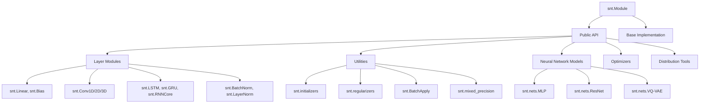
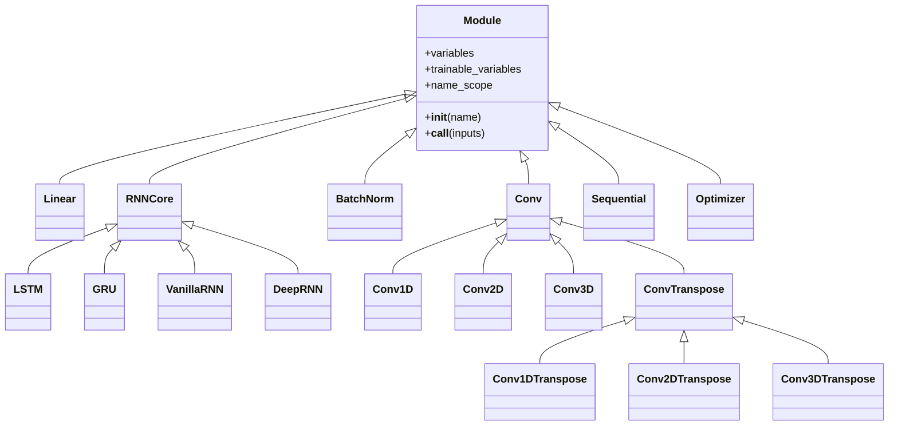
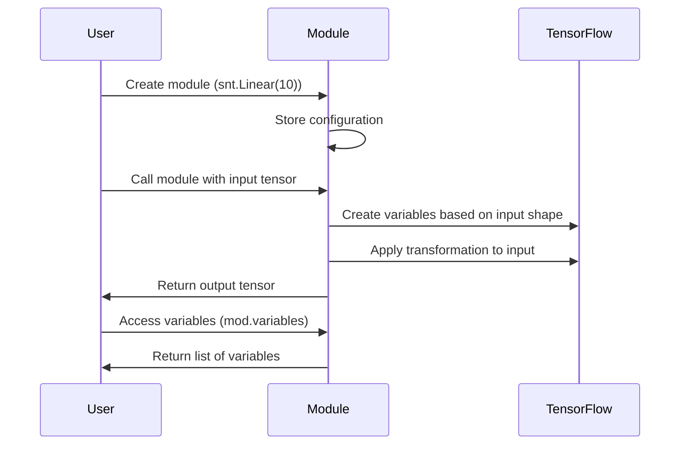
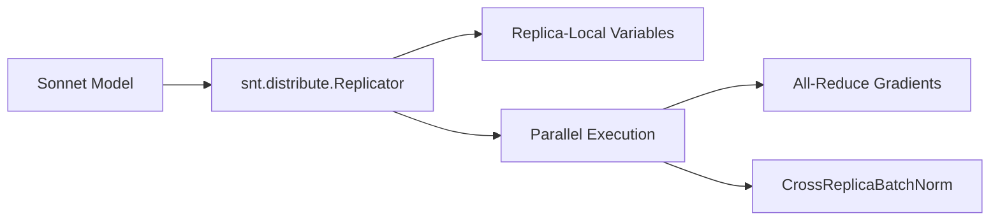

<!-- source: DeepWiki mcp.deepwiki.com · repo google-deepmind/sonnet · page 1 Overview · fetched 2026-10-26 -->

# Overview

<details>
<summary>Relevant source files</summary>

The following files were used as context for generating this wiki page:

- [README.md](README.md)
- [docs/Makefile](docs/Makefile)
- [docs/conf.py](docs/conf.py)
- [docs/index.rst](docs/index.rst)
- [docs/requirements.txt](docs/requirements.txt)
- [sonnet/__init__.py](sonnet/__init__.py)

</details>


Sonnet is a neural network library built on top of TensorFlow 2, providing simple, composable abstractions for machine learning research. Developed by researchers at DeepMind, Sonnet offers a clean, modular approach to building neural networks for various purposes including supervised learning, unsupervised learning, and reinforcement learning.

This document provides a high-level overview of Sonnet's architecture, key components, and its integration with TensorFlow 2. For detailed explanation of the module system, see [Core Module System](#2). For information about specific layer implementations, see [Basic Modules](#3).

## Library Architecture

### Core Architecture



Sources: [sonnet/__init__.py:15-165](), [README.md:7-29]()

Sonnet is centered around a single core concept: the `snt.Module` class, which is the foundation for all Sonnet components. Unlike many frameworks, Sonnet is deliberately unopinionated about how modules are used, allowing researchers to build their own training loops or adopt those built by others.

### Module Hierarchy



Sources: [sonnet/__init__.py:27-73]()

This diagram shows the inheritance hierarchy of key Sonnet modules. All modules inherit from the base `snt.Module` class, which provides common functionality such as variable management and name scoping.

## Key Components

### Layer Modules

Sonnet provides a variety of layer modules that serve as the building blocks for neural networks:

| Category | Modules | Description |
|----------|---------|-------------|
| Linear | `snt.Linear`, `snt.Bias` | Linear transformations with optional bias |
| Convolutional | `snt.Conv1D/2D/3D`, `snt.Conv1D/2D/3DTranspose` | Convolution operations in 1D, 2D, and 3D |
| Normalization | `snt.BatchNorm`, `snt.LayerNorm`, `snt.GroupNorm`, `snt.InstanceNorm` | Various normalization techniques |
| Recurrent | `snt.LSTM`, `snt.GRU`, `snt.VanillaRNN`, `snt.DeepRNN` | Various recurrent neural network architectures |

Sources: [sonnet/__init__.py:35-73]()

### Neural Network Models

Sonnet provides higher-level neural network models in the `snt.nets` package:

| Model | Description |
|-------|-------------|
| `snt.nets.MLP` | Multi-Layer Perceptron with configurable hidden layers |
| `snt.nets.ResNet` | Residual Network implementation |
| `snt.nets.VQ-VAE` | Vector Quantized Variational Autoencoder |

Sources: [sonnet/__init__.py:17, 21](), [README.md:15-16, 22-23]()

### Utilities

Sonnet includes various utilities to enhance the functionality of modules:

| Utility | Description |
|---------|-------------|
| `snt.initializers` | Weight initialization schemes (e.g., Xavier, Orthogonal) |
| `snt.regularizers` | Weight regularization techniques (L1, L2, L1L2) |
| `snt.BatchApply` | Apply any module to batched inputs of higher dimensions |
| `snt.mixed_precision` | Tools for mixed precision training |
| `snt.Sequential` | Chain multiple modules and functions together |

Sources: [sonnet/__init__.py:18-24, 31-33, 79]()

### Distribution Tools

Sonnet provides tools for distributed training across multiple devices:

| Tool | Description |
|------|-------------|
| `snt.distribute.Replicator` | For multi-GPU training |
| `snt.distribute.TpuReplicator` | For TPU training |
| `snt.distribute.CrossReplicaBatchNorm` | Batch normalization that works across replicas in distributed training |

Sources: [sonnet/__init__.py:17](), [docs/conf.py:102-106](), [README.md:285-302]()

## Key Features

### Module Lifecycle



Sources: [README.md:119-157]()

This diagram illustrates the typical lifecycle of a Sonnet module. Modules create their variables lazily when first called with input, allowing the variable shapes to be determined from the input shape.

### Variable Management

Sonnet provides a clean way to manage variables:

- The `variables` property returns all variables referenced by the module
- The `trainable_variables` property returns only the trainable variables
- Variables are created automatically when a module is first called
- Variables are scoped with the module's name for better organization and debugging

Example:
```python
# Create and call a module
mod = snt.Linear(10)
mod(tf.ones([1, 5]))

# Access all variables
all_vars = mod.variables
# Access only trainable variables
trainable_vars = mod.trainable_variables
```

Sources: [README.md:87-103]()

### Serialization

Sonnet supports multiple serialization formats:

| Format | Description | Use Case |
|--------|-------------|----------|
| TensorFlow Checkpointing | For saving and restoring variables | Resuming training after interruption |
| TensorFlow SavedModel | For saving and loading entire models | Deployment, sharing models |
| Python's pickle | Simple serialization (not recommended) | Quick prototyping |

For more details on serialization, see [Serialization](#7.3).

Sources: [README.md:169-282]()

### Distributed Training



Sources: [README.md:285-302]()

This diagram shows how Sonnet supports distributed training. Unlike other frameworks, Sonnet modules and optimizers do not automatically handle gradient averaging or synchronization, giving users full control over these aspects.

For more details on distributed training, see [Distributed Training](#6).

## Integration with TensorFlow 2

Sonnet is built on top of TensorFlow 2 and leverages many of its features:

- **Eager execution** for intuitive debugging and development
- **tf.function** for performance optimization through graph compilation
- **tf.Variable** for parameter management
- **TensorFlow's distribution strategies** for distributed training
- **TensorFlow's serialization mechanisms** for saving and loading models

Sources: [README.md:7-9](), [README.md:49-50]()

## Getting Started

To use Sonnet, first install it:

```bash
pip install tensorflow
pip install dm-sonnet
```

Then import it in your Python code:

```python
import tensorflow as tf
import sonnet as snt

# Create a simple model
mlp = snt.Sequential([
    snt.Linear(1024),
    tf.nn.relu,
    snt.Linear(10),
])

# Apply it to some input
logits = mlp(tf.ones([8, 28 * 28]))
```

For more examples and tutorials, see [Examples](#9).

Sources: [README.md:49-53](), [docs/index.rst:9-15]()

---

