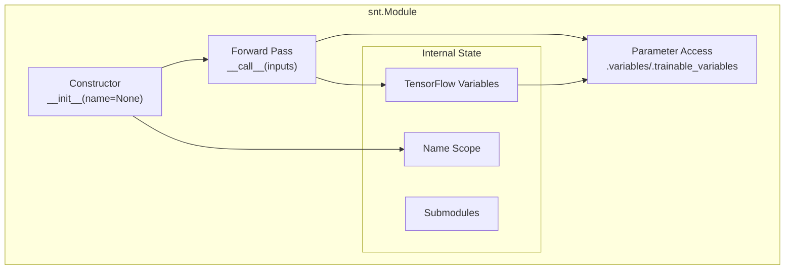
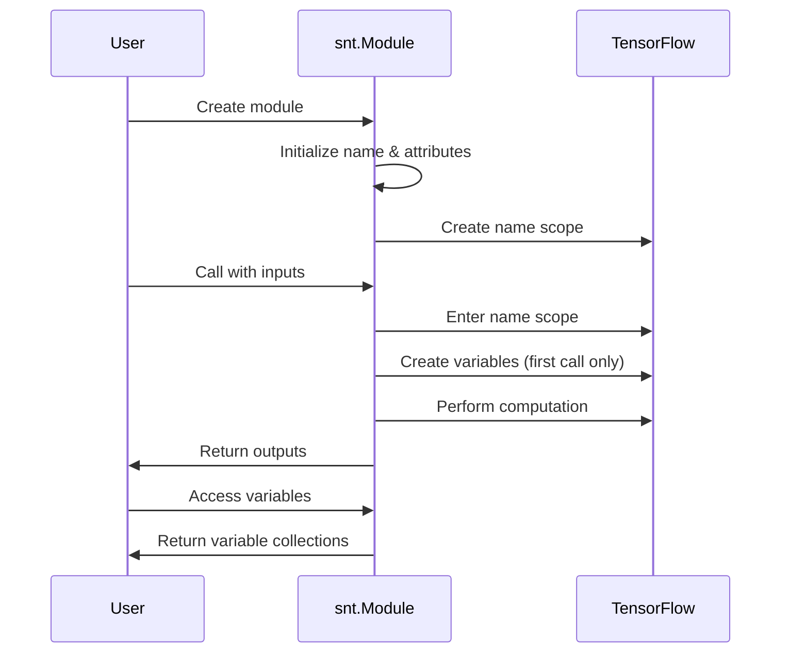
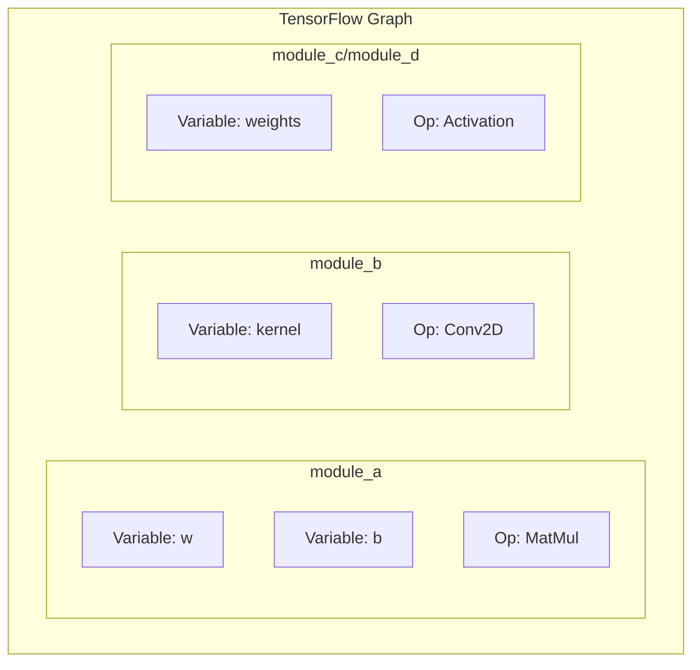
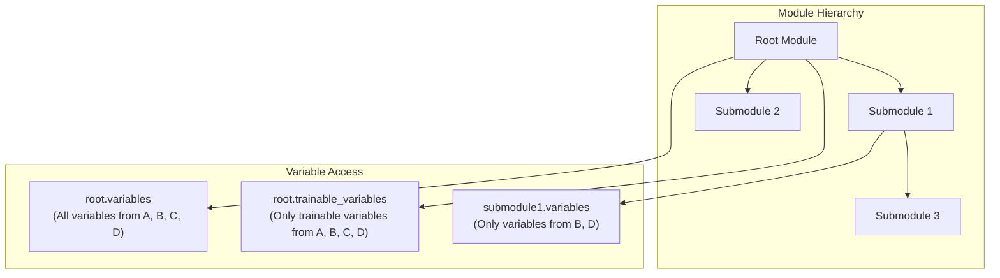

<!-- source: DeepWiki mcp.deepwiki.com · repo google-deepmind/sonnet · page 2 Core Module System · fetched 2026-10-26 -->

# Core Module System

<details>
<summary>Relevant source files</summary>

The following files were used as context for generating this wiki page:

- [README.md](README.md)
- [docs/Makefile](docs/Makefile)
- [docs/conf.py](docs/conf.py)
- [docs/index.rst](docs/index.rst)
- [docs/requirements.txt](docs/requirements.txt)
- [sonnet/__init__.py](sonnet/__init__.py)
- [sonnet/src/base.py](sonnet/src/base.py)
- [sonnet/src/base_test.py](sonnet/src/base_test.py)
- [sonnet/src/conformance/api_test.py](sonnet/src/conformance/api_test.py)
- [sonnet/src/metrics.py](sonnet/src/metrics.py)
- [sonnet/src/optimizers/rmsprop.py](sonnet/src/optimizers/rmsprop.py)
- [sonnet/src/regularizers.py](sonnet/src/regularizers.py)

</details>


The Core Module System in Sonnet provides the fundamental building blocks for creating neural network components in a modular, composable way. At its heart is the `snt.Module` class, which serves as the foundation for all Sonnet components.

This document explains the design and usage of the base Module class, how it interacts with TensorFlow, and the key mechanisms that make it powerful. For information about specific module implementations like linear layers or convolutional networks, see [Basic Modules](#3).

## Overview

Sonnet's module system is designed around a single powerful abstraction: the `Module` class. A Sonnet module encapsulates parameters (variables), computation, and potentially other modules in a cohesive, reusable unit.

```mermaid
classDiagram
    class "tf.Module" {
        +name
        +variables
        +trainable_variables
        +submodules
    }
    
    class "snt.Module" {
        +name_scope
        +variables
        +trainable_variables
        +__call__(inputs)
    }
    
    class "Custom Modules" {
        +__init__(...)
        +__call__(inputs)
        +custom_methods()
    }
    
    "tf.Module" <|-- "snt.Module" : inherits
    "snt.Module" <|-- "Custom Modules" : subclass
```

Sources: [sonnet/src/base.py:368-471](), [sonnet/__init__.py:28]()

The Module class is an extension of TensorFlow's `tf.Module`, adding key features like automatic name scoping, better variable management, and a more user-friendly interface for deep learning research.

## Module Structure

A Sonnet module has three primary components:

1. **Parameters**: TensorFlow variables that are learned during training
2. **Computation**: Methods that perform operations on inputs
3. **Submodules**: Other modules that this module may contain



Sources: [sonnet/src/base.py:368-471](), [README.md:119-158]()

## Module Lifecycle

Understanding the lifecycle of a Sonnet module is crucial to using it effectively:



Sources: [sonnet/src/base.py:369-413](), [README.md:82-88]()

A key aspect of Sonnet modules is that they typically create their variables lazily — when they're first called with input data, rather than at initialization time. This allows variable shapes to be determined from the input data.

## Creating a Custom Module

To create a custom module in Sonnet, you subclass `snt.Module` and typically implement at least an `__init__` method and a `__call__` method:

1. **`__init__`**: Initialize the module, define configuration parameters
2. **`__call__`**: Implement the forward pass computation

Here's the basic pattern:

```python
class MyModule(snt.Module):
  def __init__(self, config_param, name=None):
    super().__init__(name=name)  # Must call super constructor first
    self.config_param = config_param
    
  def __call__(self, inputs):
    # Create variables if they don't exist
    if not hasattr(self, 'w'):
      self.w = tf.Variable(...)
    
    # Perform computation
    return some_operation(inputs, self.w)
```

Sources: [README.md:119-134](), [sonnet/src/base.py:390-411]()

## Name Scoping

Sonnet automatically enters a module's name scope when any method of the module is called. This is a key feature that helps organize the TensorFlow computation graph, making debugging and visualization easier.



Sources: [sonnet/src/base.py:228-262](), [sonnet/src/base_test.py:46-188]()

The module's name scope is automatically applied to:
- Variables created by the module
- Operations performed by the module
- Submodules created within the module

This behavior can be disabled for specific methods using the `@snt.no_name_scope` decorator.

## Variable Management

Sonnet modules manage two types of variable collections:

1. **`variables`**: All variables owned by the module and its submodules
2. **`trainable_variables`**: Only the trainable variables owned by the module and its submodules



Sources: [sonnet/src/base.py:412-471](), [README.md:95-104]()

These properties are typically used to:
- Pass parameters to an optimizer during training
- Apply regularization to model parameters
- Save and restore module state

## Best Practices and Common Pitfalls

### Best Practices

1. **Always call the super constructor**: The first line in your `__init__` method should be `super().__init__(name=name)`.
2. **Create variables lazily**: Define variables the first time the module is called with input, not in the constructor.
3. **Use the `@snt.once` decorator**: For initialization methods that should only be called once.
4. **Access variables after calling the module**: The `variables` and `trainable_variables` properties will raise an error if accessed before any variables are created.

### Common Pitfalls

1. **Not calling the super constructor**: This will result in a ValueError.
2. **Calling methods before the super constructor**: This can lead to an AttributeError.
3. **Accessing variables before they're created**: This results in a ValueError.
4. **Forgetting to make the module callable**: Modules should typically implement a `__call__` method.

Sources: [sonnet/src/base.py:134-143](), [sonnet/src/base_test.py:468-504]()

## Module Metaclass

Sonnet uses a custom metaclass (`ModuleMetaclass`) to provide additional functionality to modules:

```mermaid
classDiagram
    class "ModuleMetaclass" {
        +__new__(cls, name, bases, clsdict)
        +__call__(cls, *args, **kwargs)
    }
    
    class "abc.ABCMeta" {
        +__new__()
        +__call__()
    }
    
    class "snt.Module" {
        +__init__(name=None)
        +variables
        +trainable_variables
    }
    
    "abc.ABCMeta" <|-- "ModuleMetaclass" : inherits
    "ModuleMetaclass" --o "snt.Module" : metaclass
```

Sources: [sonnet/src/base.py:58-144]()

The metaclass provides:

1. **Automatic name scoping**: Wraps all methods to enter the module's name scope
2. **Auto-generated repr**: Provides a useful string representation of modules
3. **Constructor safety**: Ensures the super constructor is called properly

## Special Module Features

### Non-trainable Variables

Not all variables in a module need to be trainable. For example, batch normalization uses non-trainable variables to track running statistics.

```python
# Example of creating a non-trainable variable
self.counter = tf.Variable(0, trainable=False, name="counter")
```

### Empty Variables Handling

By default, Sonnet raises an error if you try to access `variables` or `trainable_variables` before the module has created any variables. This helps catch a common mistake. You can disable this behavior using the `snt.allow_empty_variables` decorator:

```python
@snt.allow_empty_variables
class MyStatelessModule(snt.Module):
  pass
```

Sources: [sonnet/src/base.py:337-356](), [sonnet/src/base_test.py:495-504]()

### Abstract Modules

You can create abstract module classes by combining `snt.Module` with Python's `abc.ABCMeta`:

```python
class AbstractModule(snt.Module, metaclass=abc.ABCMeta):
  @abc.abstractmethod
  def __call__(self, x):
    pass
```

Sources: [sonnet/src/base_test.py:298-315](), [sonnet/src/metrics.py:25-47]()

## Integration with TensorFlow

Sonnet modules integrate seamlessly with TensorFlow features:

1. **`tf.function`**: Methods can be decorated with `@tf.function` for graph compilation
2. **TensorFlow checkpointing**: Modules can be saved and restored using `tf.train.Checkpoint`
3. **SavedModel**: Modules can be exported using `tf.saved_model.save`

Sources: [sonnet/src/base_test.py:274-297](), [README.md:179-283]()

## Comparison to Plain TensorFlow

| Feature | Sonnet Module | Plain TensorFlow |
|---------|---------------|------------------|
| Variable creation | Typically lazy (on first call) | Whenever code is executed |
| Name scoping | Automatic for all methods | Manual with `tf.name_scope` |
| Variable collection | Automatic via properties | Manual tracking required |
| Submodule nesting | Automatically tracked | Manual tracking required |
| String representation | Auto-generated with parameters | Basic class name |

Sources: [README.md:7-29](), [sonnet/src/base.py:368-387]()

## Summary

The Core Module System in Sonnet provides a powerful, flexible foundation for building neural networks. The `snt.Module` class extends TensorFlow's base functionality with automatic name scoping, improved variable management, and a more intuitive interface for deep learning research.

By understanding the module lifecycle, variable management, and name scoping, you can effectively use existing modules and create custom ones that integrate seamlessly into the Sonnet ecosystem.

---

