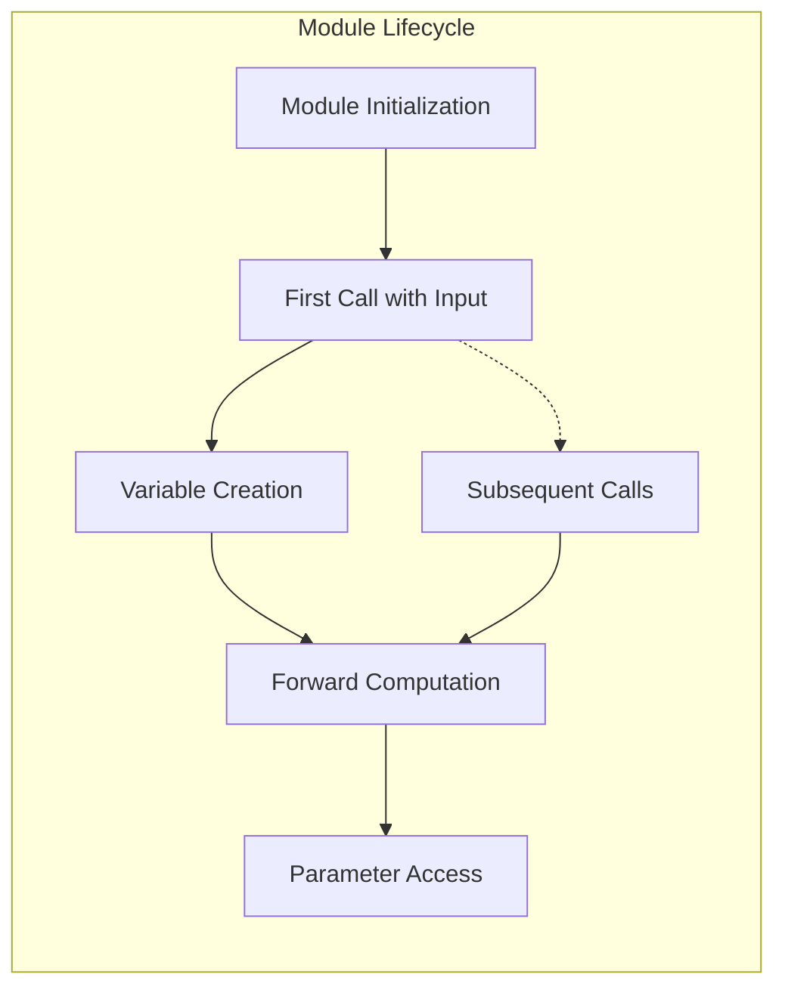
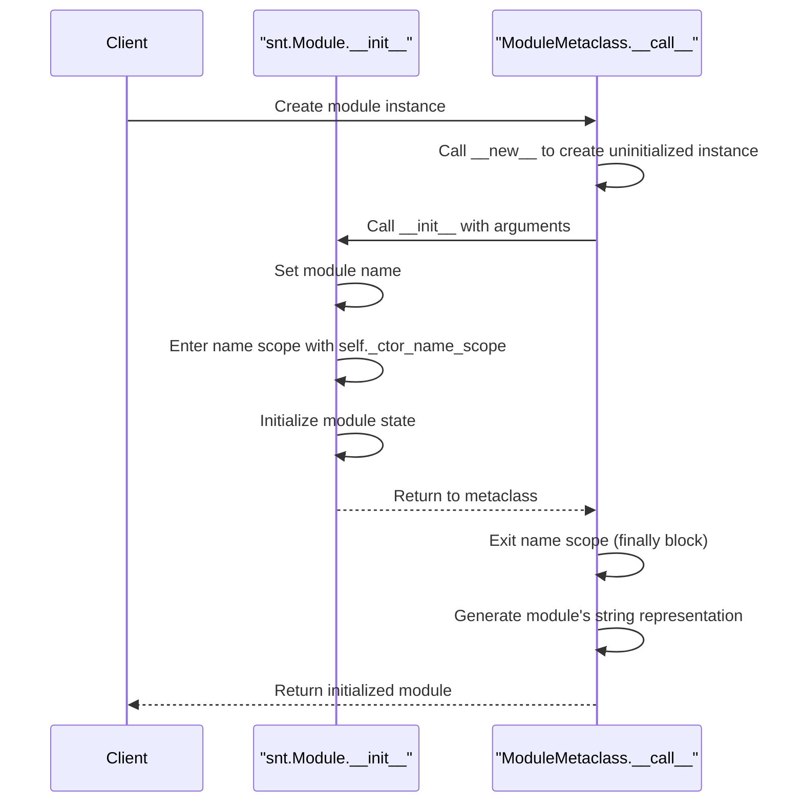
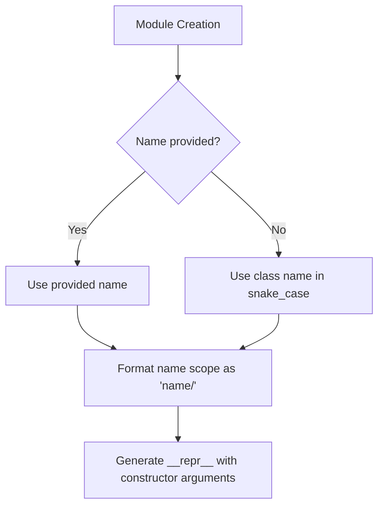
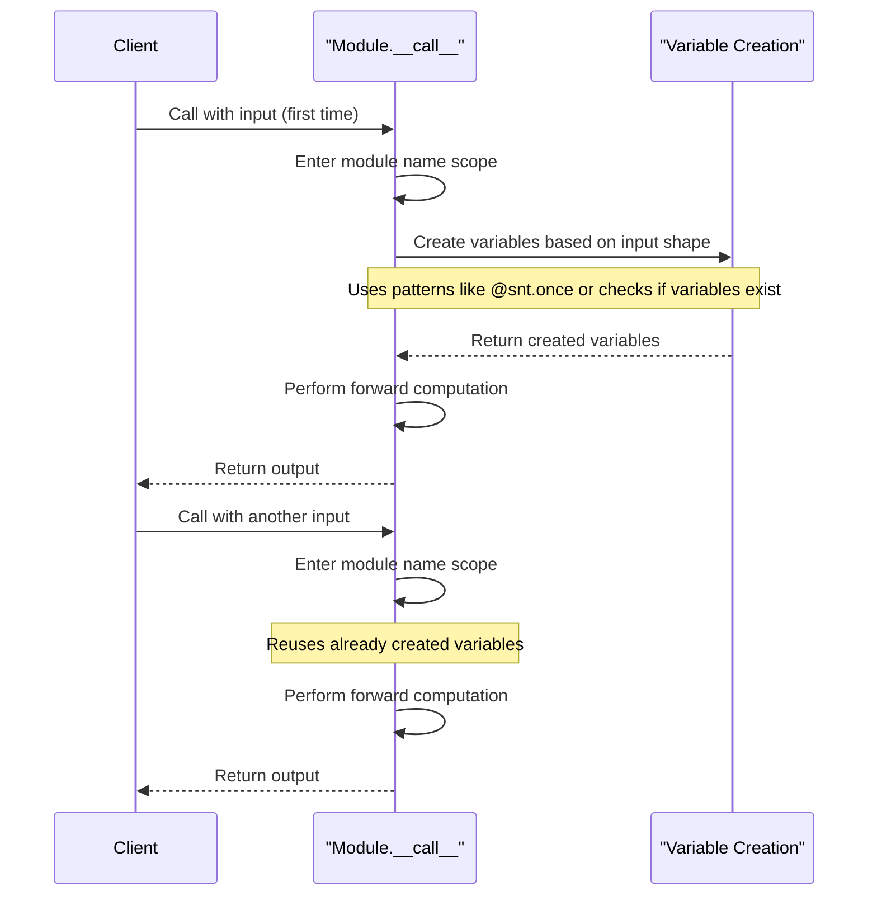
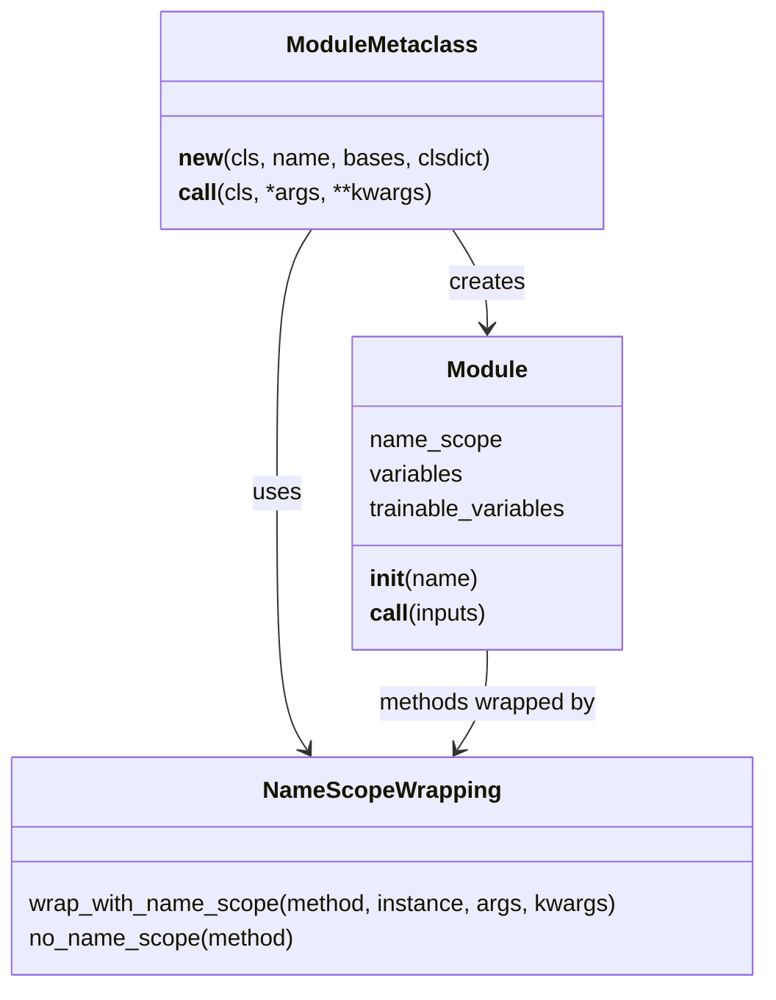
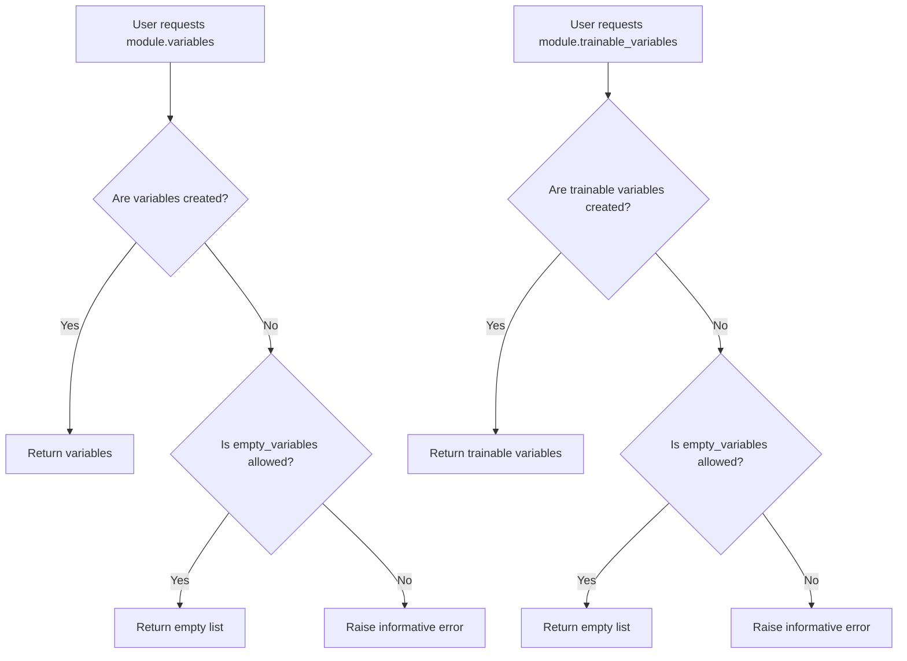
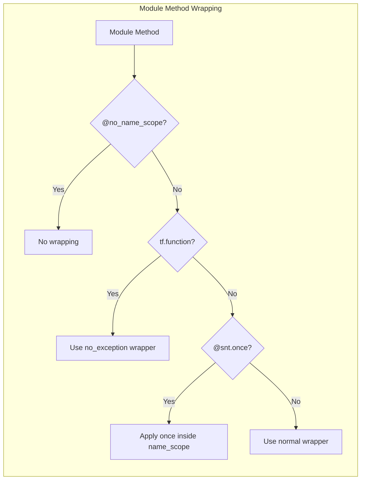
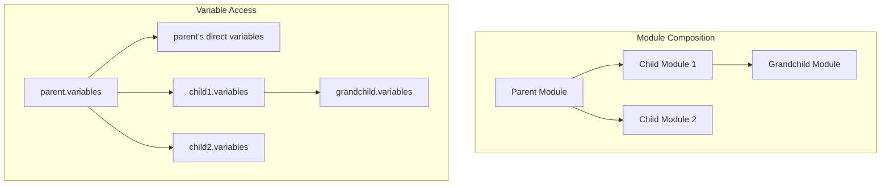
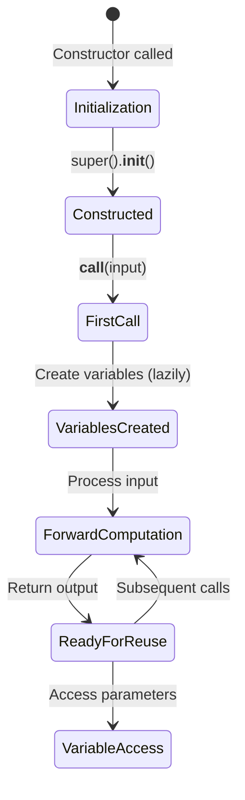

<!-- source: DeepWiki mcp.deepwiki.com · repo google-deepmind/sonnet · page 2.1 Module Lifecycle · fetched 2026-10-26 -->

# Module Lifecycle

<details>
<summary>Relevant source files</summary>

The following files were used as context for generating this wiki page:

- [README.md](README.md)
- [docs/Makefile](docs/Makefile)
- [docs/conf.py](docs/conf.py)
- [docs/index.rst](docs/index.rst)
- [docs/requirements.txt](docs/requirements.txt)
- [sonnet/src/base.py](sonnet/src/base.py)
- [sonnet/src/base_test.py](sonnet/src/base_test.py)
- [sonnet/src/conformance/api_test.py](sonnet/src/conformance/api_test.py)
- [sonnet/src/metrics.py](sonnet/src/metrics.py)
- [sonnet/src/optimizers/rmsprop.py](sonnet/src/optimizers/rmsprop.py)
- [sonnet/src/regularizers.py](sonnet/src/regularizers.py)

</details>


## Purpose and Scope

This document explains the lifecycle of a Sonnet module, from initialization to function calling to variable management. It details how modules are created, how they handle name scoping, and how they lazily create and manage variables when called with inputs. For information about specific variable naming conventions and scope management, see [Name Scopes and Variable Management](#2.2).

## Module Overview

Sonnet modules are the fundamental building blocks of neural network models in the Sonnet library. They encapsulate parameters (variables) and operations that transform inputs.



Sources: [sonnet/src/base.py](), [README.md:66-90]()

## Module Initialization

When a Sonnet module is created, it performs the following steps:

1. The `ModuleMetaclass` handles the class creation and wraps methods with name scope management
2. The module's `__init__` method is called, which sets up the module's name
3. A name scope is entered for the duration of the constructor to ensure proper variable naming



Sources: [sonnet/src/base.py:108-144](), [sonnet/src/base.py:368-411]()

## Module Naming and Auto-repr

Sonnet modules include an automatic string representation that shows constructor arguments, making debugging easier:



Sources: [sonnet/src/base.py:158-211](), [sonnet/src/base_test.py:213-272]()

## First Call and Lazy Variable Creation

Most Sonnet modules create variables lazily on first call, rather than during initialization. This approach lets the module determine appropriate variable shapes based on input dimensions.



Sources: [README.md:84-97](), [sonnet/src/base.py:307-304]()

### Lazy Initialization Patterns

Sonnet provides several patterns for variable initialization:

1. **Direct checking**: Checking if a variable attribute exists before creating it
2. **@snt.once decorator**: Ensuring an initialization method is only called once 

Example from README:
```python
def __call__(self, x):
  # Initialize on first call
  self._initialize(x)
  return tf.matmul(x, self.w) + self.b

@snt.once
def _initialize(self, x):
  initial_w = tf.random.normal([x.shape[1], self.output_size])
  self.w = tf.Variable(initial_w, name="w")
  self.b = tf.Variable(tf.zeros([self.output_size]), name="b")
```

Sources: [README.md:115-141](), [sonnet/src/metrics.py:57-61]()

## Name Scope Management

Sonnet automatically manages name scopes, ensuring that operations and variables created within module methods are properly scoped.



Sources: [sonnet/src/base.py:58-106](), [sonnet/src/base.py:227-306]()

The name scope behavior applies to all methods of a module by default, but can be disabled for specific methods using the `@snt.no_name_scope` decorator:

```python
@snt.no_name_scope
def my_method(self, x):
  # This method won't enter the module's name scope
  pass
```

Sources: [sonnet/src/base.py:36-55](), [sonnet/src/base_test.py:115-119]()

## Variable Access and Management

Sonnet modules provide `variables` and `trainable_variables` properties to access the module's variables:



Sources: [sonnet/src/base.py:412-471](), [sonnet/src/base_test.py:204-211]()

### Variable Exception Handling

Sonnet provides helpful error messages when variables haven't been created yet, guiding users to call the module first or use `snt.allow_empty_variables`:

```python
# This pattern fails:
mod = MyModule()
params = mod.variables  # Error: no variables yet

# Correct pattern:
mod = MyModule()
output = mod(input)  # First call creates variables
params = mod.variables  # Now works

# Alternative with allow_empty_variables:
mod = MyModule()
snt.allow_empty_variables(mod)
params = mod.variables  # Returns empty list instead of error
```

Sources: [sonnet/src/base.py:309-356](), [sonnet/src/base_test.py:468-504]()

## Function Transformations and Module Methods

Sonnet modules are compatible with `tf.function` decorators and other method transformations:



Sources: [sonnet/src/base.py:284-306](), [sonnet/src/base_test.py:274-296]()

## Module Composition

Sonnet modules can be composed to create more complex architectures:



Sources: [sonnet/src/base_test.py:26-38](), [sonnet/src/base_test.py:427-437]()

## Module Lifecycle Full Flowchart

The complete lifecycle of a Sonnet module can be summarized as:



Sources: [README.md:115-141](), [sonnet/src/base.py:368-471]()

## Common Errors and Best Practices

Here are some common errors and best practices when working with Sonnet modules:

| Error | Cause | Solution |
|-------|-------|----------|
| "Constructing a snt.Module without calling the super constructor" | Constructor doesn't call `super().__init__()` | Always call `super().__init__()` at the start of your constructor |
| "The super constructor must be called before any other methods" | Calling methods before `super().__init__()` | Move all method calls after `super().__init__()` |
| "Module does not currently contain any variables/trainable_variables" | Trying to access variables before they're created | Call the module first, or use `snt.allow_empty_variables` |

Sources: [sonnet/src/base.py:468-471](), [sonnet/src/base_test.py:470-504]()

---

