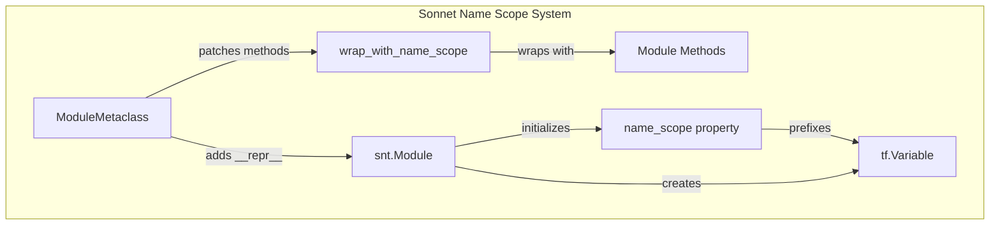
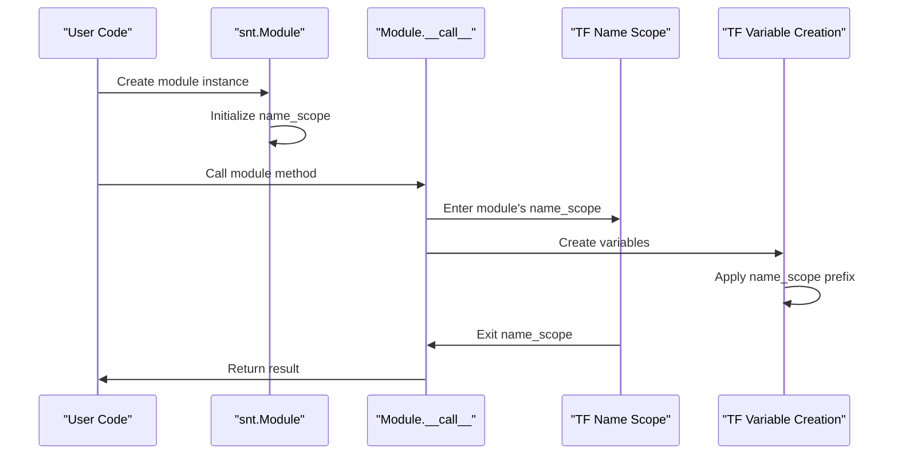
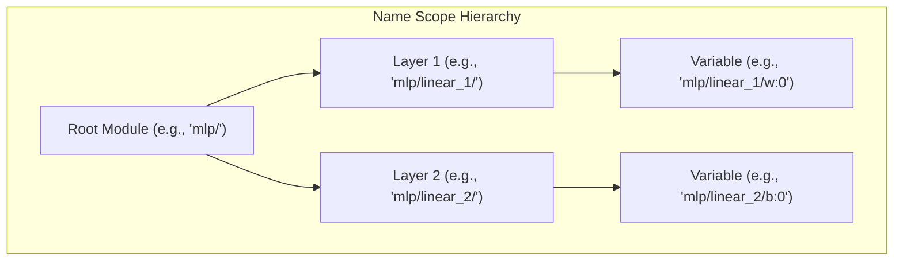
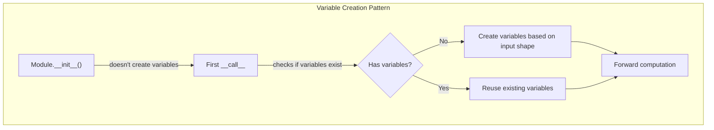
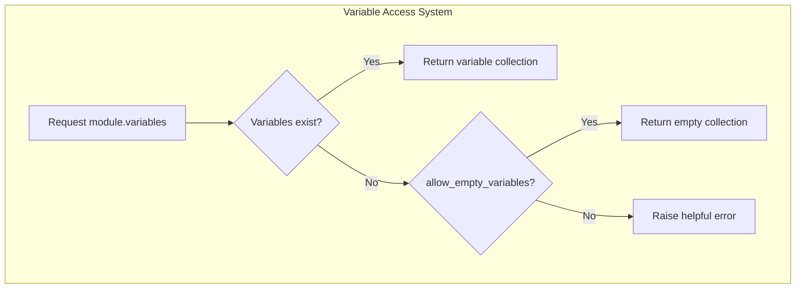
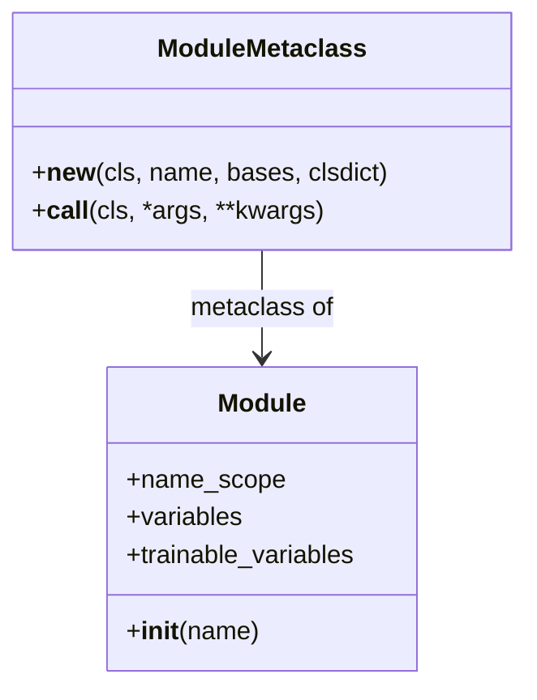
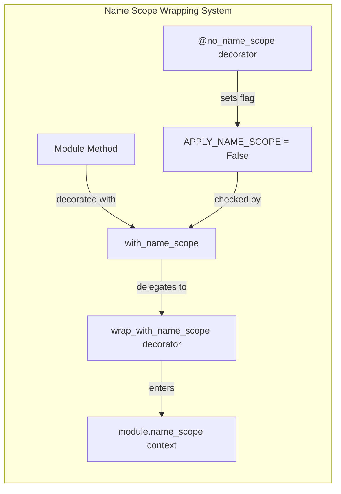

<!-- source: DeepWiki mcp.deepwiki.com · repo google-deepmind/sonnet · page 2.2 Name Scopes and Variable Management · fetched 2026-10-26 -->

# Name Scopes and Variable Management

<details>
<summary>Relevant source files</summary>

The following files were used as context for generating this wiki page:

- [docs/ext/BUILD](docs/ext/BUILD)
- [examples/BUILD](examples/BUILD)
- [sonnet/BUILD](sonnet/BUILD)
- [sonnet/nets/BUILD](sonnet/nets/BUILD)
- [sonnet/src/BUILD](sonnet/src/BUILD)
- [sonnet/src/base.py](sonnet/src/base.py)
- [sonnet/src/base_test.py](sonnet/src/base_test.py)
- [sonnet/src/conformance/BUILD](sonnet/src/conformance/BUILD)
- [sonnet/src/conformance/api_test.py](sonnet/src/conformance/api_test.py)
- [sonnet/src/conformance/checkpoints/BUILD](sonnet/src/conformance/checkpoints/BUILD)
- [sonnet/src/metrics.py](sonnet/src/metrics.py)
- [sonnet/src/nets/BUILD](sonnet/src/nets/BUILD)
- [sonnet/src/nets/dnc/BUILD](sonnet/src/nets/dnc/BUILD)
- [sonnet/src/optimizers/BUILD](sonnet/src/optimizers/BUILD)
- [sonnet/src/optimizers/rmsprop.py](sonnet/src/optimizers/rmsprop.py)
- [sonnet/src/regularizers.py](sonnet/src/regularizers.py)

</details>


This page explains how Sonnet manages TensorFlow variable scopes and variable creation. Sonnet modules automatically handle name scoping to ensure variables and operations have logical, hierarchical names that reflect their position in the module hierarchy. This document covers the name scope system, variable creation patterns, and how these components work together.

For information about the Module lifecycle and initialization, see [Module Lifecycle](#2.1). For details on implementing specific module types, see [Basic Modules](#3).

## Name Scope System

Sonnet's name scope system provides a hierarchical naming structure for variables and operations. This makes visualization tools like TensorBoard more useful and helps debug complex models by providing meaningful names for tensors and variables.

### Core Concepts

1. **Automatic Name Scoping**: All methods in a Sonnet module automatically run within the module's name scope.
2. **Hierarchical Names**: Child modules inherit parent module scopes, creating a path-like naming structure.
3. **Customizable**: Developers can disable name scoping when needed using decorators.



Sources: [sonnet/src/base.py:35-411](). [sonnet/src/base.py:58-146]().

### How Name Scopes Work

Every Sonnet module has a `name_scope` property that returns a TensorFlow name scope. When module methods are called, they automatically enter this name scope thanks to the `ModuleMetaclass` that wraps them with the `wrap_with_name_scope` decorator.



Sources: [sonnet/src/base.py:226-306](). [sonnet/src/base.py:368-411]().

### Example of Name Scope Hierarchy

When modules are nested, their name scopes combine to create a hierarchical path:



Sources: [sonnet/src/base.py:46-55](). [sonnet/src/base_test.py:204-211]().

### Controlling Name Scopes

Developers can control name scope behavior:

1. **Disabling for specific methods**: Using the `@snt.no_name_scope` decorator
2. **Disabling globally**: Setting the `SNT_MODULE_NAME_SCOPES` environment variable to "False"

```python
@snt.no_name_scope
def my_method(self):
    # This method won't enter the module's name scope
    pass
```

Sources: [sonnet/src/base.py:36-55](). [sonnet/src/base.py:284-306]().

## Variable Management

Sonnet implements a variable management pattern that simplifies creating and accessing module parameters.

### Variable Creation Pattern

Sonnet modules typically create variables lazily - when first called with an input rather than at initialization time. This allows modules to infer shapes from inputs.



Sources: [sonnet/src/base.py:429-471](). [sonnet/src/metrics.py:57-61]().

### Accessing Variables

Modules provide two main properties for accessing variables:

1. **`variables`**: All variables owned by the module and its submodules
2. **`trainable_variables`**: Only trainable variables owned by the module and its submodules

Since Sonnet uses lazy initialization, requesting these properties before variables are created will raise an error with a helpful message. The `allow_empty_variables` decorator can be used to suppress this behavior for modules that intentionally have no variables.



Sources: [sonnet/src/base.py:412-471](). [sonnet/src/base.py:337-356]().

## Implementation Details

### ModuleMetaclass

The `ModuleMetaclass` is the engine behind Sonnet's name scope system. It performs several key functions:

1. Patches methods to enter the module's name scope when called
2. Handles property methods specially to ensure they also respect name scopes
3. Adds a default `__repr__` method for better debugging
4. Manages name scope during module construction



Sources: [sonnet/src/base.py:58-146](). [sonnet/src/base.py:368-471]().

### Name Scope Wrapping Mechanism

The method wrapping mechanism has several components:

1. **`with_name_scope`**: Function that patches methods to enter the module's name scope
2. **`wrap_with_name_scope`**: Decorator that implements the actual name scope entering logic
3. **`APPLY_NAME_SCOPE`** attribute: Flag used to mark methods that should skip name scoping



Sources: [sonnet/src/base.py:227-305](). [sonnet/src/base_test.py:59-106]().

### Variable Names and Scoping

Variables created within a module's methods automatically get prefixed with the module's name scope:

```python
class MyModule(snt.Module):
  def __call__(self, x):
    if not hasattr(self, 'w'):
      self.w = tf.Variable(tf.ones([2, 2]), name="weight")
    return tf.matmul(x, self.w)

# When created, the variable will be named "my_module/weight:0"
```

This hierarchical naming is directly reflected in TensorBoard and makes it easier to understand model structure.

Sources: [sonnet/src/base.py:368-411](). [sonnet/src/base_test.py:204-211]().

## Best Practices

### 1. Call Super Constructor First

Always call `super().__init__()` at the beginning of module constructors to ensure name scopes are properly initialized:

```python
def __init__(self, output_size, name=None):
  super().__init__(name=name)  # Must be called first
  self._output_size = output_size
  # Rest of initialization...
```

Sources: [sonnet/src/base.py:136-140](). [sonnet/src/base_test.py:470-484]().

### 2. Create Variables Lazily

Follow the Sonnet pattern of creating variables on first use rather than in the constructor:

```python
def __call__(self, inputs):
  if not hasattr(self, 'w'):
    self.w = tf.Variable(
        tf.random.normal([inputs.shape[-1], self._output_size]),
        name='weights')
  return tf.matmul(inputs, self.w)
```

Sources: [sonnet/src/base.py:429-471](). [sonnet/src/metrics.py:57-61]().

### 3. Use Decorators Appropriately

Use `@snt.no_name_scope` for methods that shouldn't enter the module's name scope, particularly for methods like `clone()` or `transpose()` that create new modules:

```python
@snt.no_name_scope
def clone(self, name=None):
  # Creates a new module with the same parameters
  return type(self)(name=name, **self._clone_kwargs)
```

Sources: [sonnet/src/base.py:36-55](). [sonnet/src/base_test.py:108-114]().

### 4. Handle Empty Variable Collections

For modules that intentionally have no variables, use the `allow_empty_variables` decorator:

```python
@snt.allow_empty_variables
class StatelessModule(snt.Module):
  def __call__(self, x):
    return tf.nn.relu(x)  # No variables needed
```

Sources: [sonnet/src/base.py:337-356](). [sonnet/src/base_test.py:496-504]().

## Summary

Sonnet's name scope and variable management system provides a clean, consistent way to organize neural network components:

- **Name scopes** create hierarchical naming that reflects module structure
- **Lazy variable initialization** allows modules to adapt to input shapes
- **Variable properties** provide organized access to parameters
- **Metaclass magic** handles the plumbing to make it all work seamlessly

This system makes models easier to debug, visualize, and reason about, particularly as they grow in complexity.

Sources: [sonnet/src/base.py:368-471](). [sonnet/src/base.py:15-146]().

---

