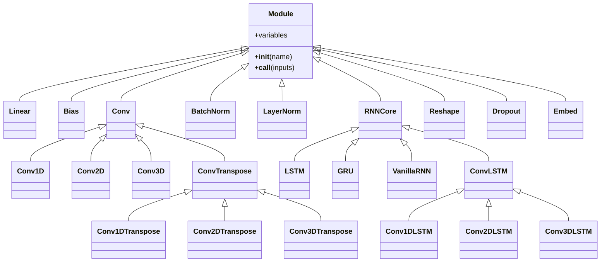
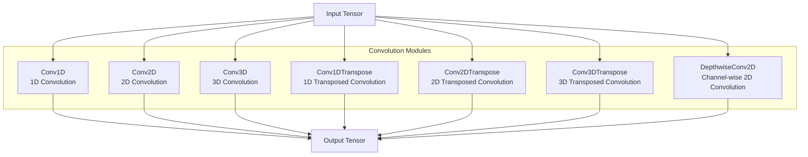
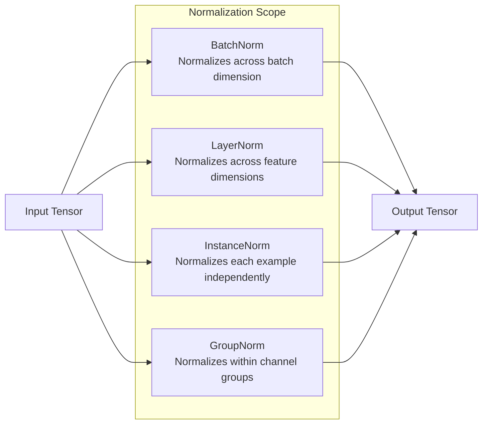
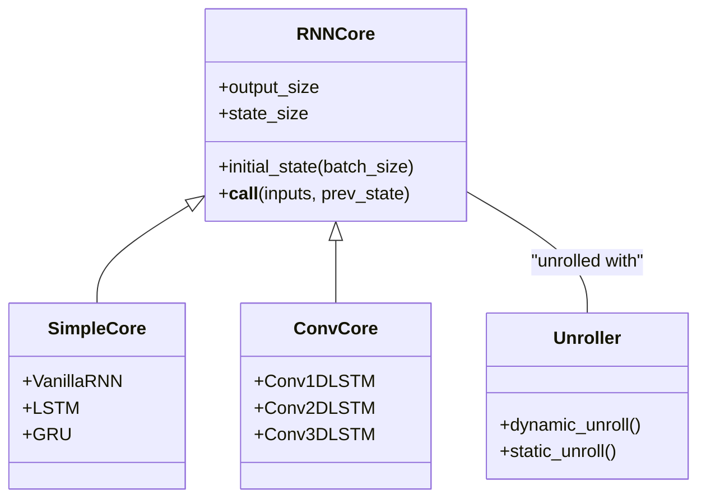
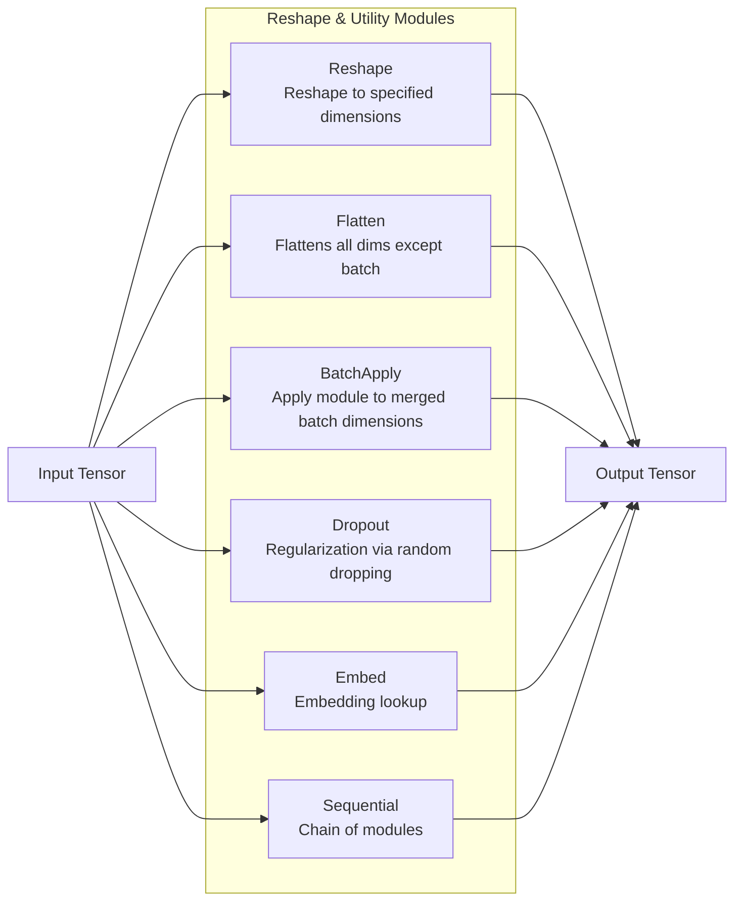
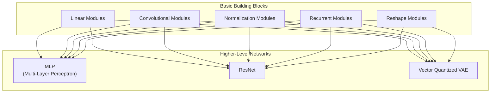

<!-- source: DeepWiki mcp.deepwiki.com · repo google-deepmind/sonnet · page 3 Basic Modules · fetched 2026-10-26 -->

# Basic Modules

<details>
<summary>Relevant source files</summary>

The following files were used as context for generating this wiki page:

- [docs/api.rst](docs/api.rst)
- [sonnet/__init__.py](sonnet/__init__.py)
- [sonnet/nets/__init__.py](sonnet/nets/__init__.py)
- [sonnet/nets/resnet.py](sonnet/nets/resnet.py)
- [sonnet/src/conformance/descriptors.py](sonnet/src/conformance/descriptors.py)
- [sonnet/src/conformance/descriptors_test.py](sonnet/src/conformance/descriptors_test.py)
- [sonnet/src/conformance/function_test.py](sonnet/src/conformance/function_test.py)
- [sonnet/src/conformance/goldens.py](sonnet/src/conformance/goldens.py)
- [sonnet/src/conformance/goldens_test.py](sonnet/src/conformance/goldens_test.py)

</details>


## Overview

This page documents the fundamental module types provided by Sonnet, which serve as the building blocks for constructing neural networks. Each module is a specialized implementation of the core `snt.Module` class (for details on the module system itself, see [Core Module System](#2)).

The basic modules in Sonnet are categorized into several types:

1. Linear modules - For simple weighted connections
2. Convolutional modules - For spatial feature extraction
3. Normalization modules - For stabilizing and accelerating training
4. Recurrent modules - For sequence processing 
5. Reshape modules - For tensor manipulation
6. Other utility modules - For common neural network operations

These modules are designed to be composable, allowing you to build complex architectures by combining them in various ways.

Sources: [sonnet/__init__.py:15-148](), [docs/api.rst:31-255]()

## Module Hierarchy



Sources: [sonnet/__init__.py:26-77](), [sonnet/src/conformance/goldens.py:130-546]()

## Linear Modules

Linear modules implement simple affine transformations of the form y = Wx + b, where W is a weight matrix and b is an optional bias vector.

### Linear

The `Linear` module performs a linear transformation on the last dimension of the input tensor.

```python
# Input shape: [batch_size, input_size]
# Output shape: [batch_size, output_size]
linear = snt.Linear(output_size=10, with_bias=True)
y = linear(x)
```

### Bias

The `Bias` module adds a bias vector to the input tensor.

```python
# Adds a bias along the last dimension of the input
bias = snt.Bias()
y = bias(x)
```

Sources: [sonnet/__init__.py:36](), [sonnet/__init__.py:51](), [sonnet/src/conformance/goldens.py:130-142](), [sonnet/src/conformance/goldens.py:442-446]()

## Convolutional Modules

Convolutional modules apply convolution operations across different dimensionalities of data.



### Convolution Layers

- **Conv1D**: 1D convolution for sequences
- **Conv2D**: 2D convolution for images
- **Conv3D**: 3D convolution for volumetric data
- **Conv1DTranspose/Conv2DTranspose/Conv3DTranspose**: Transposed convolutions (sometimes called "deconvolutions")
- **DepthwiseConv2D**: Applies a different filter to each input channel

All convolution modules support various padding schemes via the `pad` parameter, which can be:
- `same`: Output has the same spatial dimensions as input
- `valid`: No padding
- Custom padding created with functions from `snt.pad`

Sources: [sonnet/__init__.py:38-43](), [sonnet/__init__.py:46](), [sonnet/src/conformance/goldens.py:144-193](), [docs/api.rst:46-91]()

## Normalization Modules

Normalization modules standardize inputs to stabilize and accelerate training.



### Available Normalization Types

| Module | Normalizes Across | Use Case |
|--------|-------------------|----------|
| BatchNorm | Batch dimension | General purpose, sensitive to batch size |
| LayerNorm | Feature dimensions | RNNs, Transformers |
| InstanceNorm | Spatial dimensions per instance | Style transfer, image generation |
| GroupNorm | Groups of channels | Alternative to BatchNorm for small batches |

### Common Parameters

Most normalization layers support:
- `create_scale`: Whether to apply a learnable scale factor
- `create_offset`: Whether to apply a learnable offset
- `scale_init/offset_init`: Initializers for scale/offset parameters

Sources: [sonnet/__init__.py:25-26](), [sonnet/__init__.py:34-35](), [sonnet/__init__.py:49](), [sonnet/src/conformance/goldens.py:223-294](), [docs/api.rst:93-134]()

## Recurrent Modules

Recurrent modules process sequences by maintaining internal state and can be unrolled over time.



### Core RNN Types

- **VanillaRNN**: Simple RNN with tanh activation
- **LSTM**: Long Short-Term Memory network
- **GRU**: Gated Recurrent Unit
- **Conv1D/2D/3DLSTM**: Convolutional LSTM variants

### Unrolling Methods

- **dynamic_unroll**: Uses TensorFlow's control flow operations for variable-length sequences
- **static_unroll**: Unrolls the network explicitly for fixed-length sequences

### Usage Example

```python
# Create an LSTM core
lstm = snt.LSTM(hidden_size=128)

# Create initial state
batch_size = 32
initial_state = lstm.initial_state(batch_size)

# Process a single input
output, next_state = lstm(input_at_t, initial_state)

# Or unroll over a sequence
sequence_outputs, final_state = snt.static_unroll(
    lstm,
    input_sequence,
    initial_state
)
```

Sources: [sonnet/__init__.py:57-72](), [sonnet/src/conformance/goldens.py:351-432](), [docs/api.rst:136-227]()

## Reshape and Utility Modules

Sonnet provides several modules for reshaping and manipulating tensors.



### Key Reshape Modules

- **Reshape**: Reshapes input tensor to a specified shape
- **Flatten**: Flattens all dimensions except the batch dimension
- **BatchApply**: Merges leading dimensions, applies a module, then restores the original dimensions

### Utility Modules

- **Dropout**: Randomly zeros elements during training for regularization
- **Embed**: Performs embedding lookups for discrete inputs
- **Sequential**: Chains multiple modules together

Sources: [sonnet/__init__.py:31-32](), [sonnet/__init__.py:45](), [sonnet/__init__.py:47-48](), [sonnet/__init__.py:74-77](), [sonnet/__init__.py:79](), [sonnet/src/conformance/goldens.py:337-349](), [sonnet/src/conformance/goldens.py:450-453](), [docs/api.rst:229-272]()

## Module Properties and Common Patterns

All basic modules inherit from `snt.Module` and therefore share common patterns and properties:

### Common Properties

- **variables**: Access all variables in the module
- **trainable_variables**: Access only trainable variables
- **name**: The name of the module instance

### Best Practices

1. **Variable Creation**: Variables are created lazily on first call
2. **Submodule Usage**: Modules can contain other modules
3. **Reuse**: The same module can be called multiple times with different inputs

```python
# Module reuse example
linear = snt.Linear(10)

# Apply to different inputs - parameters are shared
output1 = linear(input1)  # First call creates variables
output2 = linear(input2)  # Reuses the same variables
```

Sources: [sonnet/__init__.py:28](), [sonnet/src/conformance/function_test.py:32-136]()

## Relationship to Higher-Level Components

The basic modules documented on this page are the foundation for building more complex network architectures, which are covered in [Higher-Level Neural Networks](#4).



Sources: [sonnet/nets/__init__.py:16-33](), [sonnet/nets/resnet.py:16-25]()

---

