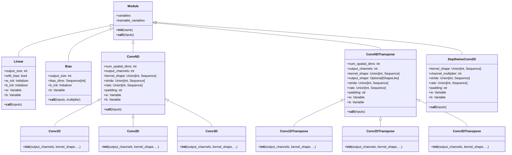
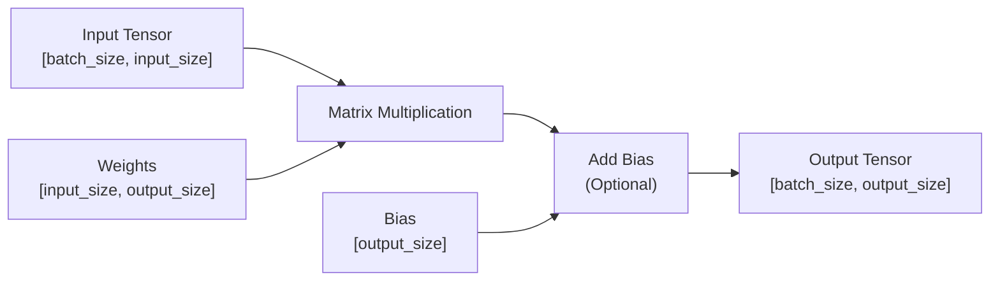
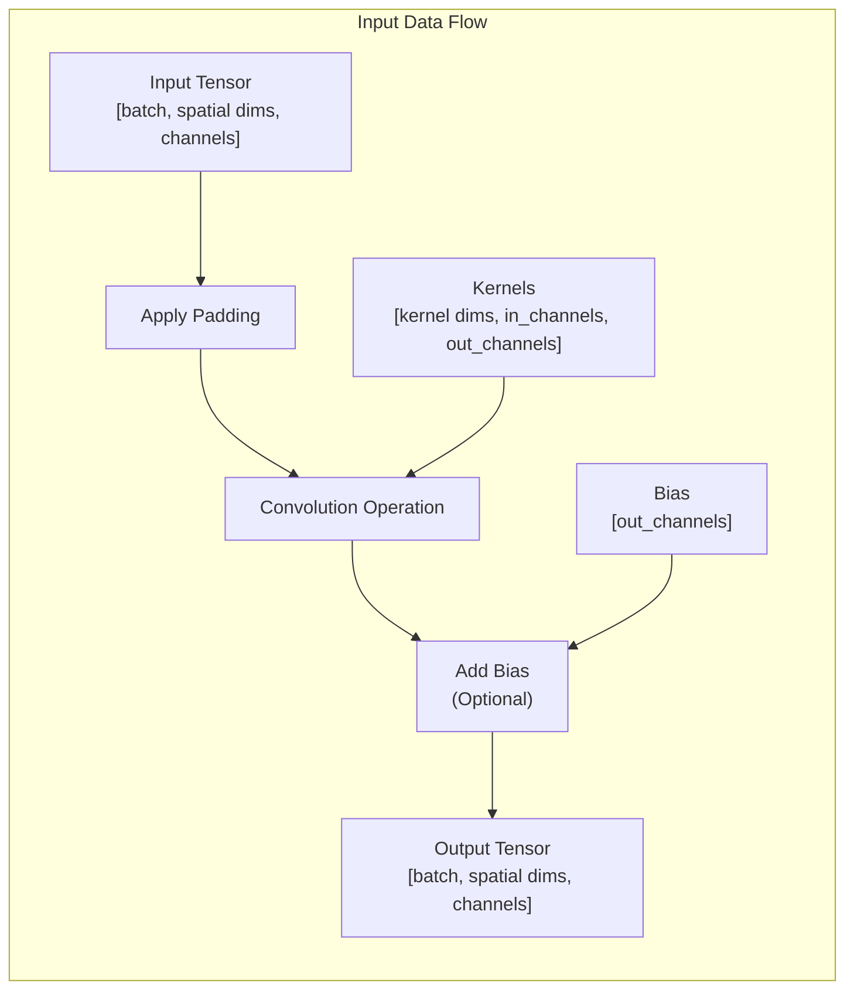
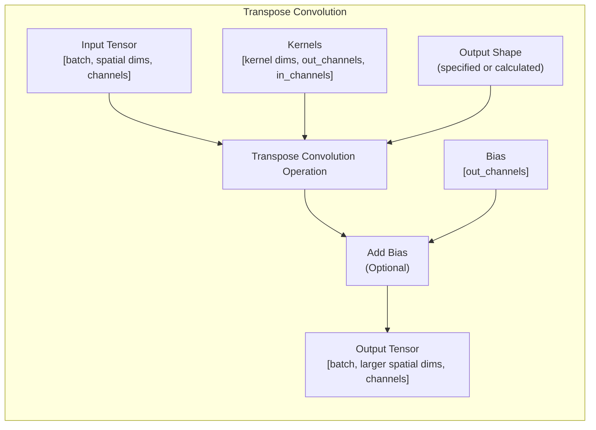
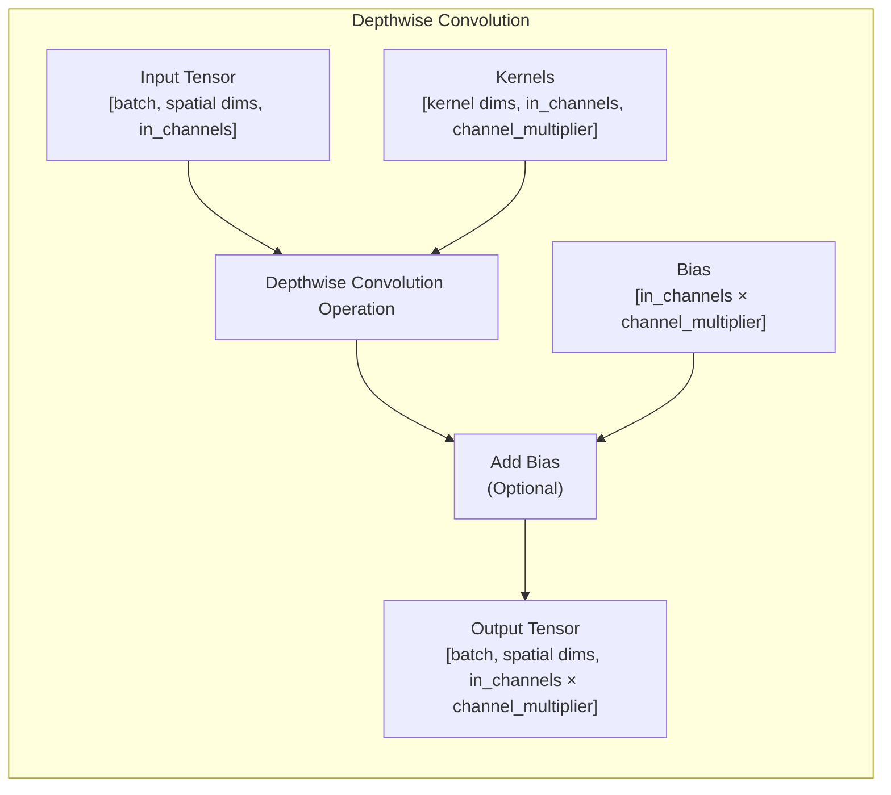
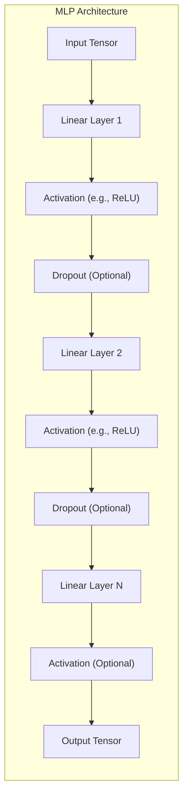

<!-- source: DeepWiki mcp.deepwiki.com · repo google-deepmind/sonnet · page 3.1 Linear and Convolutional Layers · fetched 2026-10-26 -->

# Linear and Convolutional Layers

<details>
<summary>Relevant source files</summary>

The following files were used as context for generating this wiki page:

- [docs/modules.rst](docs/modules.rst)
- [sonnet/src/bias.py](sonnet/src/bias.py)
- [sonnet/src/conformance/copy_test.py](sonnet/src/conformance/copy_test.py)
- [sonnet/src/conv.py](sonnet/src/conv.py)
- [sonnet/src/conv_transpose.py](sonnet/src/conv_transpose.py)
- [sonnet/src/conv_transpose_test.py](sonnet/src/conv_transpose_test.py)
- [sonnet/src/depthwise_conv.py](sonnet/src/depthwise_conv.py)
- [sonnet/src/linear.py](sonnet/src/linear.py)
- [sonnet/src/linear_test.py](sonnet/src/linear_test.py)
- [sonnet/src/nets/mlp.py](sonnet/src/nets/mlp.py)
- [sonnet/src/nets/mlp_test.py](sonnet/src/nets/mlp_test.py)

</details>


This page documents the implementation and usage of linear and convolutional layers in Sonnet, which are fundamental building blocks for neural networks. These layers perform affine transformations and spatial filtering operations on input tensors, serving as the core computational components in most deep learning architectures. For information about normalization layers, see [Normalization Layers](#3.2). For higher-level neural networks built using these components, see [Higher-Level Neural Networks](#4).

## Overview

Linear and convolutional layers are implemented as subclasses of the core `snt.Module` class, providing a unified interface for parameter management and variable tracking. Sonnet offers several types of linear and convolutional operations:

1. **Linear layers**: Simple matrix multiplication operations (fully connected layers)
2. **Convolutional layers**: N-dimensional convolution operations
3. **Transpose convolutional layers**: Upsampling convolution operations
4. **Specialized layers**: Including depthwise convolutions and bias-only operations

Sources: [sonnet/src/linear.py](), [sonnet/src/conv.py](), [sonnet/src/conv_transpose.py](), [sonnet/src/depthwise_conv.py](), [sonnet/src/bias.py]()

## Architecture and Relationships

Below is a diagram showing how these components relate to each other and fit into the broader Sonnet architecture:



Sources: [sonnet/src/linear.py:27-88](), [sonnet/src/conv.py:28-325](), [sonnet/src/conv_transpose.py:42-378](), [sonnet/src/depthwise_conv.py:28-131](), [sonnet/src/bias.py:27-126]()

## Linear Layers

### Implementation

The `Linear` module implements a fully connected layer that performs a matrix multiplication between the input tensor and a weight matrix, optionally adding a bias term:



The implementation uses lazy initialization with the `@once.once` decorator, which ensures that parameters are only created the first time the module is called with input data. This allows the module to infer input dimensions from the first call, making the API more concise.

Sources: [sonnet/src/linear.py:27-88]()

### Parameters

The `Linear` module takes the following parameters:

| Parameter | Type | Description |
|-----------|------|-------------|
| `output_size` | `int` | Output dimensionality |
| `with_bias` | `bool` | Whether to include bias parameters (default: `True`) |
| `w_init` | `initializers.Initializer` | Optional initializer for weights (default: `TruncatedNormal` with std=`1/sqrt(input_size)`) |
| `b_init` | `initializers.Initializer` | Optional initializer for bias (default: `Zeros`) |
| `name` | `str` | Optional name for the module |

For higher-dimensional inputs, the `Linear` layer operates on the last dimension, preserving other dimensions.

Sources: [sonnet/src/linear.py:30-56]()

### Usage Example

```python
# Create a linear layer with 100 output units
linear = snt.Linear(output_size=100)

# Apply to a batch of 32 inputs with 784 features each
inputs = tf.random.normal([32, 784])
outputs = linear(inputs)  # Shape: [32, 100]

# Access weights and biases
print(linear.w.shape)  # [784, 100]
print(linear.b.shape)  # [100]
```

Sources: [sonnet/src/linear_test.py:40-56]()

## Bias Module

The `Bias` module provides a standalone bias addition operation that can be used independently or combined with other modules. It supports flexible broadcasting patterns, allowing you to specify which dimensions should receive unique bias values.

### Parameters

| Parameter | Type | Description |
|-----------|------|-------------|
| `output_size` | `Optional[int]` | Output size (inferred from input if not provided) |
| `bias_dims` | `Optional[Sequence[int]]` | Sequence of dimensions to retain when creating bias (default: All non-batch dimensions) |
| `b_init` | `initializers.Initializer` | Optional initializer for bias (default: `Zeros`) |
| `name` | `str` | Optional name for the module |

The `bias_dims` parameter controls how bias is applied across dimensions:
- `None`: Bias applied to all non-batch dimensions
- `[]` (empty list): Scalar bias applied to entire tensor
- `[1]`, `[2]`, etc.: Bias applied only to specific dimensions

Sources: [sonnet/src/bias.py:27-126]()

### Usage Example

```python
# Create a bias for all non-batch dimensions
bias = snt.Bias()

# Apply to a batch of images
inputs = tf.random.normal([32, 28, 28, 3])
outputs = bias(inputs)  # Shape: [32, 28, 28, 3]

# Create a bias only for the channel dimension
channel_bias = snt.Bias(bias_dims=[-1])
outputs = channel_bias(inputs)  # Bias shape: [3], broadcast to [32, 28, 28, 3]

# Subtract bias with multiplier
outputs = bias(inputs, multiplier=-1)  # Subtract instead of add
```

Sources: [sonnet/src/bias.py:31-64]()

## Convolutional Layers

Sonnet provides a generic N-dimensional convolution framework through the `ConvND` base class, with specialized implementations for 1D, 2D, and 3D convolutions.



Sources: [sonnet/src/conv.py:28-325]()

### ConvND Base Class

The `ConvND` class implements the core convolution logic for all dimensionalities. It handles parameter creation, applying the convolution operation, and adding bias if specified.

#### Parameters

| Parameter | Type | Description |
|-----------|------|-------------|
| `num_spatial_dims` | `int` | Number of spatial dimensions (1, 2, or 3) |
| `output_channels` | `int` | Number of output channels |
| `kernel_shape` | `Union[int, Sequence[int]]` | Shape of the convolution kernel |
| `stride` | `Union[int, Sequence[int]]` | Stride of the convolution (default: 1) |
| `rate` | `Union[int, Sequence[int]]` | Dilation rate (default: 1) |
| `padding` | `Union[str, Paddings]` | Padding type ("SAME", "VALID", or callable) |
| `with_bias` | `bool` | Whether to include bias parameters (default: `True`) |
| `w_init` | `initializers.Initializer` | Optional initializer for weights |
| `b_init` | `initializers.Initializer` | Optional initializer for bias |
| `data_format` | `str` | Data format (e.g., "NHWC" or "NCHW") |
| `name` | `str` | Optional name for the module |

Sources: [sonnet/src/conv.py:31-71]()

### Specialized Convolution Classes

Sonnet provides specialized convolution classes for different dimensionalities:

1. **Conv1D**: 1D convolution for sequential data
2. **Conv2D**: 2D convolution for image data
3. **Conv3D**: 3D convolution for volumetric data

These classes inherit from `ConvND` and provide a simplified interface with appropriate defaults for their dimensionality.

Sources: [sonnet/src/conv.py:164-325]()

### Usage Example

```python
# Create a 2D convolution layer with 32 output channels and 3x3 kernel
conv2d = snt.Conv2D(output_channels=32, kernel_shape=3, stride=1, padding="SAME")

# Apply to a batch of images
images = tf.random.normal([32, 28, 28, 3])
features = conv2d(images)  # Shape: [32, 28, 28, 32]

# Create a 1D convolution for sequence data
conv1d = snt.Conv1D(output_channels=64, kernel_shape=5)
sequence = tf.random.normal([32, 100, 128])
features = conv1d(sequence)  # Shape: [32, 100, 64]
```

Sources: [sonnet/src/conv.py:164-216](), [sonnet/src/conv.py:218-271]()

## Transpose Convolutional Layers

Transpose convolutions, sometimes called deconvolutions or fractionally-strided convolutions, perform upsampling operations. They are commonly used in decoder networks and generative models.



Sonnet implements transpose convolutions through the `ConvNDTranspose` base class and specialized implementations for different dimensionalities.

Sources: [sonnet/src/conv_transpose.py:42-208]()

### ConvNDTranspose Base Class

The `ConvNDTranspose` class implements the core transpose convolution logic. Unlike standard convolutions, transpose convolutions require an output shape, which can be either explicitly specified or calculated based on the input shape and convolution parameters.

#### Parameters

| Parameter | Type | Description |
|-----------|------|-------------|
| `num_spatial_dims` | `int` | Number of spatial dimensions (1, 2, or 3) |
| `output_channels` | `int` | Number of output channels |
| `kernel_shape` | `Union[int, Sequence[int]]` | Shape of the convolution kernel |
| `output_shape` | `Optional[ShapeLike]` | Output shape (optional) |
| `stride` | `Union[int, Sequence[int]]` | Stride of the convolution (default: 1) |
| `rate` | `Union[int, Sequence[int]]` | Dilation rate (default: 1) |
| `padding` | `str` | Padding type ("SAME" or "VALID") |
| `with_bias` | `bool` | Whether to include bias parameters (default: `True`) |
| `w_init` | `initializers.Initializer` | Optional initializer for weights |
| `b_init` | `initializers.Initializer` | Optional initializer for bias |
| `data_format` | `str` | Data format (e.g., "NHWC" or "NCHW") |
| `name` | `str` | Optional name for the module |

Sources: [sonnet/src/conv_transpose.py:52-92]()

### Specialized Transpose Convolution Classes

Sonnet provides specialized transpose convolution classes:

1. **Conv1DTranspose**: 1D transpose convolution
2. **Conv2DTranspose**: 2D transpose convolution
3. **Conv3DTranspose**: 3D transpose convolution

These classes inherit from `ConvNDTranspose` and provide a simplified interface with appropriate defaults for their dimensionality.

Sources: [sonnet/src/conv_transpose.py:210-378]()

### Usage Example

```python
# Create a 2D transpose convolution layer with 32 output channels and 3x3 kernel
deconv2d = snt.Conv2DTranspose(output_channels=32, kernel_shape=3, stride=2, padding="SAME")

# Apply to a batch of features (will double spatial dimensions)
features = tf.random.normal([32, 14, 14, 64])
upsampled = deconv2d(features)  # Shape: [32, 28, 28, 32]

# Create a transpose convolution with explicit output shape
deconv_fixed = snt.Conv2DTranspose(output_channels=3, kernel_shape=5, output_shape=[32, 32])
reconstructed = deconv_fixed(features)  # Shape: [batch_size, 32, 32, 3]
```

Sources: [sonnet/src/conv_transpose.py:267-321]()

## Depthwise Convolution

Depthwise convolutions apply a separate filter to each input channel, making them more parameter-efficient than standard convolutions. Sonnet provides the `DepthwiseConv2D` module for 2D depthwise convolutions.



### Parameters

| Parameter | Type | Description |
|-----------|------|-------------|
| `kernel_shape` | `Union[int, Sequence[int]]` | Shape of the convolution kernel |
| `channel_multiplier` | `int` | Number of output channels per input channel (default: 1) |
| `stride` | `Union[int, Sequence[int]]` | Stride of the convolution (default: 1) |
| `rate` | `Union[int, Sequence[int]]` | Dilation rate (default: 1) |
| `padding` | `str` | Padding type ("SAME" or "VALID") |
| `with_bias` | `bool` | Whether to include bias parameters (default: `True`) |
| `w_init` | `initializers.Initializer` | Optional initializer for weights |
| `b_init` | `initializers.Initializer` | Optional initializer for bias |
| `data_format` | `str` | Data format (e.g., "NHWC" or "NCHW") |
| `name` | `str` | Optional name for the module |

Sources: [sonnet/src/depthwise_conv.py:35-95]()

### Usage Example

```python
# Create a depthwise convolution with channel multiplier 1 (separable convolution)
depthwise_conv = snt.DepthwiseConv2D(kernel_shape=3, channel_multiplier=1)

# Apply to a batch of images
images = tf.random.normal([32, 28, 28, 3])
features = depthwise_conv(images)  # Shape: [32, 28, 28, 3]

# Create a depthwise convolution with channel multiplier 2
depthwise_conv = snt.DepthwiseConv2D(kernel_shape=3, channel_multiplier=2)
features = depthwise_conv(images)  # Shape: [32, 28, 28, 6]
```

Sources: [sonnet/src/depthwise_conv.py:28-131]()

## Using Linear and Convolutional Layers in Networks

Linear and convolutional layers can be combined to create more complex neural network architectures. Sonnet provides a higher-level `MLP` (Multi-Layer Perceptron) module in the `nets` package that chains multiple `Linear` layers with activations.



Example of building a CNN with Sonnet components:

```python
class CNN(snt.Module):
    def __init__(self, name=None):
        super().__init__(name=name)
        self.conv1 = snt.Conv2D(32, kernel_shape=3, stride=1)
        self.conv2 = snt.Conv2D(64, kernel_shape=3, stride=2)
        self.flatten = lambda x: tf.reshape(x, [x.shape[0], -1])
        self.linear = snt.Linear(10)
    
    def __call__(self, inputs, is_training=True):
        x = self.conv1(inputs)
        x = tf.nn.relu(x)
        x = self.conv2(x)
        x = tf.nn.relu(x)
        x = self.flatten(x)
        x = self.linear(x)
        return x
```

Sources: [sonnet/src/nets/mlp.py:25-149]()

## Weight Initialization

Sonnet uses specific default initializers for the weights in linear and convolutional layers:

1. **Linear layers**: `TruncatedNormal` with stddev=`1/sqrt(input_size)`
2. **Convolutional layers**: `TruncatedNormal` with stddev=`1/sqrt(kernel_area * input_channels)`
3. **Bias terms**: Initialized to zeros by default

These initialization strategies help maintain stable gradients during training, especially for deep networks. Users can override these defaults by providing their own initializers.

Sources: [sonnet/src/linear.py:69-72](), [sonnet/src/conv.py:155-159](), [sonnet/src/conv_transpose.py:178-181]()

## Summary

Sonnet provides a comprehensive set of linear and convolutional layer implementations that serve as building blocks for neural networks. Key features include:

1. **Modularity**: All layers follow Sonnet's module pattern, making them easy to combine and reuse
2. **Lazy initialization**: Parameters are created only when needed, allowing for flexible module definitions
3. **TensorFlow integration**: Layers are thin wrappers around TensorFlow's optimized operations
4. **Customizability**: Extensive options for initialization, bias usage, and other parameters

For more complex neural network architectures built using these components, see [Higher-Level Neural Networks](#4).

---

