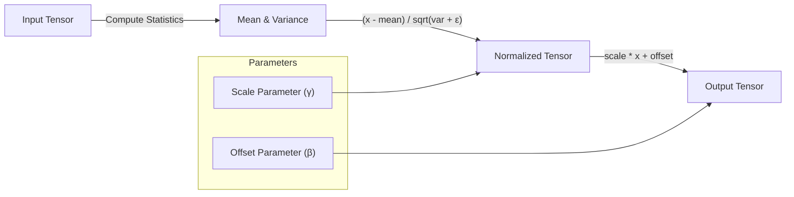
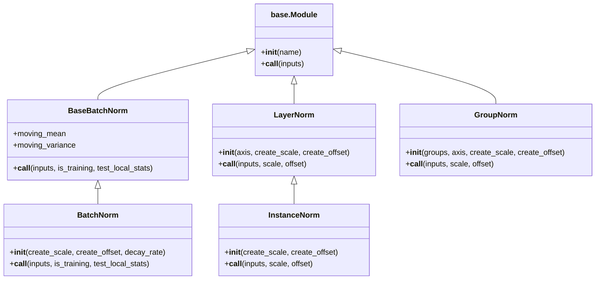
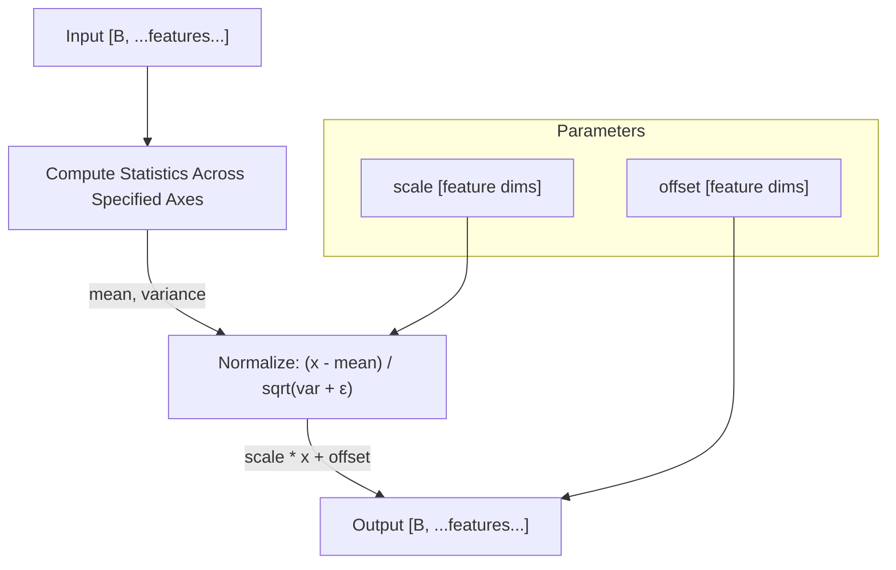
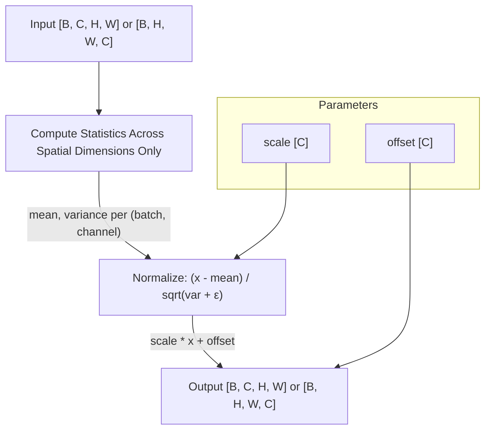
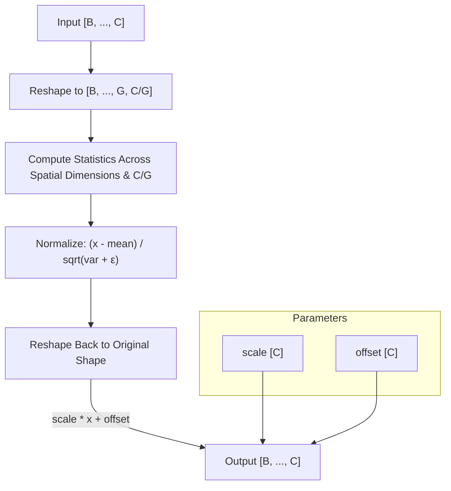
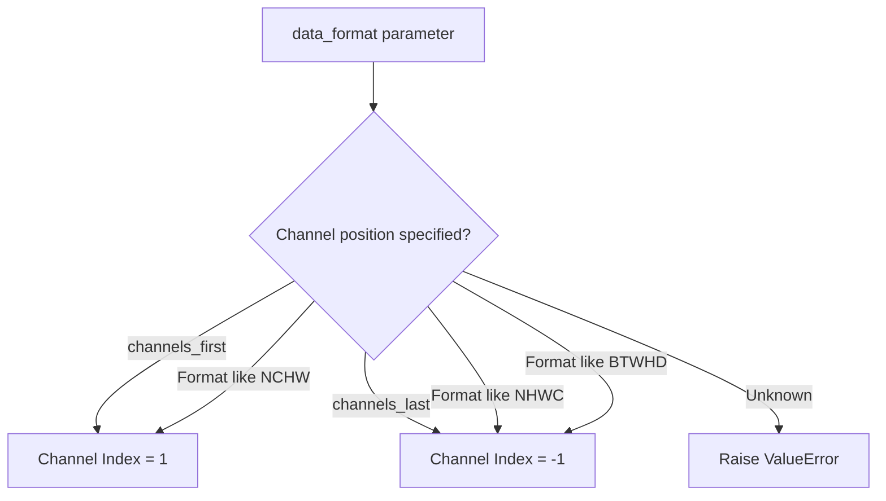

<!-- source: DeepWiki mcp.deepwiki.com · repo google-deepmind/sonnet · page 3.2 Normalization Layers · fetched 2026-10-26 -->

# Normalization Layers

<details>
<summary>Relevant source files</summary>

The following files were used as context for generating this wiki page:

- [sonnet/src/axis_norm.py](sonnet/src/axis_norm.py)
- [sonnet/src/batch_norm.py](sonnet/src/batch_norm.py)
- [sonnet/src/batch_norm_test.py](sonnet/src/batch_norm_test.py)
- [sonnet/src/group_norm.py](sonnet/src/group_norm.py)
- [sonnet/src/initializers.py](sonnet/src/initializers.py)
- [sonnet/src/moving_averages_test.py](sonnet/src/moving_averages_test.py)
- [sonnet/src/utils.py](sonnet/src/utils.py)
- [sonnet/src/utils_test.py](sonnet/src/utils_test.py)

</details>


This document covers the normalization modules available in Sonnet, which are essential components for stabilizing and accelerating neural network training. Sonnet provides several normalization techniques, each normalizing across different dimensions of the input tensor.

## Overview of Normalization in Sonnet

Normalization layers apply a transformation that normalizes activations within a neural network, typically by computing the mean and variance of a subset of the input dimensions, then normalizing the input using these statistics. All normalization layers in Sonnet follow a similar pattern:



Sonnet implements several normalization techniques that differ in which dimensions they normalize across:



Sources: [sonnet/src/batch_norm.py:29-321](), [sonnet/src/axis_norm.py:27-262](), [sonnet/src/group_norm.py:27-231]()

## Common Features

All normalization layers in Sonnet share certain common features:

1. **Normalization formula**: They all apply the formula `(input - mean) / sqrt(variance + epsilon) * scale + offset` to normalize the input.

2. **Scale and offset parameters**: Each layer can optionally create trainable scale and offset parameters.

3. **Data format support**: They support both `channels_first` and `channels_last` data formats.

4. **Channel index detection**: Sonnet automatically detects the channel index using a helper function.

Here's a table comparing the key characteristics of the different normalization techniques:

| Normalization Type | Normalizes Across | Moving Statistics | Use Cases |
|--------------------|-------------------|-------------------|-----------|
| Batch Normalization | Batch dimension and optionally spatial dimensions | Yes | CNNs, general purpose |
| Layer Normalization | Specified axes (typically all except batch) | No | RNNs, Transformers |
| Instance Normalization | Spatial dimensions only | No | Style transfer, GANs |
| Group Normalization | Spatial dimensions and grouped channels | No | Alternative to BatchNorm for small batches |

Sources: [sonnet/src/batch_norm.py:44-52](), [sonnet/src/axis_norm.py:34-41](), [sonnet/src/group_norm.py:36-44]()

## Batch Normalization

Batch Normalization (BatchNorm) is implemented in two classes: `BaseBatchNorm` which is a generic implementation, and `BatchNorm` which is a specific implementation using exponential moving averages for tracking statistics.

```mermaid
flowchart TB
    subgraph "Training Mode"
        Input1["Input Batch"] --> BatchStats["Compute Batch Statistics"]
        BatchStats --> Normalize1["Normalize Using Batch Stats"]
        Normalize1 --> Output1["Normalized Output"]
        BatchStats --> |"Update"| MovingStats["Moving Mean & Variance"]
    end
    
    subgraph "Inference Mode"
        Input2["Input Batch"] --> TestStats{"Use Test Local Stats?"}
        TestStats -->|"Yes"| BatchStats2["Compute Batch Statistics"]
        TestStats -->|"No"| UseMoving["Use Moving Statistics"]
        BatchStats2 --> Normalize2["Normalize"]
        UseMoving --> Normalize2
        Normalize2 --> Output2["Normalized Output"]
    end
    
    style "Training Mode" fill:none,stroke:#333
    style "Inference Mode" fill:none,stroke:#333
```

Key features of `BatchNorm`:

- Normalizes across the batch dimension and optionally spatial dimensions
- Maintains moving averages of mean and variance for inference
- Supports different behaviors at test time:
  - Using moving statistics (`test_local_stats=False`)
  - Using batch statistics (`test_local_stats=True`)
- Automatically uses fused operations when possible for better performance
- Supports different data formats through the `data_format` parameter

Example usage:

```python
# Create a batch normalization layer with scale and offset
bn = snt.BatchNorm(create_scale=True, create_offset=True)

# Apply in training mode
outputs = bn(inputs, is_training=True)

# Apply in inference mode using moving averages
outputs = bn(inputs, is_training=False)

# Apply in inference mode using batch statistics
outputs = bn(inputs, is_training=False, test_local_stats=True)
```

Sources: [sonnet/src/batch_norm.py:265-321](), [sonnet/src/batch_norm.py:126-197]()

## Axis-based Normalization

Sonnet provides two axis-based normalization techniques: `LayerNorm` and `InstanceNorm`.

### Layer Normalization

Layer Normalization normalizes across specified axes of the input, typically all dimensions except the batch dimension.



Key features of `LayerNorm`:

- Normalizes across specified axes (e.g., all feature dimensions)
- Does not maintain moving statistics (unlike BatchNorm)
- Creates scale and offset parameters per feature
- Works well with sequence models like RNNs and Transformers

Sources: [sonnet/src/axis_norm.py:27-208]()

### Instance Normalization

Instance Normalization is a special case of `LayerNorm` that normalizes across spatial dimensions only, treating each instance in a batch independently.



Key features of `InstanceNorm`:

- Normalizes only across spatial dimensions (e.g., height and width in images)
- Particularly useful for style transfer and GANs
- Does not normalize across batch or channel dimensions

Sources: [sonnet/src/axis_norm.py:210-262]()

## Group Normalization

Group Normalization splits channels into groups before calculating mean and variance, normalizing each group independently.



Key features of `GroupNorm`:

- Divides channels into groups before normalization
- Computes mean and variance across spatial dimensions and within each group
- Number of channels must be divisible by the number of groups
- Good alternative to BatchNorm when batch sizes are small
- Does not maintain moving statistics

Sources: [sonnet/src/group_norm.py:27-231]()

## Implementation Details

### Scale and Offset Parameters

All normalization layers in Sonnet allow three different approaches to manage scale and offset parameters:

1. **No scale/offset**: Set `create_scale=False` and `create_offset=False`
2. **Trainable parameters**: Set `create_scale=True` and/or `create_offset=True`
3. **External parameters**: Set `create_scale=False` and `create_offset=False`, then pass external tensors as `scale` and `offset` at call time

This flexibility is particularly useful for conditional normalization techniques.

Sources: [sonnet/src/batch_norm.py:55-66](), [sonnet/src/axis_norm.py:43-56](), [sonnet/src/group_norm.py:45-58]()

### Data Format Handling

Sonnet normalization layers use a utility function `get_channel_index` to automatically detect the channel index based on the data format string:



This allows the normalization layers to work with different tensor layouts common in deep learning:

- `channels_first`: NCHW format (common in some frameworks)
- `channels_last`: NHWC format (default in TensorFlow)
- Sequential data formats like BTWHD are also supported

Sources: [sonnet/src/utils.py:103-130]()

## Performance Considerations

### Fused Operations

Batch normalization can use fused operations for better performance when:
- The input has rank 4 (e.g., NHWC image data)
- Using `channels_last` data format

The code automatically detects when fused operations can be used:

```python
self._fused = (rank == 4 and self._channel_index == -1)
```

Sources: [sonnet/src/batch_norm.py:203]()

### Moving Average Metrics

Batch normalization uses a metrics system to track moving averages of the mean and variance. This is implemented through `ExponentialMovingAverage` in the `moving_averages` module.

The default implementation uses a decay rate of 0.999, which means new statistics are incorporated slowly into the running average.

Sources: [sonnet/src/batch_norm.py:307-310]()

## Usage Examples

### Basic BatchNorm Usage

```python
# Create a batch normalization layer
bn = snt.BatchNorm(create_scale=True, create_offset=True)

# Apply in training mode
outputs = bn(inputs, is_training=True)

# Apply in inference mode
outputs = bn(inputs, is_training=False)
```

### Layer Normalization

```python
# Create a layer normalization (normalizing all but batch dimension)
ln = snt.LayerNorm(axis=slice(1, None), create_scale=True, create_offset=True)

# Apply the normalization
outputs = ln(inputs)
```

### Group Normalization

```python
# Create group normalization with 32 groups
gn = snt.GroupNorm(groups=32, create_scale=True, create_offset=True)

# Apply the normalization
outputs = gn(inputs)
```

### Conditional Normalization

```python
# Create normalization without internal scale/offset
ln = snt.LayerNorm(axis=slice(1, None), create_scale=False, create_offset=False)

# Generate dynamic scale and offset (e.g., from a style vector)
scale = style_network(style_input)
offset = style_network2(style_input)

# Apply conditional normalization
outputs = ln(inputs, scale=scale, offset=offset)
```

## Related Topics

For information about using batch normalization in distributed training scenarios, see [Cross-Replica Batch Normalization](#6.2).

For details on the implementation of moving averages used in batch normalization, refer to the [Metrics](#5.1) page.

---

