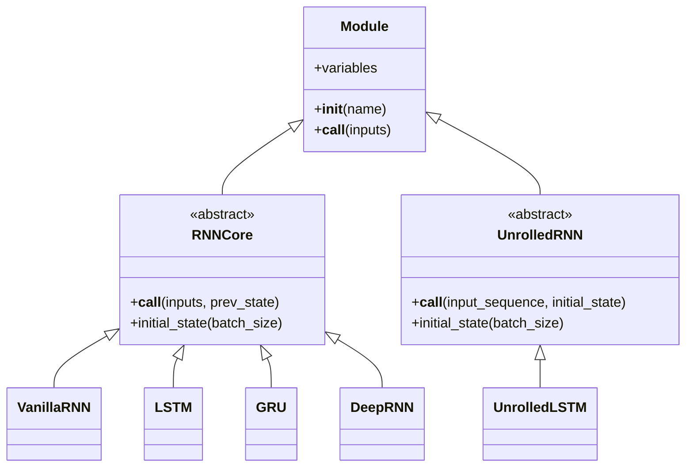
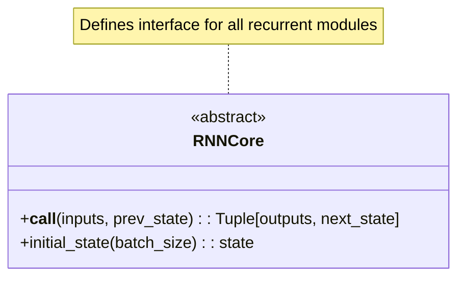
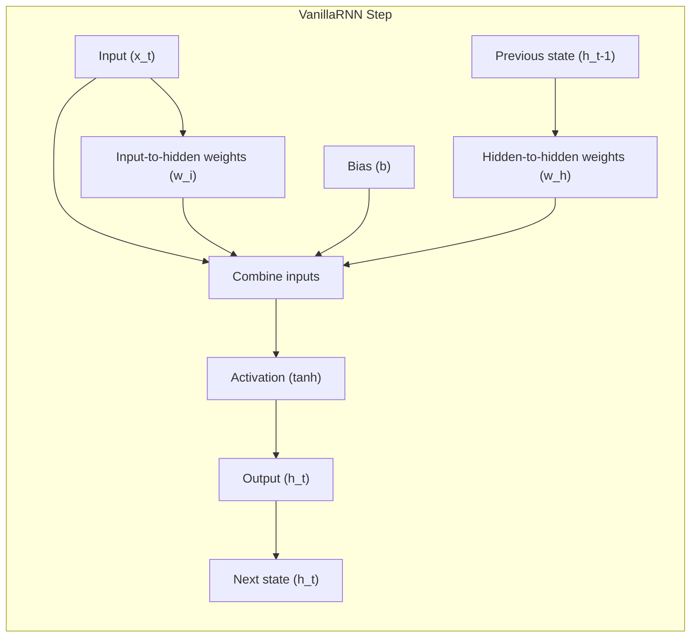
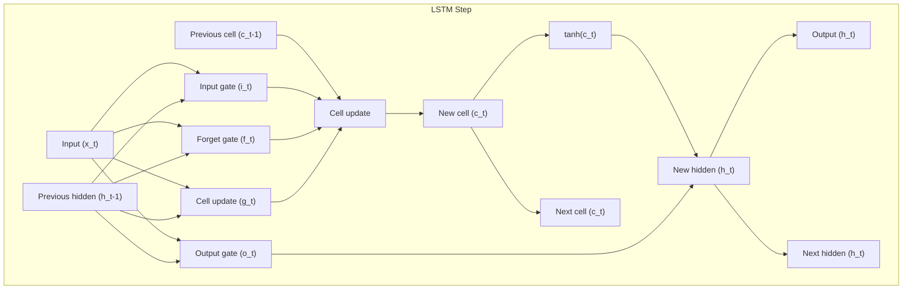
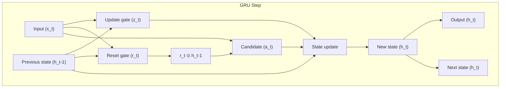
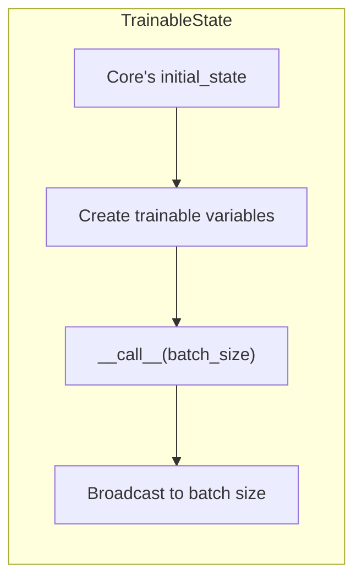
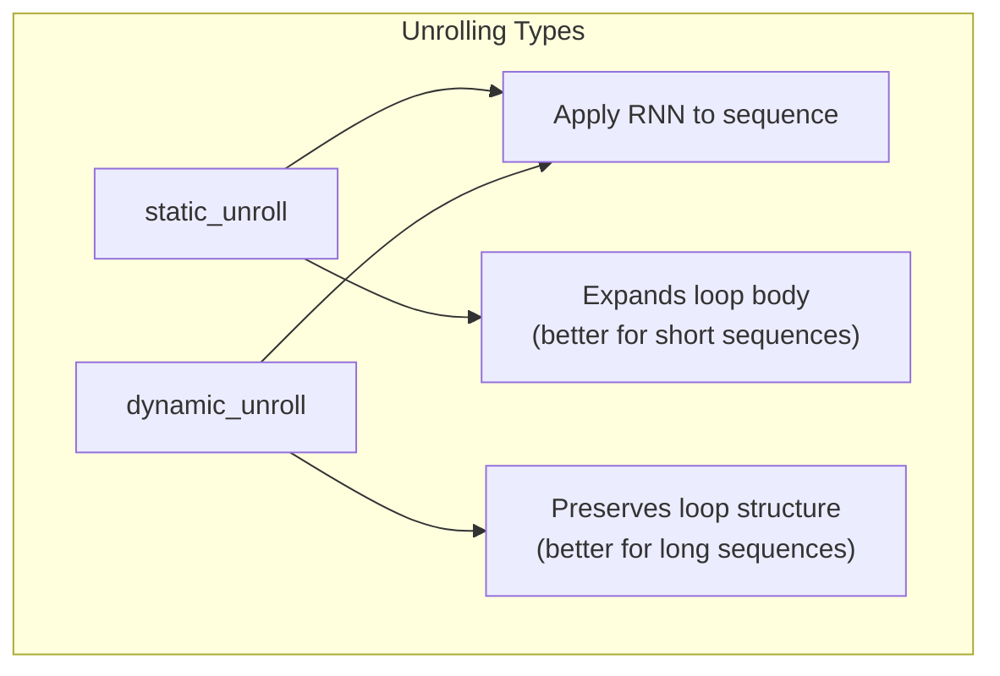
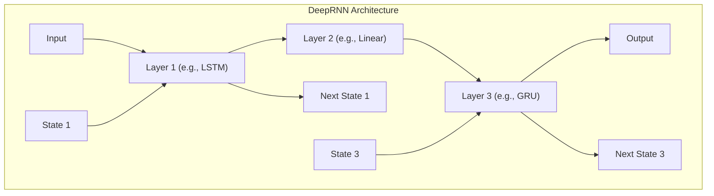
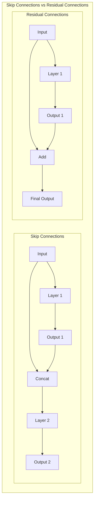

<!-- source: DeepWiki mcp.deepwiki.com · repo google-deepmind/sonnet · page 3.3 Recurrent Neural Networks · fetched 2026-10-26 -->

# Recurrent Neural Networks

<details>
<summary>Relevant source files</summary>

The following files were used as context for generating this wiki page:

- [sonnet/__init__.py](sonnet/__init__.py)
- [sonnet/src/depthwise_conv_test.py](sonnet/src/depthwise_conv_test.py)
- [sonnet/src/dropout.py](sonnet/src/dropout.py)
- [sonnet/src/dropout_test.py](sonnet/src/dropout_test.py)
- [sonnet/src/group_norm_test.py](sonnet/src/group_norm_test.py)
- [sonnet/src/initializers_test.py](sonnet/src/initializers_test.py)
- [sonnet/src/recurrent.py](sonnet/src/recurrent.py)
- [sonnet/src/recurrent_test.py](sonnet/src/recurrent_test.py)

</details>


This document describes the recurrent neural network (RNN) components in Sonnet, their architecture, usage patterns, and how they relate to each other. Sonnet provides a modular approach to building RNNs through its `RNNCore` abstraction and includes commonly used recurrent architectures like LSTM, GRU, and VanillaRNN. For information about higher-level networks that might use RNNs as components, see [Higher-Level Neural Networks](#4).

## 1. Overview of RNN Architecture in Sonnet

Sonnet implements recurrent neural networks through the `RNNCore` abstract base class, which defines a common interface for all recurrent modules. All RNN implementations in Sonnet follow this same pattern, enabling composition and interchangeability.



Sources: [sonnet/src/recurrent.py:40-82](), [sonnet/src/recurrent.py:84-120]()

## 2. The RNNCore Base Class

All RNN implementations in Sonnet inherit from the `RNNCore` abstract base class, which defines the fundamental interface for recurrent modules.



The `RNNCore` class requires implementations to define two key methods:

- `__call__(inputs, prev_state)`: Performs a single time step of the RNN
- `initial_state(batch_size)`: Constructs an initial state for the core

Sources: [sonnet/src/recurrent.py:40-82]()

## 3. Supported RNN Cell Types

Sonnet provides several built-in RNN cell implementations:

### 3.1 VanillaRNN

The `VanillaRNN` is a basic fully-connected RNN core that applies a linear transformation followed by an activation function:



Mathematical formula: $h_t = \text{activation}(W_i x_t + W_h h_{t-1} + b)$

Sources: [sonnet/src/recurrent.py:457-539]()

### 3.2 LSTM (Long Short-Term Memory)

The LSTM architecture helps address the vanishing gradient problem through its gating mechanisms.



Mathematical formulas:
- $i_t = \sigma(W_{ii} x_t + W_{hi} h_{t-1} + b_i)$ (input gate)
- $f_t = \sigma(W_{if} x_t + W_{hf} h_{t-1} + b_f)$ (forget gate)
- $g_t = \tanh(W_{ig} x_t + W_{hg} h_{t-1} + b_g)$ (cell update)
- $o_t = \sigma(W_{io} x_t + W_{ho} h_{t-1} + b_o)$ (output gate)
- $c_t = f_t \odot c_{t-1} + i_t \odot g_t$ (cell state update)
- $h_t = o_t \odot \tanh(c_t)$ (hidden state update)

Sonnet stores the LSTM state as a namedtuple `LSTMState(hidden, cell)`.

Sources: [sonnet/src/recurrent.py:738-898](), [sonnet/src/recurrent.py:735]()

### 3.3 GRU (Gated Recurrent Unit)

The `GRU` is a simplified version of LSTM with fewer parameters.



Mathematical formulas:
- $z_t = \sigma(W_{iz} x_t + W_{hz} h_{t-1} + b_z)$ (update gate)
- $r_t = \sigma(W_{ir} x_t + W_{hr} h_{t-1} + b_r)$ (reset gate)
- $a_t = \tanh(W_{ia} x_t + W_{ha} (r_t \odot h_{t-1}) + b_a)$ (candidate)
- $h_t = (1 - z_t) \odot h_{t-1} + z_t \odot a_t$ (state update)

Sources: [sonnet/recurrent.py:443-494]()

### 3.4 Convolutional LSTMs

Sonnet provides convolutional variants of LSTM for processing spatiotemporal data:
- `Conv1DLSTM`: For 1D sequential data with channels
- `Conv2DLSTM`: For 2D spatial data with channels (e.g., video)
- `Conv3DLSTM`: For 3D volumetric data with channels

These variants replace the matrix multiplications in the standard LSTM with convolutions.

Sources: [sonnet/src/recurrent.py:58-59]()

## 4. RNN State Management

RNN state is a critical concept in Sonnet's recurrent modules.

### 4.1 Initial State Creation

All RNN cores provide an `initial_state` method that creates a suitable initial state for the core:

```python
core = snt.LSTM(hidden_size=32)
batch_size = 4
initial_state = core.initial_state(batch_size)  # Returns LSTMState(hidden, cell)
```

### 4.2 Trainable Initial States

Sonnet provides the `TrainableState` class to create learnable initial states:



Example:
```python
core = snt.LSTM(hidden_size=32)
trainable_state = snt.TrainableState.for_core(core)
batch_size = 4
initial_state = trainable_state(batch_size)  # Returns trainable LSTMState
```

Sources: [sonnet/src/recurrent.py:123-195]()

## 5. Unrolling RNNs

Sonnet provides two mechanisms for unrolling RNNs over sequences:

### 5.1 Static Unrolling vs. Dynamic Unrolling



- `static_unroll`: Replaces a loop with repeated operations, which can be more efficient for short sequences
- `dynamic_unroll`: Preserves the loop structure, which is better for long sequences and helps with memory usage

Usage example:

```python
core = snt.LSTM(hidden_size=32)
batch_size = 4
input_sequence = tf.random.normal([10, batch_size, 16])  # [time, batch, features]
initial_state = core.initial_state(batch_size)

# Dynamic unrolling (preserves loop structure)
output_sequence, final_state = snt.dynamic_unroll(
    core, 
    input_sequence, 
    initial_state
)

# Static unrolling (expands loop)
output_sequence, final_state = snt.static_unroll(
    core, 
    input_sequence, 
    initial_state
)
```

Sources: [sonnet/src/recurrent.py:198-276](), [sonnet/src/recurrent.py:295-351]()

### 5.2 Unrolled RNN Classes

Sonnet also provides specialized `UnrolledRNN` implementations that optimize performance:

- `UnrolledLSTM`: An optimized implementation of LSTM unrolling

```python
unrolled_lstm = snt.UnrolledLSTM(hidden_size=32)
input_sequence = tf.random.normal([10, batch_size, 16])  # [time, batch, features]
initial_state = unrolled_lstm.initial_state(batch_size)

output_sequence, final_state = unrolled_lstm(input_sequence, initial_state)
```

Sources: [sonnet/src/recurrent.py:901-982]()

## 6. Composing RNNs

Sonnet makes it easy to compose multiple RNNs into more complex architectures.

### 6.1 DeepRNN

The `DeepRNN` allows stacking multiple RNN cores (or other modules) in sequence:



Usage example:

```python
deep_rnn = snt.DeepRNN([
    snt.LSTM(hidden_size=32),
    tf.nn.relu,
    snt.GRU(hidden_size=64)
])

# Initial state is a tuple of the initial states of all RNN cores
initial_state = deep_rnn.initial_state(batch_size)  # (lstm_state, gru_state)
```

Sources: [sonnet/src/recurrent.py:603-628]()

### 6.2 Skip and Residual Connections

Sonnet provides factory functions to create `DeepRNN` variants with skip or residual connections:

- `deep_rnn_with_skip_connections`: Creates a `DeepRNN` where each layer receives the original input concatenated with the output of the previous layer
- `deep_rnn_with_residual_connections`: Creates a `DeepRNN` where each layer's output is added to its input



Usage examples:

```python
# With skip connections
skip_rnn = snt.deep_rnn_with_skip_connections([
    snt.LSTM(hidden_size=32),
    snt.LSTM(hidden_size=64)
])

# With residual connections
residual_rnn = snt.deep_rnn_with_residual_connections([
    snt.LSTM(hidden_size=32),
    snt.LSTM(hidden_size=32)  # Same size for proper residual connections
])
```

Sources: [sonnet/src/recurrent.py:630-732]()

## 7. Additional Features

### 7.1 Recurrent Dropout

Sonnet provides a helper for implementing LSTM with recurrent dropout, which helps prevent overfitting:

```python
train_core, test_core = snt.lstm_with_recurrent_dropout(
    hidden_size=64, 
    dropout=0.5
)

# Use train_core for training and test_core for inference
```

Sources: [sonnet/src/recurrent.py:66]()

### 7.2 Performance Considerations

| Unrolling Method | Best For | Memory Usage | Compilation Time |
|------------------|----------|--------------|-----------------|
| `static_unroll`  | Short sequences | Higher | Longer |
| `dynamic_unroll` | Long sequences | Lower | Shorter |
| `UnrolledLSTM`   | Performance-critical applications | Optimized | N/A |

Sources: [sonnet/src/recurrent.py:198-351]()

## 8. Example Workflows

### 8.1 Basic Usage Pattern

```python
# 1. Create an RNN core
lstm = snt.LSTM(hidden_size=64)

# 2. Initialize state 
batch_size = 32
initial_state = lstm.initial_state(batch_size)

# 3. Process a single step
input_vector = tf.random.normal([batch_size, 128])
output, next_state = lstm(input_vector, initial_state)

# 4. Process a sequence
input_sequence = tf.random.normal([20, batch_size, 128])  # [time, batch, features]
output_sequence, final_state = snt.dynamic_unroll(lstm, input_sequence, initial_state)
```

### 8.2 Stacking Multiple RNNs

```python
# Create a multi-layer RNN
deep_rnn = snt.DeepRNN([
    snt.LSTM(hidden_size=32),
    snt.LSTM(hidden_size=64),
    snt.LSTM(hidden_size=32)
])

# Initial state is a tuple of all RNN states
initial_state = deep_rnn.initial_state(batch_size) 

# Unroll the deep RNN over a sequence
input_sequence = tf.random.normal([20, batch_size, 128])
output_sequence, final_state = snt.dynamic_unroll(deep_rnn, input_sequence, initial_state)
```

Sources: [sonnet/src/recurrent.py:603-628]()

---

