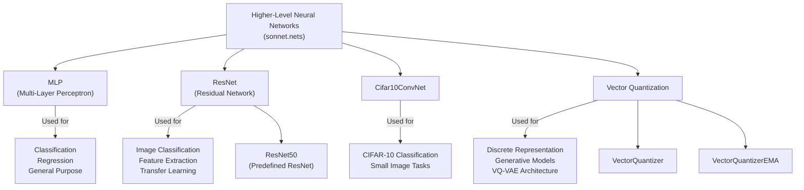
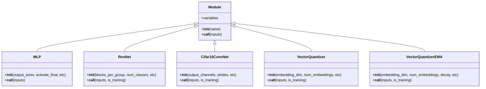
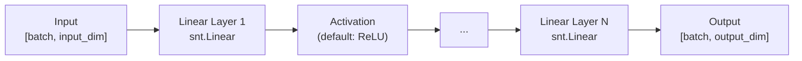
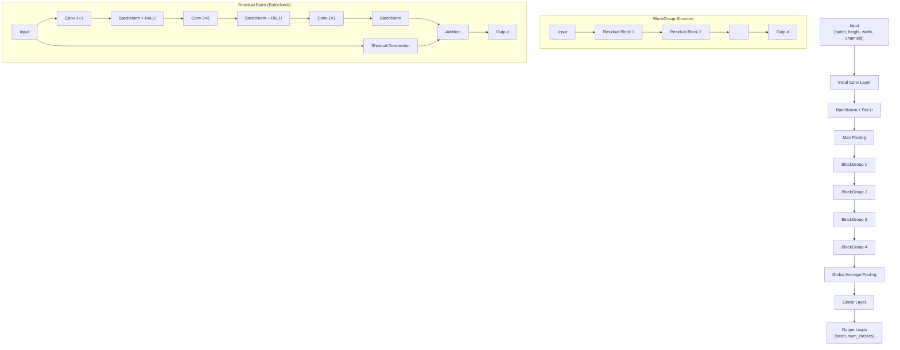
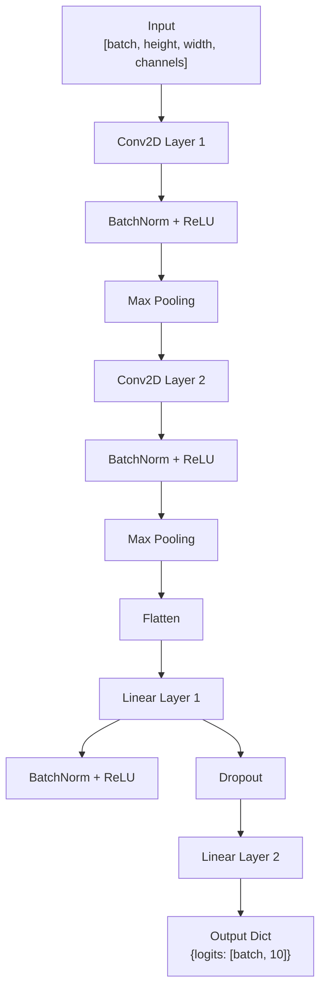
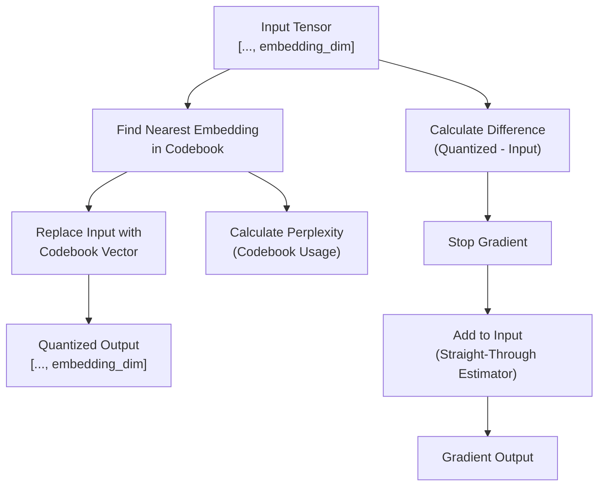
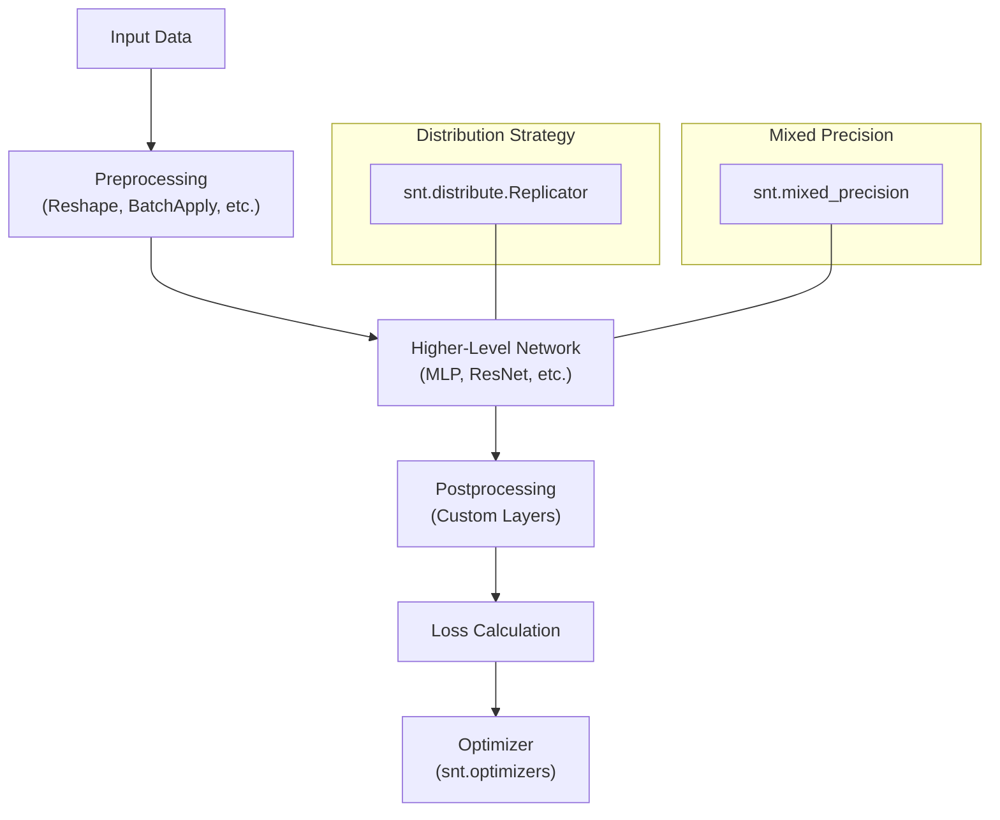

<!-- source: DeepWiki mcp.deepwiki.com · repo google-deepmind/sonnet · page 4 Higher-Level Neural Networks · fetched 2026-10-26 -->

# Higher-Level Neural Networks

<details>
<summary>Relevant source files</summary>

The following files were used as context for generating this wiki page:

- [docs/api.rst](docs/api.rst)
- [sonnet/__init__.py](sonnet/__init__.py)
- [sonnet/nets/__init__.py](sonnet/nets/__init__.py)
- [sonnet/nets/resnet.py](sonnet/nets/resnet.py)
- [sonnet/src/conformance/descriptors.py](sonnet/src/conformance/descriptors.py)
- [sonnet/src/conformance/descriptors_test.py](sonnet/src/conformance/descriptors_test.py)
- [sonnet/src/conformance/function_test.py](sonnet/src/conformance/function_test.py)
- [sonnet/src/conformance/goldens.py](sonnet/src/conformance/goldens.py)
- [sonnet/src/conformance/goldens_test.py](sonnet/src/conformance/goldens_test.py)

</details>


This document describes the pre-built neural network architectures provided by Sonnet. These higher-level modules implement common neural network designs that build upon the basic modules, saving you from having to build them from scratch while maintaining Sonnet's modular design principles.

For information about the basic building blocks like linear layers, convolutions, and normalization layers, see [Basic Modules](#3). For details about recurrent neural networks, see [Recurrent Neural Networks](#3.3).

## Architecture Overview

Sonnet provides several higher-level neural network architectures that are commonly used in deep learning research and applications:



Sources: [sonnet/nets/__init__.py:17-33](), [docs/api.rst:475-514]()

## Inheritance Hierarchy

All higher-level neural networks in Sonnet inherit from the base `snt.Module` class, maintaining the same interface and behavior patterns as other Sonnet components:



Sources: [sonnet/__init__.py:17-148](), [sonnet/src/conformance/goldens.py:196-547]()

## MLP (Multi-Layer Perceptron)

The MLP is a simple feed-forward neural network consisting of stacked linear layers with activation functions. It's a general-purpose architecture that can be used for many tasks including classification and regression.

### Architecture

An MLP with `n` layers consists of:
1. `n-1` linear layers followed by an activation function (ReLU by default)
2. A final linear layer (without activation by default, controlled by `activate_final`)



### Usage

```python
import sonnet as snt
import tensorflow as tf

# Create an MLP with 3 hidden layers with dimensions [64, 32, 10]
mlp = snt.nets.MLP([64, 32, 10])

# Apply to a batch of inputs with 20 features
batch_size = 32
inputs = tf.ones([batch_size, 20])
outputs = mlp(inputs)  # Shape: [32, 10]
```

### Parameters

| Parameter | Description | Default |
|-----------|-------------|---------|
| `output_sizes` | List of integers, sizes for the output of each layer | Required |
| `activation` | Activation function | `tf.nn.relu` |
| `activate_final` | Whether to apply activation to the final layer | `False` |
| `w_init` | Weight initializer | `None` (TF default) |
| `b_init` | Bias initializer | `None` (TF default) |
| `with_bias` | Whether to include bias parameters | `True` |
| `name` | Name of the module | `None` |

Sources: [sonnet/src/conformance/goldens.py:196-207](), [docs/api.rst:480-484]()

## ResNet

ResNet (Residual Network) is a deep convolutional neural network architecture known for its use of residual connections that enable effective training of very deep networks. It was introduced in the paper "Deep Residual Learning for Image Recognition" by He et al.

### Architecture

The ResNet architecture in Sonnet consists of:



### Components

ResNet in Sonnet is built from these key components:

1. **BlockGroup** - Organizes multiple residual blocks with the same channel dimensions
2. **BottleNeckBlockV1/V2** - Implements the bottleneck block design with 1×1, 3×3, 1×1 convolutions
3. **ResNet** - Main class that orchestrates the entire architecture
4. **ResNet50** - A predefined ResNet with 50 layers following the standard architecture

### Usage

```python
import sonnet as snt
import tensorflow as tf

# Create a ResNet with specific block configuration
# [2, 2, 2, 2] means 2 blocks in each of the 4 groups (ResNet-18)
resnet = snt.nets.ResNet([2, 2, 2, 2], num_classes=1000)

# Create a standard ResNet-50
resnet50 = snt.nets.ResNet50(num_classes=1000)

# Apply to a batch of images
batch_size = 8
images = tf.ones([batch_size, 224, 224, 3])  # Standard ImageNet size
outputs = resnet(images, is_training=True)  # Shape: [8, 1000]
```

### Parameters

| Parameter | Description | Default |
|-----------|-------------|---------|
| `blocks_per_group` | Sequence of integers specifying blocks in each group | Required |
| `num_classes` | Number of output classes | Required |
| `bn_config` | Batch normalization configuration | `None` |
| `resnet_v2` | Whether to use the ResNet v2 architecture | `False` |
| `bottleneck` | Whether to use bottleneck blocks | `True` |
| `channels_per_group` | Number of output channels per group | `[256, 512, 1024, 2048]` |
| `name` | Name of the module | `None` |

Sources: [sonnet/src/conformance/goldens.py:472-482](), [sonnet/nets/resnet.py:17-25](), [docs/api.rst:492-502]()

## Cifar10ConvNet

Cifar10ConvNet is a simple convolutional neural network specifically designed for the CIFAR-10 image classification task, which contains 10 classes of 32×32 RGB images.

### Architecture



### Usage

```python
import sonnet as snt
import tensorflow as tf

# Create a Cifar10ConvNet with default parameters
convnet = snt.nets.Cifar10ConvNet()

# Create with custom parameters
convnet = snt.nets.Cifar10ConvNet(
    output_channels=(64, 128),  # Channels for each conv layer
    strides=(2, 2)              # Strides for each conv layer
)

# Apply to a batch of images
batch_size = 32
images = tf.ones([batch_size, 32, 32, 3])  # CIFAR-10 image size
outputs = convnet(images, is_training=True)
logits = outputs["logits"]  # Shape: [32, 10]
```

### Parameters

| Parameter | Description | Default |
|-----------|-------------|---------|
| `output_channels` | Channels for each convolutional layer | `(32, 64)` |
| `kernel_shapes` | Kernel shapes for the convolutional layers | `(5, 5)` |
| `strides` | Strides for the convolutional layers | `(1, 1)` |
| `paddings` | Padding for the convolutional layers | `('SAME', 'SAME')` |
| `name` | Name of the module | `None` |

### Output

The module returns a dictionary with the following keys:
- `logits`: Final classification logits with shape `[batch_size, 10]`
- Additional intermediate activations and layers are also available

Sources: [sonnet/src/conformance/goldens.py:210-220](), [docs/api.rst:486-490]()

## Vector Quantization

Sonnet provides modules for implementing Vector Quantized Variational Autoencoders (VQ-VAE), as described in the paper "Neural Discrete Representation Learning" by van den Oord et al.

### Vector Quantization Process



### Comparison of Vector Quantizer Implementations

| Feature | VectorQuantizer | VectorQuantizerEMA |
|---------|----------------|---------------------|
| Codebook Update | Via backpropagation | Via Exponential Moving Average |
| Training Stability | Basic | Improved stability |
| Number of Variables | 1 (codebook) | 7 (codebook + EMA tracking) |
| Side Effects | None | Updates EMA during training |
| Perplexity | Tracked | Tracked |

### Usage

```python
import sonnet as snt
import tensorflow as tf

# Standard Vector Quantizer
vq = snt.nets.VectorQuantizer(
    embedding_dim=64,      # Dimension of embedding vectors
    num_embeddings=512,    # Size of the codebook
    commitment_cost=0.25   # Weight for commitment loss
)

# EMA-based Vector Quantizer (more stable training)
vq_ema = snt.nets.VectorQuantizerEMA(
    embedding_dim=64,
    num_embeddings=512,
    commitment_cost=0.25,
    decay=0.99             # EMA decay rate
)

# Apply to input with shape [..., embedding_dim]
# The last dimension must match embedding_dim
inputs = tf.ones([batch_size, height, width, 64])
outputs = vq(inputs, is_training=True)

# Access components from the output dictionary
quantized = outputs["quantize"]            # Quantized vectors
loss = outputs["loss"]                     # Total loss
commitment_loss = outputs["commitment_loss"]  # Commitment loss
codebook_loss = outputs["codebook_loss"]   # Codebook loss
perplexity = outputs["perplexity"]         # Perplexity (codebook usage)
```

### Parameters

| Parameter | Description | Default |
|-----------|-------------|---------|
| `embedding_dim` | Dimension of embedding vectors | Required |
| `num_embeddings` | Number of embedding vectors in codebook | Required |
| `commitment_cost` | Weight for commitment loss | Required |
| `decay` | EMA decay factor (VectorQuantizerEMA only) | Required |
| `name` | Name of the module | `None` |

Sources: [sonnet/src/conformance/goldens.py:485-547](), [docs/api.rst:504-514]()

## Integration with Other Sonnet Components

Higher-level neural networks can be combined with other Sonnet components to create more complex architectures:



Common patterns for integrating higher-level networks:

1. Use as feature extractors in larger networks
2. Apply transfer learning by freezing parts of pre-trained networks
3. Customize networks by replacing subcomponents
4. Combine with recurrent networks for sequential processing

Sources: [sonnet/__init__.py:17-148](), [sonnet/src/conformance/function_test.py:34-136]()

## Summary

Sonnet provides several higher-level neural networks that implement common architectures used in deep learning research:

1. **MLP** - For general classification and regression tasks
2. **ResNet** - For image classification and feature extraction
3. **Cifar10ConvNet** - For small image classification tasks
4. **Vector Quantization** - For discrete representation learning

These networks follow Sonnet's modular design philosophy, making them easy to use within larger architectures while maintaining the same initialization, variable management, and call patterns as other Sonnet modules.

---

