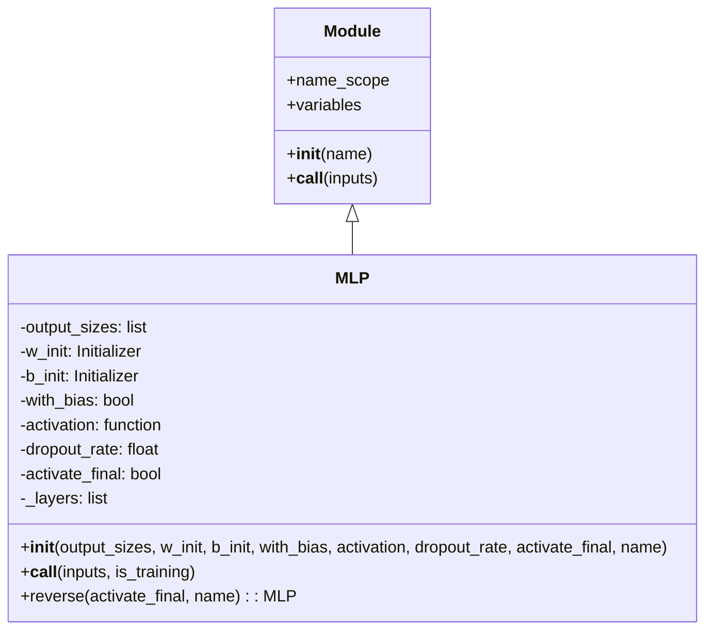
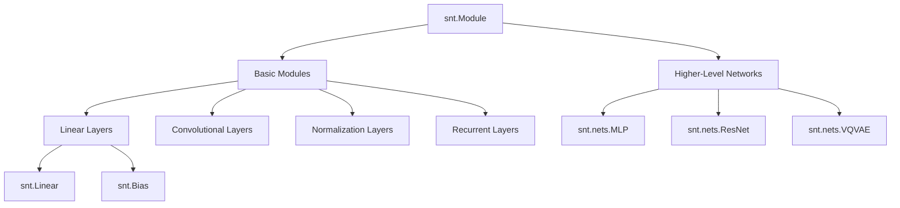

<!-- source: DeepWiki mcp.deepwiki.com · repo google-deepmind/sonnet · page 4.1 MLP (Multi-Layer Perceptron) · fetched 2026-10-26 -->

# MLP (Multi-Layer Perceptron)

<details>
<summary>Relevant source files</summary>

The following files were used as context for generating this wiki page:

- [docs/modules.rst](docs/modules.rst)
- [examples/README.md](examples/README.md)
- [examples/distributed_cifar10.ipynb](examples/distributed_cifar10.ipynb)
- [examples/little_gan_on_mnist.ipynb](examples/little_gan_on_mnist.ipynb)
- [examples/mlp_on_mnist.ipynb](examples/mlp_on_mnist.ipynb)
- [sonnet/src/conformance/copy_test.py](sonnet/src/conformance/copy_test.py)
- [sonnet/src/nets/mlp.py](sonnet/src/nets/mlp.py)
- [sonnet/src/nets/mlp_test.py](sonnet/src/nets/mlp_test.py)

</details>


This document covers the Multi-Layer Perceptron (MLP) implementation in Sonnet, which provides a convenient way to create feedforward neural networks with multiple layers. For information about other higher-level neural network models, see [Higher-Level Neural Networks](#4).

## Overview

The MLP module in Sonnet (`snt.nets.MLP`) implements a standard multi-layer perceptron that consists of a sequence of linear layers with optional activation functions, bias terms, and dropout. It provides a higher-level abstraction than working with individual `Linear` layers while offering extensive customization options.

Sources: [sonnet/src/nets/mlp.py:15-27]()

## Architecture

The diagram below illustrates the architecture of a multi-layer perceptron in Sonnet:

```mermaid
flowchart LR
    subgraph "MLP"
        Input["Input Tensor"] --> Flatten["Flatten (if needed)"]
        Flatten --> Linear1["Linear Layer 1"]
        Linear1 --> Act1["Activation 1"]
        Act1 --> Dropout1["Dropout 1 (optional)"]
        Dropout1 --> Linear2["Linear Layer 2"]
        Linear2 --> Act2["Activation 2"]
        Act2 --> Dropout2["Dropout 2 (optional)"]
        Dropout2 --> LinearN["Linear Layer N"]
        LinearN --> ActN["Activation N (optional)"]
    end
    ActN --> Output["Output Tensor"]
    
    classDef optional stroke-dasharray: 5 5
    class ActN,Dropout1,Dropout2 optional
```



The MLP module wraps a sequence of Linear layers, each potentially followed by an activation function and dropout. The final activation is optional and controlled by the `activate_final` parameter.

Sources: [sonnet/src/nets/mlp.py:75-104]()

## Implementation Details

The MLP class in Sonnet is implemented as follows:



The MLP class stores a sequence of Linear layers in its `_layers` list, which are created during initialization based on the specified `output_sizes`.

Sources: [sonnet/src/nets/mlp.py:25-149](), [docs/modules.rst:47-66]()

### Key Parameters

| Parameter | Type | Description |
|-----------|------|-------------|
| `output_sizes` | Iterable[int] | Sequence of layer sizes determining the shape of each layer |
| `w_init` | Initializer | Initializer for linear weights matrices |
| `b_init` | Initializer | Initializer for bias vectors |
| `with_bias` | bool | Whether to apply a bias in each layer |
| `activation` | function | Activation function to apply between linear layers (default: ReLU) |
| `dropout_rate` | float | Dropout rate to apply (None or 0 means no dropout) |
| `activate_final` | bool | Whether to activate the final layer |

Sources: [sonnet/src/nets/mlp.py:28-36](), [sonnet/src/nets/mlp.py:37-53]()

## Usage

### Basic Usage

Here's a simple example of creating and using an MLP:

```python
# Create an MLP with layers of size 1024 and 10
mlp = snt.nets.MLP([1024, 10])

# Pass input through the MLP
outputs = mlp(inputs)
```

The MLP will automatically handle flattening inputs and creating the appropriate layer sizes based on input shape.

Sources: [examples/mlp_on_mnist.ipynb:275-304]()

### Custom MLP

You can also create your own MLP by subclassing `snt.Module`:

```python
class MLP(snt.Module):
  def __init__(self):
    super(MLP, self).__init__()
    self.flatten = snt.Flatten()
    self.hidden1 = snt.Linear(1024, name="hidden1")
    self.hidden2 = snt.Linear(1024, name="hidden2")
    self.logits = snt.Linear(10, name="logits")

  def __call__(self, images):
    output = self.flatten(images)
    output = tf.nn.relu(self.hidden1(output))
    output = tf.nn.relu(self.hidden2(output))
    output = self.logits(output)
    return output
```

Sources: [examples/mlp_on_mnist.ipynb:289-304]()

## Forward Pass Computation

During the forward pass (`__call__` method), the MLP:

1. Validates inputs related to dropout and training mode
2. Passes the input through each linear layer
3. Applies activation functions after each layer (except possibly the last one, depending on `activate_final`)
4. Applies dropout when configured and when in training mode

```mermaid
sequenceDiagram
    participant Input
    participant MLP
    participant Linear as Linear Layers
    participant Act as Activation Functions
    participant Output
    
    Input->>MLP: inputs, is_training
    Note over MLP: Check dropout and is_training parameters
    loop For each layer except last
        MLP->>Linear: Pass through linear layer
        Linear->>Act: Apply activation
        Act->>MLP: Activated output
        opt If dropout enabled and is_training
            MLP->>MLP: Apply dropout
        end
    end
    MLP->>Linear: Pass through final linear layer
    opt If activate_final is True
        Linear->>Act: Apply activation
        Act->>Output: Activated output
    else
        Linear->>Output: Linear output
    end
```

Sources: [sonnet/src/nets/mlp.py:75-104]()

## Advanced Features

### Dropout

When `dropout_rate` is set to a value greater than 0, the MLP applies dropout after activation in each layer (except possibly the last if `activate_final=False`). When using dropout, you must provide the `is_training` parameter to `__call__` to indicate whether to apply dropout.

```python
# Create MLP with dropout
mlp = snt.nets.MLP([1024, 10], dropout_rate=0.5)

# During training
outputs = mlp(inputs, is_training=True)  # Apply dropout

# During evaluation
outputs = mlp(inputs, is_training=False)  # Don't apply dropout
```

Sources: [sonnet/src/nets/mlp.py:86-92](), [sonnet/src/nets/mlp.py:98-102]()

### Reversing an MLP

The MLP provides a `reverse` method that creates a new MLP with the layer sizes reversed. This is useful for creating autoencoder structures:

```python
# Create an MLP
encoder = snt.nets.MLP([512, 256, 128])

# Create a reversed MLP for the decoder
decoder = encoder.reverse(activate_final=True)  # Layer sizes: 128, 256, 512
```

Note that the reversed MLP doesn't share weights with the original MLP - it's a completely new instance.

Sources: [sonnet/src/nets/mlp.py:106-149]()

## MLP in the Sonnet Hierarchy

The following diagram shows where the MLP fits within the Sonnet library:



Sources: [examples/README.md:1-13]()

## Example: MNIST Classification

The following example demonstrates training an MLP on the MNIST dataset:

```python
# Define model
mlp = MLP()  # Custom MLP or snt.nets.MLP([1024, 10])

# Define optimizer
opt = snt.optimizers.SGD(learning_rate=0.1)

# Training step
def step(images, labels):
  with tf.GradientTape() as tape:
    logits = mlp(images)
    loss = tf.nn.sparse_softmax_cross_entropy_with_logits(
        logits=logits, labels=labels)
    loss = tf.reduce_mean(loss)

  params = mlp.trainable_variables
  grads = tape.gradient(loss, params)
  opt.apply(grads, params)
  return loss

# Train model
for images, labels in mnist_train.repeat(num_epochs):
  loss = step(images, labels)
```

Sources: [examples/mlp_on_mnist.ipynb:493-515]()

## Performance Considerations

When using MLP for distributed training, it can be combined with Sonnet's distribution tools like `snt.distribute.Replicator` for multi-GPU training:

```python
# Create distribution strategy
strategy = snt.distribute.Replicator(["/device:GPU:0", "/device:GPU:1"])

# Create model within strategy scope
with strategy.scope():
  model = snt.nets.MLP([1024, 10])
  optimizer = snt.optimizers.SGD(learning_rate)
```

Sources: [examples/distributed_cifar10.ipynb:244-319]()

---

