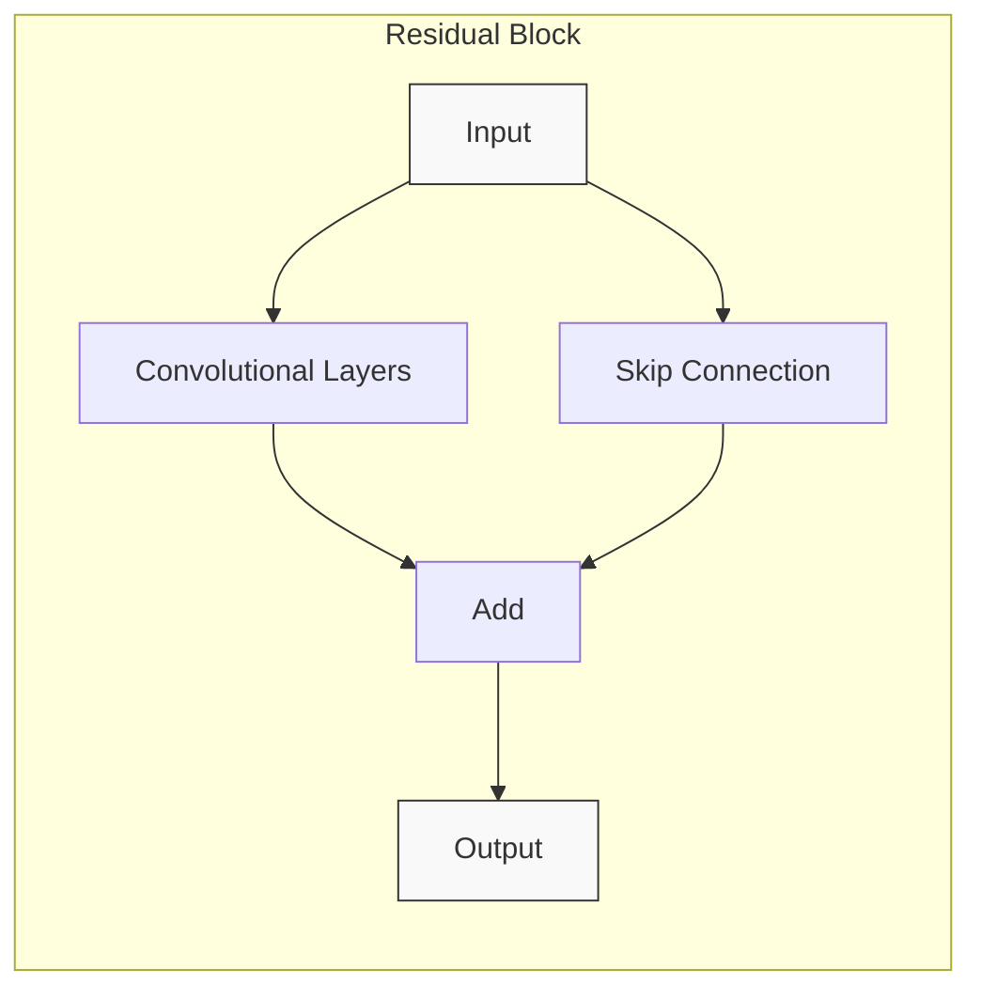
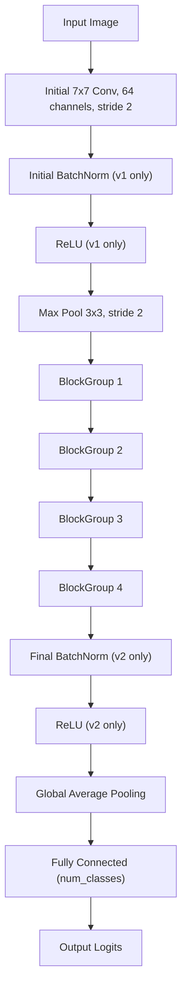
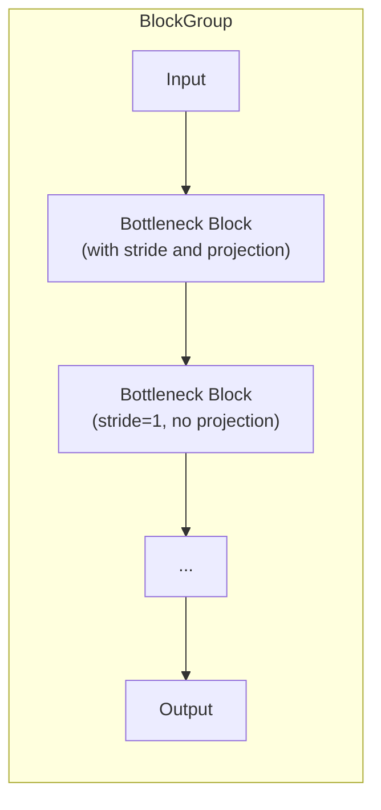

<!-- source: DeepWiki mcp.deepwiki.com · repo google-deepmind/sonnet · page 4.2 ResNet · fetched 2026-10-26 -->

# ResNet

<details>
<summary>Relevant source files</summary>

The following files were used as context for generating this wiki page:

- [sonnet/src/conformance/checkpoints/resnet50/checkpoint](sonnet/src/conformance/checkpoints/resnet50/checkpoint)
- [sonnet/src/conformance/checkpoints/resnet50/checkpoint-1.data-00000-of-00001](sonnet/src/conformance/checkpoints/resnet50/checkpoint-1.data-00000-of-00001)
- [sonnet/src/conformance/checkpoints/resnet50/checkpoint-1.index](sonnet/src/conformance/checkpoints/resnet50/checkpoint-1.index)
- [sonnet/src/nets/resnet.py](sonnet/src/nets/resnet.py)
- [sonnet/src/nets/resnet_test.py](sonnet/src/nets/resnet_test.py)

</details>


This document describes the ResNet (Residual Network) implementation in Sonnet, a deep learning neural network architecture that effectively addresses the degradation problem in very deep networks through residual learning. The document covers the ResNet architecture, its implementation details in Sonnet, usage patterns, and specific information about ResNet50.

## Introduction

ResNet is a deep convolutional neural network architecture that introduced the concept of residual learning to train very deep networks successfully. The Sonnet implementation provides flexible building blocks to create ResNet models with different depths and configurations, supporting both original (v1) and pre-activation (v2) variants of the architecture.

Sources: [sonnet/src/nets/resnet.py:15-15]()

## Architecture Overview

### Residual Learning Concept

The fundamental innovation in ResNet is the use of residual connections that allow the network to learn residual functions with reference to the layer inputs, rather than learning unreferenced functions. This helps address the vanishing/exploding gradient problem in deep networks.



Sources: [sonnet/src/nets/resnet.py:28-104](), [sonnet/src/nets/resnet.py:107-179]()

### Block Structure

The Sonnet ResNet implementation consists of several key components organized hierarchically:

```mermaid
classDiagram
    ResNet --> BlockGroup
    BlockGroup --> "BottleNeckBlockV1/V2"
    ResNet50 --|> ResNet
    
    class ResNet {
        +__init__(blocks_per_group_list, num_classes, bn_config, resnet_v2)
        +__call__(inputs, is_training)
    }
    
    class ResNet50 {
        +__init__(num_classes, bn_config, resnet_v2)
    }
    
    class BlockGroup {
        +__init__(channels, num_blocks, stride, bn_config, resnet_v2)
        +__call__(inputs, is_training)
    }
    
    class "BottleNeckBlockV1/V2" {
        +__init__(channels, stride, use_projection, bn_config)
        +__call__(inputs, is_training)
    }
```

Sources: [sonnet/src/nets/resnet.py:220-343]()

### Bottleneck Block Variants

ResNet in Sonnet implements two variants of the bottleneck block:

1. **BottleNeckBlockV1**: Original ResNet architecture where batch normalization and ReLU are applied after convolution.
2. **BottleNeckBlockV2**: Pre-activation variant where batch normalization and ReLU are applied before convolution.

```mermaid
flowchart TD
    subgraph "BottleNeckBlockV1"
        v1_in["Input"] --> v1_conv1["Conv 1x1"]
        v1_conv1 --> v1_bn1["BatchNorm"]
        v1_bn1 --> v1_relu1["ReLU"]
        v1_relu1 --> v1_conv2["Conv 3x3"]
        v1_conv2 --> v1_bn2["BatchNorm"]
        v1_bn2 --> v1_relu2["ReLU"]
        v1_relu2 --> v1_conv3["Conv 1x1"]
        v1_conv3 --> v1_bn3["BatchNorm"]
        
        v1_in --> v1_skip["Skip Connection (optional projection)"]
        v1_skip --> v1_add
        v1_bn3 --> v1_add["Add"]
        v1_add --> v1_relu3["ReLU"]
        v1_relu3 --> v1_out["Output"]
    end
    
    subgraph "BottleNeckBlockV2"
        v2_in["Input"] --> v2_bn1["BatchNorm"]
        v2_bn1 --> v2_relu1["ReLU"]
        v2_relu1 --> v2_conv1["Conv 1x1"]
        v2_conv1 --> v2_bn2["BatchNorm"]
        v2_bn2 --> v2_relu2["ReLU"]
        v2_relu2 --> v2_conv2["Conv 3x3"]
        v2_conv2 --> v2_bn3["BatchNorm"]
        v2_bn3 --> v2_relu3["ReLU"]
        v2_relu3 --> v2_conv3["Conv 1x1"]
        
        v2_in --> v2_skip["Skip Connection (optional projection)"]
        v2_skip --> v2_add
        v2_conv3 --> v2_add["Add"]
        v2_add --> v2_out["Output"]
    end
```



Sources: [sonnet/src/nets/resnet.py:28-104](), [sonnet/src/nets/resnet.py:107-179]()

## Implementation Details

### ResNet Class Structure

The main `ResNet` class serves as the base for specific ResNet variants like ResNet50. It implements the overall network structure and handles configuration options.

The `ResNet` initializer accepts parameters to customize the architecture:

```python
def __init__(self,
             blocks_per_group_list,  # List of block counts for each group
             num_classes,            # Number of output classes
             bn_config=None,         # Batch normalization parameters
             resnet_v2=False,        # Whether to use v2 architecture
             channels_per_group_list=(256, 512, 1024, 2048),  # Channel counts
             name=None)
```

Sources: [sonnet/src/nets/resnet.py:220-247]()

### Network Structure

The complete ResNet architecture follows this structure:



Sources: [sonnet/src/nets/resnet.py:301-318]()

### BlockGroup Structure

Each `BlockGroup` consists of multiple bottleneck blocks. The first block in each group may use a stride greater than 1 to reduce spatial dimensions, while subsequent blocks use stride 1.



Sources: [sonnet/src/nets/resnet.py:182-217]()

## ResNet50 Implementation

ResNet50 is a specific variant of ResNet with 50 layers, implemented as a subclass of the base `ResNet` class. It uses a specific configuration of block counts per group.

```python
def __init__(self,
             num_classes,
             bn_config=None,
             resnet_v2=False,
             name=None):
    super().__init__([3, 4, 6, 3],  # Block counts per group
                     num_classes=num_classes,
                     bn_config=bn_config,
                     resnet_v2=resnet_v2,
                     name=name)
```

Sources: [sonnet/src/nets/resnet.py:321-343]()

### ResNet50 Architecture Specifications

| Component | Configuration |
|-----------|---------------|
| Block counts per group | [3, 4, 6, 3] |
| Channels per group | [256, 512, 1024, 2048] |
| Initial convolution | 7×7, 64 channels, stride 2 |
| Max pooling | 3×3, stride 2 |
| Bottleneck structure | 1×1 → 3×3 → 1×1 convolutions |
| Output | Fully connected layer with num_classes units |

Sources: [sonnet/src/nets/resnet.py:339-343](), [sonnet/src/nets/resnet.py:265-272]()

## Usage Guide

### Basic Example

Here is a basic example of how to use ResNet50 in Sonnet:

```python
import sonnet as snt
import tensorflow as tf

# Create a ResNet50 model for ImageNet classification
model = snt.nets.ResNet50(num_classes=1000)

# Generate a random batch of images (batch_size=2, 64x64 RGB images)
images = tf.random.normal([2, 64, 64, 3])

# Forward pass for training
logits = model(images, is_training=True)

# Forward pass for inference
inference_logits = model(images, is_training=False)
```

Sources: [sonnet/src/nets/resnet_test.py:25-32]()

### Using with TensorFlow Functions

ResNet is compatible with TensorFlow's `@tf.function` for improved performance:

```python
import sonnet as snt
import tensorflow as tf

model = snt.nets.ResNet50(num_classes=10)
images = tf.random.normal([2, 64, 64, 3])

# Create a tf.function version of the model
f = tf.function(model)

# Call the function
logits = f(images, is_training=True)
```

Sources: [sonnet/src/nets/resnet_test.py:34-47]()

### Configuration Options

When creating a ResNet model, you can customize several aspects:

| Parameter | Description | Default |
|-----------|-------------|---------|
| num_classes | Number of output classes | Required |
| bn_config | Dict with 'decay_rate' and 'eps' for BatchNorm | {'decay_rate': 0.9, 'eps': 1e-5} |
| resnet_v2 | Whether to use v2 architecture | False |
| channels_per_group_list | Number of channels in each block group | (256, 512, 1024, 2048) |
| name | Name of the module | None |

Sources: [sonnet/src/nets/resnet.py:230-243]()

## Batch Normalization Configuration

BatchNorm parameters can significantly affect training dynamics. The `bn_config` parameter accepts a dictionary with the following keys:

| Parameter | Description | Default |
|-----------|-------------|---------|
| decay_rate | Exponential moving average decay for statistics | 0.9 |
| eps | Small constant added for numerical stability | 1e-5 |

```python
# Example of custom BatchNorm configuration
bn_config = {
    "decay_rate": 0.99,  # Slower decay for more stable statistics
    "eps": 1e-3          # Increased epsilon for better stability
}

model = snt.nets.ResNet50(
    num_classes=1000,
    bn_config=bn_config,
    resnet_v2=True
)
```

Sources: [sonnet/src/nets/resnet.py:246-247](), [sonnet/src/nets/resnet_test.py:54-65]()

## Model Checkpoints

The ResNet implementation supports TensorFlow's checkpoint system for saving and loading models. The checkpoint format includes all model variables organized hierarchically.

Sources: [sonnet/src/conformance/checkpoints/resnet50/checkpoint:1-3](), [sonnet/src/conformance/checkpoints/resnet50/checkpoint-1.index:1-37]()

## Internal Structure Details

### Bottleneck Block Implementation

The bottleneck block is the fundamental building block of ResNet. It consists of three convolutional layers (1×1, 3×3, 1×1) with batch normalization and ReLU activations. The implementation details vary between v1 and v2 architectures.

For the BottleNeckBlockV1:
- First two convolutions are followed by BatchNorm and ReLU
- Final convolution is followed by BatchNorm (no ReLU)
- Skip connection is added and then passed through ReLU

For the BottleNeckBlockV2:
- BatchNorm and ReLU are applied before each convolution
- Skip connection is added to the output of the final convolution

Sources: [sonnet/src/nets/resnet.py:28-104](), [sonnet/src/nets/resnet.py:107-179]()

### Forward Pass Flow

The forward pass through a ResNet model follows this sequence:

1. Initial convolution (7×7, stride 2)
2. Initial batch normalization and ReLU (v1 only)
3. Max pooling (3×3, stride 2)
4. Four block groups with bottleneck blocks
5. Final batch normalization and ReLU (v2 only)
6. Global average pooling
7. Fully connected layer for classification

Sources: [sonnet/src/nets/resnet.py:301-318]()

## Performance Considerations

- The ResNet implementation is designed to be compatible with TensorFlow's XLA compilation and function transformation for improved performance.
- Using `tf.function` decoration can significantly speed up both training and inference.
- The implementation supports both training and inference modes via the `is_training` parameter.

Sources: [sonnet/src/nets/resnet_test.py:34-47]()

---

