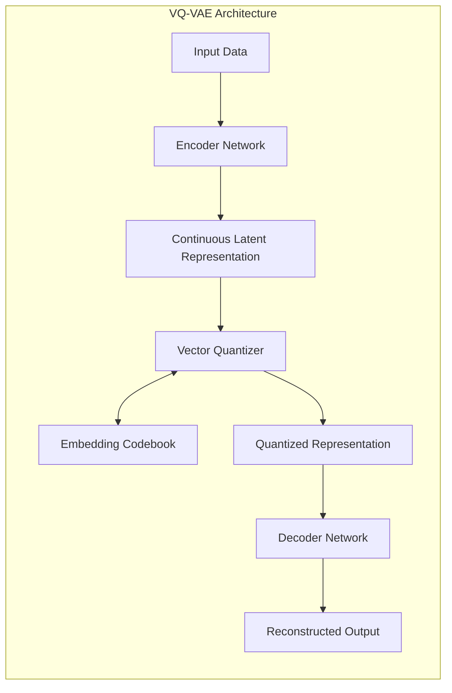
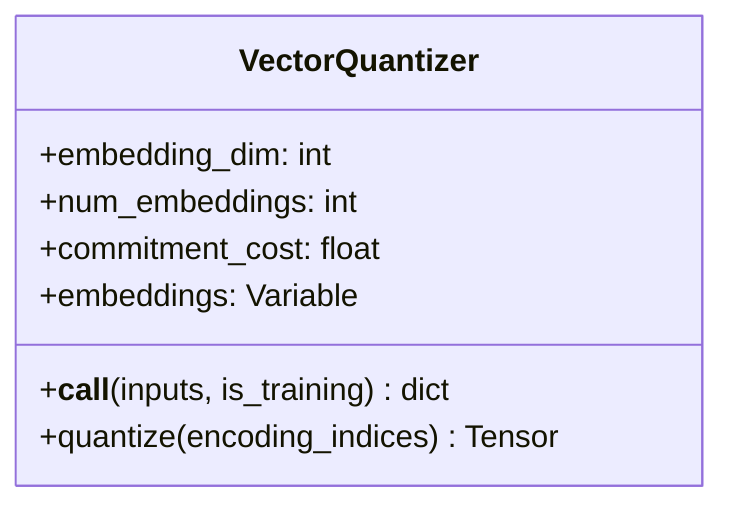
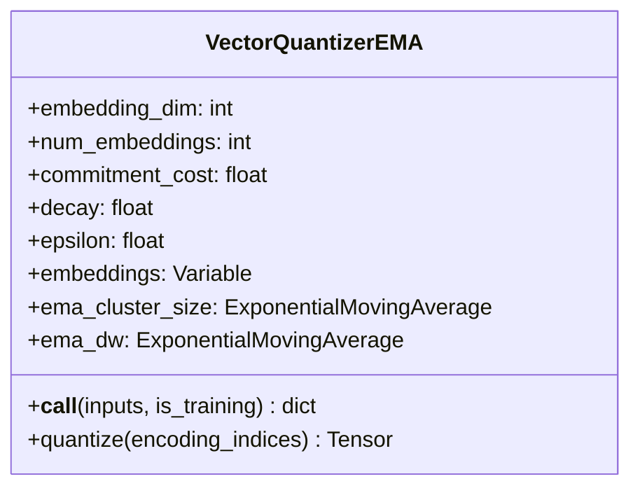
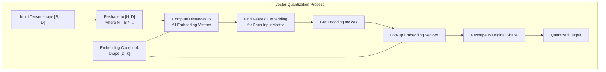
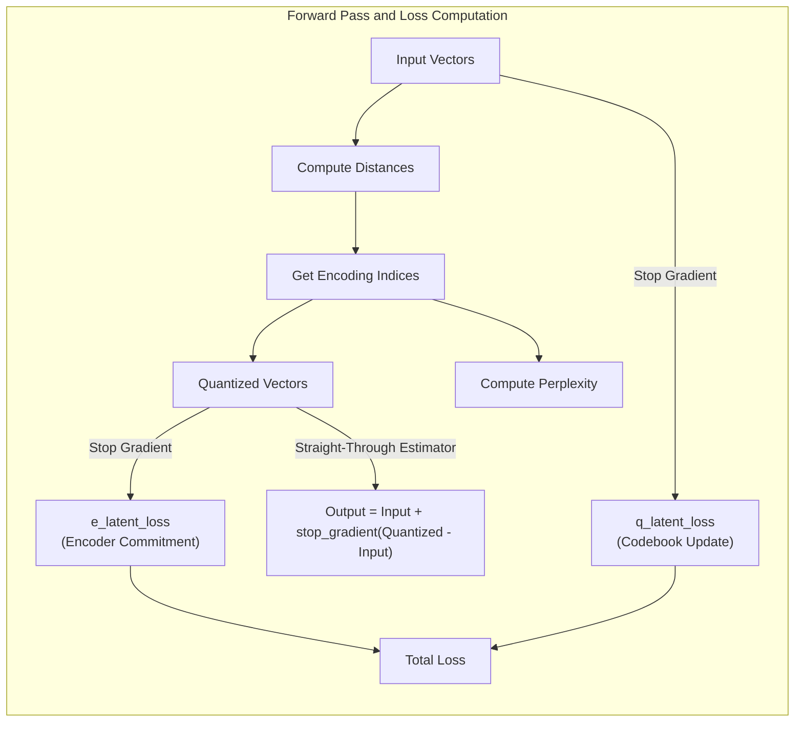
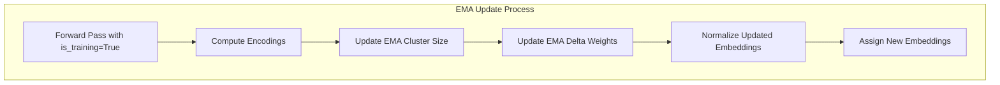
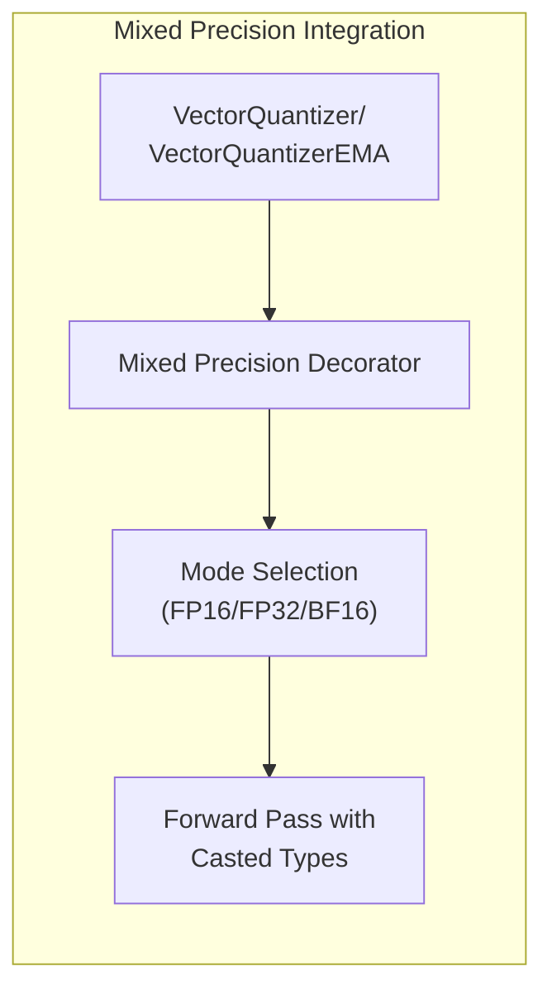
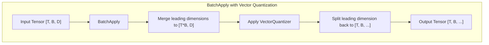
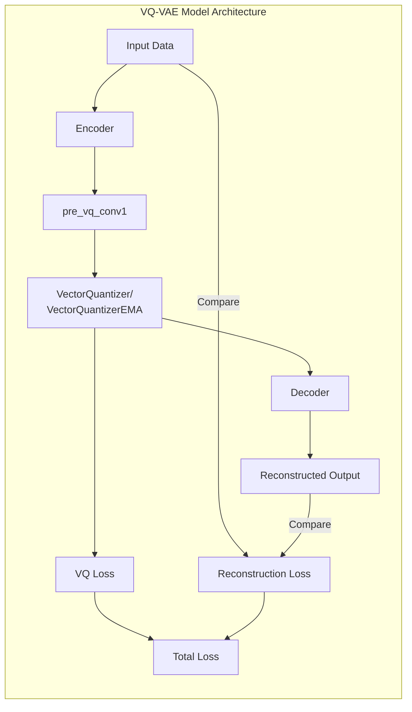

<!-- source: DeepWiki mcp.deepwiki.com · repo google-deepmind/sonnet · page 4.3 Vector Quantization · fetched 2026-10-26 -->

# Vector Quantization

<details>
<summary>Relevant source files</summary>

The following files were used as context for generating this wiki page:

- [examples/simple_mnist.py](examples/simple_mnist.py)
- [examples/vqvae_example.ipynb](examples/vqvae_example.ipynb)
- [sonnet/mixed_precision.py](sonnet/mixed_precision.py)
- [sonnet/src/batch_apply.py](sonnet/src/batch_apply.py)
- [sonnet/src/batch_apply_test.py](sonnet/src/batch_apply_test.py)
- [sonnet/src/mixed_precision.py](sonnet/src/mixed_precision.py)
- [sonnet/src/mixed_precision_test.py](sonnet/src/mixed_precision_test.py)
- [sonnet/src/nets/vqvae.py](sonnet/src/nets/vqvae.py)
- [sonnet/src/nets/vqvae_test.py](sonnet/src/nets/vqvae_test.py)
- [sonnet/src/optimizers/momentum.py](sonnet/src/optimizers/momentum.py)

</details>


## Purpose and Scope

This document describes the Vector Quantization (VQ) implementation in the Sonnet library, based on the algorithm presented in "Neural Discrete Representation Learning" by van den Oord et al. Vector Quantization provides a way to map continuous vectors to a discrete codebook of embeddings, creating an information bottleneck that can be useful for representation learning. This page focuses on the implementation details of the `VectorQuantizer` and `VectorQuantizerEMA` modules in Sonnet, their usage, and integration with the rest of the library.

## Overview

Vector Quantization in Sonnet is primarily used within the VQ-VAE (Vector Quantized Variational Autoencoder) architecture, but the quantization modules can be used independently for other discrete representation learning tasks.



Sources: [sonnet/src/nets/vqvae.py:16-24](), [examples/vqvae_example.ipynb:10-15]()

## Vector Quantization Classes

Sonnet provides two implementations for vector quantization:

### VectorQuantizer

This is the standard implementation of Vector Quantization that follows the algorithm in the original paper.



Sources: [sonnet/src/nets/vqvae.py:25-139]()

### VectorQuantizerEMA

This variant uses Exponential Moving Averages to update the embedding vectors, which typically converges faster and is less dependent on the choice of optimizer.



Sources: [sonnet/src/nets/vqvae.py:142-300]()

## Implementation Details

### Vector Quantization Process

The vector quantization process takes continuous input vectors and maps them to the nearest vectors in a learned codebook.



Sources: [sonnet/src/nets/vqvae.py:77-113](), [sonnet/src/nets/vqvae.py:241-258]()

### Forward Pass and Loss Computation

During the forward pass, the vector quantizer:
1. Computes distances between input vectors and all embeddings
2. Finds the nearest embedding for each input
3. Quantizes the input by replacing each vector with its nearest embedding
4. Computes the VQ loss and perplexity
5. Passes gradients through using the straight-through estimator



Sources: [sonnet/src/nets/vqvae.py:114-132](), [sonnet/src/nets/vqvae.py:259-287]()

### Difference Between VectorQuantizer and VectorQuantizerEMA

The key difference between the two implementations is how the embedding vectors are updated:

| Feature | VectorQuantizer | VectorQuantizerEMA |
|---------|----------------|---------------------|
| Update Mechanism | Updated through backpropagation using gradients | Updated using Exponential Moving Averages |
| Training Stability | More dependent on optimizer choice | Generally more stable |
| Convergence | May take longer to converge | Typically converges faster |
| Trainable Embeddings | Yes (with gradient updates) | No (embeddings are not trainable) |
| Additional Parameters | None | Decay rate for EMA |

Sources: [sonnet/src/nets/vqvae.py:142-153](), [sonnet/src/nets/vqvae_test.py:147-152]()

## Vector Quantization API

Both vector quantization implementations provide similar interfaces with the following methods:

### __call__ Method

The main entry point that performs the vector quantization:

```
def __call__(self, inputs, is_training):
    # Inputs: Tensor with shape [..., embedding_dim]
    # is_training: Boolean, whether in training mode
    
    # Returns dictionary with:
    # - 'quantize': Quantized version of the input
    # - 'loss': Loss to optimize
    # - 'perplexity': Perplexity of the encodings
    # - 'encodings': One-hot encodings of which embedding was selected
    # - 'encoding_indices': Indices of which embedding was selected
    # - 'distances': Distances to embeddings
```

Sources: [sonnet/src/nets/vqvae.py:77-132](), [sonnet/src/nets/vqvae.py:221-295]()

### quantize Method

Auxiliary method that looks up embeddings for given indices:

```
def quantize(self, encoding_indices):
    # Translates encoding indices to embedding vectors
    # encoding_indices: Tensor of indices
    # Returns: Tensor of embedding vectors
```

Sources: [sonnet/src/nets/vqvae.py:134-139](), [sonnet/src/nets/vqvae.py:297-300]()

## Implementation Notes

### EMA Updates in VectorQuantizerEMA

For the EMA variant, the embeddings are updated during the forward pass:



Sources: [sonnet/src/nets/vqvae.py:262-276]()

### Non-trainable Embeddings in VectorQuantizerEMA

The embeddings in `VectorQuantizerEMA` are explicitly marked as non-trainable because they are updated through the EMA mechanism rather than through gradient descent:

```
self.embeddings = tf.Variable(
    initializer(embedding_shape, dtype), trainable=False, name='embeddings')
```

Sources: [sonnet/src/nets/vqvae.py:209-211](), [sonnet/src/nets/vqvae_test.py:147-152]()

## Integration With Other Sonnet Components

### Mixed Precision Support

Vector Quantization can be used with Sonnet's mixed precision capabilities to improve performance:



Sources: [sonnet/src/mixed_precision.py:15-168](), [sonnet/mixed_precision.py:16-27]()

### BatchApply Integration

For processing higher-dimensional inputs, `BatchApply` can be used with Vector Quantization:



Sources: [sonnet/src/batch_apply.py:25-43](), [sonnet/src/batch_apply.py:136-192]()

## Usage Example

Below is how you would typically use the Vector Quantization modules within a VQ-VAE architecture:

```python
# 1. Create VectorQuantizer module
vq_vae = snt.nets.VectorQuantizer(
    embedding_dim=64,
    num_embeddings=512,
    commitment_cost=0.25)

# OR use the EMA version:
vq_vae = snt.nets.VectorQuantizerEMA(
    embedding_dim=64,
    num_embeddings=512,
    commitment_cost=0.25,
    decay=0.99)

# 2. In the forward pass of your VQ-VAE model:
z = encoder(x)  # z has shape [..., embedding_dim]
vq_output = vq_vae(z, is_training=True)
quantized = vq_output['quantize']
loss = vq_output['loss']
perplexity = vq_output['perplexity']

# 3. Use the quantized representation for reconstruction
x_recon = decoder(quantized)

# 4. Add reconstruction loss to VQ loss
recon_error = tf.reduce_mean((x_recon - x)**2)
total_loss = recon_error + vq_output['loss']
```

Sources: [examples/vqvae_example.ipynb:574-587](), [examples/vqvae_example.ipynb:306-329]()

## Advanced Integration

### Building a Complete VQ-VAE Architecture

The complete VQ-VAE architecture integrates the encoder, vector quantizer, and decoder into a unified model:



Sources: [examples/vqvae_example.ipynb:307-329](), [examples/vqvae_example.ipynb:593-598]()

## Performance Considerations

### Perplexity Metric

The vector quantizer computes a perplexity metric, which measures how evenly the model uses the available codebook vectors:

```
perplexity = tf.exp(-tf.reduce_sum(avg_probs * tf.math.log(avg_probs + 1e-10)))
```

A higher perplexity (closer to `num_embeddings`) indicates more even usage of the codebook, which is generally desirable.

Sources: [sonnet/src/nets/vqvae.py:121-123](), [sonnet/src/nets/vqvae.py:284-286]()

### Codebook Collapse Prevention

The implementation includes measures to prevent "codebook collapse," where only a few embedding vectors are used:

1. In `VectorQuantizer`: This is handled by the commitment loss that encourages the encoder outputs to be close to the selected embeddings.
2. In `VectorQuantizerEMA`: The EMA updates with proper normalization help maintain a diverse codebook.

Sources: [sonnet/src/nets/vqvae.py:115-117](), [sonnet/src/nets/vqvae.py:260-276]()

## Testing and Validation

The implementation includes comprehensive tests that verify:
1. Correct construction of the modules
2. Shape checking
3. EMA updates behavior
4. Non-trainable embeddings in the EMA variant

Sources: [sonnet/src/nets/vqvae_test.py:26-152]()

---

