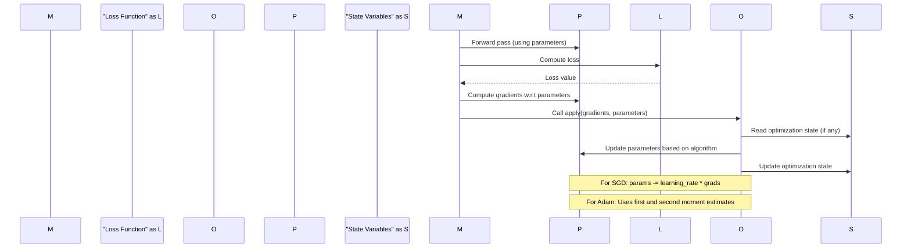
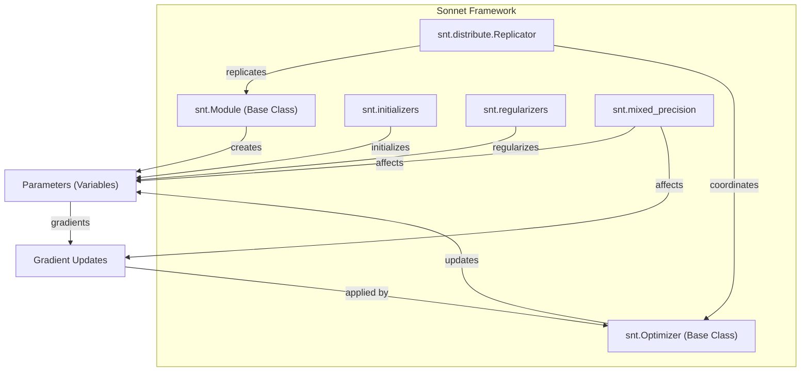

<!-- source: DeepWiki mcp.deepwiki.com · repo google-deepmind/sonnet · page 5 Optimization · fetched 2026-10-26 -->

# Optimization

<details>
<summary>Relevant source files</summary>

The following files were used as context for generating this wiki page:

- [sonnet/__init__.py](sonnet/__init__.py)
- [sonnet/src/optimizers/adam_test.py](sonnet/src/optimizers/adam_test.py)
- [sonnet/src/optimizers/momentum_test.py](sonnet/src/optimizers/momentum_test.py)
- [sonnet/src/optimizers/optimizer_tests.py](sonnet/src/optimizers/optimizer_tests.py)
- [sonnet/src/optimizers/rmsprop_test.py](sonnet/src/optimizers/rmsprop_test.py)
- [sonnet/src/optimizers/sgd_test.py](sonnet/src/optimizers/sgd_test.py)

</details>


This page provides a comprehensive overview of Sonnet's optimization system, which offers a collection of optimizers for training neural networks. The optimization system is designed to work seamlessly with Sonnet modules, providing efficient parameter updates during training while maintaining compatibility with TensorFlow's underlying optimization features.

For information about initializers and regularizers, see [Regularizers and Initializers](#5.2).

## Base Optimizer Framework

At the core of Sonnet's optimization system is the `snt.Optimizer` base class, which provides the foundation for all specific optimizer implementations. This abstract class defines the common interface that all optimizers must implement.

```mermaid
classDiagram
    class "Optimizer" {
        +__init__()
        +__call__(updates, params)
        +apply(updates, params)
        +learning_rate
    }
    "Optimizer" <|-- "SGD"
    "Optimizer" <|-- "Momentum" 
    "Optimizer" <|-- "RMSProp"
    "Optimizer" <|-- "Adam"
    
    class "SGD" {
        +learning_rate
        +apply(updates, params)
    }
    
    class "Momentum" {
        +learning_rate
        +momentum
        +use_nesterov
        +apply(updates, params)
        +accumulated_momentum
    }
    
    class "RMSProp" {
        +learning_rate
        +decay
        +momentum
        +epsilon
        +centered
        +apply(updates, params)
        +ms
        +mom
        +mg
    }
    
    class "Adam" {
        +learning_rate
        +beta1
        +beta2
        +epsilon
        +apply(updates, params)
        +m
        +v
        +t
    }
```

Sources: [sonnet/__init__.py:29-30](), [sonnet/src/optimizers/optimizer_tests.py:28-40]()

The `Optimizer` base class requires implementations to provide an `apply` method that takes two arguments:
- `updates`: A list of gradient tensors (or `None` for parameters that don't receive updates)
- `params`: A list of parameters (variables) to be updated

## Available Optimizers

Sonnet provides implementations of the most common optimization algorithms used in deep learning:

### SGD (Stochastic Gradient Descent)

The most basic optimization algorithm that updates parameters by directly subtracting the scaled gradient.

```python
# Basic usage
optimizer = snt.optimizers.SGD(learning_rate=0.01)
optimizer.apply(gradients, parameters)
```

### Momentum

An extension of SGD that accumulates gradients across iterations, enabling faster convergence and better navigation of shallow local minima.

```python
# Basic usage
optimizer = snt.optimizers.Momentum(
    learning_rate=0.01,
    momentum=0.9,
    use_nesterov=False
)
optimizer.apply(gradients, parameters)
```

The `use_nesterov` parameter enables Nesterov accelerated gradients when set to `True`.

### RMSProp

An adaptive learning rate method that divides the learning rate for each parameter by a running average of recent gradient magnitudes.

```python
# Basic usage
optimizer = snt.optimizers.RMSProp(
    learning_rate=0.001,
    decay=0.9,
    momentum=0.0,
    epsilon=1e-10,
    centered=False
)
optimizer.apply(gradients, parameters)
```

When `centered=True`, the gradient is normalized by an estimate of its variance.

### Adam

A popular optimizer that combines ideas from RMSProp and momentum, maintaining per-parameter learning rates adapted based on the first and second moments of the gradients.

```python
# Basic usage
optimizer = snt.optimizers.Adam(
    learning_rate=0.001,
    beta1=0.9,
    beta2=0.999,
    epsilon=1e-8
)
optimizer.apply(gradients, parameters)
```

Sources: [sonnet/src/optimizers/sgd_test.py:25-28](), [sonnet/src/optimizers/momentum_test.py:38-42](), [sonnet/src/optimizers/rmsprop_test.py:42-47](), [sonnet/src/optimizers/adam_test.py:40-44]()

## Optimization Workflow

The following diagram illustrates how optimization works within the Sonnet framework:



Sources: [sonnet/src/optimizers/optimizer_tests.py:162-171]()

## Implementation Details

Sonnet optimizers maintain internal state variables (e.g., momentum accumulators) that are automatically created and updated during optimization. These state variables are:

1. Co-located with the original parameters to minimize cross-device communication
2. Initialized on the first call to `apply`
3. Maintained as part of the optimizer instance

```mermaid
graph TD
    subgraph "Adam Optimizer"
        LR["learning_rate"]
        Beta1["beta1 (momentum)"]
        Beta2["beta2 (decay)"]
        Epsilon["epsilon"]
        
        Step["step_count"]
        FirstMoment["first_moment_variables (m)"]
        SecondMoment["second_moment_variables (v)"]
    end
    
    subgraph "Momentum Optimizer"
        LR2["learning_rate"]
        Momentum["momentum"]
        UseNesterov["use_nesterov"]
        
        Accum["accumulated_momentum"]
    end
    
    subgraph "RMSProp Optimizer"
        LR3["learning_rate"]
        Decay["decay"]
        Mom["momentum"]
        Eps["epsilon"]
        Centered["centered"]
        
        MS["moving_average_squared (ms)"]
        MOM["momentum_buffer (mom)"]
        MG["moving_average_grad (mg, if centered)"]
    end
    
    Parameters["Network Parameters"]
    FirstMoment -->|"Co-located with"| Parameters
    SecondMoment -->|"Co-located with"| Parameters
    Accum -->|"Co-located with"| Parameters
    MS -->|"Co-located with"| Parameters
    MOM -->|"Co-located with"| Parameters
    MG -->|"Co-located with"| Parameters
```



Sources: [sonnet/src/optimizers/adam_test.py:147-153](), [sonnet/src/optimizers/momentum_test.py:186-191](), [sonnet/src/optimizers/rmsprop_test.py:186-195]()

## Advanced Features

### Dynamic Hyperparameters

All optimizer hyperparameters (learning rate, momentum, etc.) can be provided as TensorFlow variables, allowing for dynamic adjustment during training:

```python
# Example of dynamic learning rate
learning_rate = tf.Variable(0.1)
optimizer = snt.optimizers.SGD(learning_rate=learning_rate)

# Later in training
learning_rate.assign(0.01)  # Decreases the learning rate
```

Sources: [sonnet/src/optimizers/sgd_test.py:55-67](), [sonnet/src/optimizers/momentum_test.py:153-169](), [sonnet/src/optimizers/rmsprop_test.py:152-164]()

### Sparse Gradient Support

All Sonnet optimizers support sparse gradient updates using `tf.IndexedSlices`, which is particularly useful for operations like embedding lookups:

```python
# Example of sparse gradient update
embeddings = snt.Embed(vocab_size=10000, embed_dim=128)
indices = tf.constant([42, 1337])
sparse_grads = tf.IndexedSlices(values, indices, dense_shape)
optimizer.apply([sparse_grads], [embeddings.embeddings])
```

Sources: [sonnet/src/optimizers/sgd_test.py:37-53](), [sonnet/src/optimizers/momentum_test.py:93-148](), [sonnet/src/optimizers/rmsprop_test.py:96-150]()

### Comparison with TensorFlow Optimizers

Sonnet optimizers are designed to be compatible with their TensorFlow counterparts, providing the same numerical behavior while integrating better with the Sonnet module system:

```python
# Equivalent optimizers
tf_opt = tf.keras.optimizers.Adam(learning_rate=0.001)
snt_opt = snt.optimizers.Adam(learning_rate=0.001)

# They will produce numerically equivalent updates
tf_opt.apply_gradients(zip(grads, tf_vars))
snt_opt.apply(grads, snt_vars)
```

Sources: [sonnet/src/optimizers/optimizer_tests.py:113-142](), [sonnet/src/optimizers/adam_test.py:92-115]()

## Best Practices and Limitations

### Best Practices

1. **Co-location of State Variables**: Optimizer state variables are automatically co-located with their corresponding parameters to minimize cross-device communication.

2. **Hyperparameter Types**: Sonnet optimizers automatically cast hyperparameters to the appropriate dtype, allowing you to provide `tf.int32`, `tf.int64`, `tf.float32`, or `tf.float64` values.

3. **Mixed Precision Compatibility**: Sonnet optimizers work with Sonnet's mixed precision system. See [Mixed Precision Training](#7.1) for details.

### Limitations

1. **TensorFlow Distribution Strategies**: Sonnet optimizers are designed to work with Sonnet's distribution strategies rather than TensorFlow's native distribution strategies. Attempting to use them with `tf.distribute.Strategy` will raise an error.

2. **No Native Learning Rate Schedules**: Unlike TensorFlow optimizers, Sonnet optimizers don't have built-in learning rate schedules, but you can use variable learning rates to achieve the same effect.

Sources: [sonnet/src/optimizers/optimizer_tests.py:101-112](), [sonnet/src/optimizers/sgd_test.py:69-77](), [sonnet/src/optimizers/momentum_test.py:171-181]()

## Typical Usage Pattern

The typical pattern for using optimizers in Sonnet is:

1. Create your Sonnet module
2. Define a loss function
3. Create an optimizer
4. In a training loop:
   - Compute gradients of the loss with respect to the module's parameters
   - Apply the optimizer to update the parameters

```python
# Create model and optimizer
model = snt.nets.MLP([64, 10])
optimizer = snt.optimizers.Adam(learning_rate=0.001)

# Training loop
for batch in dataset:
  with tf.GradientTape() as tape:
    logits = model(batch['images'])
    loss = tf.reduce_mean(
        tf.nn.sparse_softmax_cross_entropy_with_logits(
            labels=batch['labels'], logits=logits))
  
  # Compute gradients and update parameters
  grads = tape.gradient(loss, model.trainable_variables)
  optimizer.apply(grads, model.trainable_variables)
```

Sources: [sonnet/src/optimizers/optimizer_tests.py:162-171]()

## Relationship to Other Sonnet Components

The optimization system is designed to work with all other components of the Sonnet framework:



Sources: [sonnet/__init__.py:17-24]()

## Summary

Sonnet's optimization system provides a comprehensive set of optimizers that integrate well with the rest of the Sonnet framework. The system follows the same design principles as the rest of Sonnet: modularity, simplicity, and compatibility with TensorFlow.

---

