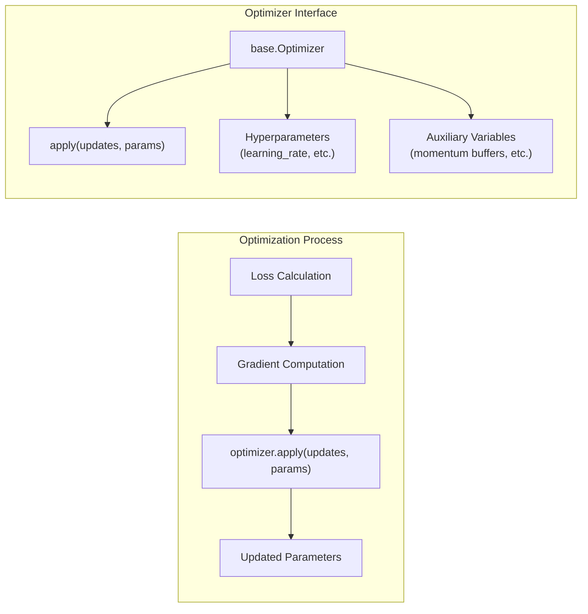
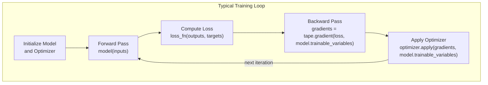

<!-- source: DeepWiki mcp.deepwiki.com · repo google-deepmind/sonnet · page 5.1 Optimizers · fetched 2026-10-26 -->

# Optimizers

<details>
<summary>Relevant source files</summary>

The following files were used as context for generating this wiki page:

- [sonnet/src/optimizers/adam_test.py](sonnet/src/optimizers/adam_test.py)
- [sonnet/src/optimizers/momentum_test.py](sonnet/src/optimizers/momentum_test.py)
- [sonnet/src/optimizers/optimizer_tests.py](sonnet/src/optimizers/optimizer_tests.py)
- [sonnet/src/optimizers/rmsprop_test.py](sonnet/src/optimizers/rmsprop_test.py)
- [sonnet/src/optimizers/sgd_test.py](sonnet/src/optimizers/sgd_test.py)

</details>


## Purpose and Scope

This document covers the optimization components available in Sonnet, a neural network library built on top of TensorFlow 2. Sonnet optimizers are used to update model parameters during training based on computed gradients. The optimizers are designed to work seamlessly with Sonnet modules while providing compatibility with TensorFlow's ecosystem. For information about regularizers and initializers, see [Regularizers and Initializers](#5.2).

## Overview

Sonnet provides several standard optimization algorithms, all inheriting from a common base optimizer class. These optimizers follow a consistent interface pattern, allowing them to be used interchangeably in training loops.

```mermaid
classDiagram
    class "base.Optimizer" {
        +__init__()
        +apply(updates, params)
        +learning_rate
    }
    
    "base.Optimizer" <|-- "SGD"
    "base.Optimizer" <|-- "Momentum" 
    "base.Optimizer" <|-- "RMSProp"
    "base.Optimizer" <|-- "Adam"
    
    class "SGD" {
        +__init__(learning_rate)
        +apply(updates, params)
    }
    
    class "Momentum" {
        +__init__(learning_rate, momentum, use_nesterov)
        +apply(updates, params)
        +accumulated_momentum
    }
    
    class "RMSProp" {
        +__init__(learning_rate, decay, momentum, epsilon, centered)
        +apply(updates, params)
        +ms
        +mom
    }
    
    class "Adam" {
        +__init__(learning_rate, beta1, beta2, epsilon)
        +apply(updates, params)
        +m
        +v
    }
```

Sources: [sonnet/src/optimizers/optimizer_tests.py:27-44](), [sonnet/src/optimizers/sgd_test.py:22-40](), [sonnet/src/optimizers/momentum_test.py:37-44](), [sonnet/src/optimizers/rmsprop_test.py:41-47](), [sonnet/src/optimizers/adam_test.py:39-44]()

## Base Optimizer Interface

All Sonnet optimizers inherit from `base.Optimizer` which provides the core interface. The primary method is `apply()`, which takes a list of updates (gradients) and parameters, and applies the optimization algorithm to update the parameters.



Sources: [sonnet/src/optimizers/optimizer_tests.py:27-44]()

### Common Functionality

All Sonnet optimizers provide the following functionality:

1. Support for both dense and sparse updates
2. Automatic validation that updates and parameters have matching shapes and dtypes
3. Auxiliary variables (like momentum buffers) that are co-located with their corresponding parameters
4. Support for variable learning rates and other hyperparameters that can be updated during training
5. Automatic conversion of hyperparameter dtypes

Sources: [sonnet/src/optimizers/optimizer_tests.py:47-112]()

### Optimizer Validation

When applying updates, Sonnet optimizers perform several validations:

- Checking that `updates` and `parameters` have the same length
- Ensuring that `parameters` is not empty
- Verifying that at least one update is not None
- Validating that update and parameter dtypes are compatible
- Checking for compatible distribution strategies

Sources: [sonnet/src/optimizers/optimizer_tests.py:60-112]()

## Optimizer Implementations

### SGD (Stochastic Gradient Descent)

SGD is the simplest optimization algorithm that updates parameters by directly subtracting the gradient multiplied by the learning rate.

**Parameters:**
- `learning_rate`: Step size for parameter updates (default: 0.01)

**Example:**
```python
optimizer = snt.optimizers.SGD(learning_rate=0.1)
optimizer.apply(gradients, parameters)
```

After applying updates, parameters are updated according to:
```
parameters -= learning_rate * gradients
```

Sources: [sonnet/src/optimizers/sgd_test.py:22-40]()

### Momentum

Momentum enhances SGD by accumulating gradients across iterations, helping to accelerate progress in the relevant direction and dampen oscillations.

**Parameters:**
- `learning_rate`: Step size for parameter updates (default: 0.01)
- `momentum`: Coefficient that determines how much previous gradients contribute to current updates (default: 0.9)
- `use_nesterov`: Whether to use Nesterov accelerated gradient (default: False)

**Example:**
```python
optimizer = snt.optimizers.Momentum(learning_rate=0.1, momentum=0.9, use_nesterov=True)
optimizer.apply(gradients, parameters)
```

The update rule with Momentum is:
```
accumulated = momentum * accumulated + gradients
if use_nesterov:
    parameters -= learning_rate * (gradients + momentum * accumulated)
else:
    parameters -= learning_rate * accumulated
```

Sources: [sonnet/src/optimizers/momentum_test.py:37-44](), [sonnet/src/optimizers/momentum_test.py:58-74](), [sonnet/src/optimizers/momentum_test.py:75-91]()

### RMSProp

RMSProp adapts the learning rate for each parameter based on the history of gradients. It divides the learning rate by a running average of the magnitudes of recent gradients.

**Parameters:**
- `learning_rate`: Step size for parameter updates (default: 0.001)
- `decay`: Discounting factor for gradient history (default: 0.9)
- `momentum`: Momentum coefficient (default: 0.0)
- `epsilon`: Small constant for numerical stability (default: 1e-8)
- `centered`: Whether to use centered RMSProp, which normalizes gradients by their variance (default: False)

**Example:**
```python
optimizer = snt.optimizers.RMSProp(
    learning_rate=0.001, 
    decay=0.9, 
    momentum=0.0, 
    epsilon=1e-8, 
    centered=False
)
optimizer.apply(gradients, parameters)
```

Sources: [sonnet/src/optimizers/rmsprop_test.py:41-47](), [sonnet/src/optimizers/rmsprop_test.py:62-77](), [sonnet/src/optimizers/rmsprop_test.py:79-94]()

### Adam

Adam (Adaptive Moment Estimation) maintains both first and second-moment estimates of gradients to adapt the learning rate for each parameter.

**Parameters:**
- `learning_rate`: Step size for parameter updates (default: 0.001)
- `beta1`: Exponential decay rate for first-moment estimate (default: 0.9)
- `beta2`: Exponential decay rate for second-moment estimate (default: 0.999)
- `epsilon`: Small constant for numerical stability (default: 1e-8)

**Example:**
```python
optimizer = snt.optimizers.Adam(
    learning_rate=0.001,
    beta1=0.9,
    beta2=0.999,
    epsilon=1e-8
)
optimizer.apply(gradients, parameters)
```

Sources: [sonnet/src/optimizers/adam_test.py:39-44](), [sonnet/src/optimizers/adam_test.py:59-74]()

## Comparison of Optimizers

The following table summarizes the key characteristics of each optimizer:

| Optimizer | Adaptive Learning Rate | Momentum | Hyperparameters |
|-----------|:----------------------:|:--------:|-----------------|
| SGD       | ❌ | ❌ | `learning_rate` |
| Momentum  | ❌ | ✅ | `learning_rate`, `momentum`, `use_nesterov` |
| RMSProp   | ✅ | ✅ | `learning_rate`, `decay`, `momentum`, `epsilon`, `centered` |
| Adam      | ✅ | ✅ | `learning_rate`, `beta1`, `beta2`, `epsilon` |

Sources: [sonnet/src/optimizers/sgd_test.py:22-40](), [sonnet/src/optimizers/momentum_test.py:37-44](), [sonnet/src/optimizers/rmsprop_test.py:41-47](), [sonnet/src/optimizers/adam_test.py:39-44]()

## Integration with Sonnet Modules



Sources: [sonnet/src/optimizers/optimizer_tests.py:161-171]()

## Sparse Updates and Device Support

Sonnet optimizers support both dense updates (regular tensors) and sparse updates (represented as `tf.IndexedSlices`). However, sparse updates have limitations:

1. Not supported on GPUs and TPUs for most optimizers
2. Require special handling to correctly update parameters

The optimizers automatically detect the update type and apply the appropriate algorithm. For devices like GPUs and TPUs, it's recommended to use dense updates for best performance.

Sources: [sonnet/src/optimizers/momentum_test.py:93-106](), [sonnet/src/optimizers/rmsprop_test.py:96-109](), [sonnet/src/optimizers/adam_test.py:76-89](), [sonnet/src/optimizers/sgd_test.py:37-40]()

## Variable Hyperparameters

All Sonnet optimizers support variable hyperparameters, allowing you to adjust optimization parameters during training:

```python
# Create optimizer with variable learning rate
learning_rate = tf.Variable(0.1)
optimizer = snt.optimizers.SGD(learning_rate=learning_rate)

# Train for some time...

# Reduce learning rate
learning_rate.assign(0.01)
```

Sources: [sonnet/src/optimizers/sgd_test.py:55-67](), [sonnet/src/optimizers/momentum_test.py:150-166](), [sonnet/src/optimizers/rmsprop_test.py:152-164](), [sonnet/src/optimizers/adam_test.py:117-130]()

## Distribution Strategy Support

Sonnet optimizers are compatible with Sonnet's distribution strategy (`snt.distribute.Replicator`), but have restrictions when used with TensorFlow's distribution strategies like `MirroredStrategy`.

Sources: [sonnet/src/optimizers/optimizer_tests.py:101-112]()

## Auxiliary Variables

Each optimizer maintains auxiliary variables that are co-located with their corresponding model parameters:

- **Momentum**: `accumulated_momentum` - Momentum accumulator for each parameter
- **RMSProp**: `ms` (mean square), `mom` (momentum buffer)
- **Adam**: `m` (first moment), `v` (second moment)

These variables are automatically created on the same device as the parameters they correspond to, which is important for distributed training scenarios.

Sources: [sonnet/src/optimizers/momentum_test.py:183-191](), [sonnet/src/optimizers/rmsprop_test.py:186-195](), [sonnet/src/optimizers/adam_test.py:147-153]()

## Compatibility with TensorFlow Optimizers

Sonnet optimizers are designed to be compatible with TensorFlow's optimizer API. This means that in many cases you can use TensorFlow optimizers with Sonnet modules or vice versa.

```python
# Using TensorFlow optimizer with Sonnet
tf_optimizer = tf.optimizers.Adam(learning_rate=0.001)
tf_optimizer.apply_gradients(zip(gradients, snt_module.trainable_variables))

# Wrapping TensorFlow optimizer as Sonnet optimizer
wrapped_tf_optimizer = WrappedTFOptimizer(tf.optimizers.Adam(learning_rate=0.001))
wrapped_tf_optimizer.apply(gradients, snt_module.trainable_variables)
```

However, there are some differences in behavior, particularly regarding distribution strategies and variable co-location.

Sources: [sonnet/src/optimizers/optimizer_tests.py:27-44]()

---

