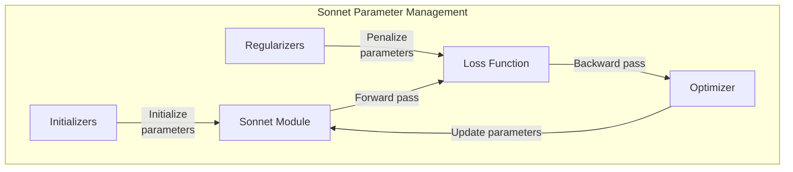
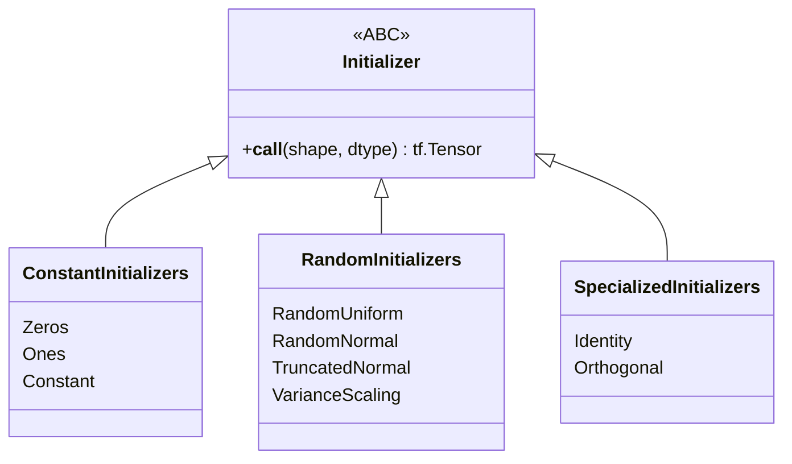
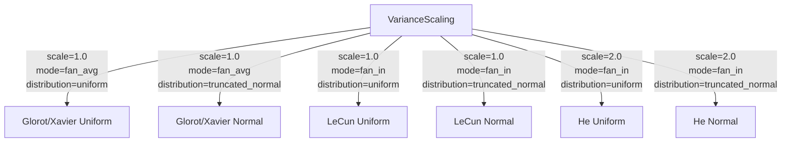
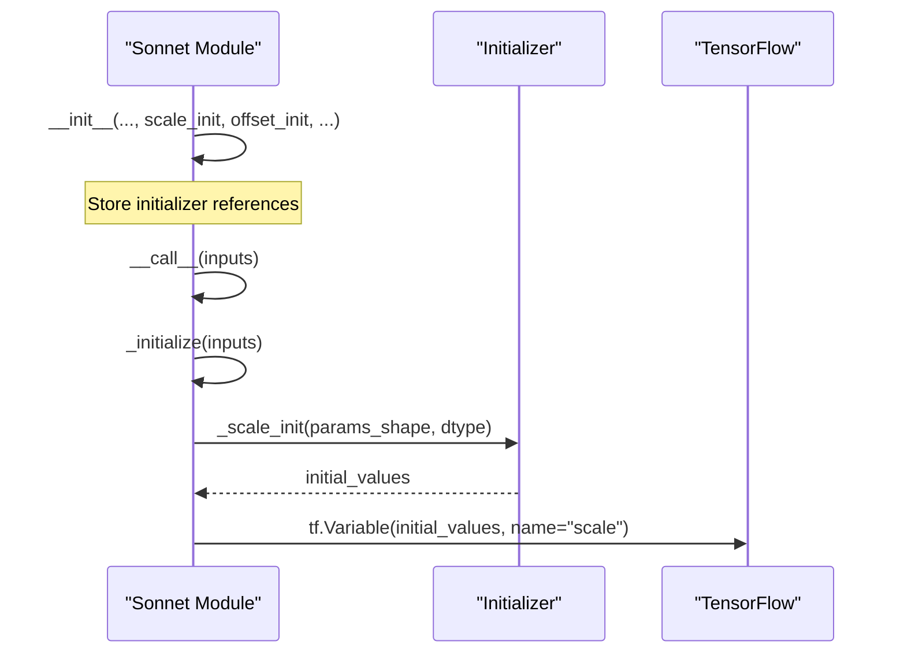
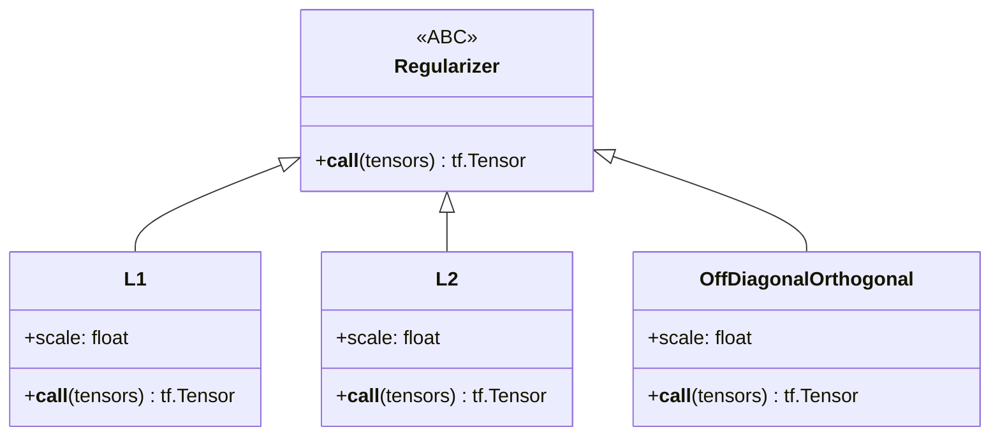
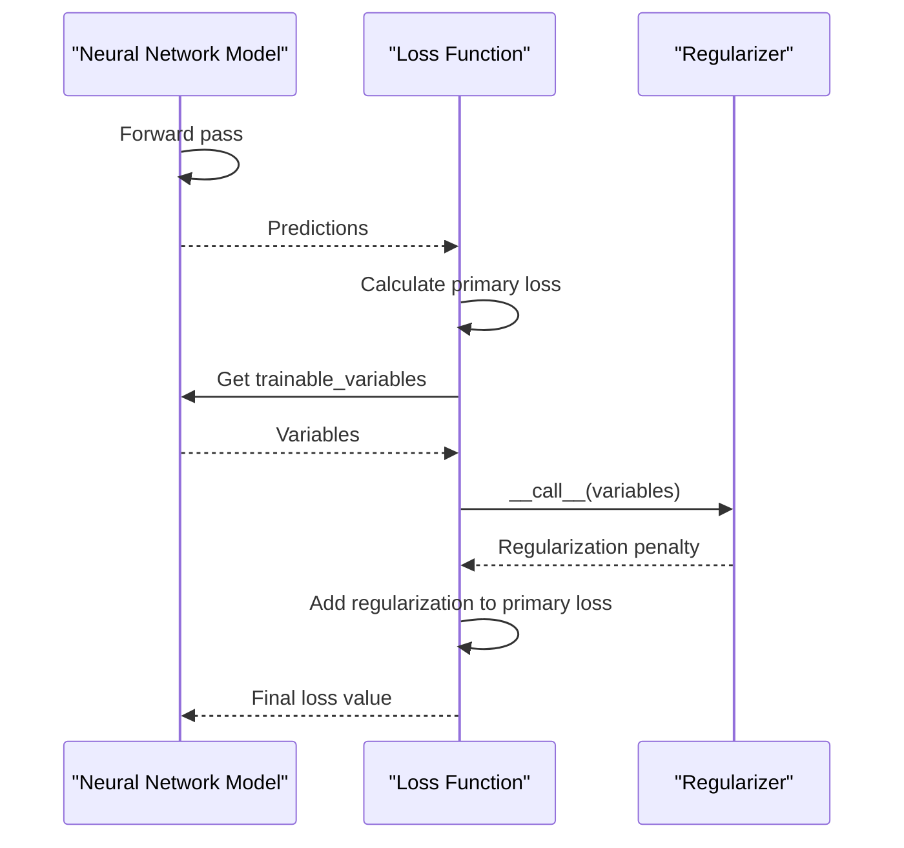
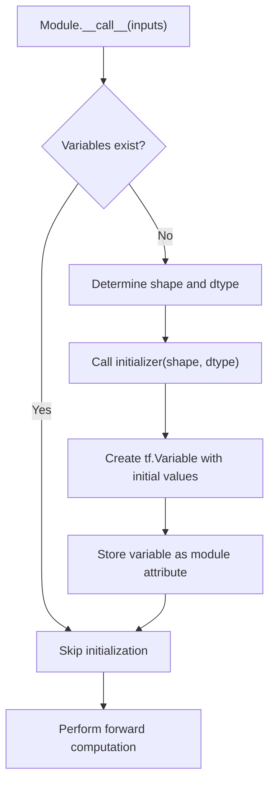

<!-- source: DeepWiki mcp.deepwiki.com · repo google-deepmind/sonnet · page 5.2 Regularizers and Initializers · fetched 2026-10-26 -->

# Regularizers and Initializers

<details>
<summary>Relevant source files</summary>

The following files were used as context for generating this wiki page:

- [sonnet/src/axis_norm.py](sonnet/src/axis_norm.py)
- [sonnet/src/base.py](sonnet/src/base.py)
- [sonnet/src/base_test.py](sonnet/src/base_test.py)
- [sonnet/src/conformance/api_test.py](sonnet/src/conformance/api_test.py)
- [sonnet/src/group_norm.py](sonnet/src/group_norm.py)
- [sonnet/src/initializers.py](sonnet/src/initializers.py)
- [sonnet/src/metrics.py](sonnet/src/metrics.py)
- [sonnet/src/optimizers/rmsprop.py](sonnet/src/optimizers/rmsprop.py)
- [sonnet/src/regularizers.py](sonnet/src/regularizers.py)
- [sonnet/src/utils.py](sonnet/src/utils.py)
- [sonnet/src/utils_test.py](sonnet/src/utils_test.py)

</details>


This page documents the regularization and initialization components provided by Sonnet. These tools are essential for controlling neural network parameter initialization and preventing overfitting during training. For information about optimization algorithms in Sonnet, see [Optimizers](#5.1).

## Overview

Sonnet provides two main systems for parameter management:

1. **Initializers**: Classes that determine how parameters like weights and biases are initialized when modules are first created
2. **Regularizers**: Classes that implement regularization techniques to prevent overfitting

These components work together with Sonnet's module system to provide a complete framework for creating and training neural networks.



Sources: [sonnet/src/initializers.py:25-403]()/[sonnet/src/regularizers.py:16-171]()

## Initializers

Initializers in Sonnet determine how module parameters are initialized when they are first created. Proper initialization is crucial for successful model training.

### Base Initializer Class

All initializers in Sonnet inherit from the abstract `Initializer` base class, which defines a common interface:



Sources: [sonnet/src/initializers.py:25-32]()

### Constant Initializers

These initializers provide fixed, deterministic values:

| Initializer | Description |
|-------------|-------------|
| `Zeros` | Initializes tensors with all zeros |
| `Ones` | Initializes tensors with all ones |
| `Constant(value)` | Initializes tensors with the specified scalar value |

Sources: [sonnet/src/initializers.py:34-62]()

### Random Initializers

These initializers generate random values according to specific distributions:

| Initializer | Description |
|-------------|-------------|
| `RandomUniform(minval=0, maxval=1)` | Uniform distribution between `minval` and `maxval` |
| `RandomNormal(mean=0.0, stddev=1.0)` | Normal distribution with specified mean and standard deviation |
| `TruncatedNormal(mean=0.0, stddev=1.0)` | Normal distribution truncated at two standard deviations |

Sources: [sonnet/src/initializers.py:65-161]()

### Specialized Initializers

These initializers implement more complex initialization strategies:

| Initializer | Description |
|-------------|-------------|
| `Identity(gain=1.0)` | Identity matrix multiplied by `gain` |
| `Orthogonal(gain=1.0)` | Orthogonal matrix multiplied by `gain` |

Sources: [sonnet/src/initializers.py:164-249]()

### VarianceScaling Initializer

The `VarianceScaling` initializer is a flexible initializer that can be configured to create several standard initializers:



Sources: [sonnet/src/initializers.py:252-343]()

### Usage in Sonnet Modules

Initializers are commonly used when creating variables in Sonnet modules. Here's an example of how they're used in the `LayerNorm` class:



Sources: [sonnet/src/axis_norm.py:64-207]()

## Regularizers

Regularizers in Sonnet add penalty terms to the loss function to prevent overfitting during training.

### Base Regularizer Class

All regularizers inherit from the abstract `Regularizer` base class, which defines a common interface:



Sources: [sonnet/src/regularizers.py:24-37]()

### L1 Regularizer

The L1 regularizer computes the sum of absolute values of parameters, scaled by a factor:

```
L1 penalty = scale * sum(|weights|)
```

This encourages sparse parameter values (many zeros).

Sources: [sonnet/src/regularizers.py:39-70]()

### L2 Regularizer

The L2 regularizer computes the sum of squared parameter values, scaled by a factor:

```
L2 penalty = scale * sum(weights²)
```

This encourages small, diffuse parameter values.

Sources: [sonnet/src/regularizers.py:73-104]()

### OffDiagonalOrthogonal Regularizer

The OffDiagonalOrthogonal regularizer encourages weight matrices to be orthogonal by penalizing the off-diagonal elements of W^T W. This can help with gradient flow in deep networks and prevent exploding/vanishing gradients.

Sources: [sonnet/src/regularizers.py:107-165]()

### Using Regularizers

Regularizers are typically applied by adding their output to the loss function during training:



Sources: [sonnet/src/regularizers.py:16-171]()

## Integration with Sonnet Modules

Both initializers and regularizers are designed to work seamlessly with Sonnet's module system.

### Initializers in Module Construction

When creating a Sonnet module, initializers can be passed to control how parameters are created:

```python
# Example pattern (not actual code)
class MyModule(snt.Module):
    def __init__(self, w_init=None, b_init=None):
        super().__init__()
        self._w_init = w_init or snt.initializers.VarianceScaling(1.0, 'fan_in', 'truncated_normal')
        self._b_init = b_init or snt.initializers.Zeros()
        
    def __call__(self, inputs):
        if not hasattr(self, 'w'):
            self.w = tf.Variable(self._w_init(shape, dtype), name='w')
            self.b = tf.Variable(self._b_init(shape, dtype), name='b')
        # ...
```

Many Sonnet modules follow this pattern, including normalization layers, convolutional layers, and linear layers.

Sources: [sonnet/src/axis_norm.py:64-207]()/[sonnet/src/group_norm.py:66-230]()

### Variable Creation Flow

The following diagram illustrates how initializers are used during variable creation:



Sources: [sonnet/src/utils.py:204-215]()

## Best Practices

### Choosing Initializers

Different initializers are suitable for different types of layers:

| Layer Type | Recommended Initializers |
|------------|--------------------------|
| Linear/Dense | `VarianceScaling` (He, Xavier/Glorot) |
| Convolutional | `VarianceScaling` (He for ReLU, Xavier for tanh/sigmoid) |
| Recurrent | `Orthogonal`, `Identity` |
| Bias terms | `Zeros`, `Constant` (small values) |
| Normalization scale | `Ones` |
| Normalization offset | `Zeros` |

### Effective Regularization

- Use L1 regularization when you want to encourage sparsity
- Use L2 regularization as a general-purpose regularizer for most problems
- Use small regularization scales (typically 1e-4 to 1e-2) and tune based on validation performance
- OffDiagonalOrthogonal regularization is useful for very deep networks

### Implementation Notes

- Initializers are called when parameters are first created, typically during the first forward pass of a module
- Regularizers need to be manually applied to the loss function during training
- The scale parameter in regularizers controls the strength of the regularization

Sources: [sonnet/src/initializers.py:25-403]()/[sonnet/src/regularizers.py:16-171]()

## Utility Functions

Sonnet provides several utility functions for working with initializers:

- `check_initializers`: Validates a dictionary of initializers against expected keys
- `_compute_fans`: Calculates fan-in/fan-out for parameter shapes (used by `VarianceScaling`)
- `variable_like`: Creates a new variable with shape/dtype/device matching an existing tensor, using a specified initializer

Sources: [sonnet/src/initializers.py:345-362]()/[sonnet/src/utils.py:204-215]()

## Conclusion

Sonnet's initializers and regularizers provide flexible, powerful tools for controlling neural network parameter initialization and regularization. By choosing appropriate initializers and regularizers, you can significantly improve model training speed, stability, and generalization performance.

---

