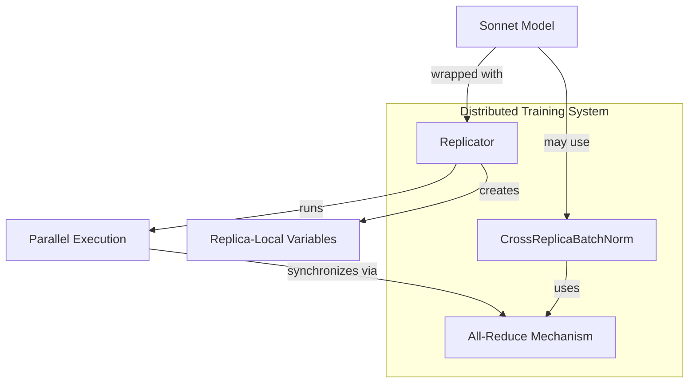
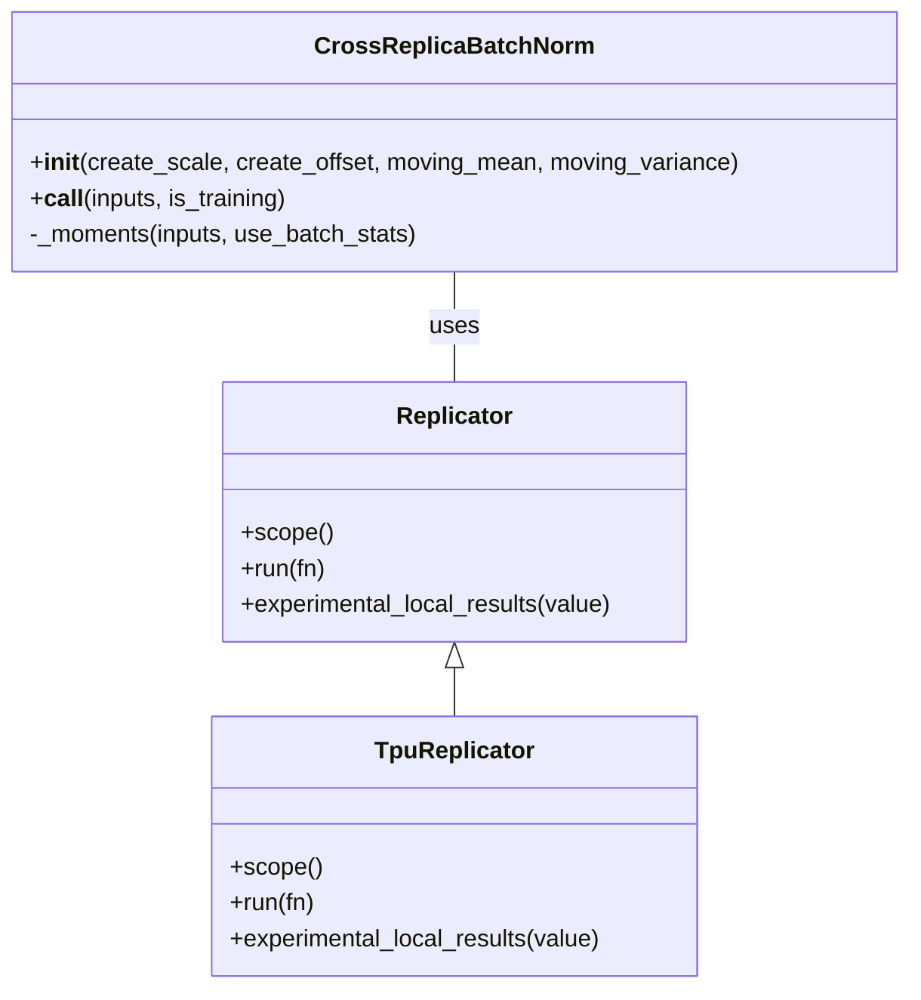
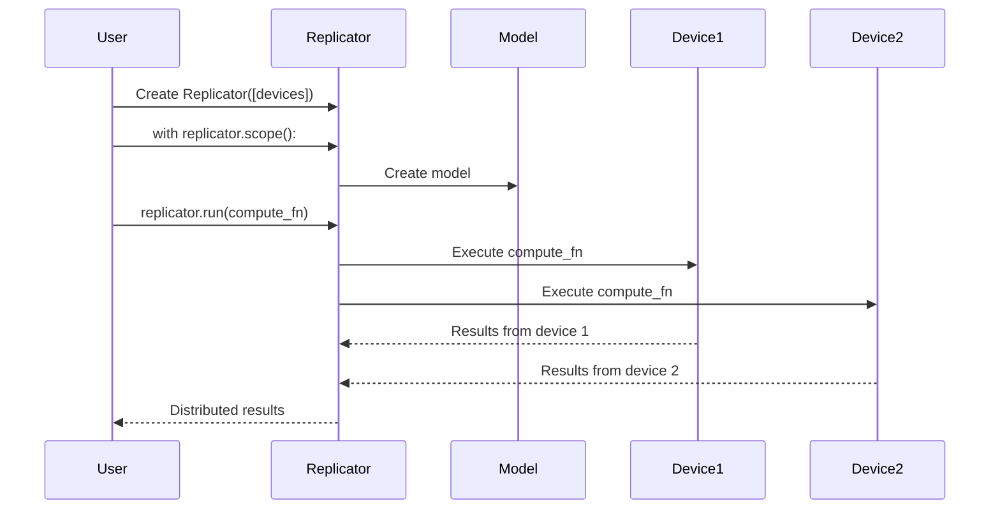
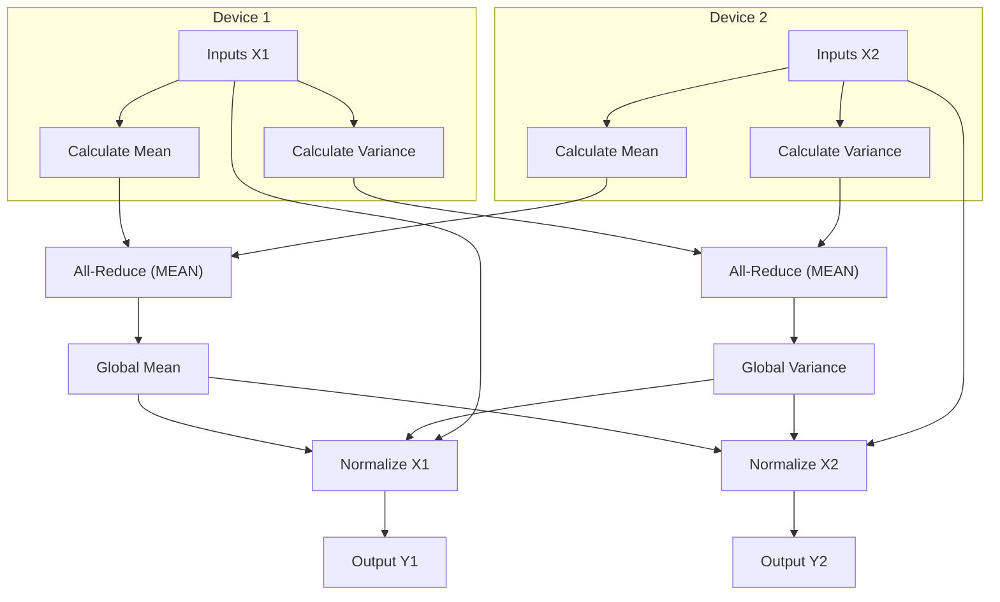
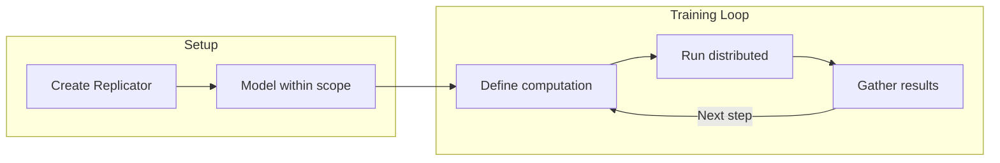

<!-- source: DeepWiki mcp.deepwiki.com · repo google-deepmind/sonnet · page 6 Distributed Training · fetched 2026-10-26 -->

# Distributed Training

<details>
<summary>Relevant source files</summary>

The following files were used as context for generating this wiki page:

- [.github/workflows/ci.yml](.github/workflows/ci.yml)
- [requirements-tf.txt](requirements-tf.txt)
- [setup.py](setup.py)
- [sonnet/src/distribute/distributed_batch_norm.py](sonnet/src/distribute/distributed_batch_norm.py)
- [sonnet/src/distribute/distributed_batch_norm_test.py](sonnet/src/distribute/distributed_batch_norm_test.py)
- [sonnet/src/nets/dnc/util.py](sonnet/src/nets/dnc/util.py)
- [sonnet/src/nets/dnc/util_test.py](sonnet/src/nets/dnc/util_test.py)
- [sonnet/src/test_utils.py](sonnet/src/test_utils.py)

</details>


This document explains how to use Sonnet for training neural networks across multiple devices, such as GPUs or TPUs. Sonnet provides tools to efficiently distribute computation and synchronize model parameters across multiple devices, enabling scalable training of large models.

For information about mixed precision training, which is often used alongside distributed training for further performance improvements, see [Mixed Precision Training](#7.1).

## Overview of Distributed Training in Sonnet

Sonnet's distributed training system provides a way to train neural networks across multiple devices while maintaining the simple programming model that Sonnet is known for. The system handles the complexities of device placement, variable replication, and gradient synchronization.



Sources: [sonnet/src/distribute/distributed_batch_norm.py](), [sonnet/src/distribute/distributed_batch_norm_test.py]()

## Core Components

Sonnet's distributed training system consists of two main components:

1. **Replicator** - Coordinates the replication of models across multiple devices
2. **CrossReplicaBatchNorm** - Provides batch normalization that works across devices during distributed training



Sources: [sonnet/src/distribute/distributed_batch_norm.py:28-124](), [sonnet/src/distribute/distributed_batch_norm_test.py:42-101]()

## Replicator

The `Replicator` is the main entry point for distributed training in Sonnet. It's responsible for:

1. Creating variables that are replicated across devices
2. Running the forward and backward passes in parallel
3. Aggregating gradients across replicas

There are two types of replicators:

1. **Replicator** - For multi-GPU training
2. **TpuReplicator** - Specifically optimized for TPU training

### Using Replicator

To use a replicator for distributed training:

1. Create a replicator, specifying the devices to use
2. Define your model inside the replicator's scope
3. Use the replicator's `run()` method to execute operations across all devices



Sources: [sonnet/src/distribute/distributed_batch_norm_test.py:42-78]()

## Cross-Replica Batch Normalization

Regular batch normalization doesn't work well in a distributed setting because each device only sees a subset of the full batch. `CrossReplicaBatchNorm` solves this by computing batch statistics across all replicas.

### How It Works

1. When `use_batch_stats=True`, the module computes mean and variance for each replica's portion of the batch
2. It then uses `all_reduce("MEAN", ...)` to aggregate these statistics across all replicas
3. The aggregated statistics are used to normalize the inputs on each replica
4. During training, the moving averages are updated with the cross-replica statistics



Sources: [sonnet/src/distribute/distributed_batch_norm.py:98-123]()

### Using CrossReplicaBatchNorm

To use `CrossReplicaBatchNorm`, first create the module within a replicator's scope, then use it as you would a regular `BatchNorm` module:

```python
strategy = snt.distribute.Replicator([device_names])
with strategy.scope():
    mean_metric = snt.metrics.Mean()
    var_metric = snt.metrics.Mean()
    batch_norm = snt.distribute.CrossReplicaBatchNorm(
        create_scale=True, 
        create_offset=True,
        moving_mean=mean_metric,
        moving_variance=var_metric
    )

def compute_fn():
    inputs = ...
    outputs = batch_norm(inputs, is_training=True)
    # ... rest of the model
    return outputs

results = strategy.run(compute_fn)
```

Sources: [sonnet/src/distribute/distributed_batch_norm_test.py:50-66]()

## Distributed Training Workflow

The typical workflow for distributed training with Sonnet involves:

1. Creating a distribution strategy (Replicator)
2. Defining the model within the strategy's scope
3. Defining a computation function that performs a training step
4. Running the computation function with the strategy
5. Processing the results from all replicas



Sources: [sonnet/src/distribute/distributed_batch_norm_test.py:80-116]()

## Performance Considerations

When using distributed training in Sonnet, keep these considerations in mind:

1. **Batch Size**: Each replica processes a portion of the batch. For example, with a batch size of 32 and 4 GPUs, each GPU will process 8 samples.

2. **Variable Creation**: Variables should be created within the replicator's scope to ensure they are properly replicated across devices.

3. **TPU-specific Optimization**: For TPU training, use `TpuReplicator` and consider wrapping your computation function with `@tf.function` for XLA compilation.

4. **Cross-Replica Batch Normalization**: Regular batch normalization can lead to inconsistent behavior in distributed settings. Use `CrossReplicaBatchNorm` to ensure correct normalization.

5. **All-Reduce Operations**: Be aware that cross-replica communication (like in `CrossReplicaBatchNorm`) introduces synchronization points that can impact performance.

## Example: Multi-GPU Training

Here's a simple example of training a model across multiple GPUs:

```python
# Create a replicator for multi-GPU training
gpus = tf.config.experimental.list_logical_devices("GPU")
strategy = snt.distribute.Replicator([device.name for device in gpus])

# Define model within strategy scope
with strategy.scope():
    model = snt.nets.MLP([512, 256, 10])
    optimizer = snt.optimizers.SGD(0.01)

# Define a training step function
def train_step(inputs, labels):
    with tf.GradientTape() as tape:
        logits = model(inputs)
        loss = tf.reduce_mean(
            tf.nn.sparse_softmax_cross_entropy_with_logits(
                logits=logits, labels=labels))
    
    gradients = tape.gradient(loss, model.trainable_variables)
    optimizer.apply(gradients, model.trainable_variables)
    return loss

# Run training step in parallel across GPUs
inputs_dataset = tf.data.Dataset.from_tensor_slices(inputs)
labels_dataset = tf.data.Dataset.from_tensor_slices(labels)
dataset = tf.data.Dataset.zip((inputs_dataset, labels_dataset)).batch(batch_size)

for inputs, labels in dataset:
    per_replica_losses = strategy.run(train_step, args=(inputs, labels))
    # Average loss across replicas
    mean_loss = strategy.reduce("MEAN", per_replica_losses, axis=None)
```

Sources: [sonnet/src/distribute/distributed_batch_norm_test.py:42-78]()

## Example: TPU Training

For TPU training, there are some additional considerations:

```python
# Create a TPU replicator
strategy = snt.distribute.TpuReplicator()

# Define model within strategy scope
with strategy.scope():
    model = snt.nets.MLP([512, 256, 10])
    optimizer = snt.optimizers.SGD(0.01)
    # Use CrossReplicaBatchNorm for correct batch normalization
    norm = snt.distribute.CrossReplicaBatchNorm(
        create_scale=True,
        create_offset=True,
        moving_mean=snt.metrics.Mean(),
        moving_variance=snt.metrics.Mean()
    )

# Function must be wrapped with tf.function for TPU execution
@tf.function
def train_step(inputs, labels):
    with tf.GradientTape() as tape:
        normalized = norm(inputs, is_training=True)
        logits = model(normalized)
        loss = tf.reduce_mean(
            tf.nn.sparse_softmax_cross_entropy_with_logits(
                logits=logits, labels=labels))
    
    gradients = tape.gradient(loss, model.trainable_variables)
    optimizer.apply(gradients, model.trainable_variables)
    return loss

# Run training
def run_training():
    return strategy.run(train_step, args=(inputs, labels))
```

Sources: [sonnet/src/distribute/distributed_batch_norm_test.py:80-116]()

## Related Topics

For more information on specific aspects of distributed training, see:

- [Replicator](#6.1) - For detailed documentation on the Replicator class
- [Cross-Replica Batch Normalization](#6.2) - For more information on distributed batch normalization
- [Mixed Precision Training](#7.1) - For combining mixed precision with distributed training
- [Distributed Training on CIFAR-10](#9.3) - For a complete example of distributed training

---

