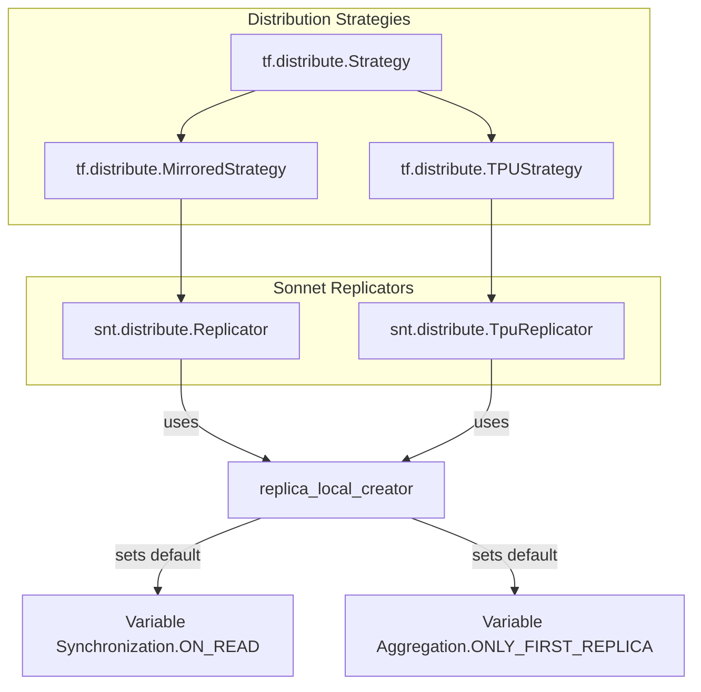
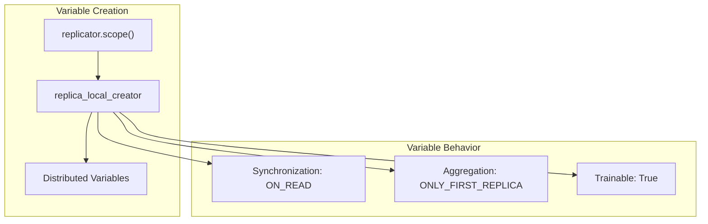
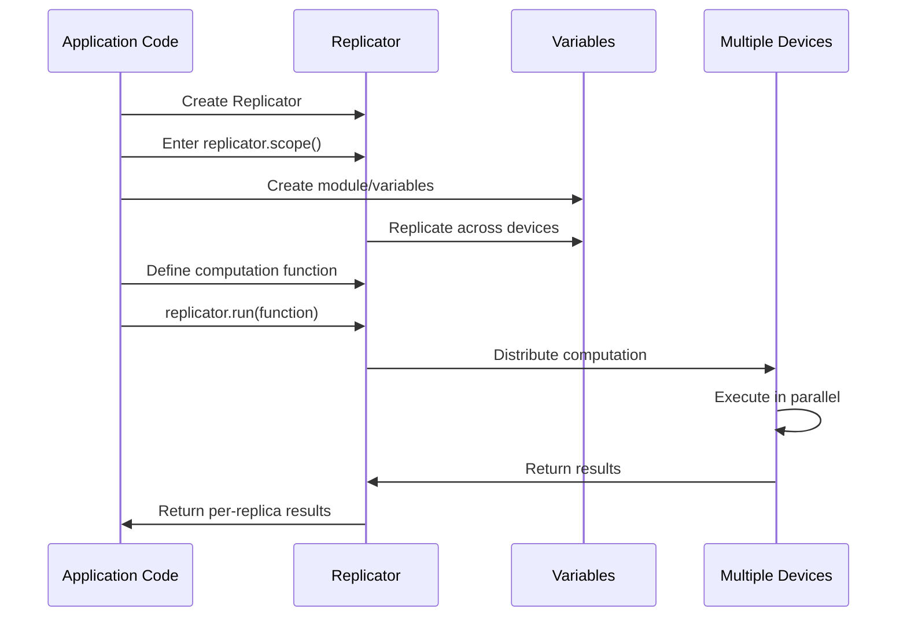
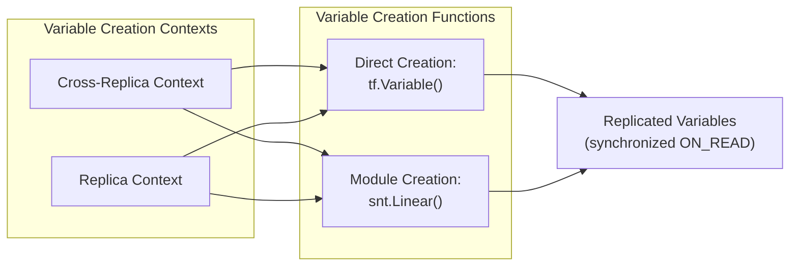
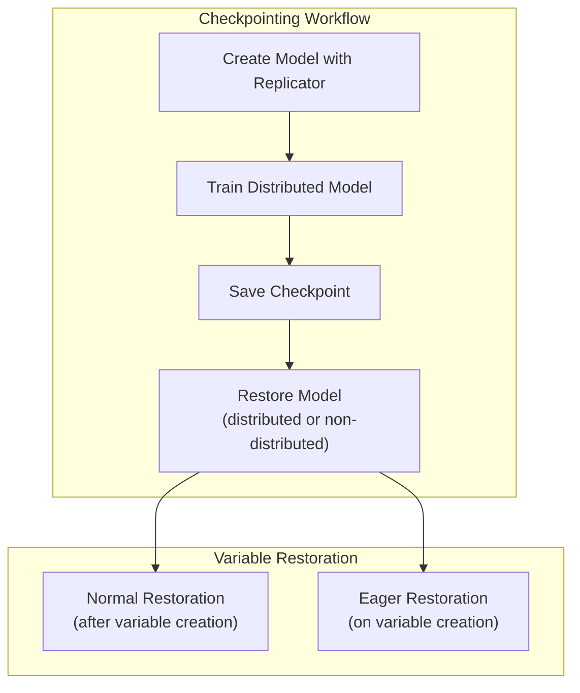
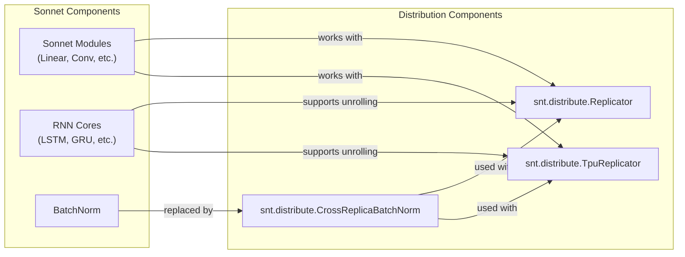

<!-- source: DeepWiki mcp.deepwiki.com · repo google-deepmind/sonnet · page 6.1 Replicator · fetched 2026-10-26 -->

# Replicator

<details>
<summary>Relevant source files</summary>

The following files were used as context for generating this wiki page:

- [sonnet/distribute.py](sonnet/distribute.py)
- [sonnet/src/conformance/checkpoint_test.py](sonnet/src/conformance/checkpoint_test.py)
- [sonnet/src/conformance/distribute_test.py](sonnet/src/conformance/distribute_test.py)
- [sonnet/src/distribute/BUILD](sonnet/src/distribute/BUILD)
- [sonnet/src/distribute/replicator.py](sonnet/src/distribute/replicator.py)
- [sonnet/src/distribute/replicator_test.py](sonnet/src/distribute/replicator_test.py)
- [sonnet/src/nets/dnc/util.py](sonnet/src/nets/dnc/util.py)
- [sonnet/src/nets/dnc/util_test.py](sonnet/src/nets/dnc/util_test.py)
- [sonnet/src/test_utils.py](sonnet/src/test_utils.py)

</details>


The Replicator is a core component of Sonnet's distributed training system that allows models to be efficiently trained across multiple accelerators. It provides a lightweight distribution strategy for replicating computation, parameters, and input across multiple GPUs on a single machine or TPUs across multiple machines. The Replicator is based on TensorFlow's Distribution Strategy API but with Sonnet-specific enhancements for variable handling and initialization.

For information about Cross-Replica Batch Normalization, which is often used with Replicator, see [Cross-Replica Batch Normalization](#6.2).

Sources: [sonnet/src/distribute/replicator.py:15-16](), [sonnet/distribute.py:15-16]()

## Overview

The Replicator implements the programming model described in the TF-Replicator paper, providing a unified approach to distributed training across different hardware accelerators. There are two main variants of Replicator:

1. **Replicator** - For distributing computation across multiple GPUs on a single machine
2. **TpuReplicator** - For distributing computation across TPU cores (potentially across multiple machines)

Both implementations share a similar interface but have important differences in how they handle execution modes and variable synchronization.



Sources: [sonnet/src/distribute/replicator.py:38-77](), [sonnet/src/distribute/replicator.py:92-135]()

## Key Concepts

### Distribution Strategy

At its core, the Replicator is a TensorFlow Distribution Strategy that handles:

1. **Variable Replication** - Creating copies of variables on each device
2. **Input Replication** - Distributing input data across devices
3. **Computation Replication** - Running the same computation in parallel
4. **Cross-Replica Communication** - Allowing communication between replicas (e.g., for gradient aggregation)

### Replica Context vs Cross-Replica Context

The Replicator operates in two different contexts:

- **Replica Context** - Code running within the `replicator.run()` method, executed separately on each device
- **Cross-Replica Context** - Code running outside `replicator.run()`, in the "coordinating" environment

Understanding these contexts is crucial for effective use of the Replicator.

### Variable Synchronization and Aggregation

By default, the Replicator creates variables with:
- Synchronization: `ON_READ` - Variables are only synchronized when read, not on every update
- Aggregation: `ONLY_FIRST_REPLICA` - When combining values, only use the value from the first replica

These defaults optimize for performance while maintaining correctness for most training workloads.



Sources: [sonnet/src/distribute/replicator.py:27-35](), [sonnet/src/distribute/replicator_test.py:68-102]()

## Using the Replicator

### Basic Usage Pattern

The basic pattern for using the Replicator consists of:

1. Create the Replicator instance
2. Use the scope context for variable creation
3. Define a function for replica execution
4. Use `run()` to execute the function across all devices



Sources: [sonnet/src/distribute/replicator.py:38-77](), [sonnet/src/distribute/replicator.py:92-135]()

### Creating a Replicator

For GPU-based parallelism:

```python
replicator = snt.distribute.Replicator()
```

For TPU-based parallelism:

```python
replicator = snt.distribute.TpuReplicator()
```

### Variable Creation

Variables must be created within the replicator's scope to be properly distributed:

```python
with replicator.scope():
    model = snt.Linear(10)  # The model's variables will be distributed
```

When created this way, each device gets its own copy of the variables. This happens automatically because the `replica_local_creator` function is applied within the scope context.

Sources: [sonnet/src/distribute/replicator.py:78-84](), [sonnet/src/distribute/replicator.py:137-142]()

### Running Distributed Computation

To execute computation in parallel across devices:

```python
def forward():
    inputs = tf.random.normal([8, 784])
    outputs = model(inputs)
    return outputs

# For GPU Replicator: can run directly
per_replica_results = replicator.run(forward)

# For TPU Replicator: must be inside a tf.function
@tf.function
def distributed_forward():
    return tpu_replicator.run(forward)

per_replica_results = distributed_forward()
```

The results from `replicator.run()` are returned in a special "distributed" format. To access the actual values from each replica:

```python
replica_results = replicator.experimental_local_results(per_replica_results)
```

### Cross-Replica Communication

When running in replica context, you can communicate between replicas using the replica context:

```python
def compute_with_reduction():
    inputs = tf.random.normal([8, 784])
    outputs = model(inputs)
    
    # Get the replica context
    ctx = tf.distribute.get_replica_context()
    
    # Perform an all-reduce to average outputs across replicas
    reduced_outputs = ctx.all_reduce("mean", outputs)
    
    return reduced_outputs
```

Sources: [sonnet/src/distribute/replicator.py:38-77](), [sonnet/src/distribute/replicator.py:92-135]()

## Replicator vs TpuReplicator

The main differences between `Replicator` and `TpuReplicator` are:

| Feature | Replicator | TpuReplicator |
|---------|------------|---------------|
| Hardware Target | Multiple GPUs on one machine | TPU cores (potentially across machines) |
| Eager Execution | Supported | Limited support, prefers tf.function |
| Distribution Mechanics | MirroredStrategy (in-graph replication) | TPUStrategy (XLA compilation) |
| Variable Sharing | Cross-device with mirrored copies | Cross-core with mirrored copies |

Both implementations share:
- The same variable creation mechanisms
- The same core API (scope, run)
- The same default variable synchronization patterns

Sources: [sonnet/src/distribute/replicator.py:38-77](), [sonnet/src/distribute/replicator.py:92-135]()

## Variable Creation and Management

The Replicator's scope affects how variables are created in both eager and graph modes. By default, variables created within the scope:

1. Have synchronization set to `ON_READ`
2. Have aggregation set to `ONLY_FIRST_REPLICA`
3. Are trainable

This behavior is controlled by the `replica_local_creator` function that's applied inside the scope.



Sources: [sonnet/src/distribute/replicator.py:27-35](), [sonnet/src/distribute/replicator_test.py:28-54]()

## Optimizing Variable Creation with create_variables_eagerly

The Replicator package also provides a utility decorator `create_variables_eagerly` that optimizes variable creation by forcing eager mode execution when possible. This can significantly improve performance, especially when working with large models or in distributed settings.

```python
@tf.function
@snt.distribute.create_variables_eagerly
def initialize_large_model(x):
    model = snt.nets.MLP([1000, 1000, 1000])
    return model(x)

# Variables will be created eagerly, but function execution
# will still benefit from tf.function optimization
result = initialize_large_model(tf.ones([1, 100]))
```

This function works by:
1. Entering an initialization scope using `tf.init_scope()`
2. Attempting to resolve initial values eagerly
3. Patching initializer classes to create values in eager mode

Sources: [sonnet/src/distribute/replicator.py:145-169](), [sonnet/src/distribute/replicator.py:170-226]()

## Checkpointing with Replicator

Replicator fully supports TensorFlow's checkpointing mechanism. Models trained with Replicator can be saved and restored using standard `tf.train.Checkpoint`.

Key points about checkpointing with Replicator:
- Variables created in replicator scope can be checkpointed normally
- Checkpoints created with a distributed model can restore a non-distributed model and vice versa
- Variables can be restored on creation (eager restoration)
- You can restore variables created in replica context

This makes it easy to alternate between distributed and non-distributed execution during development.



Sources: [sonnet/src/conformance/checkpoint_test.py:174-236](), [sonnet/src/conformance/checkpoint_test.py:238-249](), [sonnet/src/conformance/checkpoint_test.py:304-327]()

## Integration with Other Sonnet Components

Replicator integrates with the rest of the Sonnet library in several ways:

1. **Module Compatibility** - All Sonnet modules work with Replicator
2. **RNN Integration** - Works with both static and dynamic unrolling of RNN cores
3. **Custom Variable Creation** - Seamlessly interfaces with Sonnet's variable creation mechanisms
4. **Batch Normalization** - Special cross-replica variants are available for distributed training



Sources: [sonnet/src/conformance/distribute_test.py:60-93]()

## Performance Considerations

### Eager Execution vs. tf.function

For GPU-based Replicator, both eager mode and `tf.function` are supported. However:
- Eager mode is more convenient for debugging
- `tf.function` gives better performance for training

For TPU-based TpuReplicator:
- `tf.function` is required (TPUs require XLA compilation)
- Attempting to run TPU operations in eager mode will fail

### Variable Creation Optimization

For large models, variable creation can be a performance bottleneck. The `create_variables_eagerly` decorator helps by:
- Forcing variable creation into eager mode even within `tf.function`
- Resolving initial values statically when possible
- Reducing communication overhead in distributed settings

Sources: [sonnet/src/distribute/replicator.py:145-169](), [sonnet/src/distribute/replicator_test.py:151-205]()

## Complete Usage Example

Below is a complete example showing how to train a model using Replicator:

```python
# Create the replicator
replicator = snt.distribute.Replicator()

# Create the model inside replicator scope
with replicator.scope():
    model = snt.nets.MLP([128, 64, 10])
    optimizer = tf.optimizers.Adam(0.001)

# Define training step
def train_step(inputs, labels):
    with tf.GradientTape() as tape:
        logits = model(inputs)
        loss = tf.reduce_mean(
            tf.nn.sparse_softmax_cross_entropy_with_logits(
                logits=logits, labels=labels))
    
    # Get gradients and update in parallel
    grads = tape.gradient(loss, model.trainable_variables)
    optimizer.apply_gradients(zip(grads, model.trainable_variables))
    
    return loss

# Execute training step across all devices
@tf.function
def distributed_train_step(inputs, labels):
    per_replica_losses = replicator.run(
        lambda: train_step(inputs, labels))
    # Combine losses from all replicas
    return replicator.reduce("mean", per_replica_losses, axis=None)

# Train the model
for inputs, labels in dataset:
    loss = distributed_train_step(inputs, labels)
```

Sources: [sonnet/src/distribute/replicator.py:38-77](), [sonnet/src/conformance/distribute_test.py:15-94]()

## Troubleshooting

Common issues when using Replicator include:

1. **Variable Synchronization Issues**
   - Symptoms: Different replicas have different variable values
   - Solution: Make sure variables are created within `replicator.scope()`

2. **TPU Eager Execution Errors**
   - Symptoms: Errors about TPU operations not supported in eager mode
   - Solution: Always wrap TpuReplicator.run() calls in a tf.function

3. **Cross-Replica Context Errors**
   - Symptoms: Errors about operations not supported in cross-replica context
   - Solution: Move the operation inside the function passed to replicator.run()

4. **Memory Issues**
   - Symptoms: Out-of-memory errors during distributed training
   - Solution: Reduce batch size per replica (total batch will be batch_size * num_replicas)

Sources: [sonnet/src/distribute/replicator_test.py:108-149]()

---

