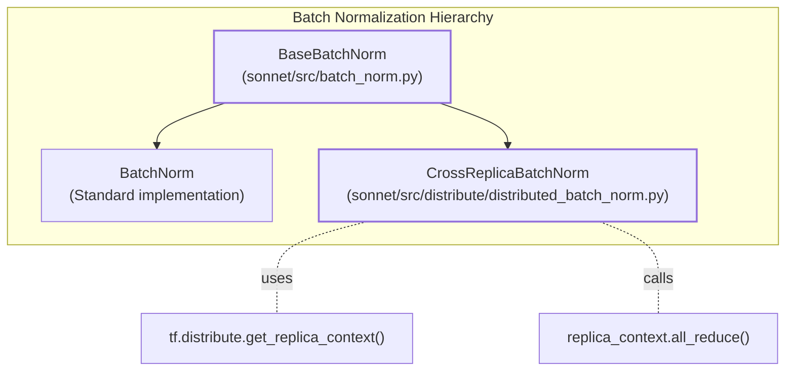
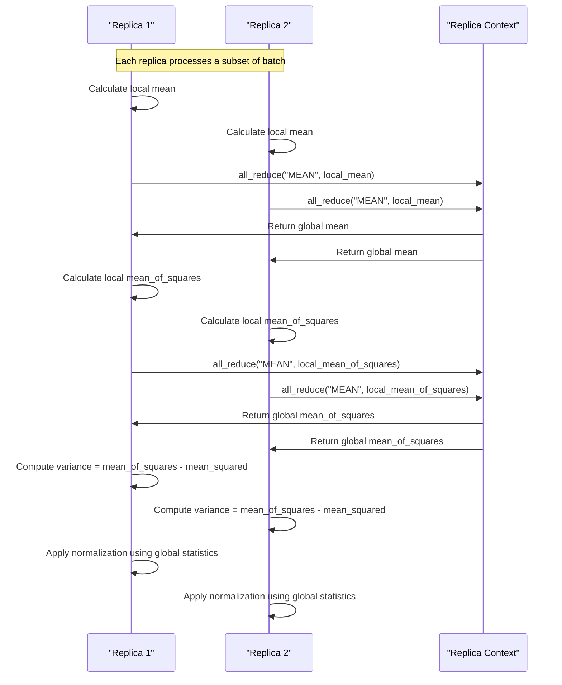
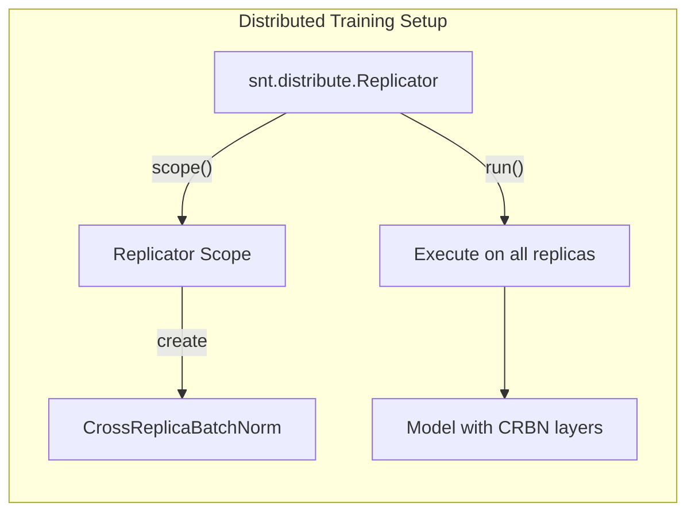
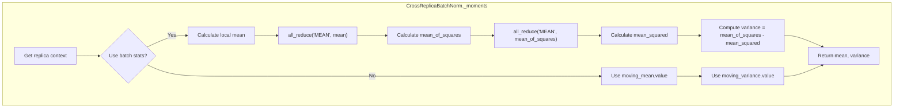
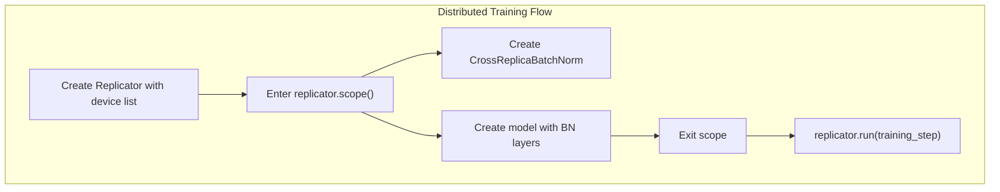

<!-- source: DeepWiki mcp.deepwiki.com · repo google-deepmind/sonnet · page 6.2 Cross-Replica Batch Normalization · fetched 2026-10-26 -->

# Cross-Replica Batch Normalization

Relevant source files

The following files were used as context for generating this wiki page:

- [.github/workflows/ci.yml](.github/workflows/ci.yml)
- [requirements-tf.txt](requirements-tf.txt)
- [setup.py](setup.py)
- [sonnet/src/batch_norm.py](sonnet/src/batch_norm.py)
- [sonnet/src/batch_norm_test.py](sonnet/src/batch_norm_test.py)
- [sonnet/src/distribute/distributed_batch_norm.py](sonnet/src/distribute/distributed_batch_norm.py)
- [sonnet/src/distribute/distributed_batch_norm_test.py](sonnet/src/distribute/distributed_batch_norm_test.py)
- [sonnet/src/moving_averages_test.py](sonnet/src/moving_averages_test.py)

## Purpose and Scope

This document describes the Cross-Replica Batch Normalization module in Sonnet, a specialized batch normalization implementation designed for distributed training environments. It explains how the module calculates batch statistics across multiple devices or TPU/GPU replicas to ensure consistent normalization during distributed training. For information about standard batch normalization, see [Normalization Layers](#3.2).

## Overview

Cross-Replica Batch Normalization extends the regular batch normalization functionality to work properly in distributed training settings by ensuring that normalization statistics (mean and variance) are calculated across all devices/replicas rather than independently on each device.

Sources: [sonnet/src/batch_norm.py:29-263](), [sonnet/src/distribute/distributed_batch_norm.py:28-124]()

## How It Works

When training neural networks in a distributed environment, each replica (GPU/TPU) processes a different portion of the batch. Regular batch normalization would calculate statistics independently for each portion, resulting in inconsistent normalization. Cross-Replica Batch Normalization solves this problem by aggregating statistics across all replicas.

Sources: [sonnet/src/distribute/distributed_batch_norm.py:98-123]()

### Key Implementation Details

The `CrossReplicaBatchNorm` class implements a specialized `_moments` method that:

1. Retrieves the replica context
2. Calculates local mean and mean of squared values
3. Uses `all_reduce` operations to aggregate these values across replicas
4. Computes the variance using an XLA-optimized formula: `var = E(x²) - E(x)²`

This approach allows for faster computation by combining the `all_reduce` operations when using XLA compilation.

Sources: [sonnet/src/distribute/distributed_batch_norm.py:98-123]()

## Usage

### Basic Example

Here's how to use `CrossReplicaBatchNorm` within a Sonnet module:

Sources: [sonnet/src/distribute/distributed_batch_norm_test.py:49-78]()

### Constructor Parameters

The `CrossReplicaBatchNorm` constructor accepts the same parameters as the base `BaseBatchNorm` class:

| Parameter | Type | Description |
|-----------|------|-------------|
| `create_scale` | bool | Whether to create a trainable scale parameter |
| `create_offset` | bool | Whether to create a trainable offset parameter |
| `moving_mean` | metrics.Metric | Metric to track the moving average of mean |
| `moving_variance` | metrics.Metric | Metric to track the moving average of variance |
| `eps` | float | Small value to avoid division by zero (default: 1e-5) |
| `scale_init` | Initializer | Optional initializer for scale (default: ones) |
| `offset_init` | Initializer | Optional initializer for offset (default: zeros) |
| `data_format` | str | Data format of input: "channels_first" or "channels_last" |
| `name` | str | Optional name for the module |

Sources: [sonnet/src/distribute/distributed_batch_norm.py:43-88]()

## Technical Implementation

### Class Definition

The `CrossReplicaBatchNorm` class extends `BaseBatchNorm` and overrides the following methods:

1. `_initialize`: Disables fused operations since statistics are calculated separately
2. `_moments`: Implements cross-replica statistics calculation

Sources: [sonnet/src/distribute/distributed_batch_norm.py:28-124]()

### Moments Calculation

The core functionality is in the `_moments` method which differs from the standard batch normalization in how it aggregates statistics:

Sources: [sonnet/src/distribute/distributed_batch_norm.py:98-123]()

### XLA Optimization

The implementation uses a specific formula for variance calculation that allows XLA (Accelerated Linear Algebra) to combine all-reduce operations for better performance:

- Instead of using the numerically stable formula: `var = E((x-E(x))²)`
- It uses: `var = E(x²) - E(x)²`

This optimization can cause numerical instability in some cases, so there's a warning comment in the code about potential NaN issues.

Sources: [sonnet/src/distribute/distributed_batch_norm.py:106-117]()

## Common Usage Patterns

### With Replicator

The most common usage pattern is with the Sonnet Replicator:

1. Create a `Replicator` with a list of devices
2. Within the replicator's scope, create your model containing `CrossReplicaBatchNorm` layers
3. Use the replicator to run training steps

Sources: [sonnet/src/distribute/distributed_batch_norm_test.py:41-78](), [sonnet/src/distribute/distributed_batch_norm_test.py:80-116]()

### With TPU Replicator

For TPU training, the usage is similar but uses the `TpuReplicator`:

1. Create a `TpuReplicator`
2. Within the TPU replicator's scope, create your model with `CrossReplicaBatchNorm` layers
3. Define a function to be executed and use `strategy.run()` to execute it on all TPU cores

Sources: [sonnet/src/distribute/distributed_batch_norm_test.py:80-116]()

## Considerations and Limitations

1. **Replica Context Requirement**: The module can only be used within a replica context (i.e., inside a function passed to `strategy.run()`).

2. **Numerical Stability**: The XLA-optimized variance formula may cause numerical instability in some cases. If you encounter NaN values, consider implementing an alternative version using the more stable formula.

3. **Compatibility**: Specifically designed to work with Sonnet's `Replicator` and `TpuReplicator`. May not work with other TensorFlow distribution strategies without modifications.

Sources: [sonnet/src/distribute/distributed_batch_norm.py:100-103](), [sonnet/src/distribute/distributed_batch_norm.py:106-110]()

## Comparison with Regular BatchNorm

| Feature | BatchNorm | CrossReplicaBatchNorm |
|---------|-----------|------------------------|
| **Statistic Calculation** | Per-replica | Across all replicas |
| **Training Context** | Any | Requires replica context |
| **Optimization** | Uses fused ops when possible | Always uses unfused ops |
| **Use Case** | Single-device training | Multi-device/distributed training |
| **Statistical Stability** | Better for small batches | Better for distributed small batches |

Sources: [sonnet/src/batch_norm.py:265-321](), [sonnet/src/distribute/distributed_batch_norm.py:28-124]()

---

