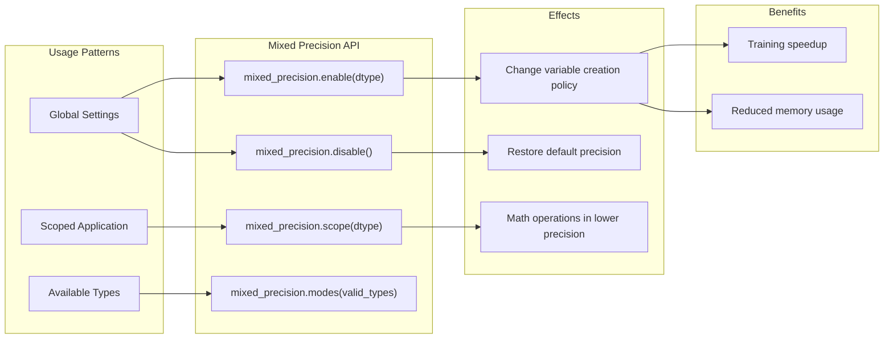
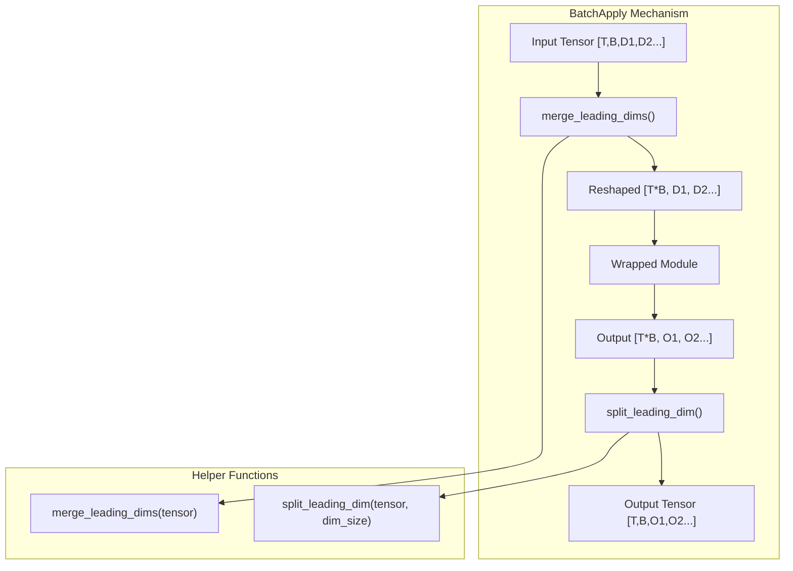
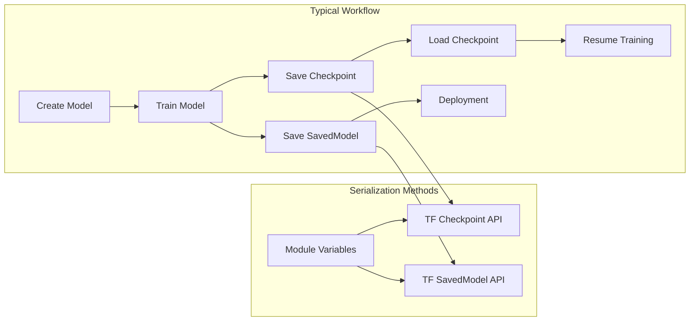
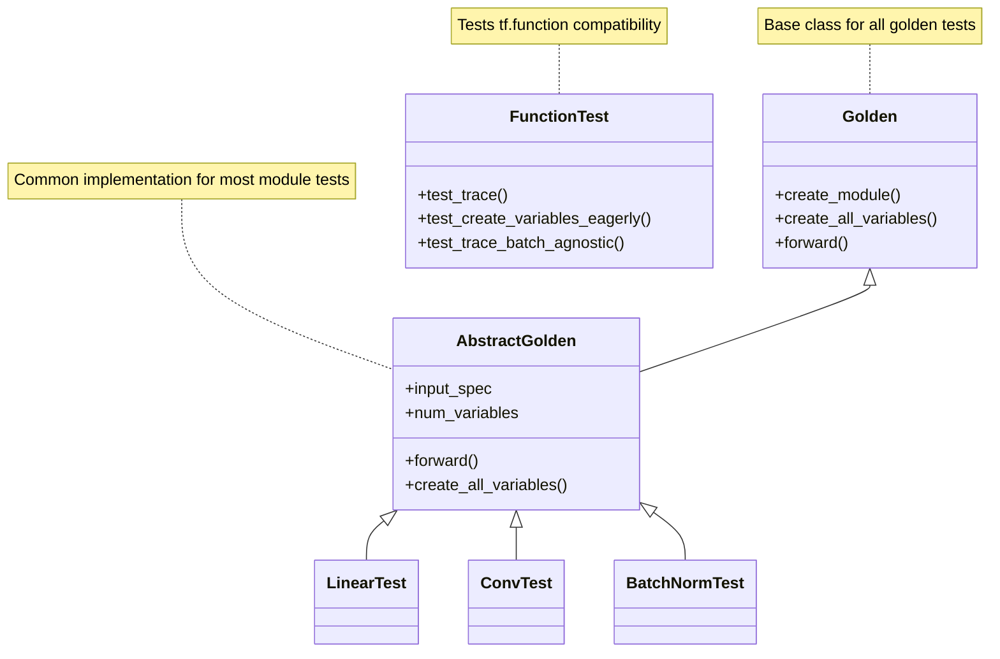
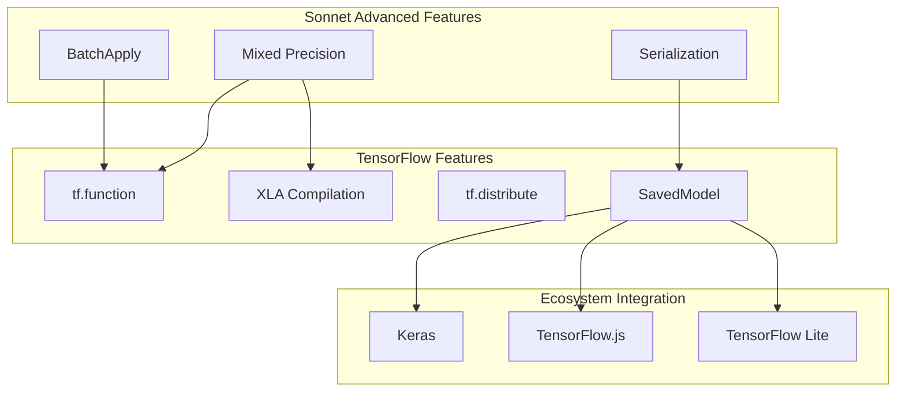

<!-- source: DeepWiki mcp.deepwiki.com · repo google-deepmind/sonnet · page 7 Advanced Features · fetched 2026-10-26 -->

# Advanced Features

<details>
<summary>Relevant source files</summary>

The following files were used as context for generating this wiki page:

- [docs/api.rst](docs/api.rst)
- [sonnet/__init__.py](sonnet/__init__.py)
- [sonnet/nets/__init__.py](sonnet/nets/__init__.py)
- [sonnet/nets/resnet.py](sonnet/nets/resnet.py)
- [sonnet/src/conformance/descriptors.py](sonnet/src/conformance/descriptors.py)
- [sonnet/src/conformance/descriptors_test.py](sonnet/src/conformance/descriptors_test.py)
- [sonnet/src/conformance/function_test.py](sonnet/src/conformance/function_test.py)
- [sonnet/src/conformance/goldens.py](sonnet/src/conformance/goldens.py)
- [sonnet/src/conformance/goldens_test.py](sonnet/src/conformance/goldens_test.py)

</details>


This page covers the advanced features available in Sonnet that enhance functionality and performance beyond the basic module system. These features include mixed precision training for performance optimization, BatchApply for handling complex tensor dimensions, and serialization for saving and loading models. For information about the core module system, see [Core Module System](#2), and for distributed training, see [Distributed Training](#6).

## Mixed Precision Training

Mixed precision training enables faster computation and reduced memory usage by utilizing lower precision datatypes (e.g., `float16`) alongside standard precision (`float32`) where appropriate.



### Usage Examples

Sonnet provides several functions for controlling precision:

1. **Enable globally for all modules**:
   ```python
   snt.mixed_precision.enable(tf.float16)
   model = snt.nets.MLP([512, 256, 10])
   # All variables created in float16
   ```

2. **Scoped precision changes**:
   ```python
   with snt.mixed_precision.scope(tf.float16):
       # Operations in this scope use float16
       outputs = model(inputs)
   ```

3. **Returning to default precision**:
   ```python
   snt.mixed_precision.disable()
   ```

4. **Checking available precision modes**:
   ```python
   available_modes = snt.mixed_precision.modes()
   ```

Mixed precision is particularly useful for training large models or when using hardware with specialized acceleration for lower precision operations (like NVIDIA GPUs with Tensor Cores).

Sources: [sonnet/__init__.py:20-20](), [docs/api.rst:516-539]()

## BatchApply

BatchApply is a module wrapper that simplifies operations on tensors with higher dimensions by reshaping the input, applying the wrapped module, and then restoring the original dimensions.



### Common Use Cases

BatchApply is particularly useful for:

1. **Applying modules across time and batch dimensions in RNNs**
2. **Processing batches of sequences**
3. **Handling outputs from recurrent modules**

### API Reference

```python
# Creating a BatchApply wrapper
batch_apply = snt.BatchApply(module)

# Applying to a tensor with additional dimensions
# Input shape: [time, batch, features...]
output = batch_apply(input_tensor)  # Preserves leading dimensions
```

The key utility functions provided alongside BatchApply are:

- `merge_leading_dims(tensor)`: Merges the first two dimensions of a tensor
- `split_leading_dim(tensor, dim_size)`: Splits the first dimension of a tensor into two dimensions

Sources: [sonnet/__init__.py:31-33](), [docs/api.rst:256-260]()

## Serialization and Checkpointing

Sonnet provides mechanisms for saving and loading module state, both for checkpointing during training and for deploying models.



### Checkpoint Saving and Loading

Checkpoints save the values of module variables:

```python
# Create a checkpoint
ckpt = tf.train.Checkpoint(model=my_sonnet_model)

# Save a checkpoint
ckpt.save('/path/to/checkpoint')

# Restore from checkpoint
ckpt.restore('/path/to/checkpoint-1')
```

### SavedModel Format

SavedModel saves both the module's variables and computation graph:

```python
# Saving a model
tf.saved_model.save(my_sonnet_model, '/path/to/saved_model')

# Loading a model
loaded_model = tf.saved_model.load('/path/to/saved_model')
```

Sonnet modules are designed to be compatible with TensorFlow's serialization APIs, allowing for seamless integration with the TensorFlow ecosystem.

Sources: [sonnet/src/conformance/goldens_test.py:1-75]()

## Conformance and Testing Framework

Sonnet includes a robust conformance and testing framework that ensures modules behave consistently and correctly across different contexts, including when used with `tf.function` for graph compilation.



### Golden Tests

Golden tests verify that modules produce consistent outputs across different environments and TensorFlow versions. Each module has specific test cases that:

1. Create the module with fixed parameters
2. Apply inputs with known shapes
3. Verify output shapes and values
4. Check variable creation

### Function Compatibility

Sonnet modules are designed to work seamlessly with TensorFlow's `tf.function` decorator, which provides significant performance improvements by tracing Python code to create optimized computation graphs.

Key tests include:
- Standard function tracing
- Variable creation inside functions
- Batch-agnostic tracing with dynamic dimensions

Sources: [sonnet/src/conformance/goldens.py:15-564](), [sonnet/src/conformance/function_test.py:15-139]()

## Additional Advanced Features

### Custom Variable Getters

Sonnet supports custom variable getters through the `custom_variable_getter` function, allowing you to intercept and modify variable creation:

```python
def my_getter(getter, name, *args, **kwargs):
    # Modify variable creation
    return getter(name, *args, **kwargs)

with snt.custom_variable_getter(my_getter):
    # Variables created here will use my_getter
    module = snt.Linear(10)
```

### Once Decorator

The `once` decorator ensures that a method is only called once during the lifetime of an object:

```python
class MyModule(snt.Module):
    @snt.once
    def initialize(self):
        # This will run only once
        self.w = tf.Variable(...)
```

### Deferred Module Construction

The `Deferred` module allows for lazy initialization of modules:

```python
# Create a module whose parameters are determined later
deferred_linear = snt.Deferred(lambda: snt.Linear(output_size))

# Later, when output_size is known
output_size = compute_output_size()
linear = deferred_linear()
```

Sources: [sonnet/__init__.py:44-46](), [sonnet/__init__.py:56-56](), [sonnet/__init__.py:45-45]()

## Feature Interaction Table

| Feature | Purpose | Common Use Cases | Interaction with Other Features |
|---------|---------|------------------|--------------------------------|
| Mixed Precision | Performance optimization | Training large models, Hardware acceleration | Compatible with distributed training |
| BatchApply | Handle higher-dimensional tensors | RNNs, Sequential data | Works with all standard modules |
| Serialization | Save and restore models | Checkpointing, Deployment | Supports all module types |
| Conformance Testing | Ensure consistent behavior | Module development, Version upgrades | N/A |
| Custom Variable Getters | Control variable creation | Regularization, Initialization customization | Affects all variable-containing modules |

Sources: [sonnet/__init__.py:17-165](), [docs/api.rst:1-546]()

## Integration with TensorFlow Ecosystem



Sonnet's advanced features are designed to integrate seamlessly with the broader TensorFlow ecosystem, allowing users to leverage the full power of TensorFlow while maintaining the clean, modular design philosophy of Sonnet.

Sources: [sonnet/__init__.py:15-165](), [sonnet/src/conformance/function_test.py:15-139]()

---

