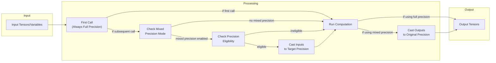
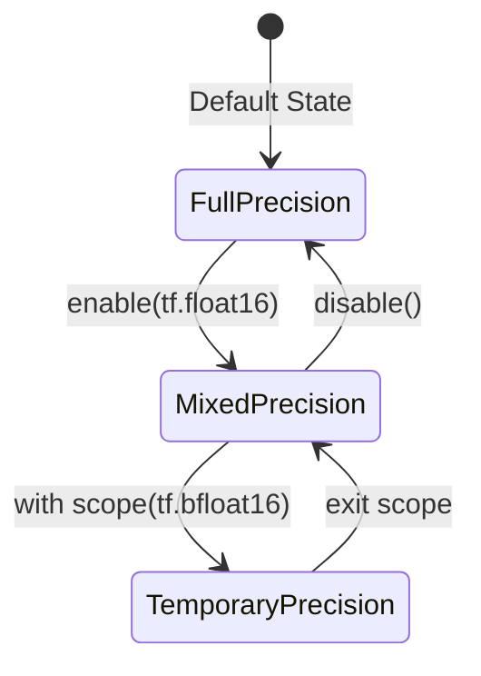
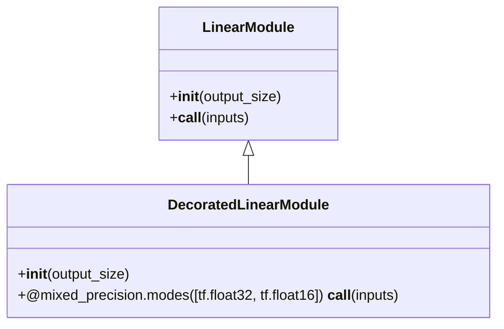
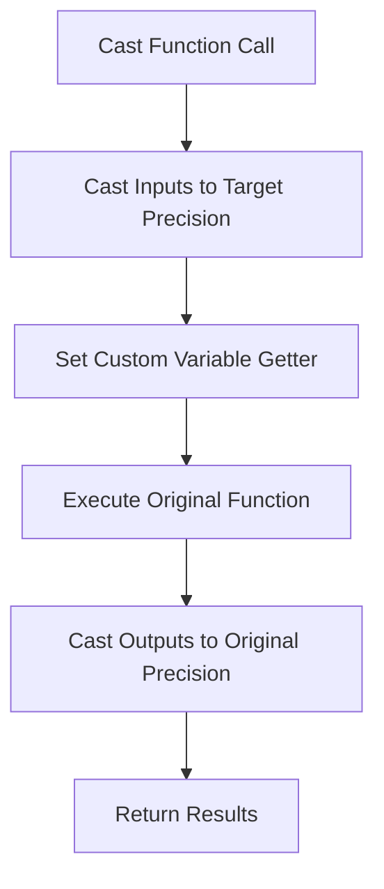
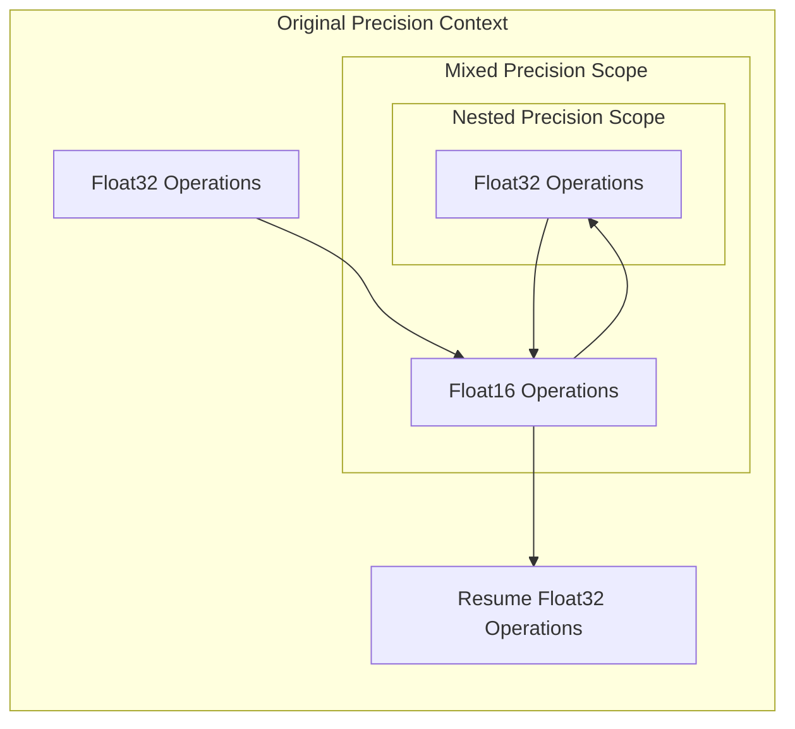
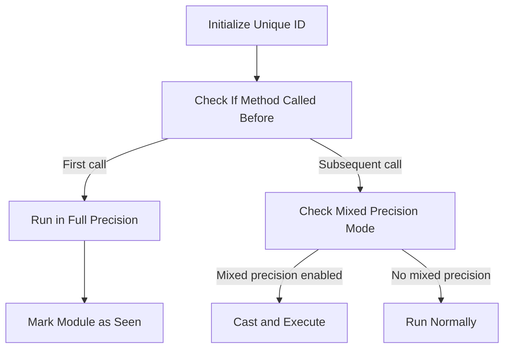
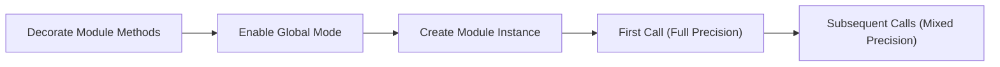

<!-- source: DeepWiki mcp.deepwiki.com · repo google-deepmind/sonnet · page 7.1 Mixed Precision Training · fetched 2026-10-26 -->

# Mixed Precision Training

Relevant source files

The following files were used as context for generating this wiki page:

- [sonnet/mixed_precision.py](sonnet/mixed_precision.py)
- [sonnet/src/mixed_precision.py](sonnet/src/mixed_precision.py)
- [sonnet/src/mixed_precision_test.py](sonnet/src/mixed_precision_test.py)
- [sonnet/src/nets/vqvae.py](sonnet/src/nets/vqvae.py)
- [sonnet/src/nets/vqvae_test.py](sonnet/src/nets/vqvae_test.py)
- [sonnet/src/optimizers/momentum.py](sonnet/src/optimizers/momentum.py)

## Purpose and Scope

Mixed precision training is a technique used to accelerate deep learning models by performing computations in lower precision formats (like `float16`) where possible, while maintaining model accuracy. This page explains Sonnet's mixed precision system, which allows modules to execute operations in reduced precision while retaining numerical stability. The system is designed to be easy to use with existing Sonnet modules with minimal code changes.

For information about distributed training that can be combined with mixed precision for further performance improvements, see [Distributed Training](#6).

Sources: [sonnet/src/mixed_precision.py:15-17]()

## Core Concepts

Mixed precision training in Sonnet works by:

1. Enabling a global mixed precision mode
2. Decorating module methods with precision eligibility information
3. Automatically casting inputs and outputs to appropriate precision types

When a decorated function is called for the first time, it executes in full precision. On subsequent calls, inputs and outputs are cast to the specified precision if compatible.

### Mixed Precision Mode Flow

Sources: [sonnet/src/mixed_precision.py:92-109](), [sonnet/src/mixed_precision.py:60-70]()

## API Components

The mixed precision API consists of four main functions:

| Function | Description |
|----------|-------------|
| `enable(dtype)` | Sets the global mixed precision mode to the specified dtype |
| `disable()` | Disables mixed precision training |
| `modes(valid_types)` | Decorator that enables mixed precision for functions/methods |
| `scope(dtype)` | Context manager for temporarily setting mixed precision |

Sources: [sonnet/src/mixed_precision.py:30-42](), [sonnet/src/mixed_precision.py:40-42](), [sonnet/src/mixed_precision.py:73-137](), [sonnet/src/mixed_precision.py:140-168]()

### Global Precision Control

The system uses a global state variable to track the current mixed precision mode. When enabled, all decorated functions that support the specified precision type will operate in that precision.

Sources: [sonnet/src/mixed_precision.py:25-46](), [sonnet/src/mixed_precision.py:140-168]()

## Usage Patterns

### Basic Module Decoration

To make a Sonnet module support mixed precision:

Sources: [sonnet/src/mixed_precision.py:73-76]()

### Implementation Details

Under the hood, the `modes` decorator performs several key operations:

1. Tracks whether a function has been called before (per-instance)
2. When executing in mixed precision:
   - Casts floating-point tensors and variables to target precision
   - Uses a custom variable getter to create variables in appropriate precision
   - Runs computation in lower precision
   - Casts outputs back to original precision (typically float32)

The mixed precision casting logic is implemented in the `_cast_call` function:

Sources: [sonnet/src/mixed_precision.py:60-70](), [sonnet/src/mixed_precision.py:50-57](), [sonnet/src/mixed_precision.py:95-134]()

## Working with Mixed Precision

### Enabling Mixed Precision 

To enable mixed precision in your Sonnet models:

1. Decorate module methods with `@mixed_precision.modes([tf.float32, tf.float16])`
2. Enable global mixed precision: `snt.mixed_precision.enable(tf.float16)`
3. Call your modules normally - operations will be performed in mixed precision

### Using Temporary Precision Scope

For finer control, you can use the scope context manager:

Sources: [sonnet/src/mixed_precision.py:140-168]()

## Implementation Behavior

### First Call Behavior

The mixed precision system uses a special first-call behavior. When a decorated function is called for the first time on a specific instance, it runs in full precision regardless of the global mixed precision setting. This helps ensure stable initialization and variable creation. Subsequent calls will use the specified mixed precision mode if applicable.

Sources: [sonnet/src/mixed_precision.py:95-134]()

### Tracking State

The system keeps track of previously-seen instances using a unique identifier:

Sources: [sonnet/src/mixed_precision.py:92-137]()

## Integration Examples

### Decorating Built-in Sonnet Modules

Mixed precision can be applied to any Sonnet module that performs floating-point computations:

Sources: [sonnet/src/mixed_precision.py:76-83]()

### Practical Considerations

When using mixed precision:

1. Certain operations require full precision for numerical stability
2. Variables are typically stored in float32 but computations can use float16
3. The system automatically handles casting between precision types
4. Non-floating point data (integers, strings) is not affected

Sources: [sonnet/src/mixed_precision.py:50-57]()

## Performance Benefits

Mixed precision training provides several benefits:

1. Faster computation (particularly on GPUs with tensor cores)
2. Reduced memory usage
3. Potentially faster memory transfers

These benefits are obtained while maintaining model accuracy by strategically using lower precision where appropriate and higher precision where needed for numerical stability.

Sources: [sonnet/src/mixed_precision.py:15-17]()

---

