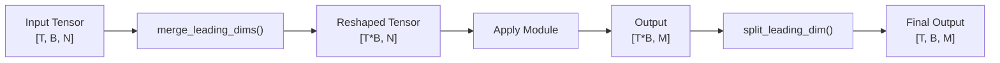
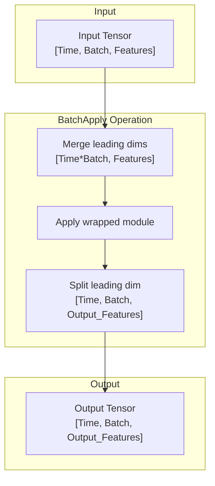
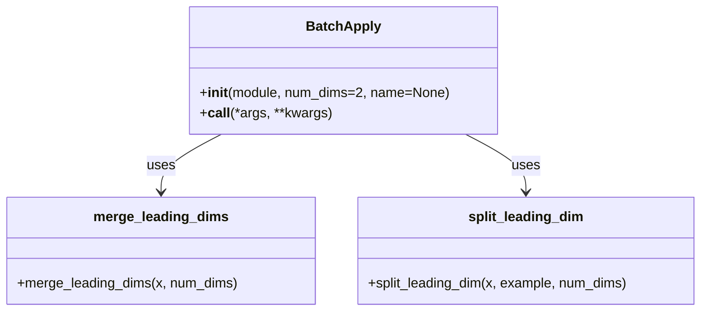

<!-- source: DeepWiki mcp.deepwiki.com · repo google-deepmind/sonnet · page 7.2 BatchApply · fetched 2026-10-26 -->

# BatchApply

<details>
<summary>Relevant source files</summary>

The following files were used as context for generating this wiki page:

- [examples/simple_mnist.py](examples/simple_mnist.py)
- [examples/vqvae_example.ipynb](examples/vqvae_example.ipynb)
- [sonnet/src/batch_apply.py](sonnet/src/batch_apply.py)
- [sonnet/src/batch_apply_test.py](sonnet/src/batch_apply_test.py)

</details>


BatchApply is a utility module in Sonnet that allows applying operations to tensors with multiple leading dimensions by automatically reshaping the input, applying the operation, and then restoring the original shape structure. This is particularly useful when dealing with sequence or batch-based data structures where you need to apply operations that expect specific input shapes.

## Overview

When working with higher dimensional tensors, such as time-series data with shape `[Time, Batch, Features]`, you might need to apply a module that only supports 2D inputs like `[Batch, Features]`. BatchApply solves this problem by:

1. Merging a specified number of leading dimensions into a single dimension
2. Applying the provided module to the reshaped tensor
3. Splitting the leading dimension of the result to match the input's original shape

This allows you to easily apply operations across multiple timesteps or batch dimensions without having to manually reshape tensors.



Sources: [sonnet/src/batch_apply.py:23-73]()

## Usage Example

BatchApply wraps any existing module and handles the reshaping automatically:



Common use cases include:

1. Applying a linear layer to each timestep of a sequence
2. Processing each example in a batch with a module that only accepts individual examples
3. Applying operations across multiple batch dimensions (e.g., in a batch of sequences)

Sources: [sonnet/src/batch_apply.py:25-43](), [sonnet/src/batch_apply_test.py:34-39]()

## Implementation Details

### Core Components

BatchApply consists of three main components:

1. The `BatchApply` class that orchestrates the process
2. Helper function `merge_leading_dims` to combine dimensions
3. Helper function `split_leading_dim` to restore original dimensionality



Sources: [sonnet/src/batch_apply.py:25-73](), [sonnet/src/batch_apply.py:136-192]()

### BatchApply Class

The `BatchApply` class is initialized with:

- `module`: The module to apply to the reshaped input
- `num_dims`: The number of leading dimensions to merge (default is 2)
- `name`: Optional name for the module

When called, BatchApply:
1. Takes any number of arguments and keyword arguments
2. Finds the first tensor input to use as an example for shape information
3. Merges leading dimensions of all tensor inputs
4. Applies the module to the reshaped inputs
5. Splits the leading dimension of all outputs to match the original input shape

Sources: [sonnet/src/batch_apply.py:25-73]()

### Handling Different Input Types

BatchApply intelligently handles various input types:

- Tensor inputs are reshaped
- Non-tensor inputs (like Python primitives) are passed through unchanged
- Inputs with rank smaller than `num_dims` are passed through unchanged
- Outputs from the module maintain the same structure as the input (using `tree.map_structure`)

Sources: [sonnet/src/batch_apply.py:53-73](), [sonnet/src/batch_apply.py:114-132]()

## Helper Functions

### merge_leading_dims

This function combines the leading dimensions of a tensor. For example, given a tensor with shape `[3, 2, 4]` and `num_dims=2`, it returns a tensor with shape `[6, 4]`.

```python
# Example:
# x = tf.ones([3, 2, 4])
# merged = snt.merge_leading_dims(x, num_dims=2)
# merged shape = [6, 4]
```

The function handles both static and dynamic shapes, ensuring shape information is preserved when possible.

Sources: [sonnet/src/batch_apply.py:136-192]()

### split_leading_dim

This function does the opposite of `merge_leading_dims`. It takes a tensor with a merged leading dimension and an example tensor with the original shape structure, then reshapes the input tensor to match that structure.

```python
# Example:
# x = tf.ones([6, 4])        # Merged tensor
# example = tf.ones([3, 2, 4])  # Original shape structure
# split = snt.split_leading_dim(x, example, num_dims=2)
# split shape = [3, 2, 4]
```

Sources: [sonnet/src/batch_apply.py:86-132]()

## Example Use Cases

### Processing Sequential Data

When working with sequential data, each timestep often needs to be processed by the same module:

```python
# Example: Apply a linear layer to each timestep of a sequence
sequence = tf.random.normal([10, 32, 64])  # [Time, Batch, Features]
linear = snt.Linear(output_size=128)
batch_apply = snt.BatchApply(linear)
processed_sequence = batch_apply(sequence)  # Shape: [10, 32, 128]
```

### Processing Multiple Batch Dimensions

In scenarios with multiple batch dimensions (e.g., batched sequences):

```python
# Example: Apply a module to data with multiple batch dimensions
data = tf.random.normal([5, 10, 32, 64])  # [Batch1, Batch2, Batch3, Features]
mlp = snt.nets.MLP([256, 128])
batch_apply = snt.BatchApply(mlp, num_dims=3)
processed_data = batch_apply(data)  # Shape: [5, 10, 32, 128]
```

Sources: [sonnet/src/batch_apply.py:36-42]()

## Edge Cases and Special Behaviors

- **Non-Tensor Inputs**: If the input is not a tensor or tf.Variable, it's returned unchanged
- **Low-Rank Tensors**: Tensors with fewer dimensions than `num_dims` are passed through unchanged
- **None Outputs**: If the wrapped module returns None, BatchApply also returns None
- **Multiple Inputs/Outputs**: BatchApply handles multiple tensor inputs and structured outputs
- **Keyword Arguments**: Keyword arguments are passed to the wrapped module after reshaping

Sources: [sonnet/src/batch_apply.py:114-125](), [sonnet/src/batch_apply_test.py:40-48]()

## Conclusion

BatchApply provides a convenient way to apply operations to tensors with complex batch and time dimensions without manually handling reshaping. This simplifies code and makes it more readable, especially when working with sequence models and multi-dimensional batch data.

---

