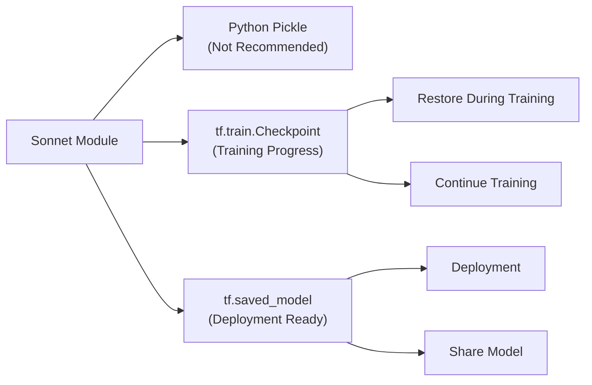
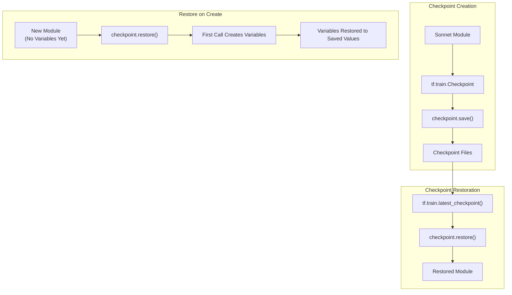
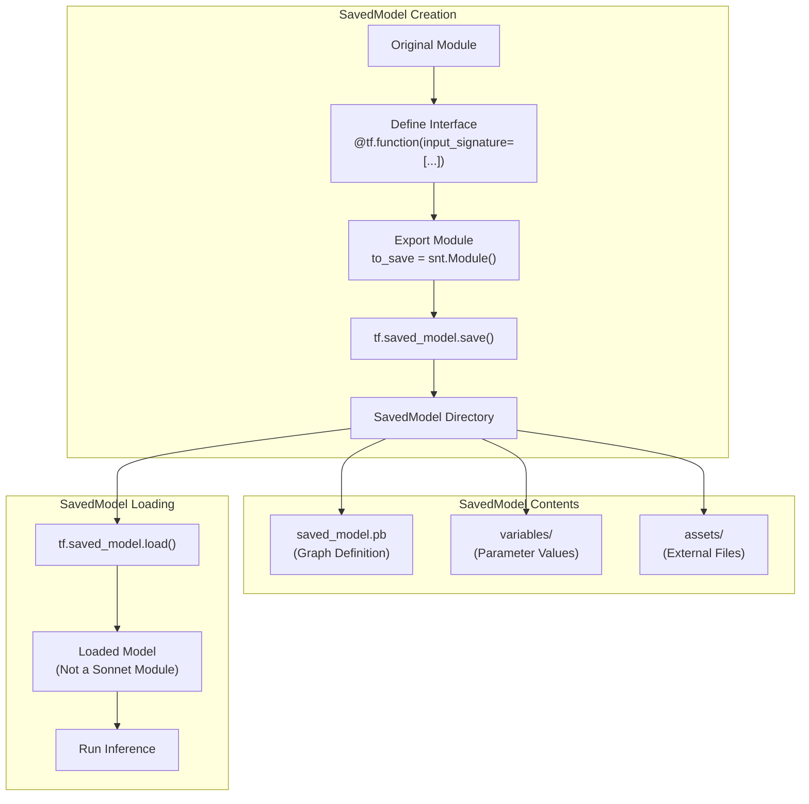
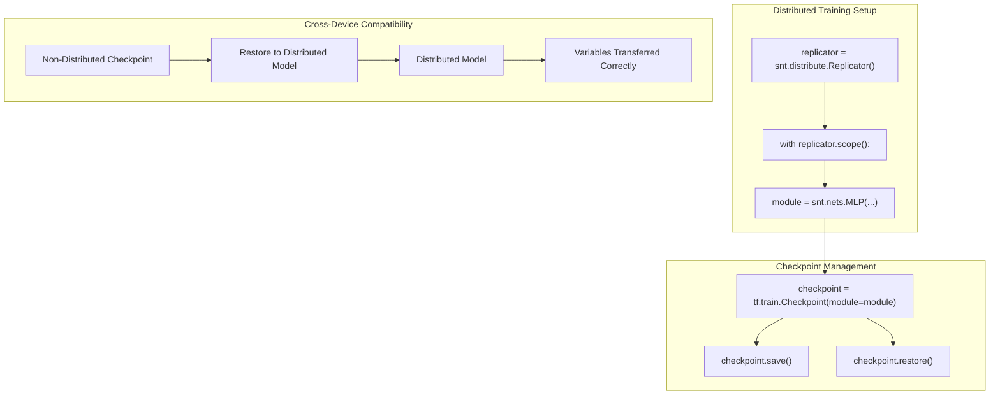

<!-- source: DeepWiki mcp.deepwiki.com · repo google-deepmind/sonnet · page 7.3 Serialization · fetched 2026-10-26 -->

# Serialization

<details>
<summary>Relevant source files</summary>

The following files were used as context for generating this wiki page:

- [README.md](README.md)
- [docs/Makefile](docs/Makefile)
- [docs/conf.py](docs/conf.py)
- [docs/index.rst](docs/index.rst)
- [docs/requirements.txt](docs/requirements.txt)
- [sonnet/distribute.py](sonnet/distribute.py)
- [sonnet/src/conformance/checkpoint_test.py](sonnet/src/conformance/checkpoint_test.py)
- [sonnet/src/conformance/distribute_test.py](sonnet/src/conformance/distribute_test.py)
- [sonnet/src/distribute/BUILD](sonnet/src/distribute/BUILD)
- [sonnet/src/distribute/replicator.py](sonnet/src/distribute/replicator.py)
- [sonnet/src/distribute/replicator_test.py](sonnet/src/distribute/replicator_test.py)

</details>


This document explains how to save and restore Sonnet modules, covering the supported serialization mechanisms and their usage patterns. Serialization allows you to save model parameters during training, deploy trained models, and share models with others.

Sonnet supports multiple serialization formats, with TensorFlow Checkpointing and SavedModel being the primary recommended approaches. For distributed model training serialization, see [Distributed Training](#6).

## Serialization Options in Sonnet



Sources: [README.md:169-176]()

## Python Pickle (Not Recommended)

Sonnet technically supports Python's built-in `pickle` module, and all built-in modules are tested to ensure they can be saved and loaded via pickle in the same Python process. However, this approach is discouraged because:

- It's not well supported by many parts of TensorFlow
- It can be brittle across different environments or versions
- It doesn't provide the same guarantees as TensorFlow's native serialization methods

```python
# While possible, this is NOT recommended
import pickle

# Save
with open("model.pkl", "wb") as f:
    pickle.dump(my_module, f)

# Load
with open("model.pkl", "rb") as f:
    loaded_module = pickle.load(f)
```

Sources: [README.md:169-176]()

## TensorFlow Checkpointing

TensorFlow checkpointing is the recommended approach for saving model parameters during training. It allows you to periodically save parameter values and restore them later, which is useful for:

- Resuming interrupted training sessions
- Preserving the best model during training
- Creating model snapshots at different training stages



Sources: [README.md:178-219](), [sonnet/src/conformance/checkpoint_test.py:30-52]()

### Basic Checkpoint Usage

Here's how to save and restore a Sonnet module using TensorFlow checkpointing:

```python
import os
import tensorflow as tf
import sonnet as snt

# Set up checkpoint location
checkpoint_root = "/tmp/checkpoints"
checkpoint_name = "example"
save_prefix = os.path.join(checkpoint_root, checkpoint_name)

# Create your module
my_module = snt.nets.MLP([1024, 1024, 10])
my_module(tf.ones([8, 784]))  # Initialize variables

# Create a checkpoint
checkpoint = tf.train.Checkpoint(module=my_module)

# Restore from previous checkpoint if it exists
latest = tf.train.latest_checkpoint(checkpoint_root)
if latest is not None:
    checkpoint.restore(latest)

# Save the checkpoint
checkpoint.save(save_prefix)
```

Sources: [README.md:186-219]()

### Restore on Create

A powerful feature of TensorFlow checkpointing is "restore on create," which allows variable values to be restored when variables are created. This is particularly useful for models that create variables dynamically during their first call:

```python
# Create a new instance of the module
new_module = snt.nets.MLP([1024, 1024, 10])

# Create a checkpoint object
checkpoint = tf.train.Checkpoint(module=new_module)

# Restore before variables are created
latest = tf.train.latest_checkpoint(checkpoint_root)
status = checkpoint.restore(latest)

# Variables will be created during the first call
# and their values will be set to the saved values
outputs = new_module(tf.ones([8, 784]))

# Verify all checkpoint variables were used
status.assert_consumed()
```

Sources: [README.md:198-206](), [sonnet/src/conformance/checkpoint_test.py:132-156]()

## TensorFlow SavedModel

TensorFlow SavedModel provides a way to save a model that is decoupled from Python source code. This is useful for:

- Deploying models in production environments
- Sharing models with others without sharing source code
- Loading models in environments that may not have Sonnet installed



Sources: [README.md:221-282]()

### Creating a SavedModel

When creating a SavedModel, you typically want to export only the specific parts of your model needed for inference:

```python
import tensorflow as tf
import sonnet as snt

# Create and initialize your module
my_module = snt.nets.MLP([1024, 1024, 10])
my_module(tf.ones([1, 784]))  # Initialize variables

# Define the inference function with a fixed signature
@tf.function(input_signature=[tf.TensorSpec([None, 784], tf.float32)])
def inference(x):
    return my_module(x)

# Create a new module for export
to_save = snt.Module()
to_save.inference = inference
to_save.all_variables = list(my_module.variables)

# Save the model
tf.saved_model.save(to_save, "/tmp/example_saved_model")
```

Sources: [README.md:244-254]()

### Loading a SavedModel

Loading a SavedModel is straightforward:

```python
import tensorflow as tf

# Load the saved model
loaded = tf.saved_model.load("/tmp/example_saved_model")

# Use the inference method
result = loaded.inference(tf.ones([1, 784]))

# Access the saved variables if needed
variables = loaded.all_variables
```

Note that the loaded object is not a Sonnet module, but a container with the specific methods and properties you defined during export.

Sources: [README.md:268-282]()

## Serialization with Distributed Training

Sonnet's serialization mechanisms work seamlessly with distributed training using `snt.distribute.Replicator` or `snt.distribute.TpuReplicator`.



Sources: [sonnet/src/conformance/checkpoint_test.py:174-237](), [sonnet/src/conformance/distribute_test.py:29-94]()

### Checkpointing Distributed Models

When using a distribution strategy, checkpointing works similar to non-distributed models:

```python
import tensorflow as tf
import sonnet as snt

# Create a replicator
replicator = snt.distribute.Replicator()

# Create the module in the replicator scope
with replicator.scope():
    module = snt.nets.MLP([1024, 1024, 10])

# Create a checkpoint
checkpoint = tf.train.Checkpoint(module=module)

# Save and restore as usual
checkpoint.save("/tmp/distributed_ckpt")
checkpoint.restore(tf.train.latest_checkpoint("/tmp"))
```

You can also restore a checkpoint created from a non-distributed model to a distributed model, which is useful for fine-tuning pre-trained models in a distributed setting.

Sources: [sonnet/src/conformance/checkpoint_test.py:257-300]()

## Best Practices

### When to Use Each Approach

| Approach | Best For | Limitations |
|----------|----------|-------------|
| TF Checkpoint | Saving training progress, resuming training | Requires original model code |
| TF SavedModel | Deployment, sharing models, production use | More complex to set up |
| Pickle | Not recommended | Brittle, not portable |

### Checkpoint Recommendations

1. Save checkpoints regularly during training, especially for long-running jobs
2. Use `latest_checkpoint()` to restore the most recent checkpoint 
3. Test the restored model to ensure correct behavior
4. For distributed training, create checkpoints within the replicator scope

### SavedModel Recommendations

1. Only export the parts of your model needed for inference
2. Always provide an `input_signature` to ensure consistent behavior
3. Make your saved model self-contained by including any required preprocessing/postprocessing
4. Test loading and using the saved model in the target environment

Sources: [README.md:169-282](), [sonnet/src/conformance/checkpoint_test.py]()

## Summary

Sonnet provides robust serialization capabilities that integrate well with TensorFlow's ecosystem. For most use cases:

- Use TensorFlow checkpoints during model development and training
- Use TensorFlow SavedModel for deployment and sharing models
- Avoid using pickle for any serious applications

These serialization mechanisms work seamlessly with Sonnet's module system and distributed training features, allowing you to develop, train, and deploy models with confidence.

Sources: [README.md:169-282](), [sonnet/src/conformance/checkpoint_test.py]()

---

