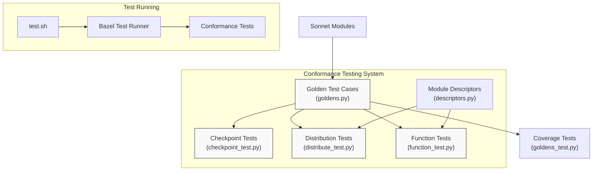
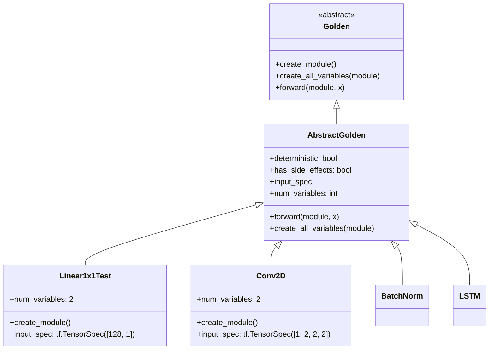
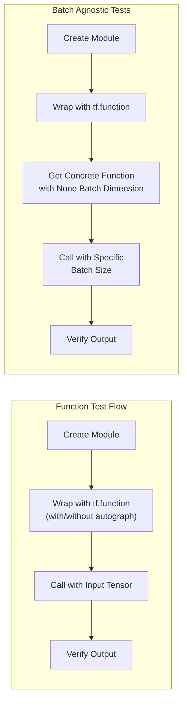
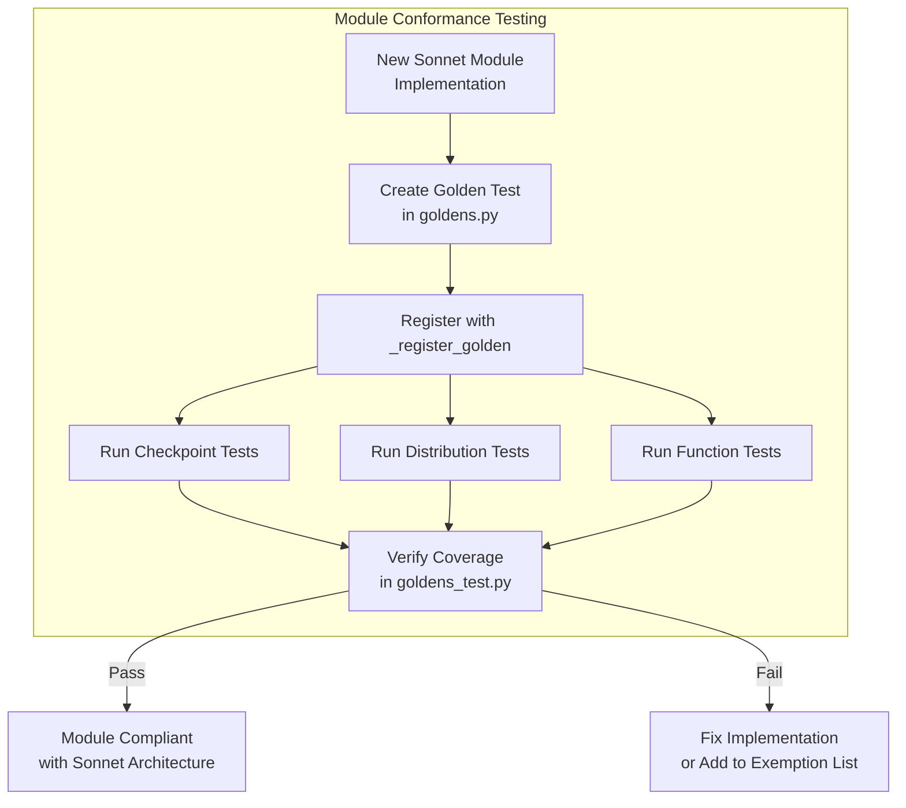

<!-- source: DeepWiki mcp.deepwiki.com · repo google-deepmind/sonnet · page 8 Testing and Conformance · fetched 2026-10-26 -->

# Testing and Conformance

<details>
<summary>Relevant source files</summary>

The following files were used as context for generating this wiki page:

- [docs/api.rst](docs/api.rst)
- [requirements-test.txt](requirements-test.txt)
- [requirements.txt](requirements.txt)
- [sonnet/distribute.py](sonnet/distribute.py)
- [sonnet/nets/__init__.py](sonnet/nets/__init__.py)
- [sonnet/nets/resnet.py](sonnet/nets/resnet.py)
- [sonnet/src/conformance/checkpoint_test.py](sonnet/src/conformance/checkpoint_test.py)
- [sonnet/src/conformance/descriptors.py](sonnet/src/conformance/descriptors.py)
- [sonnet/src/conformance/descriptors_test.py](sonnet/src/conformance/descriptors_test.py)
- [sonnet/src/conformance/distribute_test.py](sonnet/src/conformance/distribute_test.py)
- [sonnet/src/conformance/function_test.py](sonnet/src/conformance/function_test.py)
- [sonnet/src/conformance/goldens.py](sonnet/src/conformance/goldens.py)
- [sonnet/src/conformance/goldens_test.py](sonnet/src/conformance/goldens_test.py)
- [sonnet/src/distribute/BUILD](sonnet/src/distribute/BUILD)
- [sonnet/src/distribute/replicator.py](sonnet/src/distribute/replicator.py)
- [sonnet/src/distribute/replicator_test.py](sonnet/src/distribute/replicator_test.py)
- [test.sh](test.sh)

</details>


The Testing and Conformance system in Sonnet provides a comprehensive framework for verifying that all Sonnet modules adhere to consistent behavior standards. This includes ensuring proper checkpointing functionality, compatibility with TensorFlow distribution strategies, support for `tf.function` compilation, and consistent behavior across different devices (CPU, GPU, TPU).

Unlike standard unit tests, the conformance testing framework focuses on verifying compliance with Sonnet's programming model and architectural requirements.

Sources: [sonnet/src/conformance/checkpoint_test.py:15-16](), [sonnet/src/conformance/function_test.py:15-16](), [sonnet/src/conformance/goldens.py:15-16]()

## Conformance Testing Architecture

The conformance testing framework consists of several interconnected components:

### Architecture Overview Diagram



Sources: [test.sh:17-18](), [sonnet/src/conformance/goldens.py:14-16](), [sonnet/src/conformance/checkpoint_test.py:15-16](), [sonnet/src/conformance/distribute_test.py:15-16](), [sonnet/src/conformance/function_test.py:15-16]()

## Golden Tests System

The foundation of the conformance testing system is the Golden test framework, which defines reference test cases for each Sonnet module type.

### Golden Test Structure



Golden tests define the core characteristics of each module type, including:

1. **Module creation method** - Creates a new instance with standard parameters
2. **Input specification** - Tensor shape and dtype expected by the module
3. **Variable count** - Number of variables the module should create
4. **Behavioral flags** - Whether the module is deterministic, has side effects, etc.

Each golden test is registered with the testing system via the `_register_golden` decorator:

```python
@_register_golden(snt.Linear, "linear_1x1")
class Linear1x1Test(AbstractGolden):
  create_module = lambda _: snt.Linear(1)
  input_spec = tf.TensorSpec([128, 1])
  num_variables = 2
```

Sources: [sonnet/src/conformance/goldens.py:75-126](), [sonnet/src/conformance/goldens.py:130-146]()

## Checkpoint Testing

Checkpoint tests ensure that Sonnet modules can correctly save and restore their state, preserving behavior across serialization.

### Checkpoint Testing Flow

```mermaid
flowchart TD
    subgraph "Basic Checkpoint Flow"
        create["Create Module"] --> 
        init["Initialize Variables<br>with Sequential Values"] -->
        save["Save Checkpoint"] -->
        change["Change Variables<br>to Different Values"] -->
        restore["Restore Checkpoint"] -->
        verify["Verify Variables<br>Match Original Values"] -->
        check_output["Verify Output<br>Matches Original"]
    end
    
    subgraph "Advanced Checkpoint Tests"
        create_new["Create New Instance<br>of Same Module Type"] -->
        restore_new["Restore Checkpoint<br>to New Instance"] -->
        verify_new["Verify Variables and<br>Output Match Original"]
        
        create_deferred["Create Module<br>Without Variables"] -->
        restore_deferred["Restore Checkpoint<br>Before Variable Creation"] -->
        create_vars["Create Variables<br>Through Forward Pass"] -->
        verify_deferred["Verify Variables<br>Match Checkpoint Values"]
    end
```



The `TestCheckpoint` class simplifies checkpoint operations for testing:

```python
class TestCheckpoint:
  def __init__(self, golden=None, **kwargs):
    # Initialize checkpoint location
    # ...
    self._checkpoint = tf.train.Checkpoint(**kwargs)

  def save(self):
    self._checkpoint.save(file_prefix=self._prefix)

  def restore_latest(self, assert_consumed):
    status = self._checkpoint.restore(tf.train.latest_checkpoint(self._root))
    if assert_consumed:
      status.assert_consumed()
    return status
```

Key checkpoint tests include:

| Test Name | Description |
|-----------|-------------|
| `test_save_load` | Verify basic save and load functionality |
| `test_save_then_load_new_instance` | Ensure checkpoint created for one instance loads into another |
| `test_restore_on_create` | Test that variables are properly restored when created |
| `test_restore_golden` | Verify modules can restore from reference checkpoints |

Sources: [sonnet/src/conformance/checkpoint_test.py:30-52](), [sonnet/src/conformance/checkpoint_test.py:65-73]()

## Distribution Strategy Compatibility

The distribution strategy tests verify that Sonnet modules work correctly with TensorFlow distribution strategies, particularly `Replicator` and `TpuReplicator`.

### Distribution Strategy Testing Architecture

```mermaid
flowchart TD
    subgraph "Distribution Strategy Testing"
        replicator["Initialize Replicator<br>(CPU/GPU/TPU)"] -->
        scope["Enter Replicator Scope"] -->
        create["Create Module in Scope"] -->
        variables["Create Variables<br>with Sequential Values"] -->
        save["Save Checkpoint"] -->
        modify["Modify Variables<br>to Different Values"] -->
        restore["Restore Checkpoint"] -->
        verify["Verify Variables Match<br>Across All Replicas"] -->
        forward["Verify Forward Pass<br>Produces Same Output"]
    end
    
    subgraph "Replicator Implementation"
        rep_init["Replicator/TpuReplicator"] -->
        rep_scope["scope() method"] -->
        creator["replica_local_creator<br>Variable Creator"]
    end
```



Key distribution strategy tests include:

1. **Variable creation in replica context** - Ensures variables can be created within a replica context
2. **Cross-replica initialization** - Tests initialization with variables created in a cross-replica context
3. **Checkpoint save/restore** - Verifies checkpoints work correctly with distributed variables
4. **Restore on create** - Tests variable restoration in replica context

The `Replicator` and `TpuReplicator` classes provide scopes for distribution strategy testing:

```python
class Replicator(tf.distribute.MirroredStrategy):
  @contextlib.contextmanager
  def scope(self):
    with contextlib.ExitStack() as stack:
      stack.enter_context(super().scope())
      stack.enter_context(tf.variable_creator_scope(replica_local_creator))
      yield
```

Sources: [sonnet/src/distribute/replicator.py:38-84](), [sonnet/src/conformance/distribute_test.py:15-16](), [sonnet/src/conformance/checkpoint_test.py:174-301]()

## Function Compatibility

Function tests ensure that Sonnet modules work correctly with TensorFlow's `tf.function` for graph compilation.

### Function Test Flow



Function tests verify several capabilities:

| Test Name | Description |
|-----------|-------------|
| `test_trace` | Basic module tracing with `tf.function` |
| `test_create_variables_eagerly` | Test the `create_variables_eagerly` utility |
| `test_trace_batch_agnostic` | Verify modules work with variable batch sizes |
| `test_trace_batch_apply_batch_agnostic` | Test batch application with variable dimensions |
| `test_optimizer_dense/sparse` | Test optimizers with dense and sparse updates |

The `create_variables_eagerly` decorator improves performance by creating variables in eager mode:

```python
def create_variables_eagerly(f: Callable[..., T]) -> Callable[..., T]:
  """Wraps a function and attempts to create variables using eager mode."""
  def wrapper(*args, **kwargs):
    with contextlib.ExitStack() as stack:
      stack.enter_context(_eager_initial_values())
      stack.enter_context(tf.variable_creator_scope(_eager_variable_creator))
      return f(*args, **kwargs)
  return wrapper
```

Sources: [sonnet/src/conformance/function_test.py:34-135](), [sonnet/src/distribute/replicator.py:145-178]()

## Test Coverage Verification

The testing framework verifies that all Sonnet modules have appropriate conformance tests:

```python
def test_all_modules_covered(self):
  allow_no_checkpoint = set([
    # Stateless or abstract modules
    snt.BatchApply, snt.DeepRNN, snt.Deferred, snt.Flatten,
    snt.Module, snt.Reshape, snt.RNNCore, # ...
  ])

  # Find all snt.Module types
  all_sonnet_types = set()
  for _, python_module in test_utils.find_sonnet_python_modules(snt):
    for _, cls in inspect.getmembers(python_module, inspect.isclass):
      if issubclass(cls, snt.Module):
        all_sonnet_types.add(cls)

  # Find all modules that have checkpoint tests
  tested_modules = {module_cls for module_cls, _, _ in goldens.list_goldens()}

  # Make sure everything is covered
  self.assertEqual(tested_modules | allow_no_checkpoint, all_sonnet_types)
```

This ensures complete test coverage of all Sonnet modules, with explicit exceptions for stateless or abstract modules.

Sources: [sonnet/src/conformance/goldens_test.py:26-70]()

## Running Tests

Tests can be run using the `test.sh` script, which:

1. Sets up a Python virtual environment
2. Installs dependencies from requirements files
3. Runs Bazel tests with appropriate concurrency

```bash
# Run tests with automatic job count detection
bazel test --jobs=${N_JOBS} --test_timeout 300,450,1200,3600 \
    --build_tests_only --test_output=errors \
    --cache_test_results=no \
    -- //...
```

The script automatically detects CPU count to optimize test parallelism:

```bash
# CPU count detection
if [ "$(uname)" == "Darwin" ]; then
  N_JOBS=$(sysctl -n hw.logicalcpu)
else
  N_JOBS=$(grep -c ^processor /proc/cpuinfo)
fi
```

Sources: [test.sh:35-55]()

## Module Testing Workflow

The following diagram illustrates how a module is validated through the conformance testing system:



To extend the testing framework for a new module:

1. Create a golden test class in `goldens.py` that inherits from `AbstractGolden`
2. Register it with `_register_golden` decorator for the appropriate module class
3. Run the conformance tests to verify compliance
4. If the module doesn't require checkpoint tests (e.g., stateless modules), add it to the `allow_no_checkpoint` set in `goldens_test.py`

Sources: [sonnet/src/conformance/goldens.py:36-43](), [sonnet/src/conformance/goldens.py:130-146](), [sonnet/src/conformance/goldens_test.py:28-53]()

---

