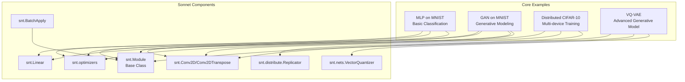
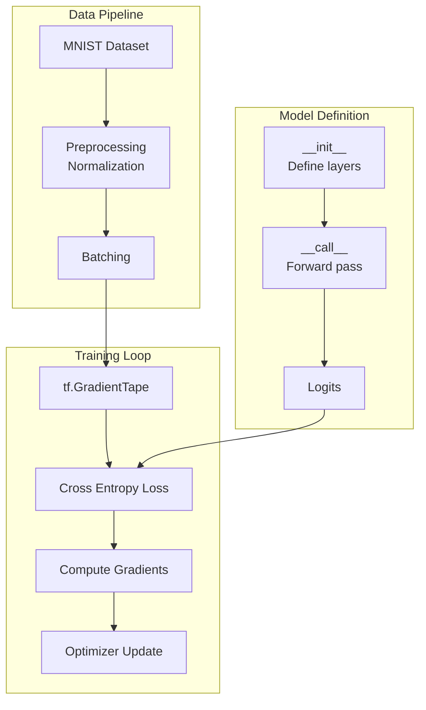
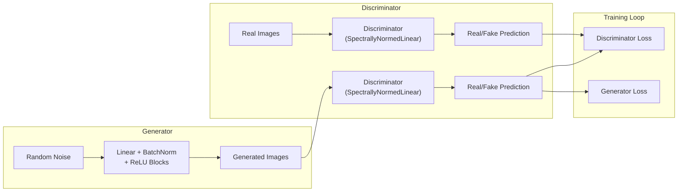
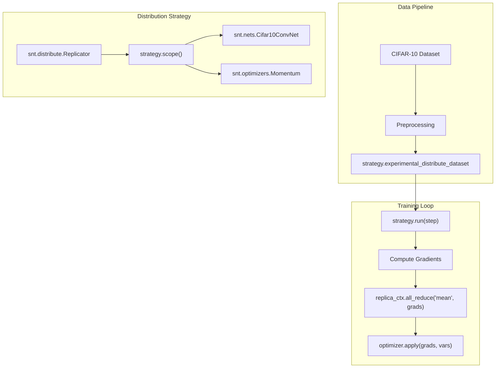
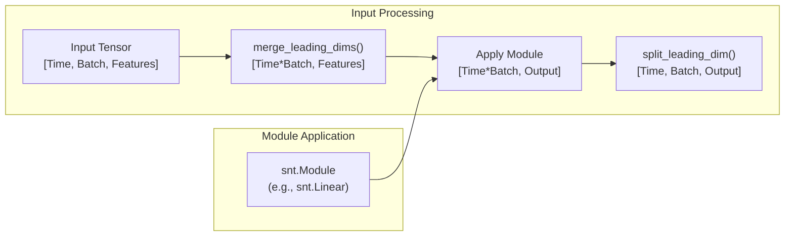
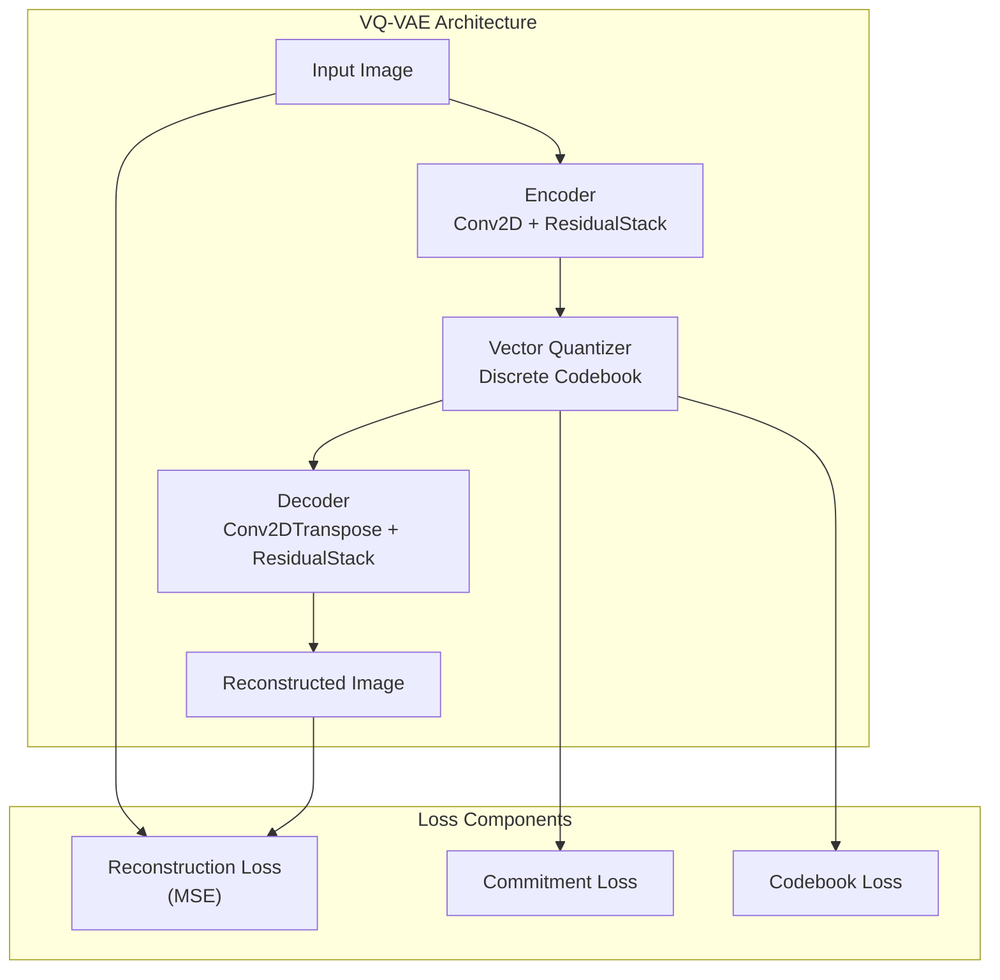

<!-- source: DeepWiki mcp.deepwiki.com · repo google-deepmind/sonnet · page 9 Examples · fetched 2026-10-26 -->

# Examples

<details>
<summary>Relevant source files</summary>

The following files were used as context for generating this wiki page:

- [examples/README.md](examples/README.md)
- [examples/distributed_cifar10.ipynb](examples/distributed_cifar10.ipynb)
- [examples/little_gan_on_mnist.ipynb](examples/little_gan_on_mnist.ipynb)
- [examples/mlp_on_mnist.ipynb](examples/mlp_on_mnist.ipynb)
- [examples/simple_mnist.py](examples/simple_mnist.py)
- [examples/vqvae_example.ipynb](examples/vqvae_example.ipynb)
- [sonnet/src/batch_apply.py](sonnet/src/batch_apply.py)
- [sonnet/src/batch_apply_test.py](sonnet/src/batch_apply_test.py)

</details>


This page provides an overview of the example code provided with Sonnet, demonstrating how to use the library for various deep learning tasks. These examples range from basic models to more advanced architectures, showcasing Sonnet's modular approach to building neural networks.

## Overview

Sonnet includes several example implementations that serve as learning resources and starting points for your own projects:

1. **MLP on MNIST** - A basic example showing how to build a multi-layer perceptron for digit classification
2. **GAN on MNIST** - Implementation of a Generative Adversarial Network for generating digit images
3. **Distributed Training on CIFAR-10** - Example of multi-device training for image classification
4. **VQ-VAE** - Vector Quantized Variational Autoencoder implementation
5. **BatchApply** - Utility for processing higher-dimensional data

### Example Components

The following diagram shows the relationship between the examples and the Sonnet components they showcase:



Sources: [examples/README.md:1-13](), [examples/mlp_on_mnist.ipynb:1-132](), [examples/little_gan_on_mnist.ipynb:1-95](), [examples/distributed_cifar10.ipynb:1-105](), [examples/vqvae_example.ipynb:1-40]()

## MLP for MNIST Example

This example demonstrates how to build and train a simple multi-layer perceptron (MLP) to classify handwritten digits from the MNIST dataset.

### Key Components

The example showcases:
- Creating a custom module by extending `snt.Module`
- Loading and preprocessing data with TensorFlow Datasets
- Implementing a training loop with gradient tape
- Evaluating model performance

### Implementation Flow



### Example Code Structure

The MLP example defines a custom module that stacks multiple linear layers with ReLU activations:

```python
class MLP(snt.Module):
  def __init__(self):
    super(MLP, self).__init__()
    self.flatten = snt.Flatten()
    self.hidden1 = snt.Linear(1024, name="hidden1")
    self.hidden2 = snt.Linear(1024, name="hidden2")
    self.logits = snt.Linear(10, name="logits")

  def __call__(self, images):
    output = self.flatten(images)
    output = tf.nn.relu(self.hidden1(output))
    output = tf.nn.relu(self.hidden2(output))
    output = self.logits(output)
    return output
```

The training process uses a gradient tape to compute gradients and update the model parameters:

```python
def step(images, labels):
  with tf.GradientTape() as tape:
    logits = mlp(images)
    loss = tf.nn.sparse_softmax_cross_entropy_with_logits(logits=logits,
                                                         labels=labels)
    loss = tf.reduce_mean(loss)

  params = mlp.trainable_variables
  grads = tape.gradient(loss, params)
  opt.apply(grads, params)
  return loss
```

Sources: [examples/mlp_on_mnist.ipynb:250-304](), [examples/mlp_on_mnist.ipynb:493-514]()

## GAN on MNIST Example

This example demonstrates how to implement a Generative Adversarial Network (GAN) for generating MNIST-like digit images.

### Architecture Overview

The GAN consists of two neural networks that train adversarially:

1. **Generator**: Takes random noise as input and generates fake images
2. **Discriminator**: Tries to distinguish between real and generated images



### Implementation Details

The GAN example implements several custom components:

1. `SpectralNormalizer` - Implements spectral normalization for model stability
2. `Generator` - Network that generates fake images from random noise
3. `Discriminator` - Network that classifies images as real or fake
4. Training loop with separate optimizer steps for generator and discriminator

Sources: [examples/little_gan_on_mnist.ipynb:270-436]()

## Distributed Training on CIFAR-10

This example demonstrates how to use Sonnet for distributed training across multiple devices, showing how to scale up training of a convolutional network on the CIFAR-10 dataset.

### Architecture Overview



### Key Concepts

The distributed training example demonstrates several important concepts:

1. **Creating virtual devices** - Splitting a physical GPU into multiple virtual devices
2. **Distribution strategy** - Using `snt.distribute.Replicator` to manage training across devices
3. **Gradient aggregation** - Using `all_reduce` to combine gradients from different devices
4. **Distributed dataset** - Splitting data across multiple devices efficiently

This example is particularly useful for scaling up training to multiple GPUs or TPUs.

Sources: [examples/distributed_cifar10.ipynb:131-187](), [examples/distributed_cifar10.ipynb:288-368]()

## BatchApply Utility

`BatchApply` is a utility module that helps process higher-dimensional tensor data by merging and then splitting leading dimensions. This is particularly useful for sequence data or when handling batched inputs.

### How BatchApply Works



### Implementation Details

`BatchApply` wraps another Sonnet module and handles the reshaping operations automatically:

```python
class BatchApply(base.Module):
  def __init__(self, module, num_dims=2, name=None):
    super().__init__(name=name)
    self.module = module
    self.num_dims = num_dims

  def __call__(self, *args, **kwargs):
    # Merge leading dimensions (e.g., [T, B, N] -> [T*B, N])
    args = tree.map_structure(lambda x: merge_leading_dims(x, num_dims=self.num_dims), args)
    kwargs = tree.map_structure(lambda x: merge_leading_dims(x, num_dims=self.num_dims), kwargs)

    # Apply the wrapped module
    outputs = self.module(*args, **kwargs)

    # Split leading dimension to match input (e.g., [T*B, O] -> [T, B, O])
    return tree.map_structure(lambda x: split_leading_dim(x, example=first_leaf(args, kwargs), 
                                                         num_dims=self.num_dims), outputs)
```

This utility is especially useful when working with RNN models or any models that process sequences of data.

Sources: [sonnet/src/batch_apply.py:25-73](), [sonnet/src/batch_apply_test.py:31-172]()

## Additional Examples

### Simple MNIST Script

A standalone Python script that implements a simple convolutional neural network for MNIST classification using Sonnet. This example is useful for understanding how to use Sonnet in production code.

Key components:
- Data loading and preprocessing
- Model definition using `snt.Sequential`
- Training and evaluation functions with TensorFlow function decorators

```python
model = snt.Sequential([
    snt.Conv2D(32, 3, 1),
    tf.nn.relu,
    snt.Conv2D(32, 3, 1),
    tf.nn.relu,
    snt.Flatten(),
    snt.Linear(10),
])
```

Sources: [examples/simple_mnist.py:100-107]()

### VQ-VAE Example

Implements a Vector Quantized Variational Autoencoder (VQ-VAE) as described in the paper "Neural Discrete Representation Learning". This is a more advanced example that demonstrates Sonnet's flexibility for implementing complex architectures.

Key components:
- Encoder and decoder networks with residual connections
- Vector quantizer for discrete representation learning
- Training loop with reconstruction and commitment losses



This example demonstrates how to implement more complex architectures with Sonnet and how to compose different modules together.

Sources: [examples/vqvae_example.ipynb:203-329]()

## Running the Examples

The examples are provided in different formats:

1. **Jupyter Notebooks** 
   - MLP on MNIST, GAN on MNIST, and VQ-VAE examples are provided as notebooks
   - Can be run in Google Colab without requiring local setup

2. **Python Scripts**
   - Simple MNIST example is provided as a standalone Python script
   - Can be run directly from the command line

```
# Running the simple MNIST script
python examples/simple_mnist.py
```

Sources: [examples/README.md:1-13]()

---

