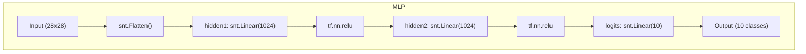
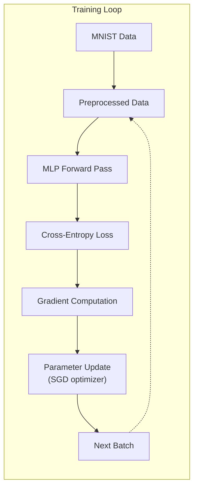
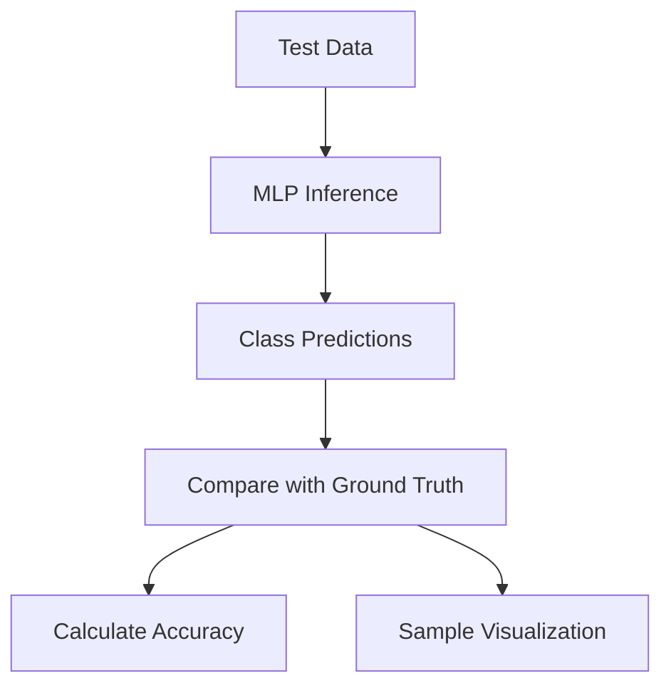

<!-- source: DeepWiki mcp.deepwiki.com · repo google-deepmind/sonnet · page 9.1 MLP for MNIST · fetched 2026-10-26 -->

# MLP for MNIST

<details>
<summary>Relevant source files</summary>

The following files were used as context for generating this wiki page:

- [examples/README.md](examples/README.md)
- [examples/distributed_cifar10.ipynb](examples/distributed_cifar10.ipynb)
- [examples/little_gan_on_mnist.ipynb](examples/little_gan_on_mnist.ipynb)
- [examples/mlp_on_mnist.ipynb](examples/mlp_on_mnist.ipynb)

</details>


This document provides a walkthrough of using Sonnet to implement and train a Multi-Layer Perceptron (MLP) on the MNIST dataset. It serves as a practical example of using Sonnet's module system to build a simple neural network. For more complex architectures like GANs, see [GAN on MNIST](#9.2), and for distributed training examples, see [Distributed Training on CIFAR-10](#9.3).

## Overview

The MNIST example demonstrates the core workflow for creating and training neural networks with Sonnet:
1. Preparing the dataset
2. Building a model with Sonnet modules
3. Training the model with an optimizer
4. Evaluating model performance

This example serves as a "Hello, World" introduction to Sonnet's API and TensorFlow 2 integration.

Sources: [examples/mlp_on_mnist.ipynb:33-56]()

## Dataset Preparation

The example uses TensorFlow Datasets to load MNIST, which contains 28x28 grayscale images of handwritten digits. The data preprocessing pipeline:

1. Loads the MNIST dataset using `tfds`
2. Applies normalization to scale pixel values to the range [-1, 1]
3. Sets up batching and prefetching for efficient training

```python
def process_batch(images, labels):
  images = tf.squeeze(images, axis=[-1])
  images = tf.cast(images, dtype=tf.float32)
  images = ((images / 255.) - .5) * 2.
  return images, labels

def mnist(split):
  dataset = tfds.load("mnist", split=split, as_supervised=True)
  dataset = dataset.map(process_batch)
  dataset = dataset.batch(batch_size)
  dataset = dataset.prefetch(tf.data.experimental.AUTOTUNE)
  dataset = dataset.cache()
  return dataset

mnist_train = mnist("train").shuffle(10)
mnist_test = mnist("test")
```

Sources: [examples/mlp_on_mnist.ipynb:166-198]()

## MLP Architecture

The Multi-Layer Perceptron is implemented as a Sonnet module by subclassing `snt.Module`. This architecture consists of a flattening layer followed by two hidden layers with ReLU activations and a final output layer.

### Diagram: MLP Architecture



The implementation creates a custom class that inherits from `snt.Module`:

```python
class MLP(snt.Module):
  def __init__(self):
    super(MLP, self).__init__()
    self.flatten = snt.Flatten()
    self.hidden1 = snt.Linear(1024, name="hidden1")
    self.hidden2 = snt.Linear(1024, name="hidden2")
    self.logits = snt.Linear(10, name="logits")

  def __call__(self, images):
    output = self.flatten(images)
    output = tf.nn.relu(self.hidden1(output))
    output = tf.nn.relu(self.hidden2(output))
    output = self.logits(output)
    return output
```

Sources: [examples/mlp_on_mnist.ipynb:289-304](), [examples/mlp_on_mnist.ipynb:277-288]()

## Training Process

The training process uses the SGD optimizer with a learning rate of 0.1. The workflow follows these steps:

1. Forward pass through the model
2. Calculate loss using sparse softmax cross-entropy
3. Compute gradients using `tf.GradientTape`
4. Apply gradients to update model parameters

### Diagram: Training Flow



The training is implemented using a `step` function that performs one optimization step:

```python
def step(images, labels):
  """Performs one optimizer step on a single mini-batch."""
  with tf.GradientTape() as tape:
    logits = mlp(images)
    loss = tf.nn.sparse_softmax_cross_entropy_with_logits(logits=logits,
                                                        labels=labels)
    loss = tf.reduce_mean(loss)

  params = mlp.trainable_variables
  grads = tape.gradient(loss, params)
  opt.apply(grads, params)
  return loss
```

The code then runs the `step` function over multiple epochs:

```python
for images, labels in progress_bar(mnist_train.repeat(num_epochs)):
  loss = step(images, labels)
```

Sources: [examples/mlp_on_mnist.ipynb:498-514](), [examples/mlp_on_mnist.ipynb:442-454]()

## Model Evaluation

After training, the model is evaluated on the test set to measure its accuracy:

```python
total = 0
correct = 0
for images, labels in mnist_test:
  predictions = tf.argmax(mlp(images), axis=1)
  correct += tf.math.count_nonzero(tf.equal(predictions, labels))
  total += images.shape[0]

print("Got %d/%d (%.02f%%) correct" % (correct, total, correct / total * 100.))
```

The example also includes visualization code to display correctly and incorrectly classified examples:

### Diagram: Evaluation Process



The model achieves approximately 97-98% accuracy on the MNIST test set after training for 10 epochs.

Sources: [examples/mlp_on_mnist.ipynb:558-567](), [examples/mlp_on_mnist.ipynb:590-618]()

## Key Components and Sonnet Integration

The example demonstrates several key Sonnet concepts:

1. **Module System**: The MLP is built using the `snt.Module` base class, which provides a clean way to organize layers and their parameters
2. **Module Composition**: Reusable components like `snt.Linear` and `snt.Flatten` are composed within a custom module
3. **Variable Management**: Sonnet automatically tracks variables, making them accessible via `trainable_variables`
4. **Optimizers**: The example uses `snt.optimizers.SGD` for weight updates

### Diagram: Sonnet Component Relationships

```mermaid
classDiagram
    class "snt.Module" {
        +__init__(name)
        +__call__(inputs)
        +variables
        +trainable_variables
    }
    
    class "MLP" {
        +flatten: snt.Flatten
        +hidden1: snt.Linear
        +hidden2: snt.Linear
        +logits: snt.Linear
        +__call__(images)
    }
    
    class "snt.Linear" {
        +w: Variable
        +b: Variable
        +__call__(inputs)
    }
    
    class "snt.Flatten" {
        +__call__(inputs)
    }
    
    class "snt.optimizers.SGD" {
        +learning_rate
        +apply(grads, params)
    }
    
    "snt.Module" <|-- "MLP"
    "snt.Module" <|-- "snt.Linear"
    "snt.Module" <|-- "snt.Flatten"
    "MLP" *-- "snt.Linear"
    "MLP" *-- "snt.Flatten"
```

Sources: [examples/mlp_on_mnist.ipynb:251-282]()

## Conclusion

This example demonstrates the fundamentals of using Sonnet to build and train a neural network:

1. Creating a custom `snt.Module` subclass to define a network architecture
2. Defining forward computation in the `__call__` method
3. Using TensorFlow's automatic differentiation for training
4. Applying an optimizer to update model parameters

The MLP for MNIST serves as a starting point for more complex models and tasks. The modular design of Sonnet allows for easy extension and reuse of components for more sophisticated architectures.

Sources: [examples/mlp_on_mnist.ipynb:1-646](), [examples/README.md:1-13]()

---

