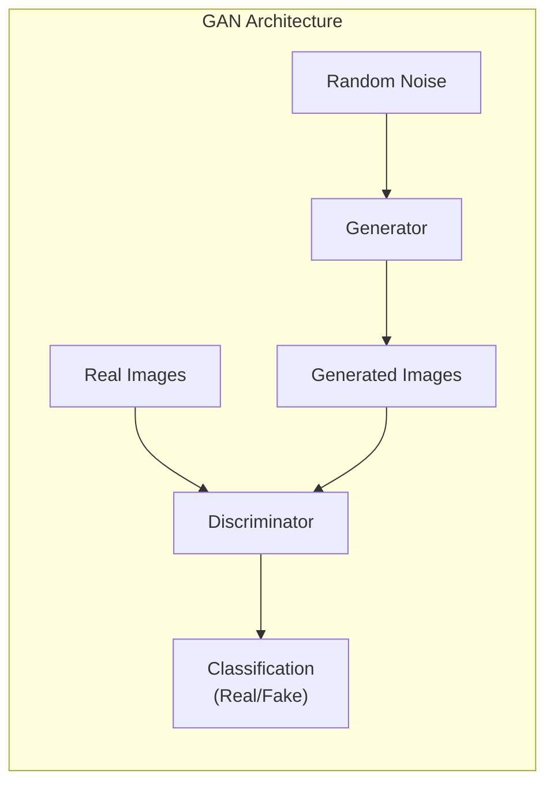
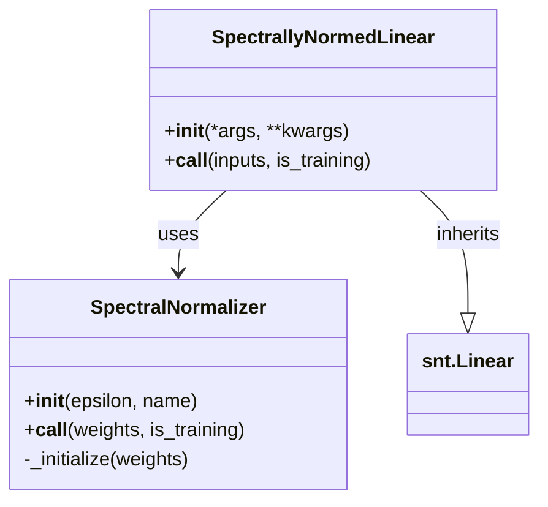
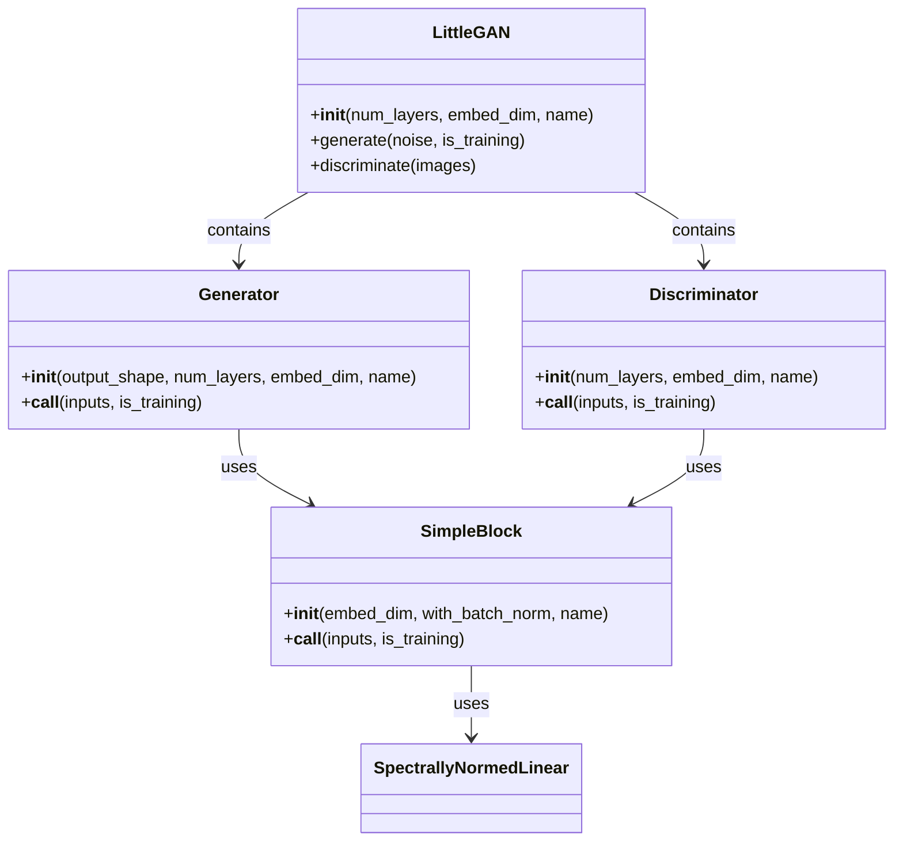
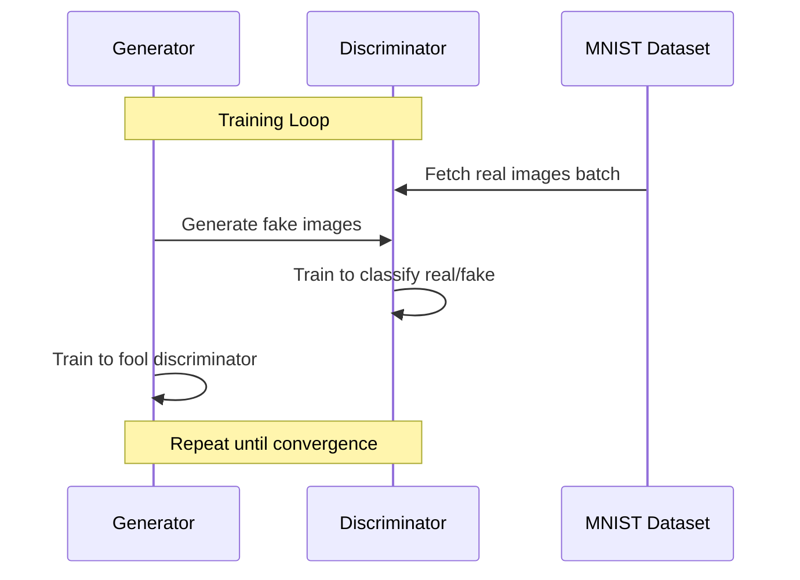
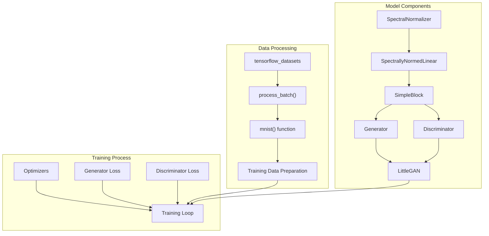

<!-- source: DeepWiki mcp.deepwiki.com · repo google-deepmind/sonnet · page 9.2 GAN on MNIST · fetched 2026-10-26 -->

# GAN on MNIST

<details>
<summary>Relevant source files</summary>

The following files were used as context for generating this wiki page:

- [examples/README.md](examples/README.md)
- [examples/distributed_cifar10.ipynb](examples/distributed_cifar10.ipynb)
- [examples/little_gan_on_mnist.ipynb](examples/little_gan_on_mnist.ipynb)
- [examples/mlp_on_mnist.ipynb](examples/mlp_on_mnist.ipynb)

</details>


This page explains how to implement a Generative Adversarial Network (GAN) on the MNIST dataset using Sonnet. The implementation demonstrates how to build and train a GAN that learns to generate handwritten digit images that resemble those in the MNIST dataset. For a simpler model on MNIST using an MLP, see [MLP for MNIST](#9.1).

## Overview of GANs

Generative Adversarial Networks (GANs) are a framework for training generative models via an adversarial process. A GAN consists of two neural networks:

1. **Generator**: Takes random noise as input and produces synthetic data (images in our case).
2. **Discriminator**: Evaluates whether an image is real (from the training dataset) or fake (created by the generator).

These two networks are trained simultaneously in a game-theoretic scenario: the generator tries to produce images that fool the discriminator, while the discriminator tries to accurately distinguish between real and generated images.



Sources: [examples/little_gan_on_mnist.ipynb:34-47]()

## MNIST Dataset Preparation

Before training the GAN, we need to prepare the MNIST dataset. The dataset contains 28x28 grayscale images of handwritten digits (0-9).

```python
def process_batch(images, labels):
  images = tf.squeeze(images, axis=[-1])
  images = tf.cast(images, dtype=tf.float32)
  images /= 255.
  images = tf.clip_by_value(images, 0., 1.)
  return images, labels

batch_size = 100
def mnist(split, batch_size=batch_size):
  dataset, ds_info = tfds.load('mnist:3.*.*', split=split, as_supervised=True,
                               with_info=True)
  dataset = dataset.map(process_batch)
  dataset = dataset.batch(batch_size)
  dataset = dataset.prefetch(tf.data.experimental.AUTOTUNE)
  dataset = dataset.cache()
  return dataset, ds_info

mnist_train, mnist_train_info = mnist('train')
mnist_test, mnist_test_info = mnist('test')

mnist_shuffled = mnist_train.shuffle(10000).repeat()
```

Sources: [examples/little_gan_on_mnist.ipynb:190-211]()

## GAN Implementation

Our GAN implementation for MNIST consists of several components:

### Spectral Normalization

Spectral normalization is used to stabilize GAN training by constraining the Lipschitz constant of the discriminator. The implementation includes:

- `SpectralNormalizer`: A class that applies spectral normalization to weights.
- `SpectrallyNormedLinear`: A linear layer with spectral normalization applied.



Sources: [examples/little_gan_on_mnist.ipynb:318-358]()

### Building Blocks

The main building blocks of our GAN are:

- `SimpleBlock`: A basic neural network block with optional batch normalization.
- `Generator`: Transforms random noise into synthetic images.
- `Discriminator`: Classifies images as real or fake.
- `LittleGAN`: Combines generator and discriminator into a single module.



Sources: [examples/little_gan_on_mnist.ipynb:360-435]()

### Model Architecture Details

The GAN implementation uses the following architecture:

1. **Generator**:
   - Input: Random noise
   - Multiple SimpleBlocks with batch normalization
   - Output layer producing 28x28 images

2. **Discriminator**:
   - Input: 28x28 images (real or generated)
   - Multiple SimpleBlocks without batch normalization
   - Output layer producing a single value (real or fake classification)

```mermaid
flowchart TB
    subgraph "Generator Architecture"
        G_In["Random Noise Input"]
        G_Flat["Flatten"]
        G_Block1["SimpleBlock with BatchNorm"]
        G_Block2["SimpleBlock with BatchNorm"]
        G_Out["Linear + Reshape + Sigmoid"]
        G_Result["Generated 28x28 Image"]
        
        G_In --> G_Flat
        G_Flat --> G_Block1
        G_Block1 --> G_Block2
        G_Block2 --> G_Out
        G_Out --> G_Result
    end
    
    subgraph "Discriminator Architecture"
        D_In["28x28 Image Input"]
        D_Flat["Flatten"]
        D_Block1["SimpleBlock without BatchNorm"]
        D_Block2["SimpleBlock without BatchNorm"]
        D_Out["SpectrallyNormedLinear"]
        D_Result["Real/Fake Classification"]
        
        D_In --> D_Flat
        D_Flat --> D_Block1
        D_Block1 --> D_Block2
        D_Block2 --> D_Out
        D_Out --> D_Result
    end
```



Sources: [examples/little_gan_on_mnist.ipynb:380-435]()

## Training the GAN

Training a GAN involves alternating between training the discriminator and the generator. The key steps are:

1. Generate a batch of fake images using the generator
2. Train the discriminator on both real and fake images
3. Train the generator to fool the discriminator



The training process in the code uses the following steps:

1. Define optimizers for both the generator and discriminator
2. For each batch:
   - Generate random noise
   - Create fake images using the generator
   - Update the discriminator using real and fake images
   - Update the generator to fool the discriminator

Sources: [examples/little_gan_on_mnist.ipynb:500-541]()

## Visualization and Evaluation

To evaluate the quality of generated images, we can visualize them during or after training. The typical evaluation method is to:

1. Generate a set of images using random noise
2. Display the images to assess their visual quality
3. Compare with real MNIST images

During training, we can display both real MNIST digits (top row) and generated digits (bottom row) to see how the quality of generated images improves over time.

Sources: [examples/little_gan_on_mnist.ipynb:496-516]()

## Implementation Structure

Here's a diagram showing how the various components of our GAN implementation fit together:



Sources: [examples/little_gan_on_mnist.ipynb:318-541]()

## Running the Example

The full example is available in the Sonnet repository as a Jupyter notebook. To run it, you'll need:

1. TensorFlow 2.x
2. Sonnet 2.x
3. TensorFlow Datasets
4. Matplotlib (for visualization)

You can run the notebook directly from Google Colab by following the link in the examples README.

Sources: [examples/README.md:4-7]()

## Conclusion

This implementation demonstrates how to build and train a GAN on the MNIST dataset using Sonnet. The architecture uses spectral normalization to stabilize training and produces reasonably good quality digit images after training.

Key takeaways:
- GANs consist of a generator and discriminator trained adversarially
- Spectral normalization helps stabilize GAN training
- The LittleGAN implementation in Sonnet provides a simple yet effective framework for generating MNIST-like images

---

