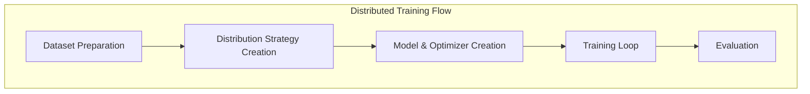
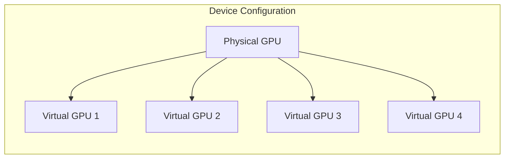
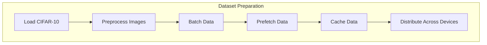
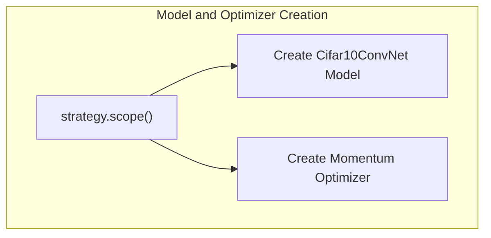
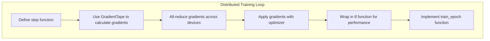
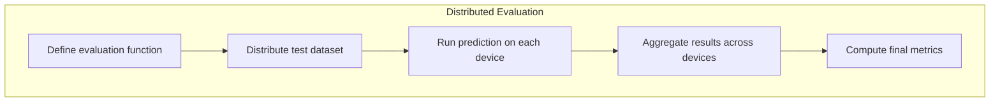
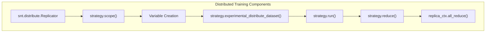

<!-- source: DeepWiki mcp.deepwiki.com · repo google-deepmind/sonnet · page 9.3 Distributed Training on CIFAR-10 · fetched 2026-10-26 -->

# Distributed Training on CIFAR-10

<details>
<summary>Relevant source files</summary>

The following files were used as context for generating this wiki page:

- [examples/README.md](examples/README.md)
- [examples/distributed_cifar10.ipynb](examples/distributed_cifar10.ipynb)
- [examples/little_gan_on_mnist.ipynb](examples/little_gan_on_mnist.ipynb)
- [examples/mlp_on_mnist.ipynb](examples/mlp_on_mnist.ipynb)
- [sonnet/src/nets/dnc/util.py](sonnet/src/nets/dnc/util.py)
- [sonnet/src/nets/dnc/util_test.py](sonnet/src/nets/dnc/util_test.py)
- [sonnet/src/test_utils.py](sonnet/src/test_utils.py)

</details>


This page explains how to implement distributed training for a convolutional neural network on the CIFAR-10 dataset using Sonnet. It covers setting up the distribution strategy, properly distributing data across devices, and implementing efficient training and evaluation loops.

For simpler, non-distributed examples, see [MLP on MNIST](#9.1) or [GAN on MNIST](#9.2).

## Overview of Distributed Training in Sonnet

Distributed training allows you to utilize multiple devices (GPUs or TPUs) to train neural networks more efficiently. Sonnet provides tools to make distributed training straightforward through the `snt.distribute` module, particularly the `Replicator` class that works with multiple GPUs.



Sources: [examples/distributed_cifar10.ipynb:133-242]()

## Setting Up the Distribution Environment

### Creating Virtual Devices

When working in environments with limited hardware (like Colab), you can create multiple virtual devices from a single physical GPU to test distributed training.



```python
# List physical devices
physical_gpus = tf.config.experimental.list_physical_devices("GPU")

# Create virtual devices
tf.config.experimental.set_virtual_device_configuration(
    physical_gpus[0],
    [tf.config.experimental.VirtualDeviceConfiguration(memory_limit=2000)] * 4
)

# Verify logical devices are created
gpus = tf.config.experimental.list_logical_devices("GPU")
```

Sources: [examples/distributed_cifar10.ipynb:169-221]()

### Creating a Distribution Strategy

Sonnet provides the `Replicator` class which is similar to TensorFlow's `MirroredStrategy` but is designed to work with Sonnet optimizers.

```python
strategy = snt.distribute.Replicator(
    ["/device:GPU:{}".format(i) for i in range(4)],
    tf.distribute.ReductionToOneDevice("GPU:0")
)
```

Sources: [examples/distributed_cifar10.ipynb:244-246]()

## Preparing the CIFAR-10 Dataset

CIFAR-10 contains 32x32 pixel color images in 10 different classes. The dataset needs to be properly batched and distributed across devices.



```python
batch_size = 100 * 4  # Total batch size across all GPUs

def process_batch(images, labels):
    images = tf.cast(images, dtype=tf.float32)
    images = ((images / 255.) - .5) * 2.
    return images, labels

def cifar10(split):
    dataset = tfds.load("cifar10", split=split, as_supervised=True)
    dataset = dataset.map(process_batch)
    dataset = dataset.batch(batch_size)
    dataset = dataset.prefetch(tf.data.experimental.AUTOTUNE)
    dataset = dataset.cache()
    return dataset

cifar10_train = cifar10("train").shuffle(10)
cifar10_test = cifar10("test")

# Distribute the dataset
cifar10_train_dist = strategy.experimental_distribute_dataset(cifar10_train)
```

Sources: [examples/distributed_cifar10.ipynb:271-288](), [examples/distributed_cifar10.ipynb:382]()

## Model and Optimizer Creation

When using distributed training, the model and optimizer must be created within the strategy's scope to ensure variables are properly distributed.



```python
learning_rate = 0.1

with strategy.scope():
    model = snt.nets.Cifar10ConvNet()
    optimizer = snt.optimizers.Momentum(learning_rate, 0.9)
```

Sources: [examples/distributed_cifar10.ipynb:315-319]()

## Implementing the Distributed Training Loop

For distributed training, you need to:
1. Define a `step` function that performs a single training step
2. Use `strategy.run` to execute this function on all devices
3. Aggregate gradients across devices



The full implementation consists of three key functions:

1. The `step` function that runs on each device:
```python
def step(images, labels):
    with tf.GradientTape() as tape:
        logits = model(images, is_training=True)["logits"]
        loss = tf.reduce_mean(
            tf.nn.sparse_softmax_cross_entropy_with_logits(labels=labels, logits=logits))

    grads = tape.gradient(loss, model.trainable_variables)
    
    # Aggregate gradients from all replicas
    replica_ctx = tf.distribute.get_replica_context()
    grads = replica_ctx.all_reduce("mean", grads)
    
    optimizer.apply(grads, model.trainable_variables)
    return loss
```

2. A `tf.function`-decorated `train_step` that uses the strategy:
```python
@tf.function
def train_step(images, labels):
    per_replica_loss = strategy.run(step, args=(images, labels))
    return strategy.reduce("sum", per_replica_loss, axis=None)
```

3. A `train_epoch` function to iterate through the dataset:
```python
def train_epoch(dataset):
    total_loss = 0.0
    num_batches = 0
    
    for images, labels in dataset:
        total_loss += train_step(images, labels).numpy()
        num_batches += 1
    
    return total_loss / num_batches
```

Sources: [examples/distributed_cifar10.ipynb:348-386]()

## Evaluating the Model

Evaluation also needs to be distributed across devices:



```python
def is_predicted(images, labels):
    logits = model(images, is_training=False)["logits"]
    return tf.cast(tf.equal(labels, tf.argmax(logits, axis=1)), dtype=tf.int32)

cifar10_test_dist = strategy.experimental_distribute_dataset(cifar10_test)

@tf.function
def evaluate():
    total_correct = 0
    
    for images, labels in cifar10_test_dist:
        per_replica_correct = strategy.run(is_predicted, args=(images, labels))
        total_correct += strategy.reduce("sum", per_replica_correct, axis=0)
    
    return tf.cast(total_correct, tf.float32) / num_cifar10_test_examples
```

Sources: [examples/distributed_cifar10.ipynb:401-433]()

## Key Components of Distributed Training



Sources: [examples/distributed_cifar10.ipynb:244-246](), [examples/distributed_cifar10.ipynb:315-319](), [examples/distributed_cifar10.ipynb:348-386](), [examples/distributed_cifar10.ipynb:401-433]()

## Sonnet Components for Distributed Training

| Component | Purpose |
|-----------|---------|
| `snt.distribute.Replicator` | Distribution strategy for multiple GPUs |
| `strategy.scope()` | Context for creating distributed variables |
| `strategy.run()` | Executes function on all devices |
| `strategy.reduce()` | Aggregates values across devices |
| `replica_ctx.all_reduce()` | Aggregates gradients across devices |
| `snt.nets.Cifar10ConvNet` | Pre-built model for CIFAR-10 classification |
| `snt.optimizers.Momentum` | Momentum optimizer compatible with distribution |

Sources: [examples/distributed_cifar10.ipynb:242-246](), [examples/distributed_cifar10.ipynb:315-319](), [examples/distributed_cifar10.ipynb:348-386]()

## Common Pitfalls and Best Practices

1. **Create models and optimizers within the strategy scope**: Variables must be created within the strategy scope to ensure proper distribution.

2. **Aggregate gradients correctly**: Use `replica_ctx.all_reduce()` to average gradients across devices.

3. **Batch sizes**: Remember that the global batch size is the per-device batch size multiplied by the number of devices.

4. **Use `tf.function`**: Wrap training steps in `tf.function` for significant performance improvements.

5. **Prefer `strategy.experimental_distribute_dataset`**: This ensures data is properly sharded across devices.

Sources: [examples/distributed_cifar10.ipynb:315-319](), [examples/distributed_cifar10.ipynb:348-386](), [examples/distributed_cifar10.ipynb:401-433]()