# Page: Overview

# Overview

<details>
<summary>Relevant source files</summary>

The following files were used as context for generating this wiki page:

- [README.md](README.md)
- [docs/Makefile](docs/Makefile)
- [docs/conf.py](docs/conf.py)
- [docs/index.rst](docs/index.rst)
- [docs/requirements.txt](docs/requirements.txt)
- [sonnet/__init__.py](sonnet/__init__.py)

</details>


Sonnet is a neural network library built on top of TensorFlow 2, providing simple, composable abstractions for machine learning research. Developed by researchers at DeepMind, Sonnet offers a clean, modular approach to building neural networks for various purposes including supervised learning, unsupervised learning, and reinforcement learning.

This document provides a high-level overview of Sonnet's architecture, key components, and its integration with TensorFlow 2. For detailed explanation of the module system, see [Core Module System](#2). For information about specific layer implementations, see [Basic Modules](#3).

## Library Architecture

### Core Architecture

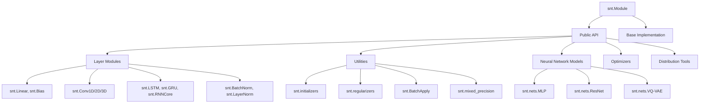

Sources: [sonnet/__init__.py:15-165](), [README.md:7-29]()

Sonnet is centered around a single core concept: the `snt.Module` class, which is the foundation for all Sonnet components. Unlike many frameworks, Sonnet is deliberately unopinionated about how modules are used, allowing researchers to build their own training loops or adopt those built by others.

### Module Hierarchy

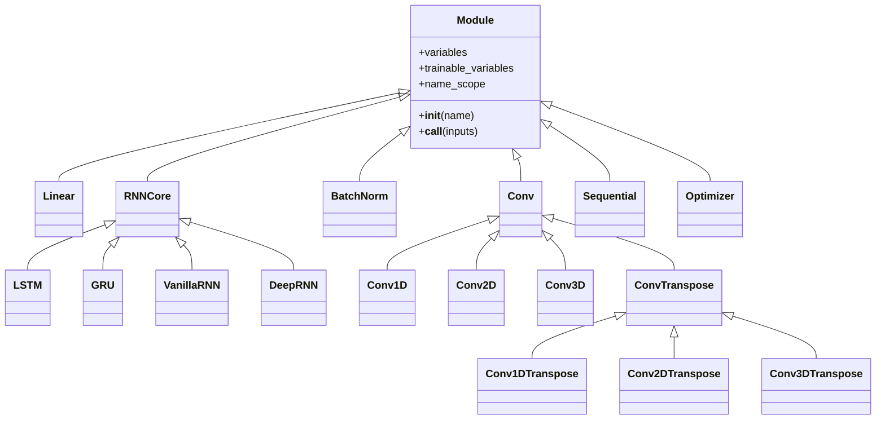

Sources: [sonnet/__init__.py:27-73]()

This diagram shows the inheritance hierarchy of key Sonnet modules. All modules inherit from the base `snt.Module` class, which provides common functionality such as variable management and name scoping.

## Key Components

### Layer Modules

Sonnet provides a variety of layer modules that serve as the building blocks for neural networks:

| Category | Modules | Description |
|----------|---------|-------------|
| Linear | `snt.Linear`, `snt.Bias` | Linear transformations with optional bias |
| Convolutional | `snt.Conv1D/2D/3D`, `snt.Conv1D/2D/3DTranspose` | Convolution operations in 1D, 2D, and 3D |
| Normalization | `snt.BatchNorm`, `snt.LayerNorm`, `snt.GroupNorm`, `snt.InstanceNorm` | Various normalization techniques |
| Recurrent | `snt.LSTM`, `snt.GRU`, `snt.VanillaRNN`, `snt.DeepRNN` | Various recurrent neural network architectures |

Sources: [sonnet/__init__.py:35-73]()

### Neural Network Models

Sonnet provides higher-level neural network models in the `snt.nets` package:

| Model | Description |
|-------|-------------|
| `snt.nets.MLP` | Multi-Layer Perceptron with configurable hidden layers |
| `snt.nets.ResNet` | Residual Network implementation |
| `snt.nets.VQ-VAE` | Vector Quantized Variational Autoencoder |

Sources: [sonnet/__init__.py:17, 21](), [README.md:15-16, 22-23]()

### Utilities

Sonnet includes various utilities to enhance the functionality of modules:

| Utility | Description |
|---------|-------------|
| `snt.initializers` | Weight initialization schemes (e.g., Xavier, Orthogonal) |
| `snt.regularizers` | Weight regularization techniques (L1, L2, L1L2) |
| `snt.BatchApply` | Apply any module to batched inputs of higher dimensions |
| `snt.mixed_precision` | Tools for mixed precision training |
| `snt.Sequential` | Chain multiple modules and functions together |

Sources: [sonnet/__init__.py:18-24, 31-33, 79]()

### Distribution Tools

Sonnet provides tools for distributed training across multiple devices:

| Tool | Description |
|------|-------------|
| `snt.distribute.Replicator` | For multi-GPU training |
| `snt.distribute.TpuReplicator` | For TPU training |
| `snt.distribute.CrossReplicaBatchNorm` | Batch normalization that works across replicas in distributed training |

Sources: [sonnet/__init__.py:17](), [docs/conf.py:102-106](), [README.md:285-302]()

## Key Features

### Module Lifecycle

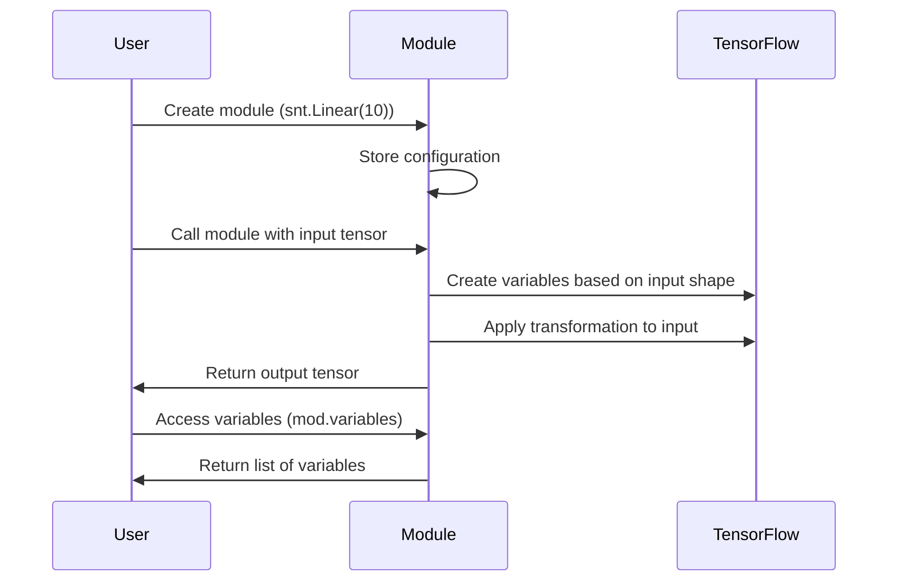

Sources: [README.md:119-157]()

This diagram illustrates the typical lifecycle of a Sonnet module. Modules create their variables lazily when first called with input, allowing the variable shapes to be determined from the input shape.

### Variable Management

Sonnet provides a clean way to manage variables:

- The `variables` property returns all variables referenced by the module
- The `trainable_variables` property returns only the trainable variables
- Variables are created automatically when a module is first called
- Variables are scoped with the module's name for better organization and debugging

Example:
```python
# Create and call a module
mod = snt.Linear(10)
mod(tf.ones([1, 5]))

# Access all variables
all_vars = mod.variables
# Access only trainable variables
trainable_vars = mod.trainable_variables
```

Sources: [README.md:87-103]()

### Serialization

Sonnet supports multiple serialization formats:

| Format | Description | Use Case |
|--------|-------------|----------|
| TensorFlow Checkpointing | For saving and restoring variables | Resuming training after interruption |
| TensorFlow SavedModel | For saving and loading entire models | Deployment, sharing models |
| Python's pickle | Simple serialization (not recommended) | Quick prototyping |

For more details on serialization, see [Serialization](#7.3).

Sources: [README.md:169-282]()

### Distributed Training

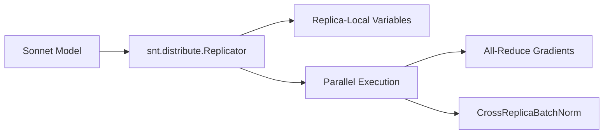

Sources: [README.md:285-302]()

This diagram shows how Sonnet supports distributed training. Unlike other frameworks, Sonnet modules and optimizers do not automatically handle gradient averaging or synchronization, giving users full control over these aspects.

For more details on distributed training, see [Distributed Training](#6).

## Integration with TensorFlow 2

Sonnet is built on top of TensorFlow 2 and leverages many of its features:

- **Eager execution** for intuitive debugging and development
- **tf.function** for performance optimization through graph compilation
- **tf.Variable** for parameter management
- **TensorFlow's distribution strategies** for distributed training
- **TensorFlow's serialization mechanisms** for saving and loading models

Sources: [README.md:7-9](), [README.md:49-50]()

## Getting Started

To use Sonnet, first install it:

```bash
pip install tensorflow
pip install dm-sonnet
```

Then import it in your Python code:

```python
import tensorflow as tf
import sonnet as snt

# Create a simple model
mlp = snt.Sequential([
    snt.Linear(1024),
    tf.nn.relu,
    snt.Linear(10),
])

# Apply it to some input
logits = mlp(tf.ones([8, 28 * 28]))
```

For more examples and tutorials, see [Examples](#9).

Sources: [README.md:49-53](), [docs/index.rst:9-15]()

---

# Page: Core Module System

# Core Module System

<details>
<summary>Relevant source files</summary>

The following files were used as context for generating this wiki page:

- [README.md](README.md)
- [docs/Makefile](docs/Makefile)
- [docs/conf.py](docs/conf.py)
- [docs/index.rst](docs/index.rst)
- [docs/requirements.txt](docs/requirements.txt)
- [sonnet/__init__.py](sonnet/__init__.py)
- [sonnet/src/base.py](sonnet/src/base.py)
- [sonnet/src/base_test.py](sonnet/src/base_test.py)
- [sonnet/src/conformance/api_test.py](sonnet/src/conformance/api_test.py)
- [sonnet/src/metrics.py](sonnet/src/metrics.py)
- [sonnet/src/optimizers/rmsprop.py](sonnet/src/optimizers/rmsprop.py)
- [sonnet/src/regularizers.py](sonnet/src/regularizers.py)

</details>


The Core Module System in Sonnet provides the fundamental building blocks for creating neural network components in a modular, composable way. At its heart is the `snt.Module` class, which serves as the foundation for all Sonnet components.

This document explains the design and usage of the base Module class, how it interacts with TensorFlow, and the key mechanisms that make it powerful. For information about specific module implementations like linear layers or convolutional networks, see [Basic Modules](#3).

## Overview

Sonnet's module system is designed around a single powerful abstraction: the `Module` class. A Sonnet module encapsulates parameters (variables), computation, and potentially other modules in a cohesive, reusable unit.

```mermaid
classDiagram
    class "tf.Module" {
        +name
        +variables
        +trainable_variables
        +submodules
    }
    
    class "snt.Module" {
        +name_scope
        +variables
        +trainable_variables
        +__call__(inputs)
    }
    
    class "Custom Modules" {
        +__init__(...)
        +__call__(inputs)
        +custom_methods()
    }
    
    "tf.Module" <|-- "snt.Module" : inherits
    "snt.Module" <|-- "Custom Modules" : subclass
```

Sources: [sonnet/src/base.py:368-471](), [sonnet/__init__.py:28]()

The Module class is an extension of TensorFlow's `tf.Module`, adding key features like automatic name scoping, better variable management, and a more user-friendly interface for deep learning research.

## Module Structure

A Sonnet module has three primary components:

1. **Parameters**: TensorFlow variables that are learned during training
2. **Computation**: Methods that perform operations on inputs
3. **Submodules**: Other modules that this module may contain

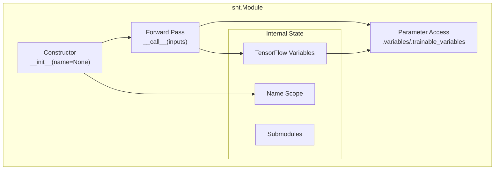

Sources: [sonnet/src/base.py:368-471](), [README.md:119-158]()

## Module Lifecycle

Understanding the lifecycle of a Sonnet module is crucial to using it effectively:

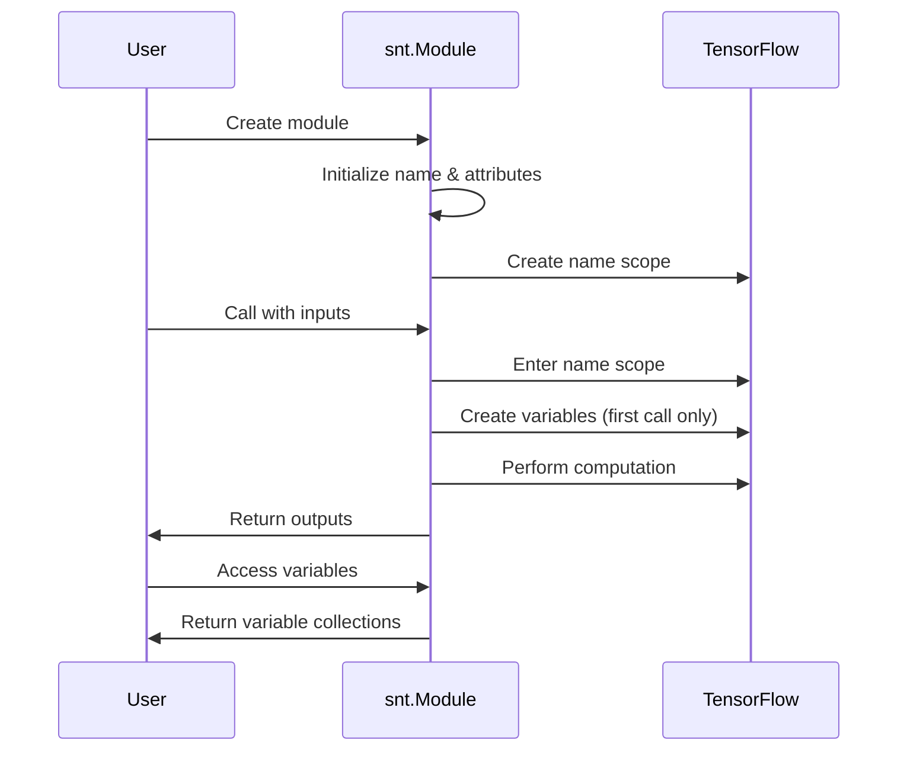

Sources: [sonnet/src/base.py:369-413](), [README.md:82-88]()

A key aspect of Sonnet modules is that they typically create their variables lazily — when they're first called with input data, rather than at initialization time. This allows variable shapes to be determined from the input data.

## Creating a Custom Module

To create a custom module in Sonnet, you subclass `snt.Module` and typically implement at least an `__init__` method and a `__call__` method:

1. **`__init__`**: Initialize the module, define configuration parameters
2. **`__call__`**: Implement the forward pass computation

Here's the basic pattern:

```python
class MyModule(snt.Module):
  def __init__(self, config_param, name=None):
    super().__init__(name=name)  # Must call super constructor first
    self.config_param = config_param
    
  def __call__(self, inputs):
    # Create variables if they don't exist
    if not hasattr(self, 'w'):
      self.w = tf.Variable(...)
    
    # Perform computation
    return some_operation(inputs, self.w)
```

Sources: [README.md:119-134](), [sonnet/src/base.py:390-411]()

## Name Scoping

Sonnet automatically enters a module's name scope when any method of the module is called. This is a key feature that helps organize the TensorFlow computation graph, making debugging and visualization easier.

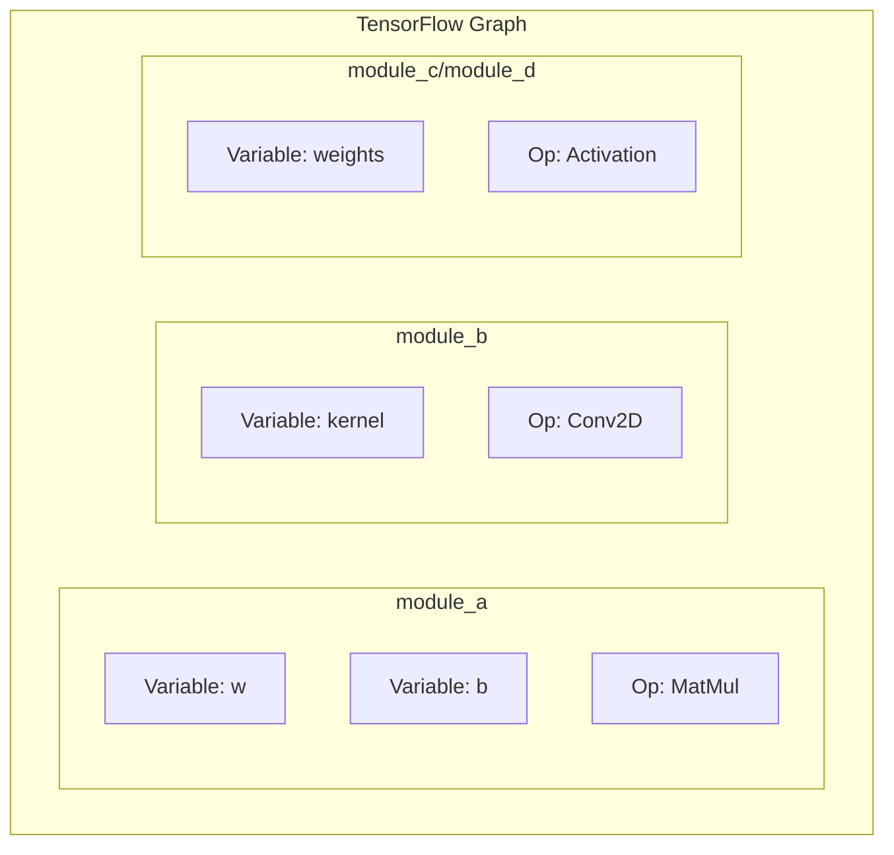

Sources: [sonnet/src/base.py:228-262](), [sonnet/src/base_test.py:46-188]()

The module's name scope is automatically applied to:
- Variables created by the module
- Operations performed by the module
- Submodules created within the module

This behavior can be disabled for specific methods using the `@snt.no_name_scope` decorator.

## Variable Management

Sonnet modules manage two types of variable collections:

1. **`variables`**: All variables owned by the module and its submodules
2. **`trainable_variables`**: Only the trainable variables owned by the module and its submodules

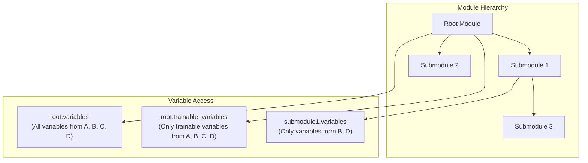

Sources: [sonnet/src/base.py:412-471](), [README.md:95-104]()

These properties are typically used to:
- Pass parameters to an optimizer during training
- Apply regularization to model parameters
- Save and restore module state

## Best Practices and Common Pitfalls

### Best Practices

1. **Always call the super constructor**: The first line in your `__init__` method should be `super().__init__(name=name)`.
2. **Create variables lazily**: Define variables the first time the module is called with input, not in the constructor.
3. **Use the `@snt.once` decorator**: For initialization methods that should only be called once.
4. **Access variables after calling the module**: The `variables` and `trainable_variables` properties will raise an error if accessed before any variables are created.

### Common Pitfalls

1. **Not calling the super constructor**: This will result in a ValueError.
2. **Calling methods before the super constructor**: This can lead to an AttributeError.
3. **Accessing variables before they're created**: This results in a ValueError.
4. **Forgetting to make the module callable**: Modules should typically implement a `__call__` method.

Sources: [sonnet/src/base.py:134-143](), [sonnet/src/base_test.py:468-504]()

## Module Metaclass

Sonnet uses a custom metaclass (`ModuleMetaclass`) to provide additional functionality to modules:

```mermaid
classDiagram
    class "ModuleMetaclass" {
        +__new__(cls, name, bases, clsdict)
        +__call__(cls, *args, **kwargs)
    }
    
    class "abc.ABCMeta" {
        +__new__()
        +__call__()
    }
    
    class "snt.Module" {
        +__init__(name=None)
        +variables
        +trainable_variables
    }
    
    "abc.ABCMeta" <|-- "ModuleMetaclass" : inherits
    "ModuleMetaclass" --o "snt.Module" : metaclass
```

Sources: [sonnet/src/base.py:58-144]()

The metaclass provides:

1. **Automatic name scoping**: Wraps all methods to enter the module's name scope
2. **Auto-generated repr**: Provides a useful string representation of modules
3. **Constructor safety**: Ensures the super constructor is called properly

## Special Module Features

### Non-trainable Variables

Not all variables in a module need to be trainable. For example, batch normalization uses non-trainable variables to track running statistics.

```python
# Example of creating a non-trainable variable
self.counter = tf.Variable(0, trainable=False, name="counter")
```

### Empty Variables Handling

By default, Sonnet raises an error if you try to access `variables` or `trainable_variables` before the module has created any variables. This helps catch a common mistake. You can disable this behavior using the `snt.allow_empty_variables` decorator:

```python
@snt.allow_empty_variables
class MyStatelessModule(snt.Module):
  pass
```

Sources: [sonnet/src/base.py:337-356](), [sonnet/src/base_test.py:495-504]()

### Abstract Modules

You can create abstract module classes by combining `snt.Module` with Python's `abc.ABCMeta`:

```python
class AbstractModule(snt.Module, metaclass=abc.ABCMeta):
  @abc.abstractmethod
  def __call__(self, x):
    pass
```

Sources: [sonnet/src/base_test.py:298-315](), [sonnet/src/metrics.py:25-47]()

## Integration with TensorFlow

Sonnet modules integrate seamlessly with TensorFlow features:

1. **`tf.function`**: Methods can be decorated with `@tf.function` for graph compilation
2. **TensorFlow checkpointing**: Modules can be saved and restored using `tf.train.Checkpoint`
3. **SavedModel**: Modules can be exported using `tf.saved_model.save`

Sources: [sonnet/src/base_test.py:274-297](), [README.md:179-283]()

## Comparison to Plain TensorFlow

| Feature | Sonnet Module | Plain TensorFlow |
|---------|---------------|------------------|
| Variable creation | Typically lazy (on first call) | Whenever code is executed |
| Name scoping | Automatic for all methods | Manual with `tf.name_scope` |
| Variable collection | Automatic via properties | Manual tracking required |
| Submodule nesting | Automatically tracked | Manual tracking required |
| String representation | Auto-generated with parameters | Basic class name |

Sources: [README.md:7-29](), [sonnet/src/base.py:368-387]()

## Summary

The Core Module System in Sonnet provides a powerful, flexible foundation for building neural networks. The `snt.Module` class extends TensorFlow's base functionality with automatic name scoping, improved variable management, and a more intuitive interface for deep learning research.

By understanding the module lifecycle, variable management, and name scoping, you can effectively use existing modules and create custom ones that integrate seamlessly into the Sonnet ecosystem.

---

# Page: Module Lifecycle

# Module Lifecycle

<details>
<summary>Relevant source files</summary>

The following files were used as context for generating this wiki page:

- [README.md](README.md)
- [docs/Makefile](docs/Makefile)
- [docs/conf.py](docs/conf.py)
- [docs/index.rst](docs/index.rst)
- [docs/requirements.txt](docs/requirements.txt)
- [sonnet/src/base.py](sonnet/src/base.py)
- [sonnet/src/base_test.py](sonnet/src/base_test.py)
- [sonnet/src/conformance/api_test.py](sonnet/src/conformance/api_test.py)
- [sonnet/src/metrics.py](sonnet/src/metrics.py)
- [sonnet/src/optimizers/rmsprop.py](sonnet/src/optimizers/rmsprop.py)
- [sonnet/src/regularizers.py](sonnet/src/regularizers.py)

</details>


## Purpose and Scope

This document explains the lifecycle of a Sonnet module, from initialization to function calling to variable management. It details how modules are created, how they handle name scoping, and how they lazily create and manage variables when called with inputs. For information about specific variable naming conventions and scope management, see [Name Scopes and Variable Management](#2.2).

## Module Overview

Sonnet modules are the fundamental building blocks of neural network models in the Sonnet library. They encapsulate parameters (variables) and operations that transform inputs.

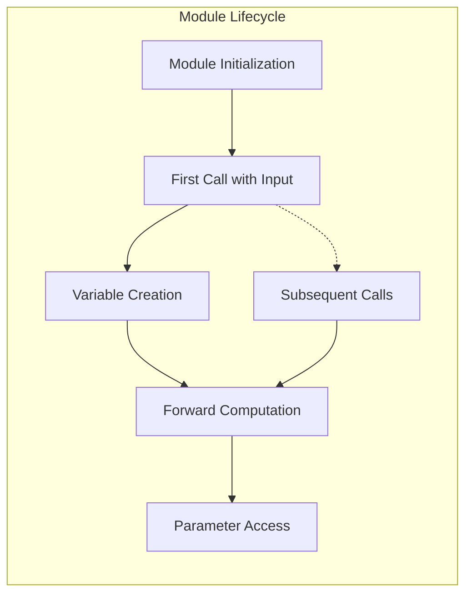

Sources: [sonnet/src/base.py](), [README.md:66-90]()

## Module Initialization

When a Sonnet module is created, it performs the following steps:

1. The `ModuleMetaclass` handles the class creation and wraps methods with name scope management
2. The module's `__init__` method is called, which sets up the module's name
3. A name scope is entered for the duration of the constructor to ensure proper variable naming

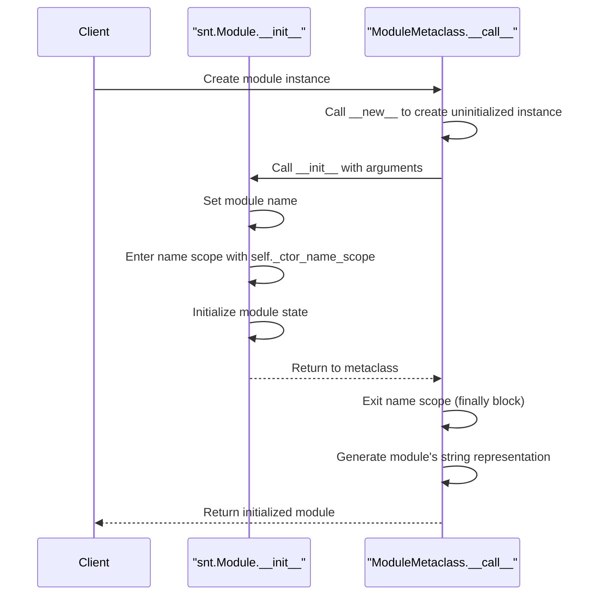

Sources: [sonnet/src/base.py:108-144](), [sonnet/src/base.py:368-411]()

## Module Naming and Auto-repr

Sonnet modules include an automatic string representation that shows constructor arguments, making debugging easier:

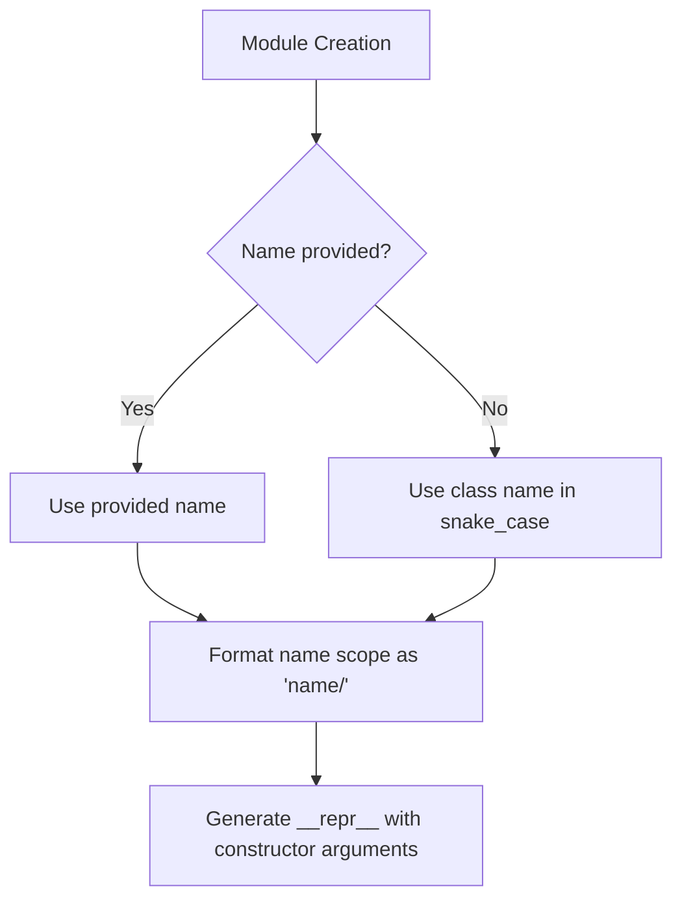

Sources: [sonnet/src/base.py:158-211](), [sonnet/src/base_test.py:213-272]()

## First Call and Lazy Variable Creation

Most Sonnet modules create variables lazily on first call, rather than during initialization. This approach lets the module determine appropriate variable shapes based on input dimensions.

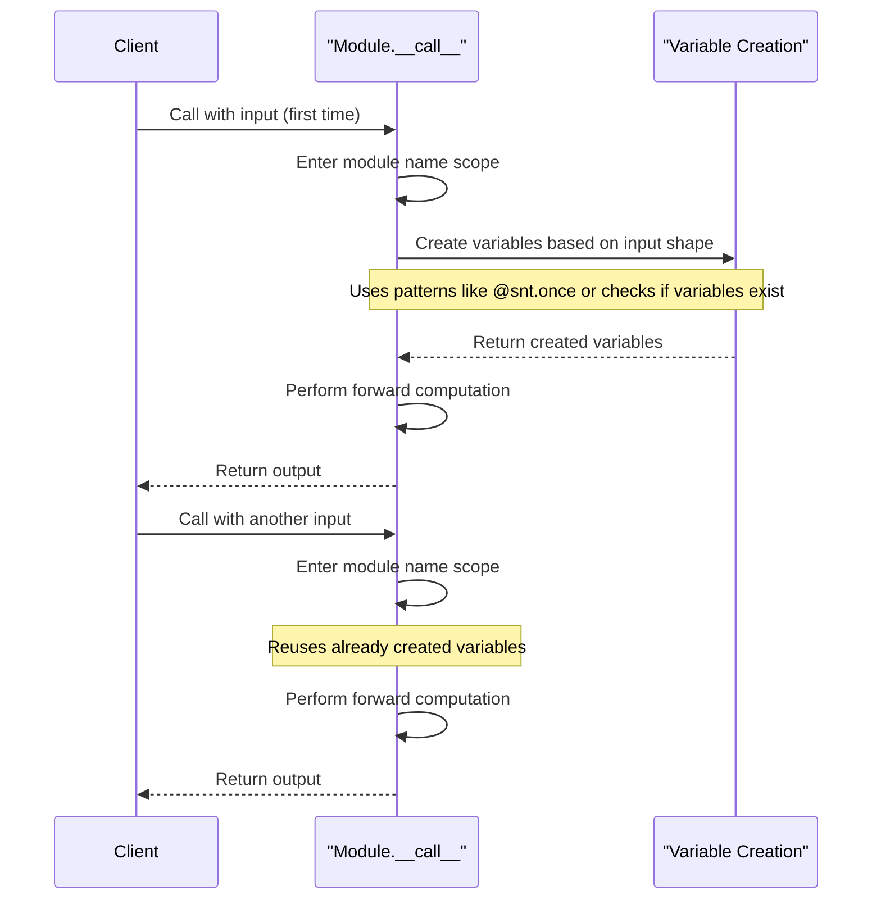

Sources: [README.md:84-97](), [sonnet/src/base.py:307-304]()

### Lazy Initialization Patterns

Sonnet provides several patterns for variable initialization:

1. **Direct checking**: Checking if a variable attribute exists before creating it
2. **@snt.once decorator**: Ensuring an initialization method is only called once 

Example from README:
```python
def __call__(self, x):
  # Initialize on first call
  self._initialize(x)
  return tf.matmul(x, self.w) + self.b

@snt.once
def _initialize(self, x):
  initial_w = tf.random.normal([x.shape[1], self.output_size])
  self.w = tf.Variable(initial_w, name="w")
  self.b = tf.Variable(tf.zeros([self.output_size]), name="b")
```

Sources: [README.md:115-141](), [sonnet/src/metrics.py:57-61]()

## Name Scope Management

Sonnet automatically manages name scopes, ensuring that operations and variables created within module methods are properly scoped.

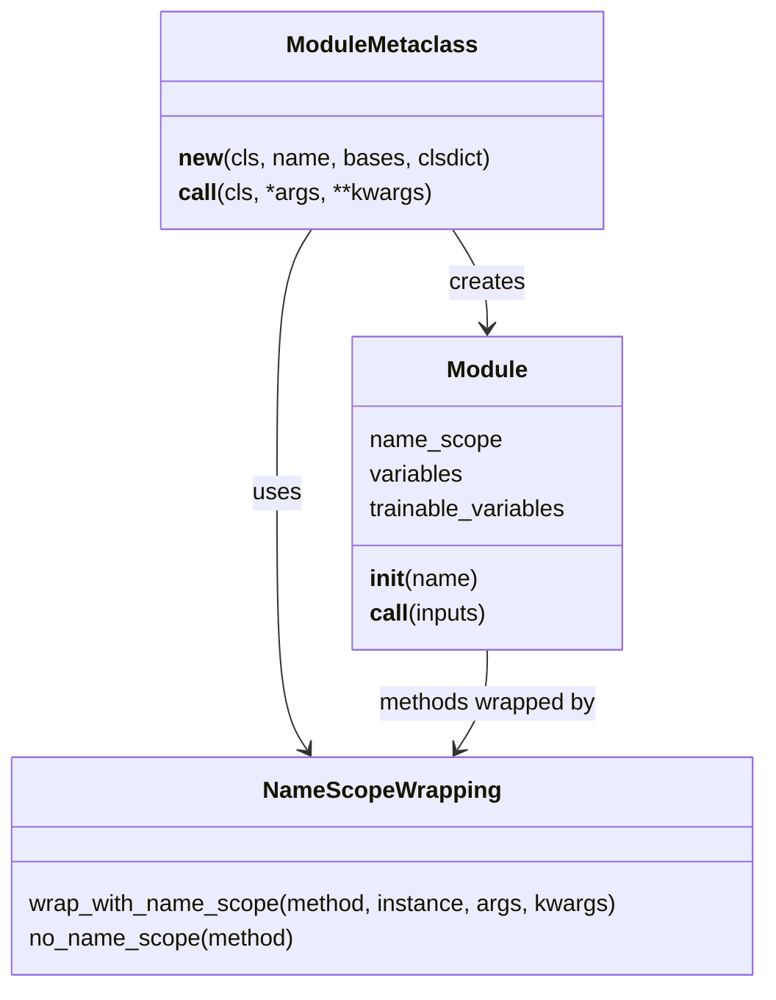

Sources: [sonnet/src/base.py:58-106](), [sonnet/src/base.py:227-306]()

The name scope behavior applies to all methods of a module by default, but can be disabled for specific methods using the `@snt.no_name_scope` decorator:

```python
@snt.no_name_scope
def my_method(self, x):
  # This method won't enter the module's name scope
  pass
```

Sources: [sonnet/src/base.py:36-55](), [sonnet/src/base_test.py:115-119]()

## Variable Access and Management

Sonnet modules provide `variables` and `trainable_variables` properties to access the module's variables:

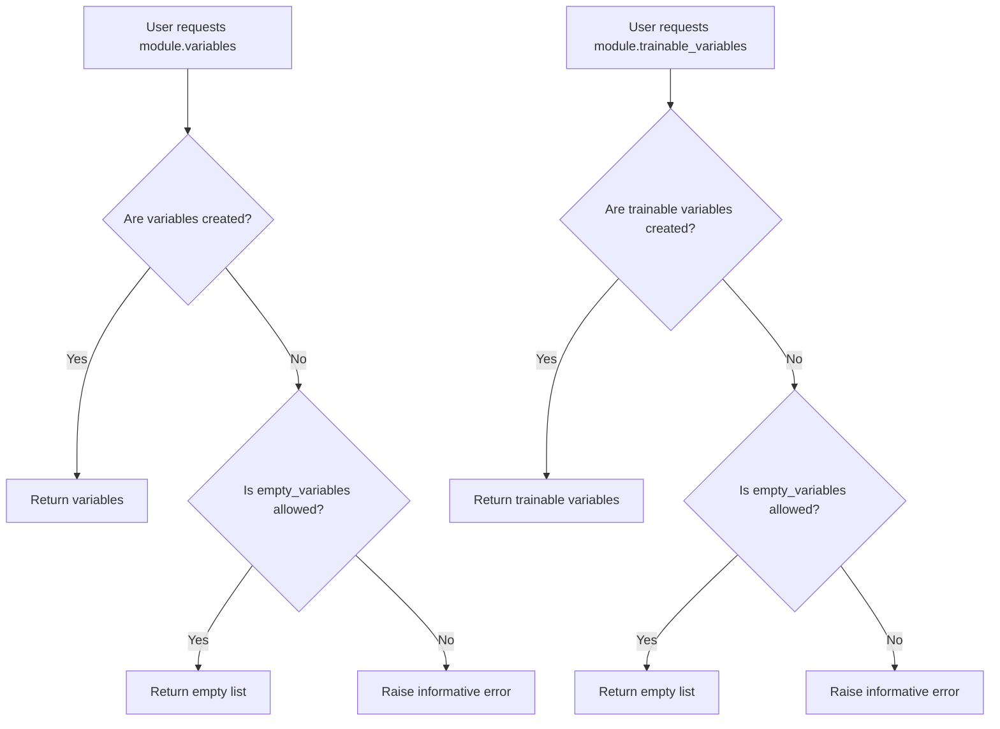

Sources: [sonnet/src/base.py:412-471](), [sonnet/src/base_test.py:204-211]()

### Variable Exception Handling

Sonnet provides helpful error messages when variables haven't been created yet, guiding users to call the module first or use `snt.allow_empty_variables`:

```python
# This pattern fails:
mod = MyModule()
params = mod.variables  # Error: no variables yet

# Correct pattern:
mod = MyModule()
output = mod(input)  # First call creates variables
params = mod.variables  # Now works

# Alternative with allow_empty_variables:
mod = MyModule()
snt.allow_empty_variables(mod)
params = mod.variables  # Returns empty list instead of error
```

Sources: [sonnet/src/base.py:309-356](), [sonnet/src/base_test.py:468-504]()

## Function Transformations and Module Methods

Sonnet modules are compatible with `tf.function` decorators and other method transformations:

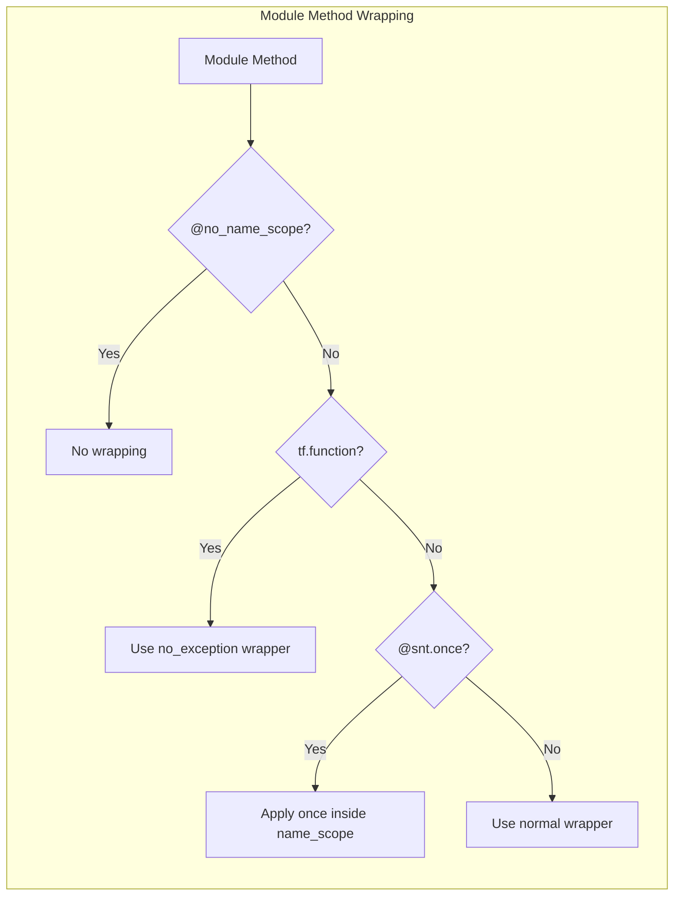

Sources: [sonnet/src/base.py:284-306](), [sonnet/src/base_test.py:274-296]()

## Module Composition

Sonnet modules can be composed to create more complex architectures:

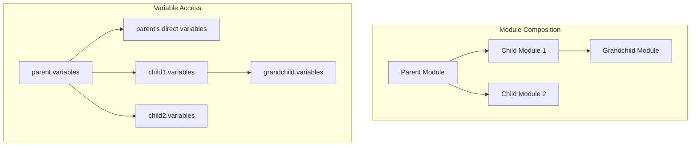

Sources: [sonnet/src/base_test.py:26-38](), [sonnet/src/base_test.py:427-437]()

## Module Lifecycle Full Flowchart

The complete lifecycle of a Sonnet module can be summarized as:

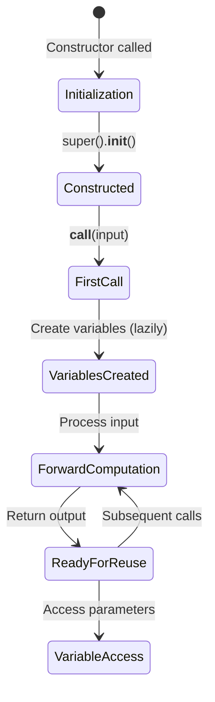

Sources: [README.md:115-141](), [sonnet/src/base.py:368-471]()

## Common Errors and Best Practices

Here are some common errors and best practices when working with Sonnet modules:

| Error | Cause | Solution |
|-------|-------|----------|
| "Constructing a snt.Module without calling the super constructor" | Constructor doesn't call `super().__init__()` | Always call `super().__init__()` at the start of your constructor |
| "The super constructor must be called before any other methods" | Calling methods before `super().__init__()` | Move all method calls after `super().__init__()` |
| "Module does not currently contain any variables/trainable_variables" | Trying to access variables before they're created | Call the module first, or use `snt.allow_empty_variables` |

Sources: [sonnet/src/base.py:468-471](), [sonnet/src/base_test.py:470-504]()

---

# Page: Name Scopes and Variable Management

# Name Scopes and Variable Management

<details>
<summary>Relevant source files</summary>

The following files were used as context for generating this wiki page:

- [docs/ext/BUILD](docs/ext/BUILD)
- [examples/BUILD](examples/BUILD)
- [sonnet/BUILD](sonnet/BUILD)
- [sonnet/nets/BUILD](sonnet/nets/BUILD)
- [sonnet/src/BUILD](sonnet/src/BUILD)
- [sonnet/src/base.py](sonnet/src/base.py)
- [sonnet/src/base_test.py](sonnet/src/base_test.py)
- [sonnet/src/conformance/BUILD](sonnet/src/conformance/BUILD)
- [sonnet/src/conformance/api_test.py](sonnet/src/conformance/api_test.py)
- [sonnet/src/conformance/checkpoints/BUILD](sonnet/src/conformance/checkpoints/BUILD)
- [sonnet/src/metrics.py](sonnet/src/metrics.py)
- [sonnet/src/nets/BUILD](sonnet/src/nets/BUILD)
- [sonnet/src/nets/dnc/BUILD](sonnet/src/nets/dnc/BUILD)
- [sonnet/src/optimizers/BUILD](sonnet/src/optimizers/BUILD)
- [sonnet/src/optimizers/rmsprop.py](sonnet/src/optimizers/rmsprop.py)
- [sonnet/src/regularizers.py](sonnet/src/regularizers.py)

</details>


This page explains how Sonnet manages TensorFlow variable scopes and variable creation. Sonnet modules automatically handle name scoping to ensure variables and operations have logical, hierarchical names that reflect their position in the module hierarchy. This document covers the name scope system, variable creation patterns, and how these components work together.

For information about the Module lifecycle and initialization, see [Module Lifecycle](#2.1). For details on implementing specific module types, see [Basic Modules](#3).

## Name Scope System

Sonnet's name scope system provides a hierarchical naming structure for variables and operations. This makes visualization tools like TensorBoard more useful and helps debug complex models by providing meaningful names for tensors and variables.

### Core Concepts

1. **Automatic Name Scoping**: All methods in a Sonnet module automatically run within the module's name scope.
2. **Hierarchical Names**: Child modules inherit parent module scopes, creating a path-like naming structure.
3. **Customizable**: Developers can disable name scoping when needed using decorators.

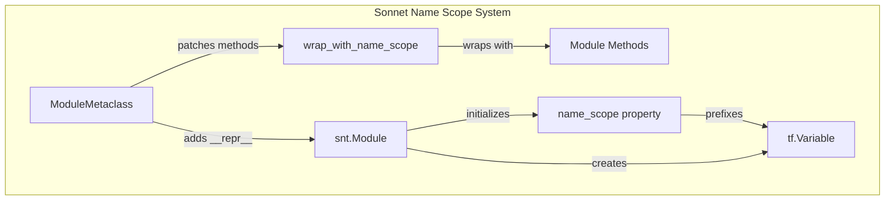

Sources: [sonnet/src/base.py:35-411](). [sonnet/src/base.py:58-146]().

### How Name Scopes Work

Every Sonnet module has a `name_scope` property that returns a TensorFlow name scope. When module methods are called, they automatically enter this name scope thanks to the `ModuleMetaclass` that wraps them with the `wrap_with_name_scope` decorator.

```mermaid
sequenceDiagram
    participant User as "User Code"
    participant Module as "snt.Module"
    participant Method as "Module.__call__"
    participant NameScope as "TF Name Scope"
    participant Variable as "TF Variable Creation"
    
    User->>Module: Create module instance
    Module->>Module: Initialize name_scope
    User->>Method: Call module method
    Method->>NameScope: Enter module's name_scope
    Method->>Variable: Create variables
    Variable->>Variable: Apply name_scope prefix
    NameScope->>Method: Exit name_scope
    Method->>User: Return result
```

Sources: [sonnet/src/base.py:226-306](). [sonnet/src/base.py:368-411]().

### Example of Name Scope Hierarchy

When modules are nested, their name scopes combine to create a hierarchical path:

```mermaid
graph TD
    subgraph "Name Scope Hierarchy"
        Root["Root Module (e.g., 'mlp/')"]
        Layer1["Layer 1 (e.g., 'mlp/linear_1/')"]
        Layer2["Layer 2 (e.g., 'mlp/linear_2/')"]
        Var1["Variable (e.g., 'mlp/linear_1/w:0')"]
        Var2["Variable (e.g., 'mlp/linear_2/b:0')"]
        
        Root --> Layer1
        Root --> Layer2
        Layer1 --> Var1
        Layer2 --> Var2
    end
```

Sources: [sonnet/src/base.py:46-55](). [sonnet/src/base_test.py:204-211]().

### Controlling Name Scopes

Developers can control name scope behavior:

1. **Disabling for specific methods**: Using the `@snt.no_name_scope` decorator
2. **Disabling globally**: Setting the `SNT_MODULE_NAME_SCOPES` environment variable to "False"

```python
@snt.no_name_scope
def my_method(self):
    # This method won't enter the module's name scope
    pass
```

Sources: [sonnet/src/base.py:36-55](). [sonnet/src/base.py:284-306]().

## Variable Management

Sonnet implements a variable management pattern that simplifies creating and accessing module parameters.

### Variable Creation Pattern

Sonnet modules typically create variables lazily - when first called with an input rather than at initialization time. This allows modules to infer shapes from inputs.

```mermaid
flowchart TB
    subgraph "Variable Creation Pattern"
        Init["Module.__init__()"] -->|"doesn't create variables"| First["First __call__"]
        First -->|"checks if variables exist"| Check{"Has variables?"}
        Check -->|"No"| Create["Create variables based on input shape"]
        Check -->|"Yes"| Reuse["Reuse existing variables"]
        Create --> Forward["Forward computation"]
        Reuse --> Forward
    end
```

Sources: [sonnet/src/base.py:429-471](). [sonnet/src/metrics.py:57-61]().

### Accessing Variables

Modules provide two main properties for accessing variables:

1. **`variables`**: All variables owned by the module and its submodules
2. **`trainable_variables`**: Only trainable variables owned by the module and its submodules

Since Sonnet uses lazy initialization, requesting these properties before variables are created will raise an error with a helpful message. The `allow_empty_variables` decorator can be used to suppress this behavior for modules that intentionally have no variables.

```mermaid
flowchart TD
    subgraph "Variable Access System"
        Request["Request module.variables"] --> Check{"Variables exist?"}
        Check -->|"Yes"| Return["Return variable collection"]
        Check -->|"No"| CheckAllowed{"allow_empty_variables?"}
        CheckAllowed -->|"Yes"| ReturnEmpty["Return empty collection"]
        CheckAllowed -->|"No"| Error["Raise helpful error"]
    end
```

Sources: [sonnet/src/base.py:412-471](). [sonnet/src/base.py:337-356]().

## Implementation Details

### ModuleMetaclass

The `ModuleMetaclass` is the engine behind Sonnet's name scope system. It performs several key functions:

1. Patches methods to enter the module's name scope when called
2. Handles property methods specially to ensure they also respect name scopes
3. Adds a default `__repr__` method for better debugging
4. Manages name scope during module construction

```mermaid
classDiagram
    class ModuleMetaclass {
        +__new__(cls, name, bases, clsdict)
        +__call__(cls, *args, **kwargs)
    }
    
    class Module {
        +__init__(name)
        +name_scope
        +variables
        +trainable_variables
    }
    
    ModuleMetaclass --> Module : metaclass of
```

Sources: [sonnet/src/base.py:58-146](). [sonnet/src/base.py:368-471]().

### Name Scope Wrapping Mechanism

The method wrapping mechanism has several components:

1. **`with_name_scope`**: Function that patches methods to enter the module's name scope
2. **`wrap_with_name_scope`**: Decorator that implements the actual name scope entering logic
3. **`APPLY_NAME_SCOPE`** attribute: Flag used to mark methods that should skip name scoping

```mermaid
flowchart LR
    subgraph "Name Scope Wrapping System"
        ModuleMethod["Module Method"] -->|"decorated with"| WithNameScope["with_name_scope"]
        WithNameScope -->|"delegates to"| WrapWithNameScope["wrap_with_name_scope decorator"]
        WrapWithNameScope -->|"enters"| NameScope["module.name_scope context"]
        NoNameScope["@no_name_scope decorator"] -->|"sets flag"| NoScopeFlag["APPLY_NAME_SCOPE = False"]
        NoScopeFlag -->|"checked by"| WithNameScope
    end
```

Sources: [sonnet/src/base.py:227-305](). [sonnet/src/base_test.py:59-106]().

### Variable Names and Scoping

Variables created within a module's methods automatically get prefixed with the module's name scope:

```python
class MyModule(snt.Module):
  def __call__(self, x):
    if not hasattr(self, 'w'):
      self.w = tf.Variable(tf.ones([2, 2]), name="weight")
    return tf.matmul(x, self.w)

# When created, the variable will be named "my_module/weight:0"
```

This hierarchical naming is directly reflected in TensorBoard and makes it easier to understand model structure.

Sources: [sonnet/src/base.py:368-411](). [sonnet/src/base_test.py:204-211]().

## Best Practices

### 1. Call Super Constructor First

Always call `super().__init__()` at the beginning of module constructors to ensure name scopes are properly initialized:

```python
def __init__(self, output_size, name=None):
  super().__init__(name=name)  # Must be called first
  self._output_size = output_size
  # Rest of initialization...
```

Sources: [sonnet/src/base.py:136-140](). [sonnet/src/base_test.py:470-484]().

### 2. Create Variables Lazily

Follow the Sonnet pattern of creating variables on first use rather than in the constructor:

```python
def __call__(self, inputs):
  if not hasattr(self, 'w'):
    self.w = tf.Variable(
        tf.random.normal([inputs.shape[-1], self._output_size]),
        name='weights')
  return tf.matmul(inputs, self.w)
```

Sources: [sonnet/src/base.py:429-471](). [sonnet/src/metrics.py:57-61]().

### 3. Use Decorators Appropriately

Use `@snt.no_name_scope` for methods that shouldn't enter the module's name scope, particularly for methods like `clone()` or `transpose()` that create new modules:

```python
@snt.no_name_scope
def clone(self, name=None):
  # Creates a new module with the same parameters
  return type(self)(name=name, **self._clone_kwargs)
```

Sources: [sonnet/src/base.py:36-55](). [sonnet/src/base_test.py:108-114]().

### 4. Handle Empty Variable Collections

For modules that intentionally have no variables, use the `allow_empty_variables` decorator:

```python
@snt.allow_empty_variables
class StatelessModule(snt.Module):
  def __call__(self, x):
    return tf.nn.relu(x)  # No variables needed
```

Sources: [sonnet/src/base.py:337-356](). [sonnet/src/base_test.py:496-504]().

## Summary

Sonnet's name scope and variable management system provides a clean, consistent way to organize neural network components:

- **Name scopes** create hierarchical naming that reflects module structure
- **Lazy variable initialization** allows modules to adapt to input shapes
- **Variable properties** provide organized access to parameters
- **Metaclass magic** handles the plumbing to make it all work seamlessly

This system makes models easier to debug, visualize, and reason about, particularly as they grow in complexity.

Sources: [sonnet/src/base.py:368-471](). [sonnet/src/base.py:15-146]().

---

# Page: Basic Modules

# Basic Modules

<details>
<summary>Relevant source files</summary>

The following files were used as context for generating this wiki page:

- [docs/api.rst](docs/api.rst)
- [sonnet/__init__.py](sonnet/__init__.py)
- [sonnet/nets/__init__.py](sonnet/nets/__init__.py)
- [sonnet/nets/resnet.py](sonnet/nets/resnet.py)
- [sonnet/src/conformance/descriptors.py](sonnet/src/conformance/descriptors.py)
- [sonnet/src/conformance/descriptors_test.py](sonnet/src/conformance/descriptors_test.py)
- [sonnet/src/conformance/function_test.py](sonnet/src/conformance/function_test.py)
- [sonnet/src/conformance/goldens.py](sonnet/src/conformance/goldens.py)
- [sonnet/src/conformance/goldens_test.py](sonnet/src/conformance/goldens_test.py)

</details>


## Overview

This page documents the fundamental module types provided by Sonnet, which serve as the building blocks for constructing neural networks. Each module is a specialized implementation of the core `snt.Module` class (for details on the module system itself, see [Core Module System](#2)).

The basic modules in Sonnet are categorized into several types:

1. Linear modules - For simple weighted connections
2. Convolutional modules - For spatial feature extraction
3. Normalization modules - For stabilizing and accelerating training
4. Recurrent modules - For sequence processing 
5. Reshape modules - For tensor manipulation
6. Other utility modules - For common neural network operations

These modules are designed to be composable, allowing you to build complex architectures by combining them in various ways.

Sources: [sonnet/__init__.py:15-148](), [docs/api.rst:31-255]()

## Module Hierarchy

```mermaid
classDiagram
    class Module {
        +__init__(name)
        +__call__(inputs)
        +variables
    }

    Module <|-- Linear
    Module <|-- Bias
    Module <|-- Conv
    Module <|-- BatchNorm
    Module <|-- LayerNorm
    Module <|-- RNNCore
    Module <|-- Reshape
    Module <|-- Dropout
    Module <|-- Embed

    Conv <|-- Conv1D
    Conv <|-- Conv2D
    Conv <|-- Conv3D
    Conv <|-- ConvTranspose
    
    ConvTranspose <|-- Conv1DTranspose
    ConvTranspose <|-- Conv2DTranspose
    ConvTranspose <|-- Conv3DTranspose
    
    RNNCore <|-- LSTM
    RNNCore <|-- GRU
    RNNCore <|-- VanillaRNN
    RNNCore <|-- ConvLSTM
    
    ConvLSTM <|-- Conv1DLSTM
    ConvLSTM <|-- Conv2DLSTM
    ConvLSTM <|-- Conv3DLSTM
```

Sources: [sonnet/__init__.py:26-77](), [sonnet/src/conformance/goldens.py:130-546]()

## Linear Modules

Linear modules implement simple affine transformations of the form y = Wx + b, where W is a weight matrix and b is an optional bias vector.

### Linear

The `Linear` module performs a linear transformation on the last dimension of the input tensor.

```python
# Input shape: [batch_size, input_size]
# Output shape: [batch_size, output_size]
linear = snt.Linear(output_size=10, with_bias=True)
y = linear(x)
```

### Bias

The `Bias` module adds a bias vector to the input tensor.

```python
# Adds a bias along the last dimension of the input
bias = snt.Bias()
y = bias(x)
```

Sources: [sonnet/__init__.py:36](), [sonnet/__init__.py:51](), [sonnet/src/conformance/goldens.py:130-142](), [sonnet/src/conformance/goldens.py:442-446]()

## Convolutional Modules

Convolutional modules apply convolution operations across different dimensionalities of data.

```mermaid
flowchart TD
    subgraph "Convolution Modules"
        direction LR
        Conv1D["Conv1D<br>1D Convolution"]
        Conv2D["Conv2D<br>2D Convolution"]
        Conv3D["Conv3D<br>3D Convolution"]
        Conv1DT["Conv1DTranspose<br>1D Transposed Convolution"]
        Conv2DT["Conv2DTranspose<br>2D Transposed Convolution"]
        Conv3DT["Conv3DTranspose<br>3D Transposed Convolution"]
        DepthwiseConv2D["DepthwiseConv2D<br>Channel-wise 2D Convolution"]
    end
    
    Input["Input Tensor"] --> Conv1D & Conv2D & Conv3D & Conv1DT & Conv2DT & Conv3DT & DepthwiseConv2D
    Conv1D & Conv2D & Conv3D & Conv1DT & Conv2DT & Conv3DT & DepthwiseConv2D --> Output["Output Tensor"]
```

### Convolution Layers

- **Conv1D**: 1D convolution for sequences
- **Conv2D**: 2D convolution for images
- **Conv3D**: 3D convolution for volumetric data
- **Conv1DTranspose/Conv2DTranspose/Conv3DTranspose**: Transposed convolutions (sometimes called "deconvolutions")
- **DepthwiseConv2D**: Applies a different filter to each input channel

All convolution modules support various padding schemes via the `pad` parameter, which can be:
- `same`: Output has the same spatial dimensions as input
- `valid`: No padding
- Custom padding created with functions from `snt.pad`

Sources: [sonnet/__init__.py:38-43](), [sonnet/__init__.py:46](), [sonnet/src/conformance/goldens.py:144-193](), [docs/api.rst:46-91]()

## Normalization Modules

Normalization modules standardize inputs to stabilize and accelerate training.

```mermaid
flowchart LR
    subgraph "Normalization Scope"
        BatchNorm["BatchNorm<br>Normalizes across batch dimension"]
        LayerNorm["LayerNorm<br>Normalizes across feature dimensions"]
        InstanceNorm["InstanceNorm<br>Normalizes each example independently"]
        GroupNorm["GroupNorm<br>Normalizes within channel groups"]
    end
    
    Input["Input Tensor"] --> BatchNorm & LayerNorm & InstanceNorm & GroupNorm
    BatchNorm & LayerNorm & InstanceNorm & GroupNorm --> Output["Output Tensor"]
```

### Available Normalization Types

| Module | Normalizes Across | Use Case |
|--------|-------------------|----------|
| BatchNorm | Batch dimension | General purpose, sensitive to batch size |
| LayerNorm | Feature dimensions | RNNs, Transformers |
| InstanceNorm | Spatial dimensions per instance | Style transfer, image generation |
| GroupNorm | Groups of channels | Alternative to BatchNorm for small batches |

### Common Parameters

Most normalization layers support:
- `create_scale`: Whether to apply a learnable scale factor
- `create_offset`: Whether to apply a learnable offset
- `scale_init/offset_init`: Initializers for scale/offset parameters

Sources: [sonnet/__init__.py:25-26](), [sonnet/__init__.py:34-35](), [sonnet/__init__.py:49](), [sonnet/src/conformance/goldens.py:223-294](), [docs/api.rst:93-134]()

## Recurrent Modules

Recurrent modules process sequences by maintaining internal state and can be unrolled over time.

```mermaid
classDiagram
    class RNNCore {
        +initial_state(batch_size)
        +__call__(inputs, prev_state)
        +output_size
        +state_size
    }
    
    RNNCore <|-- SimpleCore
    RNNCore <|-- ConvCore
    
    class SimpleCore {
        +VanillaRNN
        +LSTM
        +GRU
    }
    
    class ConvCore {
        +Conv1DLSTM
        +Conv2DLSTM
        +Conv3DLSTM
    }
    
    class Unroller {
        +dynamic_unroll()
        +static_unroll()
    }
    
    RNNCore -- Unroller : "unrolled with"
```

### Core RNN Types

- **VanillaRNN**: Simple RNN with tanh activation
- **LSTM**: Long Short-Term Memory network
- **GRU**: Gated Recurrent Unit
- **Conv1D/2D/3DLSTM**: Convolutional LSTM variants

### Unrolling Methods

- **dynamic_unroll**: Uses TensorFlow's control flow operations for variable-length sequences
- **static_unroll**: Unrolls the network explicitly for fixed-length sequences

### Usage Example

```python
# Create an LSTM core
lstm = snt.LSTM(hidden_size=128)

# Create initial state
batch_size = 32
initial_state = lstm.initial_state(batch_size)

# Process a single input
output, next_state = lstm(input_at_t, initial_state)

# Or unroll over a sequence
sequence_outputs, final_state = snt.static_unroll(
    lstm,
    input_sequence,
    initial_state
)
```

Sources: [sonnet/__init__.py:57-72](), [sonnet/src/conformance/goldens.py:351-432](), [docs/api.rst:136-227]()

## Reshape and Utility Modules

Sonnet provides several modules for reshaping and manipulating tensors.

```mermaid
flowchart LR
    subgraph "Reshape & Utility Modules"
        direction TB
        Reshape["Reshape<br>Reshape to specified dimensions"]
        Flatten["Flatten<br>Flattens all dims except batch"]
        BatchApply["BatchApply<br>Apply module to merged batch dimensions"]
        Dropout["Dropout<br>Regularization via random dropping"]
        Embed["Embed<br>Embedding lookup"]
        Sequential["Sequential<br>Chain of modules"]
    end
    
    Input["Input Tensor"] --> Reshape & Flatten & BatchApply & Dropout & Embed & Sequential
    Reshape & Flatten & BatchApply & Dropout & Embed & Sequential --> Output["Output Tensor"]
```

### Key Reshape Modules

- **Reshape**: Reshapes input tensor to a specified shape
- **Flatten**: Flattens all dimensions except the batch dimension
- **BatchApply**: Merges leading dimensions, applies a module, then restores the original dimensions

### Utility Modules

- **Dropout**: Randomly zeros elements during training for regularization
- **Embed**: Performs embedding lookups for discrete inputs
- **Sequential**: Chains multiple modules together

Sources: [sonnet/__init__.py:31-32](), [sonnet/__init__.py:45](), [sonnet/__init__.py:47-48](), [sonnet/__init__.py:74-77](), [sonnet/__init__.py:79](), [sonnet/src/conformance/goldens.py:337-349](), [sonnet/src/conformance/goldens.py:450-453](), [docs/api.rst:229-272]()

## Module Properties and Common Patterns

All basic modules inherit from `snt.Module` and therefore share common patterns and properties:

### Common Properties

- **variables**: Access all variables in the module
- **trainable_variables**: Access only trainable variables
- **name**: The name of the module instance

### Best Practices

1. **Variable Creation**: Variables are created lazily on first call
2. **Submodule Usage**: Modules can contain other modules
3. **Reuse**: The same module can be called multiple times with different inputs

```python
# Module reuse example
linear = snt.Linear(10)

# Apply to different inputs - parameters are shared
output1 = linear(input1)  # First call creates variables
output2 = linear(input2)  # Reuses the same variables
```

Sources: [sonnet/__init__.py:28](), [sonnet/src/conformance/function_test.py:32-136]()

## Relationship to Higher-Level Components

The basic modules documented on this page are the foundation for building more complex network architectures, which are covered in [Higher-Level Neural Networks](#4).

```mermaid
flowchart TD
    subgraph "Basic Building Blocks"
        Linear["Linear Modules"]
        Conv["Convolutional Modules"]
        Norm["Normalization Modules"]
        RNN["Recurrent Modules"]
        Reshape["Reshape Modules"]
    end
    
    subgraph "Higher-Level Networks"
        MLP["MLP<br>(Multi-Layer Perceptron)"]
        ResNet["ResNet"]
        VQVAE["Vector Quantized VAE"]
    end
    
    Linear & Conv & Norm & RNN & Reshape --> MLP & ResNet & VQVAE
```

Sources: [sonnet/nets/__init__.py:16-33](), [sonnet/nets/resnet.py:16-25]()

---

# Page: Linear and Convolutional Layers

# Linear and Convolutional Layers

<details>
<summary>Relevant source files</summary>

The following files were used as context for generating this wiki page:

- [docs/modules.rst](docs/modules.rst)
- [sonnet/src/bias.py](sonnet/src/bias.py)
- [sonnet/src/conformance/copy_test.py](sonnet/src/conformance/copy_test.py)
- [sonnet/src/conv.py](sonnet/src/conv.py)
- [sonnet/src/conv_transpose.py](sonnet/src/conv_transpose.py)
- [sonnet/src/conv_transpose_test.py](sonnet/src/conv_transpose_test.py)
- [sonnet/src/depthwise_conv.py](sonnet/src/depthwise_conv.py)
- [sonnet/src/linear.py](sonnet/src/linear.py)
- [sonnet/src/linear_test.py](sonnet/src/linear_test.py)
- [sonnet/src/nets/mlp.py](sonnet/src/nets/mlp.py)
- [sonnet/src/nets/mlp_test.py](sonnet/src/nets/mlp_test.py)

</details>


This page documents the implementation and usage of linear and convolutional layers in Sonnet, which are fundamental building blocks for neural networks. These layers perform affine transformations and spatial filtering operations on input tensors, serving as the core computational components in most deep learning architectures. For information about normalization layers, see [Normalization Layers](#3.2). For higher-level neural networks built using these components, see [Higher-Level Neural Networks](#4).

## Overview

Linear and convolutional layers are implemented as subclasses of the core `snt.Module` class, providing a unified interface for parameter management and variable tracking. Sonnet offers several types of linear and convolutional operations:

1. **Linear layers**: Simple matrix multiplication operations (fully connected layers)
2. **Convolutional layers**: N-dimensional convolution operations
3. **Transpose convolutional layers**: Upsampling convolution operations
4. **Specialized layers**: Including depthwise convolutions and bias-only operations

Sources: [sonnet/src/linear.py](), [sonnet/src/conv.py](), [sonnet/src/conv_transpose.py](), [sonnet/src/depthwise_conv.py](), [sonnet/src/bias.py]()

## Architecture and Relationships

Below is a diagram showing how these components relate to each other and fit into the broader Sonnet architecture:

```mermaid
classDiagram
    class Module {
        +__init__(name)
        +__call__(inputs)
        +variables
        +trainable_variables
    }
    
    class Linear {
        +output_size: int
        +with_bias: bool
        +w_init: Initializer
        +b_init: Initializer
        +w: Variable
        +b: Variable
        +__call__(inputs)
    }
    
    class Bias {
        +output_size: int
        +bias_dims: Sequence[int]
        +b_init: Initializer
        +b: Variable
        +__call__(inputs, multiplier)
    }
    
    class ConvND {
        +num_spatial_dims: int
        +output_channels: int
        +kernel_shape: Union[int, Sequence]
        +stride: Union[int, Sequence]
        +rate: Union[int, Sequence]
        +padding: str
        +w: Variable
        +b: Variable
        +__call__(inputs)
    }
    
    class Conv1D {
        +__init__(output_channels, kernel_shape, ...)
    }
    
    class Conv2D {
        +__init__(output_channels, kernel_shape, ...)
    }
    
    class Conv3D {
        +__init__(output_channels, kernel_shape, ...)
    }
    
    class ConvNDTranspose {
        +num_spatial_dims: int
        +output_channels: int
        +kernel_shape: Union[int, Sequence]
        +output_shape: Optional[ShapeLike]
        +stride: Union[int, Sequence]
        +rate: Union[int, Sequence]
        +padding: str
        +w: Variable
        +b: Variable
        +__call__(inputs)
    }
    
    class Conv1DTranspose {
        +__init__(output_channels, kernel_shape, ...)
    }
    
    class Conv2DTranspose {
        +__init__(output_channels, kernel_shape, ...)
    }
    
    class Conv3DTranspose {
        +__init__(output_channels, kernel_shape, ...)
    }
    
    class DepthwiseConv2D {
        +kernel_shape: Union[int, Sequence]
        +channel_multiplier: int
        +stride: Union[int, Sequence]
        +rate: Union[int, Sequence]
        +padding: str
        +w: Variable
        +b: Variable
        +__call__(inputs)
    }
    
    Module <|-- Linear
    Module <|-- Bias
    Module <|-- ConvND
    Module <|-- ConvNDTranspose
    Module <|-- DepthwiseConv2D
    
    ConvND <|-- Conv1D
    ConvND <|-- Conv2D
    ConvND <|-- Conv3D
    
    ConvNDTranspose <|-- Conv1DTranspose
    ConvNDTranspose <|-- Conv2DTranspose
    ConvNDTranspose <|-- Conv3DTranspose
```

Sources: [sonnet/src/linear.py:27-88](), [sonnet/src/conv.py:28-325](), [sonnet/src/conv_transpose.py:42-378](), [sonnet/src/depthwise_conv.py:28-131](), [sonnet/src/bias.py:27-126]()

## Linear Layers

### Implementation

The `Linear` module implements a fully connected layer that performs a matrix multiplication between the input tensor and a weight matrix, optionally adding a bias term:

```mermaid
flowchart LR
    Input["Input Tensor\n[batch_size, input_size]"] --> Multiply["Matrix Multiplication"]
    Weights["Weights\n[input_size, output_size]"] --> Multiply
    Multiply --> BiasAdd["Add Bias\n(Optional)"]
    Bias["Bias\n[output_size]"] --> BiasAdd
    BiasAdd --> Output["Output Tensor\n[batch_size, output_size]"]
```

The implementation uses lazy initialization with the `@once.once` decorator, which ensures that parameters are only created the first time the module is called with input data. This allows the module to infer input dimensions from the first call, making the API more concise.

Sources: [sonnet/src/linear.py:27-88]()

### Parameters

The `Linear` module takes the following parameters:

| Parameter | Type | Description |
|-----------|------|-------------|
| `output_size` | `int` | Output dimensionality |
| `with_bias` | `bool` | Whether to include bias parameters (default: `True`) |
| `w_init` | `initializers.Initializer` | Optional initializer for weights (default: `TruncatedNormal` with std=`1/sqrt(input_size)`) |
| `b_init` | `initializers.Initializer` | Optional initializer for bias (default: `Zeros`) |
| `name` | `str` | Optional name for the module |

For higher-dimensional inputs, the `Linear` layer operates on the last dimension, preserving other dimensions.

Sources: [sonnet/src/linear.py:30-56]()

### Usage Example

```python
# Create a linear layer with 100 output units
linear = snt.Linear(output_size=100)

# Apply to a batch of 32 inputs with 784 features each
inputs = tf.random.normal([32, 784])
outputs = linear(inputs)  # Shape: [32, 100]

# Access weights and biases
print(linear.w.shape)  # [784, 100]
print(linear.b.shape)  # [100]
```

Sources: [sonnet/src/linear_test.py:40-56]()

## Bias Module

The `Bias` module provides a standalone bias addition operation that can be used independently or combined with other modules. It supports flexible broadcasting patterns, allowing you to specify which dimensions should receive unique bias values.

### Parameters

| Parameter | Type | Description |
|-----------|------|-------------|
| `output_size` | `Optional[int]` | Output size (inferred from input if not provided) |
| `bias_dims` | `Optional[Sequence[int]]` | Sequence of dimensions to retain when creating bias (default: All non-batch dimensions) |
| `b_init` | `initializers.Initializer` | Optional initializer for bias (default: `Zeros`) |
| `name` | `str` | Optional name for the module |

The `bias_dims` parameter controls how bias is applied across dimensions:
- `None`: Bias applied to all non-batch dimensions
- `[]` (empty list): Scalar bias applied to entire tensor
- `[1]`, `[2]`, etc.: Bias applied only to specific dimensions

Sources: [sonnet/src/bias.py:27-126]()

### Usage Example

```python
# Create a bias for all non-batch dimensions
bias = snt.Bias()

# Apply to a batch of images
inputs = tf.random.normal([32, 28, 28, 3])
outputs = bias(inputs)  # Shape: [32, 28, 28, 3]

# Create a bias only for the channel dimension
channel_bias = snt.Bias(bias_dims=[-1])
outputs = channel_bias(inputs)  # Bias shape: [3], broadcast to [32, 28, 28, 3]

# Subtract bias with multiplier
outputs = bias(inputs, multiplier=-1)  # Subtract instead of add
```

Sources: [sonnet/src/bias.py:31-64]()

## Convolutional Layers

Sonnet provides a generic N-dimensional convolution framework through the `ConvND` base class, with specialized implementations for 1D, 2D, and 3D convolutions.

```mermaid
flowchart LR
    subgraph "Input Data Flow"
        Input["Input Tensor\n[batch, spatial dims, channels]"] --> Padding["Apply Padding"]
        Padding --> Convolution["Convolution Operation"]
        Kernels["Kernels\n[kernel dims, in_channels, out_channels]"] --> Convolution
        Convolution --> BiasAdd["Add Bias\n(Optional)"]
        Bias["Bias\n[out_channels]"] --> BiasAdd
        BiasAdd --> Output["Output Tensor\n[batch, spatial dims, channels]"]
    end
```

Sources: [sonnet/src/conv.py:28-325]()

### ConvND Base Class

The `ConvND` class implements the core convolution logic for all dimensionalities. It handles parameter creation, applying the convolution operation, and adding bias if specified.

#### Parameters

| Parameter | Type | Description |
|-----------|------|-------------|
| `num_spatial_dims` | `int` | Number of spatial dimensions (1, 2, or 3) |
| `output_channels` | `int` | Number of output channels |
| `kernel_shape` | `Union[int, Sequence[int]]` | Shape of the convolution kernel |
| `stride` | `Union[int, Sequence[int]]` | Stride of the convolution (default: 1) |
| `rate` | `Union[int, Sequence[int]]` | Dilation rate (default: 1) |
| `padding` | `Union[str, Paddings]` | Padding type ("SAME", "VALID", or callable) |
| `with_bias` | `bool` | Whether to include bias parameters (default: `True`) |
| `w_init` | `initializers.Initializer` | Optional initializer for weights |
| `b_init` | `initializers.Initializer` | Optional initializer for bias |
| `data_format` | `str` | Data format (e.g., "NHWC" or "NCHW") |
| `name` | `str` | Optional name for the module |

Sources: [sonnet/src/conv.py:31-71]()

### Specialized Convolution Classes

Sonnet provides specialized convolution classes for different dimensionalities:

1. **Conv1D**: 1D convolution for sequential data
2. **Conv2D**: 2D convolution for image data
3. **Conv3D**: 3D convolution for volumetric data

These classes inherit from `ConvND` and provide a simplified interface with appropriate defaults for their dimensionality.

Sources: [sonnet/src/conv.py:164-325]()

### Usage Example

```python
# Create a 2D convolution layer with 32 output channels and 3x3 kernel
conv2d = snt.Conv2D(output_channels=32, kernel_shape=3, stride=1, padding="SAME")

# Apply to a batch of images
images = tf.random.normal([32, 28, 28, 3])
features = conv2d(images)  # Shape: [32, 28, 28, 32]

# Create a 1D convolution for sequence data
conv1d = snt.Conv1D(output_channels=64, kernel_shape=5)
sequence = tf.random.normal([32, 100, 128])
features = conv1d(sequence)  # Shape: [32, 100, 64]
```

Sources: [sonnet/src/conv.py:164-216](), [sonnet/src/conv.py:218-271]()

## Transpose Convolutional Layers

Transpose convolutions, sometimes called deconvolutions or fractionally-strided convolutions, perform upsampling operations. They are commonly used in decoder networks and generative models.

```mermaid
flowchart LR
    subgraph "Transpose Convolution"
        Input["Input Tensor\n[batch, spatial dims, channels]"] --> TransposeConv["Transpose Convolution Operation"]
        Kernels["Kernels\n[kernel dims, out_channels, in_channels]"] --> TransposeConv
        OutputShape["Output Shape\n(specified or calculated)"] --> TransposeConv
        TransposeConv --> BiasAdd["Add Bias\n(Optional)"]
        Bias["Bias\n[out_channels]"] --> BiasAdd
        BiasAdd --> Output["Output Tensor\n[batch, larger spatial dims, channels]"]
    end
```

Sonnet implements transpose convolutions through the `ConvNDTranspose` base class and specialized implementations for different dimensionalities.

Sources: [sonnet/src/conv_transpose.py:42-208]()

### ConvNDTranspose Base Class

The `ConvNDTranspose` class implements the core transpose convolution logic. Unlike standard convolutions, transpose convolutions require an output shape, which can be either explicitly specified or calculated based on the input shape and convolution parameters.

#### Parameters

| Parameter | Type | Description |
|-----------|------|-------------|
| `num_spatial_dims` | `int` | Number of spatial dimensions (1, 2, or 3) |
| `output_channels` | `int` | Number of output channels |
| `kernel_shape` | `Union[int, Sequence[int]]` | Shape of the convolution kernel |
| `output_shape` | `Optional[ShapeLike]` | Output shape (optional) |
| `stride` | `Union[int, Sequence[int]]` | Stride of the convolution (default: 1) |
| `rate` | `Union[int, Sequence[int]]` | Dilation rate (default: 1) |
| `padding` | `str` | Padding type ("SAME" or "VALID") |
| `with_bias` | `bool` | Whether to include bias parameters (default: `True`) |
| `w_init` | `initializers.Initializer` | Optional initializer for weights |
| `b_init` | `initializers.Initializer` | Optional initializer for bias |
| `data_format` | `str` | Data format (e.g., "NHWC" or "NCHW") |
| `name` | `str` | Optional name for the module |

Sources: [sonnet/src/conv_transpose.py:52-92]()

### Specialized Transpose Convolution Classes

Sonnet provides specialized transpose convolution classes:

1. **Conv1DTranspose**: 1D transpose convolution
2. **Conv2DTranspose**: 2D transpose convolution
3. **Conv3DTranspose**: 3D transpose convolution

These classes inherit from `ConvNDTranspose` and provide a simplified interface with appropriate defaults for their dimensionality.

Sources: [sonnet/src/conv_transpose.py:210-378]()

### Usage Example

```python
# Create a 2D transpose convolution layer with 32 output channels and 3x3 kernel
deconv2d = snt.Conv2DTranspose(output_channels=32, kernel_shape=3, stride=2, padding="SAME")

# Apply to a batch of features (will double spatial dimensions)
features = tf.random.normal([32, 14, 14, 64])
upsampled = deconv2d(features)  # Shape: [32, 28, 28, 32]

# Create a transpose convolution with explicit output shape
deconv_fixed = snt.Conv2DTranspose(output_channels=3, kernel_shape=5, output_shape=[32, 32])
reconstructed = deconv_fixed(features)  # Shape: [batch_size, 32, 32, 3]
```

Sources: [sonnet/src/conv_transpose.py:267-321]()

## Depthwise Convolution

Depthwise convolutions apply a separate filter to each input channel, making them more parameter-efficient than standard convolutions. Sonnet provides the `DepthwiseConv2D` module for 2D depthwise convolutions.

```mermaid
flowchart LR
    subgraph "Depthwise Convolution"
        Input["Input Tensor\n[batch, spatial dims, in_channels]"] --> DepthwiseConv["Depthwise Convolution Operation"]
        Kernels["Kernels\n[kernel dims, in_channels, channel_multiplier]"] --> DepthwiseConv
        DepthwiseConv --> BiasAdd["Add Bias\n(Optional)"]
        Bias["Bias\n[in_channels × channel_multiplier]"] --> BiasAdd
        BiasAdd --> Output["Output Tensor\n[batch, spatial dims, in_channels × channel_multiplier]"]
    end
```

### Parameters

| Parameter | Type | Description |
|-----------|------|-------------|
| `kernel_shape` | `Union[int, Sequence[int]]` | Shape of the convolution kernel |
| `channel_multiplier` | `int` | Number of output channels per input channel (default: 1) |
| `stride` | `Union[int, Sequence[int]]` | Stride of the convolution (default: 1) |
| `rate` | `Union[int, Sequence[int]]` | Dilation rate (default: 1) |
| `padding` | `str` | Padding type ("SAME" or "VALID") |
| `with_bias` | `bool` | Whether to include bias parameters (default: `True`) |
| `w_init` | `initializers.Initializer` | Optional initializer for weights |
| `b_init` | `initializers.Initializer` | Optional initializer for bias |
| `data_format` | `str` | Data format (e.g., "NHWC" or "NCHW") |
| `name` | `str` | Optional name for the module |

Sources: [sonnet/src/depthwise_conv.py:35-95]()

### Usage Example

```python
# Create a depthwise convolution with channel multiplier 1 (separable convolution)
depthwise_conv = snt.DepthwiseConv2D(kernel_shape=3, channel_multiplier=1)

# Apply to a batch of images
images = tf.random.normal([32, 28, 28, 3])
features = depthwise_conv(images)  # Shape: [32, 28, 28, 3]

# Create a depthwise convolution with channel multiplier 2
depthwise_conv = snt.DepthwiseConv2D(kernel_shape=3, channel_multiplier=2)
features = depthwise_conv(images)  # Shape: [32, 28, 28, 6]
```

Sources: [sonnet/src/depthwise_conv.py:28-131]()

## Using Linear and Convolutional Layers in Networks

Linear and convolutional layers can be combined to create more complex neural network architectures. Sonnet provides a higher-level `MLP` (Multi-Layer Perceptron) module in the `nets` package that chains multiple `Linear` layers with activations.

```mermaid
flowchart LR
    subgraph "MLP Architecture"
        Input["Input Tensor"] --> Linear1["Linear Layer 1"]
        Linear1 --> Activation1["Activation (e.g., ReLU)"]
        Activation1 --> Dropout1["Dropout (Optional)"]
        Dropout1 --> Linear2["Linear Layer 2"]
        Linear2 --> Activation2["Activation (e.g., ReLU)"]
        Activation2 --> Dropout2["Dropout (Optional)"]
        Dropout2 --> LinearN["Linear Layer N"]
        LinearN --> ActivationN["Activation (Optional)"]
        ActivationN --> Output["Output Tensor"]
    end
```

Example of building a CNN with Sonnet components:

```python
class CNN(snt.Module):
    def __init__(self, name=None):
        super().__init__(name=name)
        self.conv1 = snt.Conv2D(32, kernel_shape=3, stride=1)
        self.conv2 = snt.Conv2D(64, kernel_shape=3, stride=2)
        self.flatten = lambda x: tf.reshape(x, [x.shape[0], -1])
        self.linear = snt.Linear(10)
    
    def __call__(self, inputs, is_training=True):
        x = self.conv1(inputs)
        x = tf.nn.relu(x)
        x = self.conv2(x)
        x = tf.nn.relu(x)
        x = self.flatten(x)
        x = self.linear(x)
        return x
```

Sources: [sonnet/src/nets/mlp.py:25-149]()

## Weight Initialization

Sonnet uses specific default initializers for the weights in linear and convolutional layers:

1. **Linear layers**: `TruncatedNormal` with stddev=`1/sqrt(input_size)`
2. **Convolutional layers**: `TruncatedNormal` with stddev=`1/sqrt(kernel_area * input_channels)`
3. **Bias terms**: Initialized to zeros by default

These initialization strategies help maintain stable gradients during training, especially for deep networks. Users can override these defaults by providing their own initializers.

Sources: [sonnet/src/linear.py:69-72](), [sonnet/src/conv.py:155-159](), [sonnet/src/conv_transpose.py:178-181]()

## Summary

Sonnet provides a comprehensive set of linear and convolutional layer implementations that serve as building blocks for neural networks. Key features include:

1. **Modularity**: All layers follow Sonnet's module pattern, making them easy to combine and reuse
2. **Lazy initialization**: Parameters are created only when needed, allowing for flexible module definitions
3. **TensorFlow integration**: Layers are thin wrappers around TensorFlow's optimized operations
4. **Customizability**: Extensive options for initialization, bias usage, and other parameters

For more complex neural network architectures built using these components, see [Higher-Level Neural Networks](#4).

---

# Page: Normalization Layers

# Normalization Layers

<details>
<summary>Relevant source files</summary>

The following files were used as context for generating this wiki page:

- [sonnet/src/axis_norm.py](sonnet/src/axis_norm.py)
- [sonnet/src/batch_norm.py](sonnet/src/batch_norm.py)
- [sonnet/src/batch_norm_test.py](sonnet/src/batch_norm_test.py)
- [sonnet/src/group_norm.py](sonnet/src/group_norm.py)
- [sonnet/src/initializers.py](sonnet/src/initializers.py)
- [sonnet/src/moving_averages_test.py](sonnet/src/moving_averages_test.py)
- [sonnet/src/utils.py](sonnet/src/utils.py)
- [sonnet/src/utils_test.py](sonnet/src/utils_test.py)

</details>


This document covers the normalization modules available in Sonnet, which are essential components for stabilizing and accelerating neural network training. Sonnet provides several normalization techniques, each normalizing across different dimensions of the input tensor.

## Overview of Normalization in Sonnet

Normalization layers apply a transformation that normalizes activations within a neural network, typically by computing the mean and variance of a subset of the input dimensions, then normalizing the input using these statistics. All normalization layers in Sonnet follow a similar pattern:

```mermaid
flowchart LR
    Input["Input Tensor"] --> |"Compute Statistics"| Moments["Mean & Variance"]
    Moments --> |"(x - mean) / sqrt(var + ε)"| Normalized["Normalized Tensor"]
    Normalized --> |"scale * x + offset"| Output["Output Tensor"]
    
    subgraph Parameters
        Scale["Scale Parameter (γ)"]
        Offset["Offset Parameter (β)"]
    end
    
    Scale --> Normalized
    Offset --> Output
```

Sonnet implements several normalization techniques that differ in which dimensions they normalize across:

```mermaid
classDiagram
    class base.Module {
        +__init__(name)
        +__call__(inputs)
    }
    
    class BaseBatchNorm {
        +moving_mean
        +moving_variance
        +__call__(inputs, is_training, test_local_stats)
    }
    
    class BatchNorm {
        +__init__(create_scale, create_offset, decay_rate)
        +__call__(inputs, is_training, test_local_stats)
    }
    
    class LayerNorm {
        +__init__(axis, create_scale, create_offset)
        +__call__(inputs, scale, offset)
    }
    
    class InstanceNorm {
        +__init__(create_scale, create_offset)
        +__call__(inputs, scale, offset)
    }
    
    class GroupNorm {
        +__init__(groups, axis, create_scale, create_offset)
        +__call__(inputs, scale, offset)
    }
    
    base.Module <|-- BaseBatchNorm
    BaseBatchNorm <|-- BatchNorm
    base.Module <|-- LayerNorm
    LayerNorm <|-- InstanceNorm
    base.Module <|-- GroupNorm
```

Sources: [sonnet/src/batch_norm.py:29-321](), [sonnet/src/axis_norm.py:27-262](), [sonnet/src/group_norm.py:27-231]()

## Common Features

All normalization layers in Sonnet share certain common features:

1. **Normalization formula**: They all apply the formula `(input - mean) / sqrt(variance + epsilon) * scale + offset` to normalize the input.

2. **Scale and offset parameters**: Each layer can optionally create trainable scale and offset parameters.

3. **Data format support**: They support both `channels_first` and `channels_last` data formats.

4. **Channel index detection**: Sonnet automatically detects the channel index using a helper function.

Here's a table comparing the key characteristics of the different normalization techniques:

| Normalization Type | Normalizes Across | Moving Statistics | Use Cases |
|--------------------|-------------------|-------------------|-----------|
| Batch Normalization | Batch dimension and optionally spatial dimensions | Yes | CNNs, general purpose |
| Layer Normalization | Specified axes (typically all except batch) | No | RNNs, Transformers |
| Instance Normalization | Spatial dimensions only | No | Style transfer, GANs |
| Group Normalization | Spatial dimensions and grouped channels | No | Alternative to BatchNorm for small batches |

Sources: [sonnet/src/batch_norm.py:44-52](), [sonnet/src/axis_norm.py:34-41](), [sonnet/src/group_norm.py:36-44]()

## Batch Normalization

Batch Normalization (BatchNorm) is implemented in two classes: `BaseBatchNorm` which is a generic implementation, and `BatchNorm` which is a specific implementation using exponential moving averages for tracking statistics.

```mermaid
flowchart TB
    subgraph "Training Mode"
        Input1["Input Batch"] --> BatchStats["Compute Batch Statistics"]
        BatchStats --> Normalize1["Normalize Using Batch Stats"]
        Normalize1 --> Output1["Normalized Output"]
        BatchStats --> |"Update"| MovingStats["Moving Mean & Variance"]
    end
    
    subgraph "Inference Mode"
        Input2["Input Batch"] --> TestStats{"Use Test Local Stats?"}
        TestStats -->|"Yes"| BatchStats2["Compute Batch Statistics"]
        TestStats -->|"No"| UseMoving["Use Moving Statistics"]
        BatchStats2 --> Normalize2["Normalize"]
        UseMoving --> Normalize2
        Normalize2 --> Output2["Normalized Output"]
    end
    
    style "Training Mode" fill:none,stroke:#333
    style "Inference Mode" fill:none,stroke:#333
```

Key features of `BatchNorm`:

- Normalizes across the batch dimension and optionally spatial dimensions
- Maintains moving averages of mean and variance for inference
- Supports different behaviors at test time:
  - Using moving statistics (`test_local_stats=False`)
  - Using batch statistics (`test_local_stats=True`)
- Automatically uses fused operations when possible for better performance
- Supports different data formats through the `data_format` parameter

Example usage:

```python
# Create a batch normalization layer with scale and offset
bn = snt.BatchNorm(create_scale=True, create_offset=True)

# Apply in training mode
outputs = bn(inputs, is_training=True)

# Apply in inference mode using moving averages
outputs = bn(inputs, is_training=False)

# Apply in inference mode using batch statistics
outputs = bn(inputs, is_training=False, test_local_stats=True)
```

Sources: [sonnet/src/batch_norm.py:265-321](), [sonnet/src/batch_norm.py:126-197]()

## Axis-based Normalization

Sonnet provides two axis-based normalization techniques: `LayerNorm` and `InstanceNorm`.

### Layer Normalization

Layer Normalization normalizes across specified axes of the input, typically all dimensions except the batch dimension.

```mermaid
flowchart TB
    Input["Input [B, ...features...]"] --> Stats["Compute Statistics Across Specified Axes"]
    Stats --> |"mean, variance"| Normalize["Normalize: (x - mean) / sqrt(var + ε)"]
    Normalize --> |"scale * x + offset"| Output["Output [B, ...features...]"]
    
    subgraph Parameters
        Scale["scale [feature dims]"]
        Offset["offset [feature dims]"]
    end
    
    Scale --> Normalize
    Offset --> Output
```

Key features of `LayerNorm`:

- Normalizes across specified axes (e.g., all feature dimensions)
- Does not maintain moving statistics (unlike BatchNorm)
- Creates scale and offset parameters per feature
- Works well with sequence models like RNNs and Transformers

Sources: [sonnet/src/axis_norm.py:27-208]()

### Instance Normalization

Instance Normalization is a special case of `LayerNorm` that normalizes across spatial dimensions only, treating each instance in a batch independently.

```mermaid
flowchart TB
    Input["Input [B, C, H, W] or [B, H, W, C]"] --> Stats["Compute Statistics Across Spatial Dimensions Only"]
    Stats --> |"mean, variance per (batch, channel)"| Normalize["Normalize: (x - mean) / sqrt(var + ε)"]
    Normalize --> |"scale * x + offset"| Output["Output [B, C, H, W] or [B, H, W, C]"]
    
    subgraph Parameters
        Scale["scale [C]"]
        Offset["offset [C]"]
    end
    
    Scale --> Normalize
    Offset --> Output
```

Key features of `InstanceNorm`:

- Normalizes only across spatial dimensions (e.g., height and width in images)
- Particularly useful for style transfer and GANs
- Does not normalize across batch or channel dimensions

Sources: [sonnet/src/axis_norm.py:210-262]()

## Group Normalization

Group Normalization splits channels into groups before calculating mean and variance, normalizing each group independently.

```mermaid
flowchart TB
    Input["Input [B, ..., C]"] --> Reshape["Reshape to [B, ..., G, C/G]"]
    Reshape --> Stats["Compute Statistics Across Spatial Dimensions & C/G"]
    Stats --> Normalize["Normalize: (x - mean) / sqrt(var + ε)"]
    Normalize --> ReshapeBack["Reshape Back to Original Shape"]
    ReshapeBack --> |"scale * x + offset"| Output["Output [B, ..., C]"]
    
    subgraph Parameters
        Scale["scale [C]"]
        Offset["offset [C]"]
    end
    
    Scale --> Output
    Offset --> Output
```

Key features of `GroupNorm`:

- Divides channels into groups before normalization
- Computes mean and variance across spatial dimensions and within each group
- Number of channels must be divisible by the number of groups
- Good alternative to BatchNorm when batch sizes are small
- Does not maintain moving statistics

Sources: [sonnet/src/group_norm.py:27-231]()

## Implementation Details

### Scale and Offset Parameters

All normalization layers in Sonnet allow three different approaches to manage scale and offset parameters:

1. **No scale/offset**: Set `create_scale=False` and `create_offset=False`
2. **Trainable parameters**: Set `create_scale=True` and/or `create_offset=True`
3. **External parameters**: Set `create_scale=False` and `create_offset=False`, then pass external tensors as `scale` and `offset` at call time

This flexibility is particularly useful for conditional normalization techniques.

Sources: [sonnet/src/batch_norm.py:55-66](), [sonnet/src/axis_norm.py:43-56](), [sonnet/src/group_norm.py:45-58]()

### Data Format Handling

Sonnet normalization layers use a utility function `get_channel_index` to automatically detect the channel index based on the data format string:

```mermaid
flowchart TD
    DataFormat["data_format parameter"] --> IsString{"Channel position specified?"}
    IsString -->|"channels_first"| FirstIdx["Channel Index = 1"]
    IsString -->|"channels_last"| LastIdx["Channel Index = -1"]
    IsString -->|"Format like NCHW"| FirstIdx
    IsString -->|"Format like NHWC"| LastIdx
    IsString -->|"Format like BTWHD"| LastIdx
    IsString -->|"Unknown"| Error["Raise ValueError"]
```

This allows the normalization layers to work with different tensor layouts common in deep learning:

- `channels_first`: NCHW format (common in some frameworks)
- `channels_last`: NHWC format (default in TensorFlow)
- Sequential data formats like BTWHD are also supported

Sources: [sonnet/src/utils.py:103-130]()

## Performance Considerations

### Fused Operations

Batch normalization can use fused operations for better performance when:
- The input has rank 4 (e.g., NHWC image data)
- Using `channels_last` data format

The code automatically detects when fused operations can be used:

```python
self._fused = (rank == 4 and self._channel_index == -1)
```

Sources: [sonnet/src/batch_norm.py:203]()

### Moving Average Metrics

Batch normalization uses a metrics system to track moving averages of the mean and variance. This is implemented through `ExponentialMovingAverage` in the `moving_averages` module.

The default implementation uses a decay rate of 0.999, which means new statistics are incorporated slowly into the running average.

Sources: [sonnet/src/batch_norm.py:307-310]()

## Usage Examples

### Basic BatchNorm Usage

```python
# Create a batch normalization layer
bn = snt.BatchNorm(create_scale=True, create_offset=True)

# Apply in training mode
outputs = bn(inputs, is_training=True)

# Apply in inference mode
outputs = bn(inputs, is_training=False)
```

### Layer Normalization

```python
# Create a layer normalization (normalizing all but batch dimension)
ln = snt.LayerNorm(axis=slice(1, None), create_scale=True, create_offset=True)

# Apply the normalization
outputs = ln(inputs)
```

### Group Normalization

```python
# Create group normalization with 32 groups
gn = snt.GroupNorm(groups=32, create_scale=True, create_offset=True)

# Apply the normalization
outputs = gn(inputs)
```

### Conditional Normalization

```python
# Create normalization without internal scale/offset
ln = snt.LayerNorm(axis=slice(1, None), create_scale=False, create_offset=False)

# Generate dynamic scale and offset (e.g., from a style vector)
scale = style_network(style_input)
offset = style_network2(style_input)

# Apply conditional normalization
outputs = ln(inputs, scale=scale, offset=offset)
```

## Related Topics

For information about using batch normalization in distributed training scenarios, see [Cross-Replica Batch Normalization](#6.2).

For details on the implementation of moving averages used in batch normalization, refer to the [Metrics](#5.1) page.

---

# Page: Recurrent Neural Networks

# Recurrent Neural Networks

<details>
<summary>Relevant source files</summary>

The following files were used as context for generating this wiki page:

- [sonnet/__init__.py](sonnet/__init__.py)
- [sonnet/src/depthwise_conv_test.py](sonnet/src/depthwise_conv_test.py)
- [sonnet/src/dropout.py](sonnet/src/dropout.py)
- [sonnet/src/dropout_test.py](sonnet/src/dropout_test.py)
- [sonnet/src/group_norm_test.py](sonnet/src/group_norm_test.py)
- [sonnet/src/initializers_test.py](sonnet/src/initializers_test.py)
- [sonnet/src/recurrent.py](sonnet/src/recurrent.py)
- [sonnet/src/recurrent_test.py](sonnet/src/recurrent_test.py)

</details>


This document describes the recurrent neural network (RNN) components in Sonnet, their architecture, usage patterns, and how they relate to each other. Sonnet provides a modular approach to building RNNs through its `RNNCore` abstraction and includes commonly used recurrent architectures like LSTM, GRU, and VanillaRNN. For information about higher-level networks that might use RNNs as components, see [Higher-Level Neural Networks](#4).

## 1. Overview of RNN Architecture in Sonnet

Sonnet implements recurrent neural networks through the `RNNCore` abstract base class, which defines a common interface for all recurrent modules. All RNN implementations in Sonnet follow this same pattern, enabling composition and interchangeability.

```mermaid
classDiagram
    class Module {
        +__init__(name)
        +__call__(inputs)
        +variables
    }
    
    class RNNCore {
        <<abstract>>
        +__call__(inputs, prev_state)
        +initial_state(batch_size)
    }
    
    class UnrolledRNN {
        <<abstract>>
        +__call__(input_sequence, initial_state)
        +initial_state(batch_size)
    }
    
    Module <|-- RNNCore
    Module <|-- UnrolledRNN
    
    RNNCore <|-- VanillaRNN
    RNNCore <|-- LSTM
    RNNCore <|-- GRU
    RNNCore <|-- DeepRNN
    
    UnrolledRNN <|-- UnrolledLSTM
```

Sources: [sonnet/src/recurrent.py:40-82](), [sonnet/src/recurrent.py:84-120]()

## 2. The RNNCore Base Class

All RNN implementations in Sonnet inherit from the `RNNCore` abstract base class, which defines the fundamental interface for recurrent modules.

```mermaid
classDiagram
    class RNNCore {
        <<abstract>>
        +__call__(inputs, prev_state): Tuple[outputs, next_state]
        +initial_state(batch_size): state
    }
    
    note for RNNCore "Defines interface for all recurrent modules"
```

The `RNNCore` class requires implementations to define two key methods:

- `__call__(inputs, prev_state)`: Performs a single time step of the RNN
- `initial_state(batch_size)`: Constructs an initial state for the core

Sources: [sonnet/src/recurrent.py:40-82]()

## 3. Supported RNN Cell Types

Sonnet provides several built-in RNN cell implementations:

### 3.1 VanillaRNN

The `VanillaRNN` is a basic fully-connected RNN core that applies a linear transformation followed by an activation function:

```mermaid
graph LR
    subgraph "VanillaRNN Step"
        Input["Input (x_t)"] --> Combine
        PrevState["Previous state (h_t-1)"] --> WH["Hidden-to-hidden weights (w_h)"]
        WH --> Combine["Combine inputs"]
        Input --> WI["Input-to-hidden weights (w_i)"]
        WI --> Combine
        Bias["Bias (b)"] --> Combine
        Combine --> Activation["Activation (tanh)"]
        Activation --> Output["Output (h_t)"]
        Output --> NextState["Next state (h_t)"]
    end
```

Mathematical formula: $h_t = \text{activation}(W_i x_t + W_h h_{t-1} + b)$

Sources: [sonnet/src/recurrent.py:457-539]()

### 3.2 LSTM (Long Short-Term Memory)

The LSTM architecture helps address the vanishing gradient problem through its gating mechanisms.

```mermaid
graph TD
    subgraph "LSTM Step"
        Input["Input (x_t)"] --> I["Input gate (i_t)"]
        Input --> F["Forget gate (f_t)"]
        Input --> G["Cell update (g_t)"]
        Input --> O["Output gate (o_t)"]
        
        PrevHidden["Previous hidden (h_t-1)"] --> I
        PrevHidden --> F
        PrevHidden --> G
        PrevHidden --> O
        
        PrevCell["Previous cell (c_t-1)"] --> CellUpdate["Cell update"]
        
        I --> CellUpdate
        F --> CellUpdate
        G --> CellUpdate
        
        CellUpdate --> Cell["New cell (c_t)"]
        Cell --> TanhCell["tanh(c_t)"]
        TanhCell --> Hidden["New hidden (h_t)"]
        O --> Hidden
        
        Hidden --> Output["Output (h_t)"]
        Hidden --> NextHidden["Next hidden (h_t)"]
        Cell --> NextCell["Next cell (c_t)"]
    end
```

Mathematical formulas:
- $i_t = \sigma(W_{ii} x_t + W_{hi} h_{t-1} + b_i)$ (input gate)
- $f_t = \sigma(W_{if} x_t + W_{hf} h_{t-1} + b_f)$ (forget gate)
- $g_t = \tanh(W_{ig} x_t + W_{hg} h_{t-1} + b_g)$ (cell update)
- $o_t = \sigma(W_{io} x_t + W_{ho} h_{t-1} + b_o)$ (output gate)
- $c_t = f_t \odot c_{t-1} + i_t \odot g_t$ (cell state update)
- $h_t = o_t \odot \tanh(c_t)$ (hidden state update)

Sonnet stores the LSTM state as a namedtuple `LSTMState(hidden, cell)`.

Sources: [sonnet/src/recurrent.py:738-898](), [sonnet/src/recurrent.py:735]()

### 3.3 GRU (Gated Recurrent Unit)

The `GRU` is a simplified version of LSTM with fewer parameters.

```mermaid
graph TD
    subgraph "GRU Step"
        Input["Input (x_t)"] --> Z["Update gate (z_t)"]
        Input --> R["Reset gate (r_t)"]
        Input --> A["Candidate (a_t)"]
        
        PrevState["Previous state (h_t-1)"] --> Z
        PrevState --> R
        
        R --> ResetState["r_t ⊙ h_t-1"]
        ResetState --> A
        
        Z --> StateUpdate["State update"]
        PrevState --> StateUpdate
        A --> StateUpdate
        
        StateUpdate --> State["New state (h_t)"]
        State --> Output["Output (h_t)"]
        State --> NextState["Next state (h_t)"]
    end
```

Mathematical formulas:
- $z_t = \sigma(W_{iz} x_t + W_{hz} h_{t-1} + b_z)$ (update gate)
- $r_t = \sigma(W_{ir} x_t + W_{hr} h_{t-1} + b_r)$ (reset gate)
- $a_t = \tanh(W_{ia} x_t + W_{ha} (r_t \odot h_{t-1}) + b_a)$ (candidate)
- $h_t = (1 - z_t) \odot h_{t-1} + z_t \odot a_t$ (state update)

Sources: [sonnet/recurrent.py:443-494]()

### 3.4 Convolutional LSTMs

Sonnet provides convolutional variants of LSTM for processing spatiotemporal data:
- `Conv1DLSTM`: For 1D sequential data with channels
- `Conv2DLSTM`: For 2D spatial data with channels (e.g., video)
- `Conv3DLSTM`: For 3D volumetric data with channels

These variants replace the matrix multiplications in the standard LSTM with convolutions.

Sources: [sonnet/src/recurrent.py:58-59]()

## 4. RNN State Management

RNN state is a critical concept in Sonnet's recurrent modules.

### 4.1 Initial State Creation

All RNN cores provide an `initial_state` method that creates a suitable initial state for the core:

```python
core = snt.LSTM(hidden_size=32)
batch_size = 4
initial_state = core.initial_state(batch_size)  # Returns LSTMState(hidden, cell)
```

### 4.2 Trainable Initial States

Sonnet provides the `TrainableState` class to create learnable initial states:

```mermaid
graph LR
    subgraph "TrainableState"
        CoreState["Core's initial_state"] --> TrainVars["Create trainable variables"]
        TrainVars --> CallState["__call__(batch_size)"]
        CallState --> BatchState["Broadcast to batch size"]
    end
```

Example:
```python
core = snt.LSTM(hidden_size=32)
trainable_state = snt.TrainableState.for_core(core)
batch_size = 4
initial_state = trainable_state(batch_size)  # Returns trainable LSTMState
```

Sources: [sonnet/src/recurrent.py:123-195]()

## 5. Unrolling RNNs

Sonnet provides two mechanisms for unrolling RNNs over sequences:

### 5.1 Static Unrolling vs. Dynamic Unrolling

```mermaid
graph TD
    subgraph "Unrolling Types"
        StaticUnroll["static_unroll"] --> UnrollRNN["Apply RNN to sequence"]
        DynamicUnroll["dynamic_unroll"] --> UnrollRNN
        
        StaticUnroll --> ExpandLoop["Expands loop body<br>(better for short sequences)"]
        DynamicUnroll --> PreserveLoop["Preserves loop structure<br>(better for long sequences)"]
    end
```

- `static_unroll`: Replaces a loop with repeated operations, which can be more efficient for short sequences
- `dynamic_unroll`: Preserves the loop structure, which is better for long sequences and helps with memory usage

Usage example:

```python
core = snt.LSTM(hidden_size=32)
batch_size = 4
input_sequence = tf.random.normal([10, batch_size, 16])  # [time, batch, features]
initial_state = core.initial_state(batch_size)

# Dynamic unrolling (preserves loop structure)
output_sequence, final_state = snt.dynamic_unroll(
    core, 
    input_sequence, 
    initial_state
)

# Static unrolling (expands loop)
output_sequence, final_state = snt.static_unroll(
    core, 
    input_sequence, 
    initial_state
)
```

Sources: [sonnet/src/recurrent.py:198-276](), [sonnet/src/recurrent.py:295-351]()

### 5.2 Unrolled RNN Classes

Sonnet also provides specialized `UnrolledRNN` implementations that optimize performance:

- `UnrolledLSTM`: An optimized implementation of LSTM unrolling

```python
unrolled_lstm = snt.UnrolledLSTM(hidden_size=32)
input_sequence = tf.random.normal([10, batch_size, 16])  # [time, batch, features]
initial_state = unrolled_lstm.initial_state(batch_size)

output_sequence, final_state = unrolled_lstm(input_sequence, initial_state)
```

Sources: [sonnet/src/recurrent.py:901-982]()

## 6. Composing RNNs

Sonnet makes it easy to compose multiple RNNs into more complex architectures.

### 6.1 DeepRNN

The `DeepRNN` allows stacking multiple RNN cores (or other modules) in sequence:

```mermaid
graph TD
    subgraph "DeepRNN Architecture"
        Input["Input"] --> Layer1["Layer 1 (e.g., LSTM)"]
        Layer1 --> Layer2["Layer 2 (e.g., Linear)"]
        Layer2 --> Layer3["Layer 3 (e.g., GRU)"]
        Layer3 --> Output["Output"]
        
        State1["State 1"] --> Layer1
        Layer1 --> NextState1["Next State 1"]
        
        State3["State 3"] --> Layer3
        Layer3 --> NextState3["Next State 3"]
    end
```

Usage example:

```python
deep_rnn = snt.DeepRNN([
    snt.LSTM(hidden_size=32),
    tf.nn.relu,
    snt.GRU(hidden_size=64)
])

# Initial state is a tuple of the initial states of all RNN cores
initial_state = deep_rnn.initial_state(batch_size)  # (lstm_state, gru_state)
```

Sources: [sonnet/src/recurrent.py:603-628]()

### 6.2 Skip and Residual Connections

Sonnet provides factory functions to create `DeepRNN` variants with skip or residual connections:

- `deep_rnn_with_skip_connections`: Creates a `DeepRNN` where each layer receives the original input concatenated with the output of the previous layer
- `deep_rnn_with_residual_connections`: Creates a `DeepRNN` where each layer's output is added to its input

```mermaid
graph TD
    subgraph "Skip Connections vs Residual Connections"
        subgraph "Skip Connections"
            SkipInput["Input"] --> SkipLayer1["Layer 1"]
            SkipLayer1 --> SkipOut1["Output 1"]
            SkipInput --> Concat1["Concat"]
            SkipOut1 --> Concat1
            Concat1 --> SkipLayer2["Layer 2"]
            SkipLayer2 --> SkipOut2["Output 2"]
        end
        
        subgraph "Residual Connections"
            ResInput["Input"] --> ResLayer1["Layer 1"]
            ResLayer1 --> ResOut1["Output 1"]
            ResInput --> Add1["Add"]
            ResOut1 --> Add1
            Add1 --> ResOut["Final Output"]
        end
    end
```

Usage examples:

```python
# With skip connections
skip_rnn = snt.deep_rnn_with_skip_connections([
    snt.LSTM(hidden_size=32),
    snt.LSTM(hidden_size=64)
])

# With residual connections
residual_rnn = snt.deep_rnn_with_residual_connections([
    snt.LSTM(hidden_size=32),
    snt.LSTM(hidden_size=32)  # Same size for proper residual connections
])
```

Sources: [sonnet/src/recurrent.py:630-732]()

## 7. Additional Features

### 7.1 Recurrent Dropout

Sonnet provides a helper for implementing LSTM with recurrent dropout, which helps prevent overfitting:

```python
train_core, test_core = snt.lstm_with_recurrent_dropout(
    hidden_size=64, 
    dropout=0.5
)

# Use train_core for training and test_core for inference
```

Sources: [sonnet/src/recurrent.py:66]()

### 7.2 Performance Considerations

| Unrolling Method | Best For | Memory Usage | Compilation Time |
|------------------|----------|--------------|-----------------|
| `static_unroll`  | Short sequences | Higher | Longer |
| `dynamic_unroll` | Long sequences | Lower | Shorter |
| `UnrolledLSTM`   | Performance-critical applications | Optimized | N/A |

Sources: [sonnet/src/recurrent.py:198-351]()

## 8. Example Workflows

### 8.1 Basic Usage Pattern

```python
# 1. Create an RNN core
lstm = snt.LSTM(hidden_size=64)

# 2. Initialize state 
batch_size = 32
initial_state = lstm.initial_state(batch_size)

# 3. Process a single step
input_vector = tf.random.normal([batch_size, 128])
output, next_state = lstm(input_vector, initial_state)

# 4. Process a sequence
input_sequence = tf.random.normal([20, batch_size, 128])  # [time, batch, features]
output_sequence, final_state = snt.dynamic_unroll(lstm, input_sequence, initial_state)
```

### 8.2 Stacking Multiple RNNs

```python
# Create a multi-layer RNN
deep_rnn = snt.DeepRNN([
    snt.LSTM(hidden_size=32),
    snt.LSTM(hidden_size=64),
    snt.LSTM(hidden_size=32)
])

# Initial state is a tuple of all RNN states
initial_state = deep_rnn.initial_state(batch_size) 

# Unroll the deep RNN over a sequence
input_sequence = tf.random.normal([20, batch_size, 128])
output_sequence, final_state = snt.dynamic_unroll(deep_rnn, input_sequence, initial_state)
```

Sources: [sonnet/src/recurrent.py:603-628]()

---

# Page: Higher-Level Neural Networks

# Higher-Level Neural Networks

<details>
<summary>Relevant source files</summary>

The following files were used as context for generating this wiki page:

- [docs/api.rst](docs/api.rst)
- [sonnet/__init__.py](sonnet/__init__.py)
- [sonnet/nets/__init__.py](sonnet/nets/__init__.py)
- [sonnet/nets/resnet.py](sonnet/nets/resnet.py)
- [sonnet/src/conformance/descriptors.py](sonnet/src/conformance/descriptors.py)
- [sonnet/src/conformance/descriptors_test.py](sonnet/src/conformance/descriptors_test.py)
- [sonnet/src/conformance/function_test.py](sonnet/src/conformance/function_test.py)
- [sonnet/src/conformance/goldens.py](sonnet/src/conformance/goldens.py)
- [sonnet/src/conformance/goldens_test.py](sonnet/src/conformance/goldens_test.py)

</details>


This document describes the pre-built neural network architectures provided by Sonnet. These higher-level modules implement common neural network designs that build upon the basic modules, saving you from having to build them from scratch while maintaining Sonnet's modular design principles.

For information about the basic building blocks like linear layers, convolutions, and normalization layers, see [Basic Modules](#3). For details about recurrent neural networks, see [Recurrent Neural Networks](#3.3).

## Architecture Overview

Sonnet provides several higher-level neural network architectures that are commonly used in deep learning research and applications:

```mermaid
graph TD
    HLNets["Higher-Level Neural Networks<br/>(sonnet.nets)"] --> MLP["MLP<br/>(Multi-Layer Perceptron)"]
    HLNets --> ResNet["ResNet<br/>(Residual Network)"]
    HLNets --> Cifar10["Cifar10ConvNet"]
    HLNets --> VQ["Vector Quantization"]
    
    MLP -->|"Used for"| MLP_Uses["Classification<br/>Regression<br/>General Purpose"]
    ResNet -->|"Used for"| ResNet_Uses["Image Classification<br/>Feature Extraction<br/>Transfer Learning"]
    Cifar10 -->|"Used for"| Cifar10_Uses["CIFAR-10 Classification<br/>Small Image Tasks"]
    VQ -->|"Used for"| VQ_Uses["Discrete Representation<br/>Generative Models<br/>VQ-VAE Architecture"]
    
    VQ --> VectorQuantizer["VectorQuantizer"]
    VQ --> VectorQuantizerEMA["VectorQuantizerEMA"]
    
    ResNet --> ResNet50["ResNet50<br/>(Predefined ResNet)"]
```

Sources: [sonnet/nets/__init__.py:17-33](), [docs/api.rst:475-514]()

## Inheritance Hierarchy

All higher-level neural networks in Sonnet inherit from the base `snt.Module` class, maintaining the same interface and behavior patterns as other Sonnet components:

```mermaid
classDiagram
    class Module {
        +__init__(name)
        +__call__(inputs)
        +variables
    }
    
    class MLP {
        +__init__(output_sizes, activate_final, etc)
        +__call__(inputs)
    }
    
    class ResNet {
        +__init__(blocks_per_group, num_classes, etc)
        +__call__(inputs, is_training)
    }
    
    class Cifar10ConvNet {
        +__init__(output_channels, strides, etc)
        +__call__(inputs, is_training)
    }
    
    class VectorQuantizer {
        +__init__(embedding_dim, num_embeddings, etc)
        +__call__(inputs, is_training)
    }
    
    class VectorQuantizerEMA {
        +__init__(embedding_dim, num_embeddings, decay, etc)
        +__call__(inputs, is_training)
    }
    
    Module <|-- MLP
    Module <|-- ResNet
    Module <|-- Cifar10ConvNet
    Module <|-- VectorQuantizer
    Module <|-- VectorQuantizerEMA
```

Sources: [sonnet/__init__.py:17-148](), [sonnet/src/conformance/goldens.py:196-547]()

## MLP (Multi-Layer Perceptron)

The MLP is a simple feed-forward neural network consisting of stacked linear layers with activation functions. It's a general-purpose architecture that can be used for many tasks including classification and regression.

### Architecture

An MLP with `n` layers consists of:
1. `n-1` linear layers followed by an activation function (ReLU by default)
2. A final linear layer (without activation by default, controlled by `activate_final`)

```mermaid
graph LR
    Input["Input<br/>[batch, input_dim]"] --> L1["Linear Layer 1<br/>snt.Linear"]
    L1 --> A1["Activation<br/>(default: ReLU)"]
    A1 --> LM["..."]
    LM --> LN["Linear Layer N<br/>snt.Linear"]
    LN --> Output["Output<br/>[batch, output_dim]"]
```

### Usage

```python
import sonnet as snt
import tensorflow as tf

# Create an MLP with 3 hidden layers with dimensions [64, 32, 10]
mlp = snt.nets.MLP([64, 32, 10])

# Apply to a batch of inputs with 20 features
batch_size = 32
inputs = tf.ones([batch_size, 20])
outputs = mlp(inputs)  # Shape: [32, 10]
```

### Parameters

| Parameter | Description | Default |
|-----------|-------------|---------|
| `output_sizes` | List of integers, sizes for the output of each layer | Required |
| `activation` | Activation function | `tf.nn.relu` |
| `activate_final` | Whether to apply activation to the final layer | `False` |
| `w_init` | Weight initializer | `None` (TF default) |
| `b_init` | Bias initializer | `None` (TF default) |
| `with_bias` | Whether to include bias parameters | `True` |
| `name` | Name of the module | `None` |

Sources: [sonnet/src/conformance/goldens.py:196-207](), [docs/api.rst:480-484]()

## ResNet

ResNet (Residual Network) is a deep convolutional neural network architecture known for its use of residual connections that enable effective training of very deep networks. It was introduced in the paper "Deep Residual Learning for Image Recognition" by He et al.

### Architecture

The ResNet architecture in Sonnet consists of:

```mermaid
graph TD
    Input["Input<br/>[batch, height, width, channels]"] --> Conv["Initial Conv Layer"]
    Conv --> BN["BatchNorm + ReLU"]
    BN --> Pool["Max Pooling"]
    
    Pool --> BG1["BlockGroup 1"]
    BG1 --> BG2["BlockGroup 2"]
    BG2 --> BG3["BlockGroup 3"]
    BG3 --> BG4["BlockGroup 4"]
    
    BG4 --> AvgPool["Global Average Pooling"]
    AvgPool --> FC["Linear Layer"]
    FC --> Output["Output Logits<br/>[batch, num_classes]"]
    
    subgraph "BlockGroup Structure"
        BG_In["Input"] --> RB1["Residual Block 1"]
        RB1 --> RB2["Residual Block 2"]
        RB2 --> RBN["..."]
        RBN --> BG_Out["Output"]
    end
    
    subgraph "Residual Block (BottleNeck)"
        RB_In["Input"] --> RC1["Conv 1×1"]
        RC1 --> RBN1["BatchNorm + ReLU"]
        RBN1 --> RC2["Conv 3×3"]
        RC2 --> RBN2["BatchNorm + ReLU"]
        RBN2 --> RC3["Conv 1×1"]
        RC3 --> RBN3["BatchNorm"]
        
        RB_In --> Shortcut["Shortcut Connection"]
        RBN3 --> Add["Addition"]
        Shortcut --> Add
        Add --> RB_Out["Output"]
    end
```

### Components

ResNet in Sonnet is built from these key components:

1. **BlockGroup** - Organizes multiple residual blocks with the same channel dimensions
2. **BottleNeckBlockV1/V2** - Implements the bottleneck block design with 1×1, 3×3, 1×1 convolutions
3. **ResNet** - Main class that orchestrates the entire architecture
4. **ResNet50** - A predefined ResNet with 50 layers following the standard architecture

### Usage

```python
import sonnet as snt
import tensorflow as tf

# Create a ResNet with specific block configuration
# [2, 2, 2, 2] means 2 blocks in each of the 4 groups (ResNet-18)
resnet = snt.nets.ResNet([2, 2, 2, 2], num_classes=1000)

# Create a standard ResNet-50
resnet50 = snt.nets.ResNet50(num_classes=1000)

# Apply to a batch of images
batch_size = 8
images = tf.ones([batch_size, 224, 224, 3])  # Standard ImageNet size
outputs = resnet(images, is_training=True)  # Shape: [8, 1000]
```

### Parameters

| Parameter | Description | Default |
|-----------|-------------|---------|
| `blocks_per_group` | Sequence of integers specifying blocks in each group | Required |
| `num_classes` | Number of output classes | Required |
| `bn_config` | Batch normalization configuration | `None` |
| `resnet_v2` | Whether to use the ResNet v2 architecture | `False` |
| `bottleneck` | Whether to use bottleneck blocks | `True` |
| `channels_per_group` | Number of output channels per group | `[256, 512, 1024, 2048]` |
| `name` | Name of the module | `None` |

Sources: [sonnet/src/conformance/goldens.py:472-482](), [sonnet/nets/resnet.py:17-25](), [docs/api.rst:492-502]()

## Cifar10ConvNet

Cifar10ConvNet is a simple convolutional neural network specifically designed for the CIFAR-10 image classification task, which contains 10 classes of 32×32 RGB images.

### Architecture

```mermaid
graph TD
    Input["Input<br/>[batch, height, width, channels]"] --> Conv1["Conv2D Layer 1"]
    Conv1 --> BN1["BatchNorm + ReLU"]
    BN1 --> Pool1["Max Pooling"]
    
    Pool1 --> Conv2["Conv2D Layer 2"]
    Conv2 --> BN2["BatchNorm + ReLU"]
    BN2 --> Pool2["Max Pooling"]
    
    Pool2 --> Flatten["Flatten"]
    Flatten --> FC1["Linear Layer 1"]
    FC1 --> BN3["BatchNorm + ReLU"]
    FC1 --> Dropout["Dropout"]
    Dropout --> FC2["Linear Layer 2"]
    
    FC2 --> Output["Output Dict<br/>{logits: [batch, 10]}"]
```

### Usage

```python
import sonnet as snt
import tensorflow as tf

# Create a Cifar10ConvNet with default parameters
convnet = snt.nets.Cifar10ConvNet()

# Create with custom parameters
convnet = snt.nets.Cifar10ConvNet(
    output_channels=(64, 128),  # Channels for each conv layer
    strides=(2, 2)              # Strides for each conv layer
)

# Apply to a batch of images
batch_size = 32
images = tf.ones([batch_size, 32, 32, 3])  # CIFAR-10 image size
outputs = convnet(images, is_training=True)
logits = outputs["logits"]  # Shape: [32, 10]
```

### Parameters

| Parameter | Description | Default |
|-----------|-------------|---------|
| `output_channels` | Channels for each convolutional layer | `(32, 64)` |
| `kernel_shapes` | Kernel shapes for the convolutional layers | `(5, 5)` |
| `strides` | Strides for the convolutional layers | `(1, 1)` |
| `paddings` | Padding for the convolutional layers | `('SAME', 'SAME')` |
| `name` | Name of the module | `None` |

### Output

The module returns a dictionary with the following keys:
- `logits`: Final classification logits with shape `[batch_size, 10]`
- Additional intermediate activations and layers are also available

Sources: [sonnet/src/conformance/goldens.py:210-220](), [docs/api.rst:486-490]()

## Vector Quantization

Sonnet provides modules for implementing Vector Quantized Variational Autoencoders (VQ-VAE), as described in the paper "Neural Discrete Representation Learning" by van den Oord et al.

### Vector Quantization Process

```mermaid
graph TD
    Input["Input Tensor<br/>[..., embedding_dim]"] --> NearestEmbed["Find Nearest Embedding<br/>in Codebook"]
    NearestEmbed --> Replace["Replace Input with<br/>Codebook Vector"]
    Replace --> Output["Quantized Output<br/>[..., embedding_dim]"]
    
    NearestEmbed --> Perplexity["Calculate Perplexity<br/>(Codebook Usage)"]
    
    Input --> DiffCalc["Calculate Difference<br/>(Quantized - Input)"]
    DiffCalc --> StopGrad["Stop Gradient"]
    StopGrad --> AddInput["Add to Input<br/>(Straight-Through Estimator)"]
    AddInput --> GradOutput["Gradient Output"]
```

### Comparison of Vector Quantizer Implementations

| Feature | VectorQuantizer | VectorQuantizerEMA |
|---------|----------------|---------------------|
| Codebook Update | Via backpropagation | Via Exponential Moving Average |
| Training Stability | Basic | Improved stability |
| Number of Variables | 1 (codebook) | 7 (codebook + EMA tracking) |
| Side Effects | None | Updates EMA during training |
| Perplexity | Tracked | Tracked |

### Usage

```python
import sonnet as snt
import tensorflow as tf

# Standard Vector Quantizer
vq = snt.nets.VectorQuantizer(
    embedding_dim=64,      # Dimension of embedding vectors
    num_embeddings=512,    # Size of the codebook
    commitment_cost=0.25   # Weight for commitment loss
)

# EMA-based Vector Quantizer (more stable training)
vq_ema = snt.nets.VectorQuantizerEMA(
    embedding_dim=64,
    num_embeddings=512,
    commitment_cost=0.25,
    decay=0.99             # EMA decay rate
)

# Apply to input with shape [..., embedding_dim]
# The last dimension must match embedding_dim
inputs = tf.ones([batch_size, height, width, 64])
outputs = vq(inputs, is_training=True)

# Access components from the output dictionary
quantized = outputs["quantize"]            # Quantized vectors
loss = outputs["loss"]                     # Total loss
commitment_loss = outputs["commitment_loss"]  # Commitment loss
codebook_loss = outputs["codebook_loss"]   # Codebook loss
perplexity = outputs["perplexity"]         # Perplexity (codebook usage)
```

### Parameters

| Parameter | Description | Default |
|-----------|-------------|---------|
| `embedding_dim` | Dimension of embedding vectors | Required |
| `num_embeddings` | Number of embedding vectors in codebook | Required |
| `commitment_cost` | Weight for commitment loss | Required |
| `decay` | EMA decay factor (VectorQuantizerEMA only) | Required |
| `name` | Name of the module | `None` |

Sources: [sonnet/src/conformance/goldens.py:485-547](), [docs/api.rst:504-514]()

## Integration with Other Sonnet Components

Higher-level neural networks can be combined with other Sonnet components to create more complex architectures:

```mermaid
graph TB
    Input["Input Data"] --> Preprocessor["Preprocessing<br/>(Reshape, BatchApply, etc.)"]
    Preprocessor --> HLNet["Higher-Level Network<br/>(MLP, ResNet, etc.)"]
    HLNet --> Postprocess["Postprocessing<br/>(Custom Layers)"]
    Postprocess --> Loss["Loss Calculation"]
    Loss --> Optimizer["Optimizer<br/>(snt.optimizers)"]
    
    subgraph "Distribution Strategy"
        Replicator["snt.distribute.Replicator"]
    end
    
    Replicator --- HLNet
    
    subgraph "Mixed Precision"
        MP["snt.mixed_precision"]
    end
    
    MP --- HLNet
```

Common patterns for integrating higher-level networks:

1. Use as feature extractors in larger networks
2. Apply transfer learning by freezing parts of pre-trained networks
3. Customize networks by replacing subcomponents
4. Combine with recurrent networks for sequential processing

Sources: [sonnet/__init__.py:17-148](), [sonnet/src/conformance/function_test.py:34-136]()

## Summary

Sonnet provides several higher-level neural networks that implement common architectures used in deep learning research:

1. **MLP** - For general classification and regression tasks
2. **ResNet** - For image classification and feature extraction
3. **Cifar10ConvNet** - For small image classification tasks
4. **Vector Quantization** - For discrete representation learning

These networks follow Sonnet's modular design philosophy, making them easy to use within larger architectures while maintaining the same initialization, variable management, and call patterns as other Sonnet modules.

---

# Page: MLP (Multi-Layer Perceptron)

# MLP (Multi-Layer Perceptron)

<details>
<summary>Relevant source files</summary>

The following files were used as context for generating this wiki page:

- [docs/modules.rst](docs/modules.rst)
- [examples/README.md](examples/README.md)
- [examples/distributed_cifar10.ipynb](examples/distributed_cifar10.ipynb)
- [examples/little_gan_on_mnist.ipynb](examples/little_gan_on_mnist.ipynb)
- [examples/mlp_on_mnist.ipynb](examples/mlp_on_mnist.ipynb)
- [sonnet/src/conformance/copy_test.py](sonnet/src/conformance/copy_test.py)
- [sonnet/src/nets/mlp.py](sonnet/src/nets/mlp.py)
- [sonnet/src/nets/mlp_test.py](sonnet/src/nets/mlp_test.py)

</details>


This document covers the Multi-Layer Perceptron (MLP) implementation in Sonnet, which provides a convenient way to create feedforward neural networks with multiple layers. For information about other higher-level neural network models, see [Higher-Level Neural Networks](#4).

## Overview

The MLP module in Sonnet (`snt.nets.MLP`) implements a standard multi-layer perceptron that consists of a sequence of linear layers with optional activation functions, bias terms, and dropout. It provides a higher-level abstraction than working with individual `Linear` layers while offering extensive customization options.

Sources: [sonnet/src/nets/mlp.py:15-27]()

## Architecture

The diagram below illustrates the architecture of a multi-layer perceptron in Sonnet:

```mermaid
flowchart LR
    subgraph "MLP"
        Input["Input Tensor"] --> Flatten["Flatten (if needed)"]
        Flatten --> Linear1["Linear Layer 1"]
        Linear1 --> Act1["Activation 1"]
        Act1 --> Dropout1["Dropout 1 (optional)"]
        Dropout1 --> Linear2["Linear Layer 2"]
        Linear2 --> Act2["Activation 2"]
        Act2 --> Dropout2["Dropout 2 (optional)"]
        Dropout2 --> LinearN["Linear Layer N"]
        LinearN --> ActN["Activation N (optional)"]
    end
    ActN --> Output["Output Tensor"]
    
    classDef optional stroke-dasharray: 5 5
    class ActN,Dropout1,Dropout2 optional
```

The MLP module wraps a sequence of Linear layers, each potentially followed by an activation function and dropout. The final activation is optional and controlled by the `activate_final` parameter.

Sources: [sonnet/src/nets/mlp.py:75-104]()

## Implementation Details

The MLP class in Sonnet is implemented as follows:

```mermaid
classDiagram
    class Module {
        +__init__(name)
        +__call__(inputs)
        +name_scope
        +variables
    }
    
    class MLP {
        -output_sizes: list
        -w_init: Initializer
        -b_init: Initializer
        -with_bias: bool
        -activation: function
        -dropout_rate: float
        -activate_final: bool
        -_layers: list
        +__init__(output_sizes, w_init, b_init, with_bias, activation, dropout_rate, activate_final, name)
        +__call__(inputs, is_training)
        +reverse(activate_final, name): MLP
    }
    
    Module <|-- MLP
```

The MLP class stores a sequence of Linear layers in its `_layers` list, which are created during initialization based on the specified `output_sizes`.

Sources: [sonnet/src/nets/mlp.py:25-149](), [docs/modules.rst:47-66]()

### Key Parameters

| Parameter | Type | Description |
|-----------|------|-------------|
| `output_sizes` | Iterable[int] | Sequence of layer sizes determining the shape of each layer |
| `w_init` | Initializer | Initializer for linear weights matrices |
| `b_init` | Initializer | Initializer for bias vectors |
| `with_bias` | bool | Whether to apply a bias in each layer |
| `activation` | function | Activation function to apply between linear layers (default: ReLU) |
| `dropout_rate` | float | Dropout rate to apply (None or 0 means no dropout) |
| `activate_final` | bool | Whether to activate the final layer |

Sources: [sonnet/src/nets/mlp.py:28-36](), [sonnet/src/nets/mlp.py:37-53]()

## Usage

### Basic Usage

Here's a simple example of creating and using an MLP:

```python
# Create an MLP with layers of size 1024 and 10
mlp = snt.nets.MLP([1024, 10])

# Pass input through the MLP
outputs = mlp(inputs)
```

The MLP will automatically handle flattening inputs and creating the appropriate layer sizes based on input shape.

Sources: [examples/mlp_on_mnist.ipynb:275-304]()

### Custom MLP

You can also create your own MLP by subclassing `snt.Module`:

```python
class MLP(snt.Module):
  def __init__(self):
    super(MLP, self).__init__()
    self.flatten = snt.Flatten()
    self.hidden1 = snt.Linear(1024, name="hidden1")
    self.hidden2 = snt.Linear(1024, name="hidden2")
    self.logits = snt.Linear(10, name="logits")

  def __call__(self, images):
    output = self.flatten(images)
    output = tf.nn.relu(self.hidden1(output))
    output = tf.nn.relu(self.hidden2(output))
    output = self.logits(output)
    return output
```

Sources: [examples/mlp_on_mnist.ipynb:289-304]()

## Forward Pass Computation

During the forward pass (`__call__` method), the MLP:

1. Validates inputs related to dropout and training mode
2. Passes the input through each linear layer
3. Applies activation functions after each layer (except possibly the last one, depending on `activate_final`)
4. Applies dropout when configured and when in training mode

```mermaid
sequenceDiagram
    participant Input
    participant MLP
    participant Linear as Linear Layers
    participant Act as Activation Functions
    participant Output
    
    Input->>MLP: inputs, is_training
    Note over MLP: Check dropout and is_training parameters
    loop For each layer except last
        MLP->>Linear: Pass through linear layer
        Linear->>Act: Apply activation
        Act->>MLP: Activated output
        opt If dropout enabled and is_training
            MLP->>MLP: Apply dropout
        end
    end
    MLP->>Linear: Pass through final linear layer
    opt If activate_final is True
        Linear->>Act: Apply activation
        Act->>Output: Activated output
    else
        Linear->>Output: Linear output
    end
```

Sources: [sonnet/src/nets/mlp.py:75-104]()

## Advanced Features

### Dropout

When `dropout_rate` is set to a value greater than 0, the MLP applies dropout after activation in each layer (except possibly the last if `activate_final=False`). When using dropout, you must provide the `is_training` parameter to `__call__` to indicate whether to apply dropout.

```python
# Create MLP with dropout
mlp = snt.nets.MLP([1024, 10], dropout_rate=0.5)

# During training
outputs = mlp(inputs, is_training=True)  # Apply dropout

# During evaluation
outputs = mlp(inputs, is_training=False)  # Don't apply dropout
```

Sources: [sonnet/src/nets/mlp.py:86-92](), [sonnet/src/nets/mlp.py:98-102]()

### Reversing an MLP

The MLP provides a `reverse` method that creates a new MLP with the layer sizes reversed. This is useful for creating autoencoder structures:

```python
# Create an MLP
encoder = snt.nets.MLP([512, 256, 128])

# Create a reversed MLP for the decoder
decoder = encoder.reverse(activate_final=True)  # Layer sizes: 128, 256, 512
```

Note that the reversed MLP doesn't share weights with the original MLP - it's a completely new instance.

Sources: [sonnet/src/nets/mlp.py:106-149]()

## MLP in the Sonnet Hierarchy

The following diagram shows where the MLP fits within the Sonnet library:

```mermaid
graph TD
    Module["snt.Module"] --> Basic["Basic Modules"]
    Module --> Higher["Higher-Level Networks"]
    
    Basic --> Linear["Linear Layers"]
    Basic --> Conv["Convolutional Layers"]
    Basic --> Norm["Normalization Layers"]
    Basic --> RNN["Recurrent Layers"]
    
    Higher --> MLP["snt.nets.MLP"]
    Higher --> ResNet["snt.nets.ResNet"]
    Higher --> VQVAE["snt.nets.VQVAE"]
    
    Linear --> Lin["snt.Linear"]
    Linear --> Bias["snt.Bias"]
```

Sources: [examples/README.md:1-13]()

## Example: MNIST Classification

The following example demonstrates training an MLP on the MNIST dataset:

```python
# Define model
mlp = MLP()  # Custom MLP or snt.nets.MLP([1024, 10])

# Define optimizer
opt = snt.optimizers.SGD(learning_rate=0.1)

# Training step
def step(images, labels):
  with tf.GradientTape() as tape:
    logits = mlp(images)
    loss = tf.nn.sparse_softmax_cross_entropy_with_logits(
        logits=logits, labels=labels)
    loss = tf.reduce_mean(loss)

  params = mlp.trainable_variables
  grads = tape.gradient(loss, params)
  opt.apply(grads, params)
  return loss

# Train model
for images, labels in mnist_train.repeat(num_epochs):
  loss = step(images, labels)
```

Sources: [examples/mlp_on_mnist.ipynb:493-515]()

## Performance Considerations

When using MLP for distributed training, it can be combined with Sonnet's distribution tools like `snt.distribute.Replicator` for multi-GPU training:

```python
# Create distribution strategy
strategy = snt.distribute.Replicator(["/device:GPU:0", "/device:GPU:1"])

# Create model within strategy scope
with strategy.scope():
  model = snt.nets.MLP([1024, 10])
  optimizer = snt.optimizers.SGD(learning_rate)
```

Sources: [examples/distributed_cifar10.ipynb:244-319]()

---

# Page: ResNet

# ResNet

<details>
<summary>Relevant source files</summary>

The following files were used as context for generating this wiki page:

- [sonnet/src/conformance/checkpoints/resnet50/checkpoint](sonnet/src/conformance/checkpoints/resnet50/checkpoint)
- [sonnet/src/conformance/checkpoints/resnet50/checkpoint-1.data-00000-of-00001](sonnet/src/conformance/checkpoints/resnet50/checkpoint-1.data-00000-of-00001)
- [sonnet/src/conformance/checkpoints/resnet50/checkpoint-1.index](sonnet/src/conformance/checkpoints/resnet50/checkpoint-1.index)
- [sonnet/src/nets/resnet.py](sonnet/src/nets/resnet.py)
- [sonnet/src/nets/resnet_test.py](sonnet/src/nets/resnet_test.py)

</details>


This document describes the ResNet (Residual Network) implementation in Sonnet, a deep learning neural network architecture that effectively addresses the degradation problem in very deep networks through residual learning. The document covers the ResNet architecture, its implementation details in Sonnet, usage patterns, and specific information about ResNet50.

## Introduction

ResNet is a deep convolutional neural network architecture that introduced the concept of residual learning to train very deep networks successfully. The Sonnet implementation provides flexible building blocks to create ResNet models with different depths and configurations, supporting both original (v1) and pre-activation (v2) variants of the architecture.

Sources: [sonnet/src/nets/resnet.py:15-15]()

## Architecture Overview

### Residual Learning Concept

The fundamental innovation in ResNet is the use of residual connections that allow the network to learn residual functions with reference to the layer inputs, rather than learning unreferenced functions. This helps address the vanishing/exploding gradient problem in deep networks.

```mermaid
flowchart LR
    subgraph "Residual Block"
        Input --> Conv["Convolutional Layers"]
        Input --> Skip["Skip Connection"]
        Conv --> Add
        Skip --> Add
        Add --> Output
    end
    
    style Input fill:#f9f9f9,stroke:#333,stroke-width:1px
    style Output fill:#f9f9f9,stroke:#333,stroke-width:1px
```

Sources: [sonnet/src/nets/resnet.py:28-104](), [sonnet/src/nets/resnet.py:107-179]()

### Block Structure

The Sonnet ResNet implementation consists of several key components organized hierarchically:

```mermaid
classDiagram
    ResNet --> BlockGroup
    BlockGroup --> "BottleNeckBlockV1/V2"
    ResNet50 --|> ResNet
    
    class ResNet {
        +__init__(blocks_per_group_list, num_classes, bn_config, resnet_v2)
        +__call__(inputs, is_training)
    }
    
    class ResNet50 {
        +__init__(num_classes, bn_config, resnet_v2)
    }
    
    class BlockGroup {
        +__init__(channels, num_blocks, stride, bn_config, resnet_v2)
        +__call__(inputs, is_training)
    }
    
    class "BottleNeckBlockV1/V2" {
        +__init__(channels, stride, use_projection, bn_config)
        +__call__(inputs, is_training)
    }
```

Sources: [sonnet/src/nets/resnet.py:220-343]()

### Bottleneck Block Variants

ResNet in Sonnet implements two variants of the bottleneck block:

1. **BottleNeckBlockV1**: Original ResNet architecture where batch normalization and ReLU are applied after convolution.
2. **BottleNeckBlockV2**: Pre-activation variant where batch normalization and ReLU are applied before convolution.

```mermaid
flowchart TD
    subgraph "BottleNeckBlockV1"
        v1_in["Input"] --> v1_conv1["Conv 1x1"]
        v1_conv1 --> v1_bn1["BatchNorm"]
        v1_bn1 --> v1_relu1["ReLU"]
        v1_relu1 --> v1_conv2["Conv 3x3"]
        v1_conv2 --> v1_bn2["BatchNorm"]
        v1_bn2 --> v1_relu2["ReLU"]
        v1_relu2 --> v1_conv3["Conv 1x1"]
        v1_conv3 --> v1_bn3["BatchNorm"]
        
        v1_in --> v1_skip["Skip Connection (optional projection)"]
        v1_skip --> v1_add
        v1_bn3 --> v1_add["Add"]
        v1_add --> v1_relu3["ReLU"]
        v1_relu3 --> v1_out["Output"]
    end
    
    subgraph "BottleNeckBlockV2"
        v2_in["Input"] --> v2_bn1["BatchNorm"]
        v2_bn1 --> v2_relu1["ReLU"]
        v2_relu1 --> v2_conv1["Conv 1x1"]
        v2_conv1 --> v2_bn2["BatchNorm"]
        v2_bn2 --> v2_relu2["ReLU"]
        v2_relu2 --> v2_conv2["Conv 3x3"]
        v2_conv2 --> v2_bn3["BatchNorm"]
        v2_bn3 --> v2_relu3["ReLU"]
        v2_relu3 --> v2_conv3["Conv 1x1"]
        
        v2_in --> v2_skip["Skip Connection (optional projection)"]
        v2_skip --> v2_add
        v2_conv3 --> v2_add["Add"]
        v2_add --> v2_out["Output"]
    end
```

Sources: [sonnet/src/nets/resnet.py:28-104](), [sonnet/src/nets/resnet.py:107-179]()

## Implementation Details

### ResNet Class Structure

The main `ResNet` class serves as the base for specific ResNet variants like ResNet50. It implements the overall network structure and handles configuration options.

The `ResNet` initializer accepts parameters to customize the architecture:

```python
def __init__(self,
             blocks_per_group_list,  # List of block counts for each group
             num_classes,            # Number of output classes
             bn_config=None,         # Batch normalization parameters
             resnet_v2=False,        # Whether to use v2 architecture
             channels_per_group_list=(256, 512, 1024, 2048),  # Channel counts
             name=None)
```

Sources: [sonnet/src/nets/resnet.py:220-247]()

### Network Structure

The complete ResNet architecture follows this structure:

```mermaid
flowchart TD
    Input["Input Image"] --> InitConv["Initial 7x7 Conv, 64 channels, stride 2"]
    InitConv --> InitBN["Initial BatchNorm (v1 only)"]
    InitBN --> InitReLU["ReLU (v1 only)"]
    InitReLU --> MaxPool["Max Pool 3x3, stride 2"]
    
    MaxPool --> Group1["BlockGroup 1"]
    Group1 --> Group2["BlockGroup 2"]
    Group2 --> Group3["BlockGroup 3"]
    Group3 --> Group4["BlockGroup 4"]
    
    Group4 --> FinalBN["Final BatchNorm (v2 only)"]
    FinalBN --> FinalReLU["ReLU (v2 only)"]
    FinalReLU --> GlobalAvg["Global Average Pooling"]
    GlobalAvg --> FC["Fully Connected (num_classes)"]
    FC --> Output["Output Logits"]
```

Sources: [sonnet/src/nets/resnet.py:301-318]()

### BlockGroup Structure

Each `BlockGroup` consists of multiple bottleneck blocks. The first block in each group may use a stride greater than 1 to reduce spatial dimensions, while subsequent blocks use stride 1.

```mermaid
flowchart LR
    subgraph "BlockGroup"
        direction TB
        bg_in["Input"] --> block1["Bottleneck Block\n(with stride and projection)"]
        block1 --> block2["Bottleneck Block\n(stride=1, no projection)"]
        block2 --> blockN["..."]
        blockN --> bg_out["Output"]
    end
```

Sources: [sonnet/src/nets/resnet.py:182-217]()

## ResNet50 Implementation

ResNet50 is a specific variant of ResNet with 50 layers, implemented as a subclass of the base `ResNet` class. It uses a specific configuration of block counts per group.

```python
def __init__(self,
             num_classes,
             bn_config=None,
             resnet_v2=False,
             name=None):
    super().__init__([3, 4, 6, 3],  # Block counts per group
                     num_classes=num_classes,
                     bn_config=bn_config,
                     resnet_v2=resnet_v2,
                     name=name)
```

Sources: [sonnet/src/nets/resnet.py:321-343]()

### ResNet50 Architecture Specifications

| Component | Configuration |
|-----------|---------------|
| Block counts per group | [3, 4, 6, 3] |
| Channels per group | [256, 512, 1024, 2048] |
| Initial convolution | 7×7, 64 channels, stride 2 |
| Max pooling | 3×3, stride 2 |
| Bottleneck structure | 1×1 → 3×3 → 1×1 convolutions |
| Output | Fully connected layer with num_classes units |

Sources: [sonnet/src/nets/resnet.py:339-343](), [sonnet/src/nets/resnet.py:265-272]()

## Usage Guide

### Basic Example

Here is a basic example of how to use ResNet50 in Sonnet:

```python
import sonnet as snt
import tensorflow as tf

# Create a ResNet50 model for ImageNet classification
model = snt.nets.ResNet50(num_classes=1000)

# Generate a random batch of images (batch_size=2, 64x64 RGB images)
images = tf.random.normal([2, 64, 64, 3])

# Forward pass for training
logits = model(images, is_training=True)

# Forward pass for inference
inference_logits = model(images, is_training=False)
```

Sources: [sonnet/src/nets/resnet_test.py:25-32]()

### Using with TensorFlow Functions

ResNet is compatible with TensorFlow's `@tf.function` for improved performance:

```python
import sonnet as snt
import tensorflow as tf

model = snt.nets.ResNet50(num_classes=10)
images = tf.random.normal([2, 64, 64, 3])

# Create a tf.function version of the model
f = tf.function(model)

# Call the function
logits = f(images, is_training=True)
```

Sources: [sonnet/src/nets/resnet_test.py:34-47]()

### Configuration Options

When creating a ResNet model, you can customize several aspects:

| Parameter | Description | Default |
|-----------|-------------|---------|
| num_classes | Number of output classes | Required |
| bn_config | Dict with 'decay_rate' and 'eps' for BatchNorm | {'decay_rate': 0.9, 'eps': 1e-5} |
| resnet_v2 | Whether to use v2 architecture | False |
| channels_per_group_list | Number of channels in each block group | (256, 512, 1024, 2048) |
| name | Name of the module | None |

Sources: [sonnet/src/nets/resnet.py:230-243]()

## Batch Normalization Configuration

BatchNorm parameters can significantly affect training dynamics. The `bn_config` parameter accepts a dictionary with the following keys:

| Parameter | Description | Default |
|-----------|-------------|---------|
| decay_rate | Exponential moving average decay for statistics | 0.9 |
| eps | Small constant added for numerical stability | 1e-5 |

```python
# Example of custom BatchNorm configuration
bn_config = {
    "decay_rate": 0.99,  # Slower decay for more stable statistics
    "eps": 1e-3          # Increased epsilon for better stability
}

model = snt.nets.ResNet50(
    num_classes=1000,
    bn_config=bn_config,
    resnet_v2=True
)
```

Sources: [sonnet/src/nets/resnet.py:246-247](), [sonnet/src/nets/resnet_test.py:54-65]()

## Model Checkpoints

The ResNet implementation supports TensorFlow's checkpoint system for saving and loading models. The checkpoint format includes all model variables organized hierarchically.

Sources: [sonnet/src/conformance/checkpoints/resnet50/checkpoint:1-3](), [sonnet/src/conformance/checkpoints/resnet50/checkpoint-1.index:1-37]()

## Internal Structure Details

### Bottleneck Block Implementation

The bottleneck block is the fundamental building block of ResNet. It consists of three convolutional layers (1×1, 3×3, 1×1) with batch normalization and ReLU activations. The implementation details vary between v1 and v2 architectures.

For the BottleNeckBlockV1:
- First two convolutions are followed by BatchNorm and ReLU
- Final convolution is followed by BatchNorm (no ReLU)
- Skip connection is added and then passed through ReLU

For the BottleNeckBlockV2:
- BatchNorm and ReLU are applied before each convolution
- Skip connection is added to the output of the final convolution

Sources: [sonnet/src/nets/resnet.py:28-104](), [sonnet/src/nets/resnet.py:107-179]()

### Forward Pass Flow

The forward pass through a ResNet model follows this sequence:

1. Initial convolution (7×7, stride 2)
2. Initial batch normalization and ReLU (v1 only)
3. Max pooling (3×3, stride 2)
4. Four block groups with bottleneck blocks
5. Final batch normalization and ReLU (v2 only)
6. Global average pooling
7. Fully connected layer for classification

Sources: [sonnet/src/nets/resnet.py:301-318]()

## Performance Considerations

- The ResNet implementation is designed to be compatible with TensorFlow's XLA compilation and function transformation for improved performance.
- Using `tf.function` decoration can significantly speed up both training and inference.
- The implementation supports both training and inference modes via the `is_training` parameter.

Sources: [sonnet/src/nets/resnet_test.py:34-47]()

---

# Page: Vector Quantization

# Vector Quantization

<details>
<summary>Relevant source files</summary>

The following files were used as context for generating this wiki page:

- [examples/simple_mnist.py](examples/simple_mnist.py)
- [examples/vqvae_example.ipynb](examples/vqvae_example.ipynb)
- [sonnet/mixed_precision.py](sonnet/mixed_precision.py)
- [sonnet/src/batch_apply.py](sonnet/src/batch_apply.py)
- [sonnet/src/batch_apply_test.py](sonnet/src/batch_apply_test.py)
- [sonnet/src/mixed_precision.py](sonnet/src/mixed_precision.py)
- [sonnet/src/mixed_precision_test.py](sonnet/src/mixed_precision_test.py)
- [sonnet/src/nets/vqvae.py](sonnet/src/nets/vqvae.py)
- [sonnet/src/nets/vqvae_test.py](sonnet/src/nets/vqvae_test.py)
- [sonnet/src/optimizers/momentum.py](sonnet/src/optimizers/momentum.py)

</details>


## Purpose and Scope

This document describes the Vector Quantization (VQ) implementation in the Sonnet library, based on the algorithm presented in "Neural Discrete Representation Learning" by van den Oord et al. Vector Quantization provides a way to map continuous vectors to a discrete codebook of embeddings, creating an information bottleneck that can be useful for representation learning. This page focuses on the implementation details of the `VectorQuantizer` and `VectorQuantizerEMA` modules in Sonnet, their usage, and integration with the rest of the library.

## Overview

Vector Quantization in Sonnet is primarily used within the VQ-VAE (Vector Quantized Variational Autoencoder) architecture, but the quantization modules can be used independently for other discrete representation learning tasks.

```mermaid
flowchart LR
    subgraph "VQ-VAE Architecture"
        Input["Input Data"] --> Encoder["Encoder Network"]
        Encoder --> Latent["Continuous Latent Representation"]
        Latent --> VQ["Vector Quantizer"]
        VQ <--> Codebook["Embedding Codebook"]
        VQ --> Quantized["Quantized Representation"]
        Quantized --> Decoder["Decoder Network"]
        Decoder --> Output["Reconstructed Output"]
    end
```

Sources: [sonnet/src/nets/vqvae.py:16-24](), [examples/vqvae_example.ipynb:10-15]()

## Vector Quantization Classes

Sonnet provides two implementations for vector quantization:

### VectorQuantizer

This is the standard implementation of Vector Quantization that follows the algorithm in the original paper.

```mermaid
classDiagram
    class VectorQuantizer {
        +embedding_dim: int
        +num_embeddings: int
        +commitment_cost: float
        +embeddings: Variable
        +__call__(inputs, is_training) dict
        +quantize(encoding_indices) Tensor
    }
```

Sources: [sonnet/src/nets/vqvae.py:25-139]()

### VectorQuantizerEMA

This variant uses Exponential Moving Averages to update the embedding vectors, which typically converges faster and is less dependent on the choice of optimizer.

```mermaid
classDiagram
    class VectorQuantizerEMA {
        +embedding_dim: int
        +num_embeddings: int
        +commitment_cost: float
        +decay: float
        +epsilon: float
        +embeddings: Variable
        +ema_cluster_size: ExponentialMovingAverage
        +ema_dw: ExponentialMovingAverage
        +__call__(inputs, is_training) dict
        +quantize(encoding_indices) Tensor
    }
```

Sources: [sonnet/src/nets/vqvae.py:142-300]()

## Implementation Details

### Vector Quantization Process

The vector quantization process takes continuous input vectors and maps them to the nearest vectors in a learned codebook.

```mermaid
flowchart TD
    subgraph "Vector Quantization Process"
        Input["Input Tensor shape [B, ..., D]"] --> Reshape["Reshape to [N, D]\nwhere N = B * ..."]
        Reshape --> ComputeDistances["Compute Distances to\nAll Embedding Vectors"]
        ComputeDistances --> FindNearest["Find Nearest Embedding\nfor Each Input Vector"]
        FindNearest --> GetIndices["Get Encoding Indices"]
        GetIndices --> Lookup["Lookup Embedding Vectors"]
        Lookup --> Reshape2["Reshape to Original Shape"]
        Reshape2 --> Output["Quantized Output"]
        
        Codebook["Embedding Codebook\nshape [D, K]"] --- ComputeDistances
        Codebook --- Lookup
    end
```

Sources: [sonnet/src/nets/vqvae.py:77-113](), [sonnet/src/nets/vqvae.py:241-258]()

### Forward Pass and Loss Computation

During the forward pass, the vector quantizer:
1. Computes distances between input vectors and all embeddings
2. Finds the nearest embedding for each input
3. Quantizes the input by replacing each vector with its nearest embedding
4. Computes the VQ loss and perplexity
5. Passes gradients through using the straight-through estimator

```mermaid
flowchart LR
    subgraph "Forward Pass and Loss Computation"
        Input["Input Vectors"] --> Distances["Compute Distances"]
        Distances --> Indices["Get Encoding Indices"]
        Indices --> Quantized["Quantized Vectors"]
        
        Quantized -- "Stop Gradient" --> LossLatent["e_latent_loss\n(Encoder Commitment)"]
        Input -- "Stop Gradient" --> LossQuant["q_latent_loss\n(Codebook Update)"]
        
        LossLatent --> TotalLoss["Total Loss"]
        LossQuant --> TotalLoss
        
        Quantized -- "Straight-Through Estimator" --> STEOut["Output = Input + stop_gradient(Quantized - Input)"]
        
        Indices --> Perplexity["Compute Perplexity"]
    end
```

Sources: [sonnet/src/nets/vqvae.py:114-132](), [sonnet/src/nets/vqvae.py:259-287]()

### Difference Between VectorQuantizer and VectorQuantizerEMA

The key difference between the two implementations is how the embedding vectors are updated:

| Feature | VectorQuantizer | VectorQuantizerEMA |
|---------|----------------|---------------------|
| Update Mechanism | Updated through backpropagation using gradients | Updated using Exponential Moving Averages |
| Training Stability | More dependent on optimizer choice | Generally more stable |
| Convergence | May take longer to converge | Typically converges faster |
| Trainable Embeddings | Yes (with gradient updates) | No (embeddings are not trainable) |
| Additional Parameters | None | Decay rate for EMA |

Sources: [sonnet/src/nets/vqvae.py:142-153](), [sonnet/src/nets/vqvae_test.py:147-152]()

## Vector Quantization API

Both vector quantization implementations provide similar interfaces with the following methods:

### __call__ Method

The main entry point that performs the vector quantization:

```
def __call__(self, inputs, is_training):
    # Inputs: Tensor with shape [..., embedding_dim]
    # is_training: Boolean, whether in training mode
    
    # Returns dictionary with:
    # - 'quantize': Quantized version of the input
    # - 'loss': Loss to optimize
    # - 'perplexity': Perplexity of the encodings
    # - 'encodings': One-hot encodings of which embedding was selected
    # - 'encoding_indices': Indices of which embedding was selected
    # - 'distances': Distances to embeddings
```

Sources: [sonnet/src/nets/vqvae.py:77-132](), [sonnet/src/nets/vqvae.py:221-295]()

### quantize Method

Auxiliary method that looks up embeddings for given indices:

```
def quantize(self, encoding_indices):
    # Translates encoding indices to embedding vectors
    # encoding_indices: Tensor of indices
    # Returns: Tensor of embedding vectors
```

Sources: [sonnet/src/nets/vqvae.py:134-139](), [sonnet/src/nets/vqvae.py:297-300]()

## Implementation Notes

### EMA Updates in VectorQuantizerEMA

For the EMA variant, the embeddings are updated during the forward pass:

```mermaid
flowchart TD
    subgraph "EMA Update Process"
        Input["Forward Pass with is_training=True"] --> ComputeEncodings["Compute Encodings"]
        ComputeEncodings --> UpdateEMAClusterSize["Update EMA Cluster Size"]
        UpdateEMAClusterSize --> UpdateEMADW["Update EMA Delta Weights"]
        UpdateEMADW --> NormalizeEMA["Normalize Updated Embeddings"]
        NormalizeEMA --> AssignEmbeddings["Assign New Embeddings"]
    end
```

Sources: [sonnet/src/nets/vqvae.py:262-276]()

### Non-trainable Embeddings in VectorQuantizerEMA

The embeddings in `VectorQuantizerEMA` are explicitly marked as non-trainable because they are updated through the EMA mechanism rather than through gradient descent:

```
self.embeddings = tf.Variable(
    initializer(embedding_shape, dtype), trainable=False, name='embeddings')
```

Sources: [sonnet/src/nets/vqvae.py:209-211](), [sonnet/src/nets/vqvae_test.py:147-152]()

## Integration With Other Sonnet Components

### Mixed Precision Support

Vector Quantization can be used with Sonnet's mixed precision capabilities to improve performance:

```mermaid
flowchart LR
    subgraph "Mixed Precision Integration"
        VQ["VectorQuantizer/\nVectorQuantizerEMA"] --> MP["Mixed Precision Decorator"]
        MP --> Mode["Mode Selection\n(FP16/FP32/BF16)"]
        Mode --> Forward["Forward Pass with\nCasted Types"]
    end
```

Sources: [sonnet/src/mixed_precision.py:15-168](), [sonnet/mixed_precision.py:16-27]()

### BatchApply Integration

For processing higher-dimensional inputs, `BatchApply` can be used with Vector Quantization:

```mermaid
flowchart TD
    subgraph "BatchApply with Vector Quantization"
        Input["Input Tensor [T, B, D]"] --> BA["BatchApply"]
        BA --> Merge["Merge leading dimensions to [T*B, D]"]
        Merge --> VQ["Apply VectorQuantizer"]
        VQ --> Split["Split leading dimension back to [T, B, ...]"]
        Split --> Output["Output Tensor [T, B, ...]"]
    end
```

Sources: [sonnet/src/batch_apply.py:25-43](), [sonnet/src/batch_apply.py:136-192]()

## Usage Example

Below is how you would typically use the Vector Quantization modules within a VQ-VAE architecture:

```python
# 1. Create VectorQuantizer module
vq_vae = snt.nets.VectorQuantizer(
    embedding_dim=64,
    num_embeddings=512,
    commitment_cost=0.25)

# OR use the EMA version:
vq_vae = snt.nets.VectorQuantizerEMA(
    embedding_dim=64,
    num_embeddings=512,
    commitment_cost=0.25,
    decay=0.99)

# 2. In the forward pass of your VQ-VAE model:
z = encoder(x)  # z has shape [..., embedding_dim]
vq_output = vq_vae(z, is_training=True)
quantized = vq_output['quantize']
loss = vq_output['loss']
perplexity = vq_output['perplexity']

# 3. Use the quantized representation for reconstruction
x_recon = decoder(quantized)

# 4. Add reconstruction loss to VQ loss
recon_error = tf.reduce_mean((x_recon - x)**2)
total_loss = recon_error + vq_output['loss']
```

Sources: [examples/vqvae_example.ipynb:574-587](), [examples/vqvae_example.ipynb:306-329]()

## Advanced Integration

### Building a Complete VQ-VAE Architecture

The complete VQ-VAE architecture integrates the encoder, vector quantizer, and decoder into a unified model:

```mermaid
flowchart LR
    subgraph "VQ-VAE Model Architecture"
        Input["Input Data"] --> Encoder["Encoder"]
        Encoder --> PreVQ["pre_vq_conv1"]
        PreVQ --> VQ["VectorQuantizer/\nVectorQuantizerEMA"]
        VQ --> Dec["Decoder"]
        Dec --> Output["Reconstructed Output"]
        
        VQ --> VQLoss["VQ Loss"]
        Input --> |Compare| ReconLoss["Reconstruction Loss"]
        Output --> |Compare| ReconLoss
        VQLoss --> TotalLoss["Total Loss"]
        ReconLoss --> TotalLoss
    end
```

Sources: [examples/vqvae_example.ipynb:307-329](), [examples/vqvae_example.ipynb:593-598]()

## Performance Considerations

### Perplexity Metric

The vector quantizer computes a perplexity metric, which measures how evenly the model uses the available codebook vectors:

```
perplexity = tf.exp(-tf.reduce_sum(avg_probs * tf.math.log(avg_probs + 1e-10)))
```

A higher perplexity (closer to `num_embeddings`) indicates more even usage of the codebook, which is generally desirable.

Sources: [sonnet/src/nets/vqvae.py:121-123](), [sonnet/src/nets/vqvae.py:284-286]()

### Codebook Collapse Prevention

The implementation includes measures to prevent "codebook collapse," where only a few embedding vectors are used:

1. In `VectorQuantizer`: This is handled by the commitment loss that encourages the encoder outputs to be close to the selected embeddings.
2. In `VectorQuantizerEMA`: The EMA updates with proper normalization help maintain a diverse codebook.

Sources: [sonnet/src/nets/vqvae.py:115-117](), [sonnet/src/nets/vqvae.py:260-276]()

## Testing and Validation

The implementation includes comprehensive tests that verify:
1. Correct construction of the modules
2. Shape checking
3. EMA updates behavior
4. Non-trainable embeddings in the EMA variant

Sources: [sonnet/src/nets/vqvae_test.py:26-152]()

---

# Page: Optimization

# Optimization

<details>
<summary>Relevant source files</summary>

The following files were used as context for generating this wiki page:

- [sonnet/__init__.py](sonnet/__init__.py)
- [sonnet/src/optimizers/adam_test.py](sonnet/src/optimizers/adam_test.py)
- [sonnet/src/optimizers/momentum_test.py](sonnet/src/optimizers/momentum_test.py)
- [sonnet/src/optimizers/optimizer_tests.py](sonnet/src/optimizers/optimizer_tests.py)
- [sonnet/src/optimizers/rmsprop_test.py](sonnet/src/optimizers/rmsprop_test.py)
- [sonnet/src/optimizers/sgd_test.py](sonnet/src/optimizers/sgd_test.py)

</details>


This page provides a comprehensive overview of Sonnet's optimization system, which offers a collection of optimizers for training neural networks. The optimization system is designed to work seamlessly with Sonnet modules, providing efficient parameter updates during training while maintaining compatibility with TensorFlow's underlying optimization features.

For information about initializers and regularizers, see [Regularizers and Initializers](#5.2).

## Base Optimizer Framework

At the core of Sonnet's optimization system is the `snt.Optimizer` base class, which provides the foundation for all specific optimizer implementations. This abstract class defines the common interface that all optimizers must implement.

```mermaid
classDiagram
    class "Optimizer" {
        +__init__()
        +__call__(updates, params)
        +apply(updates, params)
        +learning_rate
    }
    "Optimizer" <|-- "SGD"
    "Optimizer" <|-- "Momentum" 
    "Optimizer" <|-- "RMSProp"
    "Optimizer" <|-- "Adam"
    
    class "SGD" {
        +learning_rate
        +apply(updates, params)
    }
    
    class "Momentum" {
        +learning_rate
        +momentum
        +use_nesterov
        +apply(updates, params)
        +accumulated_momentum
    }
    
    class "RMSProp" {
        +learning_rate
        +decay
        +momentum
        +epsilon
        +centered
        +apply(updates, params)
        +ms
        +mom
        +mg
    }
    
    class "Adam" {
        +learning_rate
        +beta1
        +beta2
        +epsilon
        +apply(updates, params)
        +m
        +v
        +t
    }
```

Sources: [sonnet/__init__.py:29-30](), [sonnet/src/optimizers/optimizer_tests.py:28-40]()

The `Optimizer` base class requires implementations to provide an `apply` method that takes two arguments:
- `updates`: A list of gradient tensors (or `None` for parameters that don't receive updates)
- `params`: A list of parameters (variables) to be updated

## Available Optimizers

Sonnet provides implementations of the most common optimization algorithms used in deep learning:

### SGD (Stochastic Gradient Descent)

The most basic optimization algorithm that updates parameters by directly subtracting the scaled gradient.

```python
# Basic usage
optimizer = snt.optimizers.SGD(learning_rate=0.01)
optimizer.apply(gradients, parameters)
```

### Momentum

An extension of SGD that accumulates gradients across iterations, enabling faster convergence and better navigation of shallow local minima.

```python
# Basic usage
optimizer = snt.optimizers.Momentum(
    learning_rate=0.01,
    momentum=0.9,
    use_nesterov=False
)
optimizer.apply(gradients, parameters)
```

The `use_nesterov` parameter enables Nesterov accelerated gradients when set to `True`.

### RMSProp

An adaptive learning rate method that divides the learning rate for each parameter by a running average of recent gradient magnitudes.

```python
# Basic usage
optimizer = snt.optimizers.RMSProp(
    learning_rate=0.001,
    decay=0.9,
    momentum=0.0,
    epsilon=1e-10,
    centered=False
)
optimizer.apply(gradients, parameters)
```

When `centered=True`, the gradient is normalized by an estimate of its variance.

### Adam

A popular optimizer that combines ideas from RMSProp and momentum, maintaining per-parameter learning rates adapted based on the first and second moments of the gradients.

```python
# Basic usage
optimizer = snt.optimizers.Adam(
    learning_rate=0.001,
    beta1=0.9,
    beta2=0.999,
    epsilon=1e-8
)
optimizer.apply(gradients, parameters)
```

Sources: [sonnet/src/optimizers/sgd_test.py:25-28](), [sonnet/src/optimizers/momentum_test.py:38-42](), [sonnet/src/optimizers/rmsprop_test.py:42-47](), [sonnet/src/optimizers/adam_test.py:40-44]()

## Optimization Workflow

The following diagram illustrates how optimization works within the Sonnet framework:

```mermaid
sequenceDiagram
    participant "Model" as M
    participant "Loss Function" as L
    participant "Optimizer" as O
    participant "Parameters" as P
    participant "State Variables" as S
    
    M->>P: Forward pass (using parameters)
    M->>L: Compute loss
    L-->>M: Loss value
    M->>P: Compute gradients w.r.t parameters
    
    M->>O: Call apply(gradients, parameters)
    O->>S: Read optimization state (if any)
    O->>P: Update parameters based on algorithm
    O->>S: Update optimization state
    
    Note over O,P: For SGD: params -= learning_rate * grads
    Note over O,P: For Adam: Uses first and second moment estimates
```

Sources: [sonnet/src/optimizers/optimizer_tests.py:162-171]()

## Implementation Details

Sonnet optimizers maintain internal state variables (e.g., momentum accumulators) that are automatically created and updated during optimization. These state variables are:

1. Co-located with the original parameters to minimize cross-device communication
2. Initialized on the first call to `apply`
3. Maintained as part of the optimizer instance

```mermaid
graph TD
    subgraph "Adam Optimizer"
        LR["learning_rate"]
        Beta1["beta1 (momentum)"]
        Beta2["beta2 (decay)"]
        Epsilon["epsilon"]
        
        Step["step_count"]
        FirstMoment["first_moment_variables (m)"]
        SecondMoment["second_moment_variables (v)"]
    end
    
    subgraph "Momentum Optimizer"
        LR2["learning_rate"]
        Momentum["momentum"]
        UseNesterov["use_nesterov"]
        
        Accum["accumulated_momentum"]
    end
    
    subgraph "RMSProp Optimizer"
        LR3["learning_rate"]
        Decay["decay"]
        Mom["momentum"]
        Eps["epsilon"]
        Centered["centered"]
        
        MS["moving_average_squared (ms)"]
        MOM["momentum_buffer (mom)"]
        MG["moving_average_grad (mg, if centered)"]
    end
    
    Parameters["Network Parameters"]
    FirstMoment -->|"Co-located with"| Parameters
    SecondMoment -->|"Co-located with"| Parameters
    Accum -->|"Co-located with"| Parameters
    MS -->|"Co-located with"| Parameters
    MOM -->|"Co-located with"| Parameters
    MG -->|"Co-located with"| Parameters
```

Sources: [sonnet/src/optimizers/adam_test.py:147-153](), [sonnet/src/optimizers/momentum_test.py:186-191](), [sonnet/src/optimizers/rmsprop_test.py:186-195]()

## Advanced Features

### Dynamic Hyperparameters

All optimizer hyperparameters (learning rate, momentum, etc.) can be provided as TensorFlow variables, allowing for dynamic adjustment during training:

```python
# Example of dynamic learning rate
learning_rate = tf.Variable(0.1)
optimizer = snt.optimizers.SGD(learning_rate=learning_rate)

# Later in training
learning_rate.assign(0.01)  # Decreases the learning rate
```

Sources: [sonnet/src/optimizers/sgd_test.py:55-67](), [sonnet/src/optimizers/momentum_test.py:153-169](), [sonnet/src/optimizers/rmsprop_test.py:152-164]()

### Sparse Gradient Support

All Sonnet optimizers support sparse gradient updates using `tf.IndexedSlices`, which is particularly useful for operations like embedding lookups:

```python
# Example of sparse gradient update
embeddings = snt.Embed(vocab_size=10000, embed_dim=128)
indices = tf.constant([42, 1337])
sparse_grads = tf.IndexedSlices(values, indices, dense_shape)
optimizer.apply([sparse_grads], [embeddings.embeddings])
```

Sources: [sonnet/src/optimizers/sgd_test.py:37-53](), [sonnet/src/optimizers/momentum_test.py:93-148](), [sonnet/src/optimizers/rmsprop_test.py:96-150]()

### Comparison with TensorFlow Optimizers

Sonnet optimizers are designed to be compatible with their TensorFlow counterparts, providing the same numerical behavior while integrating better with the Sonnet module system:

```python
# Equivalent optimizers
tf_opt = tf.keras.optimizers.Adam(learning_rate=0.001)
snt_opt = snt.optimizers.Adam(learning_rate=0.001)

# They will produce numerically equivalent updates
tf_opt.apply_gradients(zip(grads, tf_vars))
snt_opt.apply(grads, snt_vars)
```

Sources: [sonnet/src/optimizers/optimizer_tests.py:113-142](), [sonnet/src/optimizers/adam_test.py:92-115]()

## Best Practices and Limitations

### Best Practices

1. **Co-location of State Variables**: Optimizer state variables are automatically co-located with their corresponding parameters to minimize cross-device communication.

2. **Hyperparameter Types**: Sonnet optimizers automatically cast hyperparameters to the appropriate dtype, allowing you to provide `tf.int32`, `tf.int64`, `tf.float32`, or `tf.float64` values.

3. **Mixed Precision Compatibility**: Sonnet optimizers work with Sonnet's mixed precision system. See [Mixed Precision Training](#7.1) for details.

### Limitations

1. **TensorFlow Distribution Strategies**: Sonnet optimizers are designed to work with Sonnet's distribution strategies rather than TensorFlow's native distribution strategies. Attempting to use them with `tf.distribute.Strategy` will raise an error.

2. **No Native Learning Rate Schedules**: Unlike TensorFlow optimizers, Sonnet optimizers don't have built-in learning rate schedules, but you can use variable learning rates to achieve the same effect.

Sources: [sonnet/src/optimizers/optimizer_tests.py:101-112](), [sonnet/src/optimizers/sgd_test.py:69-77](), [sonnet/src/optimizers/momentum_test.py:171-181]()

## Typical Usage Pattern

The typical pattern for using optimizers in Sonnet is:

1. Create your Sonnet module
2. Define a loss function
3. Create an optimizer
4. In a training loop:
   - Compute gradients of the loss with respect to the module's parameters
   - Apply the optimizer to update the parameters

```python
# Create model and optimizer
model = snt.nets.MLP([64, 10])
optimizer = snt.optimizers.Adam(learning_rate=0.001)

# Training loop
for batch in dataset:
  with tf.GradientTape() as tape:
    logits = model(batch['images'])
    loss = tf.reduce_mean(
        tf.nn.sparse_softmax_cross_entropy_with_logits(
            labels=batch['labels'], logits=logits))
  
  # Compute gradients and update parameters
  grads = tape.gradient(loss, model.trainable_variables)
  optimizer.apply(grads, model.trainable_variables)
```

Sources: [sonnet/src/optimizers/optimizer_tests.py:162-171]()

## Relationship to Other Sonnet Components

The optimization system is designed to work with all other components of the Sonnet framework:

```mermaid
graph TD
    subgraph "Sonnet Framework"
        Modules["snt.Module (Base Class)"]
        Optimizers["snt.Optimizer (Base Class)"]
        Initializers["snt.initializers"]
        Regularizers["snt.regularizers"]
        MixedPrecision["snt.mixed_precision"]
        Distribute["snt.distribute.Replicator"]
    end
    
    Modules -->|"creates"| Parameters["Parameters (Variables)"]
    Parameters -->|"gradients"| Updates["Gradient Updates"]
    Updates -->|"applied by"| Optimizers
    Optimizers -->|"updates"| Parameters
    
    Initializers -->|"initializes"| Parameters
    Regularizers -->|"regularizes"| Parameters
    MixedPrecision -->|"affects"| Parameters
    MixedPrecision -->|"affects"| Updates
    Distribute -->|"replicates"| Modules
    Distribute -->|"coordinates"| Optimizers
```

Sources: [sonnet/__init__.py:17-24]()

## Summary

Sonnet's optimization system provides a comprehensive set of optimizers that integrate well with the rest of the Sonnet framework. The system follows the same design principles as the rest of Sonnet: modularity, simplicity, and compatibility with TensorFlow.

---

# Page: Optimizers

# Optimizers

<details>
<summary>Relevant source files</summary>

The following files were used as context for generating this wiki page:

- [sonnet/src/optimizers/adam_test.py](sonnet/src/optimizers/adam_test.py)
- [sonnet/src/optimizers/momentum_test.py](sonnet/src/optimizers/momentum_test.py)
- [sonnet/src/optimizers/optimizer_tests.py](sonnet/src/optimizers/optimizer_tests.py)
- [sonnet/src/optimizers/rmsprop_test.py](sonnet/src/optimizers/rmsprop_test.py)
- [sonnet/src/optimizers/sgd_test.py](sonnet/src/optimizers/sgd_test.py)

</details>


## Purpose and Scope

This document covers the optimization components available in Sonnet, a neural network library built on top of TensorFlow 2. Sonnet optimizers are used to update model parameters during training based on computed gradients. The optimizers are designed to work seamlessly with Sonnet modules while providing compatibility with TensorFlow's ecosystem. For information about regularizers and initializers, see [Regularizers and Initializers](#5.2).

## Overview

Sonnet provides several standard optimization algorithms, all inheriting from a common base optimizer class. These optimizers follow a consistent interface pattern, allowing them to be used interchangeably in training loops.

```mermaid
classDiagram
    class "base.Optimizer" {
        +__init__()
        +apply(updates, params)
        +learning_rate
    }
    
    "base.Optimizer" <|-- "SGD"
    "base.Optimizer" <|-- "Momentum" 
    "base.Optimizer" <|-- "RMSProp"
    "base.Optimizer" <|-- "Adam"
    
    class "SGD" {
        +__init__(learning_rate)
        +apply(updates, params)
    }
    
    class "Momentum" {
        +__init__(learning_rate, momentum, use_nesterov)
        +apply(updates, params)
        +accumulated_momentum
    }
    
    class "RMSProp" {
        +__init__(learning_rate, decay, momentum, epsilon, centered)
        +apply(updates, params)
        +ms
        +mom
    }
    
    class "Adam" {
        +__init__(learning_rate, beta1, beta2, epsilon)
        +apply(updates, params)
        +m
        +v
    }
```

Sources: [sonnet/src/optimizers/optimizer_tests.py:27-44](), [sonnet/src/optimizers/sgd_test.py:22-40](), [sonnet/src/optimizers/momentum_test.py:37-44](), [sonnet/src/optimizers/rmsprop_test.py:41-47](), [sonnet/src/optimizers/adam_test.py:39-44]()

## Base Optimizer Interface

All Sonnet optimizers inherit from `base.Optimizer` which provides the core interface. The primary method is `apply()`, which takes a list of updates (gradients) and parameters, and applies the optimization algorithm to update the parameters.

```mermaid
flowchart LR
    subgraph "Optimization Process"
        Loss["Loss Calculation"] --> Gradients["Gradient Computation"]
        Gradients --> ApplyGradients["optimizer.apply(updates, params)"]
        ApplyGradients --> UpdatedParams["Updated Parameters"]
    end
    
    subgraph "Optimizer Interface"
        OptimizerClass["base.Optimizer"] --> ApplyMethod["apply(updates, params)"]
        OptimizerClass --> Configuration["Hyperparameters\n(learning_rate, etc.)"]
        OptimizerClass --> AuxVariables["Auxiliary Variables\n(momentum buffers, etc.)"]
    end
```

Sources: [sonnet/src/optimizers/optimizer_tests.py:27-44]()

### Common Functionality

All Sonnet optimizers provide the following functionality:

1. Support for both dense and sparse updates
2. Automatic validation that updates and parameters have matching shapes and dtypes
3. Auxiliary variables (like momentum buffers) that are co-located with their corresponding parameters
4. Support for variable learning rates and other hyperparameters that can be updated during training
5. Automatic conversion of hyperparameter dtypes

Sources: [sonnet/src/optimizers/optimizer_tests.py:47-112]()

### Optimizer Validation

When applying updates, Sonnet optimizers perform several validations:

- Checking that `updates` and `parameters` have the same length
- Ensuring that `parameters` is not empty
- Verifying that at least one update is not None
- Validating that update and parameter dtypes are compatible
- Checking for compatible distribution strategies

Sources: [sonnet/src/optimizers/optimizer_tests.py:60-112]()

## Optimizer Implementations

### SGD (Stochastic Gradient Descent)

SGD is the simplest optimization algorithm that updates parameters by directly subtracting the gradient multiplied by the learning rate.

**Parameters:**
- `learning_rate`: Step size for parameter updates (default: 0.01)

**Example:**
```python
optimizer = snt.optimizers.SGD(learning_rate=0.1)
optimizer.apply(gradients, parameters)
```

After applying updates, parameters are updated according to:
```
parameters -= learning_rate * gradients
```

Sources: [sonnet/src/optimizers/sgd_test.py:22-40]()

### Momentum

Momentum enhances SGD by accumulating gradients across iterations, helping to accelerate progress in the relevant direction and dampen oscillations.

**Parameters:**
- `learning_rate`: Step size for parameter updates (default: 0.01)
- `momentum`: Coefficient that determines how much previous gradients contribute to current updates (default: 0.9)
- `use_nesterov`: Whether to use Nesterov accelerated gradient (default: False)

**Example:**
```python
optimizer = snt.optimizers.Momentum(learning_rate=0.1, momentum=0.9, use_nesterov=True)
optimizer.apply(gradients, parameters)
```

The update rule with Momentum is:
```
accumulated = momentum * accumulated + gradients
if use_nesterov:
    parameters -= learning_rate * (gradients + momentum * accumulated)
else:
    parameters -= learning_rate * accumulated
```

Sources: [sonnet/src/optimizers/momentum_test.py:37-44](), [sonnet/src/optimizers/momentum_test.py:58-74](), [sonnet/src/optimizers/momentum_test.py:75-91]()

### RMSProp

RMSProp adapts the learning rate for each parameter based on the history of gradients. It divides the learning rate by a running average of the magnitudes of recent gradients.

**Parameters:**
- `learning_rate`: Step size for parameter updates (default: 0.001)
- `decay`: Discounting factor for gradient history (default: 0.9)
- `momentum`: Momentum coefficient (default: 0.0)
- `epsilon`: Small constant for numerical stability (default: 1e-8)
- `centered`: Whether to use centered RMSProp, which normalizes gradients by their variance (default: False)

**Example:**
```python
optimizer = snt.optimizers.RMSProp(
    learning_rate=0.001, 
    decay=0.9, 
    momentum=0.0, 
    epsilon=1e-8, 
    centered=False
)
optimizer.apply(gradients, parameters)
```

Sources: [sonnet/src/optimizers/rmsprop_test.py:41-47](), [sonnet/src/optimizers/rmsprop_test.py:62-77](), [sonnet/src/optimizers/rmsprop_test.py:79-94]()

### Adam

Adam (Adaptive Moment Estimation) maintains both first and second-moment estimates of gradients to adapt the learning rate for each parameter.

**Parameters:**
- `learning_rate`: Step size for parameter updates (default: 0.001)
- `beta1`: Exponential decay rate for first-moment estimate (default: 0.9)
- `beta2`: Exponential decay rate for second-moment estimate (default: 0.999)
- `epsilon`: Small constant for numerical stability (default: 1e-8)

**Example:**
```python
optimizer = snt.optimizers.Adam(
    learning_rate=0.001,
    beta1=0.9,
    beta2=0.999,
    epsilon=1e-8
)
optimizer.apply(gradients, parameters)
```

Sources: [sonnet/src/optimizers/adam_test.py:39-44](), [sonnet/src/optimizers/adam_test.py:59-74]()

## Comparison of Optimizers

The following table summarizes the key characteristics of each optimizer:

| Optimizer | Adaptive Learning Rate | Momentum | Hyperparameters |
|-----------|:----------------------:|:--------:|-----------------|
| SGD       | ❌ | ❌ | `learning_rate` |
| Momentum  | ❌ | ✅ | `learning_rate`, `momentum`, `use_nesterov` |
| RMSProp   | ✅ | ✅ | `learning_rate`, `decay`, `momentum`, `epsilon`, `centered` |
| Adam      | ✅ | ✅ | `learning_rate`, `beta1`, `beta2`, `epsilon` |

Sources: [sonnet/src/optimizers/sgd_test.py:22-40](), [sonnet/src/optimizers/momentum_test.py:37-44](), [sonnet/src/optimizers/rmsprop_test.py:41-47](), [sonnet/src/optimizers/adam_test.py:39-44]()

## Integration with Sonnet Modules

```mermaid
flowchart TD
    subgraph "Typical Training Loop"
        Init["Initialize Model\nand Optimizer"]
        Forward["Forward Pass\nmodel(inputs)"]
        Loss["Compute Loss\nloss_fn(outputs, targets)"]
        Backward["Backward Pass\ngradients = tape.gradient(loss, model.trainable_variables)"]
        Optimize["Apply Optimizer\noptimizer.apply(gradients, model.trainable_variables)"]
        
        Init --> Forward
        Forward --> Loss
        Loss --> Backward
        Backward --> Optimize
        Optimize -->|next iteration| Forward
    end
```

Sources: [sonnet/src/optimizers/optimizer_tests.py:161-171]()

## Sparse Updates and Device Support

Sonnet optimizers support both dense updates (regular tensors) and sparse updates (represented as `tf.IndexedSlices`). However, sparse updates have limitations:

1. Not supported on GPUs and TPUs for most optimizers
2. Require special handling to correctly update parameters

The optimizers automatically detect the update type and apply the appropriate algorithm. For devices like GPUs and TPUs, it's recommended to use dense updates for best performance.

Sources: [sonnet/src/optimizers/momentum_test.py:93-106](), [sonnet/src/optimizers/rmsprop_test.py:96-109](), [sonnet/src/optimizers/adam_test.py:76-89](), [sonnet/src/optimizers/sgd_test.py:37-40]()

## Variable Hyperparameters

All Sonnet optimizers support variable hyperparameters, allowing you to adjust optimization parameters during training:

```python
# Create optimizer with variable learning rate
learning_rate = tf.Variable(0.1)
optimizer = snt.optimizers.SGD(learning_rate=learning_rate)

# Train for some time...

# Reduce learning rate
learning_rate.assign(0.01)
```

Sources: [sonnet/src/optimizers/sgd_test.py:55-67](), [sonnet/src/optimizers/momentum_test.py:150-166](), [sonnet/src/optimizers/rmsprop_test.py:152-164](), [sonnet/src/optimizers/adam_test.py:117-130]()

## Distribution Strategy Support

Sonnet optimizers are compatible with Sonnet's distribution strategy (`snt.distribute.Replicator`), but have restrictions when used with TensorFlow's distribution strategies like `MirroredStrategy`.

Sources: [sonnet/src/optimizers/optimizer_tests.py:101-112]()

## Auxiliary Variables

Each optimizer maintains auxiliary variables that are co-located with their corresponding model parameters:

- **Momentum**: `accumulated_momentum` - Momentum accumulator for each parameter
- **RMSProp**: `ms` (mean square), `mom` (momentum buffer)
- **Adam**: `m` (first moment), `v` (second moment)

These variables are automatically created on the same device as the parameters they correspond to, which is important for distributed training scenarios.

Sources: [sonnet/src/optimizers/momentum_test.py:183-191](), [sonnet/src/optimizers/rmsprop_test.py:186-195](), [sonnet/src/optimizers/adam_test.py:147-153]()

## Compatibility with TensorFlow Optimizers

Sonnet optimizers are designed to be compatible with TensorFlow's optimizer API. This means that in many cases you can use TensorFlow optimizers with Sonnet modules or vice versa.

```python
# Using TensorFlow optimizer with Sonnet
tf_optimizer = tf.optimizers.Adam(learning_rate=0.001)
tf_optimizer.apply_gradients(zip(gradients, snt_module.trainable_variables))

# Wrapping TensorFlow optimizer as Sonnet optimizer
wrapped_tf_optimizer = WrappedTFOptimizer(tf.optimizers.Adam(learning_rate=0.001))
wrapped_tf_optimizer.apply(gradients, snt_module.trainable_variables)
```

However, there are some differences in behavior, particularly regarding distribution strategies and variable co-location.

Sources: [sonnet/src/optimizers/optimizer_tests.py:27-44]()

---

# Page: Regularizers and Initializers

# Regularizers and Initializers

<details>
<summary>Relevant source files</summary>

The following files were used as context for generating this wiki page:

- [sonnet/src/axis_norm.py](sonnet/src/axis_norm.py)
- [sonnet/src/base.py](sonnet/src/base.py)
- [sonnet/src/base_test.py](sonnet/src/base_test.py)
- [sonnet/src/conformance/api_test.py](sonnet/src/conformance/api_test.py)
- [sonnet/src/group_norm.py](sonnet/src/group_norm.py)
- [sonnet/src/initializers.py](sonnet/src/initializers.py)
- [sonnet/src/metrics.py](sonnet/src/metrics.py)
- [sonnet/src/optimizers/rmsprop.py](sonnet/src/optimizers/rmsprop.py)
- [sonnet/src/regularizers.py](sonnet/src/regularizers.py)
- [sonnet/src/utils.py](sonnet/src/utils.py)
- [sonnet/src/utils_test.py](sonnet/src/utils_test.py)

</details>


This page documents the regularization and initialization components provided by Sonnet. These tools are essential for controlling neural network parameter initialization and preventing overfitting during training. For information about optimization algorithms in Sonnet, see [Optimizers](#5.1).

## Overview

Sonnet provides two main systems for parameter management:

1. **Initializers**: Classes that determine how parameters like weights and biases are initialized when modules are first created
2. **Regularizers**: Classes that implement regularization techniques to prevent overfitting

These components work together with Sonnet's module system to provide a complete framework for creating and training neural networks.

```mermaid
graph TD
    subgraph "Sonnet Parameter Management"
        Init["Initializers"] --> |"Initialize<br>parameters"| Module["Sonnet Module"]
        Reg["Regularizers"] --> |"Penalize<br>parameters"| Loss["Loss Function"]
        Module --> |"Forward pass"| Loss
        Loss --> |"Backward pass"| Opt["Optimizer"]
        Opt --> |"Update parameters"| Module
    end
```

Sources: [sonnet/src/initializers.py:25-403]()/[sonnet/src/regularizers.py:16-171]()

## Initializers

Initializers in Sonnet determine how module parameters are initialized when they are first created. Proper initialization is crucial for successful model training.

### Base Initializer Class

All initializers in Sonnet inherit from the abstract `Initializer` base class, which defines a common interface:

```mermaid
classDiagram
    class Initializer {
        <<ABC>>
        +__call__(shape, dtype) tf.Tensor
    }
    
    Initializer <|-- ConstantInitializers
    Initializer <|-- RandomInitializers
    Initializer <|-- SpecializedInitializers
    
    class ConstantInitializers {
        Zeros
        Ones
        Constant
    }
    
    class RandomInitializers {
        RandomUniform
        RandomNormal
        TruncatedNormal
        VarianceScaling
    }
    
    class SpecializedInitializers {
        Identity
        Orthogonal
    }
```

Sources: [sonnet/src/initializers.py:25-32]()

### Constant Initializers

These initializers provide fixed, deterministic values:

| Initializer | Description |
|-------------|-------------|
| `Zeros` | Initializes tensors with all zeros |
| `Ones` | Initializes tensors with all ones |
| `Constant(value)` | Initializes tensors with the specified scalar value |

Sources: [sonnet/src/initializers.py:34-62]()

### Random Initializers

These initializers generate random values according to specific distributions:

| Initializer | Description |
|-------------|-------------|
| `RandomUniform(minval=0, maxval=1)` | Uniform distribution between `minval` and `maxval` |
| `RandomNormal(mean=0.0, stddev=1.0)` | Normal distribution with specified mean and standard deviation |
| `TruncatedNormal(mean=0.0, stddev=1.0)` | Normal distribution truncated at two standard deviations |

Sources: [sonnet/src/initializers.py:65-161]()

### Specialized Initializers

These initializers implement more complex initialization strategies:

| Initializer | Description |
|-------------|-------------|
| `Identity(gain=1.0)` | Identity matrix multiplied by `gain` |
| `Orthogonal(gain=1.0)` | Orthogonal matrix multiplied by `gain` |

Sources: [sonnet/src/initializers.py:164-249]()

### VarianceScaling Initializer

The `VarianceScaling` initializer is a flexible initializer that can be configured to create several standard initializers:

```mermaid
graph TD
    VS["VarianceScaling"] --> |"scale=1.0<br>mode=fan_avg<br>distribution=uniform"| GU["Glorot/Xavier Uniform"]
    VS --> |"scale=1.0<br>mode=fan_avg<br>distribution=truncated_normal"| GN["Glorot/Xavier Normal"]
    VS --> |"scale=1.0<br>mode=fan_in<br>distribution=uniform"| LU["LeCun Uniform"]
    VS --> |"scale=1.0<br>mode=fan_in<br>distribution=truncated_normal"| LN["LeCun Normal"]
    VS --> |"scale=2.0<br>mode=fan_in<br>distribution=uniform"| HU["He Uniform"]
    VS --> |"scale=2.0<br>mode=fan_in<br>distribution=truncated_normal"| HN["He Normal"]
```

Sources: [sonnet/src/initializers.py:252-343]()

### Usage in Sonnet Modules

Initializers are commonly used when creating variables in Sonnet modules. Here's an example of how they're used in the `LayerNorm` class:

```mermaid
sequenceDiagram
    participant Module as "Sonnet Module"
    participant Init as "Initializer"
    participant TF as "TensorFlow"
    
    Module->>Module: __init__(..., scale_init, offset_init, ...)
    Note over Module: Store initializer references
    Module->>Module: __call__(inputs)
    Module->>Module: _initialize(inputs)
    Module->>Init: _scale_init(params_shape, dtype)
    Init-->>Module: initial_values
    Module->>TF: tf.Variable(initial_values, name="scale")
```

Sources: [sonnet/src/axis_norm.py:64-207]()

## Regularizers

Regularizers in Sonnet add penalty terms to the loss function to prevent overfitting during training.

### Base Regularizer Class

All regularizers inherit from the abstract `Regularizer` base class, which defines a common interface:

```mermaid
classDiagram
    class Regularizer {
        <<ABC>>
        +__call__(tensors) tf.Tensor
    }
    
    Regularizer <|-- L1
    Regularizer <|-- L2
    Regularizer <|-- OffDiagonalOrthogonal
    
    class L1 {
        +scale: float
        +__call__(tensors) tf.Tensor
    }
    
    class L2 {
        +scale: float
        +__call__(tensors) tf.Tensor
    }
    
    class OffDiagonalOrthogonal {
        +scale: float
        +__call__(tensors) tf.Tensor
    }
```

Sources: [sonnet/src/regularizers.py:24-37]()

### L1 Regularizer

The L1 regularizer computes the sum of absolute values of parameters, scaled by a factor:

```
L1 penalty = scale * sum(|weights|)
```

This encourages sparse parameter values (many zeros).

Sources: [sonnet/src/regularizers.py:39-70]()

### L2 Regularizer

The L2 regularizer computes the sum of squared parameter values, scaled by a factor:

```
L2 penalty = scale * sum(weights²)
```

This encourages small, diffuse parameter values.

Sources: [sonnet/src/regularizers.py:73-104]()

### OffDiagonalOrthogonal Regularizer

The OffDiagonalOrthogonal regularizer encourages weight matrices to be orthogonal by penalizing the off-diagonal elements of W^T W. This can help with gradient flow in deep networks and prevent exploding/vanishing gradients.

Sources: [sonnet/src/regularizers.py:107-165]()

### Using Regularizers

Regularizers are typically applied by adding their output to the loss function during training:

```mermaid
sequenceDiagram
    participant Model as "Neural Network Model"
    participant Loss as "Loss Function"
    participant Reg as "Regularizer"
    
    Model->>Model: Forward pass
    Model-->>Loss: Predictions
    Loss->>Loss: Calculate primary loss
    Loss->>Model: Get trainable_variables
    Model-->>Loss: Variables
    Loss->>Reg: __call__(variables)
    Reg-->>Loss: Regularization penalty
    Loss->>Loss: Add regularization to primary loss
    Loss-->>Model: Final loss value
```

Sources: [sonnet/src/regularizers.py:16-171]()

## Integration with Sonnet Modules

Both initializers and regularizers are designed to work seamlessly with Sonnet's module system.

### Initializers in Module Construction

When creating a Sonnet module, initializers can be passed to control how parameters are created:

```python
# Example pattern (not actual code)
class MyModule(snt.Module):
    def __init__(self, w_init=None, b_init=None):
        super().__init__()
        self._w_init = w_init or snt.initializers.VarianceScaling(1.0, 'fan_in', 'truncated_normal')
        self._b_init = b_init or snt.initializers.Zeros()
        
    def __call__(self, inputs):
        if not hasattr(self, 'w'):
            self.w = tf.Variable(self._w_init(shape, dtype), name='w')
            self.b = tf.Variable(self._b_init(shape, dtype), name='b')
        # ...
```

Many Sonnet modules follow this pattern, including normalization layers, convolutional layers, and linear layers.

Sources: [sonnet/src/axis_norm.py:64-207]()/[sonnet/src/group_norm.py:66-230]()

### Variable Creation Flow

The following diagram illustrates how initializers are used during variable creation:

```mermaid
flowchart TD
    A["Module.__call__(inputs)"] --> B{"Variables exist?"}
    B -->|"No"| C["Determine shape and dtype"]
    B -->|"Yes"| G["Skip initialization"]
    C --> D["Call initializer(shape, dtype)"]
    D --> E["Create tf.Variable with initial values"]
    E --> F["Store variable as module attribute"]
    F --> G
    G --> H["Perform forward computation"]
```

Sources: [sonnet/src/utils.py:204-215]()

## Best Practices

### Choosing Initializers

Different initializers are suitable for different types of layers:

| Layer Type | Recommended Initializers |
|------------|--------------------------|
| Linear/Dense | `VarianceScaling` (He, Xavier/Glorot) |
| Convolutional | `VarianceScaling` (He for ReLU, Xavier for tanh/sigmoid) |
| Recurrent | `Orthogonal`, `Identity` |
| Bias terms | `Zeros`, `Constant` (small values) |
| Normalization scale | `Ones` |
| Normalization offset | `Zeros` |

### Effective Regularization

- Use L1 regularization when you want to encourage sparsity
- Use L2 regularization as a general-purpose regularizer for most problems
- Use small regularization scales (typically 1e-4 to 1e-2) and tune based on validation performance
- OffDiagonalOrthogonal regularization is useful for very deep networks

### Implementation Notes

- Initializers are called when parameters are first created, typically during the first forward pass of a module
- Regularizers need to be manually applied to the loss function during training
- The scale parameter in regularizers controls the strength of the regularization

Sources: [sonnet/src/initializers.py:25-403]()/[sonnet/src/regularizers.py:16-171]()

## Utility Functions

Sonnet provides several utility functions for working with initializers:

- `check_initializers`: Validates a dictionary of initializers against expected keys
- `_compute_fans`: Calculates fan-in/fan-out for parameter shapes (used by `VarianceScaling`)
- `variable_like`: Creates a new variable with shape/dtype/device matching an existing tensor, using a specified initializer

Sources: [sonnet/src/initializers.py:345-362]()/[sonnet/src/utils.py:204-215]()

## Conclusion

Sonnet's initializers and regularizers provide flexible, powerful tools for controlling neural network parameter initialization and regularization. By choosing appropriate initializers and regularizers, you can significantly improve model training speed, stability, and generalization performance.

---

# Page: Distributed Training

# Distributed Training

<details>
<summary>Relevant source files</summary>

The following files were used as context for generating this wiki page:

- [.github/workflows/ci.yml](.github/workflows/ci.yml)
- [requirements-tf.txt](requirements-tf.txt)
- [setup.py](setup.py)
- [sonnet/src/distribute/distributed_batch_norm.py](sonnet/src/distribute/distributed_batch_norm.py)
- [sonnet/src/distribute/distributed_batch_norm_test.py](sonnet/src/distribute/distributed_batch_norm_test.py)
- [sonnet/src/nets/dnc/util.py](sonnet/src/nets/dnc/util.py)
- [sonnet/src/nets/dnc/util_test.py](sonnet/src/nets/dnc/util_test.py)
- [sonnet/src/test_utils.py](sonnet/src/test_utils.py)

</details>


This document explains how to use Sonnet for training neural networks across multiple devices, such as GPUs or TPUs. Sonnet provides tools to efficiently distribute computation and synchronize model parameters across multiple devices, enabling scalable training of large models.

For information about mixed precision training, which is often used alongside distributed training for further performance improvements, see [Mixed Precision Training](#7.1).

## Overview of Distributed Training in Sonnet

Sonnet's distributed training system provides a way to train neural networks across multiple devices while maintaining the simple programming model that Sonnet is known for. The system handles the complexities of device placement, variable replication, and gradient synchronization.

```mermaid
flowchart TD
    subgraph "Distributed Training System"
        R["Replicator"]
        CRBN["CrossReplicaBatchNorm"]
        AM["All-Reduce Mechanism"]
    end
    
    M["Sonnet Model"] --> |"wrapped with"| R
    R --> |"creates"| RLV["Replica-Local Variables"]
    R --> |"runs"| PE["Parallel Execution"]
    PE --> |"synchronizes via"| AM
    M --> |"may use"| CRBN
    CRBN --> |"uses"| AM
```

Sources: [sonnet/src/distribute/distributed_batch_norm.py](), [sonnet/src/distribute/distributed_batch_norm_test.py]()

## Core Components

Sonnet's distributed training system consists of two main components:

1. **Replicator** - Coordinates the replication of models across multiple devices
2. **CrossReplicaBatchNorm** - Provides batch normalization that works across devices during distributed training

```mermaid
classDiagram
    class Replicator {
        +scope()
        +run(fn)
        +experimental_local_results(value)
    }
    
    class TpuReplicator {
        +scope()
        +run(fn)
        +experimental_local_results(value)
    }
    
    class CrossReplicaBatchNorm {
        +__init__(create_scale, create_offset, moving_mean, moving_variance)
        +__call__(inputs, is_training)
        -_moments(inputs, use_batch_stats)
    }
    
    Replicator <|-- TpuReplicator
    CrossReplicaBatchNorm -- Replicator : uses
```

Sources: [sonnet/src/distribute/distributed_batch_norm.py:28-124](), [sonnet/src/distribute/distributed_batch_norm_test.py:42-101]()

## Replicator

The `Replicator` is the main entry point for distributed training in Sonnet. It's responsible for:

1. Creating variables that are replicated across devices
2. Running the forward and backward passes in parallel
3. Aggregating gradients across replicas

There are two types of replicators:

1. **Replicator** - For multi-GPU training
2. **TpuReplicator** - Specifically optimized for TPU training

### Using Replicator

To use a replicator for distributed training:

1. Create a replicator, specifying the devices to use
2. Define your model inside the replicator's scope
3. Use the replicator's `run()` method to execute operations across all devices

```mermaid
sequenceDiagram
    participant User
    participant Replicator
    participant Model
    participant Device1
    participant Device2
    
    User->>Replicator: Create Replicator([devices])
    User->>Replicator: with replicator.scope():
    Replicator->>Model: Create model
    User->>Replicator: replicator.run(compute_fn)
    Replicator->>Device1: Execute compute_fn
    Replicator->>Device2: Execute compute_fn
    Device1-->>Replicator: Results from device 1
    Device2-->>Replicator: Results from device 2
    Replicator-->>User: Distributed results
```

Sources: [sonnet/src/distribute/distributed_batch_norm_test.py:42-78]()

## Cross-Replica Batch Normalization

Regular batch normalization doesn't work well in a distributed setting because each device only sees a subset of the full batch. `CrossReplicaBatchNorm` solves this by computing batch statistics across all replicas.

### How It Works

1. When `use_batch_stats=True`, the module computes mean and variance for each replica's portion of the batch
2. It then uses `all_reduce("MEAN", ...)` to aggregate these statistics across all replicas
3. The aggregated statistics are used to normalize the inputs on each replica
4. During training, the moving averages are updated with the cross-replica statistics

```mermaid
flowchart TD
    subgraph "Device 1"
        X1["Inputs X1"]
        M1["Calculate Mean"]
        V1["Calculate Variance"]
    end
    
    subgraph "Device 2"
        X2["Inputs X2"]
        M2["Calculate Mean"]
        V2["Calculate Variance"]
    end
    
    X1 --> M1
    X1 --> V1
    X2 --> M2
    X2 --> V2
    
    M1 --> AR1["All-Reduce (MEAN)"]
    M2 --> AR1
    AR1 --> GM["Global Mean"]
    
    V1 --> AR2["All-Reduce (MEAN)"]
    V2 --> AR2
    AR2 --> GV["Global Variance"]
    
    GM --> N1["Normalize X1"]
    GV --> N1
    X1 --> N1
    
    GM --> N2["Normalize X2"]
    GV --> N2
    X2 --> N2
    
    N1 --> Y1["Output Y1"]
    N2 --> Y2["Output Y2"]
```

Sources: [sonnet/src/distribute/distributed_batch_norm.py:98-123]()

### Using CrossReplicaBatchNorm

To use `CrossReplicaBatchNorm`, first create the module within a replicator's scope, then use it as you would a regular `BatchNorm` module:

```python
strategy = snt.distribute.Replicator([device_names])
with strategy.scope():
    mean_metric = snt.metrics.Mean()
    var_metric = snt.metrics.Mean()
    batch_norm = snt.distribute.CrossReplicaBatchNorm(
        create_scale=True, 
        create_offset=True,
        moving_mean=mean_metric,
        moving_variance=var_metric
    )

def compute_fn():
    inputs = ...
    outputs = batch_norm(inputs, is_training=True)
    # ... rest of the model
    return outputs

results = strategy.run(compute_fn)
```

Sources: [sonnet/src/distribute/distributed_batch_norm_test.py:50-66]()

## Distributed Training Workflow

The typical workflow for distributed training with Sonnet involves:

1. Creating a distribution strategy (Replicator)
2. Defining the model within the strategy's scope
3. Defining a computation function that performs a training step
4. Running the computation function with the strategy
5. Processing the results from all replicas

```mermaid
flowchart LR
    subgraph "Setup"
        CR["Create Replicator"] --> MS["Model within scope"]
    end
    
    subgraph "Training Loop"
        DC["Define computation"] --> RD["Run distributed"]
        RD --> GR["Gather results"]
        GR --> |"Next step"| DC
    end
    
    MS --> DC
```

Sources: [sonnet/src/distribute/distributed_batch_norm_test.py:80-116]()

## Performance Considerations

When using distributed training in Sonnet, keep these considerations in mind:

1. **Batch Size**: Each replica processes a portion of the batch. For example, with a batch size of 32 and 4 GPUs, each GPU will process 8 samples.

2. **Variable Creation**: Variables should be created within the replicator's scope to ensure they are properly replicated across devices.

3. **TPU-specific Optimization**: For TPU training, use `TpuReplicator` and consider wrapping your computation function with `@tf.function` for XLA compilation.

4. **Cross-Replica Batch Normalization**: Regular batch normalization can lead to inconsistent behavior in distributed settings. Use `CrossReplicaBatchNorm` to ensure correct normalization.

5. **All-Reduce Operations**: Be aware that cross-replica communication (like in `CrossReplicaBatchNorm`) introduces synchronization points that can impact performance.

## Example: Multi-GPU Training

Here's a simple example of training a model across multiple GPUs:

```python
# Create a replicator for multi-GPU training
gpus = tf.config.experimental.list_logical_devices("GPU")
strategy = snt.distribute.Replicator([device.name for device in gpus])

# Define model within strategy scope
with strategy.scope():
    model = snt.nets.MLP([512, 256, 10])
    optimizer = snt.optimizers.SGD(0.01)

# Define a training step function
def train_step(inputs, labels):
    with tf.GradientTape() as tape:
        logits = model(inputs)
        loss = tf.reduce_mean(
            tf.nn.sparse_softmax_cross_entropy_with_logits(
                logits=logits, labels=labels))
    
    gradients = tape.gradient(loss, model.trainable_variables)
    optimizer.apply(gradients, model.trainable_variables)
    return loss

# Run training step in parallel across GPUs
inputs_dataset = tf.data.Dataset.from_tensor_slices(inputs)
labels_dataset = tf.data.Dataset.from_tensor_slices(labels)
dataset = tf.data.Dataset.zip((inputs_dataset, labels_dataset)).batch(batch_size)

for inputs, labels in dataset:
    per_replica_losses = strategy.run(train_step, args=(inputs, labels))
    # Average loss across replicas
    mean_loss = strategy.reduce("MEAN", per_replica_losses, axis=None)
```

Sources: [sonnet/src/distribute/distributed_batch_norm_test.py:42-78]()

## Example: TPU Training

For TPU training, there are some additional considerations:

```python
# Create a TPU replicator
strategy = snt.distribute.TpuReplicator()

# Define model within strategy scope
with strategy.scope():
    model = snt.nets.MLP([512, 256, 10])
    optimizer = snt.optimizers.SGD(0.01)
    # Use CrossReplicaBatchNorm for correct batch normalization
    norm = snt.distribute.CrossReplicaBatchNorm(
        create_scale=True,
        create_offset=True,
        moving_mean=snt.metrics.Mean(),
        moving_variance=snt.metrics.Mean()
    )

# Function must be wrapped with tf.function for TPU execution
@tf.function
def train_step(inputs, labels):
    with tf.GradientTape() as tape:
        normalized = norm(inputs, is_training=True)
        logits = model(normalized)
        loss = tf.reduce_mean(
            tf.nn.sparse_softmax_cross_entropy_with_logits(
                logits=logits, labels=labels))
    
    gradients = tape.gradient(loss, model.trainable_variables)
    optimizer.apply(gradients, model.trainable_variables)
    return loss

# Run training
def run_training():
    return strategy.run(train_step, args=(inputs, labels))
```

Sources: [sonnet/src/distribute/distributed_batch_norm_test.py:80-116]()

## Related Topics

For more information on specific aspects of distributed training, see:

- [Replicator](#6.1) - For detailed documentation on the Replicator class
- [Cross-Replica Batch Normalization](#6.2) - For more information on distributed batch normalization
- [Mixed Precision Training](#7.1) - For combining mixed precision with distributed training
- [Distributed Training on CIFAR-10](#9.3) - For a complete example of distributed training

---

# Page: Replicator

# Replicator

<details>
<summary>Relevant source files</summary>

The following files were used as context for generating this wiki page:

- [sonnet/distribute.py](sonnet/distribute.py)
- [sonnet/src/conformance/checkpoint_test.py](sonnet/src/conformance/checkpoint_test.py)
- [sonnet/src/conformance/distribute_test.py](sonnet/src/conformance/distribute_test.py)
- [sonnet/src/distribute/BUILD](sonnet/src/distribute/BUILD)
- [sonnet/src/distribute/replicator.py](sonnet/src/distribute/replicator.py)
- [sonnet/src/distribute/replicator_test.py](sonnet/src/distribute/replicator_test.py)
- [sonnet/src/nets/dnc/util.py](sonnet/src/nets/dnc/util.py)
- [sonnet/src/nets/dnc/util_test.py](sonnet/src/nets/dnc/util_test.py)
- [sonnet/src/test_utils.py](sonnet/src/test_utils.py)

</details>


The Replicator is a core component of Sonnet's distributed training system that allows models to be efficiently trained across multiple accelerators. It provides a lightweight distribution strategy for replicating computation, parameters, and input across multiple GPUs on a single machine or TPUs across multiple machines. The Replicator is based on TensorFlow's Distribution Strategy API but with Sonnet-specific enhancements for variable handling and initialization.

For information about Cross-Replica Batch Normalization, which is often used with Replicator, see [Cross-Replica Batch Normalization](#6.2).

Sources: [sonnet/src/distribute/replicator.py:15-16](), [sonnet/distribute.py:15-16]()

## Overview

The Replicator implements the programming model described in the TF-Replicator paper, providing a unified approach to distributed training across different hardware accelerators. There are two main variants of Replicator:

1. **Replicator** - For distributing computation across multiple GPUs on a single machine
2. **TpuReplicator** - For distributing computation across TPU cores (potentially across multiple machines)

Both implementations share a similar interface but have important differences in how they handle execution modes and variable synchronization.

```mermaid
flowchart TD
    subgraph "Distribution Strategies"
        TFStrategy["tf.distribute.Strategy"]
        MirroredStrategy["tf.distribute.MirroredStrategy"]
        TpuStrategy["tf.distribute.TPUStrategy"]
    end

    subgraph "Sonnet Replicators"
        Replicator["snt.distribute.Replicator"]
        TpuReplicator["snt.distribute.TpuReplicator"]
    end

    TFStrategy --> MirroredStrategy
    TFStrategy --> TpuStrategy
    MirroredStrategy --> Replicator
    TpuStrategy --> TpuReplicator

    Replicator --> |"uses"| ReplicaLocalCreator["replica_local_creator"]
    TpuReplicator --> |"uses"| ReplicaLocalCreator

    ReplicaLocalCreator --> |"sets default"| VarSyncOnRead["Variable Synchronization.ON_READ"]
    ReplicaLocalCreator --> |"sets default"| VarAggregationFirst["Variable Aggregation.ONLY_FIRST_REPLICA"]
```

Sources: [sonnet/src/distribute/replicator.py:38-77](), [sonnet/src/distribute/replicator.py:92-135]()

## Key Concepts

### Distribution Strategy

At its core, the Replicator is a TensorFlow Distribution Strategy that handles:

1. **Variable Replication** - Creating copies of variables on each device
2. **Input Replication** - Distributing input data across devices
3. **Computation Replication** - Running the same computation in parallel
4. **Cross-Replica Communication** - Allowing communication between replicas (e.g., for gradient aggregation)

### Replica Context vs Cross-Replica Context

The Replicator operates in two different contexts:

- **Replica Context** - Code running within the `replicator.run()` method, executed separately on each device
- **Cross-Replica Context** - Code running outside `replicator.run()`, in the "coordinating" environment

Understanding these contexts is crucial for effective use of the Replicator.

### Variable Synchronization and Aggregation

By default, the Replicator creates variables with:
- Synchronization: `ON_READ` - Variables are only synchronized when read, not on every update
- Aggregation: `ONLY_FIRST_REPLICA` - When combining values, only use the value from the first replica

These defaults optimize for performance while maintaining correctness for most training workloads.

```mermaid
flowchart TD
    subgraph "Variable Creation"
        ReplicatorScope["replicator.scope()"]
        VariableCreator["replica_local_creator"]
        Variables["Distributed Variables"]
    end

    subgraph "Variable Behavior"
        SyncOnRead["Synchronization: ON_READ"]
        AggFirstReplica["Aggregation: ONLY_FIRST_REPLICA"]
        IsTrainable["Trainable: True"]
    end

    ReplicatorScope --> VariableCreator
    VariableCreator --> Variables
    VariableCreator --> SyncOnRead
    VariableCreator --> AggFirstReplica
    VariableCreator --> IsTrainable
```

Sources: [sonnet/src/distribute/replicator.py:27-35](), [sonnet/src/distribute/replicator_test.py:68-102]()

## Using the Replicator

### Basic Usage Pattern

The basic pattern for using the Replicator consists of:

1. Create the Replicator instance
2. Use the scope context for variable creation
3. Define a function for replica execution
4. Use `run()` to execute the function across all devices

```mermaid
sequenceDiagram
    participant App as Application Code
    participant R as Replicator
    participant Vars as Variables
    participant Devices as Multiple Devices

    App->>R: Create Replicator
    App->>R: Enter replicator.scope()
    App->>Vars: Create module/variables
    R->>Vars: Replicate across devices
    App->>R: Define computation function
    App->>R: replicator.run(function)
    R->>Devices: Distribute computation
    Devices->>Devices: Execute in parallel
    Devices->>R: Return results
    R->>App: Return per-replica results
```

Sources: [sonnet/src/distribute/replicator.py:38-77](), [sonnet/src/distribute/replicator.py:92-135]()

### Creating a Replicator

For GPU-based parallelism:

```python
replicator = snt.distribute.Replicator()
```

For TPU-based parallelism:

```python
replicator = snt.distribute.TpuReplicator()
```

### Variable Creation

Variables must be created within the replicator's scope to be properly distributed:

```python
with replicator.scope():
    model = snt.Linear(10)  # The model's variables will be distributed
```

When created this way, each device gets its own copy of the variables. This happens automatically because the `replica_local_creator` function is applied within the scope context.

Sources: [sonnet/src/distribute/replicator.py:78-84](), [sonnet/src/distribute/replicator.py:137-142]()

### Running Distributed Computation

To execute computation in parallel across devices:

```python
def forward():
    inputs = tf.random.normal([8, 784])
    outputs = model(inputs)
    return outputs

# For GPU Replicator: can run directly
per_replica_results = replicator.run(forward)

# For TPU Replicator: must be inside a tf.function
@tf.function
def distributed_forward():
    return tpu_replicator.run(forward)

per_replica_results = distributed_forward()
```

The results from `replicator.run()` are returned in a special "distributed" format. To access the actual values from each replica:

```python
replica_results = replicator.experimental_local_results(per_replica_results)
```

### Cross-Replica Communication

When running in replica context, you can communicate between replicas using the replica context:

```python
def compute_with_reduction():
    inputs = tf.random.normal([8, 784])
    outputs = model(inputs)
    
    # Get the replica context
    ctx = tf.distribute.get_replica_context()
    
    # Perform an all-reduce to average outputs across replicas
    reduced_outputs = ctx.all_reduce("mean", outputs)
    
    return reduced_outputs
```

Sources: [sonnet/src/distribute/replicator.py:38-77](), [sonnet/src/distribute/replicator.py:92-135]()

## Replicator vs TpuReplicator

The main differences between `Replicator` and `TpuReplicator` are:

| Feature | Replicator | TpuReplicator |
|---------|------------|---------------|
| Hardware Target | Multiple GPUs on one machine | TPU cores (potentially across machines) |
| Eager Execution | Supported | Limited support, prefers tf.function |
| Distribution Mechanics | MirroredStrategy (in-graph replication) | TPUStrategy (XLA compilation) |
| Variable Sharing | Cross-device with mirrored copies | Cross-core with mirrored copies |

Both implementations share:
- The same variable creation mechanisms
- The same core API (scope, run)
- The same default variable synchronization patterns

Sources: [sonnet/src/distribute/replicator.py:38-77](), [sonnet/src/distribute/replicator.py:92-135]()

## Variable Creation and Management

The Replicator's scope affects how variables are created in both eager and graph modes. By default, variables created within the scope:

1. Have synchronization set to `ON_READ`
2. Have aggregation set to `ONLY_FIRST_REPLICA`
3. Are trainable

This behavior is controlled by the `replica_local_creator` function that's applied inside the scope.

```mermaid
flowchart LR
    subgraph "Variable Creation Contexts"
        CrossReplica["Cross-Replica Context"]
        ReplicaContext["Replica Context"]
    end

    subgraph "Variable Creation Functions"
        DirectCreation["Direct Creation:<br>tf.Variable()"]
        ModuleCreation["Module Creation:<br>snt.Linear()"]
    end

    CrossReplica --> DirectCreation
    CrossReplica --> ModuleCreation
    ReplicaContext --> DirectCreation
    ReplicaContext --> ModuleCreation

    DirectCreation --> ReplicatedVars["Replicated Variables<br>(synchronized ON_READ)"]
    ModuleCreation --> ReplicatedVars
```

Sources: [sonnet/src/distribute/replicator.py:27-35](), [sonnet/src/distribute/replicator_test.py:28-54]()

## Optimizing Variable Creation with create_variables_eagerly

The Replicator package also provides a utility decorator `create_variables_eagerly` that optimizes variable creation by forcing eager mode execution when possible. This can significantly improve performance, especially when working with large models or in distributed settings.

```python
@tf.function
@snt.distribute.create_variables_eagerly
def initialize_large_model(x):
    model = snt.nets.MLP([1000, 1000, 1000])
    return model(x)

# Variables will be created eagerly, but function execution
# will still benefit from tf.function optimization
result = initialize_large_model(tf.ones([1, 100]))
```

This function works by:
1. Entering an initialization scope using `tf.init_scope()`
2. Attempting to resolve initial values eagerly
3. Patching initializer classes to create values in eager mode

Sources: [sonnet/src/distribute/replicator.py:145-169](), [sonnet/src/distribute/replicator.py:170-226]()

## Checkpointing with Replicator

Replicator fully supports TensorFlow's checkpointing mechanism. Models trained with Replicator can be saved and restored using standard `tf.train.Checkpoint`.

Key points about checkpointing with Replicator:
- Variables created in replicator scope can be checkpointed normally
- Checkpoints created with a distributed model can restore a non-distributed model and vice versa
- Variables can be restored on creation (eager restoration)
- You can restore variables created in replica context

This makes it easy to alternate between distributed and non-distributed execution during development.

```mermaid
flowchart TD
    subgraph "Checkpointing Workflow"
        CreateModel["Create Model with Replicator"]
        TrainModel["Train Distributed Model"]
        SaveCheckpoint["Save Checkpoint"]
        RestoreModel["Restore Model<br>(distributed or non-distributed)"]
    end

    CreateModel --> TrainModel
    TrainModel --> SaveCheckpoint
    SaveCheckpoint --> RestoreModel

    subgraph "Variable Restoration"
        NormalRestore["Normal Restoration<br>(after variable creation)"]
        EagerRestore["Eager Restoration<br>(on variable creation)"]
    end

    RestoreModel --> NormalRestore
    RestoreModel --> EagerRestore
```

Sources: [sonnet/src/conformance/checkpoint_test.py:174-236](), [sonnet/src/conformance/checkpoint_test.py:238-249](), [sonnet/src/conformance/checkpoint_test.py:304-327]()

## Integration with Other Sonnet Components

Replicator integrates with the rest of the Sonnet library in several ways:

1. **Module Compatibility** - All Sonnet modules work with Replicator
2. **RNN Integration** - Works with both static and dynamic unrolling of RNN cores
3. **Custom Variable Creation** - Seamlessly interfaces with Sonnet's variable creation mechanisms
4. **Batch Normalization** - Special cross-replica variants are available for distributed training

```mermaid
flowchart LR
    subgraph "Sonnet Components"
        Modules["Sonnet Modules<br>(Linear, Conv, etc.)"]
        RNNCores["RNN Cores<br>(LSTM, GRU, etc.)"]
        BatchNorm["BatchNorm"]
    end

    subgraph "Distribution Components"
        Replicator["snt.distribute.Replicator"]
        TPUReplicator["snt.distribute.TpuReplicator"]
        CrossReplicaBN["snt.distribute.CrossReplicaBatchNorm"]
    end

    Modules --> |"works with"| Replicator
    Modules --> |"works with"| TPUReplicator
    
    RNNCores --> |"supports unrolling"| Replicator
    RNNCores --> |"supports unrolling"| TPUReplicator
    
    BatchNorm --> |"replaced by"| CrossReplicaBN
    CrossReplicaBN --> |"used with"| Replicator
    CrossReplicaBN --> |"used with"| TPUReplicator
```

Sources: [sonnet/src/conformance/distribute_test.py:60-93]()

## Performance Considerations

### Eager Execution vs. tf.function

For GPU-based Replicator, both eager mode and `tf.function` are supported. However:
- Eager mode is more convenient for debugging
- `tf.function` gives better performance for training

For TPU-based TpuReplicator:
- `tf.function` is required (TPUs require XLA compilation)
- Attempting to run TPU operations in eager mode will fail

### Variable Creation Optimization

For large models, variable creation can be a performance bottleneck. The `create_variables_eagerly` decorator helps by:
- Forcing variable creation into eager mode even within `tf.function`
- Resolving initial values statically when possible
- Reducing communication overhead in distributed settings

Sources: [sonnet/src/distribute/replicator.py:145-169](), [sonnet/src/distribute/replicator_test.py:151-205]()

## Complete Usage Example

Below is a complete example showing how to train a model using Replicator:

```python
# Create the replicator
replicator = snt.distribute.Replicator()

# Create the model inside replicator scope
with replicator.scope():
    model = snt.nets.MLP([128, 64, 10])
    optimizer = tf.optimizers.Adam(0.001)

# Define training step
def train_step(inputs, labels):
    with tf.GradientTape() as tape:
        logits = model(inputs)
        loss = tf.reduce_mean(
            tf.nn.sparse_softmax_cross_entropy_with_logits(
                logits=logits, labels=labels))
    
    # Get gradients and update in parallel
    grads = tape.gradient(loss, model.trainable_variables)
    optimizer.apply_gradients(zip(grads, model.trainable_variables))
    
    return loss

# Execute training step across all devices
@tf.function
def distributed_train_step(inputs, labels):
    per_replica_losses = replicator.run(
        lambda: train_step(inputs, labels))
    # Combine losses from all replicas
    return replicator.reduce("mean", per_replica_losses, axis=None)

# Train the model
for inputs, labels in dataset:
    loss = distributed_train_step(inputs, labels)
```

Sources: [sonnet/src/distribute/replicator.py:38-77](), [sonnet/src/conformance/distribute_test.py:15-94]()

## Troubleshooting

Common issues when using Replicator include:

1. **Variable Synchronization Issues**
   - Symptoms: Different replicas have different variable values
   - Solution: Make sure variables are created within `replicator.scope()`

2. **TPU Eager Execution Errors**
   - Symptoms: Errors about TPU operations not supported in eager mode
   - Solution: Always wrap TpuReplicator.run() calls in a tf.function

3. **Cross-Replica Context Errors**
   - Symptoms: Errors about operations not supported in cross-replica context
   - Solution: Move the operation inside the function passed to replicator.run()

4. **Memory Issues**
   - Symptoms: Out-of-memory errors during distributed training
   - Solution: Reduce batch size per replica (total batch will be batch_size * num_replicas)

Sources: [sonnet/src/distribute/replicator_test.py:108-149]()

---

# Page: Cross-Replica Batch Normalization

# Cross-Replica Batch Normalization

<details>
<summary>Relevant source files</summary>

The following files were used as context for generating this wiki page:

- [.github/workflows/ci.yml](.github/workflows/ci.yml)
- [requirements-tf.txt](requirements-tf.txt)
- [setup.py](setup.py)
- [sonnet/src/batch_norm.py](sonnet/src/batch_norm.py)
- [sonnet/src/batch_norm_test.py](sonnet/src/batch_norm_test.py)
- [sonnet/src/distribute/distributed_batch_norm.py](sonnet/src/distribute/distributed_batch_norm.py)
- [sonnet/src/distribute/distributed_batch_norm_test.py](sonnet/src/distribute/distributed_batch_norm_test.py)
- [sonnet/src/moving_averages_test.py](sonnet/src/moving_averages_test.py)

</details>


## Purpose and Scope

This document describes the Cross-Replica Batch Normalization module in Sonnet, a specialized batch normalization implementation designed for distributed training environments. It explains how the module calculates batch statistics across multiple devices or TPU/GPU replicas to ensure consistent normalization during distributed training. For information about standard batch normalization, see [Normalization Layers](#3.2).

## Overview

Cross-Replica Batch Normalization extends the regular batch normalization functionality to work properly in distributed training settings by ensuring that normalization statistics (mean and variance) are calculated across all devices/replicas rather than independently on each device.

```mermaid
graph TD
    subgraph "Batch Normalization Hierarchy"
        BaseBN["BaseBatchNorm<br/>(sonnet/src/batch_norm.py)"] --> BN["BatchNorm<br/>(Standard implementation)"]
        BaseBN --> CRBN["CrossReplicaBatchNorm<br/>(sonnet/src/distribute/distributed_batch_norm.py)"]
    end
    
    CRBN -.- |"uses"| RC["tf.distribute.get_replica_context()"]
    CRBN -.- |"calls"| AR["replica_context.all_reduce()"]
    
    style BaseBN stroke-width:2px
    style CRBN stroke-width:2px
```

Sources: [sonnet/src/batch_norm.py:29-263](), [sonnet/src/distribute/distributed_batch_norm.py:28-124]()

## How It Works

When training neural networks in a distributed environment, each replica (GPU/TPU) processes a different portion of the batch. Regular batch normalization would calculate statistics independently for each portion, resulting in inconsistent normalization. Cross-Replica Batch Normalization solves this problem by aggregating statistics across all replicas.

```mermaid
sequenceDiagram
    participant R1 as "Replica 1"
    participant R2 as "Replica 2"
    participant RC as "Replica Context"
    
    Note over R1, R2: Each replica processes a subset of batch
    
    R1->>R1: Calculate local mean
    R2->>R2: Calculate local mean
    
    R1->>RC: all_reduce("MEAN", local_mean)
    R2->>RC: all_reduce("MEAN", local_mean)
    
    RC->>R1: Return global mean
    RC->>R2: Return global mean
    
    R1->>R1: Calculate local mean_of_squares
    R2->>R2: Calculate local mean_of_squares
    
    R1->>RC: all_reduce("MEAN", local_mean_of_squares)
    R2->>RC: all_reduce("MEAN", local_mean_of_squares)
    
    RC->>R1: Return global mean_of_squares
    RC->>R2: Return global mean_of_squares
    
    R1->>R1: Compute variance = mean_of_squares - mean_squared
    R2->>R2: Compute variance = mean_of_squares - mean_squared
    
    R1->>R1: Apply normalization using global statistics
    R2->>R2: Apply normalization using global statistics
```

Sources: [sonnet/src/distribute/distributed_batch_norm.py:98-123]()

### Key Implementation Details

The `CrossReplicaBatchNorm` class implements a specialized `_moments` method that:

1. Retrieves the replica context
2. Calculates local mean and mean of squared values
3. Uses `all_reduce` operations to aggregate these values across replicas
4. Computes the variance using an XLA-optimized formula: `var = E(x²) - E(x)²`

This approach allows for faster computation by combining the `all_reduce` operations when using XLA compilation.

Sources: [sonnet/src/distribute/distributed_batch_norm.py:98-123]()

## Usage

### Basic Example

Here's how to use `CrossReplicaBatchNorm` within a Sonnet module:

```mermaid
graph LR
    subgraph "Distributed Training Setup"
        Strategy["snt.distribute.Replicator"] --> |"scope()"| Scope["Replicator Scope"]
        Scope --> |"create"| CRBN["CrossReplicaBatchNorm"]
        Strategy --> |"run()"| Run["Execute on all replicas"]
        Run --> Model["Model with CRBN layers"]
    end
```

Sources: [sonnet/src/distribute/distributed_batch_norm_test.py:49-78]()

### Constructor Parameters

The `CrossReplicaBatchNorm` constructor accepts the same parameters as the base `BaseBatchNorm` class:

| Parameter | Type | Description |
|-----------|------|-------------|
| `create_scale` | bool | Whether to create a trainable scale parameter |
| `create_offset` | bool | Whether to create a trainable offset parameter |
| `moving_mean` | metrics.Metric | Metric to track the moving average of mean |
| `moving_variance` | metrics.Metric | Metric to track the moving average of variance |
| `eps` | float | Small value to avoid division by zero (default: 1e-5) |
| `scale_init` | Initializer | Optional initializer for scale (default: ones) |
| `offset_init` | Initializer | Optional initializer for offset (default: zeros) |
| `data_format` | str | Data format of input: "channels_first" or "channels_last" |
| `name` | str | Optional name for the module |

Sources: [sonnet/src/distribute/distributed_batch_norm.py:43-88]()

## Technical Implementation

### Class Definition

The `CrossReplicaBatchNorm` class extends `BaseBatchNorm` and overrides the following methods:

1. `_initialize`: Disables fused operations since statistics are calculated separately
2. `_moments`: Implements cross-replica statistics calculation

Sources: [sonnet/src/distribute/distributed_batch_norm.py:28-124]()

### Moments Calculation

The core functionality is in the `_moments` method which differs from the standard batch normalization in how it aggregates statistics:

```mermaid
graph TD
    subgraph "CrossReplicaBatchNorm._moments"
        RC["Get replica context"] --> CBS{"Use batch stats?"}
        
        CBS -->|"Yes"| LM["Calculate local mean"]
        LM --> ARM["all_reduce('MEAN', mean)"]
        ARM --> MS["Calculate mean_of_squares"]
        MS --> ARMS["all_reduce('MEAN', mean_of_squares)"]
        ARMS --> MSQ["Calculate mean_squared"]
        MSQ --> VAR["Compute variance = mean_of_squares - mean_squared"]
        
        CBS -->|"No"| MM["Use moving_mean.value"]
        MM --> MV["Use moving_variance.value"]
        
        VAR --> RET["Return mean, variance"]
        MV --> RET
    end
```

Sources: [sonnet/src/distribute/distributed_batch_norm.py:98-123]()

### XLA Optimization

The implementation uses a specific formula for variance calculation that allows XLA (Accelerated Linear Algebra) to combine all-reduce operations for better performance:

- Instead of using the numerically stable formula: `var = E((x-E(x))²)`
- It uses: `var = E(x²) - E(x)²`

This optimization can cause numerical instability in some cases, so there's a warning comment in the code about potential NaN issues.

Sources: [sonnet/src/distribute/distributed_batch_norm.py:106-117]()

## Common Usage Patterns

### With Replicator

```mermaid
graph TD
    subgraph "Distributed Training Flow"
        Init["Create Replicator with device list"] --> Scope["Enter replicator.scope()"]
        Scope --> CreateBN["Create CrossReplicaBatchNorm"]
        Scope --> CreateModel["Create model with BN layers"]
        CreateModel --> ExitScope["Exit scope"]
        ExitScope --> Run["replicator.run(training_step)"]
    end
```

The most common usage pattern is with the Sonnet Replicator:

1. Create a `Replicator` with a list of devices
2. Within the replicator's scope, create your model containing `CrossReplicaBatchNorm` layers
3. Use the replicator to run training steps

Sources: [sonnet/src/distribute/distributed_batch_norm_test.py:41-78](), [sonnet/src/distribute/distributed_batch_norm_test.py:80-116]()

### With TPU Replicator

For TPU training, the usage is similar but uses the `TpuReplicator`:

1. Create a `TpuReplicator`
2. Within the TPU replicator's scope, create your model with `CrossReplicaBatchNorm` layers
3. Define a function to be executed and use `strategy.run()` to execute it on all TPU cores

Sources: [sonnet/src/distribute/distributed_batch_norm_test.py:80-116]()

## Considerations and Limitations

1. **Replica Context Requirement**: The module can only be used within a replica context (i.e., inside a function passed to `strategy.run()`).

2. **Numerical Stability**: The XLA-optimized variance formula may cause numerical instability in some cases. If you encounter NaN values, consider implementing an alternative version using the more stable formula.

3. **Compatibility**: Specifically designed to work with Sonnet's `Replicator` and `TpuReplicator`. May not work with other TensorFlow distribution strategies without modifications.

Sources: [sonnet/src/distribute/distributed_batch_norm.py:100-103](), [sonnet/src/distribute/distributed_batch_norm.py:106-110]()

## Comparison with Regular BatchNorm

| Feature | BatchNorm | CrossReplicaBatchNorm |
|---------|-----------|------------------------|
| **Statistic Calculation** | Per-replica | Across all replicas |
| **Training Context** | Any | Requires replica context |
| **Optimization** | Uses fused ops when possible | Always uses unfused ops |
| **Use Case** | Single-device training | Multi-device/distributed training |
| **Statistical Stability** | Better for small batches | Better for distributed small batches |

Sources: [sonnet/src/batch_norm.py:265-321](), [sonnet/src/distribute/distributed_batch_norm.py:28-124]()

---

# Page: Advanced Features

# Advanced Features

<details>
<summary>Relevant source files</summary>

The following files were used as context for generating this wiki page:

- [docs/api.rst](docs/api.rst)
- [sonnet/__init__.py](sonnet/__init__.py)
- [sonnet/nets/__init__.py](sonnet/nets/__init__.py)
- [sonnet/nets/resnet.py](sonnet/nets/resnet.py)
- [sonnet/src/conformance/descriptors.py](sonnet/src/conformance/descriptors.py)
- [sonnet/src/conformance/descriptors_test.py](sonnet/src/conformance/descriptors_test.py)
- [sonnet/src/conformance/function_test.py](sonnet/src/conformance/function_test.py)
- [sonnet/src/conformance/goldens.py](sonnet/src/conformance/goldens.py)
- [sonnet/src/conformance/goldens_test.py](sonnet/src/conformance/goldens_test.py)

</details>


This page covers the advanced features available in Sonnet that enhance functionality and performance beyond the basic module system. These features include mixed precision training for performance optimization, BatchApply for handling complex tensor dimensions, and serialization for saving and loading models. For information about the core module system, see [Core Module System](#2), and for distributed training, see [Distributed Training](#6).

## Mixed Precision Training

Mixed precision training enables faster computation and reduced memory usage by utilizing lower precision datatypes (e.g., `float16`) alongside standard precision (`float32`) where appropriate.

```mermaid
flowchart LR
    subgraph "Mixed Precision API"
        enable["mixed_precision.enable(dtype)"]
        disable["mixed_precision.disable()"]
        modes["mixed_precision.modes(valid_types)"]
        scope["mixed_precision.scope(dtype)"]
    end

    subgraph "Usage Patterns"
        GlobalUsage["Global Settings"] --> enable
        GlobalUsage --> disable
        ScopedUsage["Scoped Application"] --> scope
        TypeOptions["Available Types"] --> modes
    end

    subgraph "Effects"
        enable --> ChangeVar["Change variable creation policy"]
        scope --> ScopedComputation["Math operations in lower precision"]
        disable --> RestoreDefault["Restore default precision"]
    end

    subgraph "Benefits"
        ChangeVar --> SpeedUp["Training speedup"]
        ChangeVar --> MemoryReduction["Reduced memory usage"]
    end
```

### Usage Examples

Sonnet provides several functions for controlling precision:

1. **Enable globally for all modules**:
   ```python
   snt.mixed_precision.enable(tf.float16)
   model = snt.nets.MLP([512, 256, 10])
   # All variables created in float16
   ```

2. **Scoped precision changes**:
   ```python
   with snt.mixed_precision.scope(tf.float16):
       # Operations in this scope use float16
       outputs = model(inputs)
   ```

3. **Returning to default precision**:
   ```python
   snt.mixed_precision.disable()
   ```

4. **Checking available precision modes**:
   ```python
   available_modes = snt.mixed_precision.modes()
   ```

Mixed precision is particularly useful for training large models or when using hardware with specialized acceleration for lower precision operations (like NVIDIA GPUs with Tensor Cores).

Sources: [sonnet/__init__.py:20-20](), [docs/api.rst:516-539]()

## BatchApply

BatchApply is a module wrapper that simplifies operations on tensors with higher dimensions by reshaping the input, applying the wrapped module, and then restoring the original dimensions.

```mermaid
flowchart TB
    subgraph "BatchApply Mechanism"
        Input["Input Tensor [T,B,D1,D2...]"] --> MergeLeading["merge_leading_dims()"]
        MergeLeading --> Reshaped["Reshaped [T*B, D1, D2...]"]
        Reshaped --> WrappedModule["Wrapped Module"]
        WrappedModule --> OutputReshaped["Output [T*B, O1, O2...]"]
        OutputReshaped --> SplitLeading["split_leading_dim()"]
        SplitLeading --> Output["Output Tensor [T,B,O1,O2...]"]
    end

    subgraph "Helper Functions"
        merge_leading_dims["merge_leading_dims(tensor)"]
        split_leading_dim["split_leading_dim(tensor, dim_size)"]
    end

    MergeLeading --> merge_leading_dims
    SplitLeading --> split_leading_dim
```

### Common Use Cases

BatchApply is particularly useful for:

1. **Applying modules across time and batch dimensions in RNNs**
2. **Processing batches of sequences**
3. **Handling outputs from recurrent modules**

### API Reference

```python
# Creating a BatchApply wrapper
batch_apply = snt.BatchApply(module)

# Applying to a tensor with additional dimensions
# Input shape: [time, batch, features...]
output = batch_apply(input_tensor)  # Preserves leading dimensions
```

The key utility functions provided alongside BatchApply are:

- `merge_leading_dims(tensor)`: Merges the first two dimensions of a tensor
- `split_leading_dim(tensor, dim_size)`: Splits the first dimension of a tensor into two dimensions

Sources: [sonnet/__init__.py:31-33](), [docs/api.rst:256-260]()

## Serialization and Checkpointing

Sonnet provides mechanisms for saving and loading module state, both for checkpointing during training and for deploying models.

```mermaid
flowchart LR
    subgraph "Serialization Methods"
        Variables["Module Variables"] --> Checkpoint["TF Checkpoint API"]
        Variables --> SavedModel["TF SavedModel API"]
    end

    subgraph "Typical Workflow"
        Create["Create Model"] --> Train["Train Model"]
        Train --> SaveCheckpoint["Save Checkpoint"]
        SaveCheckpoint --> LoadCheckpoint["Load Checkpoint"]
        LoadCheckpoint --> Resume["Resume Training"]
        Train --> SaveFinal["Save SavedModel"]
        SaveFinal --> Deploy["Deployment"]
    end

    SaveCheckpoint --> Checkpoint
    SaveFinal --> SavedModel
```

### Checkpoint Saving and Loading

Checkpoints save the values of module variables:

```python
# Create a checkpoint
ckpt = tf.train.Checkpoint(model=my_sonnet_model)

# Save a checkpoint
ckpt.save('/path/to/checkpoint')

# Restore from checkpoint
ckpt.restore('/path/to/checkpoint-1')
```

### SavedModel Format

SavedModel saves both the module's variables and computation graph:

```python
# Saving a model
tf.saved_model.save(my_sonnet_model, '/path/to/saved_model')

# Loading a model
loaded_model = tf.saved_model.load('/path/to/saved_model')
```

Sonnet modules are designed to be compatible with TensorFlow's serialization APIs, allowing for seamless integration with the TensorFlow ecosystem.

Sources: [sonnet/src/conformance/goldens_test.py:1-75]()

## Conformance and Testing Framework

Sonnet includes a robust conformance and testing framework that ensures modules behave consistently and correctly across different contexts, including when used with `tf.function` for graph compilation.

```mermaid
classDiagram
    class Golden {
        +create_module()
        +create_all_variables()
        +forward()
    }
    
    class AbstractGolden {
        +input_spec
        +num_variables
        +forward()
        +create_all_variables()
    }
    
    class FunctionTest {
        +test_trace()
        +test_create_variables_eagerly()
        +test_trace_batch_agnostic()
    }
    
    Golden <|-- AbstractGolden
    AbstractGolden <|-- LinearTest
    AbstractGolden <|-- ConvTest
    AbstractGolden <|-- BatchNormTest
    
    note for Golden "Base class for all golden tests"
    note for AbstractGolden "Common implementation for most module tests"
    note for FunctionTest "Tests tf.function compatibility"
```

### Golden Tests

Golden tests verify that modules produce consistent outputs across different environments and TensorFlow versions. Each module has specific test cases that:

1. Create the module with fixed parameters
2. Apply inputs with known shapes
3. Verify output shapes and values
4. Check variable creation

### Function Compatibility

Sonnet modules are designed to work seamlessly with TensorFlow's `tf.function` decorator, which provides significant performance improvements by tracing Python code to create optimized computation graphs.

Key tests include:
- Standard function tracing
- Variable creation inside functions
- Batch-agnostic tracing with dynamic dimensions

Sources: [sonnet/src/conformance/goldens.py:15-564](), [sonnet/src/conformance/function_test.py:15-139]()

## Additional Advanced Features

### Custom Variable Getters

Sonnet supports custom variable getters through the `custom_variable_getter` function, allowing you to intercept and modify variable creation:

```python
def my_getter(getter, name, *args, **kwargs):
    # Modify variable creation
    return getter(name, *args, **kwargs)

with snt.custom_variable_getter(my_getter):
    # Variables created here will use my_getter
    module = snt.Linear(10)
```

### Once Decorator

The `once` decorator ensures that a method is only called once during the lifetime of an object:

```python
class MyModule(snt.Module):
    @snt.once
    def initialize(self):
        # This will run only once
        self.w = tf.Variable(...)
```

### Deferred Module Construction

The `Deferred` module allows for lazy initialization of modules:

```python
# Create a module whose parameters are determined later
deferred_linear = snt.Deferred(lambda: snt.Linear(output_size))

# Later, when output_size is known
output_size = compute_output_size()
linear = deferred_linear()
```

Sources: [sonnet/__init__.py:44-46](), [sonnet/__init__.py:56-56](), [sonnet/__init__.py:45-45]()

## Feature Interaction Table

| Feature | Purpose | Common Use Cases | Interaction with Other Features |
|---------|---------|------------------|--------------------------------|
| Mixed Precision | Performance optimization | Training large models, Hardware acceleration | Compatible with distributed training |
| BatchApply | Handle higher-dimensional tensors | RNNs, Sequential data | Works with all standard modules |
| Serialization | Save and restore models | Checkpointing, Deployment | Supports all module types |
| Conformance Testing | Ensure consistent behavior | Module development, Version upgrades | N/A |
| Custom Variable Getters | Control variable creation | Regularization, Initialization customization | Affects all variable-containing modules |

Sources: [sonnet/__init__.py:17-165](), [docs/api.rst:1-546]()

## Integration with TensorFlow Ecosystem

```mermaid
flowchart TD
    subgraph "Sonnet Advanced Features"
        MixedPrecision["Mixed Precision"]
        BatchApply["BatchApply"]
        Serialization["Serialization"]
    end
    
    subgraph "TensorFlow Features"
        TFFunction["tf.function"]
        TFXLA["XLA Compilation"]
        TFDistribute["tf.distribute"]
        TFSavedModel["SavedModel"]
    end
    
    MixedPrecision --> TFFunction
    MixedPrecision --> TFXLA
    BatchApply --> TFFunction
    Serialization --> TFSavedModel
    
    subgraph "Ecosystem Integration"
        Keras["Keras"]
        TFJS["TensorFlow.js"]
        TFLite["TensorFlow Lite"]
    end
    
    TFSavedModel --> Keras
    TFSavedModel --> TFJS
    TFSavedModel --> TFLite
```

Sonnet's advanced features are designed to integrate seamlessly with the broader TensorFlow ecosystem, allowing users to leverage the full power of TensorFlow while maintaining the clean, modular design philosophy of Sonnet.

Sources: [sonnet/__init__.py:15-165](), [sonnet/src/conformance/function_test.py:15-139]()

---

# Page: Mixed Precision Training

# Mixed Precision Training

<details>
<summary>Relevant source files</summary>

The following files were used as context for generating this wiki page:

- [sonnet/mixed_precision.py](sonnet/mixed_precision.py)
- [sonnet/src/mixed_precision.py](sonnet/src/mixed_precision.py)
- [sonnet/src/mixed_precision_test.py](sonnet/src/mixed_precision_test.py)
- [sonnet/src/nets/vqvae.py](sonnet/src/nets/vqvae.py)
- [sonnet/src/nets/vqvae_test.py](sonnet/src/nets/vqvae_test.py)
- [sonnet/src/optimizers/momentum.py](sonnet/src/optimizers/momentum.py)

</details>


## Purpose and Scope

Mixed precision training is a technique used to accelerate deep learning models by performing computations in lower precision formats (like `float16`) where possible, while maintaining model accuracy. This page explains Sonnet's mixed precision system, which allows modules to execute operations in reduced precision while retaining numerical stability. The system is designed to be easy to use with existing Sonnet modules with minimal code changes.

For information about distributed training that can be combined with mixed precision for further performance improvements, see [Distributed Training](#6).

Sources: [sonnet/src/mixed_precision.py:15-17]()

## Core Concepts

Mixed precision training in Sonnet works by:

1. Enabling a global mixed precision mode
2. Decorating module methods with precision eligibility information
3. Automatically casting inputs and outputs to appropriate precision types

When a decorated function is called for the first time, it executes in full precision. On subsequent calls, inputs and outputs are cast to the specified precision if compatible.

### Mixed Precision Mode Flow

```mermaid
flowchart LR
    subgraph Input
        Tensors["Input Tensors/Variables"]
    end
    
    subgraph Processing
        FirstCall["First Call\n(Always Full Precision)"]
        CheckMode["Check Mixed\nPrecision Mode"]
        CheckEligible["Check Precision\nEligibility"]
        CastInputs["Cast Inputs\nto Target Precision"]
        RunComputation["Run Computation"]
        CastOutputs["Cast Outputs\nto Original Precision"]
    end
    
    subgraph Output
        Results["Output Tensors"]
    end
    
    Tensors --> FirstCall
    FirstCall --> |"if first call"| RunComputation
    FirstCall --> |"if subsequent call"| CheckMode
    
    CheckMode --> |"mixed precision enabled"| CheckEligible
    CheckMode --> |"no mixed precision"| RunComputation
    
    CheckEligible --> |"eligible"| CastInputs
    CheckEligible --> |"ineligible"| RunComputation
    
    CastInputs --> RunComputation
    RunComputation --> |"if using mixed precision"| CastOutputs
    RunComputation --> |"if using full precision"| Results
    
    CastOutputs --> Results
```

Sources: [sonnet/src/mixed_precision.py:92-109](), [sonnet/src/mixed_precision.py:60-70]()

## API Components

The mixed precision API consists of four main functions:

| Function | Description |
|----------|-------------|
| `enable(dtype)` | Sets the global mixed precision mode to the specified dtype |
| `disable()` | Disables mixed precision training |
| `modes(valid_types)` | Decorator that enables mixed precision for functions/methods |
| `scope(dtype)` | Context manager for temporarily setting mixed precision |

Sources: [sonnet/src/mixed_precision.py:30-42](), [sonnet/src/mixed_precision.py:40-42](), [sonnet/src/mixed_precision.py:73-137](), [sonnet/src/mixed_precision.py:140-168]()

### Global Precision Control

The system uses a global state variable to track the current mixed precision mode. When enabled, all decorated functions that support the specified precision type will operate in that precision.

```mermaid
stateDiagram-v2
    [*] --> FullPrecision: Default State
    FullPrecision --> MixedPrecision: enable(tf.float16)
    MixedPrecision --> FullPrecision: disable()
    MixedPrecision --> TemporaryPrecision: with scope(tf.bfloat16)
    TemporaryPrecision --> MixedPrecision: exit scope
```

Sources: [sonnet/src/mixed_precision.py:25-46](), [sonnet/src/mixed_precision.py:140-168]()

## Usage Patterns

### Basic Module Decoration

To make a Sonnet module support mixed precision:

```mermaid
classDiagram
    class LinearModule {
        +__init__(output_size)
        +__call__(inputs)
    }
    
    class DecoratedLinearModule {
        +__init__(output_size)
        +@mixed_precision.modes([tf.float32, tf.float16]) __call__(inputs)
    }
    
    LinearModule <|-- DecoratedLinearModule
```

Sources: [sonnet/src/mixed_precision.py:73-76]()

### Implementation Details

Under the hood, the `modes` decorator performs several key operations:

1. Tracks whether a function has been called before (per-instance)
2. When executing in mixed precision:
   - Casts floating-point tensors and variables to target precision
   - Uses a custom variable getter to create variables in appropriate precision
   - Runs computation in lower precision
   - Casts outputs back to original precision (typically float32)

The mixed precision casting logic is implemented in the `_cast_call` function:

```mermaid
flowchart TD
    Start["Cast Function Call"] --> CastInputs["Cast Inputs to Target Precision"]
    CastInputs --> SetupVariableGetter["Set Custom Variable Getter"]
    SetupVariableGetter --> ExecuteFunction["Execute Original Function"]
    ExecuteFunction --> CastOutputs["Cast Outputs to Original Precision"]
    CastOutputs --> Return["Return Results"]
```

Sources: [sonnet/src/mixed_precision.py:60-70](), [sonnet/src/mixed_precision.py:50-57](), [sonnet/src/mixed_precision.py:95-134]()

## Working with Mixed Precision

### Enabling Mixed Precision 

To enable mixed precision in your Sonnet models:

1. Decorate module methods with `@mixed_precision.modes([tf.float32, tf.float16])`
2. Enable global mixed precision: `snt.mixed_precision.enable(tf.float16)`
3. Call your modules normally - operations will be performed in mixed precision

### Using Temporary Precision Scope

For finer control, you can use the scope context manager:

```mermaid
flowchart LR
    subgraph "Original Precision Context"
        A["Float32 Operations"]
        subgraph "Mixed Precision Scope"
            B["Float16 Operations"]
            subgraph "Nested Precision Scope"
                C["Float32 Operations"]
            end
        end
        D["Resume Float32 Operations"]
    end
    
    A --> B --> C --> B --> D
```

Sources: [sonnet/src/mixed_precision.py:140-168]()

## Implementation Behavior

### First Call Behavior

The mixed precision system uses a special first-call behavior. When a decorated function is called for the first time on a specific instance, it runs in full precision regardless of the global mixed precision setting. This helps ensure stable initialization and variable creation. Subsequent calls will use the specified mixed precision mode if applicable.

Sources: [sonnet/src/mixed_precision.py:95-134]()

### Tracking State

The system keeps track of previously-seen instances using a unique identifier:

```mermaid
flowchart TD
    Initialize["Initialize Unique ID"] --> CheckInstance["Check If Method Called Before"]
    CheckInstance --> |"First call"| RunFull["Run in Full Precision"]
    CheckInstance --> |"Subsequent call"| CheckMode["Check Mixed Precision Mode"]
    
    RunFull --> Mark["Mark Module as Seen"]
    
    CheckMode --> |"Mixed precision enabled"| CastCall["Cast and Execute"]
    CheckMode --> |"No mixed precision"| RunNormal["Run Normally"]
```

Sources: [sonnet/src/mixed_precision.py:92-137]()

## Integration Examples

### Decorating Built-in Sonnet Modules

Mixed precision can be applied to any Sonnet module that performs floating-point computations:

```mermaid
flowchart LR
    DecorateModules["Decorate Module Methods"] --> EnableMode["Enable Global Mode"]
    EnableMode --> CreateModule["Create Module Instance"]
    CreateModule --> FirstCall["First Call (Full Precision)"]
    FirstCall --> SubsequentCalls["Subsequent Calls (Mixed Precision)"]
```

Sources: [sonnet/src/mixed_precision.py:76-83]()

### Practical Considerations

When using mixed precision:

1. Certain operations require full precision for numerical stability
2. Variables are typically stored in float32 but computations can use float16
3. The system automatically handles casting between precision types
4. Non-floating point data (integers, strings) is not affected

Sources: [sonnet/src/mixed_precision.py:50-57]()

## Performance Benefits

Mixed precision training provides several benefits:

1. Faster computation (particularly on GPUs with tensor cores)
2. Reduced memory usage
3. Potentially faster memory transfers

These benefits are obtained while maintaining model accuracy by strategically using lower precision where appropriate and higher precision where needed for numerical stability.

Sources: [sonnet/src/mixed_precision.py:15-17]()

---

# Page: BatchApply

# BatchApply

<details>
<summary>Relevant source files</summary>

The following files were used as context for generating this wiki page:

- [examples/simple_mnist.py](examples/simple_mnist.py)
- [examples/vqvae_example.ipynb](examples/vqvae_example.ipynb)
- [sonnet/src/batch_apply.py](sonnet/src/batch_apply.py)
- [sonnet/src/batch_apply_test.py](sonnet/src/batch_apply_test.py)

</details>


BatchApply is a utility module in Sonnet that allows applying operations to tensors with multiple leading dimensions by automatically reshaping the input, applying the operation, and then restoring the original shape structure. This is particularly useful when dealing with sequence or batch-based data structures where you need to apply operations that expect specific input shapes.

## Overview

When working with higher dimensional tensors, such as time-series data with shape `[Time, Batch, Features]`, you might need to apply a module that only supports 2D inputs like `[Batch, Features]`. BatchApply solves this problem by:

1. Merging a specified number of leading dimensions into a single dimension
2. Applying the provided module to the reshaped tensor
3. Splitting the leading dimension of the result to match the input's original shape

This allows you to easily apply operations across multiple timesteps or batch dimensions without having to manually reshape tensors.

```mermaid
flowchart LR
    I["Input Tensor\n[T, B, N]"] --> M["merge_leading_dims()"]
    M --> R["Reshaped Tensor\n[T*B, N]"]
    R --> A["Apply Module"]
    A --> O["Output\n[T*B, M]"]
    O --> S["split_leading_dim()"]
    S --> F["Final Output\n[T, B, M]"]
```

Sources: [sonnet/src/batch_apply.py:23-73]()

## Usage Example

BatchApply wraps any existing module and handles the reshaping automatically:

```mermaid
flowchart TD
    subgraph Input
        I1["Input Tensor\n[Time, Batch, Features]"]
    end
    
    subgraph "BatchApply Operation"
        M1["Merge leading dims\n[Time*Batch, Features]"]
        A["Apply wrapped module"]
        S1["Split leading dim\n[Time, Batch, Output_Features]"]
        
        M1 --> A
        A --> S1
    end
    
    subgraph Output
        O1["Output Tensor\n[Time, Batch, Output_Features]"]
    end
    
    I1 --> M1
    S1 --> O1
```

Common use cases include:

1. Applying a linear layer to each timestep of a sequence
2. Processing each example in a batch with a module that only accepts individual examples
3. Applying operations across multiple batch dimensions (e.g., in a batch of sequences)

Sources: [sonnet/src/batch_apply.py:25-43](), [sonnet/src/batch_apply_test.py:34-39]()

## Implementation Details

### Core Components

BatchApply consists of three main components:

1. The `BatchApply` class that orchestrates the process
2. Helper function `merge_leading_dims` to combine dimensions
3. Helper function `split_leading_dim` to restore original dimensionality

```mermaid
classDiagram
    class BatchApply {
        +__init__(module, num_dims=2, name=None)
        +__call__(*args, **kwargs)
    }
    
    class merge_leading_dims {
        +merge_leading_dims(x, num_dims)
    }
    
    class split_leading_dim {
        +split_leading_dim(x, example, num_dims)
    }
    
    BatchApply --> merge_leading_dims : uses
    BatchApply --> split_leading_dim : uses
```

Sources: [sonnet/src/batch_apply.py:25-73](), [sonnet/src/batch_apply.py:136-192]()

### BatchApply Class

The `BatchApply` class is initialized with:

- `module`: The module to apply to the reshaped input
- `num_dims`: The number of leading dimensions to merge (default is 2)
- `name`: Optional name for the module

When called, BatchApply:
1. Takes any number of arguments and keyword arguments
2. Finds the first tensor input to use as an example for shape information
3. Merges leading dimensions of all tensor inputs
4. Applies the module to the reshaped inputs
5. Splits the leading dimension of all outputs to match the original input shape

Sources: [sonnet/src/batch_apply.py:25-73]()

### Handling Different Input Types

BatchApply intelligently handles various input types:

- Tensor inputs are reshaped
- Non-tensor inputs (like Python primitives) are passed through unchanged
- Inputs with rank smaller than `num_dims` are passed through unchanged
- Outputs from the module maintain the same structure as the input (using `tree.map_structure`)

Sources: [sonnet/src/batch_apply.py:53-73](), [sonnet/src/batch_apply.py:114-132]()

## Helper Functions

### merge_leading_dims

This function combines the leading dimensions of a tensor. For example, given a tensor with shape `[3, 2, 4]` and `num_dims=2`, it returns a tensor with shape `[6, 4]`.

```python
# Example:
# x = tf.ones([3, 2, 4])
# merged = snt.merge_leading_dims(x, num_dims=2)
# merged shape = [6, 4]
```

The function handles both static and dynamic shapes, ensuring shape information is preserved when possible.

Sources: [sonnet/src/batch_apply.py:136-192]()

### split_leading_dim

This function does the opposite of `merge_leading_dims`. It takes a tensor with a merged leading dimension and an example tensor with the original shape structure, then reshapes the input tensor to match that structure.

```python
# Example:
# x = tf.ones([6, 4])        # Merged tensor
# example = tf.ones([3, 2, 4])  # Original shape structure
# split = snt.split_leading_dim(x, example, num_dims=2)
# split shape = [3, 2, 4]
```

Sources: [sonnet/src/batch_apply.py:86-132]()

## Example Use Cases

### Processing Sequential Data

When working with sequential data, each timestep often needs to be processed by the same module:

```python
# Example: Apply a linear layer to each timestep of a sequence
sequence = tf.random.normal([10, 32, 64])  # [Time, Batch, Features]
linear = snt.Linear(output_size=128)
batch_apply = snt.BatchApply(linear)
processed_sequence = batch_apply(sequence)  # Shape: [10, 32, 128]
```

### Processing Multiple Batch Dimensions

In scenarios with multiple batch dimensions (e.g., batched sequences):

```python
# Example: Apply a module to data with multiple batch dimensions
data = tf.random.normal([5, 10, 32, 64])  # [Batch1, Batch2, Batch3, Features]
mlp = snt.nets.MLP([256, 128])
batch_apply = snt.BatchApply(mlp, num_dims=3)
processed_data = batch_apply(data)  # Shape: [5, 10, 32, 128]
```

Sources: [sonnet/src/batch_apply.py:36-42]()

## Edge Cases and Special Behaviors

- **Non-Tensor Inputs**: If the input is not a tensor or tf.Variable, it's returned unchanged
- **Low-Rank Tensors**: Tensors with fewer dimensions than `num_dims` are passed through unchanged
- **None Outputs**: If the wrapped module returns None, BatchApply also returns None
- **Multiple Inputs/Outputs**: BatchApply handles multiple tensor inputs and structured outputs
- **Keyword Arguments**: Keyword arguments are passed to the wrapped module after reshaping

Sources: [sonnet/src/batch_apply.py:114-125](), [sonnet/src/batch_apply_test.py:40-48]()

## Conclusion

BatchApply provides a convenient way to apply operations to tensors with complex batch and time dimensions without manually handling reshaping. This simplifies code and makes it more readable, especially when working with sequence models and multi-dimensional batch data.

---

# Page: Serialization

# Serialization

<details>
<summary>Relevant source files</summary>

The following files were used as context for generating this wiki page:

- [README.md](README.md)
- [docs/Makefile](docs/Makefile)
- [docs/conf.py](docs/conf.py)
- [docs/index.rst](docs/index.rst)
- [docs/requirements.txt](docs/requirements.txt)
- [sonnet/distribute.py](sonnet/distribute.py)
- [sonnet/src/conformance/checkpoint_test.py](sonnet/src/conformance/checkpoint_test.py)
- [sonnet/src/conformance/distribute_test.py](sonnet/src/conformance/distribute_test.py)
- [sonnet/src/distribute/BUILD](sonnet/src/distribute/BUILD)
- [sonnet/src/distribute/replicator.py](sonnet/src/distribute/replicator.py)
- [sonnet/src/distribute/replicator_test.py](sonnet/src/distribute/replicator_test.py)

</details>


This document explains how to save and restore Sonnet modules, covering the supported serialization mechanisms and their usage patterns. Serialization allows you to save model parameters during training, deploy trained models, and share models with others.

Sonnet supports multiple serialization formats, with TensorFlow Checkpointing and SavedModel being the primary recommended approaches. For distributed model training serialization, see [Distributed Training](#6).

## Serialization Options in Sonnet

```mermaid
graph LR
    model["Sonnet Module"]
    
    model --> pickle["Python Pickle<br>(Not Recommended)"]
    model --> checkpoint["tf.train.Checkpoint<br>(Training Progress)"]
    model --> savedmodel["tf.saved_model<br>(Deployment Ready)"]
    
    checkpoint --> restore["Restore During Training"]
    checkpoint --> continue["Continue Training"]
    
    savedmodel --> deploy["Deployment"]
    savedmodel --> share["Share Model"]
```

Sources: [README.md:169-176]()

## Python Pickle (Not Recommended)

Sonnet technically supports Python's built-in `pickle` module, and all built-in modules are tested to ensure they can be saved and loaded via pickle in the same Python process. However, this approach is discouraged because:

- It's not well supported by many parts of TensorFlow
- It can be brittle across different environments or versions
- It doesn't provide the same guarantees as TensorFlow's native serialization methods

```python
# While possible, this is NOT recommended
import pickle

# Save
with open("model.pkl", "wb") as f:
    pickle.dump(my_module, f)

# Load
with open("model.pkl", "rb") as f:
    loaded_module = pickle.load(f)
```

Sources: [README.md:169-176]()

## TensorFlow Checkpointing

TensorFlow checkpointing is the recommended approach for saving model parameters during training. It allows you to periodically save parameter values and restore them later, which is useful for:

- Resuming interrupted training sessions
- Preserving the best model during training
- Creating model snapshots at different training stages

```mermaid
flowchart TD
    subgraph "Checkpoint Creation"
        M1["Sonnet Module"] --> C1["tf.train.Checkpoint"]
        C1 --> S["checkpoint.save()"]
        S --> FS["Checkpoint Files"]
    end
    
    subgraph "Checkpoint Restoration"
        FS --> LCP["tf.train.latest_checkpoint()"]
        LCP --> R["checkpoint.restore()"]
        R --> M2["Restored Module"]
    end
    
    subgraph "Restore on Create"
        NC["New Module<br>(No Variables Yet)"] --> CR["checkpoint.restore()"]
        CR --> FC["First Call Creates Variables"]
        FC --> RV["Variables Restored to Saved Values"]
    end
```

Sources: [README.md:178-219](), [sonnet/src/conformance/checkpoint_test.py:30-52]()

### Basic Checkpoint Usage

Here's how to save and restore a Sonnet module using TensorFlow checkpointing:

```python
import os
import tensorflow as tf
import sonnet as snt

# Set up checkpoint location
checkpoint_root = "/tmp/checkpoints"
checkpoint_name = "example"
save_prefix = os.path.join(checkpoint_root, checkpoint_name)

# Create your module
my_module = snt.nets.MLP([1024, 1024, 10])
my_module(tf.ones([8, 784]))  # Initialize variables

# Create a checkpoint
checkpoint = tf.train.Checkpoint(module=my_module)

# Restore from previous checkpoint if it exists
latest = tf.train.latest_checkpoint(checkpoint_root)
if latest is not None:
    checkpoint.restore(latest)

# Save the checkpoint
checkpoint.save(save_prefix)
```

Sources: [README.md:186-219]()

### Restore on Create

A powerful feature of TensorFlow checkpointing is "restore on create," which allows variable values to be restored when variables are created. This is particularly useful for models that create variables dynamically during their first call:

```python
# Create a new instance of the module
new_module = snt.nets.MLP([1024, 1024, 10])

# Create a checkpoint object
checkpoint = tf.train.Checkpoint(module=new_module)

# Restore before variables are created
latest = tf.train.latest_checkpoint(checkpoint_root)
status = checkpoint.restore(latest)

# Variables will be created during the first call
# and their values will be set to the saved values
outputs = new_module(tf.ones([8, 784]))

# Verify all checkpoint variables were used
status.assert_consumed()
```

Sources: [README.md:198-206](), [sonnet/src/conformance/checkpoint_test.py:132-156]()

## TensorFlow SavedModel

TensorFlow SavedModel provides a way to save a model that is decoupled from Python source code. This is useful for:

- Deploying models in production environments
- Sharing models with others without sharing source code
- Loading models in environments that may not have Sonnet installed

```mermaid
graph TD
    subgraph "SavedModel Creation"
        OM["Original Module"] 
        OM --> FD["Define Interface<br>@tf.function(input_signature=[...])"]
        FD --> EM["Export Module<br>to_save = snt.Module()"]
        EM --> SM["tf.saved_model.save()"]
        SM --> DIR["SavedModel Directory"]
    end
    
    subgraph "SavedModel Contents"
        DIR --> PB["saved_model.pb<br>(Graph Definition)"]
        DIR --> VARS["variables/<br>(Parameter Values)"]
        DIR --> ASSETS["assets/<br>(External Files)"]
    end
    
    subgraph "SavedModel Loading"
        DIR --> LOAD["tf.saved_model.load()"]
        LOAD --> LOADED["Loaded Model<br>(Not a Sonnet Module)"]
        LOADED --> INFER["Run Inference"]
    end
```

Sources: [README.md:221-282]()

### Creating a SavedModel

When creating a SavedModel, you typically want to export only the specific parts of your model needed for inference:

```python
import tensorflow as tf
import sonnet as snt

# Create and initialize your module
my_module = snt.nets.MLP([1024, 1024, 10])
my_module(tf.ones([1, 784]))  # Initialize variables

# Define the inference function with a fixed signature
@tf.function(input_signature=[tf.TensorSpec([None, 784], tf.float32)])
def inference(x):
    return my_module(x)

# Create a new module for export
to_save = snt.Module()
to_save.inference = inference
to_save.all_variables = list(my_module.variables)

# Save the model
tf.saved_model.save(to_save, "/tmp/example_saved_model")
```

Sources: [README.md:244-254]()

### Loading a SavedModel

Loading a SavedModel is straightforward:

```python
import tensorflow as tf

# Load the saved model
loaded = tf.saved_model.load("/tmp/example_saved_model")

# Use the inference method
result = loaded.inference(tf.ones([1, 784]))

# Access the saved variables if needed
variables = loaded.all_variables
```

Note that the loaded object is not a Sonnet module, but a container with the specific methods and properties you defined during export.

Sources: [README.md:268-282]()

## Serialization with Distributed Training

Sonnet's serialization mechanisms work seamlessly with distributed training using `snt.distribute.Replicator` or `snt.distribute.TpuReplicator`.

```mermaid
graph TD
    subgraph "Distributed Training Setup"
        RS["replicator = snt.distribute.Replicator()"]
        RS --> SCOPE["with replicator.scope():"]
        SCOPE --> MOD["module = snt.nets.MLP(...)"]
    end
    
    subgraph "Checkpoint Management"
        MOD --> CKP["checkpoint = tf.train.Checkpoint(module=module)"]
        CKP --> SAVE["checkpoint.save()"]
        CKP --> REST["checkpoint.restore()"]
    end
    
    subgraph "Cross-Device Compatibility"
        ND["Non-Distributed Checkpoint"] --> RESTORE["Restore to Distributed Model"]
        RESTORE --> DIST["Distributed Model"]
        DIST --> TRANSFER["Variables Transferred Correctly"]
    end
```

Sources: [sonnet/src/conformance/checkpoint_test.py:174-237](), [sonnet/src/conformance/distribute_test.py:29-94]()

### Checkpointing Distributed Models

When using a distribution strategy, checkpointing works similar to non-distributed models:

```python
import tensorflow as tf
import sonnet as snt

# Create a replicator
replicator = snt.distribute.Replicator()

# Create the module in the replicator scope
with replicator.scope():
    module = snt.nets.MLP([1024, 1024, 10])

# Create a checkpoint
checkpoint = tf.train.Checkpoint(module=module)

# Save and restore as usual
checkpoint.save("/tmp/distributed_ckpt")
checkpoint.restore(tf.train.latest_checkpoint("/tmp"))
```

You can also restore a checkpoint created from a non-distributed model to a distributed model, which is useful for fine-tuning pre-trained models in a distributed setting.

Sources: [sonnet/src/conformance/checkpoint_test.py:257-300]()

## Best Practices

### When to Use Each Approach

| Approach | Best For | Limitations |
|----------|----------|-------------|
| TF Checkpoint | Saving training progress, resuming training | Requires original model code |
| TF SavedModel | Deployment, sharing models, production use | More complex to set up |
| Pickle | Not recommended | Brittle, not portable |

### Checkpoint Recommendations

1. Save checkpoints regularly during training, especially for long-running jobs
2. Use `latest_checkpoint()` to restore the most recent checkpoint 
3. Test the restored model to ensure correct behavior
4. For distributed training, create checkpoints within the replicator scope

### SavedModel Recommendations

1. Only export the parts of your model needed for inference
2. Always provide an `input_signature` to ensure consistent behavior
3. Make your saved model self-contained by including any required preprocessing/postprocessing
4. Test loading and using the saved model in the target environment

Sources: [README.md:169-282](), [sonnet/src/conformance/checkpoint_test.py]()

## Summary

Sonnet provides robust serialization capabilities that integrate well with TensorFlow's ecosystem. For most use cases:

- Use TensorFlow checkpoints during model development and training
- Use TensorFlow SavedModel for deployment and sharing models
- Avoid using pickle for any serious applications

These serialization mechanisms work seamlessly with Sonnet's module system and distributed training features, allowing you to develop, train, and deploy models with confidence.

Sources: [README.md:169-282](), [sonnet/src/conformance/checkpoint_test.py]()

---

# Page: Testing and Conformance

# Testing and Conformance

<details>
<summary>Relevant source files</summary>

The following files were used as context for generating this wiki page:

- [docs/api.rst](docs/api.rst)
- [requirements-test.txt](requirements-test.txt)
- [requirements.txt](requirements.txt)
- [sonnet/distribute.py](sonnet/distribute.py)
- [sonnet/nets/__init__.py](sonnet/nets/__init__.py)
- [sonnet/nets/resnet.py](sonnet/nets/resnet.py)
- [sonnet/src/conformance/checkpoint_test.py](sonnet/src/conformance/checkpoint_test.py)
- [sonnet/src/conformance/descriptors.py](sonnet/src/conformance/descriptors.py)
- [sonnet/src/conformance/descriptors_test.py](sonnet/src/conformance/descriptors_test.py)
- [sonnet/src/conformance/distribute_test.py](sonnet/src/conformance/distribute_test.py)
- [sonnet/src/conformance/function_test.py](sonnet/src/conformance/function_test.py)
- [sonnet/src/conformance/goldens.py](sonnet/src/conformance/goldens.py)
- [sonnet/src/conformance/goldens_test.py](sonnet/src/conformance/goldens_test.py)
- [sonnet/src/distribute/BUILD](sonnet/src/distribute/BUILD)
- [sonnet/src/distribute/replicator.py](sonnet/src/distribute/replicator.py)
- [sonnet/src/distribute/replicator_test.py](sonnet/src/distribute/replicator_test.py)
- [test.sh](test.sh)

</details>


The Testing and Conformance system in Sonnet provides a comprehensive framework for verifying that all Sonnet modules adhere to consistent behavior standards. This includes ensuring proper checkpointing functionality, compatibility with TensorFlow distribution strategies, support for `tf.function` compilation, and consistent behavior across different devices (CPU, GPU, TPU).

Unlike standard unit tests, the conformance testing framework focuses on verifying compliance with Sonnet's programming model and architectural requirements.

Sources: [sonnet/src/conformance/checkpoint_test.py:15-16](), [sonnet/src/conformance/function_test.py:15-16](), [sonnet/src/conformance/goldens.py:15-16]()

## Conformance Testing Architecture

The conformance testing framework consists of several interconnected components:

### Architecture Overview Diagram

```mermaid
graph TD
    subgraph "Conformance Testing System"
        goldens["Golden Test Cases<br>(goldens.py)"] --> checkpoint["Checkpoint Tests<br>(checkpoint_test.py)"]
        goldens --> distribute["Distribution Tests<br>(distribute_test.py)"]
        goldens --> function["Function Tests<br>(function_test.py)"]
        descriptors["Module Descriptors<br>(descriptors.py)"] --> function
        descriptors --> distribute
    end
    
    goldens --> coverage["Coverage Tests<br>(goldens_test.py)"]
    
    subgraph "Test Running"
        test_script["test.sh"] --> bazel["Bazel Test Runner"]
        bazel --> conformance_tests["Conformance Tests"]
    end
    
    module["Sonnet Modules"] --> goldens
    
    style checkpoint fill:#f9f9f9,stroke:#333,stroke-width:1px
    style distribute fill:#f9f9f9,stroke:#333,stroke-width:1px
    style function fill:#f9f9f9,stroke:#333,stroke-width:1px
    style goldens fill:#f9f9f9,stroke:#333,stroke-width:1px
```

Sources: [test.sh:17-18](), [sonnet/src/conformance/goldens.py:14-16](), [sonnet/src/conformance/checkpoint_test.py:15-16](), [sonnet/src/conformance/distribute_test.py:15-16](), [sonnet/src/conformance/function_test.py:15-16]()

## Golden Tests System

The foundation of the conformance testing system is the Golden test framework, which defines reference test cases for each Sonnet module type.

### Golden Test Structure

```mermaid
classDiagram
    Golden <|-- AbstractGolden
    AbstractGolden <|-- Linear1x1Test
    AbstractGolden <|-- Conv2D
    AbstractGolden <|-- BatchNorm
    AbstractGolden <|-- LSTM
    
    class Golden {
        <<abstract>>
        +create_module()
        +create_all_variables(module)
        +forward(module, x)
    }
    
    class AbstractGolden {
        +deterministic: bool
        +has_side_effects: bool
        +input_spec
        +num_variables: int
        +forward(module, x)
        +create_all_variables(module)
    }
    
    class Linear1x1Test {
        +create_module()
        +input_spec: tf.TensorSpec([128, 1])
        +num_variables: 2
    }
    
    class Conv2D {
        +create_module()
        +input_spec: tf.TensorSpec([1, 2, 2, 2])
        +num_variables: 2
    }
```

Golden tests define the core characteristics of each module type, including:

1. **Module creation method** - Creates a new instance with standard parameters
2. **Input specification** - Tensor shape and dtype expected by the module
3. **Variable count** - Number of variables the module should create
4. **Behavioral flags** - Whether the module is deterministic, has side effects, etc.

Each golden test is registered with the testing system via the `_register_golden` decorator:

```python
@_register_golden(snt.Linear, "linear_1x1")
class Linear1x1Test(AbstractGolden):
  create_module = lambda _: snt.Linear(1)
  input_spec = tf.TensorSpec([128, 1])
  num_variables = 2
```

Sources: [sonnet/src/conformance/goldens.py:75-126](), [sonnet/src/conformance/goldens.py:130-146]()

## Checkpoint Testing

Checkpoint tests ensure that Sonnet modules can correctly save and restore their state, preserving behavior across serialization.

### Checkpoint Testing Flow

```mermaid
flowchart TD
    subgraph "Basic Checkpoint Flow"
        create["Create Module"] --> 
        init["Initialize Variables<br>with Sequential Values"] -->
        save["Save Checkpoint"] -->
        change["Change Variables<br>to Different Values"] -->
        restore["Restore Checkpoint"] -->
        verify["Verify Variables<br>Match Original Values"] -->
        check_output["Verify Output<br>Matches Original"]
    end
    
    subgraph "Advanced Checkpoint Tests"
        create_new["Create New Instance<br>of Same Module Type"] -->
        restore_new["Restore Checkpoint<br>to New Instance"] -->
        verify_new["Verify Variables and<br>Output Match Original"]
        
        create_deferred["Create Module<br>Without Variables"] -->
        restore_deferred["Restore Checkpoint<br>Before Variable Creation"] -->
        create_vars["Create Variables<br>Through Forward Pass"] -->
        verify_deferred["Verify Variables<br>Match Checkpoint Values"]
    end
```

The `TestCheckpoint` class simplifies checkpoint operations for testing:

```python
class TestCheckpoint:
  def __init__(self, golden=None, **kwargs):
    # Initialize checkpoint location
    # ...
    self._checkpoint = tf.train.Checkpoint(**kwargs)

  def save(self):
    self._checkpoint.save(file_prefix=self._prefix)

  def restore_latest(self, assert_consumed):
    status = self._checkpoint.restore(tf.train.latest_checkpoint(self._root))
    if assert_consumed:
      status.assert_consumed()
    return status
```

Key checkpoint tests include:

| Test Name | Description |
|-----------|-------------|
| `test_save_load` | Verify basic save and load functionality |
| `test_save_then_load_new_instance` | Ensure checkpoint created for one instance loads into another |
| `test_restore_on_create` | Test that variables are properly restored when created |
| `test_restore_golden` | Verify modules can restore from reference checkpoints |

Sources: [sonnet/src/conformance/checkpoint_test.py:30-52](), [sonnet/src/conformance/checkpoint_test.py:65-73]()

## Distribution Strategy Compatibility

The distribution strategy tests verify that Sonnet modules work correctly with TensorFlow distribution strategies, particularly `Replicator` and `TpuReplicator`.

### Distribution Strategy Testing Architecture

```mermaid
flowchart TD
    subgraph "Distribution Strategy Testing"
        replicator["Initialize Replicator<br>(CPU/GPU/TPU)"] -->
        scope["Enter Replicator Scope"] -->
        create["Create Module in Scope"] -->
        variables["Create Variables<br>with Sequential Values"] -->
        save["Save Checkpoint"] -->
        modify["Modify Variables<br>to Different Values"] -->
        restore["Restore Checkpoint"] -->
        verify["Verify Variables Match<br>Across All Replicas"] -->
        forward["Verify Forward Pass<br>Produces Same Output"]
    end
    
    subgraph "Replicator Implementation"
        rep_init["Replicator/TpuReplicator"] -->
        rep_scope["scope() method"] -->
        creator["replica_local_creator<br>Variable Creator"]
    end
```

Key distribution strategy tests include:

1. **Variable creation in replica context** - Ensures variables can be created within a replica context
2. **Cross-replica initialization** - Tests initialization with variables created in a cross-replica context
3. **Checkpoint save/restore** - Verifies checkpoints work correctly with distributed variables
4. **Restore on create** - Tests variable restoration in replica context

The `Replicator` and `TpuReplicator` classes provide scopes for distribution strategy testing:

```python
class Replicator(tf.distribute.MirroredStrategy):
  @contextlib.contextmanager
  def scope(self):
    with contextlib.ExitStack() as stack:
      stack.enter_context(super().scope())
      stack.enter_context(tf.variable_creator_scope(replica_local_creator))
      yield
```

Sources: [sonnet/src/distribute/replicator.py:38-84](), [sonnet/src/conformance/distribute_test.py:15-16](), [sonnet/src/conformance/checkpoint_test.py:174-301]()

## Function Compatibility

Function tests ensure that Sonnet modules work correctly with TensorFlow's `tf.function` for graph compilation.

### Function Test Flow

```mermaid
flowchart LR
    subgraph "Function Test Flow"
        module["Create Module"] --> 
        trace["Wrap with tf.function<br>(with/without autograph)"] --> 
        call["Call with Input Tensor"] --> 
        verify["Verify Output"]
    end
    
    subgraph "Batch Agnostic Tests"
        module_batch["Create Module"] --> 
        trace_batch["Wrap with tf.function"] -->
        get_fn["Get Concrete Function<br>with None Batch Dimension"] -->
        call_batch["Call with Specific<br>Batch Size"] -->
        verify_batch["Verify Output"]
    end
```

Function tests verify several capabilities:

| Test Name | Description |
|-----------|-------------|
| `test_trace` | Basic module tracing with `tf.function` |
| `test_create_variables_eagerly` | Test the `create_variables_eagerly` utility |
| `test_trace_batch_agnostic` | Verify modules work with variable batch sizes |
| `test_trace_batch_apply_batch_agnostic` | Test batch application with variable dimensions |
| `test_optimizer_dense/sparse` | Test optimizers with dense and sparse updates |

The `create_variables_eagerly` decorator improves performance by creating variables in eager mode:

```python
def create_variables_eagerly(f: Callable[..., T]) -> Callable[..., T]:
  """Wraps a function and attempts to create variables using eager mode."""
  def wrapper(*args, **kwargs):
    with contextlib.ExitStack() as stack:
      stack.enter_context(_eager_initial_values())
      stack.enter_context(tf.variable_creator_scope(_eager_variable_creator))
      return f(*args, **kwargs)
  return wrapper
```

Sources: [sonnet/src/conformance/function_test.py:34-135](), [sonnet/src/distribute/replicator.py:145-178]()

## Test Coverage Verification

The testing framework verifies that all Sonnet modules have appropriate conformance tests:

```python
def test_all_modules_covered(self):
  allow_no_checkpoint = set([
    # Stateless or abstract modules
    snt.BatchApply, snt.DeepRNN, snt.Deferred, snt.Flatten,
    snt.Module, snt.Reshape, snt.RNNCore, # ...
  ])

  # Find all snt.Module types
  all_sonnet_types = set()
  for _, python_module in test_utils.find_sonnet_python_modules(snt):
    for _, cls in inspect.getmembers(python_module, inspect.isclass):
      if issubclass(cls, snt.Module):
        all_sonnet_types.add(cls)

  # Find all modules that have checkpoint tests
  tested_modules = {module_cls for module_cls, _, _ in goldens.list_goldens()}

  # Make sure everything is covered
  self.assertEqual(tested_modules | allow_no_checkpoint, all_sonnet_types)
```

This ensures complete test coverage of all Sonnet modules, with explicit exceptions for stateless or abstract modules.

Sources: [sonnet/src/conformance/goldens_test.py:26-70]()

## Running Tests

Tests can be run using the `test.sh` script, which:

1. Sets up a Python virtual environment
2. Installs dependencies from requirements files
3. Runs Bazel tests with appropriate concurrency

```bash
# Run tests with automatic job count detection
bazel test --jobs=${N_JOBS} --test_timeout 300,450,1200,3600 \
    --build_tests_only --test_output=errors \
    --cache_test_results=no \
    -- //...
```

The script automatically detects CPU count to optimize test parallelism:

```bash
# CPU count detection
if [ "$(uname)" == "Darwin" ]; then
  N_JOBS=$(sysctl -n hw.logicalcpu)
else
  N_JOBS=$(grep -c ^processor /proc/cpuinfo)
fi
```

Sources: [test.sh:35-55]()

## Module Testing Workflow

The following diagram illustrates how a module is validated through the conformance testing system:

```mermaid
flowchart TB
    subgraph "Module Conformance Testing"
        direction TB
        new_module["New Sonnet Module<br>Implementation"] --> 
        golden["Create Golden Test<br>in goldens.py"] --> 
        register["Register with _register_golden"]
        
        register --> checkpoint_test["Run Checkpoint Tests"]
        register --> distribute_test["Run Distribution Tests"]
        register --> function_test["Run Function Tests"]
        
        checkpoint_test & distribute_test & function_test --> coverage["Verify Coverage<br>in goldens_test.py"]
    end
    
    coverage --> |"Pass"| compliant["Module Compliant<br>with Sonnet Architecture"]
    coverage --> |"Fail"| fix["Fix Implementation<br>or Add to Exemption List"]
```

To extend the testing framework for a new module:

1. Create a golden test class in `goldens.py` that inherits from `AbstractGolden`
2. Register it with `_register_golden` decorator for the appropriate module class
3. Run the conformance tests to verify compliance
4. If the module doesn't require checkpoint tests (e.g., stateless modules), add it to the `allow_no_checkpoint` set in `goldens_test.py`

Sources: [sonnet/src/conformance/goldens.py:36-43](), [sonnet/src/conformance/goldens.py:130-146](), [sonnet/src/conformance/goldens_test.py:28-53]()

---

# Page: Examples

# Examples

<details>
<summary>Relevant source files</summary>

The following files were used as context for generating this wiki page:

- [examples/README.md](examples/README.md)
- [examples/distributed_cifar10.ipynb](examples/distributed_cifar10.ipynb)
- [examples/little_gan_on_mnist.ipynb](examples/little_gan_on_mnist.ipynb)
- [examples/mlp_on_mnist.ipynb](examples/mlp_on_mnist.ipynb)
- [examples/simple_mnist.py](examples/simple_mnist.py)
- [examples/vqvae_example.ipynb](examples/vqvae_example.ipynb)
- [sonnet/src/batch_apply.py](sonnet/src/batch_apply.py)
- [sonnet/src/batch_apply_test.py](sonnet/src/batch_apply_test.py)

</details>


This page provides an overview of the example code provided with Sonnet, demonstrating how to use the library for various deep learning tasks. These examples range from basic models to more advanced architectures, showcasing Sonnet's modular approach to building neural networks.

## Overview

Sonnet includes several example implementations that serve as learning resources and starting points for your own projects:

1. **MLP on MNIST** - A basic example showing how to build a multi-layer perceptron for digit classification
2. **GAN on MNIST** - Implementation of a Generative Adversarial Network for generating digit images
3. **Distributed Training on CIFAR-10** - Example of multi-device training for image classification
4. **VQ-VAE** - Vector Quantized Variational Autoencoder implementation
5. **BatchApply** - Utility for processing higher-dimensional data

### Example Components

The following diagram shows the relationship between the examples and the Sonnet components they showcase:

```mermaid
graph TD
    subgraph "Core Examples"
        MLP["MLP on MNIST<br/>Basic Classification"]
        GAN["GAN on MNIST<br/>Generative Modeling"]
        DIST["Distributed CIFAR-10<br/>Multi-device Training"]
        VQVAE["VQ-VAE<br/>Advanced Generative Model"]
    end
    
    subgraph "Sonnet Components"
        Module["snt.Module<br/>Base Class"]
        Linear["snt.Linear"]
        Conv["snt.Conv2D/Conv2DTranspose"]
        Replicator["snt.distribute.Replicator"]
        BatchApply["snt.BatchApply"]
        VQ["snt.nets.VectorQuantizer"]
        Optim["snt.optimizers"]
    end
    
    MLP --> Module
    MLP --> Linear
    MLP --> Optim
    
    GAN --> Module
    GAN --> Linear
    GAN --> Conv
    GAN --> Optim
    
    DIST --> Replicator
    DIST --> Conv
    DIST --> Optim
    
    VQVAE --> VQ
    VQVAE --> Conv
    VQVAE --> Module
    
    BatchApply --> Module
```

Sources: [examples/README.md:1-13](), [examples/mlp_on_mnist.ipynb:1-132](), [examples/little_gan_on_mnist.ipynb:1-95](), [examples/distributed_cifar10.ipynb:1-105](), [examples/vqvae_example.ipynb:1-40]()

## MLP for MNIST Example

This example demonstrates how to build and train a simple multi-layer perceptron (MLP) to classify handwritten digits from the MNIST dataset.

### Key Components

The example showcases:
- Creating a custom module by extending `snt.Module`
- Loading and preprocessing data with TensorFlow Datasets
- Implementing a training loop with gradient tape
- Evaluating model performance

### Implementation Flow

```mermaid
flowchart TD
    subgraph "Data Pipeline"
        DS["MNIST Dataset"] --> Preprocess["Preprocessing<br/>Normalization"]
        Preprocess --> Batch["Batching"]
    end
    
    subgraph "Model Definition"
        Init["__init__<br/>Define layers"] --> Call["__call__<br/>Forward pass"]
        Call --> Output["Logits"]
    end
    
    subgraph "Training Loop"
        GT["tf.GradientTape"] --> Loss["Cross Entropy Loss"]
        Loss --> Grad["Compute Gradients"]
        Grad --> Update["Optimizer Update"]
    end
    
    Batch --> GT
    Output --> Loss
```

### Example Code Structure

The MLP example defines a custom module that stacks multiple linear layers with ReLU activations:

```python
class MLP(snt.Module):
  def __init__(self):
    super(MLP, self).__init__()
    self.flatten = snt.Flatten()
    self.hidden1 = snt.Linear(1024, name="hidden1")
    self.hidden2 = snt.Linear(1024, name="hidden2")
    self.logits = snt.Linear(10, name="logits")

  def __call__(self, images):
    output = self.flatten(images)
    output = tf.nn.relu(self.hidden1(output))
    output = tf.nn.relu(self.hidden2(output))
    output = self.logits(output)
    return output
```

The training process uses a gradient tape to compute gradients and update the model parameters:

```python
def step(images, labels):
  with tf.GradientTape() as tape:
    logits = mlp(images)
    loss = tf.nn.sparse_softmax_cross_entropy_with_logits(logits=logits,
                                                         labels=labels)
    loss = tf.reduce_mean(loss)

  params = mlp.trainable_variables
  grads = tape.gradient(loss, params)
  opt.apply(grads, params)
  return loss
```

Sources: [examples/mlp_on_mnist.ipynb:250-304](), [examples/mlp_on_mnist.ipynb:493-514]()

## GAN on MNIST Example

This example demonstrates how to implement a Generative Adversarial Network (GAN) for generating MNIST-like digit images.

### Architecture Overview

The GAN consists of two neural networks that train adversarially:

1. **Generator**: Takes random noise as input and generates fake images
2. **Discriminator**: Tries to distinguish between real and generated images

```mermaid
graph LR
    subgraph "Generator"
        Noise["Random Noise"] --> GenBlocks["Linear + BatchNorm<br/>+ ReLU Blocks"]
        GenBlocks --> FakeImg["Generated Images"]
    end
    
    subgraph "Discriminator"
        RealImg["Real Images"] --> DiscReal["Discriminator<br/>(SpectrallyNormedLinear)"]
        FakeImg --> DiscFake["Discriminator<br/>(SpectrallyNormedLinear)"]
        
        DiscReal --> RealPred["Real/Fake Prediction"]
        DiscFake --> FakePred["Real/Fake Prediction"]
    end
    
    subgraph "Training Loop"
        RealPred --> DiscLoss["Discriminator Loss"]
        FakePred --> DiscLoss
        FakePred --> GenLoss["Generator Loss"]
    end
```

### Implementation Details

The GAN example implements several custom components:

1. `SpectralNormalizer` - Implements spectral normalization for model stability
2. `Generator` - Network that generates fake images from random noise
3. `Discriminator` - Network that classifies images as real or fake
4. Training loop with separate optimizer steps for generator and discriminator

Sources: [examples/little_gan_on_mnist.ipynb:270-436]()

## Distributed Training on CIFAR-10

This example demonstrates how to use Sonnet for distributed training across multiple devices, showing how to scale up training of a convolutional network on the CIFAR-10 dataset.

### Architecture Overview

```mermaid
graph TD
    subgraph "Data Pipeline"
        Dataset["CIFAR-10 Dataset"] --> Preprocess["Preprocessing"]
        Preprocess --> DistDS["strategy.experimental_distribute_dataset"]
    end
    
    subgraph "Distribution Strategy"
        Replicator["snt.distribute.Replicator"] --> Scope["strategy.scope()"]
        Scope --> Model["snt.nets.Cifar10ConvNet"]
        Scope --> Optimizer["snt.optimizers.Momentum"]
    end
    
    subgraph "Training Loop"
        Strategy["strategy.run(step)"] --> Grad["Compute Gradients"]
        Grad --> AllReduce["replica_ctx.all_reduce('mean', grads)"]
        AllReduce --> OptApply["optimizer.apply(grads, vars)"]
    end
    
    DistDS --> Strategy
```

### Key Concepts

The distributed training example demonstrates several important concepts:

1. **Creating virtual devices** - Splitting a physical GPU into multiple virtual devices
2. **Distribution strategy** - Using `snt.distribute.Replicator` to manage training across devices
3. **Gradient aggregation** - Using `all_reduce` to combine gradients from different devices
4. **Distributed dataset** - Splitting data across multiple devices efficiently

This example is particularly useful for scaling up training to multiple GPUs or TPUs.

Sources: [examples/distributed_cifar10.ipynb:131-187](), [examples/distributed_cifar10.ipynb:288-368]()

## BatchApply Utility

`BatchApply` is a utility module that helps process higher-dimensional tensor data by merging and then splitting leading dimensions. This is particularly useful for sequence data or when handling batched inputs.

### How BatchApply Works

```mermaid
flowchart LR
    subgraph "Input Processing"
        Input["Input Tensor<br/>[Time, Batch, Features]"] --> Merge["merge_leading_dims()<br/>[Time*Batch, Features]"]
        Merge --> Apply["Apply Module<br/>[Time*Batch, Output]"]
        Apply --> Split["split_leading_dim()<br/>[Time, Batch, Output]"]
    end
    
    subgraph "Module Application"
        Module["snt.Module<br/>(e.g., snt.Linear)"] --> Apply
    end
```

### Implementation Details

`BatchApply` wraps another Sonnet module and handles the reshaping operations automatically:

```python
class BatchApply(base.Module):
  def __init__(self, module, num_dims=2, name=None):
    super().__init__(name=name)
    self.module = module
    self.num_dims = num_dims

  def __call__(self, *args, **kwargs):
    # Merge leading dimensions (e.g., [T, B, N] -> [T*B, N])
    args = tree.map_structure(lambda x: merge_leading_dims(x, num_dims=self.num_dims), args)
    kwargs = tree.map_structure(lambda x: merge_leading_dims(x, num_dims=self.num_dims), kwargs)

    # Apply the wrapped module
    outputs = self.module(*args, **kwargs)

    # Split leading dimension to match input (e.g., [T*B, O] -> [T, B, O])
    return tree.map_structure(lambda x: split_leading_dim(x, example=first_leaf(args, kwargs), 
                                                         num_dims=self.num_dims), outputs)
```

This utility is especially useful when working with RNN models or any models that process sequences of data.

Sources: [sonnet/src/batch_apply.py:25-73](), [sonnet/src/batch_apply_test.py:31-172]()

## Additional Examples

### Simple MNIST Script

A standalone Python script that implements a simple convolutional neural network for MNIST classification using Sonnet. This example is useful for understanding how to use Sonnet in production code.

Key components:
- Data loading and preprocessing
- Model definition using `snt.Sequential`
- Training and evaluation functions with TensorFlow function decorators

```python
model = snt.Sequential([
    snt.Conv2D(32, 3, 1),
    tf.nn.relu,
    snt.Conv2D(32, 3, 1),
    tf.nn.relu,
    snt.Flatten(),
    snt.Linear(10),
])
```

Sources: [examples/simple_mnist.py:100-107]()

### VQ-VAE Example

Implements a Vector Quantized Variational Autoencoder (VQ-VAE) as described in the paper "Neural Discrete Representation Learning". This is a more advanced example that demonstrates Sonnet's flexibility for implementing complex architectures.

Key components:
- Encoder and decoder networks with residual connections
- Vector quantizer for discrete representation learning
- Training loop with reconstruction and commitment losses

```mermaid
graph TD
    subgraph "VQ-VAE Architecture"
        Input["Input Image"] --> Encoder["Encoder<br/>Conv2D + ResidualStack"]
        Encoder --> VQ["Vector Quantizer<br/>Discrete Codebook"]
        VQ --> Decoder["Decoder<br/>Conv2DTranspose + ResidualStack"]
        Decoder --> Output["Reconstructed Image"]
    end
    
    subgraph "Loss Components"
        ReconLoss["Reconstruction Loss<br/>(MSE)"]
        CommitLoss["Commitment Loss"]
        CodebookLoss["Codebook Loss"]
        
        Output --> ReconLoss
        Input --> ReconLoss
        VQ --> CommitLoss
        VQ --> CodebookLoss
    end
```

This example demonstrates how to implement more complex architectures with Sonnet and how to compose different modules together.

Sources: [examples/vqvae_example.ipynb:203-329]()

## Running the Examples

The examples are provided in different formats:

1. **Jupyter Notebooks** 
   - MLP on MNIST, GAN on MNIST, and VQ-VAE examples are provided as notebooks
   - Can be run in Google Colab without requiring local setup

2. **Python Scripts**
   - Simple MNIST example is provided as a standalone Python script
   - Can be run directly from the command line

```
# Running the simple MNIST script
python examples/simple_mnist.py
```

Sources: [examples/README.md:1-13]()

---

# Page: MLP for MNIST

# MLP for MNIST

<details>
<summary>Relevant source files</summary>

The following files were used as context for generating this wiki page:

- [examples/README.md](examples/README.md)
- [examples/distributed_cifar10.ipynb](examples/distributed_cifar10.ipynb)
- [examples/little_gan_on_mnist.ipynb](examples/little_gan_on_mnist.ipynb)
- [examples/mlp_on_mnist.ipynb](examples/mlp_on_mnist.ipynb)

</details>


This document provides a walkthrough of using Sonnet to implement and train a Multi-Layer Perceptron (MLP) on the MNIST dataset. It serves as a practical example of using Sonnet's module system to build a simple neural network. For more complex architectures like GANs, see [GAN on MNIST](#9.2), and for distributed training examples, see [Distributed Training on CIFAR-10](#9.3).

## Overview

The MNIST example demonstrates the core workflow for creating and training neural networks with Sonnet:
1. Preparing the dataset
2. Building a model with Sonnet modules
3. Training the model with an optimizer
4. Evaluating model performance

This example serves as a "Hello, World" introduction to Sonnet's API and TensorFlow 2 integration.

Sources: [examples/mlp_on_mnist.ipynb:33-56]()

## Dataset Preparation

The example uses TensorFlow Datasets to load MNIST, which contains 28x28 grayscale images of handwritten digits. The data preprocessing pipeline:

1. Loads the MNIST dataset using `tfds`
2. Applies normalization to scale pixel values to the range [-1, 1]
3. Sets up batching and prefetching for efficient training

```python
def process_batch(images, labels):
  images = tf.squeeze(images, axis=[-1])
  images = tf.cast(images, dtype=tf.float32)
  images = ((images / 255.) - .5) * 2.
  return images, labels

def mnist(split):
  dataset = tfds.load("mnist", split=split, as_supervised=True)
  dataset = dataset.map(process_batch)
  dataset = dataset.batch(batch_size)
  dataset = dataset.prefetch(tf.data.experimental.AUTOTUNE)
  dataset = dataset.cache()
  return dataset

mnist_train = mnist("train").shuffle(10)
mnist_test = mnist("test")
```

Sources: [examples/mlp_on_mnist.ipynb:166-198]()

## MLP Architecture

The Multi-Layer Perceptron is implemented as a Sonnet module by subclassing `snt.Module`. This architecture consists of a flattening layer followed by two hidden layers with ReLU activations and a final output layer.

### Diagram: MLP Architecture

```mermaid
flowchart TD
    subgraph "MLP"
        Input["Input (28x28)"] --> Flatten["snt.Flatten()"]
        Flatten --> Hidden1["hidden1: snt.Linear(1024)"] 
        Hidden1 --> ReLU1["tf.nn.relu"]
        ReLU1 --> Hidden2["hidden2: snt.Linear(1024)"]
        Hidden2 --> ReLU2["tf.nn.relu"]
        ReLU2 --> Logits["logits: snt.Linear(10)"]
        Logits --> Output["Output (10 classes)"]
    end
```

The implementation creates a custom class that inherits from `snt.Module`:

```python
class MLP(snt.Module):
  def __init__(self):
    super(MLP, self).__init__()
    self.flatten = snt.Flatten()
    self.hidden1 = snt.Linear(1024, name="hidden1")
    self.hidden2 = snt.Linear(1024, name="hidden2")
    self.logits = snt.Linear(10, name="logits")

  def __call__(self, images):
    output = self.flatten(images)
    output = tf.nn.relu(self.hidden1(output))
    output = tf.nn.relu(self.hidden2(output))
    output = self.logits(output)
    return output
```

Sources: [examples/mlp_on_mnist.ipynb:289-304](), [examples/mlp_on_mnist.ipynb:277-288]()

## Training Process

The training process uses the SGD optimizer with a learning rate of 0.1. The workflow follows these steps:

1. Forward pass through the model
2. Calculate loss using sparse softmax cross-entropy
3. Compute gradients using `tf.GradientTape`
4. Apply gradients to update model parameters

### Diagram: Training Flow

```mermaid
flowchart LR
    subgraph "Training Loop"
        MNIST["MNIST Data"] --> Preprocessed["Preprocessed Data"]
        Preprocessed --> ModelForward["MLP Forward Pass"]
        ModelForward --> Loss["Cross-Entropy Loss"]
        Loss --> Gradients["Gradient Computation"]
        Gradients --> Update["Parameter Update\n(SGD optimizer)"]
        Update --> NextBatch["Next Batch"]
        NextBatch -.-> Preprocessed
    end
```

The training is implemented using a `step` function that performs one optimization step:

```python
def step(images, labels):
  """Performs one optimizer step on a single mini-batch."""
  with tf.GradientTape() as tape:
    logits = mlp(images)
    loss = tf.nn.sparse_softmax_cross_entropy_with_logits(logits=logits,
                                                        labels=labels)
    loss = tf.reduce_mean(loss)

  params = mlp.trainable_variables
  grads = tape.gradient(loss, params)
  opt.apply(grads, params)
  return loss
```

The code then runs the `step` function over multiple epochs:

```python
for images, labels in progress_bar(mnist_train.repeat(num_epochs)):
  loss = step(images, labels)
```

Sources: [examples/mlp_on_mnist.ipynb:498-514](), [examples/mlp_on_mnist.ipynb:442-454]()

## Model Evaluation

After training, the model is evaluated on the test set to measure its accuracy:

```python
total = 0
correct = 0
for images, labels in mnist_test:
  predictions = tf.argmax(mlp(images), axis=1)
  correct += tf.math.count_nonzero(tf.equal(predictions, labels))
  total += images.shape[0]

print("Got %d/%d (%.02f%%) correct" % (correct, total, correct / total * 100.))
```

The example also includes visualization code to display correctly and incorrectly classified examples:

### Diagram: Evaluation Process

```mermaid
flowchart TD
    TestData["Test Data"] --> ModelInference["MLP Inference"]
    ModelInference --> Predictions["Class Predictions"]
    Predictions --> Comparison["Compare with Ground Truth"]
    Comparison --> AccuracyMetric["Calculate Accuracy"]
    Comparison --> Visualization["Sample Visualization"]
```

The model achieves approximately 97-98% accuracy on the MNIST test set after training for 10 epochs.

Sources: [examples/mlp_on_mnist.ipynb:558-567](), [examples/mlp_on_mnist.ipynb:590-618]()

## Key Components and Sonnet Integration

The example demonstrates several key Sonnet concepts:

1. **Module System**: The MLP is built using the `snt.Module` base class, which provides a clean way to organize layers and their parameters
2. **Module Composition**: Reusable components like `snt.Linear` and `snt.Flatten` are composed within a custom module
3. **Variable Management**: Sonnet automatically tracks variables, making them accessible via `trainable_variables`
4. **Optimizers**: The example uses `snt.optimizers.SGD` for weight updates

### Diagram: Sonnet Component Relationships

```mermaid
classDiagram
    class "snt.Module" {
        +__init__(name)
        +__call__(inputs)
        +variables
        +trainable_variables
    }
    
    class "MLP" {
        +flatten: snt.Flatten
        +hidden1: snt.Linear
        +hidden2: snt.Linear
        +logits: snt.Linear
        +__call__(images)
    }
    
    class "snt.Linear" {
        +w: Variable
        +b: Variable
        +__call__(inputs)
    }
    
    class "snt.Flatten" {
        +__call__(inputs)
    }
    
    class "snt.optimizers.SGD" {
        +learning_rate
        +apply(grads, params)
    }
    
    "snt.Module" <|-- "MLP"
    "snt.Module" <|-- "snt.Linear"
    "snt.Module" <|-- "snt.Flatten"
    "MLP" *-- "snt.Linear"
    "MLP" *-- "snt.Flatten"
```

Sources: [examples/mlp_on_mnist.ipynb:251-282]()

## Conclusion

This example demonstrates the fundamentals of using Sonnet to build and train a neural network:

1. Creating a custom `snt.Module` subclass to define a network architecture
2. Defining forward computation in the `__call__` method
3. Using TensorFlow's automatic differentiation for training
4. Applying an optimizer to update model parameters

The MLP for MNIST serves as a starting point for more complex models and tasks. The modular design of Sonnet allows for easy extension and reuse of components for more sophisticated architectures.

Sources: [examples/mlp_on_mnist.ipynb:1-646](), [examples/README.md:1-13]()

---

# Page: GAN on MNIST

# GAN on MNIST

<details>
<summary>Relevant source files</summary>

The following files were used as context for generating this wiki page:

- [examples/README.md](examples/README.md)
- [examples/distributed_cifar10.ipynb](examples/distributed_cifar10.ipynb)
- [examples/little_gan_on_mnist.ipynb](examples/little_gan_on_mnist.ipynb)
- [examples/mlp_on_mnist.ipynb](examples/mlp_on_mnist.ipynb)

</details>


This page explains how to implement a Generative Adversarial Network (GAN) on the MNIST dataset using Sonnet. The implementation demonstrates how to build and train a GAN that learns to generate handwritten digit images that resemble those in the MNIST dataset. For a simpler model on MNIST using an MLP, see [MLP for MNIST](#9.1).

## Overview of GANs

Generative Adversarial Networks (GANs) are a framework for training generative models via an adversarial process. A GAN consists of two neural networks:

1. **Generator**: Takes random noise as input and produces synthetic data (images in our case).
2. **Discriminator**: Evaluates whether an image is real (from the training dataset) or fake (created by the generator).

These two networks are trained simultaneously in a game-theoretic scenario: the generator tries to produce images that fool the discriminator, while the discriminator tries to accurately distinguish between real and generated images.

```mermaid
flowchart LR
    subgraph "GAN Architecture"
        A["Random Noise"] --> B["Generator"]
        B --> C["Generated Images"]
        D["Real Images"] --> E["Discriminator"]
        C --> E
        E --> F["Classification\n(Real/Fake)"]
    end
```

Sources: [examples/little_gan_on_mnist.ipynb:34-47]()

## MNIST Dataset Preparation

Before training the GAN, we need to prepare the MNIST dataset. The dataset contains 28x28 grayscale images of handwritten digits (0-9).

```python
def process_batch(images, labels):
  images = tf.squeeze(images, axis=[-1])
  images = tf.cast(images, dtype=tf.float32)
  images /= 255.
  images = tf.clip_by_value(images, 0., 1.)
  return images, labels

batch_size = 100
def mnist(split, batch_size=batch_size):
  dataset, ds_info = tfds.load('mnist:3.*.*', split=split, as_supervised=True,
                               with_info=True)
  dataset = dataset.map(process_batch)
  dataset = dataset.batch(batch_size)
  dataset = dataset.prefetch(tf.data.experimental.AUTOTUNE)
  dataset = dataset.cache()
  return dataset, ds_info

mnist_train, mnist_train_info = mnist('train')
mnist_test, mnist_test_info = mnist('test')

mnist_shuffled = mnist_train.shuffle(10000).repeat()
```

Sources: [examples/little_gan_on_mnist.ipynb:190-211]()

## GAN Implementation

Our GAN implementation for MNIST consists of several components:

### Spectral Normalization

Spectral normalization is used to stabilize GAN training by constraining the Lipschitz constant of the discriminator. The implementation includes:

- `SpectralNormalizer`: A class that applies spectral normalization to weights.
- `SpectrallyNormedLinear`: A linear layer with spectral normalization applied.

```mermaid
classDiagram
    class SpectralNormalizer {
        +__init__(epsilon, name)
        +__call__(weights, is_training)
        -_initialize(weights)
    }
    
    class SpectrallyNormedLinear {
        +__init__(*args, **kwargs)
        +__call__(inputs, is_training)
    }
    
    SpectrallyNormedLinear --> SpectralNormalizer : uses
    SpectrallyNormedLinear --|> snt.Linear : inherits
```

Sources: [examples/little_gan_on_mnist.ipynb:318-358]()

### Building Blocks

The main building blocks of our GAN are:

- `SimpleBlock`: A basic neural network block with optional batch normalization.
- `Generator`: Transforms random noise into synthetic images.
- `Discriminator`: Classifies images as real or fake.
- `LittleGAN`: Combines generator and discriminator into a single module.

```mermaid
classDiagram
    class SimpleBlock {
        +__init__(embed_dim, with_batch_norm, name)
        +__call__(inputs, is_training)
    }
    
    class Generator {
        +__init__(output_shape, num_layers, embed_dim, name)
        +__call__(inputs, is_training)
    }
    
    class Discriminator {
        +__init__(num_layers, embed_dim, name)
        +__call__(inputs, is_training)
    }
    
    class LittleGAN {
        +__init__(num_layers, embed_dim, name)
        +generate(noise, is_training)
        +discriminate(images)
    }
    
    LittleGAN --> Generator : contains
    LittleGAN --> Discriminator : contains
    Generator --> SimpleBlock : uses
    Discriminator --> SimpleBlock : uses
    SimpleBlock --> SpectrallyNormedLinear : uses
```

Sources: [examples/little_gan_on_mnist.ipynb:360-435]()

### Model Architecture Details

The GAN implementation uses the following architecture:

1. **Generator**:
   - Input: Random noise
   - Multiple SimpleBlocks with batch normalization
   - Output layer producing 28x28 images

2. **Discriminator**:
   - Input: 28x28 images (real or generated)
   - Multiple SimpleBlocks without batch normalization
   - Output layer producing a single value (real or fake classification)

```mermaid
flowchart TB
    subgraph "Generator Architecture"
        G_In["Random Noise Input"]
        G_Flat["Flatten"]
        G_Block1["SimpleBlock with BatchNorm"]
        G_Block2["SimpleBlock with BatchNorm"]
        G_Out["Linear + Reshape + Sigmoid"]
        G_Result["Generated 28x28 Image"]
        
        G_In --> G_Flat
        G_Flat --> G_Block1
        G_Block1 --> G_Block2
        G_Block2 --> G_Out
        G_Out --> G_Result
    end
    
    subgraph "Discriminator Architecture"
        D_In["28x28 Image Input"]
        D_Flat["Flatten"]
        D_Block1["SimpleBlock without BatchNorm"]
        D_Block2["SimpleBlock without BatchNorm"]
        D_Out["SpectrallyNormedLinear"]
        D_Result["Real/Fake Classification"]
        
        D_In --> D_Flat
        D_Flat --> D_Block1
        D_Block1 --> D_Block2
        D_Block2 --> D_Out
        D_Out --> D_Result
    end
```

Sources: [examples/little_gan_on_mnist.ipynb:380-435]()

## Training the GAN

Training a GAN involves alternating between training the discriminator and the generator. The key steps are:

1. Generate a batch of fake images using the generator
2. Train the discriminator on both real and fake images
3. Train the generator to fool the discriminator

```mermaid
sequenceDiagram
    participant G as Generator
    participant D as Discriminator
    participant Dataset as MNIST Dataset
    
    Note over G,D: Training Loop
    
    Dataset->>D: Fetch real images batch
    G->>D: Generate fake images
    D->>D: Train to classify real/fake
    G->>G: Train to fool discriminator
    
    Note over G,D: Repeat until convergence
```

The training process in the code uses the following steps:

1. Define optimizers for both the generator and discriminator
2. For each batch:
   - Generate random noise
   - Create fake images using the generator
   - Update the discriminator using real and fake images
   - Update the generator to fool the discriminator

Sources: [examples/little_gan_on_mnist.ipynb:500-541]()

## Visualization and Evaluation

To evaluate the quality of generated images, we can visualize them during or after training. The typical evaluation method is to:

1. Generate a set of images using random noise
2. Display the images to assess their visual quality
3. Compare with real MNIST images

During training, we can display both real MNIST digits (top row) and generated digits (bottom row) to see how the quality of generated images improves over time.

Sources: [examples/little_gan_on_mnist.ipynb:496-516]()

## Implementation Structure

Here's a diagram showing how the various components of our GAN implementation fit together:

```mermaid
graph TD
    subgraph "Data Processing"
        tfds["tensorflow_datasets"]
        processBatch["process_batch()"]
        mnist["mnist() function"]
        dataPrep["Training Data Preparation"]
        
        tfds --> processBatch
        processBatch --> mnist
        mnist --> dataPrep
    end
    
    subgraph "Model Components"
        specNorm["SpectralNormalizer"]
        specLinear["SpectrallyNormedLinear"]
        simpleBlock["SimpleBlock"]
        generator["Generator"]
        discriminator["Discriminator"]
        littleGAN["LittleGAN"]
        
        specNorm --> specLinear
        specLinear --> simpleBlock
        simpleBlock --> generator
        simpleBlock --> discriminator
        generator --> littleGAN
        discriminator --> littleGAN
    end
    
    subgraph "Training Process"
        optimizers["Optimizers"]
        genLoss["Generator Loss"]
        discLoss["Discriminator Loss"]
        trainingLoop["Training Loop"]
        
        optimizers --> trainingLoop
        genLoss --> trainingLoop
        discLoss --> trainingLoop
    end
    
    dataPrep --> trainingLoop
    littleGAN --> trainingLoop
```

Sources: [examples/little_gan_on_mnist.ipynb:318-541]()

## Running the Example

The full example is available in the Sonnet repository as a Jupyter notebook. To run it, you'll need:

1. TensorFlow 2.x
2. Sonnet 2.x
3. TensorFlow Datasets
4. Matplotlib (for visualization)

You can run the notebook directly from Google Colab by following the link in the examples README.

Sources: [examples/README.md:4-7]()

## Conclusion

This implementation demonstrates how to build and train a GAN on the MNIST dataset using Sonnet. The architecture uses spectral normalization to stabilize training and produces reasonably good quality digit images after training.

Key takeaways:
- GANs consist of a generator and discriminator trained adversarially
- Spectral normalization helps stabilize GAN training
- The LittleGAN implementation in Sonnet provides a simple yet effective framework for generating MNIST-like images

---

# Page: Distributed Training on CIFAR-10

# Distributed Training on CIFAR-10

<details>
<summary>Relevant source files</summary>

The following files were used as context for generating this wiki page:

- [examples/README.md](examples/README.md)
- [examples/distributed_cifar10.ipynb](examples/distributed_cifar10.ipynb)
- [examples/little_gan_on_mnist.ipynb](examples/little_gan_on_mnist.ipynb)
- [examples/mlp_on_mnist.ipynb](examples/mlp_on_mnist.ipynb)
- [sonnet/src/nets/dnc/util.py](sonnet/src/nets/dnc/util.py)
- [sonnet/src/nets/dnc/util_test.py](sonnet/src/nets/dnc/util_test.py)
- [sonnet/src/test_utils.py](sonnet/src/test_utils.py)

</details>


This page explains how to implement distributed training for a convolutional neural network on the CIFAR-10 dataset using Sonnet. It covers setting up the distribution strategy, properly distributing data across devices, and implementing efficient training and evaluation loops.

For simpler, non-distributed examples, see [MLP on MNIST](#9.1) or [GAN on MNIST](#9.2).

## Overview of Distributed Training in Sonnet

Distributed training allows you to utilize multiple devices (GPUs or TPUs) to train neural networks more efficiently. Sonnet provides tools to make distributed training straightforward through the `snt.distribute` module, particularly the `Replicator` class that works with multiple GPUs.

```mermaid
flowchart TD
    subgraph "Distributed Training Flow"
        Data["Dataset Preparation"]
        Strategy["Distribution Strategy Creation"]
        Model["Model & Optimizer Creation"]
        Training["Training Loop"]
        Eval["Evaluation"]
        
        Data --> Strategy
        Strategy --> Model
        Model --> Training
        Training --> Eval
    end
```

Sources: [examples/distributed_cifar10.ipynb:133-242]()

## Setting Up the Distribution Environment

### Creating Virtual Devices

When working in environments with limited hardware (like Colab), you can create multiple virtual devices from a single physical GPU to test distributed training.

```mermaid
flowchart LR
    subgraph "Device Configuration"
        PhysicalGPU["Physical GPU"] --> VirtualGPU1["Virtual GPU 1"]
        PhysicalGPU --> VirtualGPU2["Virtual GPU 2"]
        PhysicalGPU --> VirtualGPU3["Virtual GPU 3"]
        PhysicalGPU --> VirtualGPU4["Virtual GPU 4"]
    end
```

```python
# List physical devices
physical_gpus = tf.config.experimental.list_physical_devices("GPU")

# Create virtual devices
tf.config.experimental.set_virtual_device_configuration(
    physical_gpus[0],
    [tf.config.experimental.VirtualDeviceConfiguration(memory_limit=2000)] * 4
)

# Verify logical devices are created
gpus = tf.config.experimental.list_logical_devices("GPU")
```

Sources: [examples/distributed_cifar10.ipynb:169-221]()

### Creating a Distribution Strategy

Sonnet provides the `Replicator` class which is similar to TensorFlow's `MirroredStrategy` but is designed to work with Sonnet optimizers.

```python
strategy = snt.distribute.Replicator(
    ["/device:GPU:{}".format(i) for i in range(4)],
    tf.distribute.ReductionToOneDevice("GPU:0")
)
```

Sources: [examples/distributed_cifar10.ipynb:244-246]()

## Preparing the CIFAR-10 Dataset

CIFAR-10 contains 32x32 pixel color images in 10 different classes. The dataset needs to be properly batched and distributed across devices.

```mermaid
flowchart TD
    subgraph "Dataset Preparation"
        Load["Load CIFAR-10"] --> Process["Preprocess Images"]
        Process --> Batch["Batch Data"]
        Batch --> Prefetch["Prefetch Data"]
        Prefetch --> Cache["Cache Data"]
        Cache --> Distribute["Distribute Across Devices"]
    end
```

```python
batch_size = 100 * 4  # Total batch size across all GPUs

def process_batch(images, labels):
    images = tf.cast(images, dtype=tf.float32)
    images = ((images / 255.) - .5) * 2.
    return images, labels

def cifar10(split):
    dataset = tfds.load("cifar10", split=split, as_supervised=True)
    dataset = dataset.map(process_batch)
    dataset = dataset.batch(batch_size)
    dataset = dataset.prefetch(tf.data.experimental.AUTOTUNE)
    dataset = dataset.cache()
    return dataset

cifar10_train = cifar10("train").shuffle(10)
cifar10_test = cifar10("test")

# Distribute the dataset
cifar10_train_dist = strategy.experimental_distribute_dataset(cifar10_train)
```

Sources: [examples/distributed_cifar10.ipynb:271-288](), [examples/distributed_cifar10.ipynb:382]()

## Model and Optimizer Creation

When using distributed training, the model and optimizer must be created within the strategy's scope to ensure variables are properly distributed.

```mermaid
flowchart TD
    subgraph "Model and Optimizer Creation"
        StrategyScope["strategy.scope()"] --> Model["Create Cifar10ConvNet Model"]
        StrategyScope --> Optimizer["Create Momentum Optimizer"]
    end
```

```python
learning_rate = 0.1

with strategy.scope():
    model = snt.nets.Cifar10ConvNet()
    optimizer = snt.optimizers.Momentum(learning_rate, 0.9)
```

Sources: [examples/distributed_cifar10.ipynb:315-319]()

## Implementing the Distributed Training Loop

For distributed training, you need to:
1. Define a `step` function that performs a single training step
2. Use `strategy.run` to execute this function on all devices
3. Aggregate gradients across devices

```mermaid
flowchart TD
    subgraph "Distributed Training Loop"
        Step["Define step function"] --> GradientTape["Use GradientTape to calculate gradients"]
        GradientTape --> Reduce["All-reduce gradients across devices"]
        Reduce --> Apply["Apply gradients with optimizer"]
        Apply --> TFFunction["Wrap in tf.function for performance"]
        TFFunction --> TrainEpoch["Implement train_epoch function"]
    end
```

The full implementation consists of three key functions:

1. The `step` function that runs on each device:
```python
def step(images, labels):
    with tf.GradientTape() as tape:
        logits = model(images, is_training=True)["logits"]
        loss = tf.reduce_mean(
            tf.nn.sparse_softmax_cross_entropy_with_logits(labels=labels, logits=logits))

    grads = tape.gradient(loss, model.trainable_variables)
    
    # Aggregate gradients from all replicas
    replica_ctx = tf.distribute.get_replica_context()
    grads = replica_ctx.all_reduce("mean", grads)
    
    optimizer.apply(grads, model.trainable_variables)
    return loss
```

2. A `tf.function`-decorated `train_step` that uses the strategy:
```python
@tf.function
def train_step(images, labels):
    per_replica_loss = strategy.run(step, args=(images, labels))
    return strategy.reduce("sum", per_replica_loss, axis=None)
```

3. A `train_epoch` function to iterate through the dataset:
```python
def train_epoch(dataset):
    total_loss = 0.0
    num_batches = 0
    
    for images, labels in dataset:
        total_loss += train_step(images, labels).numpy()
        num_batches += 1
    
    return total_loss / num_batches
```

Sources: [examples/distributed_cifar10.ipynb:348-386]()

## Evaluating the Model

Evaluation also needs to be distributed across devices:

```mermaid
flowchart TD
    subgraph "Distributed Evaluation"
        EvalFn["Define evaluation function"] --> DistributeTest["Distribute test dataset"]
        DistributeTest --> RunOnDevices["Run prediction on each device"]
        RunOnDevices --> AggregateResults["Aggregate results across devices"]
        AggregateResults --> ComputeMetrics["Compute final metrics"]
    end
```

```python
def is_predicted(images, labels):
    logits = model(images, is_training=False)["logits"]
    return tf.cast(tf.equal(labels, tf.argmax(logits, axis=1)), dtype=tf.int32)

cifar10_test_dist = strategy.experimental_distribute_dataset(cifar10_test)

@tf.function
def evaluate():
    total_correct = 0
    
    for images, labels in cifar10_test_dist:
        per_replica_correct = strategy.run(is_predicted, args=(images, labels))
        total_correct += strategy.reduce("sum", per_replica_correct, axis=0)
    
    return tf.cast(total_correct, tf.float32) / num_cifar10_test_examples
```

Sources: [examples/distributed_cifar10.ipynb:401-433]()

## Key Components of Distributed Training

```mermaid
flowchart TD
    subgraph "Distributed Training Components"
        Distribution["snt.distribute.Replicator"] --> Scope["strategy.scope()"]
        Scope --> Variables["Variable Creation"]
        Variables --> DistributeData["strategy.experimental_distribute_dataset()"]
        DistributeData --> Run["strategy.run()"]
        Run --> Reduce["strategy.reduce()"]
        Reduce --> AllReduce["replica_ctx.all_reduce()"]
    end
```

Sources: [examples/distributed_cifar10.ipynb:244-246](), [examples/distributed_cifar10.ipynb:315-319](), [examples/distributed_cifar10.ipynb:348-386](), [examples/distributed_cifar10.ipynb:401-433]()

## Sonnet Components for Distributed Training

| Component | Purpose |
|-----------|---------|
| `snt.distribute.Replicator` | Distribution strategy for multiple GPUs |
| `strategy.scope()` | Context for creating distributed variables |
| `strategy.run()` | Executes function on all devices |
| `strategy.reduce()` | Aggregates values across devices |
| `replica_ctx.all_reduce()` | Aggregates gradients across devices |
| `snt.nets.Cifar10ConvNet` | Pre-built model for CIFAR-10 classification |
| `snt.optimizers.Momentum` | Momentum optimizer compatible with distribution |

Sources: [examples/distributed_cifar10.ipynb:242-246](), [examples/distributed_cifar10.ipynb:315-319](), [examples/distributed_cifar10.ipynb:348-386]()

## Common Pitfalls and Best Practices

1. **Create models and optimizers within the strategy scope**: Variables must be created within the strategy scope to ensure proper distribution.

2. **Aggregate gradients correctly**: Use `replica_ctx.all_reduce()` to average gradients across devices.

3. **Batch sizes**: Remember that the global batch size is the per-device batch size multiplied by the number of devices.

4. **Use `tf.function`**: Wrap training steps in `tf.function` for significant performance improvements.

5. **Prefer `strategy.experimental_distribute_dataset`**: This ensures data is properly sharded across devices.

Sources: [examples/distributed_cifar10.ipynb:315-319](), [examples/distributed_cifar10.ipynb:348-386](), [examples/distributed_cifar10.ipynb:401-433]()