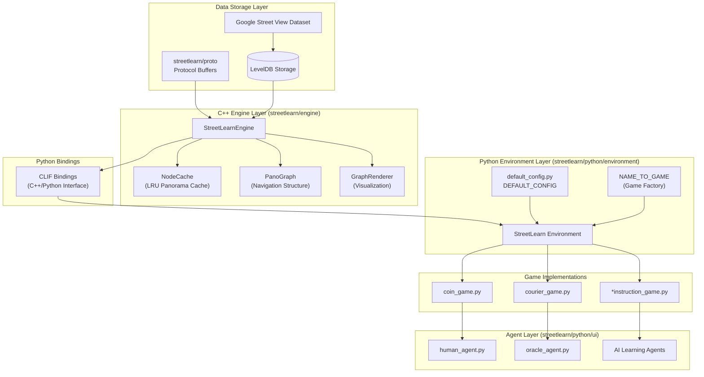
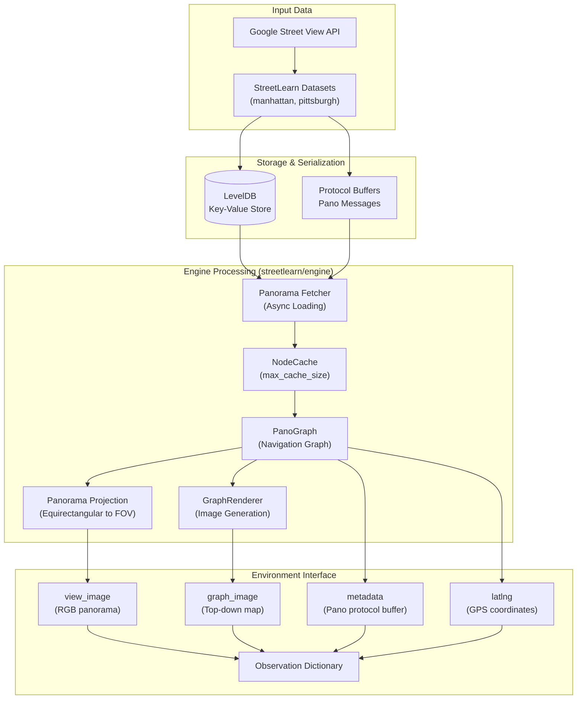
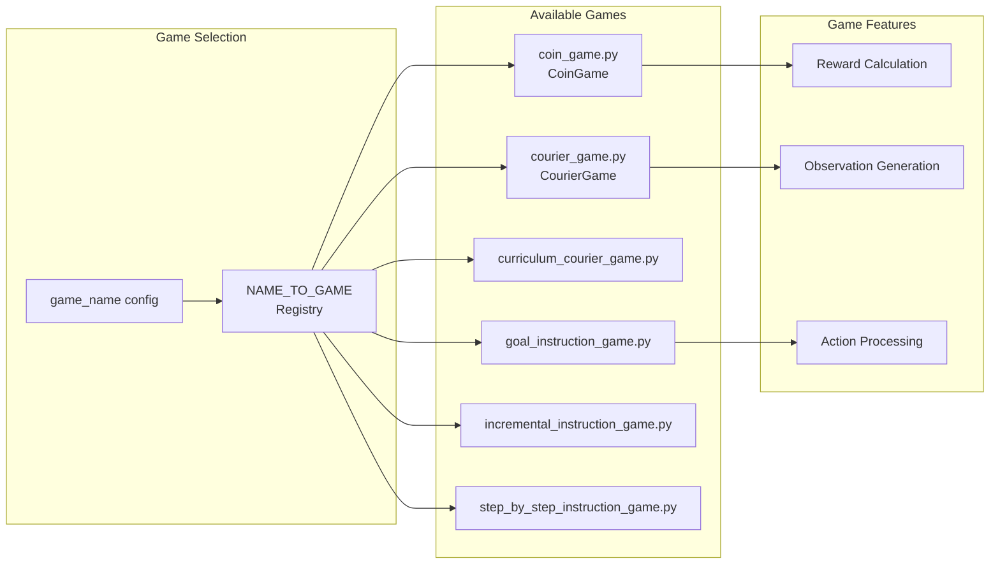

<!-- source: DeepWiki mcp.deepwiki.com · repo google-deepmind/streetlearn · page 1 Overview · fetched 2026-10-26 -->

# Overview

Relevant source files

The following files were used as context for generating this wiki page:

- [README.md](README.md)

## Purpose and Scope

StreetLearn is a navigation learning platform that enables training AI agents in real-world photographic street environments using Google Street View data. This system provides a C++ engine for high-performance panorama processing and a Python environment interface for implementing navigation games and training agents.

This document covers the high-level architecture and core components of StreetLearn. For detailed information about specific subsystems, see [System Architecture](#2), [Environment System](#3), [Agent System](#4), and [Training and Experimentation](#5).

Sources: [README.md:1-425]()

## System Architecture Overview

StreetLearn follows a layered architecture with clear separation between the high-performance C++ engine and the flexible Python environment layer.

The system processes Google Street View panoramas through a multi-layered caching and rendering pipeline, exposing navigation functionality through Python interfaces that support various game types and agent implementations.

Sources: [README.md:32-62]()

## Core Components

### C++ Engine (`streetlearn/engine`)

The `StreetLearnEngine` provides high-performance panorama processing with the following key capabilities:

| Component | Function | Description |
|-----------|----------|-------------|
| `StreetLearnEngine` | Core engine | Loads, caches, and serves Street View panoramas |
| `NodeCache` | Caching | LRU cache for panorama data |
| `PanoGraph` | Navigation | Street graph structure for movement |
| `GraphRenderer` | Visualization | Renders top-down graph images |

The engine projects panoramas from equirectangular representation to first-person view at specified yaw, pitch, and field of view parameters.

Sources: [README.md:36-41]()

### Python Environment (`streetlearn/python/environment`)

The Python layer provides OpenAI Gym-compatible interfaces through:

- `StreetLearn` environment class with `step(action)` and `reset()` methods
- `BatchedStreetLearn` for multi-environment parallelization  
- Game factory system using `NAME_TO_GAME` registry
- Configuration management through `DEFAULT_CONFIG`

Sources: [README.md:45-51](), [README.md:259-264]()

### Protocol Buffers (`streetlearn/proto`)

Message definitions for storing panorama metadata and street graph structure, enabling efficient serialization and cross-language compatibility.

Sources: [README.md:42-44]()

## Data Flow Architecture

The data flows from raw Street View panoramas through caching and processing layers to produce rich observations for agent training. The `NodeCache` uses LRU eviction with configurable `max_cache_size`, while the `PanoGraph` maintains navigation connectivity.

Sources: [README.md:268-383]()

## Environment Configuration and Games

### Configuration System

Environment settings are managed through `streetlearn/python/default_config.py` with key parameters:

| Parameter Category | Key Settings | Purpose |
|-------------------|--------------|---------|
| Visual | `width`, `height`, `field_of_view` | Panorama rendering |
| Graph | `min_graph_depth`, `max_graph_depth` | BFS exploration bounds |
| Caching | `max_cache_size` | Memory management |
| Games | `game_name`, `action_spec` | Game selection and controls |

Sources: [README.md:266-343]()

### Game Factory System

Games are registered in the `NAME_TO_GAME` dictionary and instantiated dynamically:

Each game implements specific reward structures and observation types, from simple coin collection to complex instruction-following navigation tasks.

Sources: [README.md:384-416]()

## Agent and Interface Architecture

StreetLearn supports multiple agent types through the UI system in `streetlearn/python/ui`:

| Agent Type | Implementation | Purpose |
|------------|----------------|---------|
| `human_agent.py` | Interactive control | Manual navigation and testing |
| `oracle_agent.py` | Ground truth navigation | Performance baselines |
| `batched_oracle_agent.py` | Parallel oracle processing | Batch evaluation |
| AI Learning Agents | Neural network-based | Reinforcement learning training |

The system uses PyGame for visualization, displaying both `view_image` (first-person view) and `graph_image` (top-down map) with navigation indicators and status information.

Sources: [README.md:52-62](), [README.md:173-216]()

---

