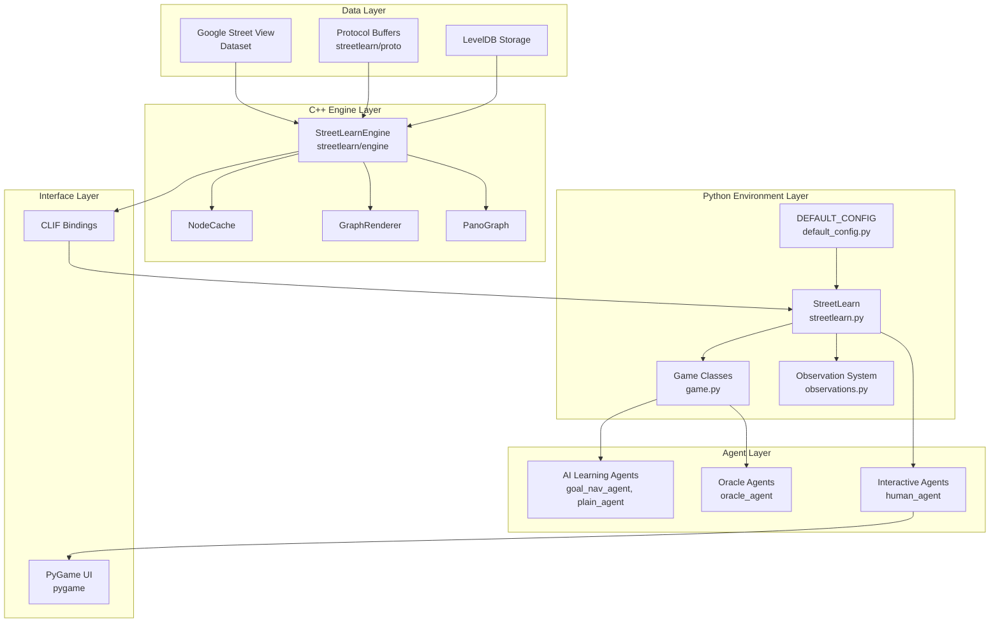
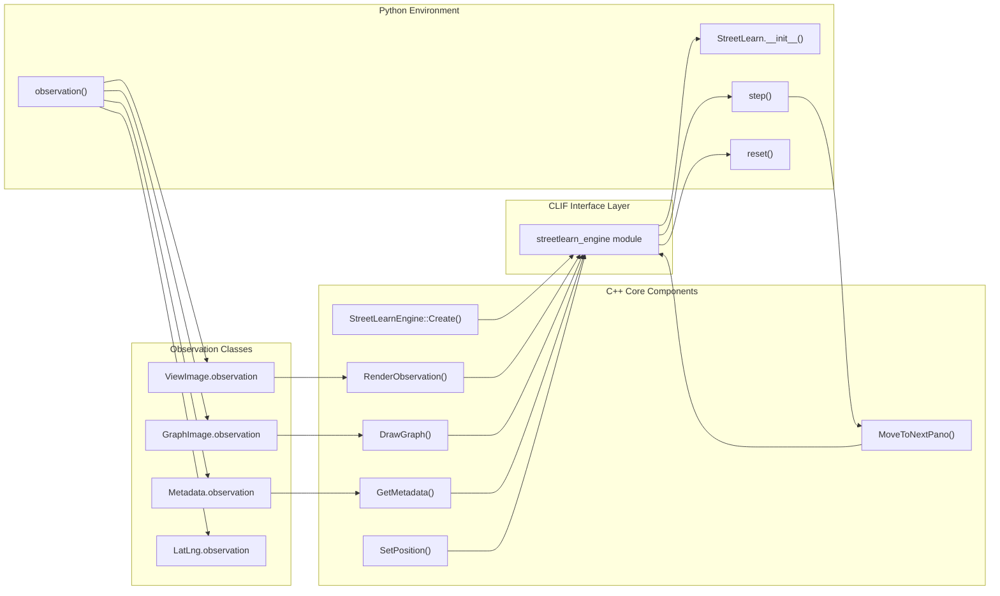
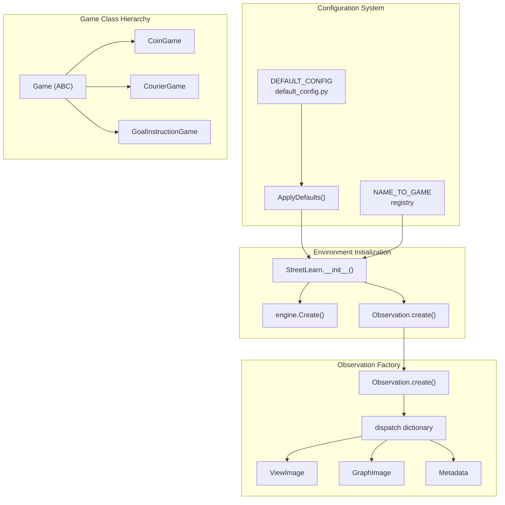
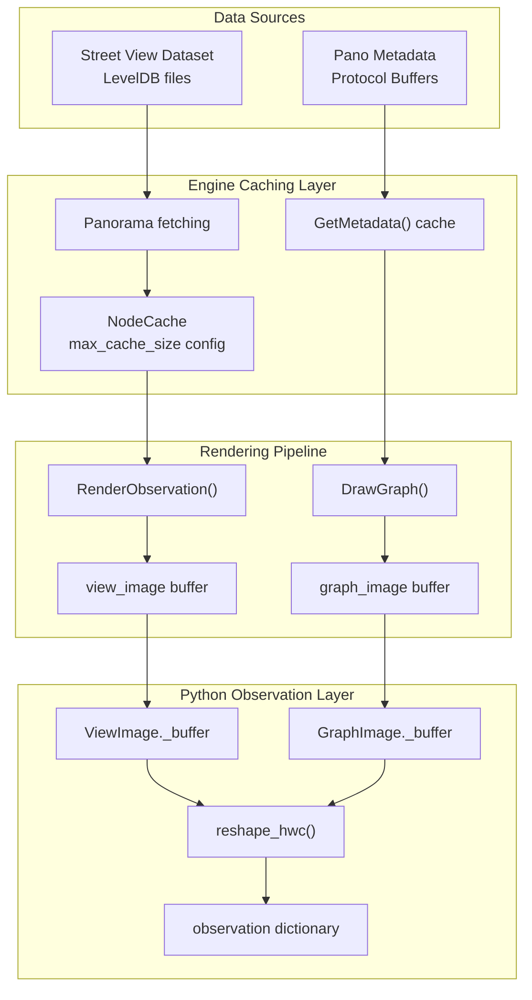
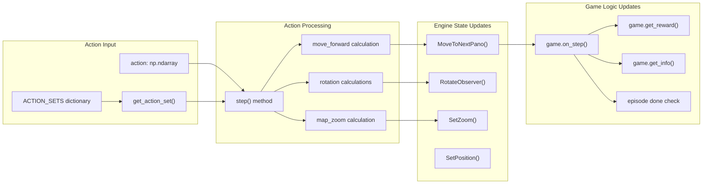
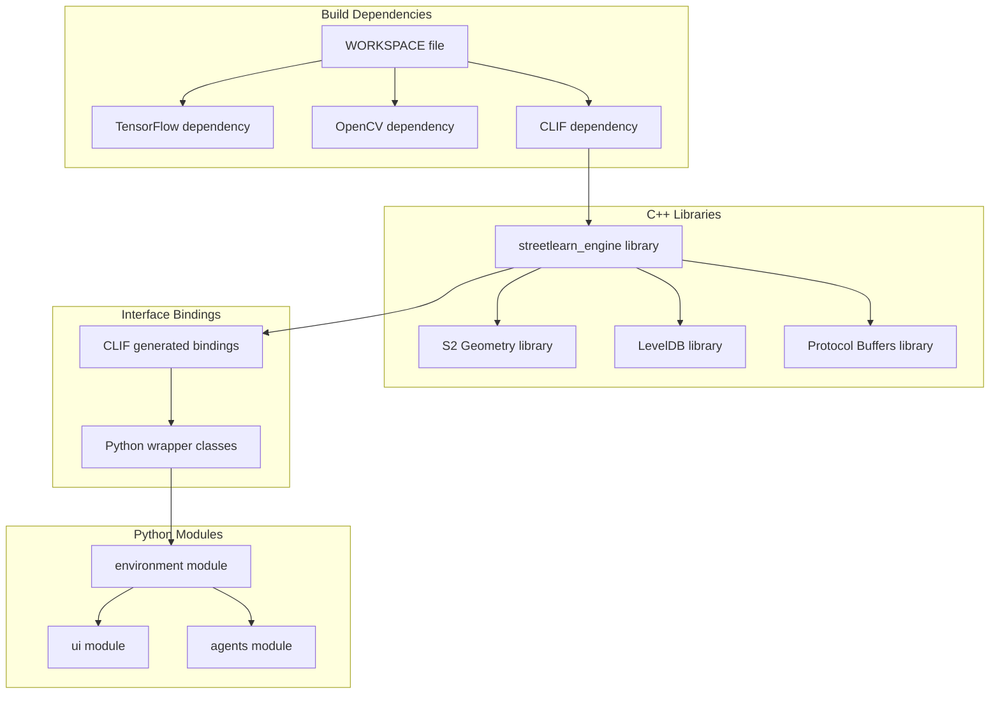

<!-- source: DeepWiki mcp.deepwiki.com · repo google-deepmind/streetlearn · page 2 System Architecture · fetched 2026-10-26 -->

# System Architecture

Relevant source files

The following files were used as context for generating this wiki page:

- [README.md](README.md)
- [WORKSPACE](WORKSPACE)
- [streetlearn/python/environment/game.py](streetlearn/python/environment/game.py)
- [streetlearn/python/environment/observations.py](streetlearn/python/environment/observations.py)
- [streetlearn/python/environment/streetlearn.py](streetlearn/python/environment/streetlearn.py)

## Purpose and Scope

This document explains the overall architecture of StreetLearn, a navigation learning platform that enables training AI agents in real-world photographic street environments using Google Street View data. It covers the multi-layer system design, component interactions, and data flow patterns across the C++ engine core, Python environment layer, and agent interfaces.

For information about specific environment games and observation types, see [Environment System](#3). For details on agent implementations and training, see [Agent System](#4) and [Training and Experimentation](#5).

## Architecture Overview

StreetLearn follows a layered architecture that separates high-performance computation (C++) from flexible environment logic (Python), connected through CLIF bindings.

### System Layers

**Sources**: [README.md:32-63](), [streetlearn/python/environment/streetlearn.py:108-183]()

## Core Component Architecture

### Engine and Environment Interface

The C++ engine provides high-performance panorama processing and graph operations, while the Python environment handles game logic and agent interactions.

**Sources**: [streetlearn/python/environment/streetlearn.py:172-182](), [streetlearn/python/environment/observations.py:77-135]()

### Configuration and Game System

The environment uses a factory pattern with configuration-driven game instantiation and observation selection.

**Sources**: [streetlearn/python/environment/streetlearn.py:111-189](), [streetlearn/python/environment/observations.py:62-74](), [streetlearn/python/environment/game.py:40-107]()

## Data Flow and Caching Architecture

### Multi-Level Caching System

StreetLearn implements sophisticated caching to optimize Street View data access and rendering performance.

**Sources**: [streetlearn/python/environment/streetlearn.py:172-183](), [streetlearn/python/environment/observations.py:87-134](), [streetlearn/python/environment/observations.py:30-43]()

### Action Processing and State Updates

The environment processes actions through a structured pipeline that updates agent state and triggers game logic.

**Sources**: [streetlearn/python/environment/streetlearn.py:332-377](), [streetlearn/python/environment/streetlearn.py:60-98]()

## Build System and Dependencies

### External Dependencies Architecture

The system relies on multiple external libraries coordinated through Bazel build configuration.

| Component | Library | Purpose | Build Integration |
|-----------|---------|---------|-------------------|
| Machine Learning | TensorFlow | Neural network training | `@org_tensorflow` |
| Computer Vision | OpenCV | Image processing | `@opencv` local repository |
| Graphics Rendering | Cairo | 2D graphics rendering | `@cairo` local repository |
| Geometry | S2 Geometry | Spherical calculations | `@com_google_s2geometry` |
| Storage | LevelDB | Key-value panorama storage | `@com_google_leveldb` |
| Serialization | Protocol Buffers | Data structure serialization | `@com_google_protobuf` |
| Python Bindings | CLIF | C++/Python interface | `@clif` environment variable |

**Sources**: [WORKSPACE:1-106](), [README.md:64-201]()

### Component Interaction Boundaries

The architecture maintains clear separation between performance-critical C++ components and flexible Python logic through well-defined interfaces.

**Sources**: [WORKSPACE:89-106](), [README.md:97-104](), [README.md:158-171]()

---

