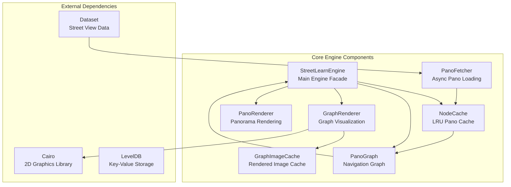
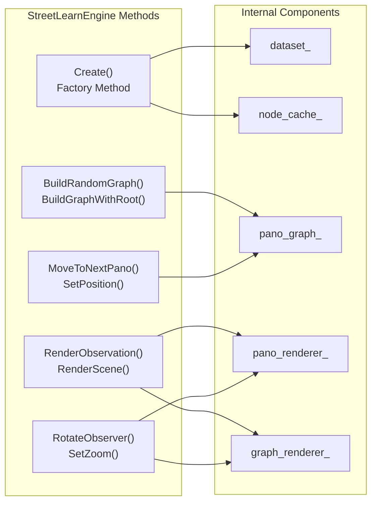
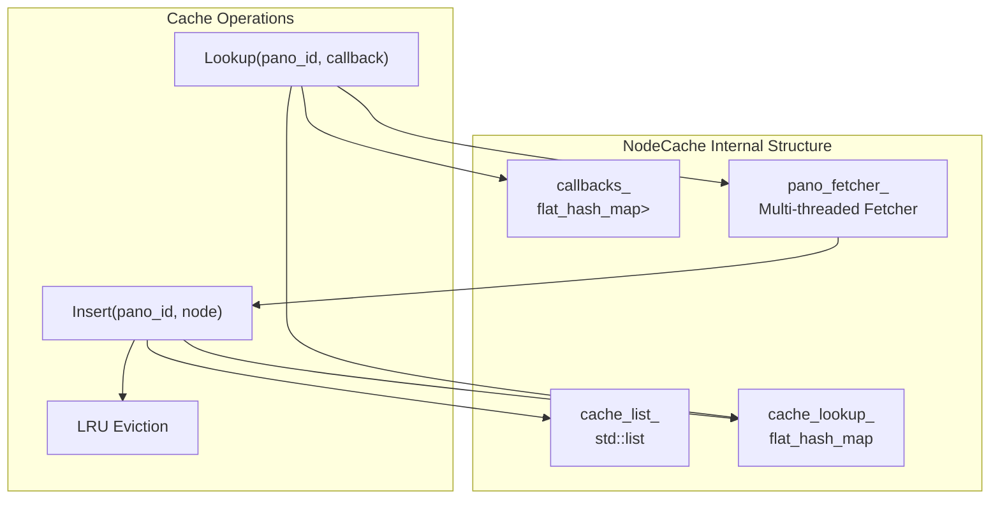
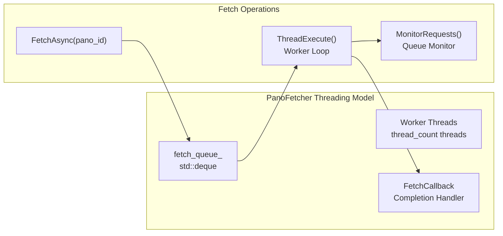
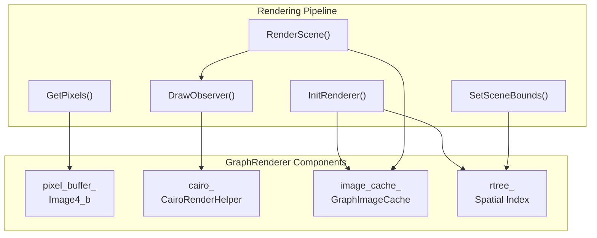
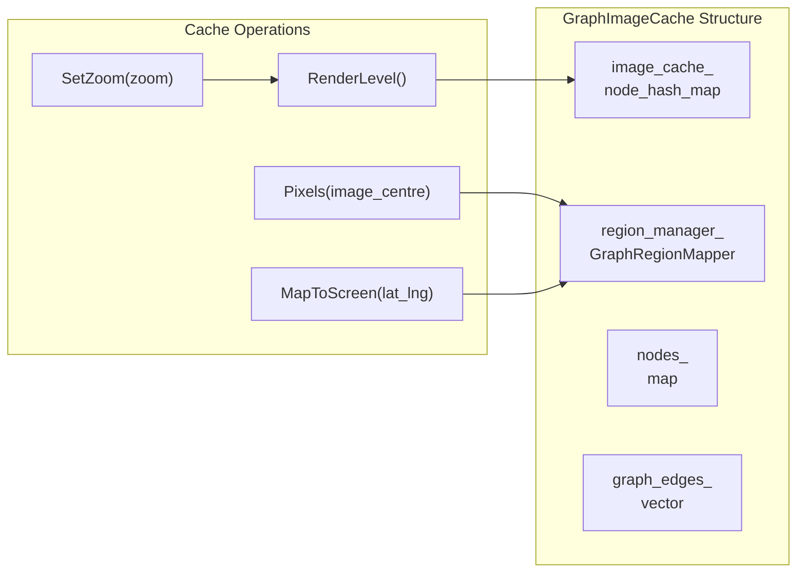

<!-- source: DeepWiki mcp.deepwiki.com · repo google-deepmind/streetlearn · page 2.1 Core Engine · fetched 2026-10-26 -->

# Core Engine

Relevant source files

The following files were used as context for generating this wiki page:

- [streetlearn/engine/graph_image_cache.h](streetlearn/engine/graph_image_cache.h)
- [streetlearn/engine/graph_renderer.cc](streetlearn/engine/graph_renderer.cc)
- [streetlearn/engine/graph_renderer.h](streetlearn/engine/graph_renderer.h)
- [streetlearn/engine/node_cache.cc](streetlearn/engine/node_cache.cc)
- [streetlearn/engine/node_cache.h](streetlearn/engine/node_cache.h)
- [streetlearn/engine/pano_fetcher.h](streetlearn/engine/pano_fetcher.h)
- [streetlearn/engine/pano_graph_test.cc](streetlearn/engine/pano_graph_test.cc)
- [streetlearn/engine/streetlearn_engine.cc](streetlearn/engine/streetlearn_engine.cc)

The Core Engine is the high-performance C++ component that forms the computational backbone of StreetLearn. It handles computationally intensive tasks including panorama loading, caching, graph management, and rendering operations. The engine provides the foundational infrastructure that enables efficient navigation simulation in Google Street View environments.

This document covers the C++ engine components and their interactions. For information about the Python environment that interfaces with this engine, see [Python Environment Layer](#2.2). For details on data management and caching strategies, see [Data Management and Caching](#2.3).

## Architecture Overview

The Core Engine consists of several interconnected C++ components that work together to provide efficient panorama processing and graph navigation capabilities.

Sources: [streetlearn/engine/streetlearn_engine.cc:50-98](), [streetlearn/engine/node_cache.h:33-47](), [streetlearn/engine/graph_renderer.h:53-82]()

## StreetLearnEngine - Main Engine Facade

The `StreetLearnEngine` class serves as the primary interface to the Core Engine, coordinating all subsystems and providing a unified API for panorama navigation and rendering.

### Core Functionality

| Component | Responsibility |
|-----------|----------------|
| Graph Management | Building and navigating panorama graphs |
| Rendering Pipeline | Coordinating scene and observation rendering |
| Observer Control | Managing camera position and orientation |
| Metadata Access | Providing panorama and graph metadata |

The engine initializes with specific rendering dimensions and caching parameters:

- **Panorama rendering**: Configurable width/height and field of view
- **Graph visualization**: Separate dimensions for graph images
- **Threading**: Uses 16 threads for panorama fetching by default
- **Caching**: Configurable maximum cache size for loaded panoramas

Sources: [streetlearn/engine/streetlearn_engine.cc:50-77](), [streetlearn/engine/streetlearn_engine.h:79-96]()

## NodeCache - LRU Panorama Caching

The `NodeCache` implements a thread-safe Least Recently Used (LRU) cache for `PanoGraphNode` objects, providing efficient access to frequently used panoramas while managing memory usage.

### Cache Architecture

### Cache Behavior

The cache operates with the following characteristics:

- **Thread Safety**: All operations are protected by `absl::Mutex`
- **Asynchronous Loading**: Uses callback mechanism for non-blocking access
- **LRU Eviction**: Automatically removes least recently used items when capacity exceeded
- **Callback Management**: Queues callbacks for pending fetches and executes them when items become available

Key methods include:
- `Lookup(pano_id, callback)`: Returns `true` if item is cached, `false` if fetch required
- `Insert(pano_id, node)`: Adds item to cache and triggers pending callbacks
- `CancelPendingFetches()`: Cancels outstanding fetch requests

Sources: [streetlearn/engine/node_cache.h:33-127](), [streetlearn/engine/node_cache.cc:40-110]()

## PanoFetcher - Asynchronous Panorama Loading

The `PanoFetcher` provides multi-threaded, asynchronous loading of panorama data from the dataset storage, using a producer-consumer pattern with a synchronized queue.

### Threading Architecture

### Key Features

- **Thread Pool**: Configurable number of worker threads for parallel fetching
- **Queue Management**: Synchronized queue with non-blocking queue operations
- **Graceful Shutdown**: Proper thread termination and resource cleanup
- **Cancellation Support**: Ability to cancel pending fetches and return cancelled IDs

The fetcher integrates with the `NodeCache` through a callback mechanism, allowing the cache to be populated asynchronously without blocking client threads.

Sources: [streetlearn/engine/pano_fetcher.h:56-106](), [streetlearn/engine/pano_fetcher.cc:80-110]()

## Graph Rendering System

The graph rendering system consists of two main components that work together to provide efficient visualization of panorama graphs at different scales and zoom levels.

### GraphRenderer - Main Rendering Controller

The `GraphRenderer` class manages the overall graph visualization pipeline, including node positioning, observer visualization, and zoom management.

Key rendering features:
- **Spatial Indexing**: Uses R-tree for efficient node visibility culling
- **Observer Visualization**: Draws view cones showing agent orientation and field of view
- **Dynamic Bounds**: Automatically calculates optimal viewing regions
- **Color Mapping**: Supports custom node coloring for different visualization modes

### GraphImageCache - Multi-Level Image Caching

The `GraphImageCache` provides efficient caching of rendered graph images at multiple zoom levels, reducing redundant rendering operations.

The cache operates with:
- **Multi-Level Storage**: Different images cached for each zoom level
- **On-Demand Rendering**: Images generated only when requested for new zoom levels
- **Coordinate Mapping**: Efficient lat/lng to screen coordinate transformation
- **Memory Management**: Automatic cleanup of unused zoom levels

Sources: [streetlearn/engine/graph_renderer.h:53-141](), [streetlearn/engine/graph_renderer.cc:85-325](), [streetlearn/engine/graph_image_cache.h:38-115]()

## Performance Characteristics

The Core Engine is designed for high-performance navigation simulation with several optimization strategies:

### Caching Strategy
- **Multi-Level Caching**: Panorama nodes, graph images, and metadata cached separately
- **LRU Eviction**: Intelligent memory management for long-running simulations
- **Asynchronous Loading**: Non-blocking panorama fetching prevents UI freezes

### Threading Model
- **Parallel Fetching**: Multiple threads for concurrent panorama loading
- **Thread-Safe Operations**: All shared data structures properly synchronized
- **Producer-Consumer Pattern**: Efficient queue-based work distribution

### Rendering Optimizations
- **Spatial Culling**: R-tree based visibility determination for large graphs
- **Image Caching**: Pre-rendered graph images reduce redundant drawing operations
- **Zoom-Level Management**: Different detail levels for different viewing scales

Sources: [streetlearn/engine/streetlearn_engine.cc:36-37](), [streetlearn/engine/node_cache.h:105-127](), [streetlearn/engine/graph_renderer.cc:37-40]()

---

