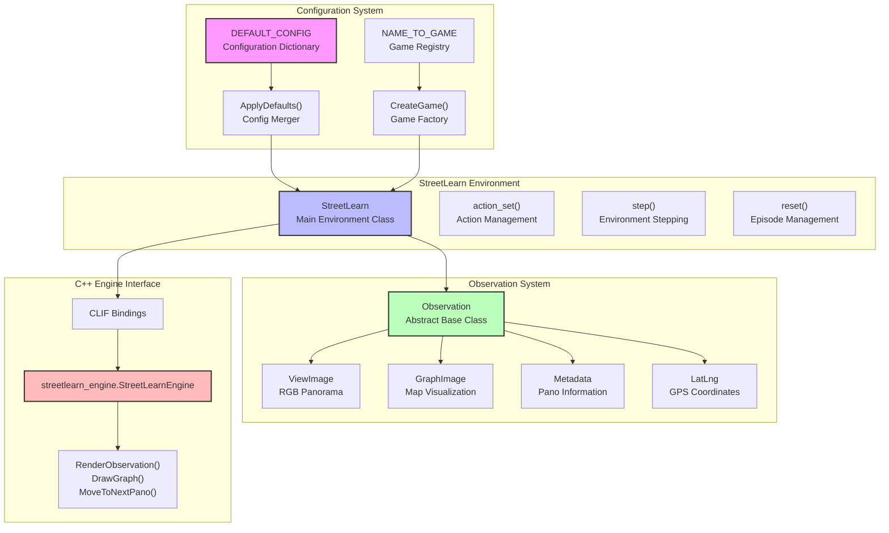
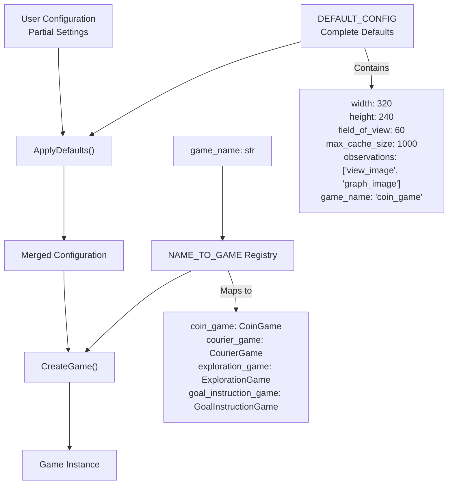
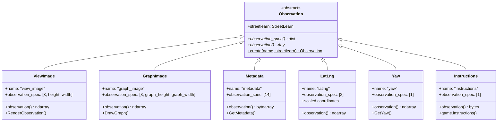
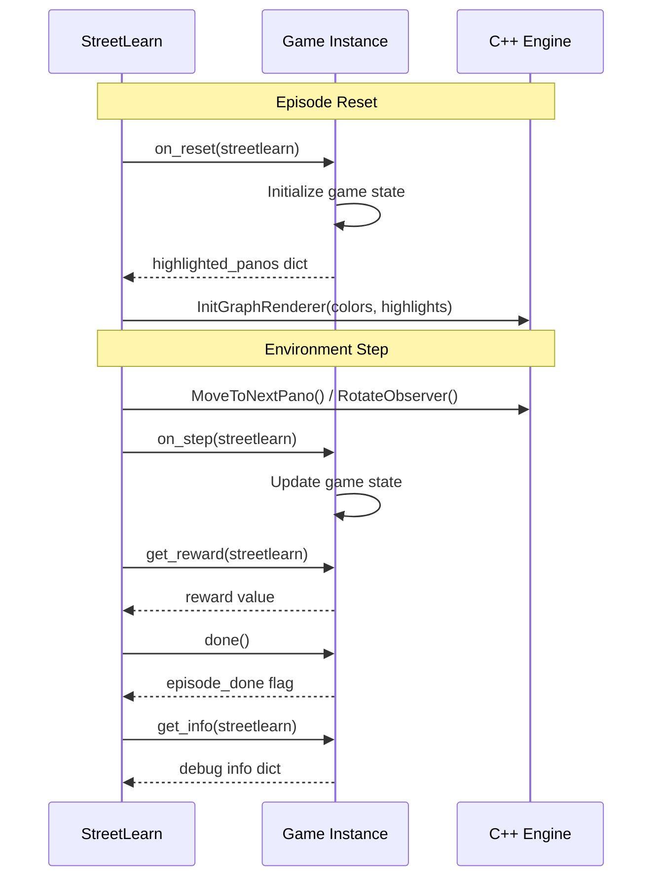

<!-- source: DeepWiki mcp.deepwiki.com · repo google-deepmind/streetlearn · page 2.2 Python Environment Layer · fetched 2026-10-26 -->

# Python Environment Layer

Relevant source files

The following files were used as context for generating this wiki page:

- [streetlearn/python/environment/courier_game.py](streetlearn/python/environment/courier_game.py)
- [streetlearn/python/environment/curriculum_courier_game.py](streetlearn/python/environment/curriculum_courier_game.py)
- [streetlearn/python/environment/default_config.py](streetlearn/python/environment/default_config.py)
- [streetlearn/python/environment/observations.py](streetlearn/python/environment/observations.py)
- [streetlearn/python/environment/streetlearn.py](streetlearn/python/environment/streetlearn.py)

The Python Environment Layer provides the primary interface between the C++ StreetLearn engine and Python-based reinforcement learning agents. This layer abstracts the low-level C++ functionality into a clean, extensible Python API that supports multiple game types, rich observations, and flexible configuration. 

For information about the underlying C++ engine components, see [Core Engine](#2.1). For details about specific game implementations and reward structures, see [Game Types](#3.2).

## Core Architecture

The Python Environment Layer consists of four main components that work together to provide a complete RL environment interface:

**Sources:** [streetlearn/python/environment/default_config.py:31-122](), [streetlearn/python/environment/streetlearn.py:108-419](), [streetlearn/python/environment/observations.py:46-396]()

## Configuration System

The configuration system provides centralized management of environment settings through a dictionary-based approach with intelligent defaults and game factory registration.

The `DEFAULT_CONFIG` dictionary at [streetlearn/python/environment/default_config.py:31-90]() contains comprehensive defaults for all environment parameters:

| Category | Key Parameters | Purpose |
|----------|----------------|---------|
| **Rendering** | `width`, `height`, `field_of_view` | Control visual output dimensions |
| **Graph** | `graph_width`, `graph_height`, `max_graph_depth` | Configure map visualization |
| **Caching** | `max_cache_size` | Control memory usage |
| **Actions** | `action_spec`, `rotation_speed` | Define available agent actions |
| **Observations** | `observations` | Specify which observation types to include |
| **Games** | `game_name`, reward parameters | Configure game-specific settings |

The `ApplyDefaults()` function at [streetlearn/python/environment/default_config.py:109-117]() merges user configuration with defaults while performing type checking to ensure consistency.

**Sources:** [streetlearn/python/environment/default_config.py:31-122]()

## StreetLearn Environment Class

The `StreetLearn` class at [streetlearn/python/environment/streetlearn.py:108-419]() serves as the main environment orchestrator, managing the complete RL episode lifecycle:

```mermaid
graph TD
    subgraph "Initialization"
        Constructor["__init__()"]
        CreateEngine["Create/Clone Engine"]
        SetupObservations["Setup Observations"]
        ConfigureActions["Configure Action Set"]
    end
    
    subgraph "Episode Management"
        Reset["reset()"]
        BuildGraph["Build/Reuse Graph"]
        InitGame["Initialize Game"]
        SetupRenderer["Setup Graph Renderer"]
    end
    
    subgraph "Step Execution"
        Step["step(action)"]
        ProcessAction["Process Action Components"]
        UpdateEngine["Update Engine State"]
        ComputeReward["Compute Game Reward"]
        CheckDone["Check Episode End"]
        GetObservation["Get Observations"]
    end
    
    subgraph "Action Processing"
        ActionSet["get_action_set()"]
        MoveForward["move_forward"]
        HorizontalRotation["horizontal_rotation"]
        VerticalRotation["vertical_rotation"]
        MapZoom["map_zoom"]
    end
    
    Constructor --> CreateEngine
    CreateEngine --> SetupObservations
    SetupObservations --> ConfigureActions
    
    Reset --> BuildGraph
    BuildGraph --> InitGame
    InitGame --> SetupRenderer
    
    Step --> ProcessAction
    ProcessAction --> UpdateEngine
    UpdateEngine --> ComputeReward
    ComputeReward --> CheckDone
    CheckDone --> GetObservation
    
    ActionSet --> MoveForward
    ActionSet --> HorizontalRotation
    ActionSet --> VerticalRotation
    ActionSet --> MapZoom
```

### Key Methods

- **`__init__()`** at [streetlearn/python/environment/streetlearn.py:111-196](): Initializes engine connection, applies configuration, and sets up observation pipeline
- **`reset()`** at [streetlearn/python/environment/streetlearn.py:274-314](): Manages episode initialization, graph building, and game setup
- **`step()`** at [streetlearn/python/environment/streetlearn.py:332-377](): Processes agent actions, updates environment state, and returns observations
- **`observation()`** at [streetlearn/python/environment/streetlearn.py:379-381](): Collects and returns current observations from all configured observers

### Action System

The environment supports flexible action specifications through the `ACTION_SETS` dictionary at [streetlearn/python/environment/streetlearn.py:69-86]():

- **`streetlearn_default`**: Basic movement and rotation (3 actions)
- **`streetlearn_fast_rotate`**: Extended rotation speeds (5 actions)  
- **`streetlearn_tilt`**: Includes vertical camera control (5 actions)

**Sources:** [streetlearn/python/environment/streetlearn.py:108-419]()

## Observation System

The observation system provides rich, multi-modal environmental information through a polymorphic class hierarchy rooted at the abstract `Observation` base class:

### Core Observation Types

| Observation | Shape | Description | Engine Method |
|-------------|-------|-------------|---------------|
| **`view_image`** | `[3, H, W]` | RGB panorama view | `RenderObservation()` |
| **`graph_image`** | `[3, H, W]` | Map visualization | `DrawGraph()` |
| **`metadata`** | `[14]` | Pano protocol buffer | `GetMetadata()` |
| **`latlng`** | `[2]` | Scaled GPS coordinates | `GetMetadata().coords` |
| **`yaw`** | `[1]` | Camera heading | `GetYaw()` |
| **`instructions`** | `[1]` | Game instructions | `game.instructions()` |

The observation factory at [streetlearn/python/environment/observations.py:62-74]() uses a dispatch pattern to instantiate the correct observation type based on string names from the configuration.

**Sources:** [streetlearn/python/environment/observations.py:46-396]()

## Game Framework Integration

The environment integrates with the game framework through a clean interface that allows games to customize rewards, visualization, and episode logic:

Games interact with the environment through several key methods:
- **`on_reset()`**: Initialize game state and return highlighted panoramas for visualization
- **`on_step()`**: Update game state after each environment step  
- **`get_reward()`**: Compute step reward based on current environment state
- **`done()`**: Determine if episode should terminate
- **`get_info()`**: Provide debugging and analysis information

Example game implementations include `CourierGame` at [streetlearn/python/environment/courier_game.py:32-286]() and `CurriculumCourierGame` at [streetlearn/python/environment/curriculum_courier_game.py:33-145]().

**Sources:** [streetlearn/python/environment/courier_game.py:67-161](), [streetlearn/python/environment/curriculum_courier_game.py:94-123]()

## C++ Engine Interface

The Python environment interfaces with the C++ engine through CLIF-generated bindings that expose core engine functionality:

| Engine Method | Purpose | Usage in Python Layer |
|---------------|---------|----------------------|
| **`Create()`** | Initialize engine | [streetlearn.py:172-182]() |
| **`RenderObservation()`** | Generate view image | [observations.py:96]() |
| **`DrawGraph()`** | Render map visualization | [observations.py:134]() |
| **`MoveToNextPano()`** | Navigate to adjacent pano | [streetlearn.py:354]() |
| **`RotateObserver()`** | Change camera orientation | [streetlearn.py:361]() |
| **`GetMetadata()`** | Retrieve pano information | [observations.py:208]() |
| **`GetYaw()`** | Get camera heading | [observations.py:164]() |

The engine reference is stored in `self._engine` at [streetlearn/python/environment/streetlearn.py:159-182]() and accessed throughout the observation system to retrieve real-time environmental data.

**Sources:** [streetlearn/python/environment/streetlearn.py:159-182](), [streetlearn/python/environment/observations.py:96](), [streetlearn/python/environment/observations.py:134]()

---

