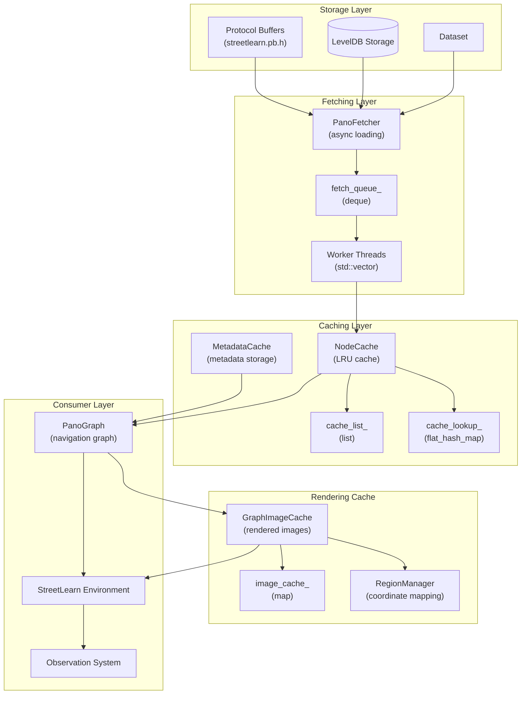
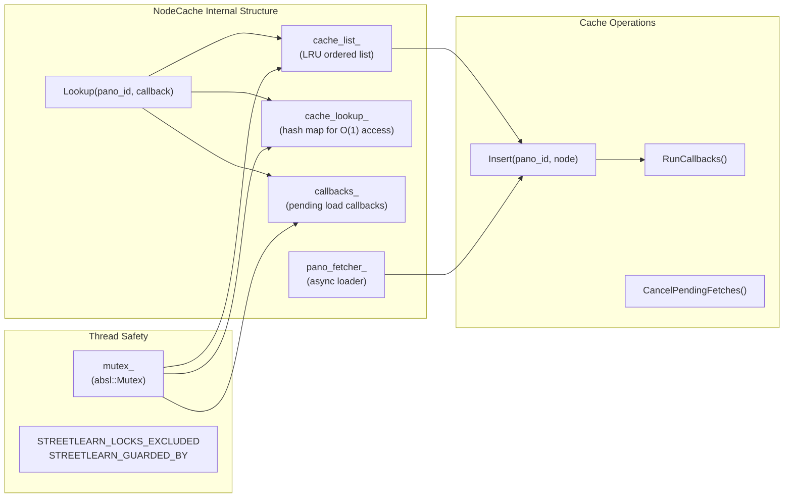
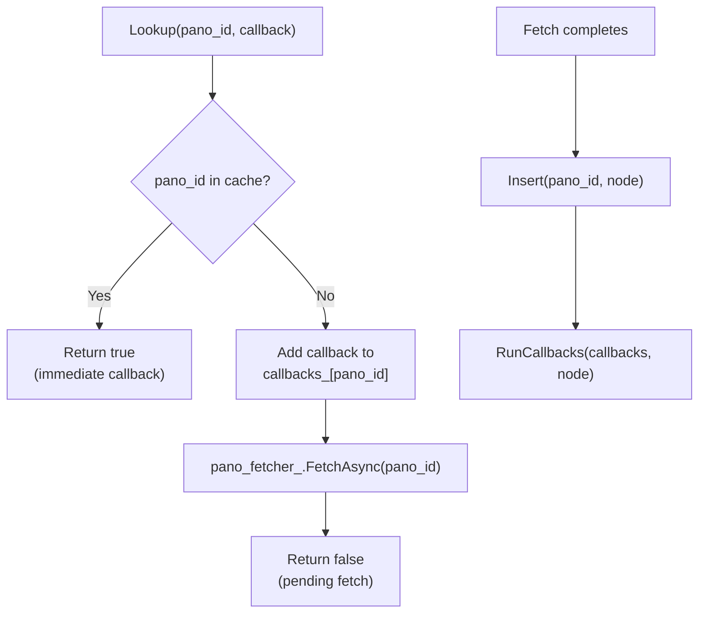
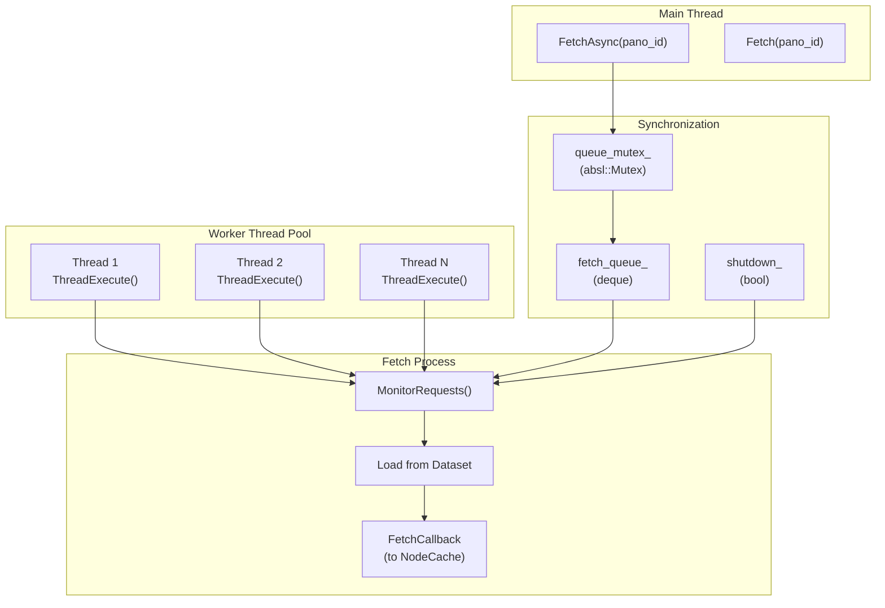
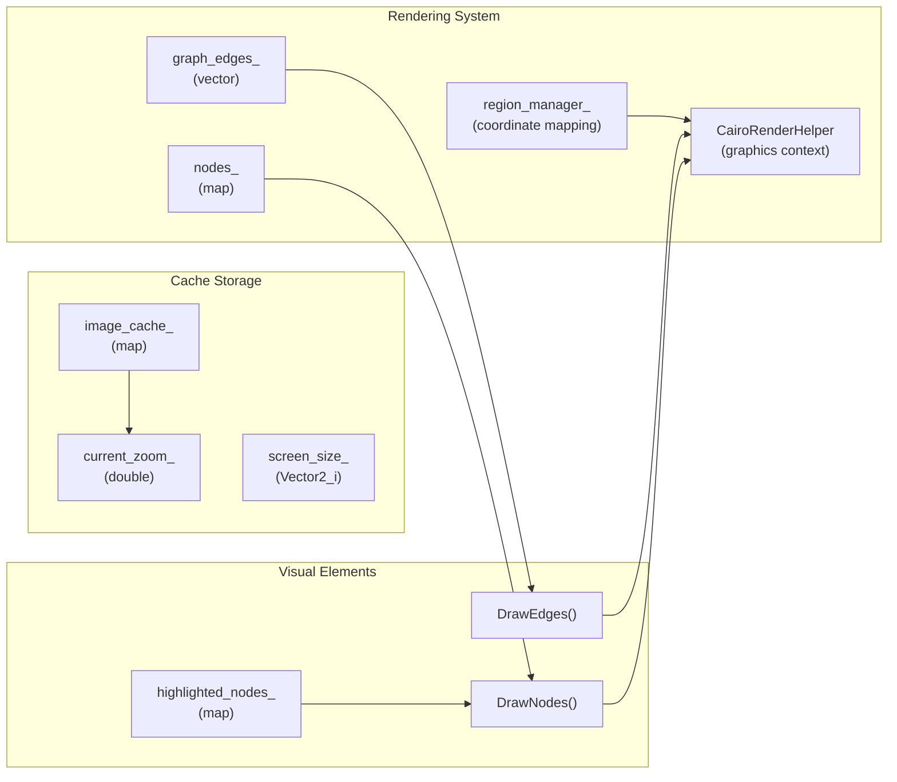
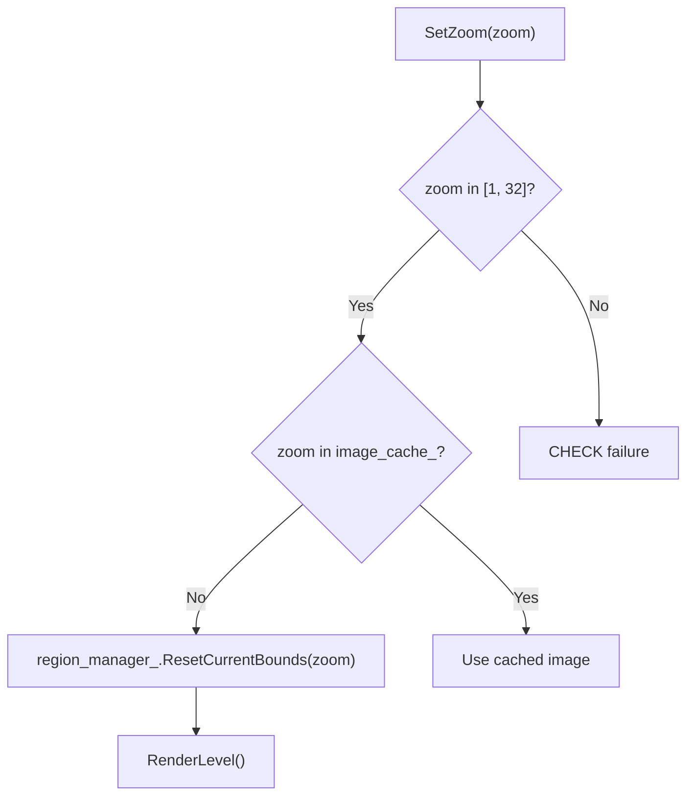
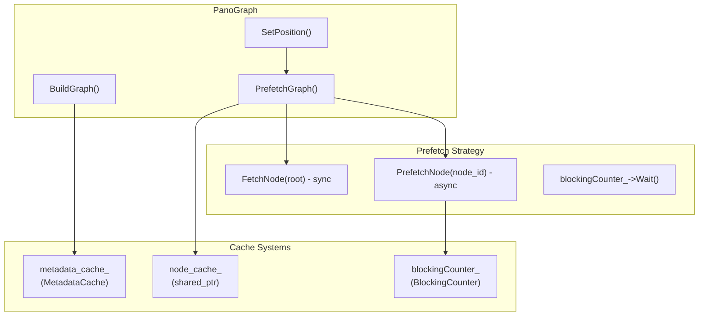

<!-- source: DeepWiki mcp.deepwiki.com · repo google-deepmind/streetlearn · page 2.3 Data Management and Caching · fetched 2026-10-26 -->

# Data Management and Caching

<details>
<summary>Relevant source files</summary>

The following files were used as context for generating this wiki page:

- [streetlearn/engine/graph_image_cache.cc](streetlearn/engine/graph_image_cache.cc)
- [streetlearn/engine/node_cache.h](streetlearn/engine/node_cache.h)
- [streetlearn/engine/pano_fetcher.h](streetlearn/engine/pano_fetcher.h)
- [streetlearn/engine/pano_graph.cc](streetlearn/engine/pano_graph.cc)
- [streetlearn/python/environment/coin_game.py](streetlearn/python/environment/coin_game.py)

</details>


## Purpose and Scope

This document describes the multi-layered caching and data management system in StreetLearn that efficiently handles Street View panorama data, metadata, and rendered visualizations. The system consists of three main caching components: the `NodeCache` for panorama nodes, the `PanoFetcher` for asynchronous data loading, and the `GraphImageCache` for rendered graph visualizations.

For information about the core engine architecture, see [2.1](#2.1). For details about the Python environment layer that consumes cached data, see [2.2](#2.2).

## Data Flow Overview

The StreetLearn caching system implements a sophisticated multi-tier architecture that optimizes data access patterns for navigation learning environments.



**Data Flow Architecture**

Sources: [streetlearn/engine/node_cache.h:47-128](), [streetlearn/engine/pano_fetcher.h:56-106](), [streetlearn/engine/graph_image_cache.cc:47-194]()

## Node Caching System

The `NodeCache` class implements a thread-safe LRU (Least Recently Used) cache for `PanoGraphNode` objects, which contain panorama images and associated metadata.

### NodeCache Architecture



**NodeCache Component Relationships**

The cache uses a dual data structure approach for optimal performance:

| Component | Type | Purpose |
|-----------|------|---------|
| `cache_list_` | `std::list<CacheEntry>` | Maintains LRU ordering |
| `cache_lookup_` | `absl::flat_hash_map` | Provides O(1) lookup access |
| `callbacks_` | `absl::flat_hash_map<string, list<LoadCallback>>` | Manages pending async requests |
| `pano_fetcher_` | `PanoFetcher` | Handles disk I/O operations |

### Cache Lookup Flow

The `NodeCache::Lookup` method implements an efficient callback-based async loading pattern:



**Cache Lookup State Machine**

Sources: [streetlearn/engine/node_cache.h:63-67](), [streetlearn/engine/node_cache.h:82-94]()

## Asynchronous Data Fetching

The `PanoFetcher` class provides asynchronous panorama loading using a thread pool and synchronized queue system.

### PanoFetcher Threading Model



**PanoFetcher Thread Pool Architecture**

The fetcher implements a producer-consumer pattern where the main thread queues requests and worker threads process them:

- **Thread Count**: Configurable via constructor parameter
- **Queue Management**: Thread-safe `std::deque<std::string>` for pano IDs
- **Callback Mechanism**: `FetchCallback` function called on completion
- **Cancellation**: `CancelPendingFetches()` clears queue and returns cancelled IDs

Sources: [streetlearn/engine/pano_fetcher.h:62-63](), [streetlearn/engine/pano_fetcher.h:81-87](), [streetlearn/engine/pano_fetcher.h:95-105]()

## Graph Image Caching

The `GraphImageCache` class manages rendered visualizations of the navigation graph at different zoom levels using Cairo graphics.

### GraphImageCache Structure



**GraphImageCache Rendering Pipeline**

### Zoom Level Management

The cache maintains separate rendered images for different zoom levels:

| Zoom Range | Rendering Features | Performance Characteristics |
|------------|-------------------|---------------------------|
| 1-32 | Full graph with edges | Pre-rendered and cached |
| ≥ 1 | Node visualization enabled | Conditional rendering |
| < 1 | Edges only | Minimal detail level |

The `SetZoom()` method triggers on-demand rendering:



**Zoom Level Processing Flow**

Sources: [streetlearn/engine/graph_image_cache.cc:61-71](), [streetlearn/engine/graph_image_cache.cc:97-124](), [streetlearn/engine/graph_image_cache.cc:126-157]()

## Cache Integration and Performance

### PanoGraph Cache Coordination

The `PanoGraph` class orchestrates multiple caching systems to provide efficient navigation graph operations:



**PanoGraph Cache Orchestration**

### Performance Characteristics

| Operation | Synchronization | Typical Latency | Cache Behavior |
|-----------|----------------|-----------------|----------------|
| `NodeCache::Lookup` (hit) | Lock-free read | < 1ms | Immediate callback |
| `NodeCache::Lookup` (miss) | Async fetch | 10-100ms | Queued for loading |
| `GraphImageCache::SetZoom` (cached) | None | < 1ms | Direct image access |
| `GraphImageCache::SetZoom` (new) | Rendering | 50-200ms | Cairo rendering |

### Thread Safety Implementation

All caching systems implement thread safety using different strategies:

- **NodeCache**: `absl::Mutex` with thread annotations (`STREETLEARN_LOCKS_EXCLUDED`, `STREETLEARN_GUARDED_BY`)
- **PanoFetcher**: Queue-based synchronization with worker thread pool
- **GraphImageCache**: Single-threaded rendering with cached results

Sources: [streetlearn/engine/pano_graph.cc:121-164](), [streetlearn/engine/pano_graph.cc:429-455](), [streetlearn/engine/node_cache.h:105-127]()

## Cache Configuration and Sizing

### NodeCache Configuration

Cache size is determined at construction and affects memory usage and hit rates:

```cpp
// From node_cache.h constructor
NodeCache(const Dataset* dataset, int thread_count, std::size_t max_size);
```

The cache maintains current size via `cache_size_` and evicts LRU entries when `max_size_` is exceeded.

### Usage in Environment Games

Games like `CoinGame` monitor cache performance through the StreetLearn environment:

```python
# Cache size monitoring in coin_game.py
logging.info('seed %d, %d/%d coins left, cache size %d, current pano: %s',
             streetlearn.seed, len(self._coin_pano_id_set), self._num_coins,
             streetlearn.cache_size, streetlearn.current_pano_id)
```

### Memory Management Strategy

The caching system implements several memory optimization techniques:

- **LRU Eviction**: Automatic removal of least recently used panorama nodes
- **Async Loading**: Non-blocking I/O prevents thread starvation  
- **Zoom-based Rendering**: Multiple zoom levels cached independently
- **Shared Pointers**: `std::shared_ptr<const PanoGraphNode>` for safe memory sharing

Sources: [streetlearn/engine/node_cache.h:54-60](), [streetlearn/python/environment/coin_game.py:91-94](), [streetlearn/engine/graph_image_cache.cc:100-102]()

---

