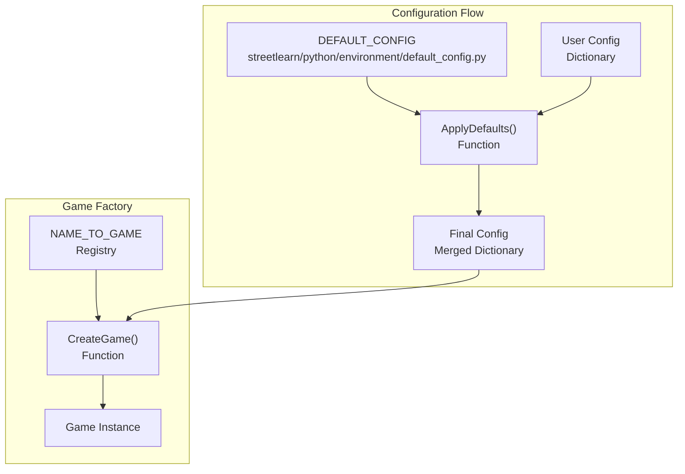
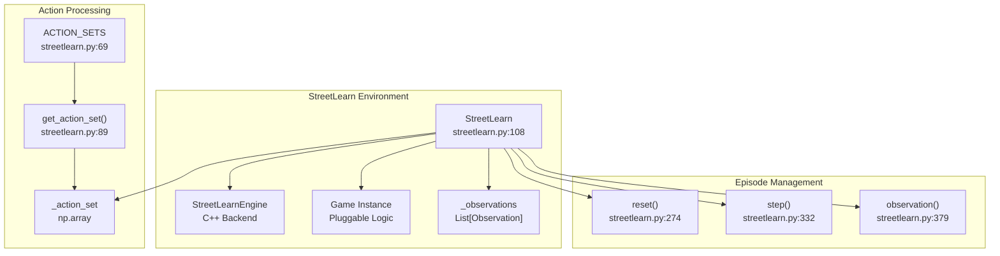
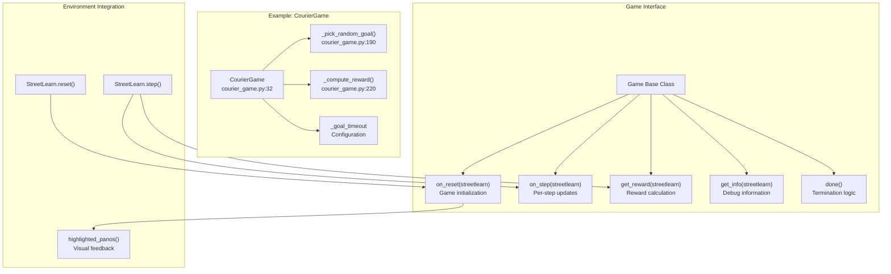
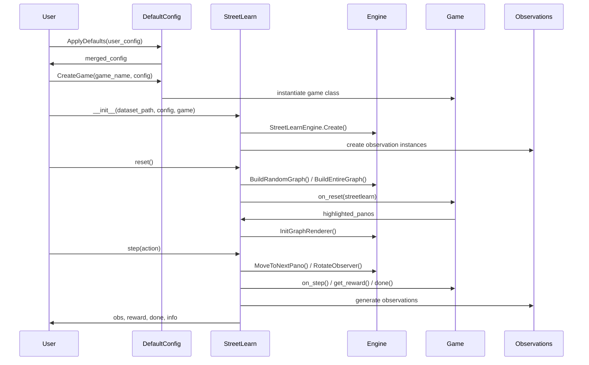

<!-- source: DeepWiki mcp.deepwiki.com · repo google-deepmind/streetlearn · page 3 Environment System · fetched 2026-10-26 -->

# Environment System

Relevant source files

The following files were used as context for generating this wiki page:

- [streetlearn/python/environment/courier_game.py](streetlearn/python/environment/courier_game.py)
- [streetlearn/python/environment/curriculum_courier_game.py](streetlearn/python/environment/curriculum_courier_game.py)
- [streetlearn/python/environment/default_config.py](streetlearn/python/environment/default_config.py)
- [streetlearn/python/environment/observations.py](streetlearn/python/environment/observations.py)
- [streetlearn/python/environment/streetlearn.py](streetlearn/python/environment/streetlearn.py)

This document covers the StreetLearn environment system, which provides the core interface between agents and the StreetView navigation world. The environment system handles configuration management, game instantiation, observation generation, and the step-by-step execution of navigation episodes.

For information about the underlying C++ engine components, see [Core Engine](#2.1). For details about specific game implementations and their mechanics, see [Game Types](#3.2).

## Configuration Management

The environment system uses a centralized configuration approach with sensible defaults and a factory pattern for game instantiation. The `DEFAULT_CONFIG` dictionary in [streetlearn/python/environment/default_config.py:31-90]() defines all configurable parameters for the environment.

**Configuration Merging Process**

The `ApplyDefaults` function [streetlearn/python/environment/default_config.py:109-117]() merges user-provided configuration with defaults, ensuring type consistency and completeness. Key configuration categories include:

| Category | Parameters | Purpose |
|----------|------------|---------|
| Visual | `width`, `height`, `field_of_view` | Control rendered image dimensions |
| Graph | `graph_width`, `graph_height`, `graph_zoom` | Configure graph visualization |
| Caching | `max_cache_size`, `max_graph_depth` | Memory and performance tuning |
| Rewards | `max_reward_per_goal`, `reward_per_coin` | Game-specific reward structure |
| Actions | `action_spec`, `rotation_speed` | Agent movement capabilities |

**Game Factory Pattern**

The `NAME_TO_GAME` registry [streetlearn/python/environment/default_config.py:92-107]() maps string identifiers to game classes, enabling dynamic game instantiation through the `CreateGame` function [streetlearn/python/environment/default_config.py:119-121]().

Sources: [streetlearn/python/environment/default_config.py:31-121]()

## Core Environment Architecture

The `StreetLearn` class [streetlearn/python/environment/streetlearn.py:108-419]() serves as the primary environment interface, orchestrating interactions between the C++ engine, games, and observation systems.

**Action System**

The environment supports multiple action configurations through `ACTION_SETS` [streetlearn/python/environment/streetlearn.py:69-86]():

- `streetlearn_default`: Basic movement and rotation (3 actions)
- `streetlearn_fast_rotate`: Adds fast rotation options (5 actions)  
- `streetlearn_tilt`: Includes vertical head movement (5 actions)

Each action is a 4-dimensional vector controlling movement, horizontal rotation, vertical rotation, and map zoom [streetlearn/python/environment/streetlearn.py:60-65]().

**Episode Lifecycle**

The environment follows a standard RL episode pattern:

1. `reset()` [streetlearn/python/environment/streetlearn.py:274-313]() initializes new episodes, builds navigation graphs, and calls game-specific reset logic
2. `step(action)` [streetlearn/python/environment/streetlearn.py:332-377]() processes agent actions, updates engine state, and returns observations
3. `observation()` [streetlearn/python/environment/streetlearn.py:379-381]() generates current observations from all configured observation types

Sources: [streetlearn/python/environment/streetlearn.py:108-419]()

## Observation System

The observation system provides a flexible, extensible framework for generating different types of environmental data. The base `Observation` class [streetlearn/python/environment/observations.py:46-75]() defines the interface, with specific implementations for various data types.

```mermaid
graph TD
    subgraph "Observation Factory"
        ObservationBase["Observation<br/>observations.py:46"]
        CreateMethod["Observation.create()<br/>observations.py:63"]
        ObservationRegistry["observations list<br/>observations.py:65-69"]
    end
    
    subgraph "Visual Observations"
        ViewImage["ViewImage<br/>observations.py:77"]
        ViewImageHWC["ViewImageHWC<br/>observations.py:99"]
        GraphImage["GraphImage<br/>observations.py:114"]
        GraphImageHWC["GraphImageHWC<br/>observations.py:137"]
        Thumbnails["Thumbnails<br/>observations.py:310"]
    end
    
    subgraph "Spatial Observations"
        Yaw["Yaw<br/>observations.py:153"]
        Pitch["Pitch<br/>observations.py:167"]
        LatLng["LatLng<br/>observations.py:230"]
        TargetLatLng["TargetLatLng<br/>observations.py:283"]
        Neighbors["Neighbors<br/>observations.py:353"]
    end
    
    subgraph "Metadata Observations"
        Metadata["Metadata<br/>observations.py:196"]
        TargetMetadata["TargetMetadata<br/>observations.py:212"]
        Instructions["Instructions<br/>observations.py:324"]
        GroundTruthDirection["GroundTruthDirection<br/>observations.py:338"]
    end
    
    ObservationBase --> CreateMethod
    CreateMethod --> ObservationRegistry
    
    ObservationBase --> ViewImage
    ObservationBase --> ViewImageHWC
    ObservationBase --> GraphImage
    ObservationBase --> GraphImageHWC
    ObservationBase --> Thumbnails
    
    ObservationBase --> Yaw
    ObservationBase --> Pitch
    ObservationBase --> LatLng
    ObservationBase --> TargetLatLng
    ObservationBase --> Neighbors
    
    ObservationBase --> Metadata
    ObservationBase --> TargetMetadata
    ObservationBase --> Instructions
    ObservationBase --> GroundTruthDirection
```

**Observation Types**

| Type | Class | Data Format | Purpose |
|------|-------|-------------|---------|
| Visual | `ViewImage` | `uint8[3,H,W]` | RGB street view imagery |
| Visual | `GraphImage` | `uint8[3,H,W]` | Navigation graph visualization |
| Spatial | `Yaw`/`Pitch` | `float64[1]` | Agent orientation |
| Spatial | `LatLng` | `float64[2]` | Geographic coordinates |
| Meta | `Metadata` | `bytearray` | Protobuf pano metadata |
| Meta | `Instructions` | `str` | Natural language guidance |

**Observation Generation Process**

1. Environment initialization creates observation instances based on `config["observations"]` [streetlearn/python/environment/streetlearn.py:184-189]()
2. Each observation implements `observation_spec` property defining data shape and type
3. The `observation` property generates current data by querying the engine or game state
4. `reshape_hwc()` [streetlearn/python/environment/observations.py:30-43]() converts between planar and interleaved image formats

**Coordinate Scaling**

Geographic coordinates use bounding box normalization [streetlearn/python/environment/observations.py:238-244]() to map lat/lng values to [0,1] range within configured boundaries, enabling consistent spatial representations across different cities.

Sources: [streetlearn/python/environment/observations.py:46-397]()

## Game Integration

Games define task-specific logic, rewards, and termination conditions while leveraging the shared environment infrastructure. The environment system provides hooks for games to customize behavior at key lifecycle points.

**Game Lifecycle Integration**

The environment calls game methods at specific points:

1. `on_reset(streetlearn)` [streetlearn/python/environment/courier_game.py:67-89]() during episode initialization to set up game state
2. `on_step(streetlearn)` during action processing for per-step game logic
3. `get_reward(streetlearn)` [streetlearn/python/environment/courier_game.py:96-132]() after each step to calculate rewards
4. `done()` [streetlearn/python/environment/courier_game.py:163-174]() to determine episode termination

**Highlighted Panos System**

Games can return dictionaries mapping pano IDs to colors through `highlighted_panos()`, enabling visual feedback in graph observations. The CourierGame uses this to highlight goals, shortest paths, and coin locations [streetlearn/python/environment/courier_game.py:214-218]().

Sources: [streetlearn/python/environment/courier_game.py:32-287]()

## Environment Instantiation

The complete environment setup process demonstrates the integration of all system components:

This sequence illustrates how configuration defaults, game instantiation, engine initialization, and observation setup work together to create a fully functional navigation environment.

Sources: [streetlearn/python/environment/default_config.py:109-121](), [streetlearn/python/environment/streetlearn.py:111-195](), [streetlearn/python/environment/streetlearn.py:274-377]()

---

