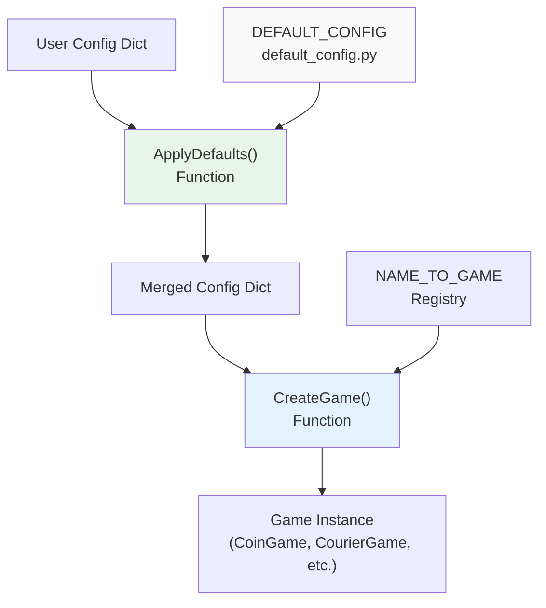
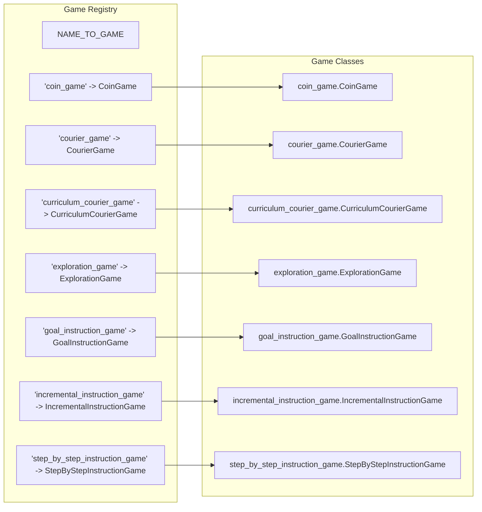
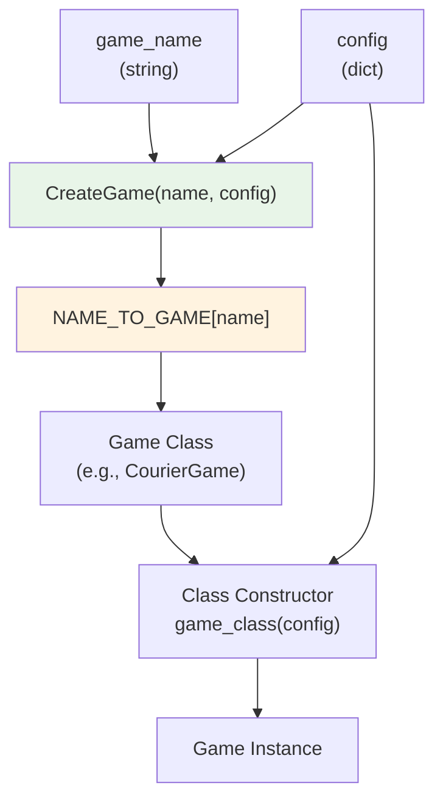
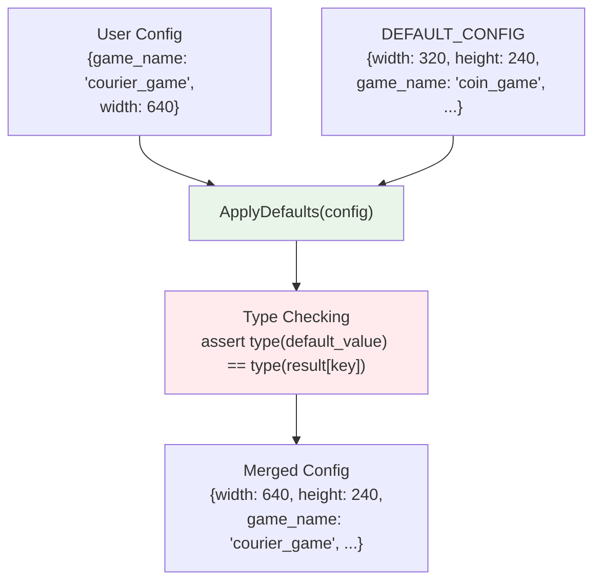
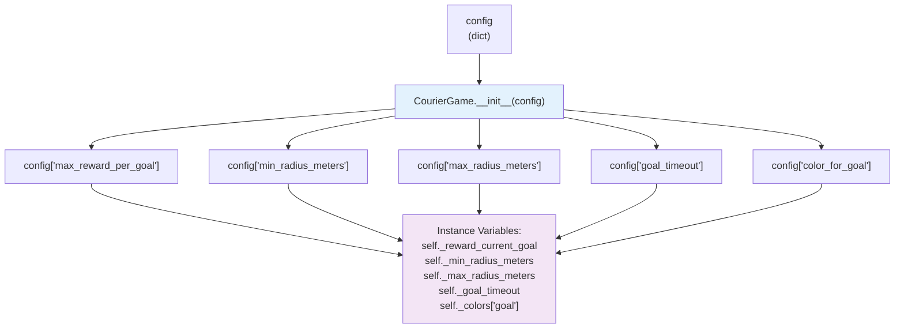

<!-- source: DeepWiki mcp.deepwiki.com · repo google-deepmind/streetlearn · page 3.1 Environment Configuration · fetched 2026-10-26 -->

# Environment Configuration

<details>
<summary>Relevant source files</summary>

The following files were used as context for generating this wiki page:

- [streetlearn/python/environment/courier_game.py](streetlearn/python/environment/courier_game.py)
- [streetlearn/python/environment/curriculum_courier_game.py](streetlearn/python/environment/curriculum_courier_game.py)
- [streetlearn/python/environment/default_config.py](streetlearn/python/environment/default_config.py)

</details>


This document covers the StreetLearn environment configuration system, including the default configuration parameters, game factory system, and how to customize environment settings. The configuration system provides a centralized way to control visual rendering, game mechanics, reward structures, and behavioral parameters across all StreetLearn games.

For information about specific game implementations that use these configurations, see [Game Types](#3.2). For details about how observations are configured and processed, see [Observation System](#3.3).

## Configuration System Overview

The StreetLearn configuration system is built around a centralized `DEFAULT_CONFIG` dictionary that defines default values for all environment parameters. This configuration is processed through utility functions that handle defaults application and game instantiation.



**Configuration Flow Diagram**
This diagram shows how user configurations are merged with defaults and used to instantiate games.

Sources: [streetlearn/python/environment/default_config.py:109-122]()

## DEFAULT_CONFIG Structure

The `DEFAULT_CONFIG` dictionary contains all configurable parameters organized into functional categories:

### Visual Rendering Parameters

| Parameter | Default | Description |
|-----------|---------|-------------|
| `width` | 320 | Viewport width in pixels |
| `height` | 240 | Viewport height in pixels |
| `field_of_view` | 60 | Camera field of view in degrees |
| `graph_width` | 320 | Graph visualization width |
| `graph_height` | 240 | Graph visualization height |
| `status_height` | 10 | Status bar height |

### Graph and Caching Parameters

| Parameter | Default | Description |
|-----------|---------|-------------|
| `min_graph_depth` | 200 | Minimum graph traversal depth |
| `max_graph_depth` | 200 | Maximum graph traversal depth |
| `max_cache_size` | 1000 | Maximum panorama cache size |
| `full_graph` | True | Whether to load full graph |
| `sample_graph_depth` | True | Whether to sample graph depth |

### Spatial Bounds and Navigation

| Parameter | Default | Description |
|-----------|---------|-------------|
| `bbox_lat_min` | -90.0 | Minimum latitude boundary |
| `bbox_lat_max` | 90.0 | Maximum latitude boundary |
| `bbox_lng_min` | -180.0 | Minimum longitude boundary |
| `bbox_lng_max` | 180.0 | Maximum longitude boundary |
| `neighbor_resolution` | 8 | Navigation neighbor resolution |

Sources: [streetlearn/python/environment/default_config.py:31-90]()

## Game Factory System

The environment uses a factory pattern to create game instances dynamically. The `NAME_TO_GAME` registry maps string identifiers to game classes, enabling runtime game selection.



**Game Factory Registry Mapping**
This diagram shows the mapping between game name strings and their corresponding class implementations.

### Game Creation Process

The `CreateGame()` function handles game instantiation:



**Game Instantiation Flow**
This diagram shows how the `CreateGame()` function uses the registry to instantiate game objects.

Sources: [streetlearn/python/environment/default_config.py:92-122]()

## Configuration Categories

### Reward and Game Mechanics

| Parameter | Default | Description |
|-----------|---------|-------------|
| `max_reward_per_goal` | 10.0 | Maximum reward for reaching goals |
| `reward_per_coin` | 1.0 | Reward for collecting coins |
| `reward_at_waypoint` | 0.5 | Reward for reaching waypoints |
| `reward_at_goal` | 1.0 | Base reward for goal completion |
| `max_reward_per_cone` | 0.49 | Maximum reward per cone collection |
| `goal_timeout` | 1000 | Steps before goal timeout |
| `frame_cap` | 1000 | Maximum frames per episode |

### Spatial and Distance Parameters

| Parameter | Default | Description |
|-----------|---------|-------------|
| `min_radius_meters` | 100.0 | Minimum goal completion radius |
| `max_radius_meters` | 200.0 | Maximum goal detection radius |
| `cone_radius_meters` | 50.0 | Cone collection radius |

### Curriculum Learning Parameters

| Parameter | Default | Description |
|-----------|---------|-------------|
| `timestamp_start_curriculum` | 0.0 | Curriculum start timestamp |
| `annealing_rate_curriculum` | 2.0 | Curriculum difficulty annealing rate |
| `hours_curriculum_part_1` | 0.0 | Duration of curriculum phase 1 |
| `hours_curriculum_part_2` | 24.0 | Duration of curriculum phase 2 |
| `min_goal_distance_curriculum` | 500.0 | Minimum curriculum goal distance |
| `max_goal_distance_curriculum` | 3500.0 | Maximum curriculum goal distance |

Sources: [streetlearn/python/environment/default_config.py:46-58]()

## Configuration Merging

The `ApplyDefaults()` function merges user-provided configuration with `DEFAULT_CONFIG`, ensuring all required parameters are present while allowing customization:



**Configuration Merging Process**
This diagram shows how user configurations override defaults while maintaining type safety.

The function performs type checking to ensure configuration values match expected types and prevents configuration errors at runtime.

Sources: [streetlearn/python/environment/default_config.py:109-117]()

## Color Configuration

Visual elements are configured through color parameters that define the appearance of different game objects:

| Parameter | Default RGB | Purpose |
|-----------|-------------|---------|
| `color_for_touched_pano` | (1.0, 0.5, 0.5) | Visited panorama nodes |
| `color_for_observer` | (0.5, 0.5, 1.0) | Current player position |
| `color_for_coin` | (1.0, 1.0, 0.0) | Collectible coins |
| `color_for_goal` | (1.0, 0.0, 0.0) | Goal destinations |
| `color_for_shortest_path` | (1.0, 0.0, 1.0) | Optimal path visualization |
| `color_for_waypoint` | (0, 0.7, 0.7) | Navigation waypoints |

Sources: [streetlearn/python/environment/default_config.py:72-77]()

## Game Configuration Usage

Games access configuration parameters through their constructors. Here's how `CourierGame` uses configuration:



**Game Configuration Access Pattern**
This diagram shows how games extract and store configuration parameters as instance variables.

Sources: [streetlearn/python/environment/courier_game.py:38-66]()

## Customizing Environment Configuration

To customize the StreetLearn environment:

1. **Create a custom configuration dictionary** with desired parameter overrides
2. **Apply defaults** using `ApplyDefaults()` to ensure completeness
3. **Select game type** by setting `game_name` parameter
4. **Create game instance** using `CreateGame()` function

Example configuration customization for a high-resolution courier game with extended timeouts:

```python
custom_config = {
    'width': 640,
    'height': 480,
    'game_name': 'courier_game',
    'goal_timeout': 2000,
    'max_reward_per_goal': 20.0,
    'frame_cap': 2000
}

complete_config = ApplyDefaults(custom_config)
game = CreateGame(complete_config['game_name'], complete_config)
```

The configuration system ensures type safety and parameter completeness while providing flexibility for experimental setups and different learning scenarios.

Sources: [streetlearn/python/environment/default_config.py:109-122](), [streetlearn/python/environment/curriculum_courier_game.py:41-66]()

---

