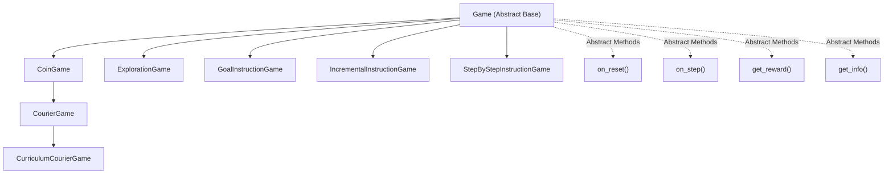
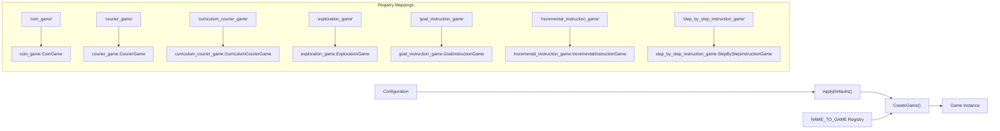
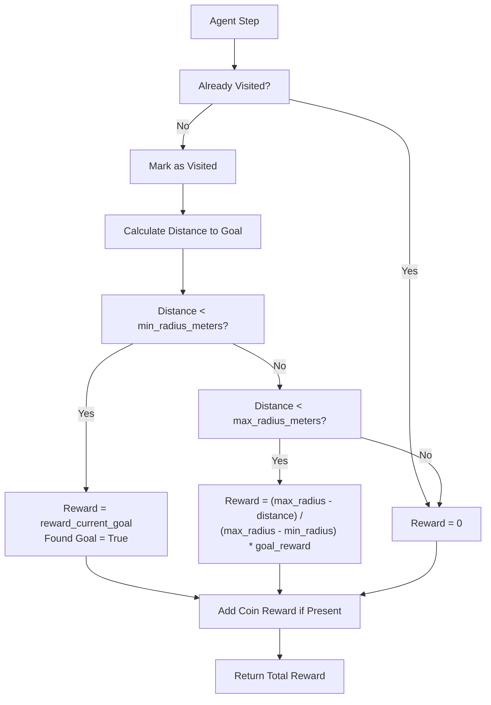

<!-- source: DeepWiki mcp.deepwiki.com · repo google-deepmind/streetlearn · page 3.2 Game Types · fetched 2026-10-26 -->

# Game Types

<details>
<summary>Relevant source files</summary>

The following files were used as context for generating this wiki page:

- [WORKSPACE](WORKSPACE)
- [streetlearn/python/environment/courier_game.py](streetlearn/python/environment/courier_game.py)
- [streetlearn/python/environment/curriculum_courier_game.py](streetlearn/python/environment/curriculum_courier_game.py)
- [streetlearn/python/environment/default_config.py](streetlearn/python/environment/default_config.py)
- [streetlearn/python/environment/game.py](streetlearn/python/environment/game.py)

</details>


This document details the different game implementations available in StreetLearn and their reward structures. Game types define the objectives, reward mechanisms, and termination conditions for navigation episodes. For information about environment configuration, see [Environment Configuration](#3.1). For details about observation types, see [Observation System](#3.3).

## Game Architecture Overview

StreetLearn implements a hierarchical game system where all games inherit from a base `Game` class and are instantiated through a factory pattern. The system supports various navigation tasks from basic coin collection to complex instruction-following scenarios.

### Game Class Hierarchy



**Sources:** [streetlearn/python/environment/game.py:40-107](), [streetlearn/python/environment/default_config.py:92-107]()

### Game Factory System



**Sources:** [streetlearn/python/environment/default_config.py:92-107](), [streetlearn/python/environment/default_config.py:109-121]()

## Base Game Interface

All games implement the abstract `Game` class which defines the core interface for game mechanics.

### Abstract Methods

| Method | Purpose | Return Type |
|--------|---------|-------------|
| `on_reset(streetlearn)` | Initialize game state after environment reset | `dict` (pano_id_to_color) |
| `on_step(streetlearn)` | Update game state after each step | `None` |
| `get_reward(streetlearn)` | Calculate reward for current step | `float` |
| `get_info(streetlearn)` | Provide environment information | `dict` |

### Optional Properties

| Property | Purpose | Default |
|----------|---------|---------|
| `goal_id` | ID of current goal panorama | `None` |
| `done` | Episode termination flag | `True` |
| `ground_truth_direction()` | Optimal direction angle | Empty array |
| `thumbnails()` | Observation thumbnails | Empty array |
| `instructions()` | Game-specific instructions | Empty string |
| `highlighted_panos()` | Panos with special colors | Empty dict |

**Sources:** [streetlearn/python/environment/game.py:44-107]()

## Core Game Types

### CoinGame

The fundamental game type where agents collect rewards by visiting panoramas containing coins.

**Key Features:**
- Random coin placement on panoramas
- One-time reward collection per coin
- Configurable coin density via `proportion_of_panos_with_coins`
- Reward amount controlled by `reward_per_coin`

**Configuration Parameters:**
- `reward_per_coin`: Reward value for each coin collected (default: 1.0)
- `proportion_of_panos_with_coins`: Fraction of panoramas containing coins (default: 0.5)
- `color_for_coin`: RGB color for coin visualization (default: [1.0, 1.0, 0.0])

**Sources:** [streetlearn/python/environment/default_config.py:79-85]()

### CourierGame

Extends `CoinGame` with goal-directed navigation where agents receive additional rewards for reaching specific target panoramas.

**Key Features:**
- Dynamic goal selection from available panoramas
- Distance-based reward shaping
- Goal timeout mechanism
- Success metrics including Success weighted by Path Length (SPL)

**Reward Structure:**


**Configuration Parameters:**
- `max_reward_per_goal`: Maximum reward for reaching goal
- `min_radius_meters`: Distance for full goal reward (default: 100.0)
- `max_radius_meters`: Distance threshold for any goal reward (default: 200.0)
- `goal_timeout`: Maximum steps before goal reset (default: 1000)

**Sources:** [streetlearn/python/environment/courier_game.py:32-287](), [streetlearn/python/environment/default_config.py:46-62]()

### CurriculumCourierGame

Extends `CourierGame` with curriculum learning that gradually increases goal distance over training time.

**Key Features:**
- Time-based curriculum progression
- Two-phase training schedule
- Configurable annealing rate
- Distance constraints based on training hours

**Curriculum Phases:**
1. **Phase 1**: Goals within `min_goal_distance_curriculum` for `hours_curriculum_part_1` hours
2. **Phase 2**: Goals gradually increase to `max_goal_distance_curriculum` over `hours_curriculum_part_2` hours

**Distance Calculation:**
```
allowed_distance = min_distance + (max_distance - min_distance) * time_factor^annealing_rate
```

**Configuration Parameters:**
- `timestamp_start_curriculum`: Training start timestamp
- `annealing_rate_curriculum`: Curriculum difficulty scaling (default: 2.0)
- `hours_curriculum_part_1`: Duration of phase 1 (default: 0.0)
- `hours_curriculum_part_2`: Duration of phase 2 (default: 24.0)
- `min_goal_distance_curriculum`: Minimum goal distance (default: 500.0)
- `max_goal_distance_curriculum`: Maximum goal distance (default: 3500.0)

**Sources:** [streetlearn/python/environment/curriculum_courier_game.py:33-145](), [streetlearn/python/environment/default_config.py:49-59]()

## Instruction-Based Games

### GoalInstructionGame

Provides natural language instructions to guide agents toward goals using landmark descriptions and directional cues.

### IncrementalInstructionGame

Delivers instructions progressively as agents make progress toward goals, simulating real-world navigation assistance.

### StepByStepInstructionGame

Provides detailed turn-by-turn instructions for navigation, similar to GPS guidance systems.

**Common Features:**
- Natural language instruction generation
- Instruction curriculum support
- Configurable instruction complexity
- Integration with landmark detection

**Configuration Parameters:**
- `instruction_file`: Path to instruction dataset
- `num_instructions`: Number of instructions per episode (default: 5)
- `max_instructions`: Maximum instruction limit (default: 5)
- `instruction_curriculum_type`: Curriculum progression type (default: 0)

**Sources:** [streetlearn/python/environment/default_config.py:82-84](), [streetlearn/python/environment/default_config.py:55-59]()

## ExplorationGame

Focuses on environment exploration without specific goals, encouraging agents to discover new areas and build spatial knowledge.

**Key Features:**
- Exploration-based rewards
- Coverage metrics
- No specific goal targets
- Suitable for pre-training and spatial learning

**Sources:** [streetlearn/python/environment/default_config.py:99-100]()

## Game Selection and Configuration

Games are selected through the `game_name` configuration parameter and instantiated via the factory pattern:

```python
# Default game selection
config['game_name'] = 'coin_game'

# Game instantiation
game_instance = CreateGame(config['game_name'], config)
```

The `ApplyDefaults()` function ensures all games receive consistent configuration parameters, with game-specific settings overriding defaults as needed.

**Sources:** [streetlearn/python/environment/default_config.py:86](), [streetlearn/python/environment/default_config.py:119-121]()

---

