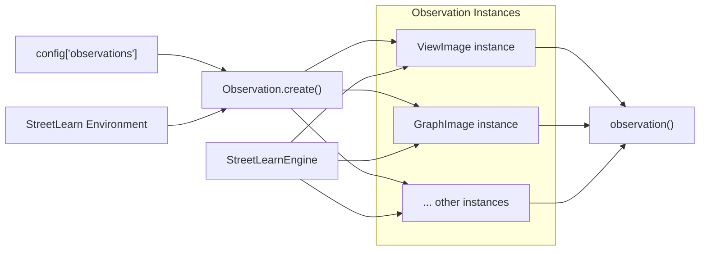
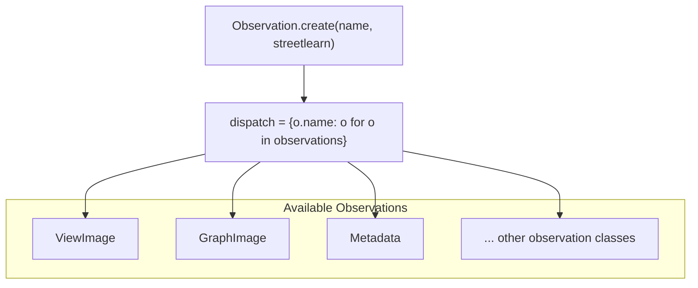
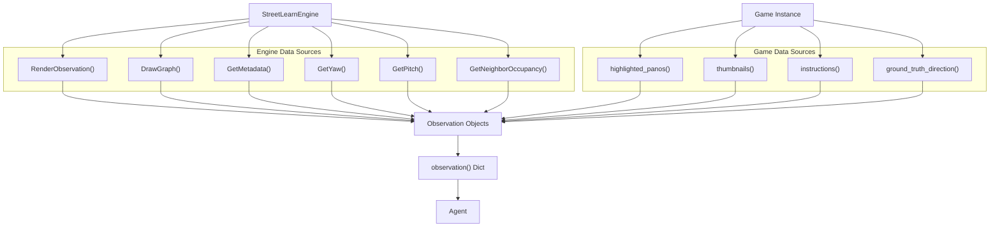

<!-- source: DeepWiki mcp.deepwiki.com · repo google-deepmind/streetlearn · page 3.3 Observation System · fetched 2026-10-26 -->

# Observation System

<details>
<summary>Relevant source files</summary>

The following files were used as context for generating this wiki page:

- [streetlearn/python/environment/observations.py](streetlearn/python/environment/observations.py)
- [streetlearn/python/environment/streetlearn.py](streetlearn/python/environment/streetlearn.py)

</details>


The Observation System provides a modular framework for delivering environmental information to agents in StreetLearn. It converts raw data from the C++ engine into structured observations that agents can use for navigation and learning. The system supports multiple observation types including visual data, spatial information, metadata, and navigation history.

For information about how observations are used in specific games, see [Game Types](#3.2). For details about environment configuration, see [Environment Configuration](#3.1).

## Architecture Overview

The observation system follows an object-oriented design with a factory pattern for creating observation instances. Each observation type is implemented as a class that inherits from the abstract `Observation` base class.

### Observation Class Hierarchy

```mermaid
graph TD
    ObservationBase["Observation (Base Class)"]
    
    subgraph "Visual Observations"
        ViewImage["ViewImage"]
        ViewImageHWC["ViewImageHWC"]
        GraphImage["GraphImage"] 
        GraphImageHWC["GraphImageHWC"]
        Thumbnails["Thumbnails"]
    end
    
    subgraph "Spatial Observations"
        Yaw["Yaw"]
        Pitch["Pitch"]
        YawLabel["YawLabel"]
        LatLng["LatLng"]
        TargetLatLng["TargetLatLng"]
        LatLngLabel["LatLngLabel"]
        TargetLatLngLabel["TargetLatLngLabel"]
        Neighbors["Neighbors"]
    end
    
    subgraph "Metadata Observations"
        Metadata["Metadata"]
        TargetMetadata["TargetMetadata"]
        Instructions["Instructions"]
        GroundTruthDirection["GroundTruthDirection"]
    end
    
    subgraph "History Observations"
        PrevReward["PrevReward"]
        PrevAction["PrevAction"]
    end
    
    ObservationBase --> ViewImage
    ObservationBase --> ViewImageHWC
    ObservationBase --> GraphImage
    ObservationBase --> GraphImageHWC
    ObservationBase --> Thumbnails
    ObservationBase --> Yaw
    ObservationBase --> Pitch
    ObservationBase --> YawLabel
    ObservationBase --> LatLng
    ObservationBase --> TargetLatLng
    ObservationBase --> LatLngLabel
    ObservationBase --> TargetLatLngLabel
    ObservationBase --> Neighbors
    ObservationBase --> Metadata
    ObservationBase --> TargetMetadata
    ObservationBase --> Instructions
    ObservationBase --> GroundTruthDirection
    ObservationBase --> PrevReward
    ObservationBase --> PrevAction
```



**Sources:** [streetlearn/python/environment/observations.py:46-75]()

### Integration with StreetLearn Environment



**Sources:** [streetlearn/python/environment/streetlearn.py:184-189](), [streetlearn/python/environment/streetlearn.py:379-381]()

## Observation Types

### Visual Observations

| Observation | Shape | Data Type | Description |
|-------------|-------|-----------|-------------|
| `view_image` | `[3, height, width]` | `np.uint8` | RGB pixel data of current street view (CHW format) |
| `view_image_hwc` | `[height, width, 3]` | `np.uint8` | RGB pixel data of current street view (HWC format) |
| `graph_image` | `[3, graph_height, graph_width]` | `np.uint8` | RGB pixel data of navigation graph (CHW format) |
| `graph_image_hwc` | `[graph_height, graph_width, 3]` | `np.uint8` | RGB pixel data of navigation graph (HWC format) |
| `thumbnails` | Variable | `np.uint8` | Thumbnail images provided by the game |

The visual observations provide the primary sensory input for navigation. The `view_image` observations render the current panoramic view using the C++ engine's `RenderObservation()` method, while `graph_image` observations visualize the navigation graph with highlighted panos using `DrawGraph()`.

**Sources:** [streetlearn/python/environment/observations.py:77-151](), [streetlearn/python/environment/observations.py:310-322]()

### Spatial Observations

| Observation | Shape | Data Type | Description |
|-------------|-------|-----------|-------------|
| `yaw` | `[1]` | `np.float64` | Agent's current yaw angle in degrees |
| `pitch` | `[1]` | `np.float64` | Agent's current pitch angle in degrees |
| `yaw_label` | `[1]` | `np.uint8` | Discretized yaw into 16 bins |
| `latlng` | `[2]` | `np.float64` | Scaled latitude/longitude coordinates [0,1] |
| `target_latlng` | `[2]` | `np.float64` | Scaled target coordinates [0,1] |
| `latlng_label` | `[1]` | `np.int32` | Discretized lat/lng into 32x32 grid |
| `target_latlng_label` | `[1]` | `np.int32` | Discretized target lat/lng |
| `neighbors` | `[neighbor_resolution]` | `np.uint8` | Occupancy information for neighboring panos |

Spatial observations provide geometric and positional information. The `LatLng` class implements coordinate scaling using bounding box parameters to normalize coordinates to the [0,1] range within the dataset area.

**Sources:** [streetlearn/python/environment/observations.py:153-194](), [streetlearn/python/environment/observations.py:230-308](), [streetlearn/python/environment/observations.py:353-368]()

### Metadata and Navigation Observations

| Observation | Shape | Data Type | Description |
|-------------|-------|-----------|-------------|
| `metadata` | `[14]` | `bytearray` | Serialized protocol buffer with current pano metadata |
| `target_metadata` | `[14]` | `bytearray` | Serialized protocol buffer with target pano metadata |
| `instructions` | `[1]` | `str` | UTF-8 encoded navigation instructions |
| `ground_truth_direction` | `[1]` | `np.float32` | Oracle direction to target in degrees |

These observations provide high-level navigation information and ground truth data for training and evaluation.

**Sources:** [streetlearn/python/environment/observations.py:196-227](), [streetlearn/python/environment/observations.py:324-351]()

### History Observations

| Observation | Shape | Data Type | Description |
|-------------|-------|-----------|-------------|
| `prev_reward` | `[1]` | `np.float32` | Reward from previous time step |
| `prev_action` | `[4]` | `np.float32` | Action taken at previous time step |

History observations provide temporal context by exposing information from the previous time step.

**Sources:** [streetlearn/python/environment/observations.py:370-396]()

## Configuration and Usage

### Observation Configuration

Observations are configured through the `observations` parameter in the environment configuration. This parameter is a list of observation names that determines which observations will be available to the agent.

```python
config = {
    "observations": ["view_image", "graph_image", "metadata", "yaw"]
}
```

The configuration is processed during environment initialization:

**Sources:** [streetlearn/python/environment/streetlearn.py:184-189]()

### Factory Pattern Implementation

The observation system uses a factory pattern implemented in the `Observation.create()` class method. The factory maintains a dispatch dictionary mapping observation names to their corresponding classes:



**Sources:** [streetlearn/python/environment/observations.py:62-74]()

### Observation Specification

Each observation class defines two key properties:
- `observation_spec`: Returns the shape/dimensions of the observation data
- `observation`: Returns the actual observation data

The environment exposes observation specifications through the `observation_spec()` method, which returns a dictionary mapping observation names to their specifications.

**Sources:** [streetlearn/python/environment/observations.py:52-60](), [streetlearn/python/environment/streetlearn.py:261-264]()

## Implementation Details

### Data Flow Architecture



**Sources:** [streetlearn/python/environment/observations.py:95-96](), [streetlearn/python/environment/observations.py:133-134](), [streetlearn/python/environment/observations.py:207-209]()

### Memory Management

Visual observations like `ViewImage` and `GraphImage` use pre-allocated numpy buffers to avoid memory allocation overhead during environment steps. The buffers are allocated once during initialization and reused for each observation.

**Sources:** [streetlearn/python/environment/observations.py:87-88](), [streetlearn/python/environment/observations.py:124-125]()

### Coordinate Scaling

The `LatLng` observation class implements coordinate normalization using bounding box parameters from the environment configuration. This ensures coordinates are scaled to [0,1] within the dataset's geographic extent.

**Sources:** [streetlearn/python/environment/observations.py:238-244]()

---

