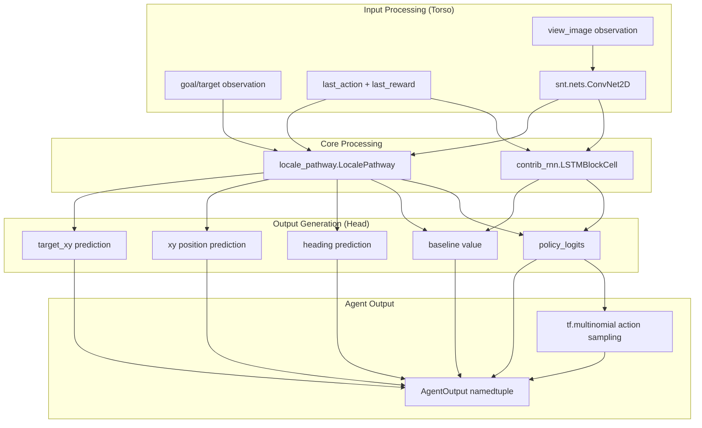
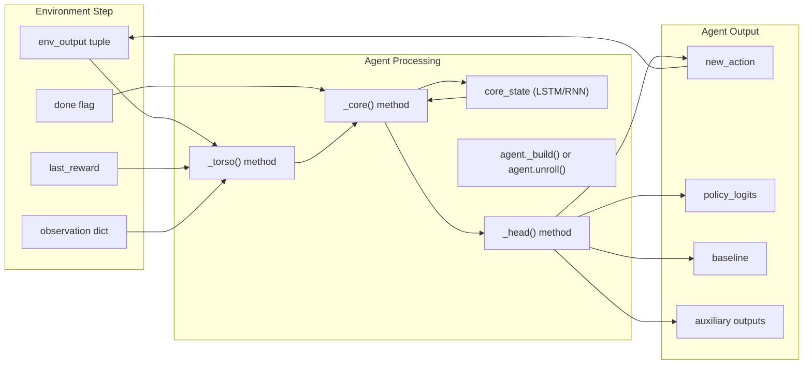

<!-- source: DeepWiki mcp.deepwiki.com · repo google-deepmind/streetlearn · page 4 Agent System · fetched 2026-10-26 -->

# Agent System

<details>
<summary>Relevant source files</summary>

The following files were used as context for generating this wiki page:

- [streetlearn/python/agents/goal_nav_agent.py](streetlearn/python/agents/goal_nav_agent.py)
- [streetlearn/python/agents/plain_agent.py](streetlearn/python/agents/plain_agent.py)
- [streetlearn/python/ui/BUILD](streetlearn/python/ui/BUILD)

</details>


The Agent System provides the core abstraction layer for implementing navigation agents that interact with StreetLearn environments. This system encompasses reinforcement learning agents, oracle baselines, and interactive interfaces for human control and data exploration.

For detailed information about training agents with IMPALA, see [Training and Experimentation](#5). For environment interactions and observation types, see [Environment System](#3).

## Overview

The StreetLearn agent system implements multiple agent types ranging from simple baselines to sophisticated neural network architectures. All agents interface with the environment through a standardized action-observation loop, while internally employing different strategies for navigation decision-making.

```mermaid
graph TB
    subgraph "Environment Interface"
        EnvironmentPy["streetlearn.python.environment"]
        ObservationDict["Observation Dictionary"]
        ActionSpace["Action Space"]
    end
    
    subgraph "Agent Categories"
        AIAgents["AI Learning Agents"]
        OracleAgents["Oracle Agents"] 
        InteractiveAgents["Interactive Agents"]
    end
    
    subgraph "AI Agent Implementations"
        PlainAgent["PlainAgent"]
        GoalNavAgent["GoalNavAgent"]
        CityNavAgent["CityNavAgent"]
    end
    
    subgraph "Oracle Implementations"
        OracleAgent["OracleAgent"]
        BatchedOracleAgent["BatchedOracleAgent"] 
        InstructionOracleAgent["InstructionFollowingOracleAgent"]
    end
    
    subgraph "Interactive Implementations"
        HumanAgent["HumanAgent"]
        ScanAgent["ScanAgent"]
    end
    
    EnvironmentPy --> ObservationDict
    EnvironmentPy --> ActionSpace
    
    ObservationDict --> AIAgents
    ObservationDict --> OracleAgents
    ObservationDict --> InteractiveAgents
    
    ActionSpace <-- AIAgents
    ActionSpace <-- OracleAgents  
    ActionSpace <-- InteractiveAgents
    
    AIAgents --> PlainAgent
    AIAgents --> GoalNavAgent
    AIAgents --> CityNavAgent
    
    OracleAgents --> OracleAgent
    OracleAgents --> BatchedOracleAgent
    OracleAgents --> InstructionOracleAgent
    
    InteractiveAgents --> HumanAgent
    InteractiveAgents --> ScanAgent
```

Sources: [streetlearn/python/ui/BUILD:1-77](), [streetlearn/python/agents/goal_nav_agent.py:1-246](), [streetlearn/python/agents/plain_agent.py:1-193]()

## Agent Architecture Components

StreetLearn agents are built using modular neural network components that can be combined for different navigation tasks. The core architecture follows a torso-core-head pattern.



Sources: [streetlearn/python/agents/plain_agent.py:84-192](), [streetlearn/python/agents/goal_nav_agent.py:112-245]()

## Agent Types and Implementations

### AI Learning Agents

AI learning agents use neural networks trained with reinforcement learning to develop navigation policies. These agents process visual observations and learn to navigate through trial and error.

| Agent Class | Architecture | Key Features |
|-------------|-------------|--------------|
| `PlainAgent` | ConvNet + LSTM | Basic visual processing, no goal conditioning |
| `GoalNavAgent` | ConvNet + LocalePathway + LSTM | Goal-conditioned navigation with spatial reasoning |
| `CityNavAgent` | Extended GoalNavAgent | City-scale navigation capabilities |

The `PlainAgent` implements the simplest learning architecture with a residual convolutional network followed by an LSTM core:

- **Torso**: Residual ConvNet with (16,32,32) channels and max pooling
- **Core**: `LSTMBlockCell` with configurable hidden units (default 256)
- **Head**: Linear layers for policy logits and baseline value

Sources: [streetlearn/python/agents/plain_agent.py:42-193]()

The `GoalNavAgent` extends this with goal-conditioning and spatial prediction capabilities:

- **Goal Processing**: Handles `target_latlng` or `target_landmarks` observations
- **LocalePathway**: Specialized module for spatial reasoning and prediction
- **Auxiliary Outputs**: Heading, position, and target position predictions

Sources: [streetlearn/python/agents/goal_nav_agent.py:43-246]()

### Oracle Agents

Oracle agents utilize ground truth information from the environment to provide optimal or near-optimal navigation policies. These serve as upper bounds for learning agent performance and debugging tools.

| Agent Binary | Purpose | Implementation Location |
|-------------|---------|------------------------|
| `oracle_agent` | Basic shortest-path navigation | [streetlearn/python/ui/oracle_agent.py]() |
| `batched_oracle_agent` | Parallel oracle processing | [streetlearn/python/ui/batched_oracle_agent.py]() |
| `instruction_following_oracle_agent` | Instruction-guided optimal navigation | [streetlearn/python/ui/instruction_following_oracle_agent.py]() |

Sources: [streetlearn/python/ui/BUILD:34-65]()

### Interactive Agents

Interactive agents provide interfaces for human control and automated data exploration, enabling manual testing and dataset analysis.

| Agent Binary | Interface | Purpose |
|-------------|-----------|---------|
| `human_agent` | Keyboard control via PyGame | Manual navigation and testing |
| `scan_agent` | Automated panorama scanning | Data exploration and visualization |

Sources: [streetlearn/python/ui/BUILD:23-76]()

## Agent-Environment Interface

All agents interact with the StreetLearn environment through a standardized interface that supports batched observations and recurrent neural network state management.



Sources: [streetlearn/python/agents/plain_agent.py:165-192](), [streetlearn/python/agents/goal_nav_agent.py:201-245]()

## Configuration and Instantiation

Agents are configured through observation specifications and hyperparameters. The key configuration parameters include:

- **`num_actions`**: Size of the discrete action space
- **`observation_names`**: Semicolon-separated list of observation types (e.g., `"view_image;target_latlng"`)
- **`lstm_num_hiddens`**: LSTM core hidden unit count
- **`feed_action_and_reward`**: Whether to append previous action and reward to inputs
- **`max_reward`**: Reward clipping threshold for input preprocessing

Both `PlainAgent` and `GoalNavAgent` implement the `snt.RNNCore` interface, providing `initial_state()`, `_build()`, and `unroll()` methods for integration with TensorFlow training loops.

Sources: [streetlearn/python/agents/plain_agent.py:45-83](), [streetlearn/python/agents/goal_nav_agent.py:46-127]()

# Agent System

The Agent System provides the core abstraction layer for implementing navigation agents that interact with StreetLearn environments. This system encompasses reinforcement learning agents, oracle baselines, and interactive interfaces for human control and data exploration.

For detailed information about training agents with IMPALA, see [Training and Experimentation](#5). For environment interactions and observation types, see [Environment System](#3).

## Overview

The StreetLearn agent system implements multiple agent types ranging from simple baselines to sophisticated neural network architectures. All agents interface with the environment through a standardized action-observation loop, while internally employing different strategies for navigation decision-making.

```mermaid
graph TB
    subgraph "Environment Interface"
        EnvironmentPy["streetlearn.python.environment"]
        ObservationDict["Observation Dictionary"]
        ActionSpace["Action Space"]
    end
    
    subgraph "Agent Categories"
        AIAgents["AI Learning Agents"]
        OracleAgents["Oracle Agents"] 
        InteractiveAgents["Interactive Agents"]
    end
    
    subgraph "AI Agent Implementations"
        PlainAgent["PlainAgent"]
        GoalNavAgent["GoalNavAgent"]
        CityNavAgent["CityNavAgent"]
    end
    
    subgraph "Oracle Implementations"
        OracleAgent["OracleAgent"]
        BatchedOracleAgent["BatchedOracleAgent"] 
        InstructionOracleAgent["InstructionFollowingOracleAgent"]
    end
    
    subgraph "Interactive Implementations"
        HumanAgent["HumanAgent"]
        ScanAgent["ScanAgent"]
    end
    
    EnvironmentPy --> ObservationDict
    EnvironmentPy --> ActionSpace
    
    ObservationDict --> AIAgents
    ObservationDict --> OracleAgents
    ObservationDict --> InteractiveAgents
    
    ActionSpace <-- AIAgents
    ActionSpace <-- OracleAgents  
    ActionSpace <-- InteractiveAgents
    
    AIAgents --> PlainAgent
    AIAgents --> GoalNavAgent
    AIAgents --> CityNavAgent
    
    OracleAgents --> OracleAgent
    OracleAgents --> BatchedOracleAgent
    OracleAgents --> InstructionOracleAgent
    
    InteractiveAgents --> HumanAgent
    InteractiveAgents --> ScanAgent
```

Sources: [streetlearn/python/ui/BUILD:1-77](), [streetlearn/python/agents/goal_nav_agent.py:1-246](), [streetlearn/python/agents/plain_agent.py:1-193]()

## Agent Architecture Components

StreetLearn agents are built using modular neural network components that can be combined for different navigation tasks. The core architecture follows a torso-core-head pattern.


Sources: [streetlearn/python/agents/plain_agent.py:84-192](), [streetlearn/python/agents/goal_nav_agent.py:112-245]()

## Agent Types and Implementations

### AI Learning Agents

AI learning agents use neural networks trained with reinforcement learning to develop navigation policies. These agents process visual observations and learn to navigate through trial and error.

| Agent Class | Architecture | Key Features |
|-------------|-------------|--------------|
| `PlainAgent` | ConvNet + LSTM | Basic visual processing, no goal conditioning |
| `GoalNavAgent` | ConvNet + LocalePathway + LSTM | Goal-conditioned navigation with spatial reasoning |
| `CityNavAgent` | Extended GoalNavAgent | City-scale navigation capabilities |

The `PlainAgent` implements the simplest learning architecture with a residual convolutional network followed by an LSTM core:

- **Torso**: Residual ConvNet with (16,32,32) channels and max pooling
- **Core**: `LSTMBlockCell` with configurable hidden units (default 256)
- **Head**: Linear layers for policy logits and baseline value

Sources: [streetlearn/python/agents/plain_agent.py:42-193]()

The `GoalNavAgent` extends this with goal-conditioning and spatial prediction capabilities:

- **Goal Processing**: Handles `target_latlng` or `target_landmarks` observations
- **LocalePathway**: Specialized module for spatial reasoning and prediction
- **Auxiliary Outputs**: Heading, position, and target position predictions

Sources: [streetlearn/python/agents/goal_nav_agent.py:43-246]()

### Oracle Agents

Oracle agents utilize ground truth information from the environment to provide optimal or near-optimal navigation policies. These serve as upper bounds for learning agent performance and debugging tools.

| Agent Binary | Purpose | Implementation Location |
|-------------|---------|------------------------|
| `oracle_agent` | Basic shortest-path navigation | [streetlearn/python/ui/oracle_agent.py]() |
| `batched_oracle_agent` | Parallel oracle processing | [streetlearn/python/ui/batched_oracle_agent.py]() |
| `instruction_following_oracle_agent` | Instruction-guided optimal navigation | [streetlearn/python/ui/instruction_following_oracle_agent.py]() |

Sources: [streetlearn/python/ui/BUILD:34-65]()

### Interactive Agents

Interactive agents provide interfaces for human control and automated data exploration, enabling manual testing and dataset analysis.

| Agent Binary | Interface | Purpose |
|-------------|-----------|---------|
| `human_agent` | Keyboard control via PyGame | Manual navigation and testing |
| `scan_agent` | Automated panorama scanning | Data exploration and visualization |

Sources: [streetlearn/python/ui/BUILD:23-76]()

## Agent-Environment Interface

All agents interact with the StreetLearn environment through a standardized interface that supports batched observations and recurrent neural network state management.


Sources: [streetlearn/python/agents/plain_agent.py:165-192](), [streetlearn/python/agents/goal_nav_agent.py:201-245]()

## Configuration and Instantiation

Agents are configured through observation specifications and hyperparameters. The key configuration parameters include:

- **`num_actions`**: Size of the discrete action space
- **`observation_names`**: Semicolon-separated list of observation types (e.g., `"view_image;target_latlng"`)
- **`lstm_num_hiddens`**: LSTM core hidden unit count
- **`feed_action_and_reward`**: Whether to append previous action and reward to inputs
- **`max_reward`**: Reward clipping threshold for input preprocessing

Both `PlainAgent` and `GoalNavAgent` implement the `snt.RNNCore` interface, providing `initial_state()`, `_build()`, and `unroll()` methods for integration with TensorFlow training loops.

Sources: [streetlearn/python/agents/plain_agent.py:45-83](), [streetlearn/python/agents/goal_nav_agent.py:46-127]()

---

