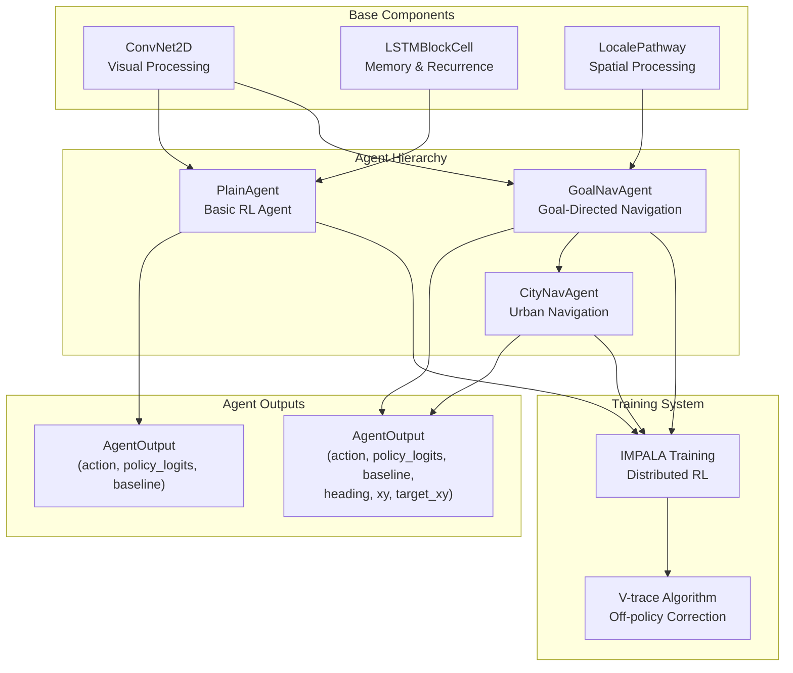
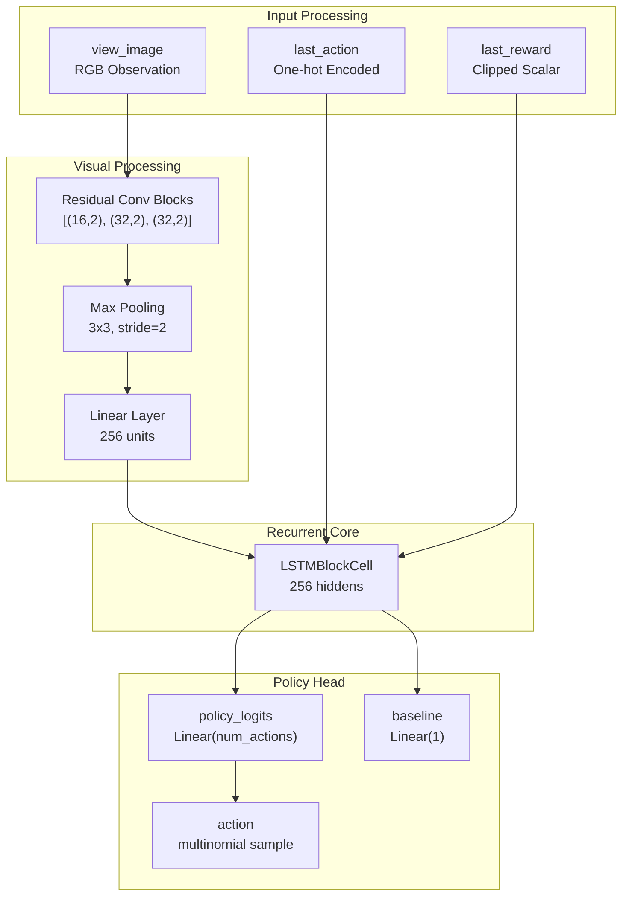
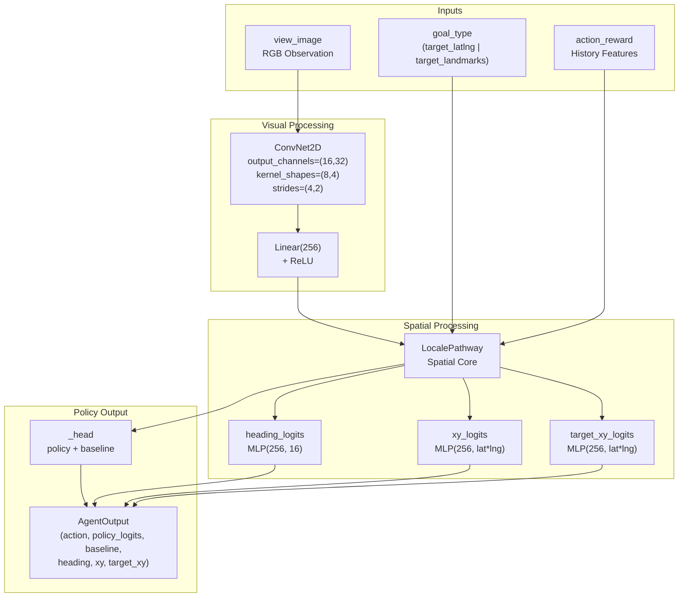
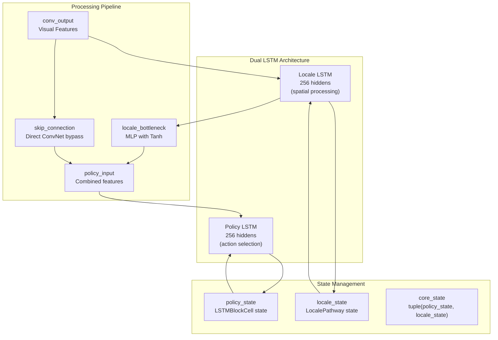
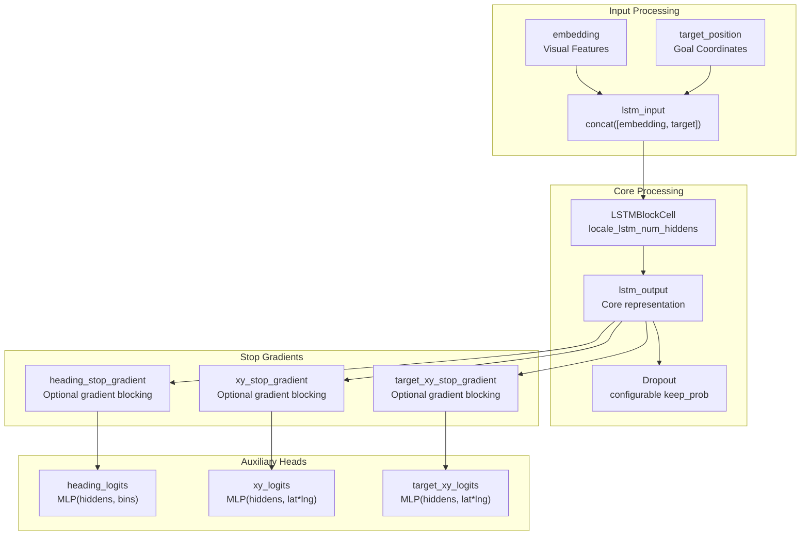
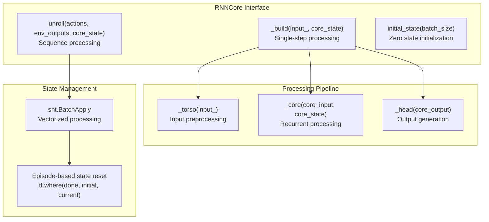

<!-- source: DeepWiki mcp.deepwiki.com · repo google-deepmind/streetlearn · page 4.1 AI Learning Agents · fetched 2026-10-26 -->

# AI Learning Agents

Relevant source files

The following files were used as context for generating this wiki page:

- [streetlearn/python/agents/city_nav_agent.py](streetlearn/python/agents/city_nav_agent.py)
- [streetlearn/python/agents/goal_nav_agent.py](streetlearn/python/agents/goal_nav_agent.py)
- [streetlearn/python/agents/locale_pathway.py](streetlearn/python/agents/locale_pathway.py)
- [streetlearn/python/agents/plain_agent.py](streetlearn/python/agents/plain_agent.py)

This page covers the neural network-based learning agents in StreetLearn that use reinforcement learning to navigate through street-view environments. These agents process visual observations and learn navigation policies through training with algorithms like IMPALA.

For information about agents that use ground truth navigation data, see [Oracle Agents](#4.2). For human-controlled and utility agents, see [Interactive Agents](#4.3). For the training infrastructure that powers these agents, see [Training and Experimentation](#5).

## Agent Architecture Overview

The AI learning agents in StreetLearn follow a hierarchical architecture with three main agent types of increasing complexity:

**Agent Evolution and Capabilities**

The agents represent an evolutionary progression in navigation capabilities, from basic visual processing to sophisticated spatial reasoning.

Sources: [streetlearn/python/agents/plain_agent.py:42-43](), [streetlearn/python/agents/goal_nav_agent.py:43-44](), [streetlearn/python/agents/city_nav_agent.py:32-33]()

## PlainAgent - Basic RL Agent

The `PlainAgent` provides a foundational implementation of a reinforcement learning agent using a residual convolutional network and LSTM architecture.

### Architecture Components

**Key Implementation Details**

| Component | Configuration | Purpose |
|-----------|---------------|---------|
| Residual Blocks | 3 stages: (16,2), (32,2), (32,2) | Visual feature extraction with skip connections |
| LSTM Core | 256 hidden units | Temporal memory and state management |
| Action/Reward Feed | Configurable via `feed_action_and_reward` | History-aware decision making |
| Reward Clipping | `[-max_reward, max_reward]` | Stable training dynamics |

The agent's `_torso` method processes visual inputs through residual blocks, while the `_core` method handles recurrent processing and the `_head` method produces policy outputs.

Sources: [streetlearn/python/agents/plain_agent.py:111-133](), [streetlearn/python/agents/plain_agent.py:84-86](), [streetlearn/python/agents/plain_agent.py:151-163]()

## GoalNavAgent - Goal-Directed Navigation

The `GoalNavAgent` extends basic RL with goal-oriented navigation capabilities, incorporating spatial reasoning through the `LocalePathway` component.

### Enhanced Architecture

**Auxiliary Task Configuration**

The `GoalNavAgent` supports multiple auxiliary prediction tasks that aid in spatial understanding:

| Task | Default Bins | Purpose | Stop Gradient |
|------|--------------|---------|---------------|
| Heading Prediction | 16 bins | Absolute orientation estimation | Configurable |
| XY Position | 32×32 lat/lng bins | Current location estimation | True (default) |
| Target XY | 32×32 lat/lng bins | Goal location prediction | True (default) |

Sources: [streetlearn/python/agents/goal_nav_agent.py:114-127](), [streetlearn/python/agents/goal_nav_agent.py:183-199]()

## CityNavAgent - Urban Navigation

The `CityNavAgent` represents the most sophisticated navigation agent, designed specifically for complex urban environments with additional architectural components.

### Advanced Architecture

**Key Architectural Innovations**

The `CityNavAgent` introduces several enhancements over the `GoalNavAgent`:

- **Dual LSTM Design**: Separates spatial processing (locale pathway) from action selection (policy LSTM)
- **Bottleneck Layer**: Optional compression layer with tanh activation between locale and policy pathways
- **Skip Connections**: Direct connection from ConvNet to policy LSTM, controlled by `skip_connection` parameter
- **Hierarchical State**: Manages separate states for both LSTM components

Sources: [streetlearn/python/agents/city_nav_agent.py:141-169](), [streetlearn/python/agents/city_nav_agent.py:115-129]()

## LocalePathway - Spatial Processing Core

The `LocalePathway` is a specialized RNN core that handles spatial reasoning and auxiliary task prediction for navigation agents.

### Spatial Processing Architecture

**Gradient Control Strategy**

The `LocalePathway` implements selective gradient blocking to control auxiliary task learning:

| Parameter | Default | Purpose |
|-----------|---------|---------|
| `heading_stop_gradient` | False | Allow heading prediction to influence main policy |
| `xy_stop_gradient` | True | Prevent position prediction from affecting navigation |
| `target_xy_stop_gradient` | True | Isolate target prediction from main learning |

**Output Structure**

The pathway returns a `LocalePathwayOutput` namedtuple containing:
- `lstm_output`: Core hidden state for policy decisions
- `heading`: Absolute orientation predictions  
- `xy`: Current position estimates
- `target_xy`: Target location predictions

Sources: [streetlearn/python/agents/locale_pathway.py:106-174](), [streetlearn/python/agents/locale_pathway.py:27-28](), [streetlearn/python/agents/locale_pathway.py:137-158]()

## Common Components and Training Integration

All AI learning agents in StreetLearn share common architectural patterns and training interfaces designed for distributed reinforcement learning.

### Shared Interface Pattern

**Training Compatibility**

All agents implement the `snt.RNNCore` interface required for IMPALA training:

- **Observation Processing**: Handle multi-modal observations via `observation_names` parameter
- **Action History**: Optional integration of previous actions and rewards
- **Episode Handling**: Automatic state reset on episode boundaries using `done` flags
- **Batch Processing**: Support for parallel environment execution

**Configuration Management**

Agents accept standardized configuration parameters:

| Parameter Category | Common Options |
|-------------------|----------------|
| Architecture | `lstm_num_hiddens`, `dropout`, `num_actions` |
| Training | `feed_action_and_reward`, `max_reward` |
| Observations | `observation_names` (semicolon-separated) |
| Goals | `goal_type` (target_latlng, target_landmarks) |

Sources: [streetlearn/python/agents/plain_agent.py:173-192](), [streetlearn/python/agents/goal_nav_agent.py:209-245](), [streetlearn/python/agents/goal_nav_agent.py:39-41]()

---

