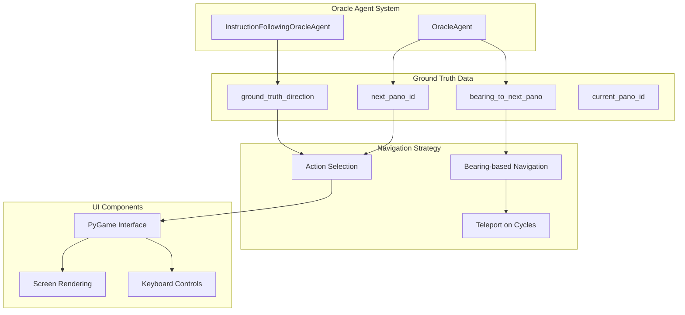
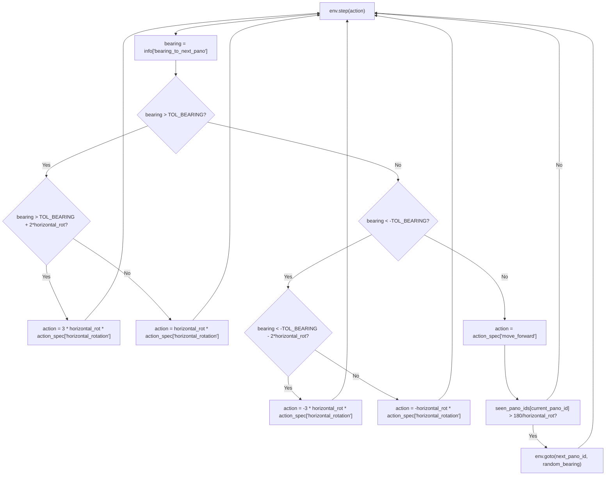
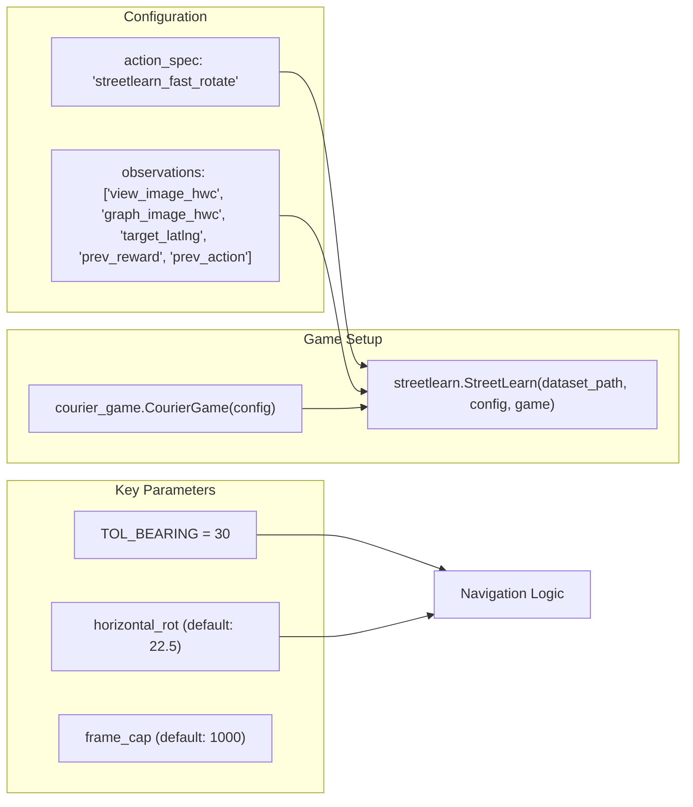
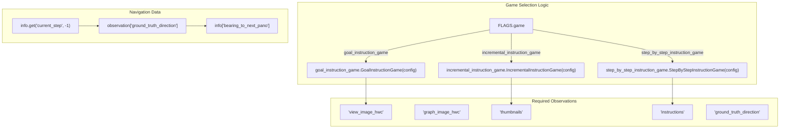
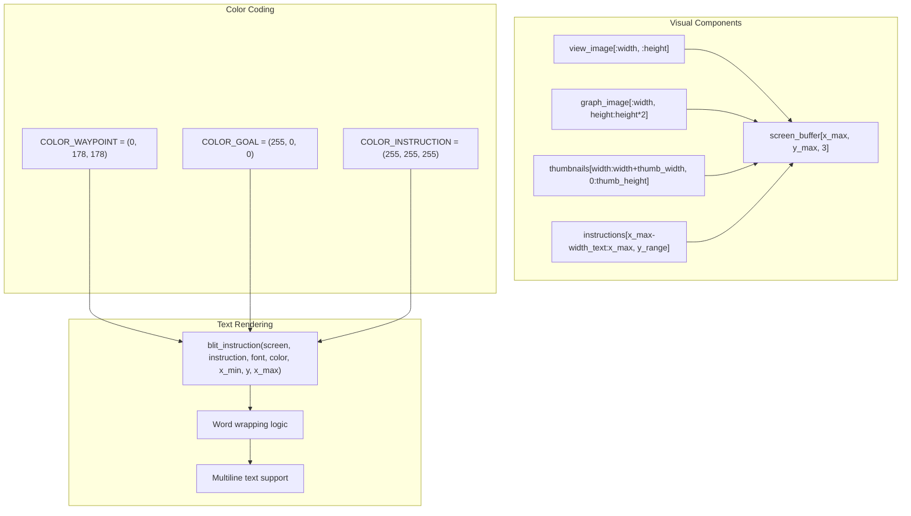
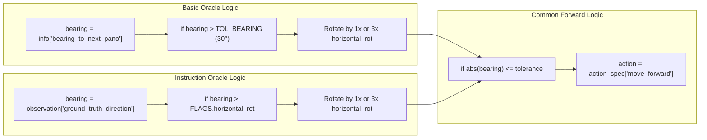
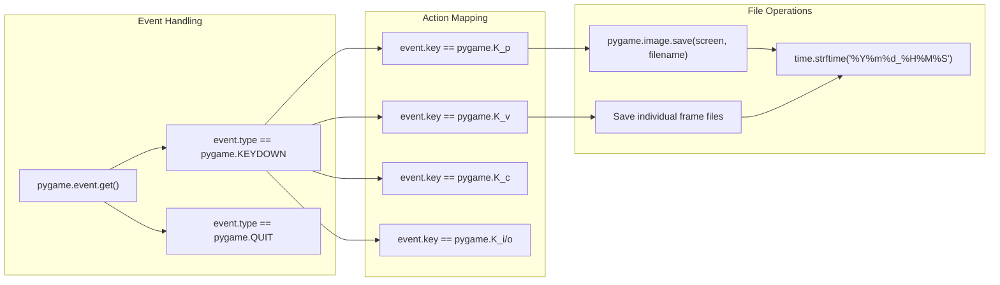
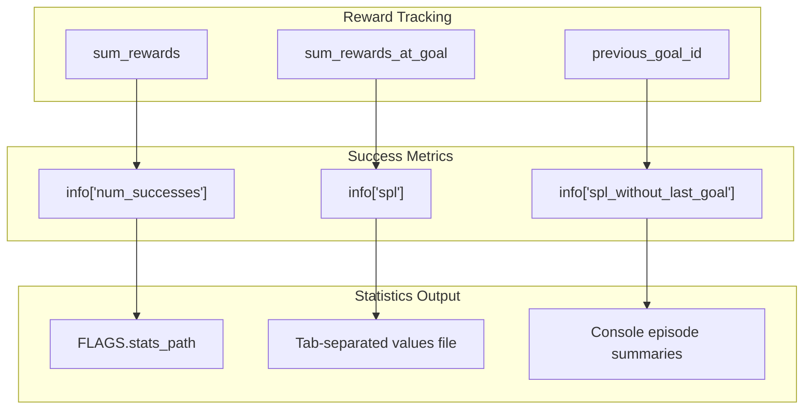

<!-- source: DeepWiki mcp.deepwiki.com · repo google-deepmind/streetlearn · page 4.2 Oracle Agents · fetched 2026-10-26 -->

# Oracle Agents

Relevant source files

The following files were used as context for generating this wiki page:

- [streetlearn/python/ui/instruction_following_oracle_agent.py](streetlearn/python/ui/instruction_following_oracle_agent.py)
- [streetlearn/python/ui/oracle_agent.py](streetlearn/python/ui/oracle_agent.py)

This document covers Oracle Agents in StreetLearn, which are baseline agents that use perfect knowledge of the environment for navigation. These agents serve as upper bounds for performance evaluation and provide reference implementations for testing navigation algorithms. For information about neural network-based learning agents, see [AI Learning Agents](#4.1). For human-controlled and utility agents, see [Interactive Agents](#4.3).

## Overview

Oracle agents leverage ground truth information from the StreetLearn environment to achieve optimal navigation performance. Unlike learning agents that must discover navigation strategies through trial and error, oracle agents have access to perfect information such as optimal paths, bearings to targets, and complete graph connectivity. This makes them valuable for establishing performance baselines and validating environment correctness.

The system provides two main oracle agent implementations:

| Agent Type | Primary Use Case | Game Compatibility |
|------------|------------------|-------------------|
| `OracleAgent` | Basic navigation tasks | `CourierGame` |
| `InstructionFollowingOracleAgent` | Instruction-guided navigation | Instruction games |

Sources: [streetlearn/python/ui/oracle_agent.py:1-200](), [streetlearn/python/ui/instruction_following_oracle_agent.py:1-234]()

## Basic Oracle Agent

The `OracleAgent` implementation provides fundamental oracle navigation capabilities using bearing-based pathfinding. It accesses ground truth navigation information through the environment's info dictionary and implements a simple but effective navigation strategy.

### Core Navigation Logic

The agent uses a tolerance-based bearing navigation system centered around the `TOL_BEARING` constant:

The navigation algorithm implements anti-cycling logic by tracking panorama visit counts and teleporting when excessive revisits are detected, preventing infinite loops in complex graph topologies.

Sources: [streetlearn/python/ui/oracle_agent.py:127-169]()

### Action Specification and Configuration

The oracle agent uses the `streetlearn_fast_rotate` action specification and configures specific observations required for ground truth navigation:

Sources: [streetlearn/python/ui/oracle_agent.py:171-192](), [streetlearn/python/ui/oracle_agent.py:53]()

## Instruction Following Oracle Agent

The `InstructionFollowingOracleAgent` extends oracle capabilities to instruction-guided navigation tasks. It supports multiple instruction-based games and provides enhanced visualization for multi-step navigation scenarios.

### Game Compatibility

The instruction oracle agent supports three specialized instruction games:

| Game Class | Description | Key Features |
|------------|-------------|--------------|
| `GoalInstructionGame` | Single goal instruction | Basic instruction following |
| `IncrementalInstructionGame` | Step-by-step waypoints | Progressive instruction reveal |
| `StepByStepInstructionGame` | Detailed step guidance | Granular navigation steps |

Sources: [streetlearn/python/ui/instruction_following_oracle_agent.py:206-216](), [streetlearn/python/ui/instruction_following_oracle_agent.py:201-203]()

### Enhanced Visualization System

The instruction oracle provides sophisticated visual feedback including instruction text rendering, thumbnail displays, and progress indicators:

Sources: [streetlearn/python/ui/instruction_following_oracle_agent.py:134-166](), [streetlearn/python/ui/instruction_following_oracle_agent.py:67-69](), [streetlearn/python/ui/instruction_following_oracle_agent.py:72-85]()

## Navigation Strategy Implementation

Both oracle agents implement bearing-based navigation but with different ground truth sources and precision requirements. The core strategy involves angular alignment followed by forward movement, with anti-cycling mechanisms for robust navigation.

### Bearing Calculation and Action Selection

The navigation logic differs between the two oracle implementations:

| Agent Type | Bearing Source | Tolerance | Action Strategy |
|------------|----------------|-----------|-----------------|
| Basic Oracle | `info['bearing_to_next_pano']` | `TOL_BEARING = 30` | Multi-speed rotation |
| Instruction Oracle | `observation['ground_truth_direction']` | `FLAGS.horizontal_rot` | Incremental rotation |

Sources: [streetlearn/python/ui/oracle_agent.py:140-156](), [streetlearn/python/ui/instruction_following_oracle_agent.py:119-131]()

## UI Integration and Control Interface

Oracle agents provide interactive PyGame-based interfaces for manual control, visualization, and data collection. The UI systems support real-time observation display, screenshot capture, and video recording capabilities.

### Control Schemes and Interaction

Both agents implement similar keyboard control schemes for user interaction:

| Key | Function | Implementation |
|-----|----------|----------------|
| `ESC` | Exit application | `pygame.K_ESCAPE` |
| `P` | Save screenshot | `pygame.image.save()` |
| `V` | Start video recording | Toggle `save_video = True` |
| `C` | Stop video recording | Toggle `save_video = False` |
| `I/O` | Zoom in/out | Map zoom actions (Basic Oracle only) |

Sources: [streetlearn/python/ui/oracle_agent.py:68-86](), [streetlearn/python/ui/instruction_following_oracle_agent.py:168-176]()

## Usage Patterns and Performance Metrics

Oracle agents serve multiple purposes in the StreetLearn ecosystem, from baseline establishment to debugging and demonstration. They track comprehensive performance metrics and support various evaluation scenarios.

### Performance Tracking and Statistics

Both oracle implementations track detailed navigation statistics:

The agents output comprehensive episode statistics including Success-weighted Path Length (SPL) metrics, which provide standardized navigation performance evaluation comparable across different agent implementations.

Sources: [streetlearn/python/ui/oracle_agent.py:105-126](), [streetlearn/python/ui/instruction_following_oracle_agent.py:91-108]()

---

